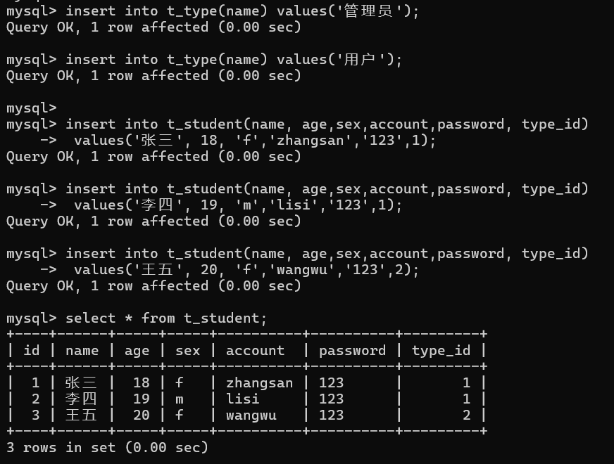
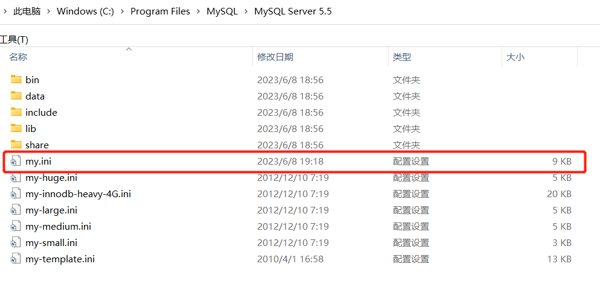
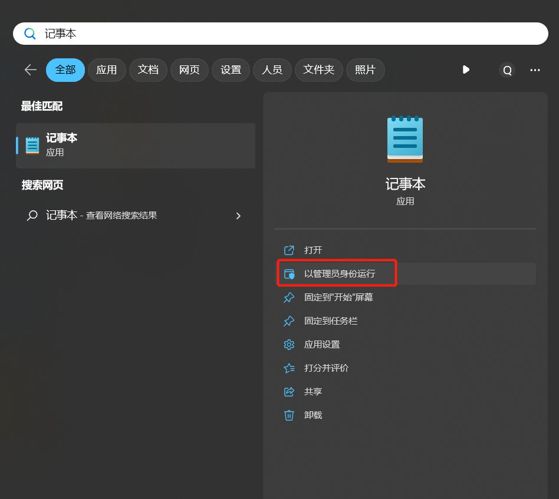
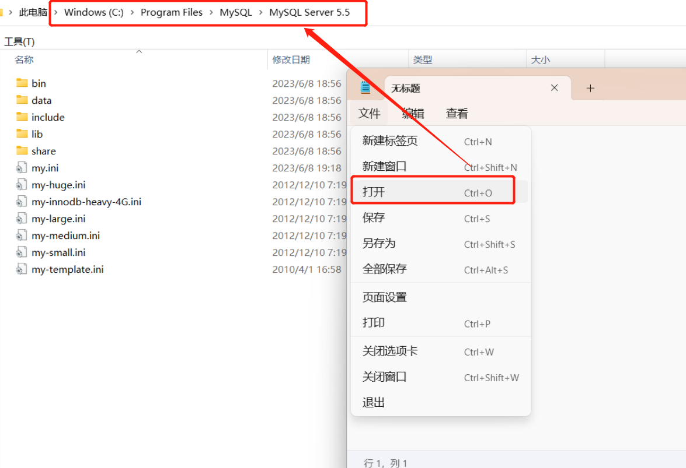
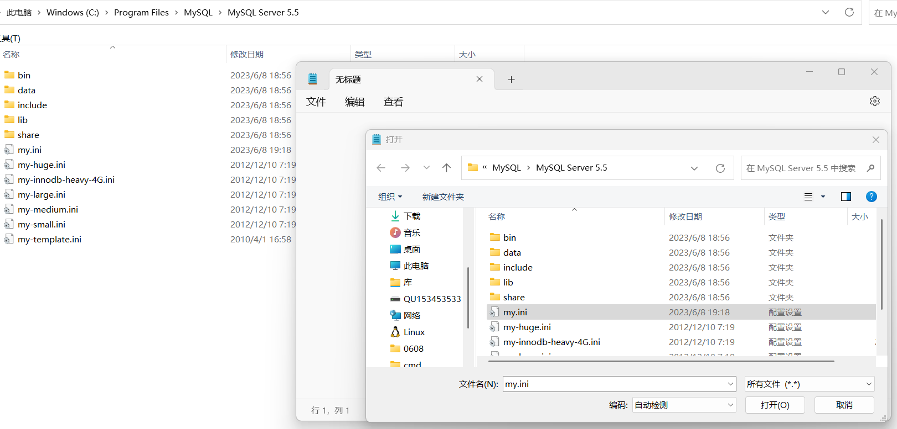
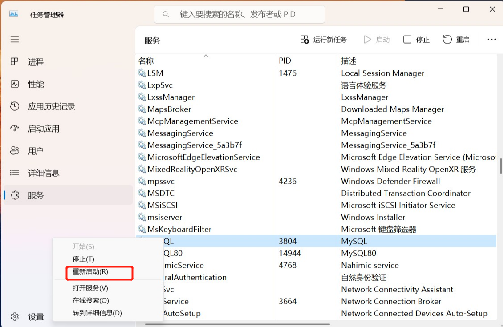

# 字节流动

#### 查看修改Window CMD编码

```powershell
C:\Users\Qingyuan_Qu>chcp
活动代码页: 936 

C:\Users\Qingyuan_Qu>chcp 65001
Active code page: 65001

# 936 GBK
# 65001 UTF-8
```

#### MySQL支持的字符集

```mysql
mysql> show charset;
+----------+-----------------------------+---------------------+--------+
| Charset  | Description                 | Default collation   | Maxlen |
+----------+-----------------------------+---------------------+--------+
| big5     | Big5 Traditional Chinese    | big5_chinese_ci     |      2 |
| latin1   | cp1252 West European        | latin1_swedish_ci   |      1 |
| latin2   | ISO 8859-2 Central European | latin2_general_ci   |      1 |
| ascii    | US ASCII                    | ascii_general_ci    |      1 |
| gb2312   | GB2312 Simplified Chinese   | gb2312_chinese_ci   |      2 |
| gbk      | GBK Simplified Chinese      | gbk_chinese_ci      |      2 |
| utf8     | UTF-8 Unicode               | utf8_general_ci     |      3 |
| utf8mb4  | UTF-8 Unicode               | utf8mb4_general_ci  |      4 |
| utf16    | UTF-16 Unicode              | utf16_general_ci    |      4 |
| utf32    | UTF-32 Unicode              | utf32_general_ci    |      4 |
| binary   | Binary pseudo charset       | binary              |      1 |
+----------+-----------------------------+---------------------+--------+
39 rows in set (0.00 sec)
```


#### 字节流动

| 场景                                   | 默认字符集                                                 |
| -------------------------------------- | ---------------------------------------------------------- |
| `Windows`                              |                                                            |
| Windows Command Line                   | 默认 GBK                                                   |
| `MySQL 5.5`                            |                                                            |
| MySQL 5.5  Command Line Client         | 默认GBK                                                    |
| character_set_client                   | latin1                                                     |
| character_set_connection               | latin1                                                     |
| character_set_database                 | latin1                                                     |
| character_set_filesystem               | latin1                                                     |
| character_set_results                  | latin1                                                     |
| character_set_server                   | latin1                                                     |
| character_set_system                   | utf8                                                       |
|                                        |                                                            |
| set names utf8;                        | 仅当次生效，修改client, connection, result;                |
| create database a default charset utf8 | database                                                   |
| my.ini                                 | 重启service生效                                            |
| `Java`                                 | 如果不显示指定，Java默认是UTF-8                            |
|                                        |                                                            |
| `JSP`                                  |                                                            |
| contentType="text/html; charset=UTF-8" | 服务器和客户端传输的内容的编码                             |
| pageEncoding="UTF-8"                   | JSP文本文件的编码                                          |
| requests                               | latin-1                                                    |
| response                               | latin-1                                                    |
| `HTML`                                 |                                                            |
| content="text/html; charset=UTF-8"     | 告知浏览器此页面的字符编码                                 |
| `Eclipse`                              |                                                            |
| Workspace                              | Window - Preferences - Workspace - Text file encoding      |
| Project                                | Project(右键) - properties - Resource - Text file encoding |
| File                                   | File(右键) - properties - Resource - Text file encoding    |
| `浏览器`                               |                                                            |
| 有的360浏览器可以右键选择网页编码      |                                                            |


### `MySQL 5.5`

#### 解决办法1

在 `MySQL command line client`默认使用的是`Windows CMD`的编码，即 `GBK`；

如果不修改`MySQL`各种字符集，如数据库、表都使用默认`latin1`字符集；

```sql
create database mybatis2;
use mybatis2;
drop table if exists t_student;
drop table if exists t_type;

create table t_type(
    id int(11) primary key auto_increment,
    name varchar(20) not null
);

create table t_student(
    id int(11) primary key auto_increment,
    name varchar(20) not null,
  	age tinyint(4) not null,
  	sex char(1) not null,
  	account varchar(16) not null,
  	password varchar(64) not null,
  	type_id int(11) not null,
    foreign key(type_id) references t_type(id)
);

insert into t_type(name) values('管理员');
insert into t_type(name) values('用户');

insert into t_student(name, age,sex,account,password, type_id)
	values('张三', 18, 'f','zhangsan','123',1);
insert into t_student(name, age,sex,account,password, type_id)
	values('李四', 19, 'm','lisi','123',1);
insert into t_student(name, age,sex,account,password, type_id)
	values('王五', 20, 'f','wangwu','123',2);
```

完全可以在`MySQL command line client`中执行包含中文字符的`SQL`语句；因为`CMD`会将中文字符使用`GBK`编码为字节流，此时`MySQL`会把它当作`latin1`字节流保存到数据库中；



当使用`Java`查询数据库时，注意将包含中文的字段，使用`latin1`读取字节流，然后使用 `GBK`解码；

```java
while(rs.next()){
    s = new Student();
    s.setId(rs.getInt("id"));
    s.setName(new String(rs.getString("name").getBytes("latin1"),"gbk"));
    s.setAge(rs.getInt("age"));
    s.setSex(rs.getString("sex"));
    s.setAccount(rs.getString("account"));
    s.setPassword(rs.getString("password"));
    s.setTypeId(rs.getInt("type_id"));
    studentList.add(s);
}
```

这种方式有个优点，`utf8`单字符最大可占字节数为`3`，`latin1`字节集中一个字符仅需要一个字节的空间；节省了MySQL的存储空间。

#### 解决办法2

##### `MySQL`的配置文件 `my.ini`




##### 以管理员方式打开该文件

修改该文件需要管理员权限，使用管理员权限启动记事本，然后在记事本中打开该文件进行修改。







##### 修改两个配置项

```shell
default-character-set=utf8
character-set-server=utf8
```


##### 重启MySQL服务

同时按住 `Ctrl+Alt+Delete`启动任务管理器。



##### MySQL 5.5自带客户端的字符集为GBK

但是插入数据还是会出现问题，

```sql
mysql> insert into t_type(name) values('啊命');
ERROR 1366 (HY000): Incorrect string value: '\xB0\xA1\xC3\xFC' for column 'name' at row 1
```

这是因为：GBK的编码中文是双字节，utf-8的中文是三字节。使用默认客户端插入中文数据时，会将中文字符转为GBK编码，但是client的字符集为UTF8。

##### 支持Unicode的客户端

可以尝试使用支持`Unicode`的客户端进行数据的查询插入，如：

- MySQL 8.0 Command Line Client - Unicode
- Navicat
- 在Windows CMD中使用chcp切换字符集，然后启动MySQL client 该方法不可行。

