# 直方图：从数学原理到 matplotlib 实现

直方图（Histogram）是描述**连续型数据分布**最基础的统计图形。本文先讲清它的数学原理（分箱、频数、频率密度、组数选择），再用 matplotlib 把它画出来。

**全文只用一份例子：某公司 2000 名员工的「单程通勤耗时」（单位：分钟）。** 之所以选它——通勤时间人人有体感，多数人集中在半小时上下，少数人赶上堵车能一路拖到一个半小时；而"分钟"又是地道的连续量，天然适合切段。后面所有图都取自这一批数据，读者不必在若干组陌生数字之间来回切换。

## 1 数学概念与原理

### 1.1 什么是直方图

给定 $n$ 个观测值 $x_1, x_2, \dots, x_n$，直方图的构造逻辑是三步：

1. 把数据的取值范围切分成若干**互不重叠的区间**（称为 **bin**，中文叫"组"或"箱"）；
2. 数一数每个区间里落了多少个观测值（**频数**）；
3. 用矩形的**高度**（或面积）表示这个数。

<!--begin-->

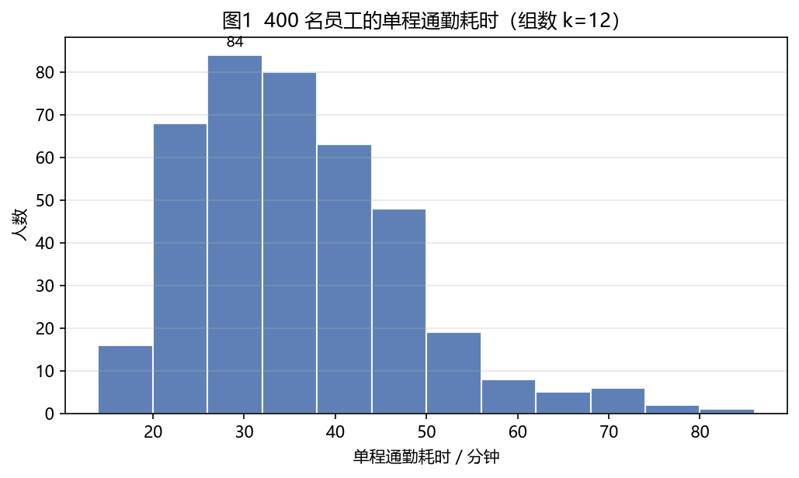

<!--split-->

把 400 名员工的通勤耗时从 14 分钟排到 86 分钟，按每 6 分钟划一段，数出每段里塞了多少人，就是上图——最高的一段落在 26~32 分钟，挤了 84 人。
它回答的问题很实在：**这些人大多路上要花多久？有没有一小撮人每天在路上苦熬？**

> 可以先建立一个类比：直方图之于数据，就像"人口密度"之于地图。
> 地图不关心某个具体的人住哪，只关心"每平方公里挤了多少人"；
> 直方图也不关心某个人的通勤时间，只关心"每单位时间区间里挤了多少人"。
> "密度"这个词在 1.5 节会正式登场。

<!--end-->

### 1.2 直方图 vs 柱状图：本质区别

两者长得像，但横轴语义完全不同，这是初学者最容易混淆的点。拿同一批通勤数据分别画出来对比：

|              | 柱状图（bar chart）                    | 直方图（histogram）                     |
| ------------ | -------------------------------------- | --------------------------------------- |
| 横轴         | **离散类别**（地铁、自驾、公交…）      | **连续数值**被切成的区间（15~30 分钟…） |
| 柱子之间     | 有间隙（类别无顺序、无连续性）         | 相连无间隙（区间首尾相接）              |
| 柱子可否重排 | 可以（按人数排序是常见做法）           | 不可以（区间顺序固定）                  |
| 高度含义     | 该类别的某个度量值（该通勤方式的人数） | 落入该区间的频数/频率密度               |

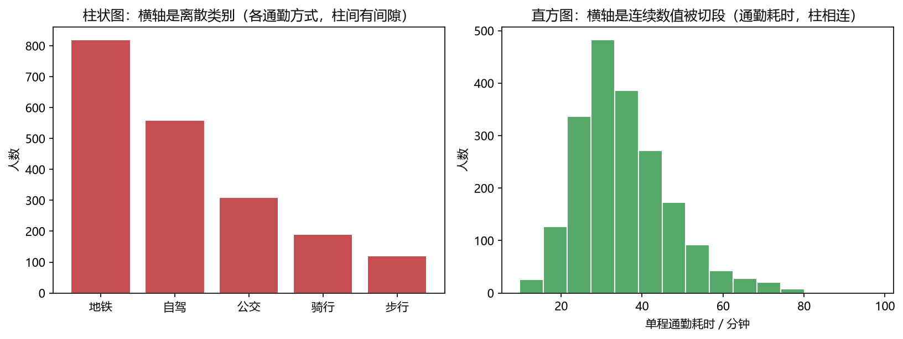

左图里"地铁 820 人、自驾 560 人"，把地铁和自驾调个位置完全不影响阅读，因为通勤方式本来就没有先后之分。
右图不行：相邻两段必须首尾相接，"20 多分钟"天然挨着"30 分钟出头"，谁也不会把"20 分钟"和"60 分钟"摆成相邻的两根柱子。

一句话：**柱状图比较"类别"，直方图展示"分布"**。

### 1.3 构造一个直方图：分箱四步

设样本 $x_1,\dots,x_n$，构造步骤：

1. **求极差**：$R = \max(x_i) - \min(x_i)$ —— 这批通勤数据里最快的 9.8 分钟、最慢的 97.7 分钟，$R = 87.9$ 分钟
2. **定组数 $k$（或组距 $h$）**：等宽分箱时 $h = R / k$，二者定一个即可推出另一个 —— 取 $k=12$，则 $h = 87.9/12 \approx 7.3$ 分钟
3. **定边界**：$a_0 = \min,\ a_1 = a_0+h,\ \dots,\ a_k = \max$，通常约定**左闭右开** $[a_{j}, a_{j+1})$，最后一个区间闭（这样每个点归属唯一，不会重复计数）
4. **计数**：$n_j = \#\{i : a_j \le x_i < a_{j+1}\}$，以 $n_j$ 为高、$h$ 为宽画矩形 —— 数出每段里塞了多少人

所谓"分箱"，就是把一把**连续的量尺**（分钟）换成一张**印刷好的成绩单**：上面只有有限的几栏，每个人必须落进其中一栏。第 3 步的"左闭右开"正是为了避免"刚好 30 分钟整的人被数两次"这类扯皮——约定好边界归右边那栏，每人只投一次票。

> 上面 $R = 87.9$ 是按**全员 2000 人**算的；图 1 只取了其中 400 人，他们的极差是 86.0 − 14.0 = 72.0 分钟，取 12 组后组距恰好 6.0 分钟——所以两处刻度不会完全一样。换个批次的人来看，分箱结果本就该有些出入，这一点值得留意。

matplotlib 的默认行为就是这套约定（见 2.2 节 `bins` 与边界归属）。

### 1.4 组数怎么选：从经验法则到 Freedman–Diaconis

组数 $k$ 是直方图最重要的超参数，它直接决定图形的"平滑度"：

- $k$ 太小 → 组距太宽，**过度平滑**：好比用"1 小时一档"来登记通勤时间，所有人都被塞进"半小时以内""半小时到一小时半"，分布的真实形状被抹平；
- $k$ 太大 → 组距太窄，**噪声放大**：好比精确到"每 1 分钟一档"，每档只剩三五个人，柱子高高低低全是随机起伏，看不出规律。

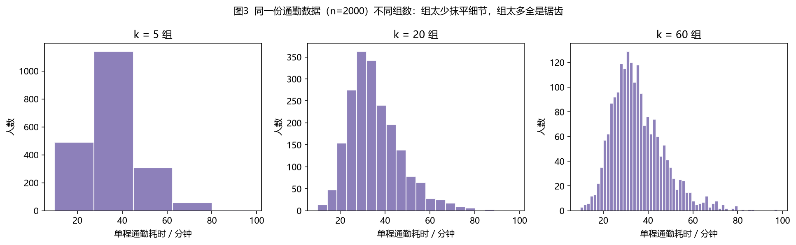

同一份通勤数据（$n=2000$）：$k=5$ 时几乎成了一个"梯形"，具体在哪一分钟最挤根本看不出来；$k=60$ 时处处是锯齿。实践中常用以下经验公式作为**起点**（不是终点，最终要结合领域知识微调）：

| 规则                  | 公式                                                    | 特点                                     |
| --------------------- | ------------------------------------------------------- | ---------------------------------------- |
| √n 法则               | $k = \lceil \sqrt{n} \rceil$                            | 最简单，样本大时偏多                     |
| Sturges               | $k = \lceil 1 + \log_2 n \rceil$                        | 假设数据近似正态，大样本时偏少           |
| Rice                  | $k = \lceil 2 n^{1/3} \rceil$                           | 折中                                     |
| **Freedman–Diaconis** | $h = 2\,\mathrm{IQR}\, n^{-1/3}$，$k=\lceil R/h \rceil$ | 用四分位距 IQR，**对异常值稳健**，最推荐 |

其中 IQR = Q3 − Q1，**即第 75 百分位减第 25 百分位——也就是「中间一半人」的通勤时间跨度**，衡量的是「典型中间那群人挤得多紧」，刻意不看来两端的极值。

把 IQR 和极差对照着看：全员从最快到最慢横跨 $R=87.9$ 分钟，可中间 50% 的人只占 $14.61$ 分钟——这 73 分钟的落差，几乎全是右侧那几个极长通勤者拉出来的（这「中间紧、尾巴长」的落差本身就是右偏的指纹）。FD 偏偏挑 IQR，图的就是它**对异常值稳健**：若改用极差或标准差来定组距，那几个动辄一个半小时的极端值会把「散布程度」撑大，组距被迫变宽，把最该看清的密集中段糊掉；IQR 只盯中间一半，尾巴再长也骗不到它。

**用本教案的通勤数据实算一遍**（$n=2000$）：

- Sturges：$\lceil 1+\log_2 2000 \rceil = \lceil 1+10.97 \rceil = 12$
- √n：$\lceil \sqrt{2000} \rceil = \lceil 44.72 \rceil = 45$
- Freedman–Diaconis：先取 IQR ≈ 14.61 分钟，则 $h = 2 \times 14.61 / 2000^{1/3} \approx 2.320$，$k = \lceil 87.9/2.320 \rceil = 38$

三者给出的 $k$ 差异不小（**12 / 38 / 45**）。为什么 FD 挑出 38 组、比 Sturges 的 12 组多了两倍？因为它只看中间那 50% 的人挤得有多紧（IQR 只有 14.61 分钟，远小于跨度 87.9 分钟）。通勤数据的真实面貌正是"中间挤成一团、右侧拖条长尾"，用 12 组会把最关键的"挤"糊成一片——这也解释了为什么**对大样本、非正态的日常数据，Sturges 常常偏少**。经验公式只给量级参考，画图时应多试几组对比。

### 1.5 纵轴的三种取法：频数、频率、频率密度

同一份数据，纵轴有三种常见画法，含义不同：

<!--begin-->

| 纵轴         | 计算             | 面积含义                                         |
| ------------ | ---------------- | ------------------------------------------------ |
| 频数         | 直接计数值 $n_j$ | 矩形面积之和 $= h \times n$（组距=1 时才等于 n） |
| 频率         | $f_j = n_j / n$  | 面积之和 $= h$（组距=1 时才等于 1）              |
| **频率密度** | $f_j / h$        | **矩形面积之和 = 1**，可视为概率密度估计         |

<!--split-->

**为什么要"频率密度"**：只有把高度除以组距，才能保证"矩形面积 = 落入该区间的概率"，进而整张图总面积为 1。这样直方图就和概率密度函数（PDF）站在了同一量纲上，可以叠加理论曲线比较（见 2.7 节）。

> **预告**：以上换算只在"等距分箱"时可以直接看高度，一旦各组宽度不等，**高度就不能直接比了**——见 1.5.1。

<!--end-->

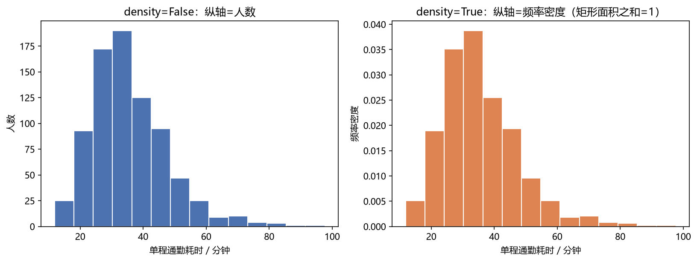

上图左：纵轴是人数（频数），矩形面积之和 = 4902.74（= 组距 6.1284 × 800 人，实算验证）；右：`density=True` 后纵轴变成频率密度，矩形面积之和 = 1.0000（实算验证）。

### 1.6 直方图能读出什么：形状、偏态与峰态

直方图的价值在于"一眼看出分布特征"：

- **对称性**：左右大致镜像（如正态分布）→ 对称；右尾长 → **右偏（正偏）**；左尾长 → 左偏。
- **峰度**：中间尖不尖、尾巴厚不厚（相对正态而言）。
- **多峰**：出现两个以上峰，往往提示数据混合了多个总体。
- **异常值**：远离主体的孤立柱。

拿通勤数据逐条对上：这 1500 人的图（见 2.7 节）是一个**明显的右偏分布**——主峰在 30 分钟附近，右侧却拖着一条长尾，一直到 90 分钟以上才散尽。实算的三个数字正好互相印证：

| 统计量 | 实测值     | 说明                   |
| ------ | ---------- | ---------------------- |
| 均值   | 35.59 分钟 | 被右尾"拉"高了         |
| 中位数 | 33.59 分钟 | 一半人在 33.6 分钟内到 |
| 偏度   | ≈ 1.00     | 明显右偏（正态为 0）   |

**均值比中位数高了整整 2 分钟**，这正是右偏的指纹：少数通勤极长的人能把平均值拽上去，却动不了中位数。所以讨论"大家一般路上花多久"，报**中位数 33.6 分钟**比均值 35.6 分钟更贴合多数人的体感；而核算"公司每天总共消耗多少通勤时间"时，才该用均值。

"多峰"同理很日常：如果把"地铁党"和"自驾党"混在一张图里，很可能看出两个鼓包——这不是数据怪，而是**两个群体被搅在了一起**，说明该分组分析了（见 2.6 节）。

### 1.7 局限与延伸：直方图 vs 核密度估计

直方图本质是**分段常数**的密度估计：每个 bin 内密度视为恒定。这带来两个固有缺陷：

1. **不光滑**——形状强烈依赖 bin 边界的位置。同一批 800 人的数据，若分箱从 10 分钟起算，"最挤的一段"是 `[28, 34)`（194 人）；只把起点挪到 13 分钟，"最挤的一段"就变成了 `[25, 31)`（191 人）。**同一份数据、同一个宽度，只因起点挪了 3 分钟，给出来的结论区间就整体平移了**——写报告时若把边界当成"客观事实"来引用，就危险了；
2. **边界突变**——密度在 bin 边界处不连续，而真实分布往往是光滑的。通勤时间本来就是连续变化的，硬切出一刀刀台阶属于"人为的粗鲁"。

针对这两条缺陷的改进思路很自然：既然直方图把**离散样本**"整块投进某一栏"、再用台阶拼出一条"假连续"，那就反过来——**先把离散样本本身连续化**：不把每个人硬塞进一个格子，而是让他在自己所在的位置向两侧温柔地扩散开。

**核密度估计（KDE）的目的正是这件事**：把每个样本点替换成一个光滑的小"核"（如高斯核），叠加并归一后得到一条处处连续的密度曲线——离散点由此被"抹"成连续函数。两者是同一目标（估计未知密度 $f(x)$）的两种做法：直方图给出**分段常数的准连续近似**，KDE 给出**光滑的连续近似**；KDE 更光滑，但也引入了带宽（bandwidth）这个新的超参数——带宽之于 KDE，正如组数之于直方图。

### 1.8 正态分布：一条只用两个数定死的钟形

前面反复拿"正态"当参照（1.4 的 Sturges 假设、1.6 的对称与峰态），这里把它本身补上。**正态（也叫高斯）分布只由两个参数决定**——均值 $\mu$ 和标准差 $\sigma$，记作 $X\sim\mathcal{N}(\mu,\sigma^2)$，其概率密度为
<!-- begin 30:70-->

$$f(x)=\frac{1}{\sigma\sqrt{2\pi}}\exp\!\left(-\frac{(x-\mu)^2}{2\sigma^2}\right)$$
<!-- split -->

- **$\mu$（均值）= 中心位置**。曲线关于 $x=\mu$ 左右对称，峰就立在 $\mu$ 上。
- **$\sigma>0$（标准差）= 展布宽度**。$\sigma$ 越大越矮胖、越小越瘦高；峰高恰为 $\dfrac{1}{\sigma\sqrt{2\pi}}$——宽度与高度**反向联动**，因为曲线下**总面积恒为 1**（概率密度的通性）。
- **$(\mu,\sigma)$ 两个数就定死了整条曲线**：它必然是**单峰且对称**的。这既是它的简洁之处，也是它的软肋——一旦数据右偏（如 1.6 的通勤数据）或本就双峰，再怎么调 $\mu,\sigma$ 也套不上去，这正是 2.7 节红色正态曲线"错位"的根源。

<!--end-->

$\mu=0,\sigma=1$ 的特例叫**标准正态**，密度写作

$$\phi(u)=\frac{1}{\sqrt{2\pi}}e^{-u^2/2}$$

它正是 2.7 节 KDE 所用的**高斯核**：KDE 把它的自变量换成 $u=(t-x_i)/h$，就得到"以样本 $x_i$ 为中心、标准差为 $h$ 的小山包"（推导见 2.7）。**"正态"与"高斯"是一回事，但 KDE 用高斯核并不代表假设数据服从正态**——它只是借用这个钟形，当作把每个样本点"抹平"的刷子。

#### 1.8.1 用 matplotlib把它画出来

纸上公式落到代码，就是"按 $x$ 取一串点、逐点算密度、再连成线"三件事：

```python
mu, sigma = 30, 8                                   # 中心 30 分钟、展布 8 分钟
x = np.linspace(mu - 4*sigma, mu + 4*sigma, 400)    # 取 ±4σ 已足够覆盖钟形
# 把 1.8 节的 PDF 公式逐字翻译：1/(σ√2π) · exp(-(x-μ)²/(2σ²))
f = 1/(sigma*np.sqrt(2*np.pi)) * np.exp(-(x - mu)**2 / (2*sigma**2))

plt.plot(x, f, 'k-', lw=2)                          # 连成钟形曲线
plt.axvline(mu, color='#C44E52', lw=1.5, label=r'$\mu$（中心）')
plt.axvline(mu - sigma, color='gray', ls='--', lw=1)
plt.axvline(mu + sigma, color='gray', ls='--', lw=1, label=r'$\mu\pm\sigma$（展布）')
plt.legend(fontsize=8); plt.grid(alpha=0.3); plt.show()
```

红线标出中心 $\mu$，两条灰虚线标出 $\mu\pm\sigma$ —— 一眼能看出"$\mu$ 管钟摆在哪里、$\sigma$ 管钟有多胖"。注意 $\sigma$ 越大曲线越矮（还记得峰高是 $1/(\sigma\sqrt{2\pi})$ 吗？面积守恒逼着它变矮）。这里用一组干净的 $(\mu,\sigma)=(30,8)$ **单独画形状**；2.7 节会把 $(\mu,\sigma)$ 换成通勤数据的均值/标准差，去套那条"套不上的"红线。

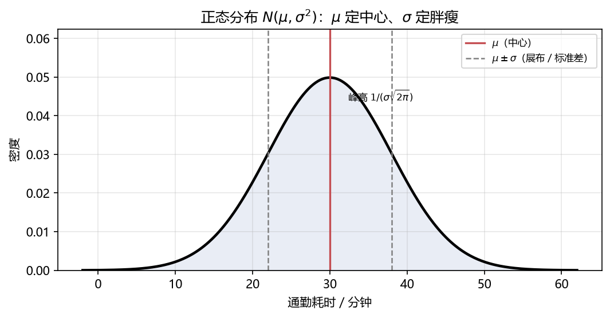

## 2 用 matplotlib 绘制直方图

### 2.1 环境准备与最小示例

matplotlib 默认字体不含中文，在 Windows 上先设成微软雅黑（否则标题/标签全是方块）：

```python
import matplotlib.pyplot as plt
plt.rcParams['font.sans-serif'] = ['Microsoft YaHei']  # Windows 中文字体
plt.rcParams['axes.unicode_minus'] = False             # 修复负号显示为方块
```

最小的直方图只需一行 `plt.hist`：

```python
import numpy as np
import matplotlib.pyplot as plt

plt.rcParams['font.sans-serif'] = ['Microsoft YaHei']
plt.rcParams['axes.unicode_minus'] = False

rng = np.random.default_rng(20260920)

commute = rng.lognormal(np.log(34), 0.32, 2000)
x = commute[:400]        # 先从全员里抽 400 人来看，对应图1

counts, edges, patches = plt.hist(x, bins=12, edgecolor='white')
plt.show()
print(counts)   # 各组人数，长度 = 组数
print(edges)    # 各组边界，长度 = 组数 + 1
```

2000 名员工的单程通勤耗时（分钟）。用对数正态生成：它把正态的钟形只取右半边
再往右拉长，正好对应"通勤有下限（不可能 0 分钟）、没有上限、偶有极端值"的现实。

`plt.hist` 返回三个对象，后面做二次加工（如叠加曲线）时非常有用：

- `counts`：每个 bin 的人数（若 `density=True` 则是密度值）
- `edges`：bin 边界数组，长度比组数多 1
- `patches`：每个矩形的图形对象列表（可用来单独改颜色等）

> 这段代码生成的正是图 1：`counts` 里最大的那个数是 84，对应 26~32 分钟那一栏——也就是"公司里路上花半小时的人最多"。

### 2.2 关键参数一览

`plt.hist(x, bins=10, range=None, density=False, histtype='bar', cumulative=False, ...)` 的常用参数：

| 参数                            | 作用                                                           | 常用取值                                             |
| ------------------------------- | -------------------------------------------------------------- | ---------------------------------------------------- |
| `bins`                          | 组数（int）或**自定义边界**（sequence）或**内置规则名**（str） | `20`、`[0,15,30,45,60]`、`'fd'`                      |
| `range`                         | 只统计该区间内的数据，之外的丢弃                               | `(0, 120)`，即"120 分钟以上的人先不管"               |
| `density`                       | `False`=频数；`True`=频率密度（面积和为 1）                    | 画分布对比时用 `True`                                |
| `histtype`                      | 直方图类型                                                     | `'bar'` / `'barstacked'` / `'step'` / `'stepfilled'` |
| `cumulative`                    | 累积直方图                                                     | `True` 或 `-1`（反向累积）                           |
| `color` / `edgecolor` / `alpha` | 填充色 / 边框色 / 透明度                                       | 美化用                                               |
| `label`                         | 图例文字                                                       | 配合 `plt.legend()`                                  |
| `orientation`                   | 方向                                                           | `'vertical'` / `'horizontal'`                        |

> **边界归属**：matplotlib 默认**左闭右开** `[a_j, a_{j+1})`，只有最后一个 bin 是闭区间。即恰好落在边界上的值归入**右边**那个 bin。按图 1 的刻度（14、20、26、32…），一位正好 32 分钟整到公司的员工会被记进 32~38 分钟那一栏，而不是 26~32 分钟——全公司一视同仁，谁也不多算一次。

#### 2.2.1 用 histtype 看直方图的"画法"（单组示例）

参数表里的 `histtype` 决定矩形怎么画。拿 2.1 那批通勤数据，单组情况下三种画法长这样：

```python
fig, axes = plt.subplots(1, 3, figsize=(13, 4))
for ax, ht in zip(axes, ['bar', 'step', 'stepfilled']):
    ax.hist(x, bins=12, histtype=ht, color='#4C72B0',
            edgecolor='white', alpha=0.85)
    ax.set_title("histtype='%s'" % ht)
plt.show()
```

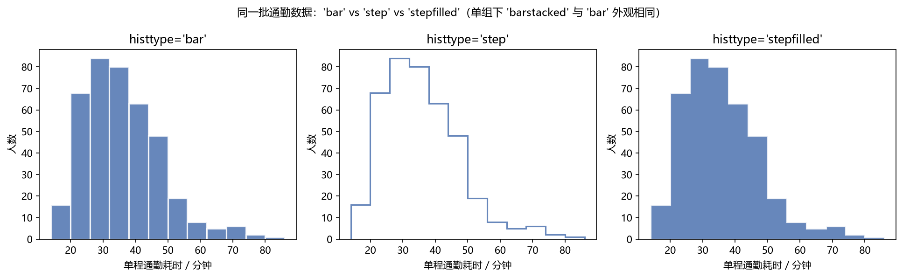

- `'bar'`：默认，实心立柱；
- `'step'`：只画**轮廓折线**（不填充），适合叠在别的图上观察分布形状。注意它的轮廓颜色由 `edgecolor` 控制（不写时回退成 `color`）；正因为没有填充，若把 `edgecolor` 设成白色，在白底上整条就看不见——本例把 step 的描边改成了可见蓝色；
- `'stepfilled'`：轮廓折线 + 填充。

注意：单组数据中 `'barstacked'` 和 `'bar'` 外观完全一样——"堆叠"只有在传入**多组数据**时才有意义（见 2.6）。所以 `histtype` 真正能拉开差异的，是"bar/barstacked（多组对比）"与"step/stepfilled（轮廓 vs 填充）"这两组。

### 2.3 频数图与密度图（density）

```python
x800 = commute[:800]        # 这次看 800 人，对应图4
fig, axes = plt.subplots(1, 2, figsize=(11, 4.2))
axes[0].hist(x800, bins=14, color='#4C72B0', edgecolor='white')
axes[0].set_title('density=False：纵轴=人数')
axes[1].hist(x800, bins=14, density=True, color='#DD8452', edgecolor='white')
axes[1].set_title('density=True：纵轴=频率密度')
plt.show()
```


左图纵轴是"多少个人"，右图纵轴是"每分钟塞多少人"。**做分布对比、叠加理论曲线时，必须用 `density=True`**：假设下周又统计了 500 人，人数图的柱子自然整体矮一截，而密度图的柱高照旧——因为它把"总共多少人"这件事除掉了。

### 2.4 自定义分组边界

`bins` 传一个序列时，它就是**边界本身**（而不是组数），支持不等距分箱——这正是 1.5.1 节那种"半小时内拆细、一小时后并档"的现实需求：

```python
edges = [0, 15, 30, 35, 40, 45, 60, 150]   # 早高峰所在区间拆细，长尾合并
plt.hist(x800, bins=edges, edgecolor='white')
plt.show()
```

也可以手动按 Sturges 公式算组数再交给 `bins`：

```python
k = int(np.ceil(1 + np.log2(len(commute))))    # Sturges → 12 组
plt.hist(commute, bins=k, edgecolor='white')
```

### 2.5 内置选 bin 规则

`bins` 也可以直接传字符串，让 matplotlib 按规则自动选组数：

```python
rules = ['sturges', 'fd', 'sqrt', 'auto']
fig, axes = plt.subplots(2, 2, figsize=(11, 7))
for ax, rule in zip(axes.ravel(), rules):
    ax.hist(commute, bins=rule, color='#64B5CD', edgecolor='white')
    ax.set_title("bins='%s'" % rule)
plt.show()
```

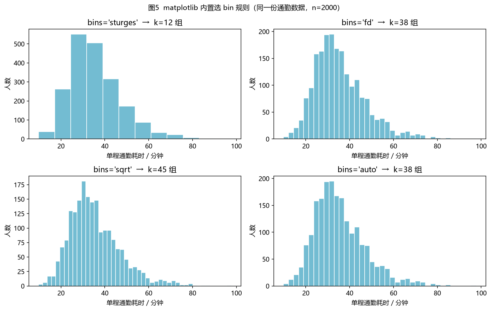

同一份通勤数据（$n=2000$），实测各规则选出的组数：

| `bins=`     | 选出的组数 $k$ | 说明                                                                     |
| ----------- | -------------- | ------------------------------------------------------------------------ |
| `'sturges'` | 12             | 对应 1.4 节公式，假设正态，所以最粗                                      |
| `'fd'`      | 38             | Freedman–Diaconis，用 IQR，对长尾不敏感                                  |
| `'sqrt'`    | 45             | √n 法则                                                                  |
| `'auto'`    | 38             | 综合启发式，等价于取 `fd` 与 `sturges` 中的较大者（本例 max(38, 12)=38） |

`'auto'` 是 matplotlib 的默认推荐，适合快速出图；要认真分析分布形状时，建议按 1.4 节的思路**多试几组 $k$ 对比**。这里 `'sturges'` 的 12 组已经明显偏粗——拿它画通勤数据，主峰和长尾会糊在一起，这也印证了 1.4 节的结论：**在非正态的日常数据上，别只信一个公式**。

### 2.6 多组数据：地铁党 vs 自驾党

把"地铁通勤"和"自驾通勤"两组人画在同一张图里，就能直接比较哪种方式更靠谱：

```python
metro = rng.lognormal(np.log(32), 0.22, 700)   # 地铁：准点，波动小
car   = rng.lognormal(np.log(41), 0.42, 700)   # 自驾：慢，堵起来没谱

# 并列：同一位置两根柱并排
plt.hist([metro, car], bins=18, histtype='bar', label=['地铁', '自驾'],
         color=['#4C72B0', '#C44E52'], edgecolor='white', alpha=0.85)

# 堆叠：同一位置两根柱叠起来
plt.hist([metro, car], bins=18, histtype='barstacked', label=['地铁', '自驾'],
         color=['#4C72B0', '#C44E52'], edgecolor='white', alpha=0.85)
plt.legend()
plt.show()
```

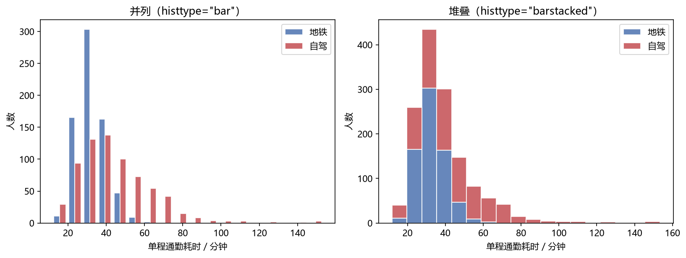

实测两组的分位数：

| 通勤方式 | 人数 | 中位数    | 90% 分位（几乎最慢的情况） |
| -------- | ---- | --------- | -------------------------- |
| 地铁     | 700  | 31.8 分钟 | 42.6 分钟                  |
| 自驾     | 700  | 41.1 分钟 | 68.2 分钟                  |

地铁的柱子又高又窄，自驾的又矮又宽——**中位数差 9 分钟，但"最慢的那 10%"差了近 26 分钟**。这正是直方图擅长而平均数会掩盖的信息：说"地铁平均快一点"没错，但真正的差别在于**自驾的方差大、风险高**。

除这两种，还常用**半透明叠加**（各自 `alpha=0.5` 直接画两条 `plt.hist`）：两组的分布一旦重叠，重合处的颜色会加深，是否"真的错开"一眼就能判断。上面的地铁 vs 自驾若这样叠，会看到地铁那一坨明显偏左、自驾那一坨又低又向右拖。

### 2.7 叠加正态曲线与核密度估计

直方图（`density=True`）和理论密度曲线同量纲，可以同框比较。对通勤数据来说，这里的看点不是"验证它像正态"，而**恰恰是看它偏离正态有多远**：

> 回顾 1.2 节的递进线：图2 左是**离散档**（柱状图，离散样本），右是**准连续**（直方图，分段常数的阶梯近似）；本节的核密度估计（KDE，图7 黑色曲线）则是**真连续**——它的目的就是把离散样本连续化：不被任何分箱边界切割，而是用一个个高斯核把每个样本点"抹"成一条光滑密度。从离散点 → 阶梯直方图 → 光滑曲线，正是"以离散逼近连续"的全过程。

```python
x1500 = commute[:1500]        # 对应图7
plt.hist(x1500, bins=30, density=True, color='#999999',
         edgecolor='white', alpha=0.6, label='直方图')

g = np.linspace(x1500.min() - 5, x1500.max() + 5, 400)
mu, sd = x1500.mean(), x1500.std(ddof=1)
plt.plot(g, 1/(sd*np.sqrt(2*np.pi)) * np.exp(-0.5*((g-mu)/sd)**2),
         'r-', lw=2, label='正态拟合曲线')
plt.legend()
plt.show()
```

跑出来会看到一件好事：**红色正态曲线明显"错位"**——它的峰被拖到 35.6 分钟（也就是均值），比真实主峰（30 分钟附近）右移了五六分钟，还矮了一截；左侧更离谱，硬生生伸出一段"20 分钟以内到公司"的曲线，而通勤耗时根本不可能为负、也很少有人能十几分钟就到。这不是画错了，而是数据本来就右偏，**硬套正态就是套不上**。相比之下，KDE 那条曲线（见下图黑虚线）能老实地贴着主峰和长尾走。

核密度估计（Kernel Density Estimation, KDE）换一个思路逼近真实密度：把每个样本点当作一个小山包，用平滑的核函数 $K$ 把 $n$ 个山包叠加、再除以 $nh$ 摊平，得到的估计量

$$\hat{f}(t)=\frac{1}{nh}\sum_{i=1}^{n}K\!\left(\frac{t-x_i}{h}\right)$$

其中 $h>0$ 叫**带宽**（bandwidth），控制曲线平滑度——$h$ 越大越平滑，$h$ 越小越贴近样本。
最常用的是**高斯核** $K(u)=\frac{1}{\sqrt{2\pi}}e^{-u^2/2}$，代入后每个样本 $x_i$ 贡献的正是以它为中心、标准差为 $h$ 的正态小山包，总面积被归一为 1。

把自变量换成 $u=\dfrac{t-x_i}{h}$ 这一步，到底"换"了什么？拆成三步看，它和 1.8 节的正态密度是一一对应的：

**① 代入：把 $u=(t-x_i)/h$ 塞进核函数**

$$K\!\left(\frac{t-x_i}{h}\right)=\frac{1}{\sqrt{2\pi}}\exp\!\left(-\frac{1}{2}\Big(\frac{t-x_i}{h}\Big)^2\right)=\frac{1}{\sqrt{2\pi}}\exp\!\left(-\frac{(t-x_i)^2}{2h^2}\right)$$

拿它和 1.8 节的正态密度 $\mathcal{N}(t;\,x_i,h^2)=\dfrac{1}{\sqrt{2\pi}\,h}\exp\!\left(-\dfrac{(t-x_i)^2}{2h^2}\right)$ 对比，二者只差一个 $h$：

$$K\!\left(\frac{t-x_i}{h}\right)=h\cdot\mathcal{N}(t;\,x_i,\,h^2)$$

**② 两个动作：$-x_i$ 负责平移，$/h$ 负责缩放**

- 分子里的 $-x_i$：**平移**——把钟形的中心从 0 挪到样本点 $x_i$；
- 分母里的 $/h$：**缩放**——把标准差从 1 拉伸到 $h$（$h>1$ 变胖、$h<1$ 变瘦）。

原型核 $K$ 的标准差是 1、面积也是 1；拉伸后宽度变成 $h$ 倍，**面积也随之变成 $h$ 倍**，所以要再除以 $h$ 把面积压回 1。于是 $\dfrac{1}{h}K\!\left(\dfrac{t-x_i}{h}\right)$ 才是**一座"面积恰为 1、中心 $x_i$、标准差 $h$"的完整正态山包**，峰高 $1/(h\sqrt{2\pi})$。

**③ 代回 KDE 公式：$1/(nh)$ 实为"除以 $h$ 归一"与"除以 $n$ 平均"两步**

$$\hat{f}(t)=\frac{1}{nh}\sum_{i=1}^{n}K\!\left(\frac{t-x_i}{h}\right)=\frac{1}{n}\sum_{i=1}^{n}\underbrace{\frac{1}{h}K\!\left(\frac{t-x_i}{h}\right)}_{\mathcal{N}(t;\,x_i,\,h^2)}$$

即**每个样本贡献 $\frac{1}{n}$ 座完整的正态山包**（面积 $1/n$），$n$ 座叠加后总面积回到 1。所以整条 KDE 曲线就是"$n$ 座小正态密度的**平均**"——**核是正态的，平均出来的形状却可以右偏、可以双峰，这并不等于假设数据服从正态**。

落到代码上，上面三步正好对应下方 `kde_eval` 里的两行（完整函数见"下面不依赖 scipy"代码块）：

- `u = (grid[:, None] - x[None, :]) / h` —— 完成 ① 的平移（$-x_i$）与缩放（$/h$）；
- `np.exp(-0.5*u**2).mean(axis=1) / (h * np.sqrt(2*np.pi))` —— 先对 $n$ 个样本取平均（即 $1/n$ 那一步），再除以 $h$ 归一（即 $1/h$ 那一步）。

顺带把 $1/h$ 这个"隐形动作"量化一下：本节 $h\approx2.76$，单座山包峰高 $=1/(h\sqrt{2\pi})\approx0.145$；而**未除 $h$ 的原型核**峰值是 $1/\sqrt{2\pi}\approx0.399$，比真正的山包整整高出 $h\approx2.76$ 倍。2.7.1 画图时若直接拿原型核当山包，就会冲出坐标轴——根子就在这个 $1/h$。

带宽 $h$ 的两条经典经验规则：

- **Scott 规则**：$h = \sigma\, n^{-1/5}$
- **Silverman 规则**：$h = 0.9\, n^{-1/5}\min\!\left(\sigma,\, \mathrm{IQR}/1.34\right)$

其中 $\sigma$ 为样本标准差、$\mathrm{IQR}$ 为四分位距。代入这批通勤数据（$n=1500$，$\sigma \approx 11.91$ 分钟）算一下量级：$h \approx 11.91 \times 1500^{-1/5} \approx 2.76$ 分钟——也就是说，每位员工会被摊成一个宽约两三分钟的"小山包"。

下面不依赖 scipy，用纯 numpy 把上面三式逐一落到代码：

```python
def kde_eval(x, grid, bw='scott'):
    """高斯核密度估计。bw 可为 'scott'/'silverman' 或数值。"""
    n = len(x)
    std = x.std(ddof=1)
    iqr = np.subtract(*np.percentile(x, [75, 25]))
    h = n**(-1/5) * std if bw == 'scott' else \
        0.9 * n**(-1/5) * min(std, iqr/1.34) if bw == 'silverman' else bw
    u = (grid[:, None] - x[None, :]) / h                 # ① 平移(-x_i) + 缩放(/h)
    return np.exp(-0.5*u**2).mean(axis=1) / (h * np.sqrt(2*np.pi))
    #      └──── 核值 ────┘   └── 1/n 平均 ──┘   └─── 1/h 归一 ───┘

plt.plot(g, kde_eval(x1500, g), 'k--', lw=2, label='KDE (Scott)')
```

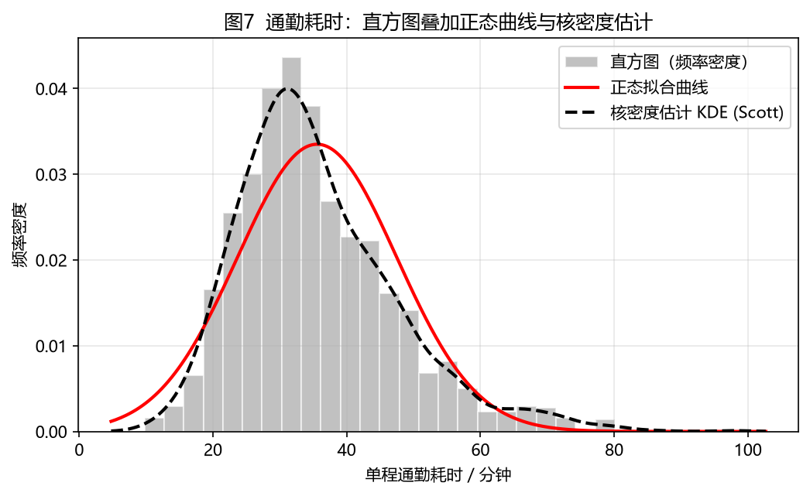

三者的关系：

- 直方图是"分段常数"的粗糙估计——老老实实一格一格数人头；
- 正态曲线是"先假定总体是正态"的参数化拟合，只用 $\mu$ 和 $\sigma$ 两个数就画得出来，代价是**套不上也得硬套**；
- KDE 是"不假设任何形状"的光滑非参数估计，只信数据本身。

读这张图能得到一份**比"平均 35 分钟"有用得多的通勤画像**：最挤的是 30 分钟前后那几格；过了 45 分钟人数明显掉下来，但一直到 70 分钟都还有零星的人在赶路——**这些每天多耗半小时的人，恰好被"平均值"这句话完全掩盖掉了**。

#### 2.7.1 循序渐进看 KDE 是怎么"堆"出来的

公式 $\hat{f}(t)=\frac{1}{nh}\sum_{i=1}^{n}K\!\left(\frac{t-x_i}{h}\right)$ 可以理解为：**每多一位员工，就在他的通勤时间上堆一座小山包，再把所有山包平均、除以带宽 $h$ 摊平**。下面固定带宽 $h$（取全量 1500 人的 Scott 规则 $h\approx2.76$ 分钟），只不断增加人数，看这条曲线怎么一个人一个人地"长"出来：

**第 1 个人**：只有 1 座山包，曲线就是一条以他为中心、宽为 $h$ 的高斯钟形（峰值 $1/(\sqrt{2\pi}\,h)\approx0.145$）。

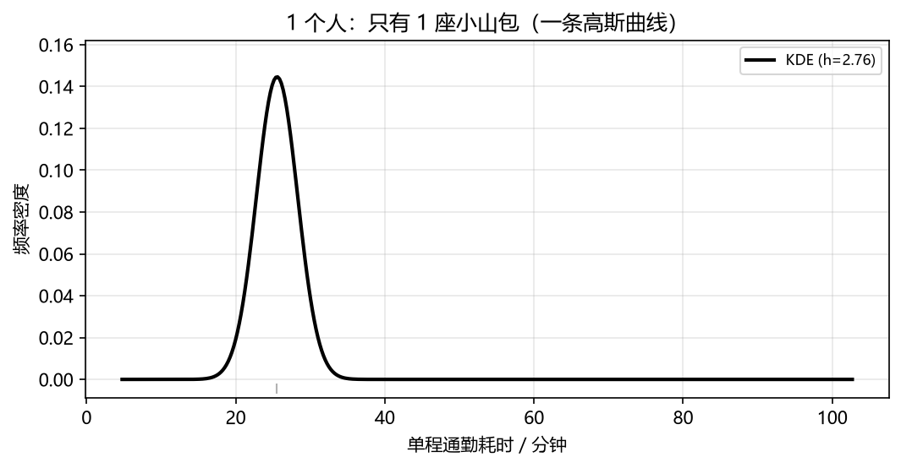

**前 2 个人**：两座山包相加再平均，两个位置之间被抬高、两侧下落，开始有"分布"的雏形。

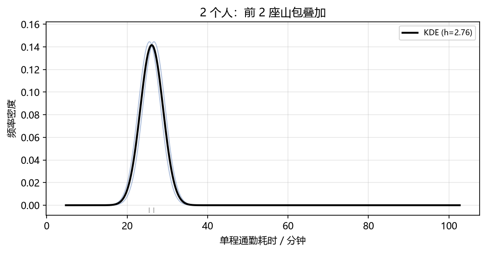

**前 3 个人**：又多一座山包，曲线在三人之间被撑得更高、更连贯。

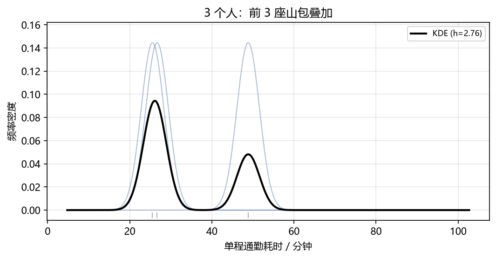

**前 5 个人**：山包更多，人扎堆的地方明显抬升、没人经过的地方压低，数据的"骨架"开始清晰。

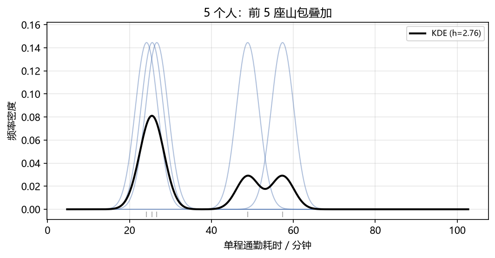

**前 9 个人**：9 座山包叠起来，已经能隐约看出"左边高、右边拖尾巴"的整体轮廓——人越多，这条曲线越接近真实的分布密度。

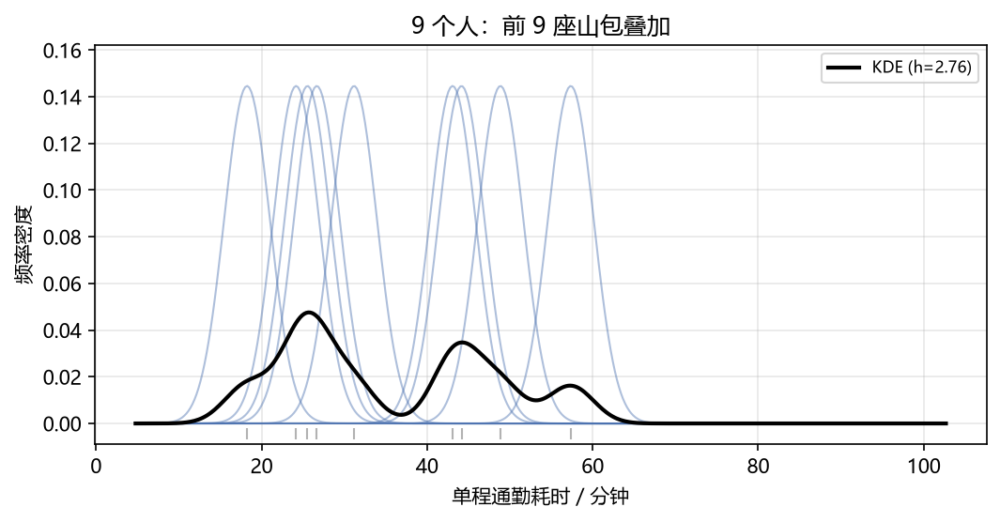

**带宽 $h$ 到底多大？** 它是 KDE 唯一的"旋钮"，决定每位员工被摊多宽。用同一份数据、只改 $h$：

- $h=0.5\times$Scott（约 $1.38$ 分钟）：山包太窄，曲线跟着每一位员工抖，噪声大（欠平滑）；
- $h=$Scott（约 $2.76$ 分钟）：形状自然；
- $h=2\times$Scott（约 $5.52$ 分钟）：山包太宽，"有过一小撮人通勤特别久"这类细节被抹平了（过平滑）。

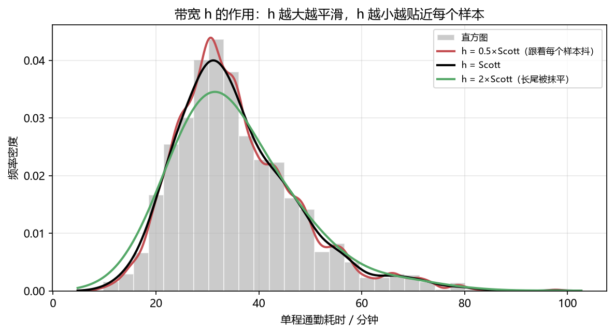

一个直观的判断口径：$h$ 宽到把"早高峰那半小时"和"偶发的长通勤"混成一坨，就是过平滑；窄到曲线开始为个别员工的偶然时间上下乱窜，就是欠平滑。

### 2.8 累积直方图：给"几点出门"一个准话

`cumulative=True` 把人数逐组累加，配合 `density=True` 纵轴变成"累积频率"（0→1），它回答的是一个非常实际的通勤问题——**留多少时间才不至于迟到**：

```python
plt.hist(commute, bins=30, cumulative=True, density=True,
         histtype='stepfilled', color='#937860', alpha=0.6)
plt.show()
```

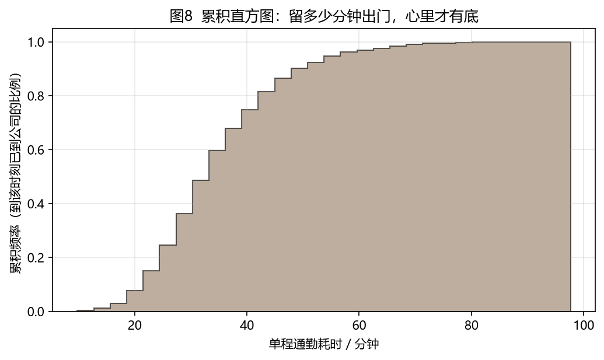

实读这张图：

| 纵轴（累积比例） | 横轴（需预留的通勤时间） | 含义                                   |
| ---------------- | ------------------------ | -------------------------------------- |
| 0.25             | 27.5 分钟                | 只有 1/4 的人能在这个时间内到公司      |
| 0.50             | 33.6 分钟                | **一半的人 33.6 分钟内能到**（中位数） |
| 0.75             | 42.1 分钟                | 3/4 的人能到                           |
| 0.90             | 50.5 分钟                | 九成的人能到                           |

于是"我该几点出门"有了量化的答案：按**中位数 33.6 分钟**出门，等于每周有一半概率迟到；按 **50.5 分钟**出门（九成分位），迟到的机会降到一成。曲线在中位数附近最陡（纵轴 0.5 处斜率最大），说明**大多数人的通勤时间都堆在这一小段里**，这正是 1.5 节说的"最挤的时段"。

### 2.9 绘图通用美化清单

```python
fig, ax = plt.subplots(figsize=(8, 4.2))
ax.hist(commute, bins=12, color='#4C72B0', edgecolor='white', alpha=0.9)
ax.set_title('全员单程通勤耗时分布')      # 标题
ax.set_xlabel('单程通勤耗时 / 分钟')       # 轴标签（务必写清单位）
ax.set_ylabel('人数')
ax.grid(axis='y', alpha=0.3)     # 只留横向网格，读数更省力
fig.tight_layout()               # 自动收紧留白
fig.savefig('out.png', dpi=150, bbox_inches='tight')  # 高清导出
```

几条经验：

- 直方图的**柱子之间不要留间隙**（`edgecolor='white'` 只留细白边即可），间隙会破坏"连续区间"的语义——就像通勤时间是连续流的，不该被切成互不相干的段落；
- 中文环境务必先设字体（见 2.1），否则标题变方块；
- **单位必须写进轴标签**（这里是"分钟"），否则读者看到"35"根本不知道是分钟还是公里；
- 论文/报告导出用 `dpi=150` 以上 + `bbox_inches='tight'`。

## 3 常见误区与排错

| 误区                                                       | 正确做法                                                                       |
| ---------------------------------------------------------- | ------------------------------------------------------------------------------ |
| 把柱状图当直方图（例如"各通勤方式的人数"也用 `hist`）      | 类别数据用 `plt.bar`；直方图只用于连续数值                                     |
| 组距不等时直接比高度（"15~30 分钟人最多，所以那时段最挤"） | 比矩形**面积**（折算成"每 5 分钟多少人"），或统一用 `density=True`             |
| 用平均数描述右偏数据（"大家平均通勤 35.6 分钟"）           | 补上中位数（33.6 分钟）或直接给分位数（"九成人 50.5 分钟内到"）                |
| 只挪一下分箱起点就换一个结论                               | 换几组边界/$k$ 复算，看结论稳不稳（1.7 节：起点挪 3 分钟，"最挤区间"就平移了） |
| 样本量太小（n<30）就画直方图                               | 改用茎叶图、点图或直接列出原始值——否则每栏只有两三个人，柱子高度纯粹是噪声     |
| 忘记 `density=True` 导致两组直方图高度不可比               | 对比分布时统一 `density=True`                                                  |
| 中文标题变方块                                             | 设 `font.sans-serif`（见 2.1）                                                 |

## 4 小结

- 直方图 = **分箱 → 计数 → 画矩形**，横轴是连续区间，纵轴是人数（频数）或频率密度；
- 组数 $k$ 是核心超参数，经验公式（Sturges / Freedman–Diaconis）只给起点：同一份通勤数据，三个公式分别给出 12 / 38 / 45 组，实际要多试几组对比；
- 柱高只在**等距分箱**时才等于"多少人"；不等距时必须比面积（800 人的例子里，人数最多的 15~30 分钟档其实不如 30~35 分钟档挤）；
- 通勤这类数据往往右偏（本例偏度 ≈ 1.0），均值会比中位数高出一截，报告时要挑对指标；
- 只有 `density=True` 的直方图面积才为 1，才能和概率密度曲线同框比较；
- matplotlib 里 `plt.hist(x, bins=..., density=..., histtype=...)` 一行即可，返回的 `counts/edges/patches` 便于二次加工。
