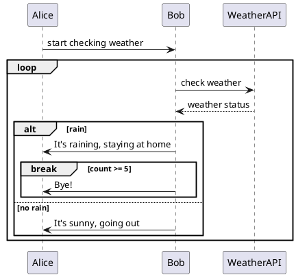

```plantuml
digraph LambdaArchitecture {
    // 全局属性设置
    rankdir=LR;
    node [shape=box, style=filled, fontname="Microsoft YaHei", fontsize=10, margin="0.15,0.08"];
    edge [fontname="Microsoft YaHei", fontsize=9, color="#555555"];

    // 定义颜色风格
    // 蓝色：交互/应用
    // 橙色/黄色：调度/同步/可视化
    // 绿色：数据缓冲/计算/缓存
    // 灰色：日志采集
    // 黑色/黄色：离线数仓集群

    // ================= 1. 数据源与接入层 =================
    subgraph cluster_source {
        label="数据源与接入";
        fontname="Microsoft YaHei";
        style=dashed;
        color="#4A90E2";
        
        WebApp1 [label="Web/App 业务交互", fillcolor="#4A90E2", fontcolor="white"];
        WebApp2 [label="Web/App 前端埋点 用户行为数据", fillcolor="#4A90E2", fontcolor="white"];
        
        Nginx1 [label="Nginx", fillcolor="#F5A623"];
        Nginx2 [label="Nginx", fillcolor="#F5A623"];
        
        WebApp1 -> Nginx1;
        WebApp2 -> Nginx2;
    }

    // ================= 2. 业务服务与日志服务 =================
    subgraph cluster_server {
        label="业务服务与日志服务";
        fontname="Microsoft YaHei";
        style=dashed;
        color="#4A90E2";
        
        Springboot1 [label="业务服务器\n(Springboot)", fillcolor="#4A90E2", fontcolor="white"];
        Springboot2 [label="业务服务器\n(Springboot)", fillcolor="#4A90E2", fontcolor="white"];
        
        LogServer1 [label="日志服务器\n(文件)(Springboot)", fillcolor="#4A90E2", fontcolor="white"];
        LogServer2 [label="日志服务器\n(文件)(Springboot)", fillcolor="#4A90E2", fontcolor="white"];
        
        LogFile1 [label="日志文件\nlogFile", fillcolor="#D3D3D3"];
        LogFile2 [label="日志文件\nlogFile", fillcolor="#D3D3D3"];
        
        Nginx1 -> Springboot1;
        Nginx1 -> Springboot2;
        Nginx2 -> LogServer1;
        Nginx2 -> LogServer2;
        
        LogServer1 -> LogFile1;
        LogServer2 -> LogFile2;
    }

    // ================= 3. 消息队列与同步层 =================
    subgraph cluster_mq {
        label="消息队列与同步层";
        fontname="Microsoft YaHei";
        style=dashed;
        color="#7ED321";
        
        MySQL [label="业务数据\nMySQL", fillcolor="#7ED321"];
        Maxwell [label="增量同步\nMaxwell", fillcolor="#F5A623"];
        
        Kafka [label="消息缓存\nKafka集群", fillcolor="#7ED321"];
        ZK [label="分布式协调\nZookeeper", fillcolor="#4A90E2", fontcolor="white"];
        
        FlumeCollect1 [label="采集日志\nFlume", fillcolor="#9B9B9B"];
        FlumeCollect2 [label="采集日志\nFlume", fillcolor="#9B9B9B"];
        
        FlumeConsume1 [label="业务消费\nFlume", fillcolor="#9B9B9B"];
        FlumeConsume2 [label="日志消费\nFlume", fillcolor="#9B9B9B"];
        
        Springboot1 -> MySQL;
        Springboot2 -> MySQL;
        MySQL -> Maxwell -> Kafka;
        
        LogFile1 -> FlumeCollect1 -> Kafka;
        LogFile2 -> FlumeCollect2 -> Kafka;
        ZK -> Kafka;
        
        Kafka -> FlumeConsume1;
        Kafka -> FlumeConsume2;
    }

    // ================= 4. 调度中心 =================
    Scheduler [label="定时调度\nDolphinScheduler", fillcolor="#F5A623"];
    DataX1 [label="每日全量\nDataX", fillcolor="#F5A623"];
    Scheduler -> DataX1;

    // ================= 5. 离线数仓 =================
    subgraph cluster_offline {
        label="离线数仓";
        fontname="Microsoft YaHei";
        style=dashed;
        color="#F5A623";
        rankdir=TB;
        
        Hadoop [label="集群存储\nHadoop", fillcolor="#000000", fontcolor="white"];
        
        ODS [label="原始数据层\nODS层", fillcolor="#000000", fontcolor="white"];
        DIM [label="公共维度层\nDIM层", fillcolor="#F5A623"];
        DWD [label="明细数据层\nDWD层", fillcolor="#F5A623"];
        DWS [label="汇总数据层\nDWS层", fillcolor="#4A90E2", fontcolor="white"];
        ADS [label="数据应用层\nADS层", fillcolor="#7ED321"];
        
        DataX1 -> Hadoop;
        FlumeConsume1 -> Hadoop;
        FlumeConsume2 -> Hadoop;
        
        Hadoop -> ODS -> DIM -> DWD -> DWS -> ADS;
    }

    // ================= 6. 实时数仓 =================
    subgraph cluster_realtime {
        label="实时数仓";
        fontname="Microsoft YaHei";
        style=dashed;
        color="#BD10E0";
        rankdir=TB;
        
        Flink [label="Flink", fillcolor="#7ED321"];
        Redis [label="旁路缓存\nRedis", fillcolor="#7ED321"];
        HBase [label="维度数据\nPhoenix + HBase", fillcolor="#4A90E2", fontcolor="white"];
        ClickHouse [label="查询宽表\nClickHouse", fillcolor="#F8E71C"];
        
        Kafka -> Flink;
        Flink -> Redis [dir=both, label=" "];
        Flink -> HBase [label="查询维度数据", color="#D0021B", fontcolor="#D0021B"];
        Flink -> ClickHouse [label="查询维度数据", color="#D0021B", fontcolor="#D0021B"];
    }

    // ================= 7. 数据应用与可视化层 =================
    subgraph cluster_app {
        label="数据应用与可视化";
        fontname="Microsoft YaHei";
        style=dashed;
        color="#F5A623";
        
        DataX2 [label="每日同步\nDataX", fillcolor="#F5A623"];
        ResultMySQL [label="结果数据\nMySQL", fillcolor="#4A90E2", fontcolor="white"];
        Superset [label="离线可视化\nSuperset", fillcolor="#F5A623"];
        
        SpringAPI [label="SpringBoot 数据\n接口服务", fillcolor="#4A90E2", fontcolor="white"];
        Sugar [label="实时可视化\nSugar", fillcolor="#F5A623"];
        
        ADS -> DataX2 -> ResultMySQL -> Superset;
        ClickHouse -> SpringAPI -> Sugar;
    }
}
```




```
```

