<div class="cover">
<h1>Hive 架构</h1>
<p>Hive SQL 引擎原理 · 从 AST 到分布式执行</p>
</div>

### 整体架构

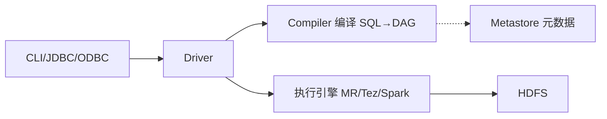

<p align="center" class="figcap">Hive 架构与编译流程</p>

### 编译

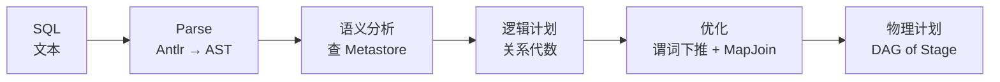

> **ANTLR（ANother Tool for Language Recognition） 把 SQL 文本从字符串解析成结构化 AST 的解析器生成工具**

### 执行

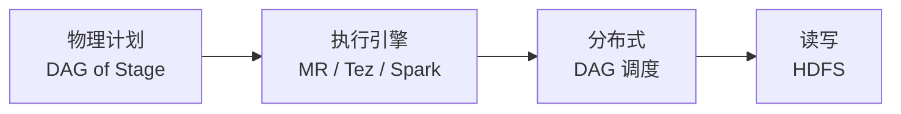


# SQL 的编译执行

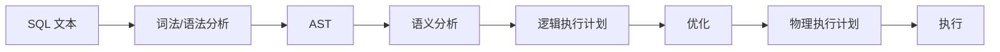

下面按顺序展开。

## 第一步：词法/语法分析（从文本到 AST）

词法分析和语法分析通常合在一起称为“解析（Parsing）”，它们的作用是将纯文本的 SQL 字符串转换成结构化的抽象语法树（AST）。这一步只关心**结构是否合法**，不关心表是否存在、类型是否匹配等语义问题。

### 1. 词法分析（Lexical Analysis / Tokenization）

**输入**：SQL 文本（字符流）  

**输出**：Token 序列（记号流）

词法分析器（Lexer/Scanner）按照 SQL 的词法规则，把连续的字符切分成一个个有意义的“单词”（Token）。每个 Token 通常包含类型和值两部分，例如：

| Token 类型           | 示例值              | 说明                     |
| -------------------- | ------------------- | ------------------------ |
| 关键字（Keyword）    | `SELECT`            | 保留字，通常大小写不敏感 |
| 标识符（Identifier） | `name`、`users`     | 表名、列名、别名等       |
| 字面量（Literal）    | `'abc'`、`123`      | 字符串、数字、日期等     |
| 运算符（Operator）   | `>`、`=`、`+`       | 比较、算术等运算符       |
| 分隔符（Delimiter）  | `,`、`(`、`)`       | 逗号、括号等             |
| 注释                 | `-- ...`、`/*...*/` | 词法分析阶段通常直接忽略 |

### **示例**

输入 SQL：

```sql
SELECT name, age FROM users WHERE id > 100
```

经过词法分析后，可能得到如下 Token 序列（简化表示）：

```yaml
[Keyword: SELECT]
[Identifier: name]
[Delimiter: ,]
[Identifier: age]
[Keyword: FROM]
[Identifier: users]
[Keyword: WHERE]
[Identifier: id]
[Operator: >]
[Literal: 100]
```

### **注意事项**：

- SQL 关键字通常不区分大小写，但标识符是否区分取决于数据库配置（如 MySQL 的表名在 Linux 上区分大小写）。
- 字符串字面量需要用引号界定，可能包含转义字符；数字字面量可能包含小数点、科学计数法等。
- 词法分析器需要处理空白和注释，通常直接跳过，不产生 Token。

### 2. 语法分析（Syntax Analysis）

**输入**：Token 序列  

**输出**：抽象语法树（AST）

语法分析器（Parser）根据 SQL 的语法规则（通常用上下文无关文法描述，如 BNF 或 EBNF），检查 Token 序列是否符合语法，并构建出 AST。

如果 Token 序列不符合语法规则（例如 `SELECT FROM WHERE` 缺少列名，或者括号不匹配），语法分析器会抛出**语法错误**，并给出错误位置和提示。此时查询不会进入后续阶段。

# 抽象语法树

**抽象语法树（Abstract Syntax Tree）**是编译原理中的核心概念，它是源代码语法结构的**树状表示形式**，忽略括号、分号等细节，只保留代码的逻辑结构。

## 举例说明
### 例1：算术表达式
::: cols 70:30

```javascript
a + b * (c - d)
```

<br>

##### AST的遍历

| 遍历方式 | 访问顺序 | 得到                   | 本树结果         |
| -------- | -------- | ---------------------- | ---------------- |
| 前序遍历 | 根→左→右 | 前缀表达式（波兰式）   | `+ a * b - c d`  |
| 中序遍历 | 左→根→右 | 中缀表达式             | `a + b * c - d`⚠️ |
| 后序遍历 | 左→右→根 | 后缀表达式（逆波兰式） | `a b c d - * +`  |

::: split

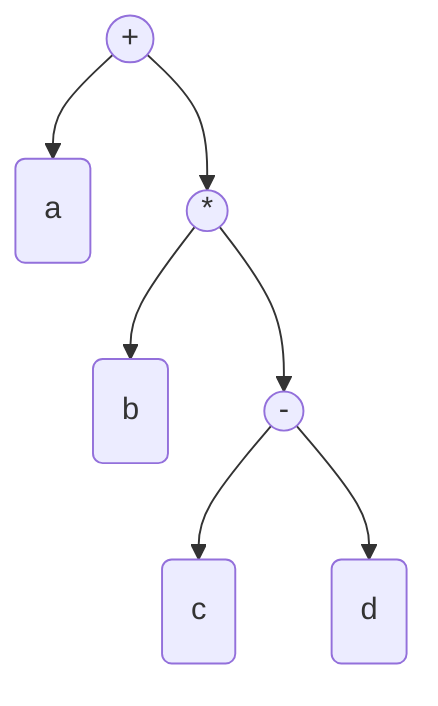

<p align="center" class="figcap">对应的抽象语法树</p>


:::

**⚠️ 中序的坑**：中序遍历直接输出是 `a + b * c - d`，按普通优先级算等于 `(a + b * c) - d`，与原式 `a + b * (c - d)` **不等价**。

要还原成正确的中缀表达式，遍历到 `-` 这类子树时必须**重新补括号**。

这正是三种表示法的本质区别：
- **中缀**：给人看的，需要括号 + 优先级规则才无歧义；
- **前缀/后缀**：给机器看的，天然无歧义、无需括号——遍历顺序本身就固定了运算结构。


### 例2：赋值语句
::: cols 50:50

```javascript
x = 1 + 2
```
::: split

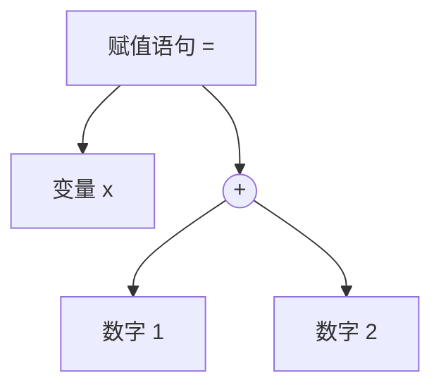

<p align="center" class="figcap">对应的AST</p>
:::


### 例3：条件语句
::: cols 40:60

```javascript
if (age >= 18) {
    status = "adult"
}
```
::: split

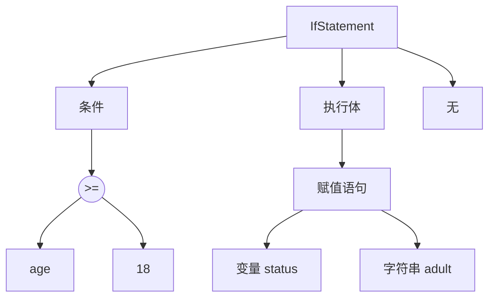

<p align="center" class="figcap">简化的AST结构</p>
:::


## 关键特点
| 特点       | 说明                                         |
| ---------- | -------------------------------------------- |
| **抽象性** | 省略括号、分号、注释等无关语法细节           |
| **层次性** | 用**父子关系**表达代码的**嵌套**和**优先级** |
| **结构化** | 便于程序遍历、分析和转换                     |
## 为什么需要AST？
以 `a + b * (c - d)` 为例，人一眼能看出先算括号内、再算乘法、最后加法，但**计算机需要通过树的层级结构**才能理解运算顺序——子树先求值，再逐层向上计算。这就是AST的本质意义：**把人能读懂的代码，转换成机器能高效处理的结构**。


# SQL 的抽象语法树

SQL 解析器同样会把 SQL 语句转换成 AST，下面用几个典型例子说明。
## 例1：简单查询
::: cols 40:60

```sql
SELECT name, age FROM users
```
::: split

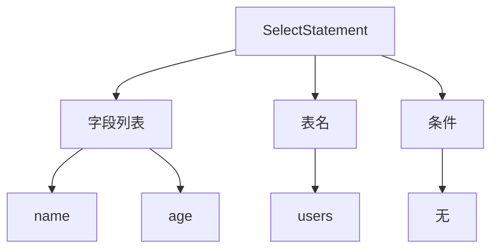

<p align="center" class="figcap">对应的 AST</p>
:::


## 例2：带条件、排序的完整查询
::: cols 40:60

```sql
SELECT name, age 
FROM users 
WHERE age > 18 AND city = '北京' 
ORDER BY age DESC
```
::: split

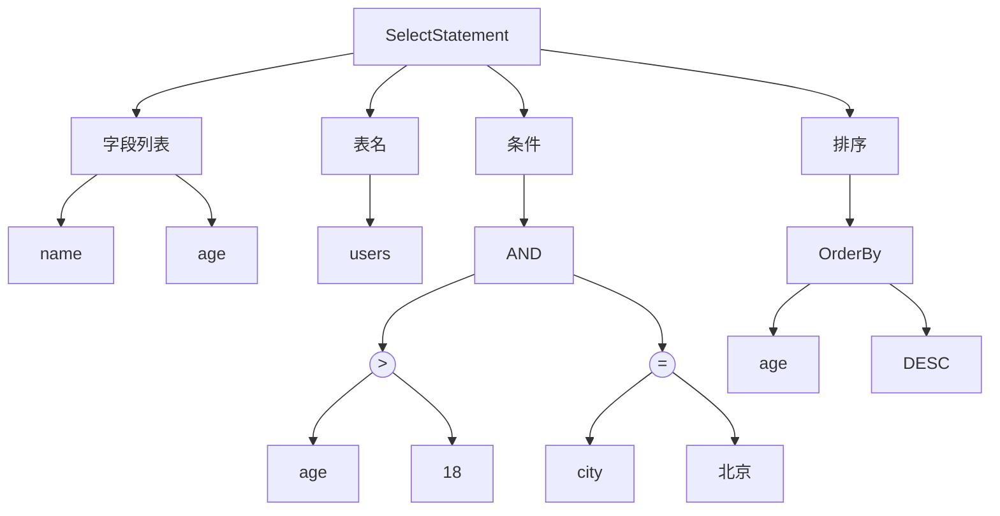

<p align="center" class="figcap">对应的 AST（简化版）</p>
:::

**要点**：`AND` 优先级低于 `>` 和 `=`，所以它是树的根条件，两个比较是它的子树——树的层级天然表达了逻辑运算的优先级。

## 例3：多表 JOIN
::: cols 40:60

```sql
SELECT u.name, o.amount
FROM users u
JOIN orders o 
ON u.id = o.user_id
WHERE o.amount > 100
```
::: split

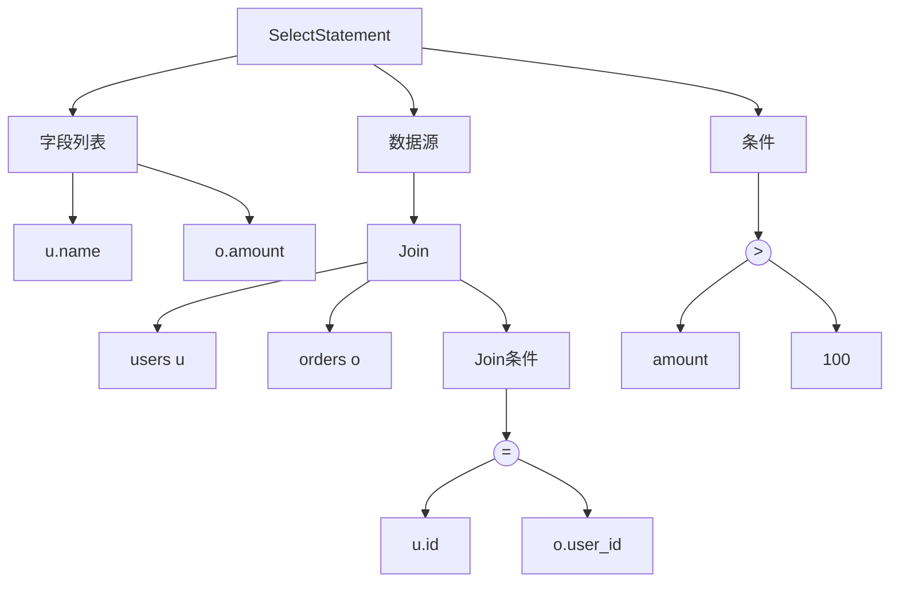

<p align="center" class="figcap">对应的 AST</p>
:::

**要点**：**JOIN 被抽象为一个“数据源节点”**，左右表和连接条件都是它的子节点。这个结构正是优化器的基础——**树形结构让重排 JOIN 顺序变得容易**。

## 例4：子查询
::: cols 40:60

```sql
SELECT NAME
FROM
  users
WHERE
  id IN (SELECT user_id 
         FROM orders 
         WHERE amount > 500)
```


::: split

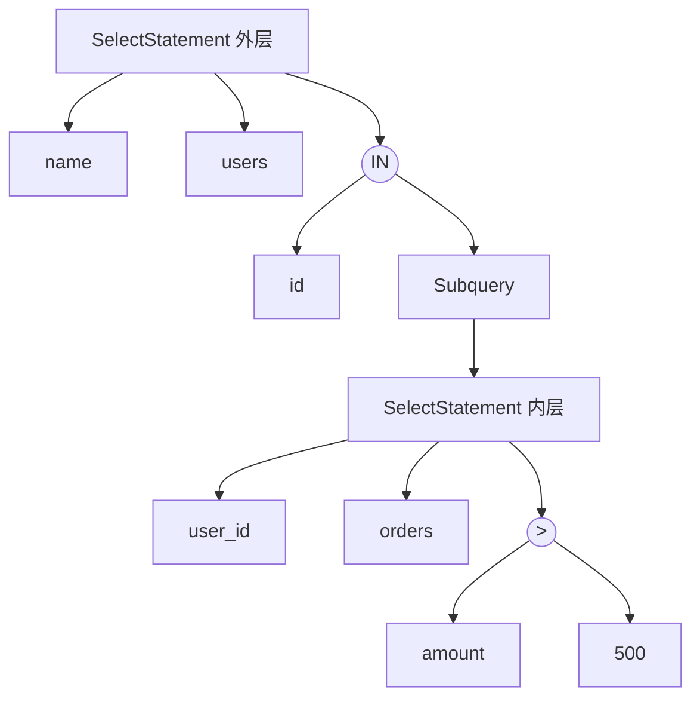

<p align="center" class="figcap">对应的 AST</p>
:::

**要点**：子查询就是“树中嵌套一棵树”，这也解释了为什么子查询过多时解析性能会下降。

## SQL AST 的实际应用
| 应用                | 说明                                                         |
| ------------------- | ------------------------------------------------------------ |
| **查询优化器**      | 通过对 AST 做等价变换（如谓词下推—详见下文、JOIN 重排）生成更优执行计划 |
| **分库分表中间件**  | ShardingSphere 解析 SQL 的 AST，找到分片键，改写路由后的 SQL |
| **SQL 审计/防火墙** | 检测 AST 中是否含 `DROP`、`DELETE 无 WHERE` 等危险操作       |
| **SQL 改写/翻译**   | 把 MySQL 语法翻译成 Hive/PostgreSQL 方言，就是在 AST 层面替换节点 |
| **BI 工具**         | 生成 SQL 时先构建 AST 再序列化成文本                         |
**ShardingSphere** 相当于在 JDBC 驱动和数据库之间加了一层**智能路由器**，你发一条 SQL，它根据**分片键**决定去哪个**库**哪个**表**执行，再把结果拼装返回给你。

**分片键**（Sharding Key）是**用来决定一条数据应该存到哪个数据库（库）或哪张表（表）的那个字段**。

### 在数据库中的实际例子

假设你有一张 **订单表 `t_order`**，数据量巨大，按 **`order_id`** 拆成 16 张表（`t_order_0` ~ `t_order_15`）。

分片算法可能是：

```
目标表序号 = order_id % 16
```

| 订单ID | 计算           | 存入的表    |
| ------ | -------------- | ----------- |
| 10001  | 10001 % 16 = 1 | `t_order_1` |
| 10016  | 10016 % 16 = 0 | `t_order_0` |
| 10032  | 10032 % 16 = 0 | `t_order_0` |

这里的 **`order_id`** 就是分片键。


## 一句话总结

SQL AST 把“给人读的字符串 SQL”变成“给机器用的结构化树”——**字符串难以分析，而树可以精确地查找、替换、优化任何一部分**。这就是所有数据库引擎和 SQL 中间件的第一步：先 `Parse`（字符串 → AST），再 `Optimize`（变换 AST），最后 `Execute`（根据树生成执行计划）。


## 第二步：语义分析（AST 只是“语法正确”，还不知道对错）
语法分析只检查“结构是否合法”，语义分析才检查“含义是否正确”：
```sql
SELECT name, ages FROM users WHERE id > 'abc'
```


这条 SQL 的 AST **完全合法**（结构没问题），但语义分析阶段会发现：

| 检查项                    | 依据                      | 结果             |
| ------------------------- | ------------------------- | ---------------- |
| `ages` 字段存在吗？       | 查系统表（Schema/元数据） | ❌ 不存在         |
| `id > 'abc'` 类型匹配吗？ | id 是 INT，'abc' 是字符串 | ⚠️ 隐式转换或报错 |

**这一步的做法**：在 AST 的节点上补充类型、字段位置等“注解信息”，产生**带注解的 AST**。

## 第三步：转换为逻辑执行计划（AST → 关系代数）

AST 是“语法视角”，数据库真正需要的是“运算视角”——**关系代数树**：

```sql
SELECT name FROM users WHERE age > 18
```
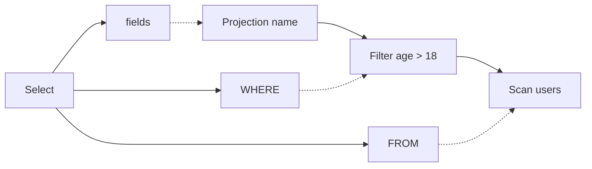
**关键区别**：逻辑计划只有投影（Projection）、过滤（Filter）、连接（Join）、扫描（Scan）等**标准算子**，不再关心 SQL 的书写形式。
## 第四步：优化（最有价值的一步）
在逻辑计划树上做**等价变换**，这一步直接决定性能。
### 经典例子：谓词下推
```sql
SELECT u.name 
FROM users u JOIN orders o 
ON u.id = o.user_id 
WHERE o.amount > 100
```
::: cols

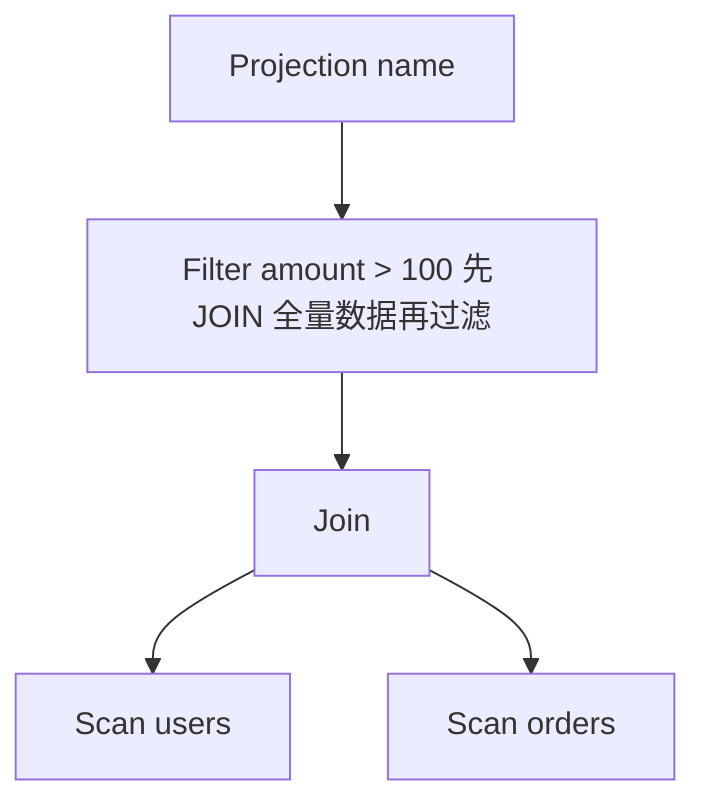

<p align="center" class="figcap"><strong>优化前</strong>（直觉翻译）</p>

::: split

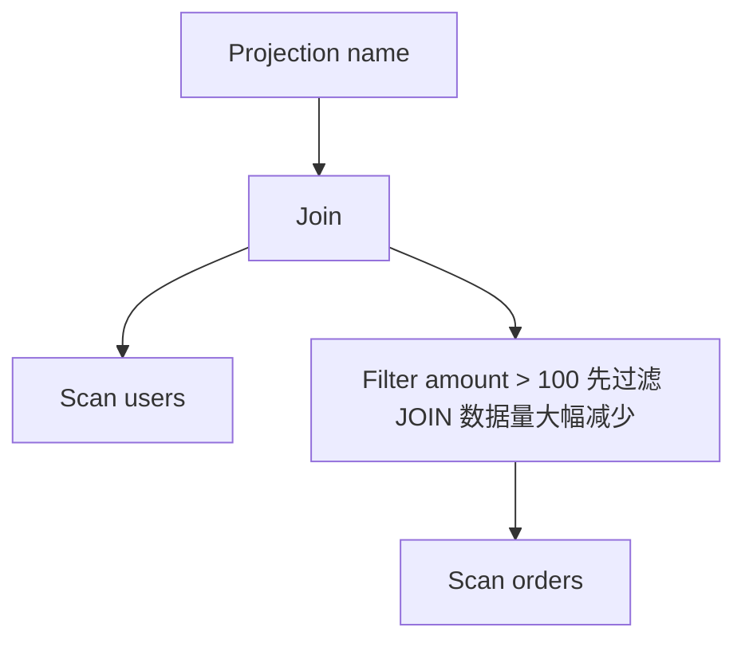

<p align="center" class="figcap"><strong>优化后</strong></p>

:::

如果 orders 有 1000 万行，符合条件的只有 1 万行，**先过滤意味着 JOIN 成本降低 1000 倍**。
### 常见优化手段
| 优化          | 作用                                        |
| ------------- | ------------------------------------------- |
| **谓词下推**  | 过滤条件尽量下推到数据源，减少上游数据量    |
| **JOIN 重排** | 小表驱动大表，确定最优连接顺序              |
| **列裁剪**    | 只读取 SQL 用到的列（配合列式存储效果显著） |
| **常量折叠**  | `age > 18+1` 直接算成 `age > 19`            |
| **索引选择**  | 判断 WHERE 条件能否命中索引                 |
## 第五步：生成物理执行计划
逻辑计划描述“做什么”，物理计划描述“**怎么做**”：
```
逻辑算子          物理实现（多种可选）
───────          ─────────────────
Join        →    HashJoin / NestedLoopJoin / SortMergeJoin
Scan        →    SeqScan（全表扫描）/ IndexScan（索引扫描）
Aggregate   →    HashAggregate / SortAggregate
```
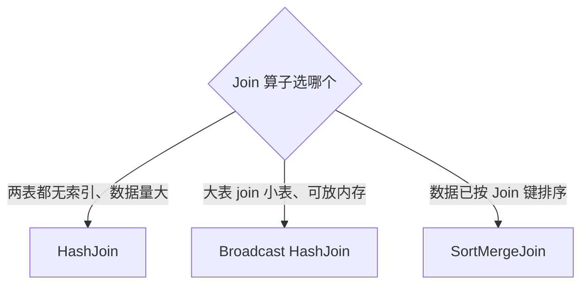

<p align="center" class="figcap"><strong>物理优化器的决策逻辑</strong></p>

## 第六步：执行
执行引擎遍历物理计划树（**火山模型**：每个算子递归调用下层 `next()` 拉取一行数据）：
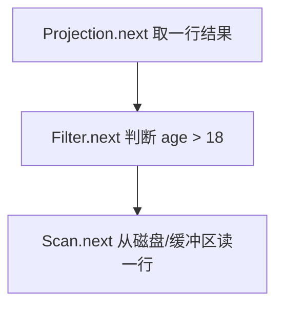
## 总结：AST 之后各阶段的核心问题
| 阶段         | 核心问题                     | 产出             |
| ------------ | ---------------------------- | ---------------- |
| **语义分析** | 这句话“说得通”吗？           | 带类型注解的 AST |
| **逻辑计划** | 这个操作用关系代数怎么表达？ | 逻辑算子树       |
| **逻辑优化** | 有没有等价但更快的写法？     | 优化后的逻辑计划 |
| **物理计划** | 每个算子用什么具体算法？     | 可执行的计划树   |
| **执行**     | 真正跑起来出结果             | 结果集           |

**一句话**：AST 回答的是“用户写了什么”，之后的所有阶段都在回答“**怎么把这件事做得又对又快**”——这也是为什么看 `EXPLAIN` 执行计划时，你看到的已经不是 SQL 的样子，而是优化器基于 AST 改写、重组后的最终形态。


# 火山模型执行过程详解

```sql
SELECT name FROM users WHERE age > 18
```
users 表数据（内存中）：
| id   | name  | age  |
| ---- | ----- | ---- |
| 1    | Alice | 25   |
| 2    | Bob   | 15   |
| 3    | Carol | 30   |
| 4    | Dave  | 17   |
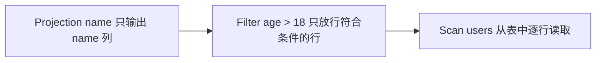

<p align="center" class="figcap">物理执行计划（三个算子组成一条“管道”）</p>

## 核心规则：每个算子只有一个接口 `next()`
- 上层算子调用下层 `next()` 要一行数据
- 下层算子返回一行，或者返回“没了”（EOF）
- **上层不关心下层怎么拿到数据**，就像插线板不关心发电厂怎么发电
## 逐行执行过程（完整跟踪）
### 第 1 轮
```
① Projection.next() 被调用（最外层发起）
      ↓ 它需要数据，于是调用
② Filter.next() 被调用
      ↓ 它也需要数据，于是调用
③ Scan.next() 被调用
      → 从表里读出第 1 行: {id:1, name:"Alice", age:25}
      → 返回给 Filter
④ Filter 拿到 {Alice, 25}
      → 判断: 25 > 18 ✅ 通过！
      → 返回给 Projection
⑤ Projection 拿到 {id:1, name:"Alice", age:25}
      → 只挑出 name 列
      → 返回 "Alice"
最终结果输出第 1 行: Alice
```
### 第 2 轮
```
① Projection.next() → ② Filter.next() → ③ Scan.next()
      → Scan 读出第 2 行: {id:2, name:"Bob", age:15}
④ Filter 拿到 {Bob, 15}
      → 判断: 15 > 18 ❌ 不通过！
      → 但 Filter 还得交差，于是再次调用 Scan.next()
      → Scan 读出第 3 行: {id:3, name:"Carol", age:30}
      → 判断: 30 > 18 ✅ 通过！
      → 返回给 Projection
⑤ Projection 返回 "Carol"
最终结果输出第 2 行: Carol
```
**注意**：这一轮 Filter 内部**循环调用了两次 Scan**——被过滤掉的行，上层根本看不见，就像不存在。
### 第 3 轮
```
① Projection.next() → ② Filter.next() → ③ Scan.next()
      → Scan 读出第 4 行: {id:4, name:"Dave", age:17}
      → Filter 判断: 17 > 18 ❌ 不通过
      → Filter 再次调用 Scan.next()
      → Scan 发现表读完了，返回 EOF（结束信号）
      → Filter 收到 EOF，自己也返回 EOF
      → Projection 收到 EOF，整个查询结束
```
## 完整过程时间线
| 调用轮次 | Scan 输出 | Filter 判定  | Projection 输出 |
| -------- | --------- | ------------ | --------------- |
| 第 1 轮  | Alice, 25 | 25>18 ✅ 放行 | Alice           |
| 第 2 轮  | Bob, 15   | 15>18 ❌ 拦截 |                 |
| 第 2 轮  | Carol, 30 | 30>18 ✅ 放行 | Carol           |
| 第 3 轮  | Dave, 17  | 17>18 ❌ 拦截 |                 |
| 第 3 轮  | (EOF)     |              | EOF（查询结束） |

最终结果：

```
Alice
Carol
```
## 为什么这样设计？三个精妙之处
### 1. 流式处理，内存占用极小
任何时刻内存里只有**一两个元组**，不是整个结果集。表有 10 亿行也能跑——一行行来，处理完就丢。
### 2. 算子可以随意组合（像乐高积木）
```
Projection → Filter → Scan           = SELECT ... WHERE ...
Projection → Filter → Sort → Scan    = SELECT ... WHERE ... ORDER BY ...
Projection → Filter → MergeJoin → (Sort → Scan) × 2   = 多表查询
```
新增一个算子（如 Limit、Aggregate），只要实现 `next()` 接口，就能插入管道，**其他算子一行代码都不用改**。
### 3. 短路能力
```sql
SELECT name FROM users WHERE age > 18 LIMIT 1
```
Projection 返回 "Alice" 后，Limit 直接停止拉取，**Bob、Carol、Dave 根本不会被读取**——需求满足了就不再干活。
## 它的代价与演进
| 模型         | 特点                                                     | 代表                          |
| ------------ | -------------------------------------------------------- | ----------------------------- |
| **火山模型** | 每行一次虚函数调用，实现优雅但函数调用开销大             | 传统 PostgreSQL、早期 MySQL   |
| **向量化**   | 每次 `next()` 返回**一批行**（如 1024 行），摊薄调用开销 | DuckDB、ClickHouse、Snowflake |
| **编译执行** | 把整个计划编译成一段机器码，数据不经过函数调用边界       | HyPer、Databricks Photon      |
## 一句话总结
火山模型就像**工厂流水线**：车间主任（Projection）向上交产品前，向班组（Filter）要半成品；班组向原料仓（Scan）要原料。每一层只干自己的活、只跟上下层打交道——**数据一行行从树的底部“冒”上来**（如同火山喷发，故得名），每经过一层就被加工一次，直到变成用户要的样子。

## 特殊情形：树其实是 DAG
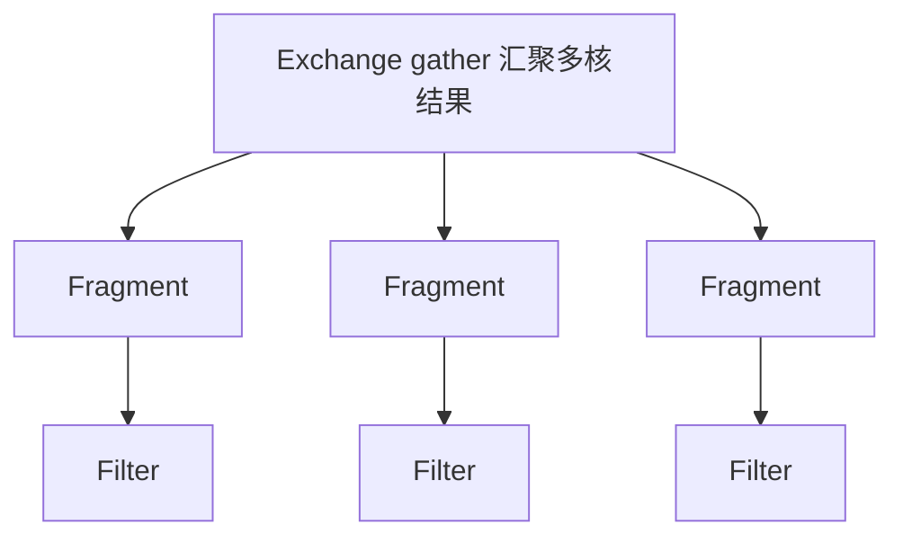

<p align="center" class="figcap">并行执行计划中，数据流可能不是纯树</p>

- 每个并行分支上的执行仍是独立的“火山管道”
- Exchange 算子负责汇合（相当于 Future/collect）
- Spark 的 Stage 划分就是按 DAG 拓扑排序执行的
## 总结表
| 阶段                     | 遍历方式                                   | 方向                       |
| ------------------------ | ------------------------------------------ | -------------------------- |
| 算子初始化               | 后序遍历                                   | 自底向上（先子后父）       |
| **拉取执行（火山模型）** | **每行一次的深度优先调用链**，数据后序上浮 | 调用自顶向下，数据自底向上 |
| 阻塞算子（Sort/Agg）     | 先排空子树（一次性全遍历），再逐行输出     | 自底向上                   |
| 优化器找最优计划         | 自底向上动态规划 / 记忆化搜索              | 自底向上                   |
| 并行计划                 | DAG + 拓扑排序，分支内仍是火山管道         | 混合                       |

**一句话**：AST 遍历是“一次走完整棵树”；物理计划执行是“**每要一行数据，就从根到叶 DFS 一次，数据沿后序方向冒上来**”——遍历的单位不是“整棵树”，而是“每一行”。

# 后序 = 栈式求值的天然搭档
## 为什么后序和栈是“天作之合”
一条铁律：**栈式求值要求“操作数先入栈，运算符后到达”**——而后序遍历恰好就是这个顺序！
```
树的结构保证了：运算符永远是"最后"被处理的节点
后序序列保证了：运算符出现在它的操作数之后
```
## 完整例子走一遍
::: cols 50:50

表达式：

```
(1 + 2) * (3 - 4)
```
::: split

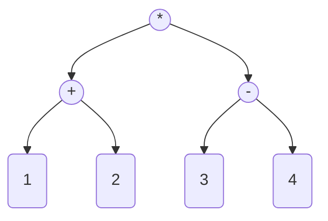

<p align="center" class="figcap">AST</p>
:::


### 第一步：后序遍历，得到后缀表达式（逆波兰式）
```
后序序列:  1 2 + 3 4 - *
```
对比中缀 ` (1 + 2) * (3 - 4)`：**括号没了，优先级也没了**——树的层级已经编码了优先级信息，后序序列把它“压平”成了线性指令流。
### 第二步：栈机器逐条执行

::: cols 40:60

规则只有两条：
- **数字** → 压栈
- **运算符** → 弹出两个操作数，计算，结果压回

::: split

```python
指令:  1  2  +  3  4  -  *
执行过程:
─────────────────────────────────────────────
指令   栈的变化              栈状态
─────────────────────────────────────────────
 1     push 1               [1]
 2     push 2               [1, 2]
 +     pop 1,2 → 3          [3]
       push 3
 3     push 3               [3, 3]
 4     push 4               [3, 3, 4]
 -     pop 3,4 → -1         [3, -1]
       push -1
 *     pop 3,-1 → -3        [-3]
       push -3
─────────────────────────────────────────────
结束: 栈顶就是答案 → -3
```
:::

整个求值**没有一次递归、没有树节点、没有括号判断、没有优先级判断**——只有压栈和弹栈。

## 对照：如果没有栈，树求值靠什么？
**递归**——而递归的本质是**隐式的调用栈**：
```python
def eval(node):
    if node 是叶子:
        return node.value
    l = eval(node.left)    # 这些递归调用
    r = eval(node.right)   # 底层就是不断压栈
    return apply(node.op, l, r)
```
所以两种方式其实是**同一件事**：
| 方式          | 栈在哪里       | 特点                               |
| ------------- | -------------- | ---------------------------------- |
| 递归树求值    | 隐式（调用栈） | 直观，但每节点一次函数调用，开销大 |
| 后序 + 显式栈 | 显式（数据栈） | 指令化、可循环执行、可优化         |

**后序 + 显式栈，本质上是“把递归手动展开成了循环”**——这正是编译器优化掉递归的经典手段。

## 各表达式的“机器友好度”对比
| 表示法                   | 求值难度   | 原因                                    |
| ------------------------ | ---------- | --------------------------------------- |
| 中缀 `(1+2)*(3-4)`       | 最难       | 需要括号 + 优先级规则，要建树或反复回溯 |
| **后缀 `1 2 + 3 4 - *`** | **最简单** | 一遍扫描 + 一个栈，O(n)                 |
| 前缀 `* + 1 2 - 3 4`     | 简单       | 从右往左扫 + 栈（或递归下降）           |

中缀是**给人看的**（符合书写习惯），后缀是**给机器执行的**——后序遍历正是“人语 → 机语”的翻译桥梁。


## 总结
| 问题               | 答案                                            |
| ------------------ | ----------------------------------------------- |
| 后序和栈的关系     | 后序序列 = 栈机器的指令流                       |
| 为什么方便         | 操作数必然先于运算符就位，弹栈即得操作数        |
| 副产品             | 括号消失、优先级消失（被树结构吸收）            |
| 递归求值 vs 栈求值 | 同构——显式栈是递归调用栈的“手动展开”            |
| 工业应用           | JVM/CPython 字节码、SQLite VDBE、PostgreSQL JIT |

**一句话**：后序遍历把“树”变成了“线性指令流”，而这个指令流恰好是一个栈就能执行的——**树是给人理解的，后序+栈是给机器跑的**，两者是同一计算过程的两种表示。

### 重要边界：表达式栈求值只是“算子内的一小步”

前面这套「后序遍历 + 显式数据栈」解决的是**标量表达式**的求值——也就是一行记录里 `age > 18`、`a + b * c` 这种计算。它发生在 `Filter` / `Project` 算子的**内部**：每拿到一行，就把这行字段代入表达式、用数据栈算出结果。

**它不等于整条 SQL 的物理执行计划怎么跑。** 两者是不同层级：

| 层级 | 例子 | 主流求值方式 |
| --- | --- | --- |
| 标量表达式 | `WHERE age>18`、`a+b*c` | 数据栈 / 步进解释器 / JIT 编译（就是上文这套） |
| 物理执行计划 | `Scan→Filter→Join→Agg` 算子树 | Volcano 迭代器：`open/next/close`，靠**调用栈**递归、自顶向下逐行拉取 |

要点：

- **整条计划不会被压成后缀表达式用数据栈扫一遍**——主流引擎把它当成一棵算子树，用 Volcano 迭代器模型执行：上层算子一层层调下层 `next()`，靠函数调用栈记住"走到树的哪一层"，元组则一行行被"拉"上来（下文分布式大节会展开）。
- 两层**都用到了"递归遍历一棵树"**（底层都是调用栈）；区别在于表达式那层额外被编译 / 展开成了**显式数据栈**，算子树这层则是**迭代器递归**，不会被拍平成 `1 2 + 3 4 - *` 去扫。
- 少数引擎（SQLite VDBE、VoltDB）确实把**整条语句**编译成字节码虚拟机来跑，那种才算"整条都用 VM 求值"，但这是少数派。

> 收口：**本页的栈求值是"一行里的表达式"怎么算；整条查询计划的执行另有其模型（火山迭代器）。** 别把两者当成同一个栈。

# 从单机到分布式：SQL 引擎的边界

前面所有内容——AST、语义分析、逻辑计划、优化器、火山模型——默认的执行环境都是**单机数据库**（PostgreSQL、MySQL）。当数据量从 GB 涨到 TB、PB，单机火山模型会遇到三道墙：

| 瓶颈     | 单机的困境                     |
| -------- | ------------------------------ |
| **存储** | 一台机器的磁盘装不下 PB 级数据 |
| **算力** | 单核/单机的 CPU 算不完         |
| **IO**   | 单机磁盘带宽成为吞吐天花板     |

Hadoop（HDFS + MapReduce）解决了存储和计算的分布式化，但 MapReduce 是 Java API，写一个 JOIN 要几百行代码。**Hive 的诞生动机**就是：让会 SQL 的人也能跑大数据——把 SQL 自动翻译成 MapReduce 任务。

**关键认知**：Hive 不是"重新发明一个 SQL 引擎"，而是**把前面那套 SQL 引擎流程搬到了分布式环境**——Parse、AST、优化器、物理计划全部保留，只是"执行层"从单机火山模型换成了分布式 DAG。

# Hive 是什么：定位与本质

一句话定义：**Hive 是建立在 Hadoop 之上的数据仓库工具，提供类 SQL 接口，将 SQL 翻译成 MapReduce / Tez / Spark 任务执行**。


| 维度         | 传统数据库（单机） | Hive                       |
| ------------ | ------------------ | -------------------------- |
| **定位**     | OLTP（事务处理）   | OLAP（离线分析）           |
| **延迟**     | 毫秒~秒级          | 分钟~小时级                |
| **数据规模** | GB~TB              | TB~PB                      |
| **数据存储** | 本地文件 + 块      | HDFS                       |
| **事务**     | 强 ACID            | 弱（仅支持有限 ACID）      |
| **更新**     | 行级 UPDATE/DELETE | 主要是追加，UPDATE 受限    |
| **执行模型** | 单机火山模型       | 分布式 DAG（MR/Tez/Spark） |

**本质区别**：传统数据库是"先存好数据，再随时查"；Hive 是"数据已经在 HDFS 上，SQL 只是描述怎么算"——它**不存储数据，只翻译 SQL**。

# Hive 架构：与单机流程逐层对应

### 整体架构


<p align="center" class="figcap">Hive 架构与编译流程</p>


### 编译

```mermaid
graph LR
    SQL[SQL<br>文本] --> P1[Parse <br> / Antlr → AST]
    P1 --> P2[语义分析<br> 查 Metastore]
    P2 --> P3[逻辑计划<br> 关系代数]
    P3 --> P4[优化<br> 谓词下推 + MapJoin]
    P4 --> P5[物理计划<br> DAG of Stage]
```

### 执行

```mermaid
graph LR
    P5[物理计划<br>DAG of Stage] --> E1[执行引擎<br>MR / Tez / Spark]
    E1 --> E2[分布式<br> DAG 调度]
    E2 --> E3[读写<br> HDFS]
```

**逐层对应前面的单机流程**：

| 阶段        | 单机数据库          | Hive                         | 差异           |
| ----------- | ------------------- | ---------------------------- | -------------- |
| Parse → AST | 本地解析器          | 同（用 Antlr）               | 无             |
| 语义分析    | 查本地系统表        | 查 **Metastore**（独立服务） | 元数据外置     |
| 逻辑计划    | 关系代数算子        | 同                           | 无             |
| 优化        | 谓词下推、JOIN 重排 | 同 + MapJoin                 | 增加分布式优化 |
| 物理计划    | 单机算子树          | **DAG of MapReduce Stage**   | 核心差异       |
| 执行        | 火山模型（单机）    | 分布式 DAG 调度              | 核心差异       |

**Metastore** 是 Hive 唯一"持久化"的部分——存表名、列、分区、位置等元数据（通常放在 MySQL 里）。它对应单机数据库的"系统表"，只是从本地变成了独立服务，因为集群里多个节点都要查同一份元数据。

# 物理执行：从火山模型到 MapReduce

前面讲过，单机执行是"每行一次 `next()` 调用，数据从叶子往上冒"。Hive 的物理执行**完全不同**：算子被组织成 **MapReduce Stage**，Stage 之间通过 HDFS 中间文件衔接。

## 一个 JOIN 查询如何变成 MapReduce

```sql
SELECT u.name, o.amount
FROM users u JOIN orders o
ON u.id = o.user_id
WHERE o.amount > 100
```

经过优化器（**谓词下推**——还记得前面那张优化前后的对比图吗？），物理计划变成：

```mermaid
graph LR
    S1[Stage 1: Map 过滤 orders] -->|HDFS 中间文件| S2[Stage 2: Map JOIN users+orders]
    S2 -->|HDFS 中间文件| S3[Stage 3: Reduce 聚合输出]

```


<p align="center" class="figcap">JOIN 查询的 MapReduce DAG</p>

每个 Stage 内部：

- **Map 阶段**：并行读取 HDFS 分片，每条记录调用一次 `map()`——本质是**分布式的 Scan + Filter**
- **Shuffle 阶段**：按 JOIN 键（`u.id` / `o.user_id`）把数据重分布到 Reducer——这是 MapReduce 的核心机制
- **Reduce 阶段**：相同键的记录汇聚到一个 Reducer，执行 JOIN 逻辑

## 与火山模型的本质差异


| 维度     | 单机火山模型      | MapReduce                                   |
| -------- | ----------------- | ------------------------------------------- |
| 数据流   | 一行行流式传递    | **Stage 间落盘**，下一 Stage 重新读         |
| 调用粒度 | 每行一次 `next()` | 每条记录一次 `map()` / `reduce()`           |
| 中间结果 | 内存中传递        | **HDFS 文件**（持久化）                     |
| 容错     | 失败重跑整个查询  | **Stage 级别重试**（已完成的 Stage 不重跑） |
| 延迟     | 低（内存）        | 高（频繁落盘）                              |

**为什么 Hive 慢**：每两个 Stage 之间都要写一次 HDFS、再读一次——这是 MapReduce 模型天生的代价，换来的是**极高的容错性和扩展性**。

# 演进：Hive on Spark

MapReduce 的"Stage 间落盘"代价太大。Spark 的改进是：**Stage 之间用内存/磁盘混合的 Shuffle，中间结果尽量不落盘**。

```mermaid
graph TD
    MR[MapReduce] -->|每 Stage 落盘| Slow[慢但稳]
    Tez[Tez] -->|DAG 不落盘| Mid[快 5~10x]
    Spark[Spark] -->|内存 Shuffle 弹性| Fast[快 10~100x]
```

<p align="center" class="figcap">三种执行引擎的对比</p>

Hive on Spark 的本质：**编译器产物（物理计划 DAG）不变，只是把执行引擎从 MR 换成 Spark**。前面 AST → 逻辑计划 → 优化这条链路完全复用，差异只在物理算子的实现：

| 算子      | MapReduce 实现           | Spark 实现                         |
| --------- | ------------------------ | ---------------------------------- |
| Scan      | InputFormat 读 HDFS 分片 | 同（RDD 分区）                     |
| Filter    | `map()` 内过滤           | `filter()` 算子                    |
| Join      | Shuffle + `reduce()`     | Shuffle + `join()`，支持 Broadcast |
| Aggregate | Shuffle + `reduce()`     | `groupByKey` / `reduceByKey`       |
| 中间数据  | HDFS 文件                | RDD（内存优先）                    |

**一句话**：Hive on Spark 不是"重写一个 Hive"，而是**把 Hive 编译器产出的 DAG 喂给 Spark 执行引擎**——SQL 翻译层和执行层彻底解耦，这正是 Hive 架构的精妙之处。

# Hive 优化

前面讲过的优化手段，在 Hive 里都有工业级实现：

| 优化          | 前面讲的原理                   | Hive 中的实现                                        |
| ------------- | ------------------------------ | ---------------------------------------------------- |
| **谓词下推**  | 过滤条件尽量下推到数据源       | `hive.optimize.ppd=true`                             |
| **JOIN 重排** | 小表驱动大表                   | 优化器自动选择 JOIN 顺序                             |
| **MapJoin**   | Broadcast HashJoin（小表广播） | `hive.auto.convert.join=true`，小表广播到所有 Mapper |
| **列裁剪**    | 只读用到的列                   | 配合 **ORC/Parquet 列式存储**，IO 减少 N 倍          |
| **分区裁剪**  | （前面未讲）只扫描需要的分区   | `WHERE dt='2024-01-01'` 自动跳过其他分区目录         |

**数据倾斜**是 Hive 特有的问题（单机没有）——某个 Reducer 拿到绝大多数数据，其他 Reducer 早早完成等它。解决思路：

- `skewjoin`：把倾斜键单独走 MapJoin
- `group by` 倾斜：两阶段聚合（先局部聚合，再全局聚合）

# 一句话总结

Hive 不是新的 SQL 引擎，而是**把单机 SQL 引擎那套流程（Parse → AST → 语义分析 → 逻辑计划 → 优化 → 物理计划 → 执行）原封不动搬到了分布式环境**——前几步完全复用，差异只在物理执行层：单机的火山模型换成了分布式的 MapReduce / Tez / Spark DAG。**前面学的所有概念（AST、谓词下推、JOIN 重排、DAG）在 Hive 里都会再次出现**——这就是为什么理解了单机 SQL 引擎，再学 Hive 只是"换一个执行后端"。

<div class="cover">
<h1>谢谢</h1>
</div>