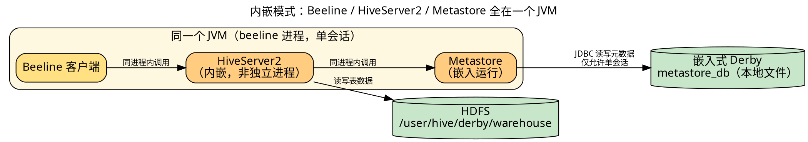
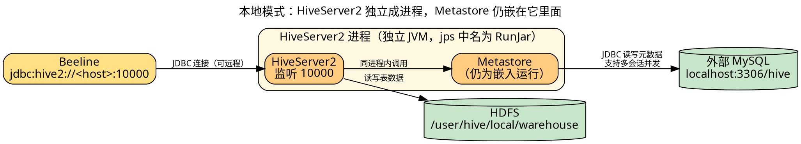
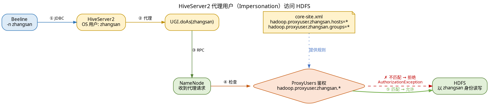
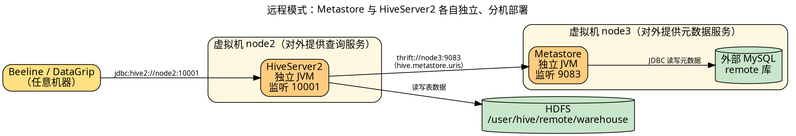

# Hive的部署与应用


## 学习目标

- 熟悉 **Beeline**，能够运用 Beeline 提供的命令选项和交互式命令实现对 Hive 的连接与操作。
- 掌握 **Hive 的部署**，能够根据实际应用需求选择并部署不同模式的 Hive 环境。
- 了解使用 **DataGrip** 操作 Hive 的方法，能够使用 DataGrip 连接 HiveServer2 实现对 Hive 的访问与操作。

## 概述

"工欲善其事，必先利其器。"要真正使用 Hive 完成数据仓库建设与数据分析任务，仅理解概念远远不够，还需要搭建可运行的 Hive 环境，并掌握常用访问工具的使用方法。

本单元包含 5 个任务：

| 编号 | 任务 | 核心内容 |
| --- | --- | --- |
| 1 | 认识 Beeline | 命令行客户端、命令选项与交互式命令 |
| 2 | 基于内嵌模式部署 Hive | Derby 内嵌，单会话，最简部署 |
| 3 | 基于本地模式部署 Hive | MySQL 存元数据，HiveServer2 独立进程 |
| 4 | 基于远程模式部署 Hive | Metastore 与 HiveServer2 分离部署 |
| 5 | 使用 DataGrip 操作 Hive | 图形化客户端连接 HiveServer2 |

## 1. 认识 Beeline

### Beeline 是什么

在 Hive 的体系架构中，**客户端**是用户提交查询语句并获取执行结果的直接交互入口。自 **Hive 2.0** 起，Beeline 逐渐取代旧版 Hive CLI，成为官方推荐的标准命令行客户端工具。

Beeline 基于 **JDBC 协议**构建，专为连接 **HiveServer2** 设计，支持远程访问、身份认证和会话管理。与 Hive CLI 不同，Beeline **不会在本地进程中直接启动 Hive 引擎**，而是作为轻量级远程客户端运行——用户提交 HiveQL 后，请求被发送至 HiveServer2 执行。

| 对比项 | Hive CLI（已废弃） | Beeline（官方推荐） |
| --- | --- | --- |
| 运行方式 | 本地进程直接启动 Hive 引擎 | 轻量级远程客户端 |
| 连接目标 | 直连 | 经 JDBC 连 HiveServer2 |
| 远程 / 认证 | 不支持 | 支持远程访问、身份认证、会话管理 |

通过 Hive 安装目录 `bin` 下的脚本文件 `beeline` 启动。

### 命令选项（启动 beeline 时指定）

命令选项在执行 `beeline` 脚本启动时使用，用于指定连接地址、认证方式、初始化参数等。

| 选项 | 语法 | 说明 |
| --- | --- | --- |
| `-u` | `-u url` | 指定连接 HiveServer2 的 JDBC 连接地址 |
| `-n` | `-n user` | 认证用户。未启用安全认证时可填任意用户名，但**建议填具备 HDFS 访问权限的有效用户**，否则查询时可能无权读写底层数据；不指定则默认 `anonymous` |
| `-p` | `-p pwd` | 认证用户密码。未启用安全认证时密码为空 |
| `-c` | `-c name` | 通过 `beeline-site.xml` 中预定义的名称加载 JDBC 连接地址 |
| `--hiveconf` | `--hiveconf property=value` | 在当前会话动态设置 Hive 参数，覆盖 `hive-site.xml` 同名配置；**仅当前会话有效**，断开后失效 |
| `-e` | `-e query` | 启动时执行单条 HiveQL，执行完自动退出，不进入交互界面 |
| `-f` | `-f file_path` | 启动时执行脚本文件中的全部 HiveQL（扩展名通常 `.hql`），执行完自动退出 |
| `-w` | `-w file_path` | 从文件读取密码，避免用 `-p` 时暴露明文密码 |
| `--outputformat` | `--outputformat=format` | 结果输出格式：`table`（默认表格）/ `vertical`（垂直列出，字段多时好用）/ `csv2` / `tsv2` / `json` |
| `--showHeader` | `--showHeader=boolean` | 是否显示表头，`true`（默认）/ `false` |
| `--truncateTable` | `--truncateTable=boolean` | 字段内容过宽时是否截断，`true` 截断 / `false`（默认）不截断 |
| `--incremental` | `--incremental=boolean` | 是否流式输出：`true` 逐行显示、不一次性载入内存（**适合大结果集**）；`false`（默认）全部查完再一次性展示 |
| `--silent` | `--silent=boolean` | 静默模式：`true` 只输出查询结果，不含日志与提示 |
| `--verbose` | `--verbose=boolean` | 是否显示详细调试信息，`false`（默认） |
| `--help` | `--help` | 显示帮助信息后退出 |

### 配置文件 beeline-site.xml（配合 `-c` 使用）

需**手动创建**，存放于 Hive 安装目录的 `conf` 目录：

```xml
<property>
    <name>beeline.hs2.jdbc.url.name</name>
    <value>url</value>
</property>
```

- `<name>`：定义该连接的**唯一标识名称**（`-c` 后面填的就是它）
- `<value>`：对应的 HiveServer2 **JDBC 连接地址**

### 交互式命令（进入 Beeline 后使用）

| 命令 | 语法 | 说明 |
| --- | --- | --- |
| `!connect` | `!connect url` | 指定连接 HiveServer2 的 JDBC 地址 |
| `!close` | `!close` | 关闭当前连接 |
| `!closeall` | `!closeall` | 关闭所有连接 |
| `!list` | `!list` | 查看所有连接及其编号 |
| `!go` | `!go id` | 按编号切换到某个已建立的连接 |
| `!quit` | `!quit` | 退出 Beeline |
| `!run` | `!run file_path` | 作用同命令选项 `-f` |
| `!script` | `!script file_path` | 开启录制，把后续所有命令存入指定文件；再次执行 `!script` 停止录制 |
| `!set` | `!set property=value` | 作用同 `--hiveconf` |
| `!sh` | `!sh cmd` | 在 Beeline 中直接执行 Shell 命令 |
| `!history` | `!history` | 查看历史命令 |
| `!outputformat` | `!outputformat format` | 作用同 `--outputformat` |
| `!tables` | `!tables` | 查看当前数据库中的所有表 |
| `!describe` | `!describe table` | 查看指定表的结构 |
| `!help` | `!help` | 显示帮助信息 |

### 连接 HiveServer2 的两种方式

1. **启动时直接指定**：执行 `beeline` 时用命令选项 `-u` 给出 JDBC 地址。
2. **进入交互界面后指定**：先启动 Beeline，再用交互式命令 `!connect` 给出 JDBC 地址。

连接地址格式：

```text
jdbc:hive2://host:port[/database]
```

| 片段 | 含义 |
| --- | --- |
| `host` | HiveServer2 所在服务器的 IP 地址或主机名 |
| `port` | HiveServer2 的端口号（默认 **10000**） |
| `database` | 可选，指定当前会话默认使用的数据库 |

## 2. 基于内嵌模式部署 Hive

### 内嵌模式是什么

内嵌模式是**最简单**的 Hive 部署方式，核心特征是**元数据存储与服务组件高度集成**：

- **无须启动 HiveServer2**；
- Metastore 以**嵌入方式**运行，使用嵌入式 **Derby** 数据库存储元数据。

下面三张模式图都用**虚线框表示"一个 JVM 进程"**，框内有几个组件就说明它们共用一个进程——这是看懂三种模式差别的关键。



一眼看懂：客户端、服务、元数据服务**三者挤在同一个 JVM**，没有任何跨进程调用，所以连接地址连主机名和端口都不用写（`jdbc:hive2://`）；元数据落在本地 Derby 文件里。

> 局限：嵌入式 Derby **仅支持单会话访问**，无法满足多客户端并发连接，也不具备元数据共享能力。因此只适用于本地单用户开发与功能验证，**不适用于多用户协作**。

下面以虚拟机 **node3** 为例演示部署步骤。

### 01 启动 Hadoop 集群

在虚拟机 node1 执行：

```bash
start-dfs.sh     # 启动 HDFS 集群
start-yarn.sh    # 启动 YARN 集群
```

### 02 上传 Hive 安装包

将 `apache-hive-3.1.2-bin.tar.gz` 上传到虚拟机 node3 的 `/export/software` 目录。

### 03 安装 Hive

将 Hive 安装至 `/opt/bigdata/hive/` 目录：

```bash
tar -zxvf apache-hive-3.1.2-bin.tar.gz -C /opt/bigdata/hive/
```

| 参数 | 含义 |
| --- | --- |
| `-z` | 用 gzip 解压 |
| `-x` | 解包 |
| `-v` | 显示过程 |
| `-f` | 指定文件 |
| `-C` | 解压到指定目录 |

### 04 创建软连接

```bash
ln -s /opt/bigdata/hive/hive-3.1.2 default
```

### 05 配置 Hive

编辑 Hive 安装目录 `conf` 下的配置文件：

```bash
vi /opt/bigdata/hive/default/conf/hive-site.xml
```

#### ① 数据路径与驱动

```xml
<!--配置数据文件在HDFS中的存储路径-->
<property>
    <name>hive.metastore.warehouse.dir</name>
    <value>/user/hive/derby/warehouse</value>
</property>
<!--配置连接嵌入式Derby数据库的JDBC驱动程序-->
<property>
    <name>javax.jdo.option.ConnectionDriverName</name>
    <value>org.apache.derby.jdbc.EmbeddedDriver</value>
</property>
```

#### ② 连接地址

```xml
<!--配置嵌入式Derby数据库的连接地址，并指定数据库文件在本地文件系统中的存储路径-->
<property>
    <name>javax.jdo.option.ConnectionURL</name>
    <value>jdbc:derby:/opt/hive/metastore_db;create=true</value>
</property>
```

> `create=true` 表示数据库不存在时自动创建。

### 06 配置系统环境变量

编辑系统环境变量文件 `profile`：

```bash
vi ~/.bashrc
```

在文件末尾追加：

```bash
export HIVE_HOME=/opt/bigdata/hive/default
export PATH=$HIVE_HOME/bin:$PATH
```

### 07 初始化系统环境变量

```bash
source ~/.bashrc
```

### 08 初始化 Hive 元数据

在嵌入式 Derby 数据库中建出 Hive 运行所需的元数据表结构：

```bash
schematool -dbType derby -initSchema
```

输出 `Initialization script completed` 即表示初始化成功。

> `schematool` 是 Hive 自带的元数据管理工具：`-dbType` 指定后端数据库类型，`-initSchema` 执行初始化。另有 `-info` 查看版本、`-upgradeSchema` 升级。


#### 排错1： NoSuchMethodError

```java
Exception in thread "main" java.lang.NoSuchMethodError: com.google.common.base.Preconditions.checkArgument(ZLjava/lang/String;Ljava/lang/Object;)V
```

##### 完整错误

```java
[zhangsan@node0 conf]$ schematool -dbType derby -initSchema SLF4J: Class path contains multiple SLF4J bindings. SLF4J: Found binding in [jar:file:/opt/bigdata/hive/apache-hive-3.1.2-bin/lib/log4j-slf4j-impl-2.10.0.jar!/org/slf4j/impl/StaticLoggerBinder.class] SLF4J: Found binding in [jar:file:/opt/bigdata/hadoop/hadoop-3.1.3/share/hadoop/common/lib/slf4j-log4j12-1.7.25.jar!/org/slf4j/impl/StaticLoggerBinder.class] SLF4J: See #multiple_bindings" target="_blank">http://www.slf4j.org/codes.html#multiple_bindings for an explanation. SLF4J: Actual binding is of type [org.apache.logging.slf4j.Log4jLoggerFactory] Exception in thread "main" java.lang.NoSuchMethodError: com.google.common.base.Preconditions.checkArgument(ZLjava/lang/String;Ljava/lang/Object;)V         at org.apache.hadoop.conf.Configuration.set(Configuration.java:1357)         at org.apache.hadoop.conf.Configuration.set(Configuration.java:1338)         at org.apache.hadoop.mapred.JobConf.setJar(JobConf.java:518)         at org.apache.hadoop.mapred.JobCo
```

##### 原因

Guava 是 **Google 开源的 Java 核心工具库**，全称是 **Google Guava**。你可以把它理解成“Java 标准库的增强版”或“Java 开发者的瑞士军刀”——它把很多日常开发中常用、但 JDK 原生支持不够好或不够方便的功能，封装成了一组稳定、高效的 API。

**提供集合、缓存、并发、字符串、参数校验等常用功能。很多大数据组件都依赖它，因此版本不一致时非常容易引发 `NoSuchMethodError`。**

##### 解决

1. 删除 Hive 自带的旧版 Guava；
2. 把 Hadoop 使用的 `guava-27.0-jre.jar` 复制到 Hive 的 `lib` 下；
3. 保证 Hive 和 Hadoop 使用同一个 Guava 版本。

```java
cd /opt/bigdata/hive/defautl/lib
rm -f guava-*.jar
    
cp /opt/bigdata/hadoop/default/share/hadoop/common/lib/guava-27.0-jre.jar /opt/bigdata/hive/default/lib/
```


### 09 操作 Hive

内嵌模式下 HiveServer2 **并非独立 JVM 进程**，而是与 Beeline 共处同一 JVM，所以**无须在连接地址中指定主机名和端口**，相应地也无法指定默认数据库：

```bash
beeline -u jdbc:hive2:// -n zhangsan
```

执行后会在当前目录生成 `derby.log`，记录嵌入式 Derby 的运行过程、错误信息与调试日志。连接成功后自动进入交互界面。

## 3. 基于本地模式部署 Hive

### 本地模式是什么

本地模式与内嵌模式部署方式相似，都适用于开发与测试环境。核心差异在于**元数据管理独立化**：

- 元数据**不再放在嵌入式 Derby**，而是迁移到外部关系型数据库（MySQL、PostgreSQL 等）；
- 摆脱单会话限制，**支持多用户并发访问**元数据服务；
- 由于涉及多会话，通常将 **HiveServer2 作为独立 JVM 进程**启动，**Metastore 仍以嵌入方式运行**。

### 本地模式执行流程图



一眼看懂：比内嵌模式只多画了一个框——**HiveServer2 从 beeline 进程里搬出来**独立运行，所以客户端必须写主机名和端口；但 Metastore 还赖在 HS2 进程里没出来。

### HiveServer2 的两种启动方式

#### ① 前台启动

在当前终端前台运行，占用终端窗口，日志实时输出；用 `Ctrl + C` 或关闭终端终止。

```bash
hive --service hiveserver2
```

#### ② 后台启动

作为后台进程运行（进程名 `RunJar`），不占用终端，关闭终端后仍保持运行，启动后返回进程 ID，可用 `kill` 终止。

```bash
hive --service hiveserver2 &
```

实际使用中通常配合**日志重定向**：

```bash
nohup hive --service hiveserver2 > /opt/bigdata/hive/default/data/hiveserver2.log 2>&1 &
```

> 注意：日志重定向时若文件不存在会自动创建，但**文件所在目录必须事先创建**，否则命令执行失败。

| 片段 | 含义 |
| --- | --- |
| `nohup` | 忽略挂断信号，终端关闭后进程继续运行 |
| `> file` | 标准输出重定向到文件 |
| `2>&1` | 标准错误也合并到同一文件 |
| `&` | 放到后台执行 |

下面演示用 **MySQL 5.7** 存储元数据（与《Hive安装配置》一致，适用于 **CentOS 7**），沿用前文已安装的 Hive，以虚拟机 **node3** 为例。

### 01 安装 MySQL

> 环境提示：**MySQL 8.4 不支持 CentOS 7**（它只提供 el8/el9 的安装包），且 CentOS 7 的包管理器是 `yum` 而非 `dnf`。所以这里改用《Hive安装配置》中已验证可用的 **MySQL 5.7 + yum** 方案。

**（1）添加 MySQL 5.7 的 yum 源**

CentOS 7 默认源里没有 MySQL，需先添加官方源。新建 repo 文件：

```bash
vi /etc/yum.repos.d/mysql-community.repo
```

填入以下内容：

```ini
[mysql57-community]
name=MySQL 5.7 Community Server
baseurl=http://repo.mysql.com/yum/mysql-5.7-community/el/7/$basearch/
enabled=1
gpgcheck=0
gpgkey=file:///etc/pki/rpm-gpg/RPM-GPG-KEY-mysql
```

> `el/7` 对应 CentOS 7；`gpgcheck=0` 可省去导入公钥的步骤（学习环境可用）。

**（2）安装并启动 MySQL 服务**

```bash
yum install -y mysql-community-server

# 启动服务；看到 Active: active (running) 即正常
systemctl start mysqld
systemctl status mysqld
```

| 命令 | 作用 |
| --- | --- |
| `yum install` | 从仓库安装 MySQL 服务端 |
| `systemctl start` / `status` | 启动服务 / 查看运行状态 |

**（3）找到初始密码并登录**

MySQL 5.7 首次启动会为 root 生成一个**临时密码**并写进日志，必须先用它登录——**5.7 不先改密就无法执行任何操作**：

```bash
grep 'temporary password' /var/log/mysqld.log
```

记下冒号后的临时密码，然后登录：

```bash
mysql -u root -p
```

**（4）修改 root 密码**

```sql
-- 先放宽密码策略（可选；仅 MySQL 5.7 支持，MySQL 8 改法不同）
set global validate_password_policy=0;
set global validate_password_length=6;

-- 改成自己的密码
alter user 'root'@'localhost' identified by '123456';
```

| 语句 | 作用 |
| --- | --- |
| `set global validate_password_policy=0` | 放宽密码复杂度策略（否则简单密码会被拒绝） |
| `set global validate_password_length=6` | 密码最小长度改为 6 |
| `alter user … identified by` | 修改 root 密码 |

**（5）允许 root 从任意主机连接**（可选，便于远程管理）

```sql
use mysql;
update user set host='%' where user='root';   -- % 表示任意主机
flush privileges;                              -- 必须执行，否则改动不生效
quit;
```

**（6）创建元数据库与专用用户**

Hive 的元数据需要一个库来存放。这里建 `hive` 库，并创建专用用户 `zhangsan`（与《Hive安装配置》一致）：

```sql
CREATE DATABASE hive;
CREATE USER 'zhangsan'@'%' IDENTIFIED BY '123456';
GRANT ALL ON hive.* TO 'zhangsan'@'%';
FLUSH PRIVILEGES;
```

| 语句 | 作用 |
| --- | --- |
| `CREATE DATABASE hive` | 建专供 Hive 使用的元数据库 |
| `CREATE USER … '@'%'` | 建用户并允许其从**任意主机**连接（远程模式需要） |
| `GRANT ALL ON hive.*` | 授予该用户对 `hive` 库全部表的全部权限 |
| `FLUSH PRIVILEGES` | **必须执行**，否则授权不生效 |

> 后面"远程模式"还会用到 `remote` 库，届时再执行一次 `CREATE DATABASE remote;` 并把 `hive.*` 换成 `remote.*` 授权即可。

### 02 启动 Hadoop 集群

在虚拟机 node1 执行：

```bash
start-dfs.sh     # 启动 HDFS 集群
start-yarn.sh    # 启动 YARN 集群
```

### 03 配置 Hive

先把内嵌模式的配置改名，使其失效：

```bash
mv /opt/bigdata/hive/default/conf/hive-site.xml \
/opt/bigdata/hive/default/conf/hive-site-derby.xml
```

#### ① 数据路径

```xml
<!--配置数据文件在HDFS中的存储路径-->
<property>
    <name>hive.metastore.warehouse.dir</name>
    <value>/user/hive/local/warehouse</value>
</property>
<!--配置Hive查询执行过程中产生的临时文件在HDFS中的存储路径，默认为/tmp/hive-->
<property>
    <name>hive.exec.scratchdir</name>
    <value>/tmp_local/hive</value>
</property>
```

#### ② MySQL 连接地址与驱动

```xml
<!--配置MySQL数据库的连接地址，并指定元数据存储在hive数据库中-->
<property>
    <name>javax.jdo.option.ConnectionURL</name>
    <value>jdbc:mysql://localhost:3306/hive?createDatabaseIfNotExist=true&amp;useSSL=false&amp;useUnicode=true&amp;characterEncoding=UTF-8</value>
</property>
<!--配置Hive连接MySQL数据库使用的JDBC驱动程序-->
<property>
    <name>javax.jdo.option.ConnectionDriverName</name>
    <value>com.mysql.cj.jdbc.Driver</value>
</property>
```

#### ③ 登录用户与密码

```xml
<!--配置登录MySQL的用户-->
<property>
    <name>javax.jdo.option.ConnectionUserName</name>
    <value>zhangsan</value>
</property>
<!--配置登录MySQL的用户密码-->
<property>
    <name>javax.jdo.option.ConnectionPassword</name>
    <value>123456</value>
</property>
```

> JDBC URL 参数要点：`createDatabaseIfNotExist=true` 自动建库；`useSSL=false` 关闭 SSL（避免连接时的 SSL 警告）；`useUnicode/characterEncoding=UTF-8` **保证中文不乱码**。（`allowPublicKeyRetrieval` 是 **MySQL 8 专用**参数，5.7 不需要。）

### 04 添加 MySQL JDBC 驱动

将 MySQL 的 JDBC 驱动 `mysql-connector-java-8.0.29.jar` 添加到 Hive 安装目录的 `lib` 目录中，使 Hive 能通过 JDBC 连接 MySQL。

> 驱动选择要点：**8.0.x 的驱动可以连接 MySQL 5.7**，此时驱动类名仍是 `com.mysql.cj.jdbc.Driver`（即上面配置里写的值）。若你放的是 5.x 的驱动包，类名要改成 `com.mysql.jdbc.Driver`。

### 05 初始化 Hive 元数据

```bash
schematool -dbType mysql -initSchema
```

输出 `Initialization script completed` 即表示已在 MySQL 的 `hive` 库中成功初始化。


### 06 MySQL 客户端工具

```http
https://www.navicat.com.cn/download/navicat-premium-lite
```


### 07 启动 HiveServer2

后台启动并重定向日志到 `hiveserver2_local.log`：

```bash
nohup hive --service hiveserver2 > /opt/bigdata/hive/default/data/hiveserver2_local.log 2>&1 &
```

### 08 操作 Hive

```bash
[zhangsan@node0 hive]$ beeline -u jdbc:hive2://localhost:10000 -n zhangsan
Connecting to jdbc:hive2://localhost:10000
Connected to: Apache Hive (version 3.1.2)
Driver: Hive JDBC (version 2.3.9)
Transaction isolation: TRANSACTION_REPEATABLE_READ
Beeline version 2.3.9 by Apache Hive
0: jdbc:hive2://localhost:10000> !tables
+------------+--------------+-------------+-------------+----------+-----------+-------------+------------+----------------------------+-----------------+
| TABLE_CAT  | TABLE_SCHEM  | TABLE_NAME  | TABLE_TYPE  | REMARKS  | TYPE_CAT  | TYPE_SCHEM  | TYPE_NAME  | SELF_REFERENCING_COL_NAME  | REF_GENERATION  |
+------------+--------------+-------------+-------------+----------+-----------+-------------+------------+----------------------------+-----------------+
+------------+--------------+-------------+-------------+----------+-----------+-------------+------------+----------------------------+-----------------+
0: jdbc:hive2://localhost:10000>
```

### 排错1：User: xxx is not allowed to impersonate xxx`

连接 HiveServer2 时若看到如下报错：

```text
Error: Could not open client transport with JDBC Uri: jdbc:hive2://localhost:10000:
Failed to open new session: java.lang.RuntimeException:
org.apache.hadoop.ipc.RemoteException(...AuthorizationException):
User: zhangsan is not allowed to impersonate zhangsan (state=08S01,code=0)
```

#### 原因

这是 **Hadoop 的代理用户（impersonation）权限**问题，不是 Hive 配错。HiveServer2 以系统用户 `zhangsan` 运行，当 Beeline 用 `-n zhangsan` 连入时，HS2 需要**代表该用户去访问 HDFS**；Hadoop 默认禁止这种代理行为，必须显式授权。



> 注意：**即使代理的用户名与 HS2 运行用户同名，也必须授权**——所以才会出现"zhangsan 不允许冒充 zhangsan"这句看似矛盾的话。

#### 解决

##### 添加配置

在 **Hadoop** 的 `core-site.xml` 中添加（`zhangsan` 换成**实际运行 HiveServer2 的那个系统用户**）：

```xml
<property>
    <name>hadoop.proxyuser.zhangsan.hosts</name>
    <value>*</value>
</property>
<property>
    <name>hadoop.proxyuser.zhangsan.groups</name>
    <value>*</value>
</property>
```

##### 重新加载配置

让 NameNode 重新加载代理用户配置：

```bash
hdfs dfsadmin -refreshSuperUserGroupsConfiguration
```

| 配置项 | 含义 |
| --- | --- |
| `hadoop.proxyuser.<用户>.hosts` | 允许该用户代理的来源主机，`*` 表示任意 |
| `hadoop.proxyuser.<用户>.groups` | 允许代理的目标用户组，`*` 表示任意 |

> ① 若刷新后仍报同样的错，重启 HDFS：`stop-dfs.sh && start-dfs.sh`（`core-site.xml` 是 HDFS 侧配置，重启最稳妥）。② `*` 仅适合学习环境，生产应限定具体主机与用户组。

### 排错2：No such file or directory

**日志所在目录必须事先存在**：`nohup ... > /opt/.../data/hiveserver2.log 2>&1 &` 中文件会自动创建，但**目录必须先 `mkdir`**，否则 bash 直接报 `No such file or directory` 并退出（Exit 1）。

### 排错3：Connection refused

```java
Error: Could not open client transport with JDBC Uri: jdbc:hive2://localhost:10000: java.net.ConnectException: Connection refused (Connection refused) (state=08S01,code=0)
Beeline version 3.1.2 by Apache Hive
```

> **确认 HS2 真的在监听**：
>
> - ` netstat -lntp|grep 10000` 有输出才算起来；
>
> - `jps` 里应能看到 `RunJar`（Hive 服务以 RunJar 进程运行）。
>
> **HS2 首次启动常需 30~60 秒**，未完成就连接会得到 `Connection refused` 。


### 排错4： Error: Could not find or load main class MRAppMaster

##### HiveServer Error

```bash
INFO  : Completed executing command(queryId=zhangyiman_20260924155824_d60237da-3849-40a5-8205-636d4138afef); Time taken: 9.351 seconds
INFO  : Concurrency mode is disabled, not creating a lock manager
Error: Error while processing statement: FAILED: Execution Error, return code 2 from org.apache.hadoop.hive.ql.exec.mr.MapRedTask (state=08S01,code=2)
```

##### YARN Error

```xml
[2026-09-24 15:58:33.683]Container exited with a non-zero exit code 1. Error file: prelaunch.err.
Last 4096 bytes of prelaunch.err :
Last 4096 bytes of stderr :
Error: Could not find or load main class org.apache.hadoop.mapreduce.v2.app.MRAppMaster

Please check whether your etc/hadoop/mapred-site.xml contains the below configuration:
<property>
  <name>yarn.app.mapreduce.am.env</name>
  <value>HADOOP_MAPRED_HOME=${full path of your hadoop distribution directory}</value>
</property>
<property>
  <name>mapreduce.map.env</name>
  <value>HADOOP_MAPRED_HOME=${full path of your hadoop distribution directory}</value>
</property>
<property>
  <name>mapreduce.reduce.env</name>
  <value>HADOOP_MAPRED_HOME=${full path of your hadoop distribution directory}</value>
</property>
```

##### 解决

```xml
<property>
  <name>yarn.app.mapreduce.am.env</name>
  <value>HADOOP_MAPRED_HOME=${HADOOP_HOME}</value>
</property>
<property>
  <name>mapreduce.map.env</name>
  <value>HADOOP_MAPRED_HOME=${HADOOP_HOME}</value>
</property>
<property>
  <name>mapreduce.reduce.env</name>
  <value>HADOOP_MAPRED_HOME=${HADOOP_HOME}</value>
</property>
```


## 4. 基于远程模式部署 Hive

### 远程模式是什么

远程模式是**生产环境常见**的部署方式，核心特征是**服务组件分离部署**：

- 元数据仍存储在外部关系型数据库中；
- **HiveServer2 和 Metastore 均作为独立 JVM 进程**启动，且**部署在不同计算机上**；
- 实现组件解耦与资源隔离。



一眼看懂：两个虚线框**彻底分开且跨机器**——HS2 不再内嵌 Metastore，而是通过 `hive.metastore.uris` 走 Thrift 远程调用 node3 的 Metastore；客户端可以来自任意机器。

### Metastore 的启动方式

与 HiveServer2 类似，也分前台与后台：

```bash
# ① 前台启动
hive --service metastore

# ② 后台启动
hive --service metastore &
```

实际使用通常配合日志重定向：

```bash
nohup hive --service metastore > /opt/bigdata/hive/default/data/metastore.log 2>&1 &
```

本任务通过 **node2 + node3** 实现：

- node2 重新安装 Hive 并启动 **HiveServer2**（对外提供查询服务），
- node3 沿用已安装的 Hive 并启动 **Metastore**（对外提供元数据管理服务）。

### 01 启动 Hadoop 集群

在虚拟机 node1 执行：

```bash
start-dfs.sh     # 启动 HDFS 集群
start-yarn.sh    # 启动 YARN 集群
```

### 02 在虚拟机 node3 配置 Hive

先把本地模式的配置改名使其失效：

```bash
mv /opt/bigdata/hive/default/conf/hive-site.xml \
/opt/bigdata/hive/default/conf/hive-site-local.xml
```

#### ① 数据路径与连接地址

```xml
<!--配置数据文件在HDFS中的存储路径-->
<property>
    <name>hive.metastore.warehouse.dir</name>
    <value>/user/hive/remote/warehouse</value>
</property>
<!--配置MySQL数据库的连接地址，并指定元数据存储在remote数据库中-->
<property>
    <name>javax.jdo.option.ConnectionURL</name>
    <value>jdbc:mysql://localhost:3306/remote?createDatabaseIfNotExist=true&amp;useSSL=false&amp;useUnicode=true&amp;characterEncoding=UTF-8</value>
</property>
```

#### ② 驱动、用户与密码

```xml
<!--配置Hive连接MySQL数据库使用的JDBC驱动程序-->
<property>
    <name>javax.jdo.option.ConnectionDriverName</name>
    <value>com.mysql.cj.jdbc.Driver</value>
</property>
<!--配置登录MySQL的用户-->
<property>
    <name>javax.jdo.option.ConnectionUserName</name>
    <value>zhangsan</value>
</property>
<!--配置登录MySQL的用户密码-->
<property>
    <name>javax.jdo.option.ConnectionPassword</name>
    <value>123456</value>
</property>
```

此处使用了新的数据库 **remote**，因此需要为zhangsan用户授权。

```mysql
CREATE DATABASE hive;
CREATE USER 'zhangsan'@'%' IDENTIFIED BY '123456';
GRANT ALL ON remote.* TO 'zhangsan'@'%';
FLUSH PRIVILEGES;
```

### 03 初始化 Hive 元数据

在虚拟机 node3 执行，在 MySQL 的 `remote` 库中建表结构：

```bash
schematool -dbType mysql -initSchema
```

### 04 启动 Metastore（node3）

在虚拟机 node3 后台启动并重定向日志：

```bash
nohup hive --service metastore > /opt/bigdata/hive/default/data/metastore.log 2>&1 &
```

### 05 确认 MetaStore 状态

```bash
[zhangsan@node3 default]$ jps
13549 RunJar
[zhangsan@node3 default]$ netstat -tunlp |grep 13549
tcp6       0      0 :::9083                 :::*                    LISTEN      13549/java
```


### 06 在虚拟机 node2 安装 Hive

上传安装包到 `~/software`，然后安装：

```bash
tar -zxvf apache-hive-3.1.2-bin.tar.gz -C /opt/bigdata/hive/
```

创建软连接：

```bash
ln -s opt/bigdata/hive/hive-3.1.2-bin default
```

### 07 在 node2 配置系统环境变量

```bash
vi ~/.bashrc
```

末尾追加：

```bash
export HIVE_HOME=/opt/bigdata/hive/hive-3.1.2
export PATH=$HIVE_HOME/bin:$PATH
```

执行 `source ~/.bashrc` 使配置生效。

### 08 在 node2 配置 Hive

```bash
vi /opt/bigdata/hive/hive-3.1.2/conf/hive-site.xml
```

#### ① 数据路径

```xml
<!--配置数据文件在HDFS中的存储路径-->
<property>
    <name>hive.metastore.warehouse.dir</name>
    <value>/user/hive/remote/warehouse</value>
</property>
<!--配置Hive查询执行过程中产生的临时文件在HDFS中的存储路径，默认为/tmp/hive-->
<property>
    <name>hive.exec.scratchdir</name>
    <value>/tmp_remote/hive</value>
</property>
```

#### ② 指向远端 Metastore

```xml
<!--配置Metastore的连接地址-->
<property>
    <name>hive.metastore.uris</name>
    <value>thrift://node3:9083</value>
</property>
```

#### ③ HiveServer2 绑定地址与端口

```xml
<!--配置HiveServer2绑定的网络地址，默认为localhost-->
<property>
    <name>hive.server2.thrift.bind.host</name>
    <value>node2</value>
</property>
<!--配置HiveServer2监听的端口，默认为10000-->
<property>
    <name>hive.server2.thrift.port</name>
    <value>10001</value>
</property>
```

> 关键：`hive.metastore.uris` 让本节点的 HiveServer2 去连 **node3:9083** 的 Metastore，而不是本地嵌入运行——这正是"远程模式"的本质。端口 9083 是 Metastore 默认端口。

### 09 启动 HiveServer2（node2）

在虚拟机 node2 后台启动并重定向日志：

```bash
nohup hive --service hiveserver2 > /opt/bigdata/hive/default/data/hiveserver2.log 2>&1 &
```

### 10 确认 HiveServer2 状态

```bash
(base) [zhangsan@node2 ~]$ jps
21118 RunJar
(base) [zhangsan@node2 ~]$ netstat -tunlp |grep 21118
tcp6       0      0 :::10001                :::*                    LISTEN      21118/java
tcp6       0      0 :::10002                :::*                    LISTEN      21118/java
```

### 11 操作 Hive

Hive 客户端可在任意计算机通过远程连接 HiveServer2 操作 Hive。这里在 node2 本地连接（简化步骤、减少网络开销）：

```bash
beeline -u jdbc:hive2://node2:10001 -n zhangsan
```

> 注意端口是 **10001**（前面在 `hive-site.xml` 中改过），不是默认的 10000。


## 5. 使用 DataGrip 操作 Hive

### DataGrip 是什么

DataGrip 是 JetBrains 开发的**跨平台数据库管理工具**，广泛用于 SQL 查询、数据库管理与数据分析。它支持 MySQL、Oracle、SQL Server 等主流数据库，同时**原生支持 Hive、Clickhouse 等大数据平台**。

它提供现代化界面与丰富功能，便于高效管理数据库对象、执行查询、可视化数据以及进行数据库建模与设计。针对 Hive，DataGrip 提供**原生 JDBC 连接支持**，可直接连接 HiveServer2。

本书使用 DataGrip **2025.1.3**，演示连接虚拟机 node2 中启动的 HiveServer2。

### 操作步骤

#### 01 在主界面依次单击 **文件 → 新建 → 数据源 → Apache Hive**，打开"数据源和驱动程序"窗口。

#### 02 单击 **下载**，下载 Hive 的驱动程序文件。

#### 03 在"数据源和驱动程序"窗口配置连接信息：

| 配置项 | 值 |
| --- | --- |
| 名称 | `MyHive` |
| 主机 | `192.168.107.102`（HiveServer2 绑定的 IP） |
| 端口 | `10001`（HiveServer2 监听端口） |
| 用户 | `zhangsan` |

#### 04 单击 **架构** 选项卡，勾选 **所有架构**，使连接能获取 Hive 中的所有数据库；否则默认只连 `default` 库。

#### 05 单击 **测试连接**，验证能否成功连到指定 HiveServer2。

#### 06 单击 **确定** 保存连接设置并返回主界面，此时会基于 `MyHive` 配置自动连接。

#### 07 在名为 `console` 的 SQL 文件中输入查询表 `users` 全部数据的 HiveQL 并运行：

```sql
SELECT * FROM users;
```


## 总结

本单元主要讲解了 Hive 部署与应用：

1. 介绍了 Hive 客户端工具 **Beeline** 的基本概念与使用方法；
2. 详细说明了基于不同模式部署 Hive 的方法，包括**内嵌模式、本地模式和远程模式**；
3. 介绍了使用 **DataGrip** 操作 Hive 的方法。

通过本单元的学习，读者能够根据实际需求灵活选择并部署不同模式的 Hive 环境，掌握多种客户端工具的使用方法，为后续 Hive 数据仓库的构建与综合应用打下坚实基础。

### 三种部署模式对比（速查）

回顾各模式小节开头的架构图，差别就是"虚线框怎么画"——框从 1 个变 2 个，再变成分居两机的 2 个：

| 模式 | 元数据库 | Metastore | HiveServer2 | 适用场景 |
| --- | --- | --- | --- | --- |
| **内嵌** | 嵌入式 Derby | 嵌入 JVM | 不启动（与 Beeline 同 JVM） | 本地单用户开发、功能验证 |
| **本地** | 外部 MySQL 等 | 嵌入 JVM | 独立 JVM 进程 | 开发 / 测试，需多用户并发 |
| **远程** | 外部 MySQL 等 | **独立 JVM**（如 node3:9083） | 独立 JVM（可另机部署） | **生产环境**，组件解耦与资源隔离 |
