# 第5章 数据仓库设计

## 5.1 数据仓库分层规划

优秀可靠的数仓体系，需要良好的数据分层结构。合理的分层，能够使数据体系更加清晰，使复杂问题得以简化。以下是该项目的分层规划。

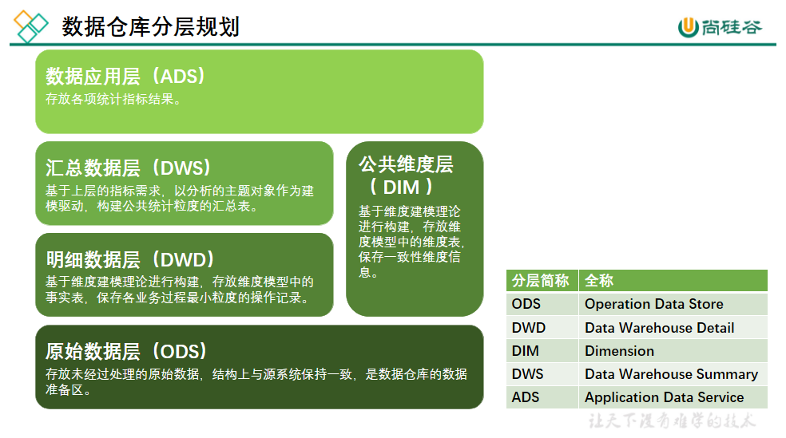

<!-- redraw:image12 lang=mermaid why="图是数仓分层架构（ODS→DWD→DWS→ADS 四层 + DIM 公共维度层），EMF 矢量文本已确认四层名称与各自职责描述；选 mermaid flowchart 表达分层流向，DIM 作为横向下层旁路。" -->
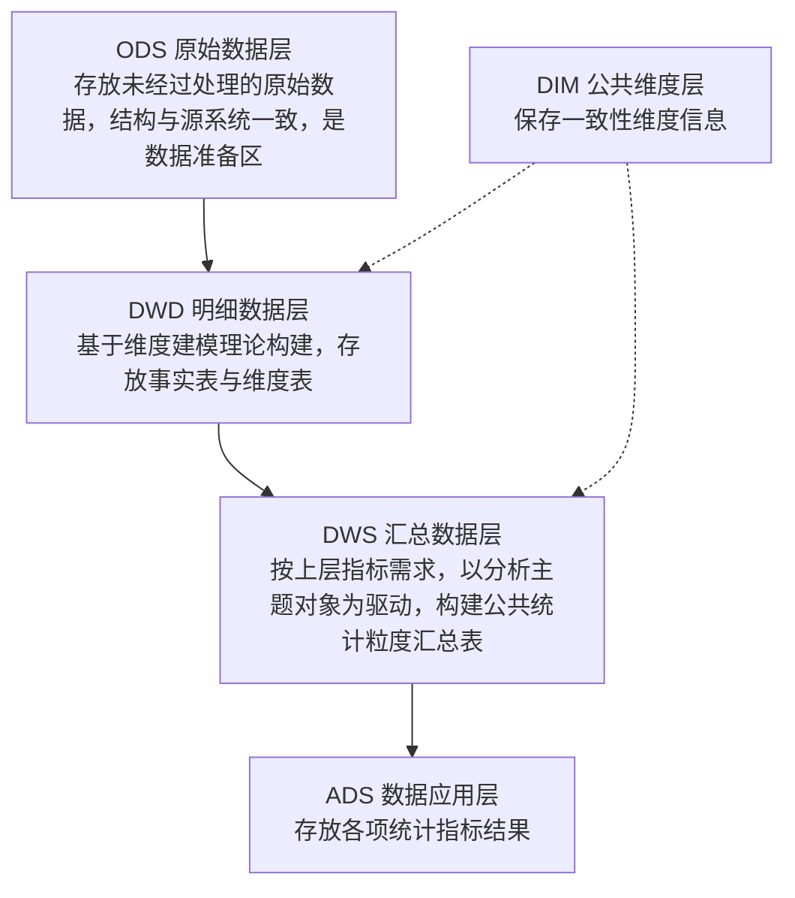
<!-- /redraw -->

## 5.2 数据仓库构建流程

以下是构建数据仓库的完整流程。

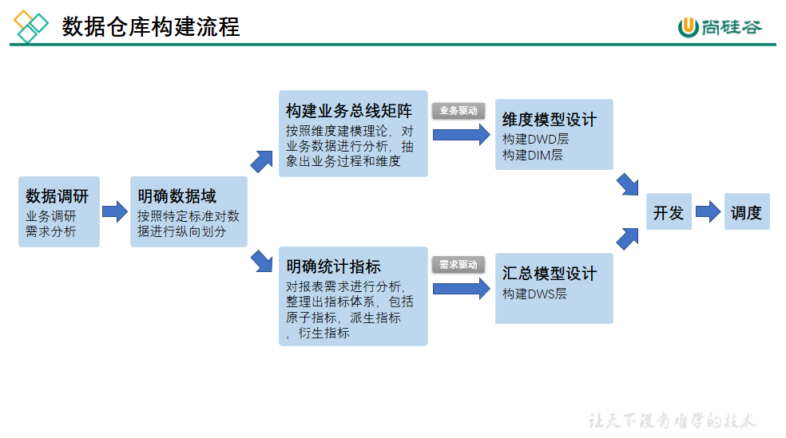

<!-- redraw:image13 lang=mermaid why="图是'数据仓库构建流程'步骤图（数据调研→明确数据域→业务总线矩阵→明确统计指标→维度模型设计/汇总模型设计→开发→调度），EMF 文本已确认各步骤名；选 mermaid flowchart 表达顺序流程。" -->
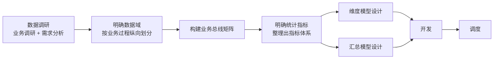
<!-- /redraw -->

### 5.2.1 数据调研

数据调研重点要做两项工作，分别是业务调研和需求分析。这两项工作做的是否充分，直接影响着数据仓库的质量。

**1）业务调研**

业务调研的主要目标是**熟悉业务流程**、**熟悉业务数据**。

**熟悉业务流程**要求做到，明确每个业务的具体流程，需要将该业务所包含的每个**业务过程**一一列举出来。

**熟悉业务数据**要求做到，将数据（包括埋点日志和业务数据表）与业务过程对应起来，明确每个业务过程会对哪些表的数据产生影响，以及产生什么影响。产生的影响，需要具体到，是新增一条数据，还是修改一条数据，并且需要明确新增的内容或者是修改的逻辑。

下面以在线教育中的交易业务为例进行演示，交易业务涉及到的业务过程有用户试听、用户下单、用户支付，具体流程如下图。

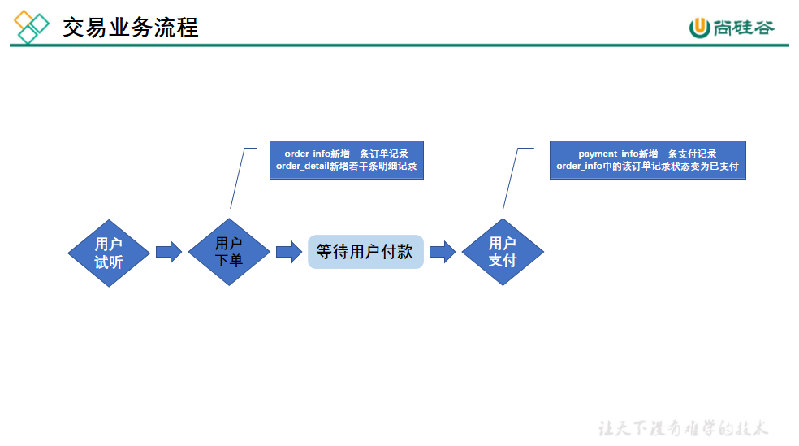

<!-- redraw:image14 lang=mermaid why="图是交易业务流程（试听→下单→支付），EMF 文本含 order_info / order_detail / payment_info 三张表及'新增订单/明细/支付记录、状态变已支付'等落库动作；选 mermaid flowchart 表达主流程与数据落地动作。" -->

<!-- /redraw -->

**2）需求分析**

典型的需求指标如，最近一天各省份 Java 学科订单总额。

分析需求时，需要明确需求所需的**业务过程**及**维度**，例如该需求所需的业务过程就是用户下单，所需的维度有日期，省份，科目。

**3）总结**

做完业务分析和需求分析之后，要保证每个需求都能找到与之对应的业务过程及维度。若现有数据无法满足需求，则需要和业务方进行沟通，例如某个页面需要新增某个行为的埋点。

### 5.2.2 明确数据域

数据仓库模型设计除横向的分层外，通常也需要根据业务情况进行纵向划分数据域。

划分数据域的意义是**便于数据的管理和应用**。

通常可以根据业务过程或者部门进行划分，本项目根据业务过程进行划分，需要注意的是一个业务过程只能属于一个数据域。

下面是本数仓项目所需的所有业务过程及数据域划分详情。

| 数据域 | 业务过程                             |
|--------|--------------------------------------|
| 交易域 | 加购、下单、支付成功                 |
| 流量域 | 页面浏览、启动应用、动作、曝光、错误 |
| 用户域 | 注册、登录                           |
| 互动域 | 收藏、评价                           |
| 考试域 | 考试                                 |
| 学习域 | 观看视频                             |

### 5.2.3 构建业务总线矩阵

业务总线矩阵中包含维度模型所需的所有事实（业务过程）以及维度，以及各业务过程与各维度的关系。矩阵的行是一个个业务过程，矩阵的列是一个个的维度，行列的交点表示业务过程与维度的关系。

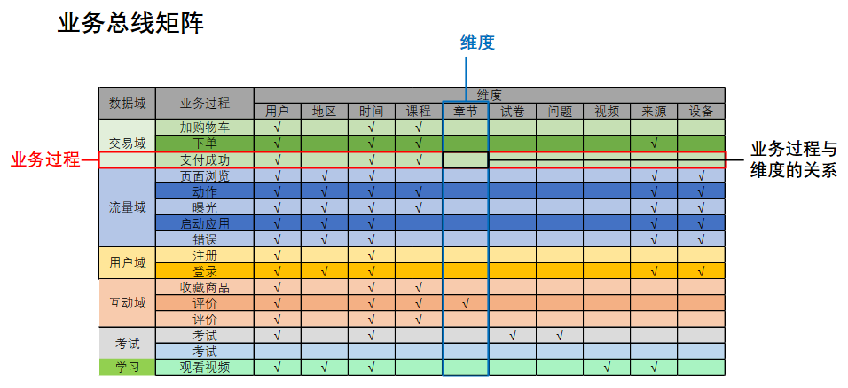

<!-- redraw:image15 lang=md why="图是'业务总线矩阵'（业务过程 × 维度 的勾选关系），EMF 矢量文本精确给出了 10 个维度列与各行业务过程的 √ 位置；本质是矩阵表，故选 markdown 表格裸插入而非绘图。" -->
| 数据域 | 业务过程 | 用户 | 地区 | 时间 | 课程 | 章节 | 试卷 | 问题 | 视频 | 来源 | 设备 |
|---|---|:--:|:--:|:--:|:--:|:--:|:--:|:--:|:--:|:--:|:--:|
| 交易域 | 加购物车 | ✓ | | ✓ | ✓ | | | | | | |
| 交易域 | 下单 | ✓ | | ✓ | ✓ | | | | | ✓ | |
| 交易域 | 支付成功 | ✓ | | ✓ | ✓ | | | | | | |
| 流量域 | 页面浏览 | ✓ | ✓ | ✓ | | | | | | ✓ | ✓ |
| 流量域 | 动作 | ✓ | ✓ | ✓ | ✓ | | | | | ✓ | ✓ |
| 流量域 | 曝光 | ✓ | ✓ | ✓ | ✓ | | | | | ✓ | ✓ |
| 流量域 | 启动应用 | ✓ | ✓ | ✓ | | | | | | ✓ | ✓ |
| 流量域 | 错误 | ✓ | ✓ | ✓ | | | | | | ✓ | ✓ |
| 用户域 | 注册 | ✓ | | ✓ | | | | | | | |
| 用户域 | 登录 | ✓ | ✓ | ✓ | | | | | | ✓ | ✓ |
| 互动域 | 收藏商品 | ✓ | | ✓ | ✓ | | | | | | |
| 互动域 | 评价 | ✓ | | ✓ | ✓ | ✓ | | | | | |
| 考试域 | 考试 | ✓ | | ✓ | | | ✓ | ✓ | | | |
| 学习域 | 观看视频 | ✓ | ✓ | ✓ | | | | | ✓ | ✓ | |
<!-- /redraw -->

一个业务过程对应维度模型中一张事务型事实表，一个维度则对应维度模型中的一张维度表。所以构建业务总线矩阵的过程就是设计维度模型的过程。但是需要注意的是，总线矩阵中通常只包含事务型事实表，另外两种类型的事实表需单独设计。

按照事务型事实表的设计流程，**选择业务过程🡪声明粒度🡪确认维度🡪确认事实**，得到的最终的业务总线矩阵见以下表格。

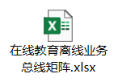

后续的DWD层以及DIM层的搭建需参考业务总线矩阵。

### 5.2.4 明确统计指标

明确统计指标具体的工作是，深入分析需求，构建指标体系。构建指标体系的主要意义就是指标定义标准化。所有指标的定义，都必须遵循同一套标准，这样能有效的避免指标定义存在歧义，指标定义重复等问题。

**1）指标体系相关概念**

（1）原子指标

原子指标基于某一**业务过程**的**度量值**，是业务定义中不可再拆解的指标，原子指标的核心功能就是对指标的**聚合逻辑**进行了定义。我们可以得出结论，原子指标包含三要素，分别是业务过程、度量值和聚合逻辑。

例如**订单总额**就是一个典型的原子指标，其中的业务过程为用户下单、度量值为订单金额，聚合逻辑为sum()求和。需要注意的是原子指标只是用来辅助定义指标一个概念，通常不会对应有实际统计需求与之对应。

（2）派生指标

派生指标基于原子指标，其与原子指标的关系如下图所示。

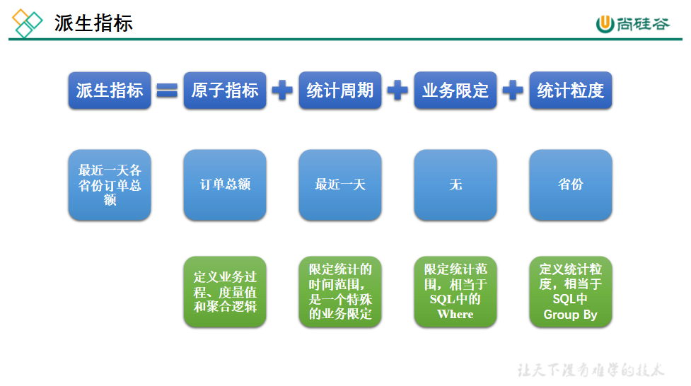

<!-- redraw:image17 lang=mermaid why="图展示原子指标到派生指标的构成（派生指标 = 原子指标 + 统计周期 + 统计粒度 + 业务限定），EMF 文本含原子指标/派生指标/统计粒度/统计周期/业务限定/订单总额等；选 mermaid flowchart。" -->
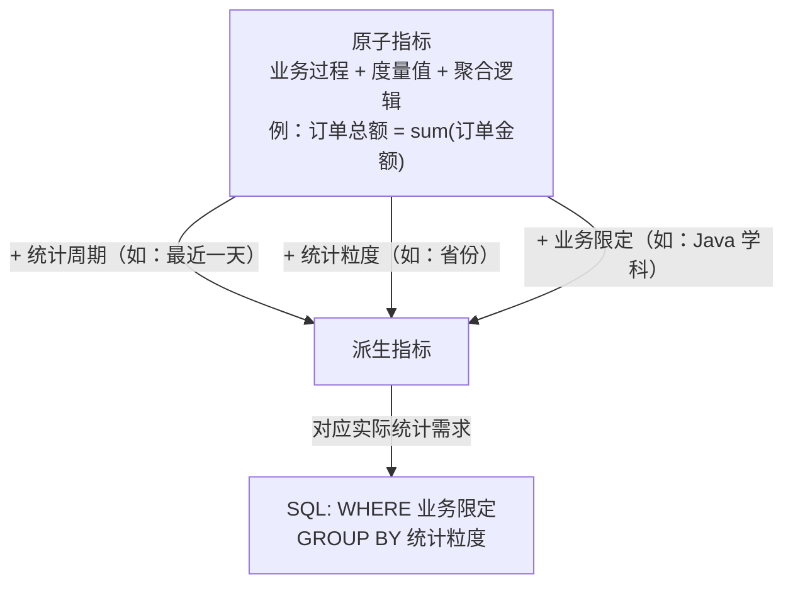
<!-- /redraw -->

与原子指标不同，派生指标通常会对应实际的统计需求。请从图中的例子中，体会指标定义标准化的含义。

（3）衍生指标

衍生指标是在一个或多个派生指标的基础上，通过各种逻辑运算复合而成的。例如比率、比例等类型的指标。衍生指标也会对应实际的统计需求。

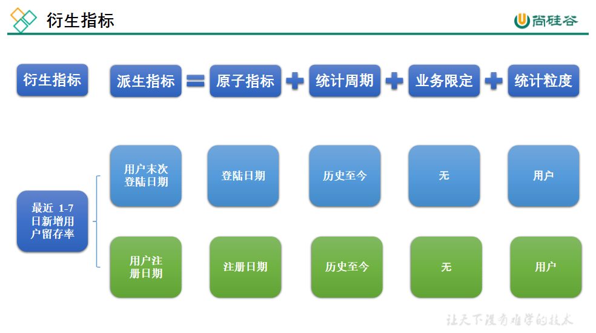

<!-- redraw:image18 lang=mermaid why="图展示衍生指标由一个或多个派生指标经复合运算得到（比率/比例等），EMF 文本含原子指标/派生指标/衍生指标/统计周期/统计粒度/日新增用户/用户留存率等；选 mermaid flowchart。" -->
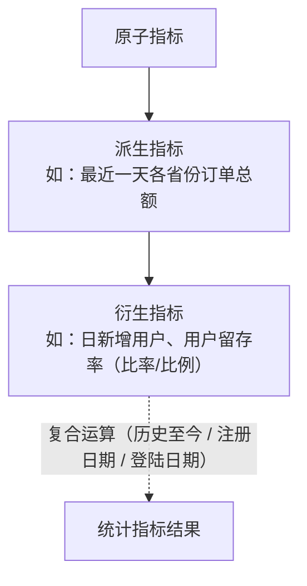
<!-- /redraw -->

**2）指标体系对于数仓建模的意义**·

通过上述两个具体的案例可以看出，绝大多数的统计需求，都可以使用原子指标、派生指标以及衍生指标这套标准去定义。同时能够发现这些统计需求都直接的或间接的对应一个或者是多个派生指标。

当统计需求足够多时，必然会出现部分统计需求对应的派生指标相同的情况。这种情况下，我们就可以考虑将这些公共的派生指标保存下来，这样做的主要目的就是减少重复计算，提高数据的复用性。

这些公共的派生指标统一保存在数据仓库的DWS层。因此DWS层设计，就可以参考我们根据现有的统计需求整理出的派生指标。

按照上述标准整理出的指标体系如下：

（1）思维导图版

（2）PDF版

从上述指标体系中抽取出来的所有派生指标见如下表格。

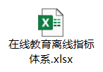

### 5.2.4 维度模型设计

维度模型的设计参照上述得到的业务总线矩阵即可。事实表存储在DWD层，维度表存储在DIM层。

### 5.2.5 汇总模型设计

汇总模型的设计参考上述整理出的指标体系（主要是派生指标）即可。汇总表与派生指标的对应关系是，**一张汇总**表通常**包含**业务过程相同、统计周期相同、统计粒度相同的**多个派生指标**。请思考：汇总表与事实表的对应关系是？
