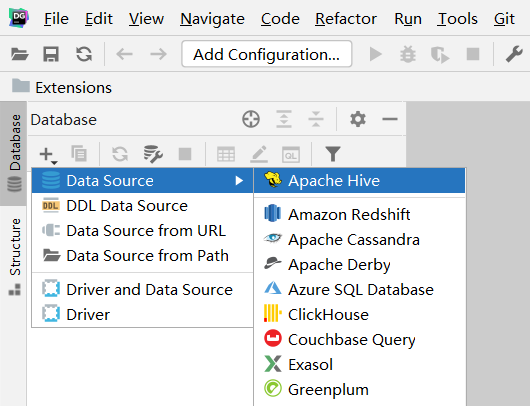
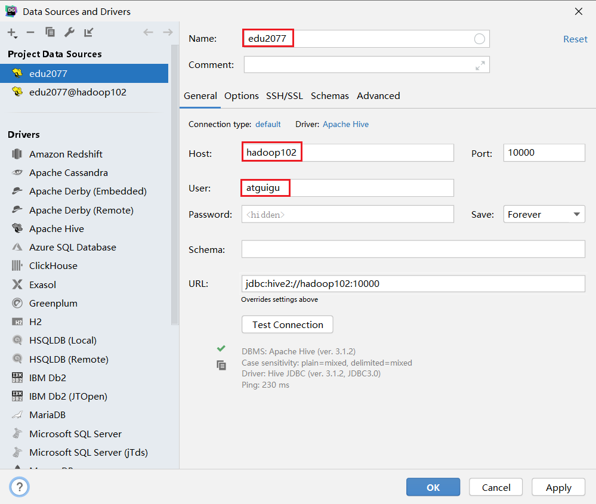
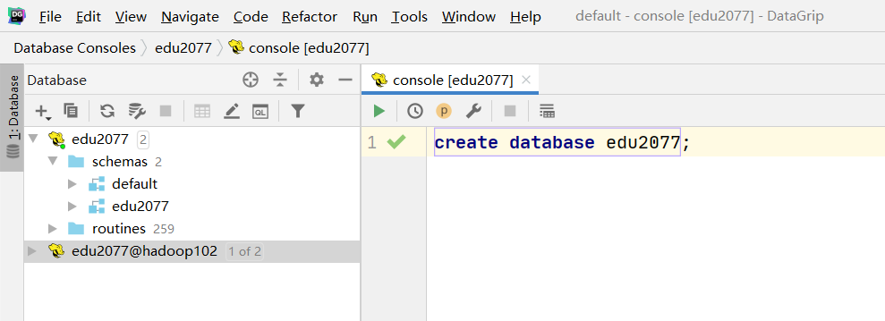
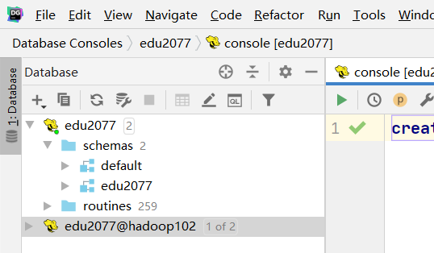
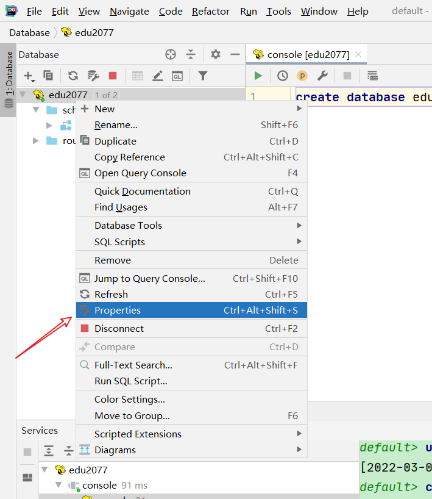
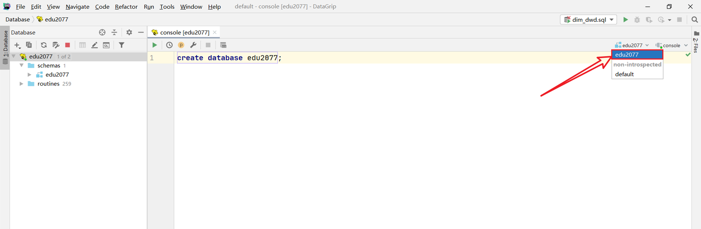

# 第6章 数据仓库环境准备

## 6.1 数据仓库运行环境

### 6.1.1 Hive环境搭建

#### **1）Hive引擎简介**

Hive引擎包括：默认MR、tez、spark

Hive on Spark：Hive既作为存储元数据又负责SQL的解析优化，语法是HQL语法，执行引擎变成了Spark，Spark负责采用RDD执行。

Spark on Hive : Hive只作为存储元数据，Spark负责SQL解析优化，语法是Spark SQL语法，Spark负责采用RDD执行。

#### **2）Hive on Spark配置**

##### （1）兼容性说明

注意：官网下载的Hive3.1.2和Spark3.0.0默认是不兼容的。因为Hive3.1.2支持的Spark版本是2.4.5，所以需要我们重新编译Hive3.1.2版本。

编译步骤：官网下载Hive3.1.2源码，修改pom文件中引用的Spark版本为3.0.0，如果编译通过，直接打包获取jar包。如果报错，就根据提示，修改相关方法，直到不报错，打包获取jar包。

##### （2）在Hive所在节点部署Spark

如果之前已经部署了Spark，则该步骤可以跳过

###### Spark官网下载jar包地址：

[<u>http://spark.apache.org/downloads.html</u>](http://spark.apache.org/downloads.html)

```bash
[zhangsan@node0 ~]$ mkdir /opt/bigdata/spark/
[zhangsan@node0 ~]$ cd /opt/bigdata/spark
[zhangsan@node0 spark]$ wget https://archive.apache.org/dist/spark/spark-3.0.0/spark-3.0.0-bin-hadoop3.2.tgz
```

###### 上传并解压解压spark-3.0.0-bin-hadoop3.2.tgz

``` bash
[zhangsan@node0 spark]$ tar -zxvf spark-3.0.0-bin-hadoop3.2.tgz
[zhangsan@node0 spark]$ ln -s spark-3.0.0-bin-hadoop3.2.tgz default
```

##### （3）配置SPARK_HOME环境变量

``` bash
[zhangsan@node0 ~]$ vim ~/.bashrc
```

添加如下内容

``` shell
# SPARK_HOME
export SPARK_HOME=/opt/bigdata/spark/default
export PATH=$PATH:$SPARK_HOME/bin
```

source 使其生效

``` bash
[zhangsan@node0 ~]$ source ~/.bashrc
```

##### （4）在hive中创建spark配置文件

``` bash
[zhangsan@node0 ~]$ vim /opt/bigdata/hive/default/conf/spark-defaults.conf
```

添加如下内容（在执行任务时，会根据如下参数执行）

``` properties
spark.master				yarn
spark.eventLog.enabled		true
spark.eventLog.dir			hdfs://node0:8020/spark-history
spark.executor.memory		1g
spark.driver.memory			1g
```

在HDFS创建如下路径，用于存储历史日志

``` bash
[zhangsan@node0 ~]$ hadoop fs -mkdir /spark-history
```

##### （5）向HDFS上传Spark纯净版jar包

说明1：由于Spark3.0.0非纯净版默认支持的是hive2.3.7版本，直接使用会和安装的Hive3.1.2出现兼容性问题。所以采用Spark纯净版jar包，不包含hadoop和hive相关依赖，避免冲突。

说明2：Hive任务最终由Spark来执行，Spark任务资源分配由Yarn来调度，该任务有可能被分配到集群的任何一个节点。所以需要将Spark的依赖上传到HDFS集群路径，这样集群中任何一个节点都能获取到。

上传Spark纯净版jar包到HDFS

``` bash
[zhangsan@node0 ~]$ hadoop fs -mkdir /spark-jars
[zhangsan@node0 ~]$ hadoop fs -put /opt/bigdata/spark/default/jars/* /spark-jars
```

##### （6）修改hive-site.xml文件

``` bash
[zhangsan@node0 ~]$ vim /opt/bigdata/hive/default/conf/hive-site.xml
```

添加如下内容

``` xml
<!--Spark依赖位置（注意：端口号8020必须和namenode的端口号一致）-->
<property>
    <name>spark.yarn.jars</name>
    <value>hdfs://node0:8020/spark-jars/*</value>
</property>

<!--Hive执行引擎-->
<property>
    <name>hive.execution.engine</name>
    <value>spark</value>
</property>
```

#### **3）Hive on Spark测试**

##### （1）启动hive客户端

``` bash
[zhangsan@node0 hive]$ hive
```

##### （2）创建一张测试表

``` hive
hive (default)> create table student(id int, name string);
```

##### （3）通过insert测试效果

``` hive
hive (default)> insert into table student values(1,'abc');
```

##### （4）若结果如下，则说明配置成功

```shell
Spark job[1] finished successfully in 1.01 second(s)
```

### 6.1.2 YARN环境配置

**1）增加ApplicationMaster资源比例**

容量调度器对每个资源队列中同时运行的Application Master占用的资源进行了限制，该限制通过yarn.scheduler.capacity.maximum-am-resource-percent参数实现，其默认值是0.1，表示每个资源队列上Application Master最多可使用的资源为该队列总资源的10%，目的是防止大部分资源都被Application Master占用，而导致Map/Reduce Task无法执行。

生产环境该参数可使用默认值。但学习环境，集群资源总数很少，如果只分配10%的资源给Application Master，则可能出现，同一时刻只能运行一个Job的情况，因为一个Application Master使用的资源就可能已经达到10%的上限了。故此处可将该值适当调大。

```bash
[zhangsan@node0 hadoop]$ vim capacity-scheduler.xml
```

（1）在node0的 /opt/bigdata/hadoop/default/etc/hadoop/capacity-scheduler.xml文件中**修改**如下参数值

``` xml
<property>
    <name>yarn.scheduler.capacity.maximum-am-resource-percent</name>
    <value>0.8</value>
</property>
```

（2）关闭正在运行的任务，重新启动yarn集群

``` bash
[zhangsan@node0 ~]$ stop-yarn.sh
[zhangsan@node0 ~]$ start-yarn.sh
```

## 6.2 数据仓库开发环境

数仓开发工具可选用DBeaver或者DataGrip。两者都需要用到JDBC协议连接到Hive，故需要启动HiveServer2。

### 6.2.1 启动HiveServer2

``` bash
[zhangsan@node0 hive]$ hiveserver2
```

### 6.2.2 配置DataGrip连接

#### （1）创建连接



#### （2）配置连接属性

所有属性配置，和Hive的beeline客户端配置一致即可。初次使用，配置过程会提示缺少JDBC驱动，按照提示下载即可。



### 6.2.3 测试使用

**创建数据库gmall，并观察是否创建成功。**

#### （1）创建数据库



#### （2）查看数据库



#### （3）修改连接，指明连接数据库



#### （4）选择当前数据库为edu2077



## 6.3 模拟数据准备

通常企业在开始搭建数仓时，业务系统中会存在历史数据，一般是业务数据库存在历史数据，而用户行为日志无历史数据。假定数仓上线的日期为2022-02-21，为模拟真实场景，需准备以下数据。

注：在执行以下操作之前，先将HDFS上/origin_data路径下之前的数据删除。

### 6.3.1 用户行为日志

用户行为日志，一般是没有历史数据的，故日志只需要准备2022-02-21一天的数据。

### 6.3.2 业务数据

业务数据一般存在历史数据，此处需准备2022-02-16至2022-02-21的数据。

### （1）历史数据

可以通过数据生成脚本一键完成历史数据初始化，操作如下

``` bash
[zhangsan@node0 bin]$ mock.sh init 2022-02-21
```

### （2）全量表同步

执行全量表同步脚本

``` bash
[zhangsan@node0 bin]$ mysql_to_hdfs_full.sh all 2022-02-21
```

观察HDFS上是否出现全量表数据

### （3）增量表首日全量同步

##### 清除Maxwell断点记录

由于Maxwell支持断点续传，而上述重新生成业务数据的过程，会产生大量的binlog操作日志，这些日志我们并不需要。故此处需清除Maxwell的断点记录，另其从binlog最新的位置开始采集。

##### 关闭Maxwell

``` bash
[zhangsan@node0 bin]$ mxw.sh stop
```

##### 清空Maxwell数据库，相当于初始化Maxwell

``` mysql
drop table maxwell.bootstrap;
drop table maxwell.columns;
drop table maxwell.databases;
drop table maxwell.heartbeats;
drop table maxwell.positions;
drop table maxwell.schemas;
drop table maxwell.tables;
```

##### 修改Maxwell配置文件中的mock_date参数

``` bash
[zhangsan@node0 maxwell]$ vim /opt/bigdata/maxwell/config.properties
```

**mock_date=2022-02-21**

启动增量表数据通道，包括Maxwell、Kafka、Flume

##### 执行增量表首日全量同步脚本

``` bash
[zhangsan@node0 bin]$ mysql_to_kafka_inc_init.sh all 2022-02-21
```

观察HDFS上是否出现全量表数据

## 6.4 Hive 常见问题及解决方式

### 6.4.1 DataGrip 中注释乱码问题

注释属于元数据的一部分，同样存储在mysql的metastore库中，如果metastore库的字符集不支持中文，就会导致中文显示乱码。

不建议修改Hive元数据库的编码，此处我们在metastore中找存储注释的表，找到表中存储注释的字段，只改对应表对应字段的编码。

如下两步修改，缺一不可

#### （1）修改mysql元数据库

我们用到的注释有两种：字段注释和整张表的注释。

COLUMNS_V2 表中的 COMMENT 字段存储了 Hive 表所有字段的注释，TABLE_PARAMS 表中的 PARAM_VALUE 字段存储了所有表的注释。

``` mysql
alter table COLUMNS_V2 modify column COMMENT varchar(256) character set utf8;
alter table TABLE_PARAMS modify column PARAM_VALUE mediumtext character set utf8;
```

修改字符集之后，已存在的中文注释能否正确显示？不能。为何？

数据库中的字符都是通过编码存储的，写入时编码，读取时解码。修改字段编码并不会改变此前数据的编码方式，依然为默认的 latin1，此时读取之前的中文注释会用 utf8 解码，编解码方式不一致，依然乱码。

#### （2）修改url连接

修改 hive-site.xml 在末尾添加

``` xml
&amp;useUnicode=true&amp;characterEncoding=UTF-8
```

xml 文件中 & 符是有特殊含义的，我们必须使用转义的方式 &amp; 对 & 进行替换

修改结果如下

``` xml
<property>
        <name>javax.jdo.option.ConnectionURL</name>
        <value>jdbc:mysql://node0:3306/metastore?useSSL=false&amp;useUnicode=true&amp;characterEncoding=UTF-8</value>
</property>
```

只要修改了 hive-site.xml，就必须重启 hiveserver2。

### 6.4.2 DataGrip 刷新连接时 hiveserver2 后台报错

（1）报错信息如下

``` text
FAILED: ParseException line 1:5 cannot recognize input near 'show' 'indexes' 'on' in ddl statement
```

原因：我们使用的是 Hive-3.1.2，早期版本的 Hive 有索引功能，当前版本已移除， DataGrip 刷新连接时会扫描索引，而 Hive 没有，就会报错。

### 6.4.3 OOM 报错

Hive 默认堆内存只有 256M，如果 hiveserver2 后台频繁出现 OutOfMemoryError，可以调大堆内存。

在 Hive 家目录的 conf 目录下复制一份模板文件 hive-env.sh.template

``` bash
[zhangsan@node0 conf]$ cd $HIVE_HOME/conf
[zhangsan@node0 conf]$ cp hive-env.sh.template hive-env.sh
```

修改 hive-env.sh，将 Hive 堆内存改为 1024M，如下

``` text
export HADOOP_HEAPSIZE=1024
```

可根据实际使用情况适当调整堆内存。

### 6.4. DataGrip ODS 层部分表字段显示异常

建表字段中有如下语句的表字段无法显示

``` java
ROW FORMAT SERDE 'org.apache.hadoop.hive.serde2.JsonSerDe'
```

上述语句指定了 Hive 表的序列化器和反序列化器 SERDE（serialization 和 deserialization 的合并缩写），用于解析 JSON 格式的文件。上述 SERDE 是由第三方提供的，在 hive-site.xml 中添加如下配置即可解决

``` hive
<property>
    <name>metastore.storage.schema.reader.impl</name>
    <value>org.apache.hadoop.hive.metastore.SerDeStorageSchemaReader</value>
</property>
```
