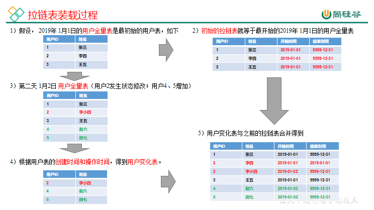
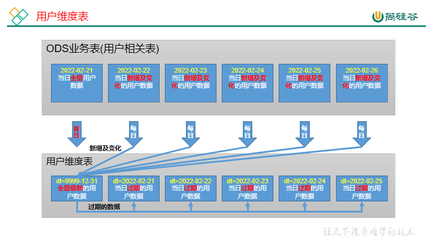
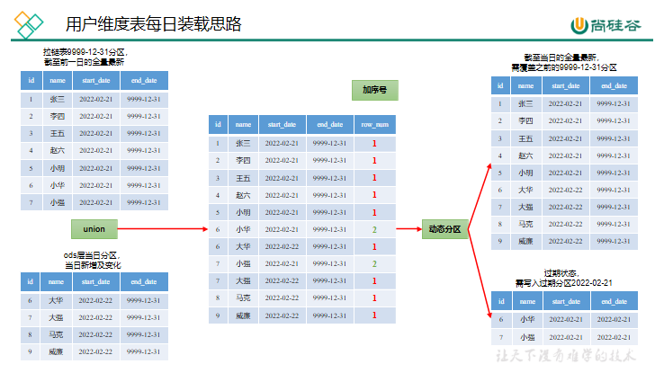

# 第8章 数仓开发之DIM层

DIM层设计要点：

（1）DIM层的设计依据是维度建模理论，该层存储维度模型的维度表。

（2）DIM层的数据存储格式为orc列式存储+snappy压缩。

（3）DIM层表名的命名规范为dim_表名_全量表或者拉链表标识（full/zip）

## 8.1 章节维度表（全量）

**1）建表语句**

``` text
DROP TABLE IF EXISTS dim_chapter_full;
CREATE EXTERNAL TABLE dim_chapter_full
(
    `id`           STRING COMMENT '章节ID',
    `chapter_name` STRING COMMENT '章节名称',
    `course_id`    STRING COMMENT '课程ID',
    `video_id`     STRING COMMENT '视频ID',
    `publisher_id` STRING COMMENT '发布者ID',
    `is_free`      STRING COMMENT '是否免费',
    `create_time`  STRING COMMENT '创建时间',
    `update_time`  STRING COMMENT '更新时间'
) COMMENT '章节维度表'
    PARTITIONED BY (`dt` STRING)
    STORED AS ORC
    LOCATION '/warehouse/edu/dim/dim_chapter_full/'
    TBLPROPERTIES ('orc.compress' = 'snappy');
```

**2）数据装载**

``` text
insert overwrite table edu.dim_chapter_full
    partition (dt = '2022-02-21')
select id,
       chapter_name,
       course_id,
       video_id,
       publisher_id,
       is_free,
       create_time,
       update_time
from edu.ods_chapter_info_full
where deleted = '0'
  and dt = '2022-02-21';
```

## 8.2 课程维度表（全量）

**1）建表语句**

``` text
DROP TABLE IF EXISTS dim_course_full;
CREATE EXTERNAL TABLE dim_course_full
(
    `id`               STRING COMMENT '编号',
    `course_name`      STRING COMMENT '课程名称',
    `subject_id`       STRING COMMENT '学科id',
    `subject_name`     STRING COMMENT '学科名称',
    `category_id`      STRING COMMENT '分类id',
    `category_name`    STRING COMMENT '分类名称',
    `teacher`          STRING COMMENT '讲师名称',
    `publisher_id`     STRING COMMENT '发布者id',
    `chapter_num`      BIGINT COMMENT '章节数',
    `origin_price`     decimal(16, 2) COMMENT '价格',
    `reduce_amount`    decimal(16, 2) COMMENT '优惠金额',
    `actual_price`     decimal(16, 2) COMMENT '实际价格',
    `create_time`      STRING COMMENT '创建时间',
    `update_time`      STRING COMMENT '更新时间',
    `chapters`       ARRAY<STRUCT<chapter_id : STRING,chapter_name : STRING, video_id : STRING,is_free  : STRING>> COMMENT '章节'
) COMMENT '课程维度表'
    PARTITIONED BY (`dt` STRING)
    STORED AS ORC
    LOCATION '/warehouse/edu/dim/dim_course_full/'
    TBLPROPERTIES ('orc.compress' = 'snappy');
```

**2）数据装载**

``` text
with a as
         (
             select id, category_name
                 from edu.ods_base_category_info_full
             where deleted = '0'
               and dt = '2022-02-21'
         ),
     b as
         (
             select id, subject_name, category_id
                 from edu.ods_base_subject_info_full
             where deleted = '0'
               and dt = '2022-02-21'
         ),
     c as
         (
             select id,
                    course_name,
                    subject_id,
                    teacher,
                    publisher_id,
                    chapter_num,
                    origin_price,
                    reduce_amount,
                    actual_price,
                    create_time,
                    update_time
                 from edu.ods_course_info_full
             where deleted = '0'
               and dt = '2022-02-21'
         ),
     d as
         (
             select course_id,
                    collect_set(named_struct('chapter_id', id, 'chapter_name', chapter_name, 'video_id', video_id, 'is_free', is_free)) chapters
                 from edu.ods_chapter_info_full
             where deleted = '0'
               and dt = '2022-02-21'
             group by course_id
         )
insert overwrite table edu.dim_course_full
partition(dt = '2022-02-21')
select c.id,
       course_name,
       subject_id,
       subject_name,
       category_id,
       category_name,
       teacher,
       publisher_id,
       chapter_num,
       origin_price,
       reduce_amount,
       actual_price,
       create_time,
       update_time,
       chapters
from c
         left join b
                   on c.subject_id = b.id
         left join a
                   on b.category_id = a.id
         left join d
                   on c.id = d.course_id;
```

## 8.3 视频维度表（全量）

**1）建表语句**

``` text
DROP TABLE IF EXISTS dim_video_full;
CREATE EXTERNAL TABLE dim_video_full
(
    `id`              STRING COMMENT '编号',
    `video_name`      STRING COMMENT '视频名称',
    `during_sec`      BIGINT COMMENT '时长',
    `video_status`    STRING COMMENT '状态 未上传，上传中，上传完',
    `video_size`      BIGINT COMMENT '大小',
    `version_id`      STRING COMMENT '版本号',
    `chapter_id`      STRING COMMENT '章节id',
    `chapter_name`    STRING COMMENT '章节名称',
    `is_free`         STRING COMMENT '是否免费',
    `course_id`       STRING COMMENT '课程id',
    `publisher_id`    STRING COMMENT '发布者id',
    `create_time`     STRING COMMENT '创建时间',
    `update_time`     STRING COMMENT '更新时间'
) COMMENT '视频维度表'
    PARTITIONED BY (`dt` STRING)
    STORED AS ORC
    LOCATION '/warehouse/edu/dim/dim_video_zip/'
    TBLPROPERTIES ('orc.compress' = 'snappy');
```

**2）数据装载**

``` text
insert overwrite table edu.dim_video_full partition (dt = '2022-02-21')
select vt.id,
       video_name,
       during_sec,
       video_status,
       video_size,
       version_id,
       chapter_id,
       chapter_name,
       is_free,
       course_id,
       publisher_id,
       create_time,
       update_time
from (
         select id,
                video_name,
                during_sec,
                video_status,
                video_size,
                version_id,
                chapter_id,
                course_id,
                publisher_id,
                create_time,
                update_time
         from edu.ods_video_info_full
         where dt = '2022-02-21' and deleted = '0'
     ) vt
         join
     (
         select id,
                chapter_name,
                is_free
         from edu.ods_chapter_info_full
         where dt = '2022-02-21'
     ) cht
     on vt.chapter_id = cht.id;
```

## 8.4 试卷维度表（全量）

**1）建表语句**

``` text
DROP TABLE IF EXISTS dim_paper_full;
CREATE EXTERNAL TABLE dim_paper_full
(
    `id`           STRING COMMENT '编号',
    `paper_title`  STRING COMMENT '试卷名称',
    `course_id`    STRING COMMENT '课程id',
    `create_time`  STRING COMMENT '创建时间',
    `update_time`  STRING COMMENT '更新时间',
    `publisher_id` STRING COMMENT '发布者id',
    `questions`   ARRAY<STRUCT<question_id: STRING, score: DECIMAL(16, 2)>> COMMENT '题目'
) COMMENT '试卷维度表'
    PARTITIONED BY (`dt` STRING)
    STORED AS ORC
    LOCATION '/warehouse/edu/dim/dim_paper_full/'
    TBLPROPERTIES ('orc.compress' = 'snappy');
```

**2）数据装载**

``` text
insert overwrite table edu.dim_paper_full partition (dt = '2022-02-21')
select t1.id,
       paper_title,
       course_id,
       create_time,
       update_time,
       publisher_id,
       questions
from edu.ods_test_paper_full t1
         left join
     (
         select paper_id,
                 collect_set(named_struct('question_id', question_id, 'score', score)) questions
         from edu.ods_test_paper_question_full
         where deleted = '0' and dt = '2022-02-21'
         group by paper_id
     ) t2
     on t1.id = t2.paper_id
where t1.deleted = '0' and t1.dt = '2022-02-21';
```

## 8.5 来源维度表（全量）

**1）建表语句**

``` text
DROP TABLE IF EXISTS dim_source_full;
CREATE EXTERNAL TABLE dim_source_full
(
    `id`            STRING COMMENT '编号',
    `source_site` STRING COMMENT '来源'
) COMMENT '来源维度表'
    PARTITIONED BY (`dt` STRING)
    STORED AS ORC
    LOCATION '/warehouse/edu/dim/dim_source_full/'
    TBLPROPERTIES ('orc.compress' = 'snappy');
```

**2）数据装载**

``` text
insert overwrite table edu.dim_source_full partition (dt = '2022-02-21')
select id,
       source_site
from edu.ods_base_source_full obsf
where dt = '2022-02-21';
```

## 8.6 题目维度表（全量）

**1）建表语句**

``` text
DROP TABLE IF EXISTS dim_question_full;
CREATE EXTERNAL TABLE dim_question_full
(
    `id`            STRING COMMENT '编号',
    `chapter_id`    STRING COMMENT '章节id',
    `course_id`     STRING COMMENT '课程id',
    `question_type` BIGINT COMMENT '题目类型',
    `create_time`   STRING COMMENT '创建时间',
    `update_time`   STRING COMMENT '更新时间',
    `publisher_id`  STRING COMMENT '发布者id'
) COMMENT '题目维度表'
    PARTITIONED BY (`dt` STRING)
    STORED AS ORC
    LOCATION '/warehouse/edu/dim/dim_question_full/'
    TBLPROPERTIES ('orc.compress' = 'snappy');
```

**2）数据装载**

``` text
insert overwrite table edu.dim_question_full
    partition (dt = '2022-02-21')
select id,
       chapter_id,
       course_id,
       question_type,
       create_time,
       update_time,
       publisher_id
from edu.ods_test_question_info_full
where deleted = '0'
  and dt = '2022-02-21';
```

## 8.7 地区维度表（全量）

**1）建表语句**

``` text
DROP TABLE IF EXISTS dim_province_full;
CREATE EXTERNAL TABLE dim_province_full
(
    `id`         STRING COMMENT '编号',
    `name`       STRING COMMENT '省名称',
    `region_id`  STRING COMMENT '地区id',
    `area_code`  STRING COMMENT '行政区位码',
    `iso_code`   STRING COMMENT '国际编码',
    `iso_3166_2` STRING COMMENT 'ISO3166编码'
) COMMENT '地区维度表'
    PARTITIONED BY (`dt` STRING)
    STORED AS ORC
    LOCATION '/warehouse/edu/dim/dim_province_full/'
    TBLPROPERTIES ('orc.compress' = 'snappy');
```

**2）数据装载**

``` text
insert overwrite table edu.dim_province_full partition (dt = '2022-02-21')
select id,
       name,
       region_id,
       area_code,
       iso_code,
       iso_3166_2
from edu.ods_base_province_full
where dt = '2022-02-21';
```

## 8.8 时间维度表（特殊）

**1）建表语句**

``` text
DROP TABLE IF EXISTS dim_date;
CREATE EXTERNAL TABLE dim_date
(
    `date_id`    STRING COMMENT '日期id',
    `week_id`    STRING COMMENT '周id,一年中的第几周',
    `week_day`   STRING COMMENT '周几',
    `day`        STRING COMMENT '每月的第几天',
    `month`      STRING COMMENT '一年中的第几月',
    `quarter`    STRING COMMENT '一年中的第几季度',
    `year`       STRING COMMENT '年份',
    `is_workday` STRING COMMENT '是否是工作日',
    `holiday_id` STRING COMMENT '节假日'
) COMMENT '时间维度表'
    STORED AS ORC
    LOCATION '/warehouse/edu/dim/dim_date/'
    TBLPROPERTIES ('orc.compress' = 'snappy');
```

**2）创建临时表**

``` text
DROP TABLE IF EXISTS tmp_dim_date_info;
CREATE EXTERNAL TABLE tmp_dim_date_info (
    `date_id` STRING COMMENT '日',
    `week_id` STRING COMMENT '周id',
    `week_day` STRING COMMENT '周几',
    `day` STRING COMMENT '每月的第几天',
    `month` STRING COMMENT '第几月',
    `quarter` STRING COMMENT '第几季度',
    `year` STRING COMMENT '年',
    `is_workday` STRING COMMENT '是否是工作日',
    `holiday_id` STRING COMMENT '节假日'
) COMMENT '时间维度表'
ROW FORMAT DELIMITED FIELDS TERMINATED BY '\t'
LOCATION '/warehouse/edu/tmp/tmp_dim_date_info/';
```

**3）上传date.info文件**

将数据文件date.info（在本书提供的资料中可以找到）上传到HFDS上临时表指定路径/warehouse/edu/tmp/tmp_dim_date_info/。

**4）执行以下语句将其导入时间维度表。**

``` text
insert overwrite table dim_date select * from tmp_dim_date_info;
```

**5）检查数据是否导入成功。**

``` text
select * from dim_date;
```

## 8.9 用户维度表（拉链表）

**1）建表语句**

``` text
DROP TABLE IF EXISTS dim_user_zip;
CREATE EXTERNAL TABLE dim_user_zip
(
    `id`           STRING COMMENT '编号',
    `login_name`   STRING COMMENT '用户名称',
    `nick_name`    STRING COMMENT '用户昵称',
    `real_name`    STRING COMMENT '用户姓名',
    `phone_num`    STRING COMMENT '手机号',
    `email`        STRING COMMENT '邮箱',
    `user_level`   STRING COMMENT '用户级别',
    `birthday`     STRING COMMENT '用户生日',
    `gender`       STRING COMMENT '性别 M男,F女',
    `create_time`  STRING COMMENT '创建时间',
    `operate_time` STRING COMMENT '修改时间',
    `status`       STRING COMMENT '状态',
    `start_date`   STRING COMMENT '开始日期',
    `end_date`     STRING COMMENT '结束日期'
) COMMENT '用户表'
    PARTITIONED BY (`dt` STRING)
    STORED AS ORC
    LOCATION '/warehouse/edu/dim/dim_user_zip/'
    TBLPROPERTIES ('orc.compress' = 'snappy');
```

**2）分区规划**


**3）数据装载**

（1）数据装载过程



（2）数据流向



（3）首日装载

``` text
insert overwrite table edu.dim_user_zip
    partition (dt = '9999-12-31')
select data.id,
       data.login_name,
       data.nick_name,
       md5(data.real_name),
       md5(if(data.phone_num regexp '^(13[0-9]|14[01456879]|15[0-35-9]|16[2567]|17[0-8]|18[0-9]|19[0-35-9])\\d{8}$',data.phone_num,null)),
       md5(if(data.email regexp '^[a-zA-Z0-9_-]+@[a-zA-Z0-9_-]+(\\.[a-zA-Z0-9_-]+)+$',data.email,null)),
       data.user_level,
       data.birthday,
       data.gender,
       data.create_time,
       data.operate_time,
       data.status,
       '2022-02-21' start_date,
       '9999-12-31' end_date
from edu.ods_user_info_inc
where dt = '2022-02-21'
  and type = 'bootstrap-insert';
```

（4）每日装载

装载思路



装载语句

``` text
set hive.exec.dynamic.partition.mode=nonstrict;
insert overwrite table edu.dim_user_zip
partition(dt)
select
    id,
    login_name,
    nick_name,
    real_name,
    phone_num,
    email,
    user_level,
    birthday,
    gender,
    create_time,
    operate_time,
    status,
    start_date,
    if(rn=1,'9999-12-31',date_sub('2022-02-22',1)) end_date,
    if(rn=1,'9999-12-31',date_sub('2022-02-22',1)) dt
from
(
    select
        id,
        login_name,
        nick_name,
        real_name,
        phone_num,
        email,
        user_level,
        birthday,
        gender,
        create_time,
        operate_time,
        status,
        start_date,
        end_date,
        row_number() over (partition by id order by start_date desc) rn
    from
    (
        select
            id,
            login_name,
            nick_name,
            real_name,
            phone_num,
            email,
            user_level,
            birthday,
            gender,
            create_time,
            operate_time,
            status,
            start_date,
            end_date
        from edu.dim_user_zip
        where dt='9999-12-31'
        union
        select
            id,
            login_name,
            nick_name,
            real_name,
            phone_num,
            email,
            user_level,
            birthday,
            gender,
            create_time,
            operate_time,
            status,
            '2020-02-22' start_date,
            '9999-12-31' end_date
        from
        (
            select
                data.id,
                data.login_name,
                data.nick_name,
                md5(data.real_name) real_name,
                md5(if(data.phone_num regexp '^(13[0-9]|14[01456879]|15[0-35-9]|16[2567]|17[0-8]|18[0-9]|19[0-35-9])\\d{8}$',data.phone_num,null)) phone_num,
                md5(if(data.email regexp '^[a-zA-Z0-9_-]+@[a-zA-Z0-9_-]+(\\.[a-zA-Z0-9_-]+)+$',data.email,null)) email,
                data.user_level,
                data.birthday,
                data.gender,
                data.create_time,
                data.operate_time,
                data.status,
                row_number() over (partition by data.id order by ts desc) rn
            from edu.ods_user_info_inc
            where dt='2022-02-22'
        )t1
        where rn=1
    )t2
)t3;
```

## 8.10 数据装载脚本

### 8.10.1 首日装载脚本

**1）在hadoop102的/home/atguigu/bin目录下创建ods_to_dim_init.sh**

``` bash
[zhangsan@node0 bin]$ vim ods_to_dim_init.sh
```

**2）编写如下内容**

``` text
#!/bin/bash
if [ -n "$2" ] ;then
    do_date=$2
else
    echo "请传入日期参数"
    exit
fi
APP=edu
dim_chapter_full="
insert overwrite table ${APP}.dim_chapter_full
    partition (dt = '$do_date')
select id,
       chapter_name,
       course_id,
       video_id,
       publisher_id,
       is_free,
       create_time,
       update_time
from ${APP}.ods_chapter_info_full
where deleted = '0'
  and dt = '$do_date';"
dim_course_full="
with a as
         (
             select id, category_name
                 from ${APP}.ods_base_category_info_full
             where deleted = '0'
               and dt = '$do_date'
         ),
     b as
         (
             select id, subject_name, category_id
                 from ${APP}.ods_base_subject_info_full
             where deleted = '0'
               and dt = '$do_date'
         ),
     c as
         (
             select id,
                    course_name,
                    subject_id,
                    teacher,
                    publisher_id,
                    chapter_num,
                    origin_price,
                    reduce_amount,
                    actual_price,
                    create_time,
                    update_time
                 from ${APP}.ods_course_info_full
             where deleted = '0'
               and dt = '$do_date'
         ),
     d as
         (
             select course_id,
                    collect_set(named_struct('chapter_id', id, 'chapter_name', chapter_name, 'video_id', video_id, 'is_free', is_free)) chapters
                 from ${APP}.ods_chapter_info_full
             where deleted = '0'
               and dt = '$do_date'
             group by course_id
         )
insert overwrite table ${APP}.dim_course_full
partition(dt = '$do_date')
select c.id,
       course_name,
       subject_id,
       subject_name,
       category_id,
       category_name,
       teacher,
       publisher_id,
       chapter_num,
       origin_price,
       reduce_amount,
       actual_price,
       create_time,
       update_time,
       chapters
from c
         left join b
                   on c.subject_id = b.id
         left join a
                   on b.category_id = a.id
         left join d
                   on c.id = d.course_id;"
dim_video_full="
insert overwrite table ${APP}.dim_video_full partition (dt = '$do_date')
select vt.id,
       video_name,
       during_sec,
       video_status,
       video_size,
       version_id,
       chapter_id,
       chapter_name,
       is_free,
       course_id,
       publisher_id,
       create_time,
       update_time
from (
         select id,
                video_name,
                during_sec,
                video_status,
                video_size,
                version_id,
                chapter_id,
                course_id,
                publisher_id,
                create_time,
                update_time
         from ${APP}.ods_video_info_full
         where dt = '$do_date' and deleted = '0'
     ) vt
         join
     (
         select id,
                chapter_name,
                is_free
         from ${APP}.ods_chapter_info_full
         where dt = '$do_date'
     ) cht
     on vt.chapter_id = cht.id;"
dim_paper_full="
insert overwrite table ${APP}.dim_paper_full partition (dt = '$do_date')
select t1.id,
       paper_title,
       course_id,
       create_time,
       update_time,
       publisher_id,
       questions
from ${APP}.ods_test_paper_full t1
         left join
     (
         select paper_id,
                 collect_set(named_struct('question_id', question_id, 'score', score)) questions
         from ${APP}.ods_test_paper_question_full
         where deleted = '0' and dt = '$do_date'
         group by paper_id
     ) t2
     on t1.id = t2.paper_id
where t1.deleted = '0' and t1.dt = '$do_date';"
dim_source_full="
insert overwrite table ${APP}.dim_source_full partition (dt = '$do_date')
select id,
       source_site
from ${APP}.ods_base_source_full obsf
where dt = '$do_date';"
dim_question_full="
insert overwrite table ${APP}.dim_question_full
    partition (dt = '$do_date')
select id,
       chapter_id,
       course_id,
       question_type,
       create_time,
       update_time,
       publisher_id
from ${APP}.ods_test_question_info_full
where deleted = '0'
  and dt = '$do_date';"
dim_province_full="
insert overwrite table ${APP}.dim_province_full partition (dt = '$do_date')
select id,
       name,
       region_id,
       area_code,
       iso_code,
       iso_3166_2
from ${APP}.ods_base_province_full
where dt = '$do_date';"
dim_user_zip="
insert overwrite table ${APP}.dim_user_zip
    partition (dt = '9999-12-31')
select data.id,
       data.login_name,
       data.nick_name,
       md5(data.real_name),
       md5(if(data.phone_num regexp '^(13[0-9]|14[01456879]|15[0-35-9]|16[2567]|17[0-8]|18[0-9]|19[0-35-9])\\d{8}$',data.phone_num,null)),
       md5(if(data.email regexp '^[a-zA-Z0-9_-]+@[a-zA-Z0-9_-]+(\\.[a-zA-Z0-9_-]+)+$',data.email,null)),
       data.user_level,
       data.birthday,
       data.gender,
       data.create_time,
       data.operate_time,
       data.status,
       '$do_date' start_date,
       '9999-12-31' end_date
from ${APP}.ods_user_info_inc
where dt = '$do_date'
  and type = 'bootstrap-insert';"
case $1 in
    dim_chapter_full|dim_course_full|dim_video_full|dim_paper_full|dim_source_full|dim_question_full|dim_province_full|dim_user_zip)
        eval "hive -e \"\$$1\""
    ;;
    "all" )
        hive -e "${dim_chapter_full}${dim_course_full}${dim_video_full}${dim_paper_full}${dim_source_full}${dim_question_full}${dim_province_full}${dim_user_zip}"
    ;;
esac
```

**3）增加脚本执行权限**

``` bash
[zhangsan@node0 bin]$ chmod +x ods_to_dim_init.sh
```

**4）脚本用法**

``` bash
[zhangsan@node0 bin]$ ods_to_dim_init.sh all 2022-02-21
```

### 8.10.2 每日装载脚本

**1）在hadoop102的/home/atguigu/bin目录下创建ods_to_dim.sh**

``` bash
[zhangsan@node0 bin]$ vim ods_to_dim.sh
```

**2）编写如下内容**

``` text
#!/bin/bash
if [ -n "$2" ] ;then
    do_date=$2
else
    do_date=`date -d "-1 day" +%F`
fi
APP=edu
dim_chapter_full="
insert overwrite table ${APP}.dim_chapter_full
    partition (dt = '$do_date')
select id,
       chapter_name,
       course_id,
       video_id,
       publisher_id,
       is_free,
       create_time,
       update_time
from ${APP}.ods_chapter_info_full
where deleted = '0'
  and dt = '$do_date';"
dim_course_full="
with a as
         (
             select id, category_name
                 from ${APP}.ods_base_category_info_full
             where deleted = '0'
               and dt = '$do_date'
         ),
     b as
         (
             select id, subject_name, category_id
                 from ${APP}.ods_base_subject_info_full
             where deleted = '0'
               and dt = '$do_date'
         ),
     c as
         (
             select id,
                    course_name,
                    subject_id,
                    teacher,
                    publisher_id,
                    chapter_num,
                    origin_price,
                    reduce_amount,
                    actual_price,
                    create_time,
                    update_time
                 from ${APP}.ods_course_info_full
             where deleted = '0'
               and dt = '$do_date'
         ),
     d as
         (
             select course_id,
                    collect_set(named_struct('chapter_id', id, 'chapter_name', chapter_name, 'video_id', video_id, 'is_free', is_free)) chapters
                 from ${APP}.ods_chapter_info_full
             where deleted = '0'
               and dt = '$do_date'
             group by course_id
         )
insert overwrite table ${APP}.dim_course_full
partition(dt = '$do_date')
select c.id,
       course_name,
       subject_id,
       subject_name,
       category_id,
       category_name,
       teacher,
       publisher_id,
       chapter_num,
       origin_price,
       reduce_amount,
       actual_price,
       create_time,
       update_time,
       chapters
from c
         left join b
                   on c.subject_id = b.id
         left join a
                   on b.category_id = a.id
         left join d
                   on c.id = d.course_id;"
dim_video_full="
insert overwrite table ${APP}.dim_video_full partition (dt = '$do_date')
select vt.id,
       video_name,
       during_sec,
       video_status,
       video_size,
       version_id,
       chapter_id,
       chapter_name,
       is_free,
       course_id,
       publisher_id,
       create_time,
       update_time
from (
         select id,
                video_name,
                during_sec,
                video_status,
                video_size,
                version_id,
                chapter_id,
                course_id,
                publisher_id,
                create_time,
                update_time
         from ${APP}.ods_video_info_full
         where dt = '$do_date' and deleted = '0'
     ) vt
         join
     (
         select id,
                chapter_name,
                is_free
         from ${APP}.ods_chapter_info_full
         where dt = '$do_date'
     ) cht
     on vt.chapter_id = cht.id;"
dim_paper_full="
insert overwrite table ${APP}.dim_paper_full partition (dt = '$do_date')
select t1.id,
       paper_title,
       course_id,
       create_time,
       update_time,
       publisher_id,
       questions
from ${APP}.ods_test_paper_full t1
         left join
     (
         select paper_id,
                 collect_set(named_struct('question_id', question_id, 'score', score)) questions
         from ${APP}.ods_test_paper_question_full
         where deleted = '0' and dt = '$do_date'
         group by paper_id
     ) t2
     on t1.id = t2.paper_id
where t1.deleted = '0' and t1.dt = '$do_date';"
dim_source_full="
insert overwrite table ${APP}.dim_source_full partition (dt = '$do_date')
select id,
       source_site
from ${APP}.ods_base_source_full obsf
where dt = '$do_date';"
dim_question_full="
insert overwrite table ${APP}.dim_question_full
    partition (dt = '$do_date')
select id,
       chapter_id,
       course_id,
       question_type,
       create_time,
       update_time,
       publisher_id
from ${APP}.ods_test_question_info_full
where deleted = '0'
  and dt = '$do_date';"
dim_province_full="
insert overwrite table ${APP}.dim_province_full partition (dt = '$do_date')
select id,
       name,
       region_id,
       area_code,
       iso_code,
       iso_3166_2
from ${APP}.ods_base_province_full
where dt = '$do_date';"
dim_user_zip="
set hive.exec.dynamic.partition.mode=nonstrict;
insert overwrite table ${APP}.dim_user_zip
partition(dt)
select
    id,
    login_name,
    nick_name,
    real_name,
    phone_num,
    email,
    user_level,
    birthday,
    gender,
    create_time,
    operate_time,
    status,
    start_date,
    if(rn=1,'9999-12-31',date_sub('$do_date',1)) end_date,
    if(rn=1,'9999-12-31',date_sub('$do_date',1)) dt
from
(
    select
        id,
        login_name,
        nick_name,
        real_name,
        phone_num,
        email,
        user_level,
        birthday,
        gender,
        create_time,
        operate_time,
        status,
        start_date,
        end_date,
        row_number() over (partition by id order by start_date desc) rn
    from
    (
        select
            id,
            login_name,
            nick_name,
            real_name,
            phone_num,
            email,
            user_level,
            birthday,
            gender,
            create_time,
            operate_time,
            status,
            start_date,
            end_date
        from ${APP}.dim_user_zip
        where dt='9999-12-31'
        union
        select
            id,
            login_name,
            nick_name,
            real_name,
            phone_num,
            email,
            user_level,
            birthday,
            gender,
            create_time,
            operate_time,
            status,
            '2020-02-22' start_date,
            '9999-12-31' end_date
        from
        (
            select
                data.id,
                data.login_name,
                data.nick_name,
                md5(data.real_name) real_name,
                md5(if(data.phone_num regexp '^(13[0-9]|14[01456879]|15[0-35-9]|16[2567]|17[0-8]|18[0-9]|19[0-35-9])\\d{8}$',data.phone_num,null)) phone_num,
                md5(if(data.email regexp '^[a-zA-Z0-9_-]+@[a-zA-Z0-9_-]+(\\.[a-zA-Z0-9_-]+)+$',data.email,null)) email,
                data.user_level,
                data.birthday,
                data.gender,
                data.create_time,
                data.operate_time,
                data.status,
                row_number() over (partition by data.id order by ts desc) rn
            from ${APP}.ods_user_info_inc
            where dt='$do_date'
        )t1
        where rn=1
    )t2
)t3;"
case $1 in
    dim_chapter_full|dim_course_full|dim_video_full|dim_paper_full|dim_source_full|dim_question_full|dim_province_full|dim_user_zip)
        eval "hive -e \"\$$1\""
    ;;
    "all" )
        hive -e "${dim_chapter_full}${dim_course_full}${dim_video_full}${dim_paper_full}${dim_source_full}${dim_question_full}${dim_province_full}${dim_user_zip}"
    ;;
esac
```

**3）增加脚本执行权限**

``` bash
[zhangsan@node0 bin]$ chmod +x ods_to_dim.sh
```

**4）脚本用法**

``` bash
[zhangsan@node0 bin]$ ods_to_dim.sh all 2022-02-22
```
