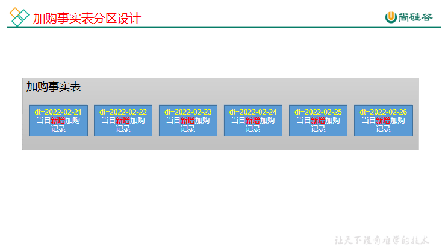
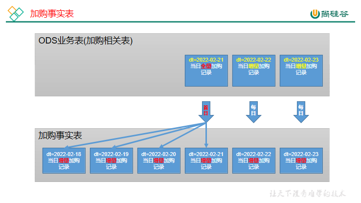
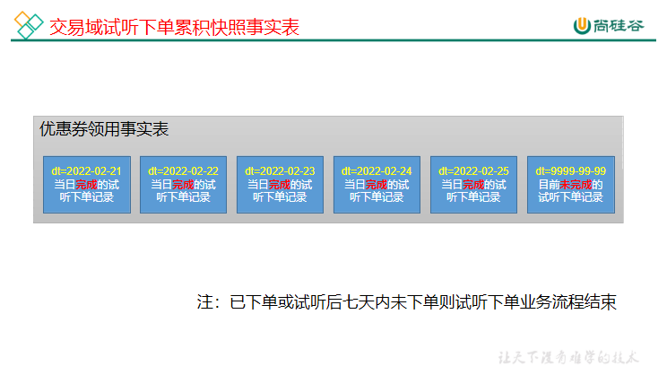
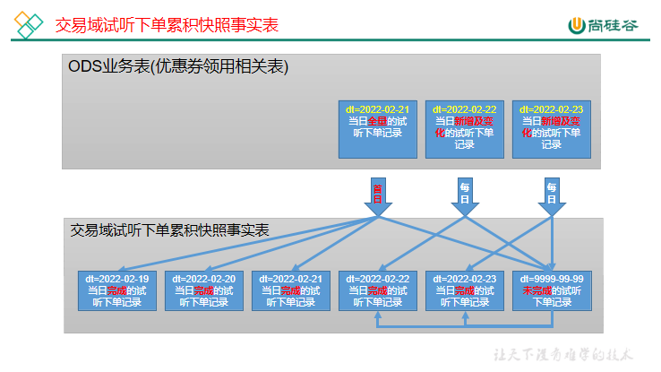
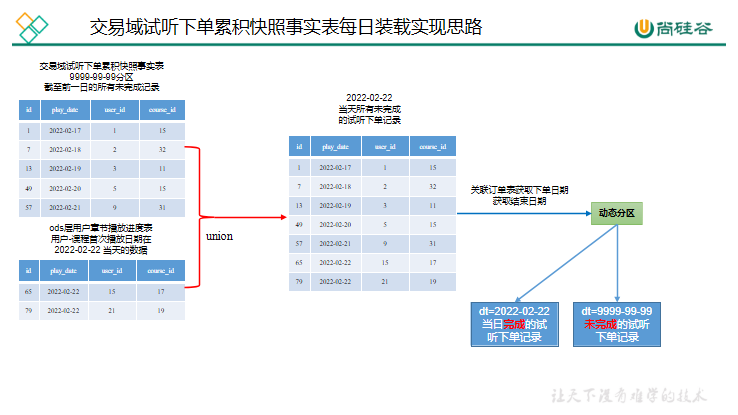

# 第9章 数仓开发之DWD层

DWD层设计要点：

（1）DWD层的设计依据是维度建模理论，该层存储维度模型的事实表。

（2）DWD层的数据存储格式为orc列式存储+snappy压缩。

（3）DWD层表名的命名规范为dwd_数据域_表名_单分区增量全量标识（inc/full）

## 9.1 交易域加购事务事实表

**1）建表语句**

``` text
DROP TABLE IF EXISTS dwd_trade_cart_add_inc;
CREATE EXTERNAL TABLE dwd_trade_cart_add_inc
(
    `id`          STRING COMMENT '编号',
    `user_id`     STRING COMMENT '用户id',
    `course_id`   STRING COMMENT '课程id',
    `date_id`     STRING COMMENT '时间id',
    `session_id`  STRING COMMENT '会话id',
    `create_time` STRING COMMENT '加购时间',
    `cart_price`  DECIMAL(16, 2) COMMENT '加购时价格'
) COMMENT '交易域加购事务事实表'
    PARTITIONED BY (`dt` STRING)
    STORED AS ORC
    LOCATION '/warehouse/edu/dwd/dwd_trade_cart_add_inc/'
    TBLPROPERTIES ('orc.compress' = 'snappy');
```

**2）分区规划**



**3）数据装载**

（1）数据流向



（2）首日装载

``` text
insert overwrite table edu.dwd_trade_cart_add_inc
select data.id,
       data.user_id,
       data.course_id,
       date_format(data.create_time, 'yyyy-MM-dd') date_id,
       data.session_id,
       data.create_time,
       data.cart_price,
       date_format(data.create_time, 'yyyy-MM-dd') dt
from edu.ods_cart_info_inc
where dt = '2022-02-21' and type = 'bootstrap-insert';
```

（3）每日装载

``` text
insert overwrite table edu.dwd_trade_cart_add_inc partition (dt = '2022-02-22')
select data.id,
       data.user_id,
       data.course_id,
       date_format(data.create_time, 'yyyy-MM-dd') date_id,
       data.session_id,
       data.create_time,
       data.cart_price
from edu.ods_cart_info_inc
where dt = '2022-02-22' and type = 'insert';
```

## 9.2 交易域加购周期快照事实表

**1）建表语句**

``` text
DROP TABLE IF EXISTS dwd_trade_cart_full;
CREATE EXTERNAL TABLE dwd_trade_cart_full
(
    `id`          STRING COMMENT '编号',
    `user_id`     STRING COMMENT '用户id',
    `course_id`   STRING COMMENT '课程id',
    `date_id`     STRING COMMENT '时间id',
    `session_id`  STRING COMMENT '会话id',
    `course_name` STRING COMMENT '课程名称',
    `create_time` STRING COMMENT '加购时间',
    `cart_price`  DECIMAL(16, 2) COMMENT '加购时价格'
) COMMENT '交易域加购周期快照事实表'
    PARTITIONED BY (`dt` STRING)
    STORED AS ORC
    LOCATION '/warehouse/edu/dwd/dwd_trade_cart_full/'
    TBLPROPERTIES ('orc.compress' = 'snappy');
```

**2）数据装载**

``` text
insert overwrite table edu.dwd_trade_cart_full  partition (dt = '2022-02-21')
select id,
       user_id,
       course_id,
       date_format(create_time, 'yyyy-MM-dd'),
       session_id,
       course_name,
       create_time,
       cart_price
from edu.ods_cart_info_full
where dt = '2022-02-21'
  and deleted = '0' and sold = '0';
```

## 9.3 交易域试听下单累积快照事实表



**1）建表语句**

``` text
DROP TABLE IF EXISTS dwd_trade_course_order_inc;
CREATE EXTERNAL TABLE dwd_trade_course_order_inc
(
    `id`                   STRING COMMENT '编号',
    `user_id`              STRING COMMENT '用户id',
    `course_id`            STRING COMMENT '课程id',
    `course_name`          STRING COMMENT '课程名称',
    `category_id`          STRING COMMENT '分类id',
    `category_name`        STRING COMMENT '分类名称',
    `subject_id`           STRING COMMENT '科目id',
    `subject_name`         STRING COMMENT '科目名称',
    `order_id`             STRING COMMENT '订单id',
    `province_id`          STRING COMMENT '省份id',
    `play_time`            STRING COMMENT '首次播放时间',
    `play_date`            STRING COMMENT '首次播放日期',
    `order_time`           STRING COMMENT '首次下单时间',
    `order_date`           STRING COMMENT '首次下单日期',
    `end_date`             STRING COMMENT '结束日期,试听后七天内未下单即为结束,试听日期+7为结束日期',
    `session_id`           STRING COMMENT '会话id',
    `original_amount`      DECIMAL(16, 2) COMMENT '原始金额分摊',
    `coupon_reduce_amount` DECIMAL(16, 2) COMMENT '优惠金额分摊',
    `final_amount`         DECIMAL(16, 2) COMMENT '最终价格分摊'
) COMMENT '交易域试听下单累积快照事实表'
    PARTITIONED BY (`dt` STRING)
    STORED AS ORC
    LOCATION '/warehouse/edu/dwd/dwd_trade_course_order_inc/'
    TBLPROPERTIES ('orc.compress' = 'snappy');
```

**2）数据装载**

（1）首日装载



``` text
set hive.exec.dynamic.partition.mode=nonstrict;
with play as
         (
             select min(id)                                     id,
                    user_id,
                    course_id,
                    min(create_time)                            play_time,
                    date_format(min(create_time), 'yyyy-MM-dd') play_date
             from edu.ods_user_chapter_process_full
             where dt = '2022-02-21'
             group by user_id, course_id
         ),
     oi as
         (
             select data.id,
                    data.province_id,
                    data.session_id
             from edu.ods_order_info_inc
             where dt = '2022-02-21'
               and type = 'bootstrap-insert'
         ),
     od as
         (
             select data.id,
                    data.course_id,
                    data.order_id,
                    data.user_id,
                    data.origin_amount,
                    data.coupon_reduce,
                    data.final_amount,
                    data.create_time order_time,
                    date_format(data.create_time, 'yyyy-MM-dd') order_date
             from edu.ods_order_detail_inc
             where dt = '2022-02-21'
               and type = 'bootstrap-insert'
         ),
     dim_course as (
         select id,
                course_name,
                category_id,
                category_name,
                subject_id,
                subject_name
         from edu.dim_course_full
         where dt = '2022-02-21'
     )
insert overwrite table edu.dwd_trade_course_order_inc partition (dt)
select final.id,
       user_id,
       course_id,
       course_name,
       category_id,
       category_name,
       subject_id,
       subject_name,
       order_id,
       province_id,
       play_time,
       play_date,
       order_time,
       order_date,
       end_date,
       session_id,
       origin_amount,
       coupon_reduce,
       final_amount,
       case
		  when end_date is not null then end_date
		  when order_date is not null then order_date
           else '9999-12-31' end dt
from (select play.id,
             play.user_id,
             play.course_id,
             od.order_id,
             oi.province_id,
             play.play_time,
             play.play_date,
             od.order_time,
             od.order_date,
             if(od.order_date is null and
                date_add(play.play_date, 7) <= '2022-02-21',
                date_add(play.play_date, 7), null) end_date,
             oi.session_id,
             od.origin_amount,
             od.coupon_reduce,
             od.final_amount
      from play
               left join od on play.user_id = od.user_id and play.course_id = od.course_id
               left join oi on od.order_id = oi.id
where od.order_time is null
or od.order_time > play.play_time
) final
         left join dim_course on course_id = dim_course.id;
```

（2）每日装载



``` text
set hive.exec.dynamic.partition.mode=nonstrict;
with play as
         (select id,
                 user_id,
                 course_id,
                 play_time,
                 play_date
          from edu.dwd_trade_course_order_inc
          where dt = '9999-12-31'
          union
          select min(id)                                     id,
                 user_id,
                 course_id,
                 min(create_time),
                 date_format(min(create_time), 'yyyy-MM-dd') play_date
          from edu.ods_user_chapter_process_full
          where dt = '2022-02-22'
          group by user_id, course_id
          having date_format(min(create_time), 'yyyy-MM-dd') = '2022-02-22'),
     oi as
         (
             select data.id,
                    data.province_id,
                    data.session_id,
                    data.create_time order_time
             from edu.ods_order_info_inc
             where dt = '2022-02-22'
               and type = 'insert'
         ),
     od as
         (
             select data.id,
                    data.course_id,
                    data.order_id,
                    data.user_id,
                    data.origin_amount,
                    data.coupon_reduce,
                    data.final_amount,
                    date_format(data.create_time, 'yyyy-MM-dd') order_date
             from edu.ods_order_detail_inc
             where dt = '2022-02-22'
               and type = 'insert'
         ),
     dim_course as
         (
             select id,
                    course_name,
                    category_id,
                    category_name,
                    subject_id,
                    subject_name
             from edu.dim_course_full
             where dt = '2022-02-22'
         )
insert overwrite table edu.dwd_trade_course_order_inc
partition (dt)
select final.id,
       user_id,
       course_id,
       course_name,
       category_id,
       category_name,
       subject_id,
       subject_name,
       order_id,
       province_id,
       play_time,
       play_date,
       order_time,
       order_date,
       end_date,
       session_id,
       origin_amount,
       coupon_reduce,
       final_amount,
       case
           when end_date is not null then end_date
           when order_date is not null then order_date
           else '9999-12-31' end dt
from (select play.id,
             play.user_id,
             play.course_id,
             od.order_id,
             oi.province_id,
             play.play_time,
             play.play_date,
             oi.order_time,
             od.order_date,
             if(order_date is null and date_add(play_date, 7) = '2022-02-22', '2022-02-22', null) end_date,
             oi.session_id,
             od.origin_amount,
             od.coupon_reduce,
             od.final_amount
      from play
               left join od on play.user_id = od.user_id and play.course_id = od.course_id
               left join oi on od.order_id = oi.id
where order_time is null
or order_time > play_time
) final
         left join dim_course on course_id = dim_course.id;
```

## 9.4 交易域下单事务事实表

**1）建表语句**

``` text
DROP TABLE IF EXISTS dwd_trade_order_detail_inc;
CREATE EXTERNAL TABLE dwd_trade_order_detail_inc
(
    `id`                   STRING COMMENT '编号',
    `order_id`             STRING COMMENT '订单id',
    `user_id`              STRING COMMENT '用户id',
    `course_id`            STRING COMMENT '课程id',
    `course_name`          STRING COMMENT '课程名称',
    `category_id`          STRING COMMENT '分类id',
    `category_name`        STRING COMMENT '分类名称',
    `subject_id`           STRING COMMENT '科目id',
    `subject_name`         STRING COMMENT '科目名称',
    `province_id`          STRING COMMENT '省份id',
    `date_id`              STRING COMMENT '下单日期id',
    `session_id`           STRING COMMENT '会话id',
    `source_id`            STRING COMMENT '来源id',
    `create_time`          STRING COMMENT '下单时间',
    `original_amount`      DECIMAL(16, 2) COMMENT '原始金额分摊',
    `coupon_reduce_amount` DECIMAL(16, 2) COMMENT '优惠金额分摊',
    `final_amount`         DECIMAL(16, 2) COMMENT '最终价格分摊',
    `out_trade_no`         STRING COMMENT '订单交易编号',
    `trade_body`           STRING COMMENT '订单描述'
) COMMENT '交易域下单事务事实表'
    PARTITIONED BY (`dt` STRING)
    STORED AS ORC
    LOCATION '/warehouse/edu/dwd/dwd_trade_order_detail_inc/'
    TBLPROPERTIES ('orc.compress' = 'snappy');
```

**2）数据装载**

（1）首日装载

``` text
set hive.exec.dynamic.partition.mode=nonstrict;
insert overwrite table edu.dwd_trade_order_detail_inc
    partition (dt)
select odt.id,
       order_id,
       user_id,
       course_id,
       course_name,
       category_id,
       category_name,
       subject_id,
       subject_name,
       province_id,
       date_id,
       session_id,
       source_id,
       create_time,
       origin_amount,
       coupon_reduce,
       final_amount,
       out_trade_no,
       trade_body,
       date_id
from (
         select data.id,
                data.order_id,
                data.user_id,
                data.course_id,
                date_format(data.create_time, 'yyyy-MM-dd') date_id,
                data.create_time,
                data.origin_amount,
                data.coupon_reduce,
                data.final_amount
         from edu.ods_order_detail_inc
         where dt = '2022-02-21'
           and type = 'bootstrap-insert'
     ) odt
         left join
     (
         select data.id,
                data.province_id,
                data.out_trade_no,
                data.session_id,
                data.trade_body
         from edu.ods_order_info_inc
         where dt = '2022-02-21'
           and type = 'bootstrap-insert'
     ) od
     on odt.order_id = od.id
         left join
     (
         select distinct common.sid,
                         common.sc source_id
         from edu.ods_log_inc oli
         where dt = '2022-02-21'
     ) log
     on od.session_id = log.sid
         left join
     (
         select id,
                course_name,
                category_id,
                category_name,
                subject_id,
                subject_name
         from edu.dim_course_full
         where dt = '2022-02-21'
     ) dim_course
     on course_id = dim_course.id;
```

（2）每日装载

``` text
insert overwrite table edu.dwd_trade_order_detail_inc
    partition (dt = '2022-02-22')
select odt.id,
       order_id,
       user_id,
       course_id,
       course_name,
       category_id,
       category_name,
       subject_id,
       subject_name,
       province_id,
       date_id,
       session_id,
       source_id,
       create_time,
       origin_amount,
       coupon_reduce,
       final_amount,
       out_trade_no,
       trade_body
from (
         select data.id,
                data.order_id,
                data.user_id,
                data.course_id,
                date_format(data.create_time, 'yyyy-MM-dd') date_id,
                data.create_time,
                data.origin_amount,
                data.coupon_reduce,
                data.final_amount
         from edu.ods_order_detail_inc
         where dt = '2022-02-22'
           and type = 'insert'
     ) odt
         left join
     (
         select data.id,
                data.province_id,
                data.session_id,
                data.out_trade_no,
                data.trade_body
         from edu.ods_order_info_inc
         where dt = '2022-02-22'
           and type = 'insert'
     ) od
     on odt.order_id = od.id
         left join
     (
         select distinct common.sid,
                         common.sc source_id
         from edu.ods_log_inc oli
         where dt = '2022-02-22'
     ) log
     on od.session_id = log.sid
         left join
     (
         select id,
                course_name,
                category_id,
                category_name,
                subject_id,
                subject_name
         from edu.dim_course_full
         where dt = '2022-02-22'
     ) dim_course
     on course_id = dim_course.id;
```

## 9.5 交易域支付成功事务事实表

**1）建表语句**

``` text
DROP TABLE IF EXISTS dwd_trade_pay_detail_suc_inc;
CREATE EXTERNAL TABLE dwd_trade_pay_detail_suc_inc
(
    `id`                   STRING COMMENT '编号',
    `order_id`             STRING COMMENT '订单id',
    `user_id`              STRING COMMENT '用户id',
    `course_id`            STRING COMMENT '课程id',
    `province_id`          STRING COMMENT '省份id',
    `date_id`              STRING COMMENT '支付日期id',
    `alipay_trade_no`      STRING COMMENT '支付宝交易编号',
    `trade_body`           STRING COMMENT '交易内容',
    `payment_type`         STRING COMMENT '支付类型名称',
    `payment_status`       STRING COMMENT '支付状态',
    `callback_time`        STRING COMMENT '支付成功时间',
    `callback_content`     STRING COMMENT '回调信息',
    `original_amount`      DECIMAL(16, 2) COMMENT '原始支付金额分摊',
    `coupon_reduce_amount` DECIMAL(16, 2) COMMENT '优惠支付金额分摊',
    `final_amount`         DECIMAL(16, 2) COMMENT '最终支付金额分摊'
) COMMENT '交易域支付成功事务事实表'
    PARTITIONED BY (`dt` STRING)
    STORED AS ORC
    LOCATION '/warehouse/edu/dwd/dwd_trade_pay_detail_suc_inc/'
    TBLPROPERTIES ('orc.compress' = 'snappy');
```

**2）数据装载**

（1）首日装载

``` text
set hive.exec.dynamic.partition.mode=nonstrict;
insert overwrite table edu.dwd_trade_pay_detail_suc_inc
partition(dt)
select odt.id,
       od.id,
       user_id,
       course_id,
       province_id,
       date_format(create_time, 'yyyy-MM-dd') date_id,
       alipay_trade_no,
       trade_body,
       payment_type,
       payment_status,
       callback_time,
       callback_content,
       origin_amount,
       coupon_reduce,
       final_amount,
       date_format(create_time, 'yyyy-MM-dd') date_id
from (
         select data.id,
                data.order_id,
                data.user_id,
                data.course_id,
                data.origin_amount,
                data.coupon_reduce,
                data.final_amount,
                data.create_time
         from edu.ods_order_detail_inc
         where dt = '2022-02-21' and type = 'bootstrap-insert'
     ) odt
         left join
     (
         select data.id,
                data.province_id
         from edu.ods_order_info_inc
         where dt = '2022-02-21' and type = 'bootstrap-insert'
     ) od
     on odt.order_id = od.id
         join
     (
         select data.alipay_trade_no,
                data.trade_body,
                data.order_id,
                data.payment_type,
                data.payment_status,
                data.callback_time,
                data.callback_content
         from edu.ods_payment_info_inc
         where dt = '2022-02-21' and type = 'bootstrap-insert'
           and data.callback_time is not null
     ) pi
     on od.id = pi.order_id;
```

（2）每日装载

``` text
insert overwrite table edu.dwd_trade_pay_detail_suc_inc
    partition (dt = '2022-02-22')
select
 odt.id,
       od.id,
       user_id,
       course_id,
       province_id,
       date_format(create_time, 'yyyy-MM-dd') date_id,
       alipay_trade_no,
       trade_body,
       payment_type,
       payment_status,
       callback_time,
       callback_content,
       origin_amount,
       coupon_reduce,
       final_amount
from (
         select data.id,
                data.order_id,
                data.user_id,
                data.course_id,
                data.origin_amount,
                data.coupon_reduce,
                data.final_amount,
                data.create_time
         from edu.ods_order_detail_inc
         where (dt = '2022-02-22' or dt = date_add('2022-02-22', -1))
           and (type = 'insert' or type = 'bootstrap-insert')
     ) odt
         left join
     (
         select data.id,
                data.province_id
         from edu.ods_order_info_inc
         where (dt = '2022-02-22' or dt = date_add('2022-02-22', -1))
           and (type = 'insert' or type = 'bootstrap-insert')
     ) od
     on odt.order_id = od.id
         join
     (
         select data.alipay_trade_no,
                data.trade_body,
                data.order_id,
                data.payment_type,
                data.payment_status,
                data.callback_time,
                data.callback_content
         from edu.ods_payment_info_inc
         where dt = '2022-02-22'
           and type = 'update'
           and array_contains(map_keys(old), 'callback_time')
     ) pi
     on od.id = pi.order_id;
```

## 9.6 流量域页面浏览事务事实表

**1）建表语句**

``` text
DROP TABLE IF EXISTS dwd_traffic_page_view_inc;
CREATE EXTERNAL TABLE dwd_traffic_page_view_inc
(
    `mid_id`         STRING COMMENT '手机唯一编号',
    `province_id`    STRING COMMENT '省份id',
    `brand`          STRING COMMENT '手机品牌',
    `is_new`         STRING COMMENT '是否新用户',
    `model`          STRING COMMENT '手机型号',
    `os`             STRING COMMENT '手机品牌',
    `session_id`     STRING COMMENT '会话id',
    `user_id`        STRING COMMENT '用户id',
    `version_code`   STRING COMMENT '版本号',
    `source_id`         STRING COMMENT '数据来源',
    `during_time`    BIGINT COMMENT '持续时间毫秒',
    `page_item`      STRING COMMENT '目标id ',
    `page_item_type` STRING COMMENT '目标类型',
    `page_id`        STRING COMMENT '页面id ',
    `last_page_id`   STRING COMMENT '上页类型',
    `ts`             STRING COMMENT '跳入时间'
)
    COMMENT '流量域页面浏览事务事实表'
    PARTITIONED BY (`dt` STRING)
    STORED AS ORC
    LOCATION '/warehouse/edu/dwd/dwd_traffic_page_view_inc'
    TBLPROPERTIES ('orc.compress' = 'snappy');
```

**2）数据装载**

``` text
set hive.cbo.enable=false;
insert overwrite table edu.dwd_traffic_page_view_inc partition (dt = '2022-02-21')
select common.mid,
       common.ar      province_id,
       common.ba      brand,
       common.is_new,
       common.md      model,
       common.os,
       common.sid     session_id,
       common.uid     user_id,
       common.vc      version_code,
       common.sc,
       page.during_time,
       page.item      page_item,
       page.item_type page_item_type,
       page.page_id,
       page.last_page_id,
       ts
from edu.ods_log_inc
where dt = '2022-02-21'
  and page is not null;
set hive.cbo.enable=true;
```

## 9.7 流量域启动事务事实表

**1）建表语句**

``` text
DROP TABLE IF EXISTS dwd_traffic_start_inc;
CREATE EXTERNAL TABLE dwd_traffic_start_inc
(
    `mid_id`          STRING COMMENT '手机唯一编号',
    `province_id`     STRING COMMENT '省份id',
    `brand`           STRING COMMENT '手机品牌',
    `is_new`          STRING COMMENT '是否新用户',
    `model`           STRING COMMENT '手机型号',
    `os`              STRING COMMENT '手机品牌',
    `session_id`      STRING COMMENT '会话id',
    `user_id`         STRING COMMENT '用户id',
    `version_code`    STRING COMMENT '版本号',
    `source_id`          STRING COMMENT '数据来源',
    `entry`           STRING COMMENT 'icon手机图标 notice 通知',
    `open_ad_id`      STRING COMMENT '广告页id',
    `first_open`      STRING COMMENT '是否首次启动',
    `date_id`         STRING COMMENT '日期id',
    `start_time`      STRING COMMENT '启动时间',
    `loading_time_ms` BIGINT COMMENT '启动加载时间',
    `open_ad_ms`      BIGINT COMMENT '广告总共播放时间',
    `open_ad_skip_ms` BIGINT COMMENT '用户跳过广告时点'
) COMMENT '流量域启动事务事实表'
    PARTITIONED BY (`dt` STRING)
    STORED AS ORC
    LOCATION '/warehouse/edu/dwd/dwd_traffic_start_inc'
    TBLPROPERTIES ('orc.compress' = 'snappy');
```

**2）数据装载**

``` text
set hive.cbo.enable=false;
insert overwrite table edu.dwd_traffic_start_inc partition (dt = '2022-02-21')
select common.mid,
       common.ar            province_id,
       common.ba            brand,
       common.is_new,
       common.md            model,
       common.os,
       common.sid           session_id,
       common.uid           user_id,
       common.vc            version_code,
       common.sc,
       `start`.entry,
       `start`.open_ad_id,
       `start`.first_open,
       date_format(from_utc_timestamp(ts, 'GMT+8'), 'yyyy-MM-dd'),
       date_format(from_utc_timestamp(ts, 'GMT+8'), 'yyyy-MM-dd HH:mm:ss'),
       `start`.loading_time loading_time_ms,
       `start`.open_ad_ms,
       `start`.open_ad_skip_ms
from edu.ods_log_inc
where dt = '2022-02-21'
  and `start` is not null;
set hive.cbo.enable=true;
```

## 9.8 流量域动作事务事实表

**1）建表语句**

``` text
DROP TABLE IF EXISTS dwd_traffic_action_inc;
CREATE EXTERNAL TABLE dwd_traffic_action_inc
(
    `mid_id`           STRING COMMENT '手机唯一编号',
    `province_id`      STRING COMMENT '省份id',
    `brand`            STRING COMMENT '手机品牌',
    `is_new`           STRING COMMENT '是否新用户',
    `model`            STRING COMMENT '手机型号',
    `os`               STRING COMMENT '手机品牌',
    `session_id`       STRING COMMENT '会话id',
    `user_id`          STRING COMMENT '用户id',
    `version_code`     STRING COMMENT '版本号',
    `source_id`           STRING COMMENT '数据来源',
    `during_time`      BIGINT COMMENT '持续时间毫秒',
    `page_item`        STRING COMMENT '目标id',
    `page_item_type`   STRING COMMENT '目标类型',
    `page_id`          STRING COMMENT '页面id',
    `last_page_id`     STRING COMMENT '上页类型',
    `action_id`        STRING COMMENT '动作id',
    `action_item`      STRING COMMENT '目标id',
    `action_item_type` STRING COMMENT '目标类型',
    `date_id`          STRING COMMENT '日期id',
    `action_time`      STRING COMMENT '动作发生时间'
) COMMENT '流量域动作事务事实表'
    PARTITIONED BY (`dt` STRING)
    STORED AS ORC
    LOCATION '/warehouse/edu/dwd/dwd_traffic_action_inc'
    TBLPROPERTIES ('orc.compress' = 'snappy');
```

**2）数据装载**

``` text
set hive.cbo.enable=false;
insert overwrite table edu.dwd_traffic_action_inc partition (dt = '2022-02-21')
select common.mid,
       common.ar,
       common.ba,
       common.is_new,
       common.md,
       common.os,
       common.sid,
       common.uid,
       common.vc,
       common.sc,
       page.during_time,
       page.item,
       page.item_type,
       page.page_id,
       page.last_page_id,
       action.action_id,
       action.item,
       action.item_type,
       date_format(from_utc_timestamp(ts * 1000, 'GMT+8'), 'yyyy-MM-dd') date_id,
       action.ts
from edu.ods_log_inc oli lateral view explode(actions) tmp as action
where oli.dt = '2022-02-21'
  and actions is not null;
set hive.cbo.enable=true;
```

## 9.9 流量域曝光事务事实表

**1）建表语句**

``` text
DROP TABLE IF EXISTS dwd_traffic_display_inc;
CREATE EXTERNAL TABLE dwd_traffic_display_inc
(
    `mid_id`            STRING COMMENT '手机唯一编号',
    `province_id`       STRING COMMENT '省份id',
    `brand`             STRING COMMENT '手机品牌',
    `is_new`            STRING COMMENT '是否新用户',
    `model`             STRING COMMENT '手机型号',
    `os`                STRING COMMENT '手机品牌',
    `session_id`        STRING COMMENT '会话id',
    `user_id`           STRING COMMENT '用户id',
    `version_code`      STRING COMMENT '版本号',
    `source_id`            STRING COMMENT '数据来源',
    `during_time`       BIGINT COMMENT '页面时间',
    `page_item`         STRING COMMENT '目标id ',
    `page_item_type`    STRING COMMENT '目标类型',
    `page_id`           STRING COMMENT '页面id ',
    `last_page_id`      STRING COMMENT '上页类型',
    `date_id`           STRING COMMENT '日期id',
    `display_time`      STRING COMMENT '曝光时间',
    `display_type`      STRING COMMENT '曝光类型',
    `display_item`      STRING COMMENT '曝光对象id ',
    `display_item_type` STRING COMMENT 'app版本号',
    `display_order`     BIGINT COMMENT '曝光顺序',
    `display_pos_id`    BIGINT COMMENT '曝光位置'
) COMMENT '流量域曝光事务事实表'
    PARTITIONED BY (`dt` STRING)
    STORED AS ORC
    LOCATION '/warehouse/edu/dwd/dwd_traffic_display_inc'
    TBLPROPERTIES ('orc.compress' = 'snappy');
```

**2）数据装载**

``` text
set hive.cbo.enable=false;
insert overwrite table edu.dwd_traffic_display_inc partition (dt = '2022-02-21')
select common.mid,
       common.ar,
       common.ba,
       common.is_new,
       common.md,
       common.os,
       common.sid,
       common.uid,
       common.vc,
       common.sc,
       page.during_time,
       page.item,
       page.item_type,
       page.page_id,
       page.last_page_id,
       date_format(from_utc_timestamp(ts * 1000, 'GMT+8'), 'yyyy-MM-dd'),
       ts,
       display.display_type,
       display.item,
       display.item_type,
       display.`order`,
       display.pos_id
from edu.ods_log_inc oli lateral view explode(displays) tmp as display
where oli.dt = '2022-02-21'
  and displays is not null;
set hive.cbo.enable=true;
```

## 9.10 流量域错误事务事实表

**1）建表语句**

``` text
DROP TABLE IF EXISTS dwd_traffic_error_inc;
CREATE EXTERNAL TABLE dwd_traffic_error_inc
(
    `mid_id`          STRING COMMENT '手机唯一编号',
    `province_id`     STRING COMMENT '省份id',
    `brand`           STRING COMMENT '手机品牌',
    `is_new`          STRING COMMENT '是否新用户',
    `model`           STRING COMMENT '手机型号',
    `os`              STRING COMMENT '手机品牌',
    `session_id`      STRING COMMENT '会话id',
    `user_id`         STRING COMMENT '用户id',
    `version_code`    STRING COMMENT '版本号',
    `source_id`          STRING COMMENT '数据来源',
    `during_time`     BIGINT COMMENT '页面时间',
    `page_item`       STRING COMMENT '目标id ',
    `page_item_type`  STRING COMMENT '目标类型',
    `last_page_id`    STRING COMMENT '上页类型',
    `page_id`         STRING COMMENT '页面id',
    `entry`           STRING COMMENT 'icon手机图标  notice 通知',
    `loading_time`    STRING COMMENT '启动加载时间',
    `open_ad_id`      STRING COMMENT '广告页id',
    `open_ad_ms`      STRING COMMENT '广告总共播放时间',
    `open_ad_skip_ms` STRING COMMENT '用户跳过广告时点',
    `actions`         ARRAY<STRUCT<action_id:STRING,item:STRING,item_type:STRING,ts:BIGINT>> COMMENT '动作信息',
    `displays`        ARRAY<STRUCT<display_type :STRING,item :STRING,item_type :STRING,`order` :STRING,pos_id
                                   :STRING>> COMMENT '曝光信息',
    `date_id`         STRING COMMENT '日期id',
    `error_time`      STRING COMMENT '错误时间',
    `error_code`      STRING COMMENT '错误码',
    `error_msg`       STRING COMMENT '错误信息'
) COMMENT '流量域错误事务事实表'
    PARTITIONED BY (`dt` STRING)
    STORED AS ORC
    LOCATION '/warehouse/edu/dwd/dwd_traffic_error_inc'
    TBLPROPERTIES ('orc.compress' = 'snappy');
```

**2）数据装载**

``` text
set hive.cbo.enable=false;
insert overwrite table edu.dwd_traffic_error_inc partition (dt = '2022-02-21')
select common.mid,
       common.ar,
       common.ba,
       common.is_new,
       common.md,
       common.os,
       common.sid,
       common.uid,
       common.vc,
       common.sc,
       page.during_time,
       page.item,
       page.item_type,
       page.last_page_id,
       page.page_id,
       `start`.entry,
       `start`.loading_time,
       `start`.open_ad_id,
       `start`.open_ad_ms,
       `start`.open_ad_skip_ms,
       actions,
       displays,
       date_format(from_utc_timestamp(ts * 1000, 'GMT+8'), 'yyyy-MM-dd'),
       ts,
       err.error_code,
       err.msg
from edu.ods_log_inc
where dt = '2022-02-21'
  and err is not null;
set hive.cbo.enable=true;
```

## 9.11 互动域收藏事务事实表

**1）建表语句**

``` text
DROP TABLE IF EXISTS dwd_interaction_favor_add_inc;
CREATE EXTERNAL TABLE dwd_interaction_favor_add_inc
(
    `id`          STRING COMMENT '编号',
    `user_id`     STRING COMMENT '用户id',
    `course_id`   STRING COMMENT '课程id',
    `date_id`     STRING COMMENT '日期id',
    `create_time` STRING COMMENT '收藏时间'
) COMMENT '互动域收藏事务事实表'
    PARTITIONED BY (`dt` STRING)
    STORED AS ORC
    LOCATION '/warehouse/edu/dwd/dwd_interaction_favor_add_inc/'
    TBLPROPERTIES ("orc.compress" = "snappy");
```

**2）数据装载**

（1）首日装载

``` text
insert overwrite table edu.dwd_interaction_favor_add_inc
select data.id,
       data.user_id,
       data.course_id,
       date_format(from_utc_timestamp(ts * 1000, 'GMT+8'), 'yyyy-MM-dd'),
       data.create_time,
       date_format(data.create_time, 'yyyy-MM-dd')
from edu.ods_favor_info_inc
where dt='2022-02-21' and type = 'bootstrap-insert';
```

（2）每日装载

``` text
insert overwrite table edu.dwd_interaction_favor_add_inc
    partition (dt = '2022-02-22')
select data.id,
       data.user_id,
       data.course_id,
       date_format(from_utc_timestamp(ts * 1000, 'GMT+8'), 'yyyy-MM-dd'),
       data.create_time
from edu.ods_favor_info_inc
where dt = '2022-02-22'
  and type = 'insert';
```

## 9.12 互动域章节评价事务事实表

**1）建表语句**

``` text
DROP TABLE IF EXISTS dwd_interaction_comment_inc;
CREATE EXTERNAL TABLE dwd_interaction_comment_inc
(
    `id`          STRING COMMENT '编号',
    `user_id`     STRING COMMENT '用户id',
    `chapter_id`  STRING COMMENT '章节id',
    `course_id`   STRING COMMENT '课程id',
    `date_id`     STRING COMMENT '日期id',
    `create_time` STRING COMMENT '评价时间',
    `comment_txt` STRING COMMENT '评价内容'
) COMMENT '互动域章节评价事务事实表'
    PARTITIONED BY (`dt` STRING)
    STORED AS ORC
    LOCATION '/warehouse/edu/dwd/dwd_interaction_comment_inc/'
    TBLPROPERTIES ("orc.compress" = "snappy");
```

**2）数据装载**

（1）首日装载

``` text
insert overwrite table edu.dwd_interaction_comment_inc
select data.id,
       data.user_id,
       data.chapter_id,
       data.course_id,
       date_format(from_utc_timestamp(ts * 1000, 'GMT+8'), 'yyyy-MM-dd'),
       data.create_time,
       data.comment_txt,
       date_format(data.create_time, 'yyyy-MM-dd')
from edu.ods_comment_info_inc
where dt='2022-02-21' and type = 'bootstrap-insert';
```

（2）每日装载

``` text
insert overwrite table edu.dwd_interaction_comment_inc
    partition (dt = '2022-02-22')
select data.id,
       data.user_id,
       data.chapter_id,
       data.course_id,
       date_format(from_utc_timestamp(ts * 1000, 'GMT+8'), 'yyyy-MM-dd'),
       data.create_time,
       data.comment_txt
from edu.ods_comment_info_inc
where dt = '2022-02-22'
  and type = 'insert';
```

## 9.13 互动域课程评价事务事实表

**1）建表语句**

``` text
DROP TABLE IF EXISTS dwd_interaction_review_inc;
CREATE EXTERNAL TABLE dwd_interaction_review_inc
(
    `id`           STRING COMMENT '编号',
    `user_id`      STRING COMMENT '用户id',
    `course_id`    STRING COMMENT '课程id',
    `date_id`      STRING COMMENT '日期id',
    `review_txt`   STRING COMMENT '评论文本',
    `review_stars` BIGINT COMMENT '评级',
    `create_time`  STRING COMMENT '评价时间'
) COMMENT '互动域课程评价事务事实表'
    PARTITIONED BY (`dt` STRING)
    STORED AS ORC
    LOCATION '/warehouse/edu/dwd/dwd_interaction_review_inc/'
    TBLPROPERTIES ("orc.compress" = "snappy");
```

**2）数据装载**

（1）首日装载

``` text
insert overwrite table edu.dwd_interaction_review_inc
select data.id,
       data.user_id,
       data.course_id,
       date_format(from_utc_timestamp(ts * 1000, 'GMT+8'), 'yyyy-MM-dd'),
       data.review_txt,
       data.review_stars,
       data.create_time,
       date_format(data.create_time, 'yyyy-MM-dd')
from edu.ods_review_info_inc
where dt='2022-02-21' and type = 'bootstrap-insert';
```

（2）每日装载

``` text
insert overwrite table edu.dwd_interaction_review_inc
    partition (dt = '2022-02-22')
select data.id,
       data.user_id,
       data.course_id,
       date_format(from_utc_timestamp(ts * 1000, 'GMT+8'), 'yyyy-MM-dd'),
       data.review_txt,
       data.review_stars,
       data.create_time
from edu.ods_review_info_inc
where dt = '2022-02-22'
  and type = 'insert';
```

## 9.14 考试域答卷事务事实表

**1）建表语句**

``` text
DROP TABLE IF EXISTS dwd_examination_test_paper_inc;
CREATE EXTERNAL TABLE dwd_examination_test_paper_inc
(
    `id`           STRING COMMENT '编号',
    `paper_id`     STRING COMMENT '试卷id',
    `user_id`      STRING COMMENT '用户id',
    `date_id`      STRING COMMENT '日期id',
    `score`        decimal(16, 2) COMMENT '分数',
    `duration_sec` STRING COMMENT '所用时长',
    `create_time`  STRING COMMENT '创建时间',
    `submit_time`  STRING COMMENT '提交时间',
    `update_time`  STRING COMMENT '更新时间'
) COMMENT '考试域答卷事务事实表'
    PARTITIONED BY (`dt` STRING)
    STORED AS ORC
    LOCATION '/warehouse/edu/dwd/dwd_examination_test_paper_inc/'
    TBLPROPERTIES ("orc.compress" = "snappy");
```

**2）数据装载**

（1）首日装载

``` text
insert overwrite table edu.dwd_examination_test_paper_inc
select data.id,
       data.paper_id,
       data.user_id,
       date_format(from_utc_timestamp(data.create_time, 'GMT+8'), 'yyyy-MM-dd'),
       data.score,
       data.duration_sec,
       data.create_time,
       data.submit_time,
       data.update_time,
       date_format(from_utc_timestamp(data.create_time, 'GMT+8'), 'yyyy-MM-dd')
from edu.ods_test_exam_inc
where dt = '2022-02-21'
  and type = 'bootstrap-insert'
  and data.deleted = '0';
```

（2）每日装载

``` text
insert overwrite table edu.dwd_examination_test_paper_inc
    partition (dt = '2022-02-22')
select data.id,
       data.paper_id,
       data.user_id,
       date_format(from_utc_timestamp(data.create_time, 'GMT+8'), 'yyyy-MM-dd'),
       data.score,
       data.duration_sec,
       data.create_time,
       data.submit_time,
       data.update_time
from edu.ods_test_exam_inc
where dt = '2022-02-22'
  and type = 'insert'
  and data.deleted = '0';
```

## 9.15 考试域答题事务事实表

**1）建表语句**

``` text
DROP TABLE IF EXISTS dwd_examination_test_question_inc;
CREATE EXTERNAL TABLE dwd_examination_test_question_inc
(
    `id`          STRING COMMENT '编号',
    `user_id`     STRING COMMENT '用户id',
    `paper_id`    STRING COMMENT '试卷id',
    `question_id` STRING COMMENT '题目id',
    `date_id`     STRING COMMENT '日期id',
    `answer`      STRING COMMENT '答案',
    `is_correct`  STRING COMMENT '是否正确',
    `score`       DECIMAL(16, 2) COMMENT '分数',
    `create_time` STRING COMMENT '开始时间',
    `update_time` STRING COMMENT '更新时间'
) COMMENT '考试域答题事务事实表'
    PARTITIONED BY (`dt` STRING)
    STORED AS ORC
    LOCATION '/warehouse/edu/dwd/dwd_examination_test_question_inc/'
    TBLPROPERTIES ("orc.compress" = "snappy");
```

**2）数据装载**

（1）首日装载

``` text
insert overwrite table edu.dwd_examination_test_question_inc
select data.id,
       data.user_id,
       data.paper_id,
       data.question_id,
       date_format(from_utc_timestamp(data.create_time, 'GMT+8'), 'yyyy-MM-dd'),
       data.answer,
       data.is_correct,
       data.score,
       data.create_time,
       data.update_time,
       date_format(from_utc_timestamp(data.create_time, 'GMT+8'), 'yyyy-MM-dd')
from edu.ods_test_exam_question_inc
where dt = '2022-02-21'
  and type = 'bootstrap-insert'
  and data.deleted = '0';
```

（2）每日装载

``` text
insert overwrite table edu.dwd_examination_test_question_inc
    partition (dt = '2022-02-22')
select data.id,
       data.user_id,
       data.paper_id,
       data.question_id,
       date_format(from_utc_timestamp(data.create_time, 'GMT+8'), 'yyyy-MM-dd'),
       data.answer,
       data.is_correct,
       data.score,
       data.create_time,
       data.update_time
from edu.ods_test_exam_question_inc
where dt = '2022-02-22'
  and type = 'insert'
  and data.deleted = '0';
```

## 9.16 学习域播放周期快照事实表

**1）建表语句**

``` text
DROP TABLE IF EXISTS dwd_learn_play_stats_full;
CREATE EXTERNAL TABLE dwd_learn_play_stats_full
(
    `user_id`                     STRING COMMENT '用户id',
    `video_id`                    STRING COMMENT '视频id',
    `video_name`                  STRING COMMENT '视频名称',
    `chapter_id`                  STRING COMMENT '章节id',
    `chapter_name`                STRING COMMENT '章节名称',
    `course_id`                   STRING COMMENT '课程id',
    `total_play_sec`              BIGINT COMMENT '累计播放时长',
    `position_sec`                BIGINT COMMENT '当前播放进度',
    `max_position_sec`            BIGINT COMMENT '历史最大播放进度',
    `first_sec_complete_date`     STRING COMMENT '首次累计时长完播日期',
    `first_process_complete_date` STRING COMMENT '进度首次完播日期',
    `first_complete_date`         STRING COMMENT '首次完播日期'
) COMMENT '学习域播放周期快照事实表'
    PARTITIONED BY (`dt` STRING)
    STORED AS ORC
    LOCATION '/warehouse/edu/dwd/dwd_learn_play_stats_full'
    TBLPROPERTIES ('orc.compress' = 'snappy');
```

**2）数据装载**

（1）首日装载

``` text
set hive.cbo.enable=false;
with curpos as (
    select user_id,
           video_id,
           position_sec
    from (select common.uid            user_id,
                 appvideo.video_id,
                 appvideo.position_sec,
                 row_number() over (partition by common.uid, appvideo.video_id
                     order by ts desc) rk
          from edu.ods_log_inc
          where dt = '2022-02-21'
and appvideo is not null) origin
    where rk = 1
),
     aggred as (
         select common.uid                 user_id,
                appvideo.video_id,
                sum(appvideo.play_sec)     total_play_sec,
                max(appvideo.position_sec) max_position_sec
         from edu.ods_log_inc
         where dt = '2022-02-21'
         and appvideo is not null
         group by common.uid, appvideo.video_id
     ),
     dim_video as (
         select id,
                video_name,
                chapter_id,
                chapter_name,
                course_id,
                during_sec
         from edu.dim_video_full
         where dt = '2022-02-21'
     )
insert overwrite table edu.dwd_learn_play_stats_full partition (dt = '2022-02-21')
select calculated.user_id,
       calculated.video_id,
       video_name,
       chapter_id,
       chapter_name,
       course_id,
       total_play_sec,
       position_sec,
       max_position_sec,
       first_sec_complete_date,
       first_process_complete_date,
       first_complete_date
from (select user_id,
             video_id,
             video_name,
             chapter_id,
             chapter_name,
             course_id,
             total_play_sec,
             max_position_sec,
             if(total_play_sec / during_sec >= 0.9, '2022-02-21', null)   first_sec_complete_date,
             if(max_position_sec / during_sec >= 0.9, '2022-02-21', null) first_process_complete_date,
             if(total_play_sec / during_sec >= 0.9 and
                max_position_sec / during_sec >= 0.9, '2022-02-21', null) first_complete_date
      from (select user_id,
                   video_id,
                   video_name,
                   chapter_id,
                   chapter_name,
                   course_id,
                   total_play_sec,
                   max_position_sec,
                   during_sec
            from aggred
                     left join dim_video
                               on aggred.video_id = dim_video.id
           ) joined) calculated
         left join curpos
                   on calculated.user_id = curpos.user_id
                       and calculated.video_id = curpos.video_id;
set hive.cbo.enable=true;
```

（2）每日装载

``` text
set hive.cbo.enable=false;
with curpos as (
    select user_id,
           video_id,
           position_sec
    from (select common.uid            user_id,
                 appvideo.video_id,
                 appvideo.position_sec,
                 row_number() over (partition by common.uid, appvideo.video_id
                     order by ts desc) rk
          from edu.ods_log_inc
          where appvideo is not null
            and dt = '2022-02-22') origin
    where rk = 1
),
     aggred as (
         select common.uid                 user_id,
                appvideo.video_id,
                sum(appvideo.play_sec)     total_play_sec,
                max(appvideo.position_sec) max_position_sec
         from edu.ods_log_inc
         where appvideo is not null
           and dt = '2022-02-22'
         group by common.uid, appvideo.video_id
     ),
     dim_video as (
         select id,
                video_name,
                chapter_id,
                chapter_name,
                course_id,
                during_sec
         from edu.dim_video_full
         where dt = '2022-02-22'
     )
insert overwrite table edu.dwd_learn_play_stats_full partition(dt = '2022-02-22')
select user_id,
       video_id,
       video_name,
       chapter_id,
       chapter_name,
       course_id,
       total_play_sec,
       position_sec,
       max_position_sec,
       nvl(first_sec_complete_date,
           if(total_play_sec / during_sec >= 0.9, '2022-02-22', null))   first_sec_complete_date,
       nvl(first_process_complete_date,
           if(max_position_sec / during_sec >= 0.9, '2022-02-22', null)) first_process_complete_date,
       nvl(first_complete_date,
           if(total_play_sec / during_sec >= 0.9 and
              max_position_sec / during_sec >= 0.9, '2022-02-22', null)) first_complete_date
from (
         select nvl(new.user_id, old.user_id)                             user_id,
                nvl(new.video_id, old.video_id)                           video_id,
                nvl(new.video_name, old.video_name)                       video_name,
                nvl(new.chapter_id, old.chapter_id)                       chapter_id,
                nvl(new.chapter_name, old.chapter_name)                   chapter_name,
                nvl(new.course_id, old.course_id)                         course_id,
                nvl(new.total_play_sec, 0L) + nvl(old.total_play_sec, 0L) total_play_sec,
                nvl(new.position_sec, old.position_sec)                   position_sec,
                if(new.max_position_sec is null, old.max_position_sec,
                   if(old.max_position_sec is null, new.max_position_sec,
                      if(new.max_position_sec > old.max_position_sec,
                         new.max_position_sec, old.max_position_sec)))    max_position_sec,
                old.first_sec_complete_date,
                old.first_process_complete_date,
                old.first_complete_date,
                during_sec
         from (select calculated.user_id  user_id,
                      calculated.video_id video_id,
                      video_name,
                      chapter_id,
                      chapter_name,
                      course_id,
                      total_play_sec,
                      position_sec,
                      max_position_sec,
                      during_sec
               from (select user_id,
                            video_id,
                            video_name,
                            chapter_id,
                            chapter_name,
                            course_id,
                            total_play_sec,
                            max_position_sec,
                            during_sec
                     from (select user_id,
                                  video_id,
                                  video_name,
                                  chapter_id,
                                  chapter_name,
                                  course_id,
                                  total_play_sec,
                                  max_position_sec,
                                  during_sec
                           from aggred
                                    left join dim_video
                                              on aggred.video_id = dim_video.id
                          ) joined) calculated
                        left join curpos
                                  on calculated.user_id = curpos.user_id
                                      and calculated.video_id = curpos.video_id) new
                  full outer join
              (
                  select user_id,
                         video_id,
                         video_name,
                         chapter_id,
                         chapter_name,
                         course_id,
                         total_play_sec,
                         position_sec,
                         max_position_sec,
                         first_sec_complete_date,
                         first_process_complete_date,
                         first_complete_date
                  from edu.dwd_learn_play_stats_full
                  where dt = date_add('2022-02-22', -1)
              ) old
              on new.user_id = old.user_id
                  and new.video_id = old.video_id
     ) final;
set hive.cbo.enable=true;
```

## 9.17 学习域播放事务事实表

**1）建表语句**

``` text
DROP TABLE IF EXISTS dwd_learn_play_inc;
CREATE EXTERNAL TABLE dwd_learn_play_inc
(
    `mid_id`       STRING COMMENT '手机唯一编号',
    `province_id`  STRING COMMENT '省份id',
    `brand`        STRING COMMENT '手机品牌',
    `is_new`       STRING COMMENT '是否新用户',
    `model`        STRING COMMENT '手机型号',
    `os`           STRING COMMENT '手机品牌',
    `session_id`   STRING COMMENT '会话id',
    `user_id`      STRING COMMENT '用户id',
    `version_code` STRING COMMENT '版本号',
    `source_id`    STRING COMMENT '数据来源',
    `video_id`     STRING COMMENT '视频id',
    `video_name`   STRING COMMENT '视频名称',
    `chapter_id`   STRING COMMENT '章节id',
    `chapter_name` STRING COMMENT '章节名称',
    `course_id`    STRING COMMENT '课程id',
	`course_name`    STRING COMMENT '课程名称',
    `play_sec`     BIGINT COMMENT '播放时长',
    `ts`           BIGINT COMMENT '跳入时间'
) COMMENT '学习域播放事务事实表'
    PARTITIONED BY (`dt` STRING)
    STORED AS ORC
    LOCATION '/warehouse/edu/dwd/dwd_learn_play_inc'
    TBLPROPERTIES ('orc.compress' = 'snappy');
```

**2）数据装载**

``` text
set hive.cbo.enable=false;
insert overwrite table edu.dwd_learn_play_inc
    partition (dt = '2022-02-21')
select mid,
       province_id,
       brand,
       is_new,
       model,
       os,
       session_id,
       user_id,
       version_code,
       sc,
       video_id,
       video_name,
       chapter_id,
       chapter_name,
       course_id,
       course_name,
       play_sec,
       ts
from (select common.mid,
             common.ar              province_id,
             common.ba              brand,
             common.is_new,
             common.md              model,
             common.os,
             common.sid             session_id,
             common.uid             user_id,
             common.vc              version_code,
             common.sc,
             appvideo.video_id,
             sum(appvideo.play_sec) play_sec,
             max(ts)                ts
      from edu.ods_log_inc
      where dt = '2022-02-21'
        and appvideo is not null
      group by common.mid,
               common.ar,
               common.ba,
               common.is_new,
               common.md,
               common.os,
               common.sid,
               common.uid,
               common.vc,
               common.sc,
               appvideo.video_id) aggred
         left join
     (select id,
             video_name,
             chapter_id,
             chapter_name,
             course_id
      from edu.dim_video_full
      where dt = '2022-02-21') dim_video
     on aggred.video_id = dim_video.id
         left join
     (select id,
             course_name
      from edu.dim_course_full
      where dt = '2022-02-21') dim_course
     on course_id = dim_course.id;
set hive.cbo.enable=true;
```

## 9.18 用户域用户注册事务事实表

**1）建表语句**

``` text
DROP TABLE IF EXISTS dwd_user_register_inc;
CREATE EXTERNAL TABLE dwd_user_register_inc
(
    `user_id`        STRING COMMENT '用户id',
    `register_time`  STRING COMMENT '注册时间',
    `register_date`  STRING COMMENT '注册日期',
    `province_id`    STRING COMMENT '省份id',
    `version_code`   STRING COMMENT '应用版本',
    `mid_id`         STRING COMMENT '设备id',
    `brand`          STRING COMMENT '设备品牌',
    `model`          STRING COMMENT '设备型号',
    `operate_system` STRING COMMENT '设备操作系统'
) COMMENT '用户域用户注册事务事实表'
    PARTITIONED BY (`dt` STRING)
    STORED AS ORC
    LOCATION '/warehouse/edu/dwd/dwd_user_register_inc/'
    TBLPROPERTIES ("orc.compress" = "snappy");
```

**2）数据装载**

（1）首日装载

``` text
set hive.cbo.enable=false;
insert overwrite table edu.dwd_user_register_inc
select register.id,
       register_time,
       register_date,
       province_id,
       version_code,
       mid_id,
       brand,
       model,
       operate_system,
       register_date
from (
select data.id,
             data.create_time register_time,
             date_format(data.create_time, 'yyyy-MM-dd') register_date
      from edu.ods_user_info_inc
      where type = 'bootstrap-insert'
        and dt = '2022-02-21'
) register
         left join
     (select common.uid      user_id,
             min(common.ar)  province_id,
             min(common.vc)  version_code,
             min(common.mid) mid_id,
             min(common.ba)  brand,
             min(common.md)  model,
             min(common.os)  operate_system
      from edu.ods_log_inc
      where dt = '2022-02-21'
        and `start` is not null
      group by common.uid) log_dim
     on register.id = log_dim.user_id;
set hive.cbo.enable=true;
```

（2）每日装载

``` text
set hive.cbo.enable=false;
insert overwrite table edu.dwd_user_register_inc partition (dt = '2022-02-22')
select
	register.id,
	register_time,
	register_date,
	province_id,
	version_code,
	mid_id,
	brand,
	model,
	operate_system
from
	(
	select
		data.id,
		data.create_time register_time,
		date_format(data.create_time, 'yyyy-MM-dd') register_date
	from edu.ods_user_info_inc
	where type = 'insert' and dt = '2022-02-22'
	) register
left join
	(
	select
		common.uid      user_id,
		min(common.ar)  province_id,
		min(common.vc)  version_code,
		min(common.mid) mid_id,
		min(common.ba)  brand,
		min(common.md)  model,
		min(common.os)  operate_system
	from edu.ods_log_inc
	where dt = '2022-02-22' and `start` is not null
	group by common.uid
	) log_dim
	on register.id = log_dim.user_id;
set hive.cbo.enable=true;
```

## 9.19 用户域用户登录事务事实表

**1）建表语句**

``` text
DROP TABLE IF EXISTS dwd_user_login_inc;
CREATE EXTERNAL TABLE dwd_user_login_inc
(
    `user_id`        STRING COMMENT '用户id',
    `date_id`        STRING COMMENT '日期id',
    `login_time`     STRING COMMENT '登录时间',
    `province_id`    STRING COMMENT '省份id',
    `version_code`   STRING COMMENT '应用版本',
    `mid_id`         STRING COMMENT '设备id',
    `brand`          STRING COMMENT '设备品牌',
    `model`          STRING COMMENT '设备型号',
    `operate_system` STRING COMMENT '设备操作系统'
) COMMENT '用户域用户登录事务事实表'
    PARTITIONED BY (`dt` STRING)
    STORED AS ORC
    LOCATION '/warehouse/edu/dwd/dwd_user_login_inc/'
    TBLPROPERTIES ("orc.compress" = "snappy");
```

**2）数据装载**

``` text
set hive.cbo.enable=false;
insert overwrite table edu.dwd_user_login_inc
    partition (dt = '2022-02-21')
select user_id,
       date_format(from_utc_timestamp(ts, 'GMT+8'), 'yyyy-MM-dd') date_id,
       date_format(from_utc_timestamp(ts, 'GMT+8'), 'yyyy-MM-dd') login_time,
       province_id,
       version_code,
       mid_id,
       brand,
       model,
       operate_system
from (select user_id,
             province_id,
             version_code,
             mid_id,
             brand,
             model,
             operate_system,
             row_number() over (partition by session_id order by ts) rk,
             ts
      from (select common.ar  province_id,
                   common.ba  brand,
                   common.md  model,
                   common.mid mid_id,
                   common.os  operate_system,
                   common.sid session_id,
                   common.vc  version_code,
                   common.uid user_id,
                   ts
            from edu.ods_log_inc
            where page is not null
   				and common.uid is not null
              and dt = '2022-02-21') log
     ) rkt
where rk = 1;
set hive.cbo.enable=true;
```

## 9.20 数据装载脚本

### 9.20.1 首日装载脚本

``` text
1）在hadoop102的/home/atguigu/bin目录下创建ods_to_dwd_init.sh
[zhangsan@node0 bin]$ vim ods_to_dwd_init.sh
```

**2）编写如下内容**

``` text
#!/bin/bash
if [ -n "$2" ] ;then
    do_date=$2
else
    echo "请传入日期参数"
    exit
fi
APP=edu
dwd_trade_cart_add_inc="
insert overwrite table ${APP}.dwd_trade_cart_add_inc
select data.id,
       data.user_id,
       data.course_id,
       date_format(data.create_time, 'yyyy-MM-dd') date_id,
       data.session_id,
       data.create_time,
       data.cart_price,
       date_format(data.create_time, 'yyyy-MM-dd') dt
from ${APP}.ods_cart_info_inc
where dt = '$do_date' and type = 'bootstrap-insert';"
dwd_trade_cart_full="
insert overwrite table ${APP}.dwd_trade_cart_full partition (dt = '$do_date')
select id,
       user_id,
       course_id,
       date_format(create_time, 'yyyy-MM-dd'),
       session_id,
       course_name,
       create_time,
       cart_price
from ${APP}.ods_cart_info_full
where dt = '$do_date'
  and deleted = '0' and sold = '0';"
dwd_trade_course_order_inc="
set hive.exec.dynamic.partition.mode=nonstrict;
with play as
         (
             select min(id)                                     id,
                    user_id,
                    course_id,
                    min(create_time)                            play_time,
                    date_format(min(create_time), 'yyyy-MM-dd') play_date
             from ${APP}.ods_user_chapter_process_full
             where dt = '$do_date'
             group by user_id, course_id
         ),
     oi as
         (
             select data.id,
                    data.province_id,
                    data.session_id
             from ${APP}.ods_order_info_inc
             where dt = '$do_date'
               and type = 'bootstrap-insert'
         ),
     od as
         (
             select data.id,
                    data.course_id,
                    data.order_id,
                    data.user_id,
                    data.origin_amount,
                    data.coupon_reduce,
                    data.final_amount,
                    data.create_time order_time,
                    date_format(data.create_time, 'yyyy-MM-dd') order_date
             from ${APP}.ods_order_detail_inc
             where dt = '$do_date'
               and type = 'bootstrap-insert'
         ),
     dim_course as (
         select id,
                course_name,
                category_id,
                category_name,
                subject_id,
                subject_name
         from ${APP}.dim_course_full
         where dt = '$do_date'
     )
insert overwrite table ${APP}.dwd_trade_course_order_inc partition (dt)
select final.id,
       user_id,
       course_id,
       course_name,
       category_id,
       category_name,
       subject_id,
       subject_name,
       order_id,
       province_id,
       play_time,
       play_date,
       order_time,
       order_date,
       end_date,
       session_id,
       origin_amount,
       coupon_reduce,
       final_amount,
       case
      when end_date is not null then end_date
      when order_date is not null then order_date
           else '9999-12-31' end dt
from (select play.id,
             play.user_id,
             play.course_id,
             od.order_id,
             oi.province_id,
             play.play_time,
             play.play_date,
             od.order_time,
             od.order_date,
             if(od.order_date is null and
                date_add(play.play_date, 7) <= '$do_date',
                date_add(play.play_date, 7), null) end_date,
             oi.session_id,
             od.origin_amount,
             od.coupon_reduce,
             od.final_amount
      from play
               left join od on play.user_id = od.user_id and play.course_id = od.course_id
               left join oi on od.order_id = oi.id
where od.order_time is null
or od.order_time > play.play_time
) final
         left join dim_course on course_id = dim_course.id;"
dwd_trade_order_detail_inc="
set hive.exec.dynamic.partition.mode=nonstrict;
insert overwrite table ${APP}.dwd_trade_order_detail_inc
    partition (dt)
select odt.id,
       order_id,
       user_id,
       course_id,
       course_name,
       category_id,
       category_name,
       subject_id,
       subject_name,
       province_id,
       date_id,
       session_id,
       source_id,
       create_time,
       origin_amount,
       coupon_reduce,
       final_amount,
       out_trade_no,
       trade_body,
       date_id
from (
         select data.id,
                data.order_id,
                data.user_id,
                data.course_id,
                date_format(data.create_time, 'yyyy-MM-dd') date_id,
                data.create_time,
                data.origin_amount,
                data.coupon_reduce,
                data.final_amount
         from ${APP}.ods_order_detail_inc
         where dt = '$do_date'
           and type = 'bootstrap-insert'
     ) odt
         left join
     (
         select data.id,
                data.province_id,
                data.out_trade_no,
                data.session_id,
                data.trade_body
         from ${APP}.ods_order_info_inc
         where dt = '$do_date'
           and type = 'bootstrap-insert'
     ) od
     on odt.order_id = od.id
         left join
     (
         select distinct common.sid,
                         common.sc source_id
         from ${APP}.ods_log_inc oli
         where dt = '$do_date'
     ) log
     on od.session_id = log.sid
         left join
     (
         select id,
                course_name,
                category_id,
                category_name,
                subject_id,
                subject_name
         from ${APP}.dim_course_full
         where dt = '$do_date'
     ) dim_course
     on course_id = dim_course.id;"
dwd_trade_pay_detail_suc_inc="
set hive.exec.dynamic.partition.mode=nonstrict;
insert overwrite table ${APP}.dwd_trade_pay_detail_suc_inc
partition(dt)
select odt.id,
       od.id,
       user_id,
       course_id,
       province_id,
       date_format(create_time, 'yyyy-MM-dd') date_id,
       alipay_trade_no,
       trade_body,
       payment_type,
       payment_status,
       callback_time,
       callback_content,
       origin_amount,
       coupon_reduce,
       final_amount,
       date_format(create_time, 'yyyy-MM-dd') date_id
from (
         select data.id,
                data.order_id,
                data.user_id,
                data.course_id,
                data.origin_amount,
                data.coupon_reduce,
                data.final_amount,
                data.create_time
         from ${APP}.ods_order_detail_inc
         where dt = '$do_date' and type = 'bootstrap-insert'
     ) odt
         left join
     (
         select data.id,
                data.province_id
         from ${APP}.ods_order_info_inc
         where dt = '$do_date' and type = 'bootstrap-insert'
     ) od
     on odt.order_id = od.id
         join
     (
         select data.alipay_trade_no,
                data.trade_body,
                data.order_id,
                data.payment_type,
                data.payment_status,
                data.callback_time,
                data.callback_content
         from ${APP}.ods_payment_info_inc
         where dt = '$do_date' and type = 'bootstrap-insert'
           and data.callback_time is not null
     ) pi
     on od.id = pi.order_id;"
dwd_traffic_page_view_inc="
set hive.cbo.enable=false;
insert overwrite table ${APP}.dwd_traffic_page_view_inc partition (dt = '$do_date')
select common.mid,
       common.ar      province_id,
       common.ba      brand,
       common.is_new,
       common.md      model,
       common.os,
       common.sid     session_id,
       common.uid     user_id,
       common.vc      version_code,
       common.sc,
       page.during_time,
       page.item      page_item,
       page.item_type page_item_type,
       page.page_id,
       page.last_page_id,
       ts
from ${APP}.ods_log_inc
where dt = '$do_date'
  and page is not null;
set hive.cbo.enable=true;"
dwd_traffic_start_inc="
set hive.cbo.enable=false;
insert overwrite table ${APP}.dwd_traffic_start_inc partition (dt = '$do_date')
select common.mid,
       common.ar            province_id,
       common.ba            brand,
       common.is_new,
       common.md            model,
       common.os,
       common.sid           session_id,
       common.uid           user_id,
       common.vc            version_code,
       common.sc,
       \`start\`.entry,
       \`start\`.open_ad_id,
       \`start\`.first_open,
       date_format(from_utc_timestamp(ts, 'GMT+8'), 'yyyy-MM-dd'),
       date_format(from_utc_timestamp(ts, 'GMT+8'), 'yyyy-MM-dd HH:mm:ss'),
       \`start\`.loading_time loading_time_ms,
       \`start\`.open_ad_ms,
       \`start\`.open_ad_skip_ms
from ${APP}.ods_log_inc
where dt = '$do_date'
  and \`start\` is not null;
set hive.cbo.enable=true;"
dwd_traffic_action_inc="
set hive.cbo.enable=false;
insert overwrite table ${APP}.dwd_traffic_action_inc partition (dt = '$do_date')
select common.mid,
       common.ar,
       common.ba,
       common.is_new,
       common.md,
       common.os,
       common.sid,
       common.uid,
       common.vc,
       common.sc,
       page.during_time,
       page.item,
       page.item_type,
       page.page_id,
       page.last_page_id,
       action.action_id,
       action.item,
       action.item_type,
       date_format(from_utc_timestamp(ts * 1000, 'GMT+8'), 'yyyy-MM-dd') date_id,
       action.ts
from ${APP}.ods_log_inc oli lateral view explode(actions) tmp as action
where oli.dt = '$do_date'
  and actions is not null;
set hive.cbo.enable=true;"
dwd_traffic_display_inc="
set hive.cbo.enable=false;
insert overwrite table ${APP}.dwd_traffic_display_inc partition (dt = '$do_date')
select common.mid,
       common.ar,
       common.ba,
       common.is_new,
       common.md,
       common.os,
       common.sid,
       common.uid,
       common.vc,
       common.sc,
       page.during_time,
       page.item,
       page.item_type,
       page.page_id,
       page.last_page_id,
       date_format(from_utc_timestamp(ts * 1000, 'GMT+8'), 'yyyy-MM-dd'),
       ts,
       display.display_type,
       display.item,
       display.item_type,
       display.\`order\`,
       display.pos_id
from ${APP}.ods_log_inc oli lateral view explode(displays) tmp as display
where oli.dt = '$do_date'
  and displays is not null;
set hive.cbo.enable=true;"
dwd_traffic_error_inc="
set hive.cbo.enable=false;
insert overwrite table ${APP}.dwd_traffic_error_inc partition (dt = '$do_date')
select common.mid,
       common.ar,
       common.ba,
       common.is_new,
       common.md,
       common.os,
       common.sid,
       common.uid,
       common.vc,
       common.sc,
       page.during_time,
       page.item,
       page.item_type,
       page.last_page_id,
       page.page_id,
       \`start\`.entry,
       \`start\`.loading_time,
       \`start\`.open_ad_id,
       \`start\`.open_ad_ms,
       \`start\`.open_ad_skip_ms,
       actions,
       displays,
       date_format(from_utc_timestamp(ts * 1000, 'GMT+8'), 'yyyy-MM-dd'),
       ts,
       err.error_code,
       err.msg
from ${APP}.ods_log_inc
where dt = '$do_date'
  and err is not null;
set hive.cbo.enable=true;"
dwd_interaction_favor_add_inc="
insert overwrite table ${APP}.dwd_interaction_favor_add_inc
select data.id,
       data.user_id,
       data.course_id,
       date_format(from_utc_timestamp(ts * 1000, 'GMT+8'), 'yyyy-MM-dd'),
       data.create_time,
       date_format(data.create_time, 'yyyy-MM-dd')
from ${APP}.ods_favor_info_inc
where dt='$do_date' and type = 'bootstrap-insert';"
dwd_interaction_comment_inc="
insert overwrite table ${APP}.dwd_interaction_comment_inc
select data.id,
       data.user_id,
       data.chapter_id,
       data.course_id,
       date_format(from_utc_timestamp(ts * 1000, 'GMT+8'), 'yyyy-MM-dd'),
       data.create_time,
       data.comment_txt,
       date_format(data.create_time, 'yyyy-MM-dd')
from ${APP}.ods_comment_info_inc
where dt='$do_date' and type = 'bootstrap-insert';"
dwd_interaction_review_inc="
insert overwrite table ${APP}.dwd_interaction_review_inc
select data.id,
       data.user_id,
       data.course_id,
       date_format(from_utc_timestamp(ts * 1000, 'GMT+8'), 'yyyy-MM-dd'),
       data.review_txt,
       data.review_stars,
       data.create_time,
       date_format(data.create_time, 'yyyy-MM-dd')
from ${APP}.ods_review_info_inc
where dt='$do_date' and type = 'bootstrap-insert';"
dwd_examination_test_paper_inc="
insert overwrite table ${APP}.dwd_examination_test_paper_inc
select data.id,
       data.paper_id,
       data.user_id,
       date_format(from_utc_timestamp(data.create_time, 'GMT+8'), 'yyyy-MM-dd'),
       data.score,
       data.duration_sec,
       data.create_time,
       data.submit_time,
       data.update_time,
       date_format(from_utc_timestamp(data.create_time, 'GMT+8'), 'yyyy-MM-dd')
from ${APP}.ods_test_exam_inc
where dt = '$do_date'
  and type = 'bootstrap-insert'
  and data.deleted = '0';"
dwd_examination_test_question_inc="
insert overwrite table ${APP}.dwd_examination_test_question_inc
select data.id,
       data.user_id,
       data.paper_id,
       data.question_id,
       date_format(from_utc_timestamp(data.create_time, 'GMT+8'), 'yyyy-MM-dd'),
       data.answer,
       data.is_correct,
       data.score,
       data.create_time,
       data.update_time,
       date_format(from_utc_timestamp(data.create_time, 'GMT+8'), 'yyyy-MM-dd')
from ${APP}.ods_test_exam_question_inc
where dt = '$do_date'
  and type = 'bootstrap-insert'
  and data.deleted = '0';"
dwd_learn_play_stats_full="
set hive.cbo.enable=false;
with curpos as (
    select user_id,
           video_id,
           position_sec
    from (select common.uid            user_id,
                 appvideo.video_id,
                 appvideo.position_sec,
                 row_number() over (partition by common.uid, appvideo.video_id
                     order by ts desc) rk
          from ${APP}.ods_log_inc
          where dt = '$do_date'
and appvideo is not null) origin
    where rk = 1
),
     aggred as (
         select common.uid                 user_id,
                appvideo.video_id,
                sum(appvideo.play_sec)     total_play_sec,
                max(appvideo.position_sec) max_position_sec
         from ${APP}.ods_log_inc
         where dt = '$do_date'
         and appvideo is not null
         group by common.uid, appvideo.video_id
     ),
     dim_video as (
         select id,
                video_name,
                chapter_id,
                chapter_name,
                course_id,
                during_sec
         from ${APP}.dim_video_full
         where dt = '$do_date'
     )
insert overwrite table ${APP}.dwd_learn_play_stats_full partition (dt = '$do_date')
select calculated.user_id,
       calculated.video_id,
       video_name,
       chapter_id,
       chapter_name,
       course_id,
       total_play_sec,
       position_sec,
       max_position_sec,
       first_sec_complete_date,
       first_process_complete_date,
       first_complete_date
from (select user_id,
             video_id,
             video_name,
             chapter_id,
             chapter_name,
             course_id,
             total_play_sec,
             max_position_sec,
             if(total_play_sec / during_sec >= 0.9, '$do_date', null)   first_sec_complete_date,
             if(max_position_sec / during_sec >= 0.9, '$do_date', null) first_process_complete_date,
             if(total_play_sec / during_sec >= 0.9 and
                max_position_sec / during_sec >= 0.9, '$do_date', null) first_complete_date
      from (select user_id,
                   video_id,
                   video_name,
                   chapter_id,
                   chapter_name,
                   course_id,
                   total_play_sec,
                   max_position_sec,
                   during_sec
            from aggred
                     left join dim_video
                               on aggred.video_id = dim_video.id
           ) joined) calculated
         left join curpos
                   on calculated.user_id = curpos.user_id
                       and calculated.video_id = curpos.video_id;
set hive.cbo.enable=true;"
dwd_learn_play_inc="
set hive.cbo.enable=false;
insert overwrite table ${APP}.dwd_learn_play_inc
    partition (dt = '$do_date')
select mid,
       province_id,
       brand,
       is_new,
       model,
       os,
       session_id,
       user_id,
       version_code,
       sc,
       video_id,
       video_name,
       chapter_id,
       chapter_name,
       course_id,
       course_name,
       play_sec,
       ts
from (select common.mid,
             common.ar              province_id,
             common.ba              brand,
             common.is_new,
             common.md              model,
             common.os,
             common.sid             session_id,
             common.uid             user_id,
             common.vc              version_code,
             common.sc,
             appvideo.video_id,
             sum(appvideo.play_sec) play_sec,
             max(ts)                ts
      from ${APP}.ods_log_inc
      where dt = '$do_date'
        and appvideo is not null
      group by common.mid,
               common.ar,
               common.ba,
               common.is_new,
               common.md,
               common.os,
               common.sid,
               common.uid,
               common.vc,
               common.sc,
               appvideo.video_id) aggred
         left join
     (select id,
             video_name,
             chapter_id,
             chapter_name,
             course_id
      from ${APP}.dim_video_full
      where dt = '$do_date') dim_video
     on aggred.video_id = dim_video.id
         left join
     (select id,
             course_name
      from ${APP}.dim_course_full
      where dt = '$do_date') dim_course
     on course_id = dim_course.id;
set hive.cbo.enable=true;"
dwd_user_register_inc="
set hive.cbo.enable=false;
insert overwrite table ${APP}.dwd_user_register_inc
select register.id,
       register_time,
       register_date,
       province_id,
       version_code,
       mid_id,
       brand,
       model,
       operate_system,
       register_date
from (
select data.id,
             data.create_time register_time,
             date_format(data.create_time, 'yyyy-MM-dd') register_date
      from ${APP}.ods_user_info_inc
      where type = 'bootstrap-insert'
        and dt = '$do_date'
) register
         left join
     (select common.uid      user_id,
             min(common.ar)  province_id,
             min(common.vc)  version_code,
             min(common.mid) mid_id,
             min(common.ba)  brand,
             min(common.md)  model,
             min(common.os)  operate_system
      from ${APP}.ods_log_inc
      where dt = '$do_date'
        and \`start\` is not null
      group by common.uid) log_dim
     on register.id = log_dim.user_id;
set hive.cbo.enable=true;"
dwd_user_login_inc="
set hive.cbo.enable=false;
insert overwrite table ${APP}.dwd_user_login_inc
    partition (dt = '$do_date')
select user_id,
       date_format(from_utc_timestamp(ts, 'GMT+8'), 'yyyy-MM-dd') date_id,
       date_format(from_utc_timestamp(ts, 'GMT+8'), 'yyyy-MM-dd') login_time,
       province_id,
       version_code,
       mid_id,
       brand,
       model,
       operate_system
from (select user_id,
             province_id,
             version_code,
             mid_id,
             brand,
             model,
             operate_system,
             row_number() over (partition by session_id order by ts) rk,
             ts
      from (select common.ar  province_id,
                   common.ba  brand,
                   common.md  model,
                   common.mid mid_id,
                   common.os  operate_system,
                   common.sid session_id,
                   common.vc  version_code,
                   common.uid user_id,
                   ts
            from ${APP}.ods_log_inc
            where page is not null
   				and common.uid is not null
              and dt = '$do_date') log
     ) rkt
where rk = 1;
set hive.cbo.enable=true;"
case $1 in
    dwd_trade_cart_add_inc|dwd_trade_cart_full|dwd_trade_course_order_inc|dwd_trade_order_detail_inc|dwd_trade_pay_detail_suc_inc|dwd_traffic_page_view_inc|dwd_traffic_start_inc|dwd_traffic_action_inc|dwd_traffic_display_inc|dwd_traffic_error_inc|dwd_interaction_favor_add_inc|dwd_interaction_comment_inc|dwd_interaction_review_inc|dwd_examination_test_paper_inc|dwd_examination_test_question_inc|dwd_learn_play_stats_full|dwd_learn_play_inc|dwd_user_register_inc|dwd_user_login_inc)
        eval "hive -e \"\$$1\""
    ;;
    "all" )
        hive -e "${dwd_trade_cart_add_inc}${dwd_trade_cart_full}${dwd_trade_course_order_inc}${dwd_trade_order_detail_inc}${dwd_trade_pay_detail_suc_inc}${dwd_traffic_page_view_inc}${dwd_traffic_start_inc}${dwd_traffic_action_inc}${dwd_traffic_display_inc}${dwd_traffic_error_inc}${dwd_interaction_favor_add_inc}${dwd_interaction_comment_inc}${dwd_interaction_review_inc}${dwd_examination_test_paper_inc}${dwd_examination_test_question_inc}${dwd_learn_play_stats_full}${dwd_learn_play_inc}${dwd_user_register_inc}${dwd_user_login_inc}"
    ;;
esac
```

**3）增加脚本执行权限**

``` bash
[zhangsan@node0 bin]$ chmod +x ods_to_dwd_init.sh
```

**4）脚本用法**

``` bash
[zhangsan@node0 bin]$ ods_to_dwd_init.sh all 2022-02-21
```

### 9.20.2 每日装载脚本

**1）在hadoop102的/home/atguigu/bin目录下创建ods_to_dwd.sh**

``` bash
[zhangsan@node0 bin]$ vim ods_to_dwd.sh
```

**2）编写如下内容**

``` text
#!/bin/bash
if [ -n "$2" ] ;then
    do_date=$2
else
    do_date=`date -d "-1 day" +%F`
fi
APP=edu
dwd_trade_cart_add_inc="
insert overwrite table ${APP}.dwd_trade_cart_add_inc partition (dt = '$do_date')
select data.id,
       data.user_id,
       data.course_id,
       date_format(data.create_time, 'yyyy-MM-dd') date_id,
       data.session_id,
       data.create_time,
       data.cart_price
from ${APP}.ods_cart_info_inc
where dt = '$do_date' and type = 'insert';"
dwd_trade_cart_full="
insert overwrite table ${APP}.dwd_trade_cart_full partition (dt = '$do_date')
select id,
       user_id,
       course_id,
       date_format(create_time, 'yyyy-MM-dd'),
       session_id,
       course_name,
       create_time,
       cart_price
from ${APP}.ods_cart_info_full
where dt = '$do_date'
  and deleted = '0' and sold = '0';"
dwd_trade_course_order_inc="
set hive.exec.dynamic.partition.mode=nonstrict;
with play as
         (select id,
                 user_id,
                 course_id,
                 play_time,
                 play_date
          from ${APP}.dwd_trade_course_order_inc
          where dt = '9999-12-31'
          union
          select min(id)                                     id,
                 user_id,
                 course_id,
                 min(create_time),
                 date_format(min(create_time), 'yyyy-MM-dd') play_date
          from ${APP}.ods_user_chapter_process_full
          where dt = '$do_date'
          group by user_id, course_id
          having date_format(min(create_time), 'yyyy-MM-dd') = '$do_date'),
     oi as
         (
             select data.id,
                    data.province_id,
                    data.session_id,
                    data.create_time order_time
             from ${APP}.ods_order_info_inc
             where dt = '$do_date'
               and type = 'insert'
         ),
     od as
         (
             select data.id,
                    data.course_id,
                    data.order_id,
                    data.user_id,
                    data.origin_amount,
                    data.coupon_reduce,
                    data.final_amount,
                    date_format(data.create_time, 'yyyy-MM-dd') order_date
             from ${APP}.ods_order_detail_inc
             where dt = '$do_date'
               and type = 'insert'
         ),
     dim_course as
         (
             select id,
                    course_name,
                    category_id,
                    category_name,
                    subject_id,
                    subject_name
             from ${APP}.dim_course_full
             where dt = '$do_date'
         )
insert overwrite table ${APP}.dwd_trade_course_order_inc
partition (dt)
select final.id,
       user_id,
       course_id,
       course_name,
       category_id,
       category_name,
       subject_id,
       subject_name,
       order_id,
       province_id,
       play_time,
       play_date,
       order_time,
       order_date,
       end_date,
       session_id,
       origin_amount,
       coupon_reduce,
       final_amount,
       case
           when end_date is not null then end_date
           when order_date is not null then order_date
           else '9999-12-31' end dt
from (select play.id,
             play.user_id,
             play.course_id,
             od.order_id,
             oi.province_id,
             play.play_time,
             play.play_date,
             oi.order_time,
             od.order_date,
             if(order_date is null and date_add(play_date, 7) = '$do_date', '$do_date', null) end_date,
             oi.session_id,
             od.origin_amount,
             od.coupon_reduce,
             od.final_amount
      from play
               left join od on play.user_id = od.user_id and play.course_id = od.course_id
               left join oi on od.order_id = oi.id
where order_time is null
or order_time > play_time
) final
         left join dim_course on course_id = dim_course.id;"
dwd_trade_order_detail_inc="
insert overwrite table ${APP}.dwd_trade_order_detail_inc
    partition (dt = '$do_date')
select odt.id,
       order_id,
       user_id,
       course_id,
       course_name,
       category_id,
       category_name,
       subject_id,
       subject_name,
       province_id,
       date_id,
       session_id,
       source_id,
       create_time,
       origin_amount,
       coupon_reduce,
       final_amount,
       out_trade_no,
       trade_body
from (
         select data.id,
                data.order_id,
                data.user_id,
                data.course_id,
                date_format(data.create_time, 'yyyy-MM-dd') date_id,
                data.create_time,
                data.origin_amount,
                data.coupon_reduce,
                data.final_amount
         from ${APP}.ods_order_detail_inc
         where dt = '$do_date'
           and type = 'insert'
     ) odt
         left join
     (
         select data.id,
                data.province_id,
                data.session_id,
                data.out_trade_no,
                data.trade_body
         from ${APP}.ods_order_info_inc
         where dt = '$do_date'
           and type = 'insert'
     ) od
     on odt.order_id = od.id
         left join
     (
         select distinct common.sid,
                         common.sc source_id
         from ${APP}.ods_log_inc oli
         where dt = '$do_date'
     ) log
     on od.session_id = log.sid
         left join
     (
         select id,
                course_name,
                category_id,
                category_name,
                subject_id,
                subject_name
         from ${APP}.dim_course_full
         where dt = '$do_date'
     ) dim_course
     on course_id = dim_course.id;"
dwd_trade_pay_detail_suc_inc="
insert overwrite table ${APP}.dwd_trade_pay_detail_suc_inc
    partition (dt = '$do_date')
select
 odt.id,
       od.id,
       user_id,
       course_id,
       province_id,
       date_format(create_time, 'yyyy-MM-dd') date_id,
       alipay_trade_no,
       trade_body,
       payment_type,
       payment_status,
       callback_time,
       callback_content,
       origin_amount,
       coupon_reduce,
       final_amount
from (
         select data.id,
                data.order_id,
                data.user_id,
                data.course_id,
                data.origin_amount,
                data.coupon_reduce,
                data.final_amount,
                data.create_time
         from ${APP}.ods_order_detail_inc
         where (dt = '$do_date' or dt = date_add('$do_date', -1))
           and (type = 'insert' or type = 'bootstrap-insert')
     ) odt
         left join
     (
         select data.id,
                data.province_id
         from ${APP}.ods_order_info_inc
         where (dt = '$do_date' or dt = date_add('$do_date', -1))
           and (type = 'insert' or type = 'bootstrap-insert')
     ) od
     on odt.order_id = od.id
         join
     (
         select data.alipay_trade_no,
                data.trade_body,
                data.order_id,
                data.payment_type,
                data.payment_status,
                data.callback_time,
                data.callback_content
         from ${APP}.ods_payment_info_inc
         where dt = '$do_date'
           and type = 'update'
           and array_contains(map_keys(old), 'callback_time')
     ) pi
     on od.id = pi.order_id;"
dwd_traffic_page_view_inc="
set hive.cbo.enable=false;
insert overwrite table ${APP}.dwd_traffic_page_view_inc partition (dt = '$do_date')
select common.mid,
       common.ar      province_id,
       common.ba      brand,
       common.is_new,
       common.md      model,
       common.os,
       common.sid     session_id,
       common.uid     user_id,
       common.vc      version_code,
       common.sc,
       page.during_time,
       page.item      page_item,
       page.item_type page_item_type,
       page.page_id,
       page.last_page_id,
       ts
from ${APP}.ods_log_inc
where dt = '$do_date'
  and page is not null;
set hive.cbo.enable=true;"
dwd_traffic_start_inc="
set hive.cbo.enable=false;
insert overwrite table ${APP}.dwd_traffic_start_inc partition (dt = '$do_date')
select common.mid,
       common.ar            province_id,
       common.ba            brand,
       common.is_new,
       common.md            model,
       common.os,
       common.sid           session_id,
       common.uid           user_id,
       common.vc            version_code,
       common.sc,
       \`start\`.entry,
       \`start\`.open_ad_id,
       \`start\`.first_open,
       date_format(from_utc_timestamp(ts, 'GMT+8'), 'yyyy-MM-dd'),
       date_format(from_utc_timestamp(ts, 'GMT+8'), 'yyyy-MM-dd HH:mm:ss'),
       \`start\`.loading_time loading_time_ms,
       \`start\`.open_ad_ms,
       \`start\`.open_ad_skip_ms
from ${APP}.ods_log_inc
where dt = '$do_date'
  and \`start\` is not null;
set hive.cbo.enable=true;"
dwd_traffic_action_inc="
set hive.cbo.enable=false;
insert overwrite table ${APP}.dwd_traffic_action_inc partition (dt = '$do_date')
select common.mid,
       common.ar,
       common.ba,
       common.is_new,
       common.md,
       common.os,
       common.sid,
       common.uid,
       common.vc,
       common.sc,
       page.during_time,
       page.item,
       page.item_type,
       page.page_id,
       page.last_page_id,
       action.action_id,
       action.item,
       action.item_type,
       date_format(from_utc_timestamp(ts * 1000, 'GMT+8'), 'yyyy-MM-dd') date_id,
       action.ts
from ${APP}.ods_log_inc oli lateral view explode(actions) tmp as action
where oli.dt = '$do_date'
  and actions is not null;
set hive.cbo.enable=true;"
dwd_traffic_display_inc="
set hive.cbo.enable=false;
insert overwrite table ${APP}.dwd_traffic_display_inc partition (dt = '$do_date')
select common.mid,
       common.ar,
       common.ba,
       common.is_new,
       common.md,
       common.os,
       common.sid,
       common.uid,
       common.vc,
       common.sc,
       page.during_time,
       page.item,
       page.item_type,
       page.page_id,
       page.last_page_id,
       date_format(from_utc_timestamp(ts * 1000, 'GMT+8'), 'yyyy-MM-dd'),
       ts,
       display.display_type,
       display.item,
       display.item_type,
       display.\`order\`,
       display.pos_id
from ${APP}.ods_log_inc oli lateral view explode(displays) tmp as display
where oli.dt = '$do_date'
  and displays is not null;
set hive.cbo.enable=true;"
dwd_traffic_error_inc="
set hive.cbo.enable=false;
insert overwrite table ${APP}.dwd_traffic_error_inc partition (dt = '$do_date')
select common.mid,
       common.ar,
       common.ba,
       common.is_new,
       common.md,
       common.os,
       common.sid,
       common.uid,
       common.vc,
       common.sc,
       page.during_time,
       page.item,
       page.item_type,
       page.last_page_id,
       page.page_id,
       \`start\`.entry,
       \`start\`.loading_time,
       \`start\`.open_ad_id,
       \`start\`.open_ad_ms,
       \`start\`.open_ad_skip_ms,
       actions,
       displays,
       date_format(from_utc_timestamp(ts * 1000, 'GMT+8'), 'yyyy-MM-dd'),
       ts,
       err.error_code,
       err.msg
from ${APP}.ods_log_inc
where dt = '$do_date'
  and err is not null;
set hive.cbo.enable=true;"
dwd_interaction_favor_add_inc="
insert overwrite table ${APP}.dwd_interaction_favor_add_inc
    partition (dt = '$do_date')
select data.id,
       data.user_id,
       data.course_id,
       date_format(from_utc_timestamp(ts * 1000, 'GMT+8'), 'yyyy-MM-dd'),
       data.create_time
from ${APP}.ods_favor_info_inc
where dt = '$do_date'
  and type = 'insert';"
dwd_interaction_comment_inc="
insert overwrite table ${APP}.dwd_interaction_comment_inc
    partition (dt = '$do_date')
select data.id,
       data.user_id,
       data.chapter_id,
       data.course_id,
       date_format(from_utc_timestamp(ts * 1000, 'GMT+8'), 'yyyy-MM-dd'),
       data.create_time,
       data.comment_txt
from ${APP}.ods_comment_info_inc
where dt = '$do_date'
  and type = 'insert';"
dwd_interaction_review_inc="
insert overwrite table ${APP}.dwd_interaction_review_inc
    partition (dt = '$do_date')
select data.id,
       data.user_id,
       data.course_id,
       date_format(from_utc_timestamp(ts * 1000, 'GMT+8'), 'yyyy-MM-dd'),
       data.review_txt,
       data.review_stars,
       data.create_time
from ${APP}.ods_review_info_inc
where dt = '$do_date'
  and type = 'insert';"
dwd_examination_test_paper_inc="
insert overwrite table ${APP}.dwd_examination_test_paper_inc
    partition (dt = '$do_date')
select data.id,
       data.paper_id,
       data.user_id,
       date_format(from_utc_timestamp(data.create_time, 'GMT+8'), 'yyyy-MM-dd'),
       data.score,
       data.duration_sec,
       data.create_time,
       data.submit_time,
       data.update_time
from ${APP}.ods_test_exam_inc
where dt = '$do_date'
  and type = 'insert'
  and data.deleted = '0';"
dwd_examination_test_question_inc="
insert overwrite table ${APP}.dwd_examination_test_question_inc
    partition (dt = '$do_date')
select data.id,
       data.user_id,
       data.paper_id,
       data.question_id,
       date_format(from_utc_timestamp(data.create_time, 'GMT+8'), 'yyyy-MM-dd'),
       data.answer,
       data.is_correct,
       data.score,
       data.create_time,
       data.update_time
from ${APP}.ods_test_exam_question_inc
where dt = '$do_date'
  and type = 'insert'
  and data.deleted = '0';"

dwd_learn_play_stats_full="
set hive.cbo.enable=false;
with curpos as (
    select user_id,
           video_id,
           position_sec
    from (select common.uid            user_id,
                 appvideo.video_id,
                 appvideo.position_sec,
                 row_number() over (partition by common.uid, appvideo.video_id
                     order by ts desc) rk
          from ${APP}.ods_log_inc
          where appvideo is not null
            and dt = '$do_date') origin
    where rk = 1
),
     aggred as (
         select common.uid                 user_id,
                appvideo.video_id,
                sum(appvideo.play_sec)     total_play_sec,
                max(appvideo.position_sec) max_position_sec
         from ${APP}.ods_log_inc
         where appvideo is not null
           and dt = '$do_date'
         group by common.uid, appvideo.video_id
     ),
     dim_video as (
         select id,
                video_name,
                chapter_id,
                chapter_name,
                course_id,
                during_sec
         from ${APP}.dim_video_full
         where dt = '$do_date'
     )
insert overwrite table ${APP}.dwd_learn_play_stats_full partition(dt = '$do_date')
select user_id,
       video_id,
       video_name,
       chapter_id,
       chapter_name,
       course_id,
       total_play_sec,
       position_sec,
       max_position_sec,
       nvl(first_sec_complete_date,
           if(total_play_sec / during_sec >= 0.9, '$do_date', null))   first_sec_complete_date,
       nvl(first_process_complete_date,
           if(max_position_sec / during_sec >= 0.9, '$do_date', null)) first_process_complete_date,
       nvl(first_complete_date,
           if(total_play_sec / during_sec >= 0.9 and
              max_position_sec / during_sec >= 0.9, '$do_date', null)) first_complete_date
from (
         select nvl(new.user_id, old.user_id)                             user_id,
                nvl(new.video_id, old.video_id)                           video_id,
                nvl(new.video_name, old.video_name)                       video_name,
                nvl(new.chapter_id, old.chapter_id)                       chapter_id,
                nvl(new.chapter_name, old.chapter_name)                   chapter_name,
                nvl(new.course_id, old.course_id)                         course_id,
                nvl(new.total_play_sec, 0L) + nvl(old.total_play_sec, 0L) total_play_sec,
                nvl(new.position_sec, old.position_sec)                   position_sec,
                if(new.max_position_sec is null, old.max_position_sec,
                   if(old.max_position_sec is null, new.max_position_sec,
                      if(new.max_position_sec > old.max_position_sec,
                         new.max_position_sec, old.max_position_sec)))    max_position_sec,
                old.first_sec_complete_date,
                old.first_process_complete_date,
                old.first_complete_date,
                during_sec
         from (select calculated.user_id  user_id,
                      calculated.video_id video_id,
                      video_name,
                      chapter_id,
                      chapter_name,
                      course_id,
                      total_play_sec,
                      position_sec,
                      max_position_sec,
                      during_sec
               from (select user_id,
                            video_id,
                            video_name,
                            chapter_id,
                            chapter_name,
                            course_id,
                            total_play_sec,
                            max_position_sec,
                            during_sec
                     from (select user_id,
                                  video_id,
                                  video_name,
                                  chapter_id,
                                  chapter_name,
                                  course_id,
                                  total_play_sec,
                                  max_position_sec,
                                  during_sec
                           from aggred
                                    left join dim_video
                                              on aggred.video_id = dim_video.id
                          ) joined) calculated
                        left join curpos
                                  on calculated.user_id = curpos.user_id
                                      and calculated.video_id = curpos.video_id) new
                  full outer join
              (
                  select user_id,
                         video_id,
                         video_name,
                         chapter_id,
                         chapter_name,
                         course_id,
                         total_play_sec,
                         position_sec,
                         max_position_sec,
                         first_sec_complete_date,
                         first_process_complete_date,
                         first_complete_date
                  from ${APP}.dwd_learn_play_stats_full
                  where dt = date_add('$do_date', -1)
              ) old
              on new.user_id = old.user_id
                  and new.video_id = old.video_id
     ) final;
set hive.cbo.enable=true;"
dwd_learn_play_inc="
set hive.cbo.enable=false;
insert overwrite table ${APP}.dwd_learn_play_inc
    partition (dt = '$do_date')
select mid,
       province_id,
       brand,
       is_new,
       model,
       os,
       session_id,
       user_id,
       version_code,
       sc,
       video_id,
       video_name,
       chapter_id,
       chapter_name,
       course_id,
       course_name,
       play_sec,
       ts
from (select common.mid,
             common.ar              province_id,
             common.ba              brand,
             common.is_new,
             common.md              model,
             common.os,
             common.sid             session_id,
             common.uid             user_id,
             common.vc              version_code,
             common.sc,
             appvideo.video_id,
             sum(appvideo.play_sec) play_sec,
             max(ts)                ts
      from ${APP}.ods_log_inc
      where dt = '$do_date'
        and appvideo is not null
      group by common.mid,
               common.ar,
               common.ba,
               common.is_new,
               common.md,
               common.os,
               common.sid,
               common.uid,
               common.vc,
               common.sc,
               appvideo.video_id) aggred
         left join
     (select id,
             video_name,
             chapter_id,
             chapter_name,
             course_id
      from ${APP}.dim_video_full
      where dt = '$do_date') dim_video
     on aggred.video_id = dim_video.id
         left join
     (select id,
             course_name
      from ${APP}.dim_course_full
      where dt = '$do_date') dim_course
     on course_id = dim_course.id;
set hive.cbo.enable=true;"
dwd_user_register_inc="
set hive.cbo.enable=false;
insert overwrite table ${APP}.dwd_user_register_inc partition (dt = '$do_date')
select
	register.id,
	register_time,
	register_date,
	province_id,
	version_code,
	mid_id,
	brand,
	model,
	operate_system
from
	(
	select
		data.id,
		data.create_time register_time,
		date_format(data.create_time, 'yyyy-MM-dd') register_date
	from ${APP}.ods_user_info_inc
	where type = 'insert' and dt = '$do_date'
	) register
left join
	(
	select
		common.uid      user_id,
		min(common.ar)  province_id,
		min(common.vc)  version_code,
		min(common.mid) mid_id,
		min(common.ba)  brand,
		min(common.md)  model,
		min(common.os)  operate_system
	from ${APP}.ods_log_inc
	where dt = '$do_date' and \`start\` is not null
	group by common.uid
	) log_dim
	on register.id = log_dim.user_id;
set hive.cbo.enable=true;"
dwd_user_login_inc="
set hive.cbo.enable=false;
insert overwrite table ${APP}.dwd_user_login_inc
    partition (dt = '$do_date')
select user_id,
       date_format(from_utc_timestamp(ts, 'GMT+8'), 'yyyy-MM-dd') date_id,
       date_format(from_utc_timestamp(ts, 'GMT+8'), 'yyyy-MM-dd') login_time,
       province_id,
       version_code,
       mid_id,
       brand,
       model,
       operate_system
from (select user_id,
             province_id,
             version_code,
             mid_id,
             brand,
             model,
             operate_system,
             row_number() over (partition by session_id order by ts) rk,
             ts
      from (select common.ar  province_id,
                   common.ba  brand,
                   common.md  model,
                   common.mid mid_id,
                   common.os  operate_system,
                   common.sid session_id,
                   common.vc  version_code,
                   common.uid user_id,
                   ts
            from ${APP}.ods_log_inc
            where page is not null
   				and common.uid is not null
              and dt = '$do_date') log
     ) rkt
where rk = 1;
set hive.cbo.enable=true;"
case $1 in
    dwd_trade_cart_add_inc|dwd_trade_cart_full|dwd_trade_course_order_inc|dwd_trade_order_detail_inc|dwd_trade_pay_detail_suc_inc|dwd_traffic_page_view_inc|dwd_traffic_start_inc|dwd_traffic_action_inc|dwd_traffic_display_inc|dwd_traffic_error_inc|dwd_interaction_favor_add_inc|dwd_interaction_comment_inc|dwd_interaction_review_inc|dwd_examination_test_paper_inc|dwd_examination_test_question_inc|dwd_learn_play_stats_full|dwd_learn_play_inc|dwd_user_register_inc|dwd_user_login_inc)
        eval "hive -e \"\$$1\""
    ;;
    "all" )
        hive -e "${dwd_trade_cart_add_inc}${dwd_trade_cart_full}${dwd_trade_course_order_inc}${dwd_trade_order_detail_inc}${dwd_trade_pay_detail_suc_inc}${dwd_traffic_page_view_inc}${dwd_traffic_start_inc}${dwd_traffic_action_inc}${dwd_traffic_display_inc}${dwd_traffic_error_inc}${dwd_interaction_favor_add_inc}${dwd_interaction_comment_inc}${dwd_interaction_review_inc}${dwd_examination_test_paper_inc}${dwd_examination_test_question_inc}${dwd_learn_play_stats_full}${dwd_learn_play_inc}${dwd_user_register_inc}${dwd_user_login_inc}"
    ;;
esac
```

**3）增加脚本执行权限**

``` bash
[zhangsan@node0 bin]$ chmod +x ods_to_dwd.sh
```

**4）脚本用法**

``` bash
[zhangsan@node0 bin]$ ods_to_dwd.sh all 2022-02-22
```
