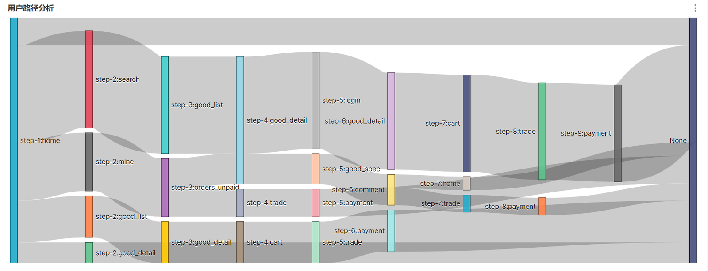
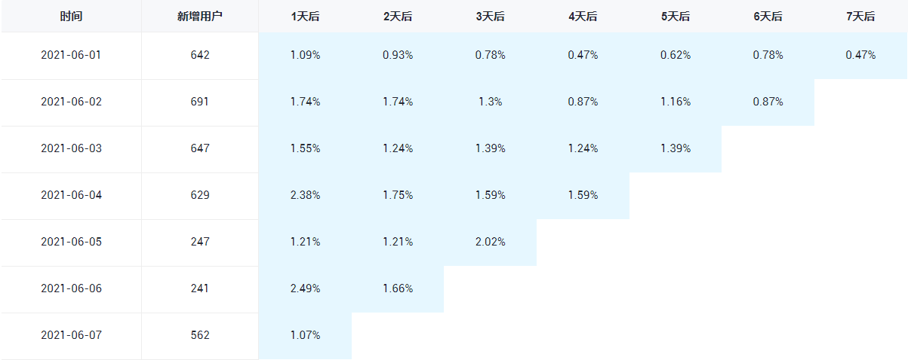
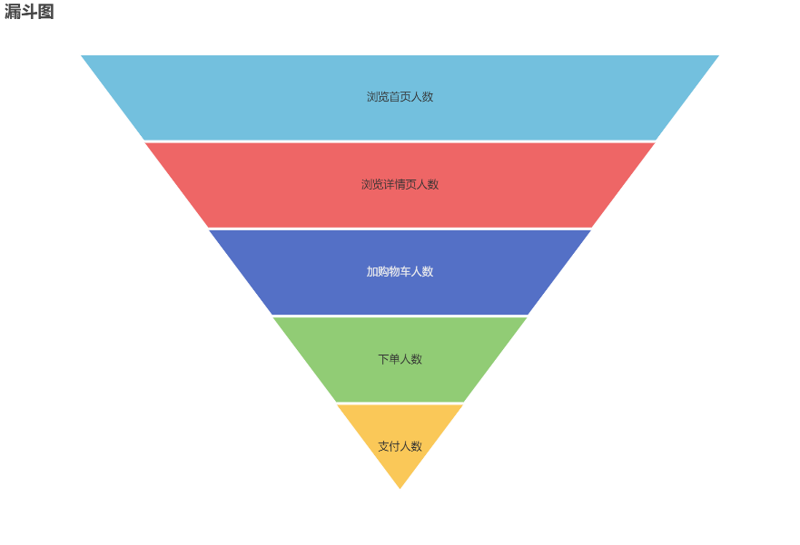

# 第11章 数仓开发之ADS层

## 11.1 流量主题

### 11.1.1 各来源流量统计

引流就是通过各种渠道吸引顾客的工作，统计不同引流来源的访客可用于分析各来源的引流效果，对企业推广策略的制定提供参考。

需求说明如下。

| 统计周期     | 统计粒度 | 指标               | 说明                       |
|--------------|----------|--------------------|----------------------------|
| 最近1/7/30日 | 来源     | 访客数             | 统计访问人数               |
| 最近1/7/30日 | 来源     | 会话平均停留时长   | 统计每个会话平均停留时长   |
| 最近1/7/30日 | 来源     | 会话平均浏览页面数 | 统计每个会话平均浏览页面数 |
| 最近1/7/30日 | 来源     | 会话总数           | 统计会话总数               |
| 最近1/7/30日 | 来源     | 跳出率             | 只有一个页面的会话的比例   |

**1）建表语句**

``` text
DROP TABLE IF EXISTS ads_traffic_stats_by_source;
CREATE EXTERNAL TABLE ads_traffic_stats_by_source
(
    `dt`               STRING COMMENT '统计日期',
    `recent_days`      BIGINT COMMENT '最近天数,1:最近1天,7:最近7天,30:最近30天',
    `source_id`           STRING COMMENT '引流来源id',
    `source_site`      STRING COMMENT '引流来源名称',
    `uv_count`         BIGINT COMMENT '访客人数',
    `avg_duration_sec` BIGINT COMMENT '会话平均停留时长，单位为秒',
    `avg_page_count`   BIGINT COMMENT '会话平均浏览页面数',
    `sv_count`         BIGINT COMMENT '会话数',
    `bounce_rate`      DECIMAL(16, 2) COMMENT '跳出率'
) COMMENT '各引流来源流量统计'
    ROW FORMAT DELIMITED FIELDS TERMINATED BY '\t'
    LOCATION '/warehouse/edu/ads/ads_traffic_stats_by_source/';
```

**2）数据装载**

``` text
insert overwrite table edu.ads_traffic_stats_by_source
select dt,
       recent_days,
       source_id,
       source_site,
       uv_count,
       avg_duration_sec,
       avg_page_count,
       sv_count,
       bounce_rate
from edu.ads_traffic_stats_by_source
union
select '2022-02-21'                                      dt,
       recent_days,
       source_id,
       source_site,
       count(distinct user_id)                           uv_count,
       cast(avg(during_time / 1000) as BIGINT)           avg_duration_sec,
       cast(avg(page_count) as BIGINT)                   avg_page_count,
       count(session_id)                                 sv_count,
       sum(if(page_count = 1, 1, 0)) / count(session_id) bounce_rate
from edu.dws_traffic_session_page_view_1d
         lateral view explode(array(1, 7, 30)) tmp as recent_days
where dt >= date_add('2022-02-21', -recent_days + 1)
  and dt <= '2022-02-21'
group by recent_days, source_id, source_site;
```

### 11.1.2 路径分析

用户路径分析，顾名思义，就是指用户在APP或网站中的访问路径。为了衡量网站优化的效果或营销推广的效果，以及了解用户行为偏好，时常要对访问路径进行分析。

用户访问路径的可视化通常使用桑基图。如下图所示，该图可真实还原用户的访问路径，包括页面跳转和页面访问次序。

桑基图需要我们提供每种页面跳转的次数，每个跳转由source/target表示，source指跳转起始页面，target表示跳转终到页面。



**1）建表语句**

``` text
DROP TABLE IF EXISTS ads_traffic_page_path;
CREATE EXTERNAL TABLE ads_traffic_page_path
(
    `dt`          STRING COMMENT '统计日期',
    `recent_days` BIGINT COMMENT '最近天数,1:最近1天,7:最近7天,30:最近30天',
    `source`      STRING COMMENT '跳转起始页面id',
    `target`      STRING COMMENT '跳转终到页面id',
    `path_count`  BIGINT COMMENT '跳转次数'
) COMMENT '页面浏览路径分析'
    ROW FORMAT DELIMITED FIELDS TERMINATED BY '\t'
    LOCATION '/warehouse/edu/ads/ads_traffic_page_path/';
```

**2）数据装载**

``` text
insert overwrite table edu.ads_traffic_page_path
select dt, recent_days, source, target, path_count
from edu.ads_traffic_page_path
union
select '2022-02-21' dt,
       recent_days,
       source,
       nvl(target, 'null'),
       count(*)     path_count
from (select recent_days,
             concat('step-', rk, ':', page_id)          source,
             concat('step-', rk + 1, ':', next_page_id) target
      from (select recent_days,
                   page_id,
                   lead(page_id) over (partition by recent_days, session_id order by ts) next_page_id,
                   row_number() over (partition by recent_days, session_id order by ts)  rk
            from edu.dwd_traffic_page_view_inc
                     lateral view explode(array(1, 7, 30)) tmp as recent_days
            where dt >= date_add('2022-02-21', -recent_days + 1)
              and dt <= '2022-02-21') t1) t2
group by recent_days, source, target;
```

### 11.1.3 各来源下单统计

需求说明如下。

| 统计周期     | 统计粒度 | 指标   | 说明                     |
|--------------|----------|--------|--------------------------|
| 最近1/7/30日 | 引流来源 | 销售额 | 统计下单金额             |
| 最近1/7/30日 | 引流来源 | 转化率 | 下单人数与引流访客数之比 |

**1）建表语句**

``` text
DROP TABLE IF EXISTS ads_traffic_sale_stats_by_source;
CREATE EXTERNAL TABLE ads_traffic_sale_stats_by_source
(
    `dt` STRING COMMENT '统计日期',
    `recent_days` BIGINT COMMENT '最近天数,1:最近1天,7:最近7天,30:最近30天',
    `source_id`          STRING COMMENT '引流来源id',
    `source_site`        STRING COMMENT '引流来源名称',
    `order_total_amount` DECIMAL(16, 2) COMMENT '销售额',
    `order_user_count`  BIGINT COMMENT '下单用户数',
    `pv_visitor_count`         BIGINT COMMENT '引流访客数',
    `convert_rate`       DECIMAL(16, 2) COMMENT '转化率'
) COMMENT '各引流来源销售状况统计'
    ROW FORMAT DELIMITED FIELDS TERMINATED BY '\t'
    LOCATION '/warehouse/edu/ads/ads_traffic_sale_stats_by_source';
```

**2）数据装载**

``` text
insert overwrite table edu.ads_traffic_sale_stats_by_source
select dt,
       recent_days,
       source_id,
       source_site,
       order_total_amount,
       order_user_count,
       pv_visitor_count,
       convert_rate
from edu.ads_traffic_sale_stats_by_source
union
select '2022-02-21'                     dt,
       t_u_count.recent_days,
       t_u_count.source_id,
       t_u_count.source_site,
       order_total_amount,
       order_user_count,
       pv_visitor_count,
       order_user_count / pv_visitor_count convert_rate
from (
         select recent_days,
                source_id,
                source_site,
                count(distinct mid_id) pv_visitor_count
         from edu.dws_traffic_session_page_view_1d
                  lateral view explode(array(1, 7, 30)) tmp as recent_days
         where dt >= date_add('2022-02-21', -recent_days + 1)
         group by recent_days,
                  source_id,
                  source_site
     ) t_u_count
         left join
     (
         select recent_days,
                source_id,
                source_site,
                sum(order_amount)       order_total_amount,
                count(distinct user_id) order_user_count
         from edu.dws_trade_session_order_1d
                  lateral view explode(array(1, 7, 30)) tmp as recent_days
         where dt >= date_add('2022-02-21', -recent_days + 1)
           and order_amount is not null
           and order_amount > 0
         group by recent_days,
                  source_id,
                  source_site
     ) t_amount
     on t_u_count.recent_days = t_amount.recent_days
         and t_u_count.source_id = t_amount.source_id;
```

## 11.2 用户主题

### 11.2.1 用户变动统计

该需求包括两个指标，分别为流失用户数和回流用户数，以下为对两个指标的解释说明。

| 统计周期 | 指标 | 说明 |
|----|----|----|
| 最近1日 | 流失用户数 | 之前活跃过的用户，最近一段时间未活跃，就称为流失用户。此处要求统计7日前活跃，但最近7日未活跃的用户总数。 |
| 最近1日 | 回流用户数 | 之前的活跃用户，一段时间未活跃（流失），今日又活跃了，就称为回流用户。此处要求统计回流用户总数。 |

**1）建表语句**

``` text
DROP TABLE IF EXISTS ads_user_user_change;
CREATE EXTERNAL TABLE ads_user_user_change
(
    `dt`               STRING COMMENT '统计日期',
    `user_churn_count` BIGINT COMMENT '流失用户数',
    `user_back_count`  BIGINT COMMENT '回流用户数'
) COMMENT '用户变动统计'
    ROW FORMAT DELIMITED FIELDS TERMINATED BY '\t'
    LOCATION '/warehouse/edu/ads/ads_user_user_change/';
```

**2）数据装载**

``` text
insert overwrite table edu.ads_user_user_change
select dt, user_churn_count, user_back_count
from edu.ads_user_user_change
union
select '2022-02-21' dt,
       user_churn_count,
       user_back_count
from (select count(*) user_churn_count
      from edu.dws_user_user_login_td
      where dt = '2022-02-21'
        and login_last_date <= date_add('2022-02-21', -6)) churn
         join
     (select count(*) user_back_count
      from (select user_id
            from edu.dws_user_user_login_td
            where dt = '2022-02-21'
and login_last_date = '2022-02-21'
           ) today
               join
           (
               select user_id,
                      login_last_date
               from edu.dws_user_user_login_td
               where dt = date_add('2022-02-21', -1)
           ) yesterday
           on today.user_id = yesterday.user_id
               and datediff('2022-02-21', yesterday.login_last_date) >= 7) back;
11.2.2 用户留存率
```

留存分析一般包含新增留存和活跃留存分析。

新增留存分析是分析某天的新增用户中，有多少人有后续的活跃行为。活跃留存分析是分析某天的活跃用户中，有多少人有后续的活跃行为。

留存分析是衡量产品对用户价值高低的重要指标。

此处要求统计新增留存率，新增留存率具体是指留存用户数与新增用户数的比值，例如2022-02-21新增100个用户，1日之后（2022-02-22）这100人中有80个人活跃了，那2022-02-21的1日留存数则为80，2022-02-21的1日留存率则为80%。

要求统计每天的1至7日留存率，如下图所示。



**1）建表语句**

``` text
DROP TABLE IF EXISTS ADS_USER_USER_RETENTION;
CREATE EXTERNAL TABLE ADS_USER_USER_RETENTION
(
    `DT`              STRING COMMENT '统计日期',
    `CREATE_DATE`     STRING COMMENT '用户新增日期',
    `RETENTION_DAY`   INT COMMENT '截至当前日期留存天数',
    `RETENTION_COUNT` BIGINT COMMENT '留存用户数量',
    `NEW_USER_COUNT`  BIGINT COMMENT '新增用户数量',
    `RETENTION_RATE`  DECIMAL(16, 2) COMMENT '留存率'
) COMMENT '用户留存率'
    ROW FORMAT DELIMITED FIELDS TERMINATED BY '\T'
    LOCATION '/WAREHOUSE/EDU/ADS/ADS_USER_USER_RETENTION/';
```

**2）数据装载**

``` text
insert overwrite table edu.ads_user_user_retention
select dt,
       create_date,
       retention_day,
       retention_count,
       new_user_count,
       retention_rate
from edu.ads_user_user_retention
union
select '2022-02-21'                                             dt,
       register_date,
       retention_day,
       sum(if(login_last_date = '2022-02-21', 1, 0))            retention_count,
       count(*)                                                 new_user_count,
       sum(if(login_last_date = '2022-02-21', 1, 0)) / count(*) retention_rate
from (
         select user_id,
                register_date,
                retention_day
         from edu.dwd_user_register_inc
                  lateral view explode(array(1, 2, 3, 4, 5, 6, 7)) tmp as retention_day
         where dt = date_add('2022-02-21', -retention_day)
     ) previous
         left join
     (select user_id,
             login_last_date
      from edu.dws_user_user_login_td
      where dt = '2022-02-21'
     ) today
     on today.user_id = previous.user_id
group by register_date,
         retention_day;
```

### 11.2.3 用户新增活跃统计

需求说明如下。

| 统计周期       | 指标       | 指标说明 |
|----------------|------------|----------|
| 最近1、7、30日 | 新增用户数 | 略       |
| 最近1、7、30日 | 活跃用户数 | 略       |

**1）建表语句**

``` text
DROP TABLE IF EXISTS ads_user_user_stats;
CREATE EXTERNAL TABLE ads_user_user_stats
(
    `dt`                STRING COMMENT '统计日期',
    `recent_days`       BIGINT COMMENT '最近n日,1:最近1日,7:最近7日,30:最近30日',
    `new_user_count`    BIGINT COMMENT '新增用户数',
    `active_user_count` BIGINT COMMENT '活跃用户数'
) COMMENT '用户新增活跃统计'
    ROW FORMAT DELIMITED FIELDS TERMINATED BY '\t'
    LOCATION '/warehouse/edu/ads/ads_user_user_stats/';
```

**2）数据装载**

``` text
insert overwrite table  edu.ads_user_user_stats
select dt, recent_days, new_user_count, active_user_count
from  edu.ads_user_user_stats
union
select '2022-02-21' dt,
       new.recent_days,
       new_user_count,
       active_user_count
from (
         select recent_days,
                count(user_id) new_user_count
         from  edu.dwd_user_register_inc
                   lateral view explode(array(1, 7, 30)) tmp as recent_days
         where dt >= date_add('2022-02-21', -recent_days + 1)
         group by recent_days
     ) new
         join
     (
         select recent_days,
                count(user_id) active_user_count
         from  edu.dws_user_user_login_td lateral view
             explode(array(1, 7, 30)) tmp as recent_days
         where dt = '2022-02-21'
           and login_last_date >= date_add('2022-02-21', -recent_days + 1)
         group by recent_days
     ) act
     on new.recent_days = act.recent_days;
```

### 11.2.4 用户行为漏斗分析

漏斗分析是一个数据分析模型，它能够科学反映一个业务过程从起点到终点各阶段用户转化情况。由于其能将各阶段环节都展示出来，故哪个阶段存在问题，就能一目了然。



该需求要求统计一个完整的购物流程各个阶段的人数，具体说明如下：

| 统计周期       | 指标               | 说明         |
|----------------|--------------------|--------------|
| 最近1、7、30日 | 首页浏览人数       | 略           |
| 最近1、7、30日 | 商品详情页浏览人数 | 略           |
| 最近1、7、30日 | 加购人数           | 略           |
| 最近1、7、30日 | 下单人数           | 略           |
| 最近1、7、30日 | 支付人数           | 支付成功人数 |

**1）建表语句**

``` text
DROP TABLE IF EXISTS ads_user_user_action;
CREATE EXTERNAL TABLE ads_user_user_action
(
    `dt`                STRING COMMENT '统计日期',
    `recent_days`       BIGINT COMMENT '最近天数,1:最近1天,7:最近7天,30:最近30天',
    `home_count`        BIGINT COMMENT '浏览首页人数',
    `good_detail_count` BIGINT COMMENT '浏览课程详情页人数',
    `cart_count`        BIGINT COMMENT '加入购物车人数',
    `order_count`       BIGINT COMMENT '下单人数',
    `payment_count`     BIGINT COMMENT '支付人数'
) COMMENT '用户行为漏斗分析'
    ROW FORMAT DELIMITED FIELDS TERMINATED BY '\t'
    LOCATION '/warehouse/edu/ads/ads_user_user_action/';
```

**2）数据装载**

``` text
insert overwrite table edu.ads_user_user_action
select dt, recent_days, home_count, good_detail_count, cart_count, order_count, payment_count
from edu.ads_user_user_action
union
select '2022-02-21' dt,
       t1.recent_days,
       home_count,
       good_detail_count,
       cart_count,
       order_count,
       payment_count
from (select recent_days,
             count(distinct if(page_id = 'home', user_id, null))          home_count,
             count(distinct if(page_id = 'course_detail', user_id, null)) good_detail_count
      from edu.dwd_traffic_page_view_inc
               lateral view explode(array(1, 7, 30)) tmp as recent_days
      where dt >= date_add('2022-02-21', -recent_days + 1)
        and page_id in ('home', 'course_detail')
      group by recent_days) t1
         join
     (select 1        recent_days,
             count(*) payment_count
      from edu.dws_trade_user_payment_1d
      where dt = '2022-02-21'
      union
      select recent_days,
             case recent_days
                 when 7
                     then sum(if(payment_count_7d > 0, 1, 0))
                 when 30
                     then sum(if(payment_count_30d > 0, 1, 0))
                 --count(*)
                 end payment_count
      from edu.dws_trade_user_payment_nd
               lateral view explode(array(7, 30)) tmp as recent_days
      where dt = '2022-02-21'
      group by recent_days) t2
     on t1.recent_days = t2.recent_days
         join
     (select recent_days,
             count(distinct user_id) order_count
      from edu.dwd_trade_order_detail_inc
               lateral view explode(array(1, 7, 30)) tmp as recent_days
      where dt >= date_add('2022-02-21', -recent_days + 1)
        and dt <= '2022-02-21'
      group by recent_days
     ) t3
     on t2.recent_days = t3.recent_days
         join
     (select 1        recent_days,
             count(*) cart_count
      from edu.dws_trade_user_cart_add_1d
      where dt = '2022-02-21'
      union
      select recent_days,
             case recent_days
                 when 7 then sum(if(course_count_7d > 0, 1, 0))
                 when 30 then (sum(if(course_count_30d > 0, 1, 0)))
                 end cart_count
      from edu.dws_trade_user_cart_add_nd
               lateral view explode(array(7, 30)) tmp as recent_days
      where dt = '2022-02-21'
      group by recent_days) t4
     on t3.recent_days = t4.recent_days;
```

### 11.2.5 新增交易用户统计

需求说明如下。

| 统计周期       | 指标         | 说明 |
|----------------|--------------|------|
| 最近1、7、30日 | 新增下单人数 | 略   |
| 最近1、7、30日 | 新增支付人数 | 略   |

**1）建表语句**

``` text
DROP TABLE IF EXISTS ads_user_new_buyer_stats;
CREATE EXTERNAL TABLE ads_user_new_buyer_stats
(
    `dt`                     STRING COMMENT '统计日期',
    `recent_days`            BIGINT COMMENT '最近天数,1:最近1天,7:最近7天,30:最近30天',
    `new_order_user_count`   BIGINT COMMENT '新增下单人数',
    `new_payment_user_count` BIGINT COMMENT '新增支付人数'
) COMMENT '新增交易用户统计'
    ROW FORMAT DELIMITED FIELDS TERMINATED BY '\t'
    LOCATION '/warehouse/edu/ads/ads_user_new_buyer_stats/';
```

**2）数据装载**

``` text
insert overwrite table edu.ads_user_new_buyer_stats
select dt, recent_days, new_order_user_count, new_payment_user_count
from edu.ads_user_new_buyer_stats
union
select '2022-02-21' dt,
       t1.recent_days,
       new_order_user_count,
       new_payment_user_count
from (select recent_days,
             sum(if(order_dt_first >=
                    date_add('2022-02-21', -recent_days + 1), 1, 0)) new_order_user_count
      from edu.dws_trade_user_order_td
               lateral view explode(array(1, 7, 30)) tmp as recent_days
      where dt = '2022-02-21'
      group by recent_days) t1
         join
     (select recent_days,
             sum(if(payment_dt_first >=
                    date_add('2022-02-21', -recent_days + 1), 1, 0)) new_payment_user_count
      from edu.dws_trade_user_payment_td
               lateral view explode(array(1, 7, 30)) tmp as recent_days
      where dt = '2022-02-21'
      group by recent_days) t2
     on t1.recent_days = t2.recent_days;
```

### 11.2.6 各年龄段下单用户数

需求说明如下。

| 统计周期       | 统计粒度 | 指标     | 说明 |
|----------------|----------|----------|------|
| 最近1、7、30日 | 年龄段   | 下单人数 | 略   |

**1）建表语句**

``` text
DROP TABLE IF EXISTS ads_user_order_user_count_by_age_group;
CREATE EXTERNAL TABLE ads_user_order_user_count_by_age_group
(
    `dt`               STRING COMMENT '统计日期',
    `recent_days`      BIGINT COMMENT '最近天数,1:最近1天,7:最近7天,30:最近30天',
    `age_group`        STRING COMMENT '年龄段,18岁及以下、19-24岁、25-29岁、30-34岁、35-39岁、40-49岁、50岁及以上',
    `order_user_count` BIGINT COMMENT '下单人数'
) COMMENT '各年龄段下单用户数统计'
    ROW FORMAT DELIMITED FIELDS TERMINATED BY '\t'
    LOCATION '/warehouse/edu/ads/ads_user_order_user_count_by_age_group/';
```

**2）数据装载**

``` text
insert overwrite table edu.ads_user_order_user_count_by_age_group
select dt, recent_days, age_group, order_user_count
from edu.ads_user_order_user_count_by_age_group
union
select '2022-02-21'   dt,
       recent_days,
       age_group,
       count(user_id) order_user_count
from (select user_id,
             recent_days,
             case
                 when age <= 18 then '18 岁及以下'
                 when age >= 19 and age <= 24 then '19-24 岁'
                 when age >= 25 and age <= 29 then '25-29 岁'
                 when age >= 30 and age <= 34 then '30-34 岁'
                 when age >= 35 and age <= 39 then '35-39 岁'
                 when age >= 40 and age <= 49 then '40-49 岁'
                 when age >= 50 then '50 岁及以上'
                 else '年龄不详'
                 end age_group
      from (
               select user_id,
                      recent_days
               from edu.dwd_trade_order_detail_inc
                        lateral view explode(array(1, 7, 30)) tmp as recent_days
               where dt >= date_add('2022-02-21', -recent_days + 1)
                 and dt <= '2022-02-21'
               group by user_id,
                        recent_days
           ) t1
               left join
           (
               select id,
                      cast(datediff('2022-02-21', birthday) / 365 as BIGINT) age
               from edu.dim_user_zip
               where dt = '9999-12-31'
           ) age
           on t1.user_id = age.id) age_g
group by recent_days,
         age_group;
```

## 11.3 商品主题

### 11.3.1 各分类课程交易统计

需求说明如下。

| 统计周期     | 统计粒度 | 指标     | 说明 |
|--------------|----------|----------|------|
| 最近1/7/30日 | 分类     | 下单数   | 略   |
| 最近1/7/30日 | 分类     | 下单人数 | 略   |
| 最近1/7/30日 | 分类     | 下单金额 | 略   |

**1）建表语句**

``` text
DROP TABLE IF EXISTS ads_course_trade_stats_by_category;
CREATE EXTERNAL TABLE ads_course_trade_stats_by_category
(
    `dt`               STRING COMMENT '统计日期',
    `recent_days`      BIGINT COMMENT '最近天数,1:最近 1 天,7:最近 7
天,30:最近 30 天',
    `category_id`      STRING COMMENT '分类 id',
    `category_name`    STRING COMMENT '分类名称',
    `order_count`      BIGINT COMMENT '下单数',
    `order_user_count` BIGINT COMMENT '下单人数',
    `order_amount`     DECIMAL(16, 2) COMMENT '下单金额'
) COMMENT '各分类课程交易统计'
    ROW FORMAT DELIMITED FIELDS TERMINATED BY '\t'
    LOCATION '/warehouse/edu/ads/ads_course_trade_stats_by_category/';
```

**2）数据装载**

``` text
insert overwrite table edu.ads_course_trade_stats_by_category
select dt,
       recent_days,
       category_id,
       category_name,
       order_count,
       order_user_count,
       order_amount
from edu.ads_course_trade_stats_by_category
union
select '2022-02-21'             dt,
       recent_days,
       category_id,
       category_name,
       count(distinct order_id) order_count,
       count(distinct user_id)  order_user_count,
       sum(final_amount)        order_amount
from edu.dwd_trade_order_detail_inc
         lateral view
             explode(array(1, 7, 30)) tmp as recent_days
where dt >= date_add('2022-02-21', -recent_days + 1)
group by recent_days, category_id, category_name;
```

### 11.3.2 各学科课程交易统计

需求说明如下。

| 统计周期     | 统计粒度 | 指标     | 说明 |
|--------------|----------|----------|------|
| 最近1/7/30日 | 学科     | 下单数   | 略   |
| 最近1/7/30日 | 学科     | 下单人数 | 略   |
| 最近1/7/30日 | 学科     | 下单金额 | 略   |

**1）建表语句**

``` text
DROP TABLE IF EXISTS ads_course_trade_stats_by_subject;
CREATE EXTERNAL TABLE ads_course_trade_stats_by_subject
(
    `dt`               STRING COMMENT '统计日期',
    `recent_days`      BIGINT COMMENT '最近天数,1:最近 1 天,7:最近 7
天,30:最近 30 天',
    `subject_id`       STRING COMMENT '学科id',
    `subject_name`     STRING COMMENT '学科名称',
    `order_count`      BIGINT COMMENT '下单数',
    `order_user_count` BIGINT COMMENT '下单人数',
    `order_amount`     DECIMAL(16, 2) COMMENT '下单金额'
) COMMENT '各学科课程交易统计'
    ROW FORMAT DELIMITED FIELDS TERMINATED BY '\t'
    LOCATION '/warehouse/edu/ads/ads_course_trade_stats_by_subject/';
```

**2）数据装载**

``` text
insert overwrite table edu.ads_course_trade_stats_by_subject
select dt,
       recent_days,
       subject_id,
       subject_name,
       order_count,
       order_user_count,
       order_amount
from edu.ads_course_trade_stats_by_subject
union
select '2022-02-21'             dt,
       recent_days,
       subject_id,
       subject_name,
       count(distinct order_id) order_count,
       count(distinct user_id)  order_user_count,
       sum(final_amount)        order_amount
from edu.dwd_trade_order_detail_inc
         lateral view
             explode(array(1, 7, 30)) tmp as recent_days
where dt >= date_add('2022-02-21', -recent_days + 1)
group by recent_days, subject_id, subject_name;
```

### 11.3.3 各课程交易统计

需求说明如下。

| 统计周期     | 统计粒度 | 指标     | 说明 |
|--------------|----------|----------|------|
| 最近1/7/30日 | 课程     | 下单数   | 略   |
| 最近1/7/30日 | 课程     | 下单人数 | 略   |
| 最近1/7/30日 | 课程     | 下单金额 | 略   |

**1）建表语句**

``` text
DROP TABLE IF EXISTS ads_course_trade_stats_by_course;
CREATE EXTERNAL TABLE ads_course_trade_stats_by_course
(
    `dt`               STRING COMMENT '统计日期',
    `recent_days`      BIGINT COMMENT '最近天数,1:最近 1 天,7:最近 7
天,30:最近 30 天',
    `course_id`        STRING COMMENT '课程id',
    `course_name`      STRING COMMENT '课程名称',
    `order_count`      BIGINT COMMENT '下单数',
    `order_user_count` BIGINT COMMENT '下单人数',
    `order_amount`     DECIMAL(16, 2) COMMENT '下单金额'
) COMMENT '各课程交易统计'
    ROW FORMAT DELIMITED FIELDS TERMINATED BY '\t'
    LOCATION '/warehouse/edu/ads/ads_course_trade_stats_by_course/';
```

**2）数据装载**

``` text
insert overwrite table edu.ads_course_trade_stats_by_course
select dt,
       recent_days,
       course_id,
       course_name,
       order_count,
       order_user_count,
       order_amount
from edu.ads_course_trade_stats_by_course
union
select '2022-02-21'             dt,
       recent_days,
       course_id,
       course_name,
       count(distinct order_id) order_count,
       count(distinct user_id)  order_user_count,
       sum(final_amount)        order_amount
from edu.dwd_trade_order_detail_inc
         lateral view
             explode(array(1, 7, 30)) tmp as recent_days
where dt >= date_add('2022-02-21', -recent_days + 1)
group by recent_days, course_id, course_name;
```

### 11.3.4 各课程评价统计

需求说明如下。

| 统计周期     | 统计粒度 | 指标                                          | 说明 |
|--------------|----------|-----------------------------------------------|------|
| 最近1/7/30日 | 课程     | 用户平均评分                                  | 略   |
| 最近1/7/30日 | 课程     | 评价用户数                                    | 略   |
| 最近1/7/30日 | 课程     | 好评率（给出5星评价的用户占总评价用户的比率） | 略   |

**1）建表语句**

``` text
DROP TABLE IF EXISTS ads_course_review_stats_by_course;
CREATE EXTERNAL TABLE ads_course_review_stats_by_course
(
    `dt`                STRING COMMENT '统计日期',
    `recent_days`       BIGINT COMMENT '最近天数,1:最近 1 天,7:最近 7
天,30:最近 30 天',
    `course_id`         STRING COMMENT '课程id',
    `course_name`       STRING COMMENT '课程名称',
    `avg_stars`         BIGINT COMMENT '用户平均评分',
    `review_user_count` BIGINT COMMENT '评价用户数',
    `praise_rate`       DECIMAL(16, 2) COMMENT '好评率'
) COMMENT '各课程评价统计'
    ROW FORMAT DELIMITED FIELDS TERMINATED BY '\t'
    LOCATION '/warehouse/edu/ads/ads_course_review_stats_by_course/';
```

**2）数据装载**

``` text
insert overwrite table ads_course_review_stats_by_course
select *
from ads_course_review_stats_by_course
union
select '2022-02-21' dt,
       recent_days,
       course_id,
       course_name,
       avg_stars,
       review_user_count,
       praise_rate
from (
     select recent_days,
           course_id,
           cast(avg(review_stars) as bigint) avg_stars,
           count(*)  review_user_count,
           cast(sum(`if`(review_stars=5,1,0)) / count(*) as decimal(16,2)) praise_rate
    from dwd_interaction_review_inc
    lateral view explode(`array`(1,7,30)) tmp as recent_days
    where dt<='2022-02-21' and dt>=date_sub('2022-02-21',recent_days-1)
    group by recent_days,course_id
)t1
left join (
    select *
    from dim_course_full
    where dt='2022-02-21'
)t2
on t1.course_id=t2.id;
```

### 11.3.5 各分类课程试听留存统计

需求说明如下。

| 统计周期  | 统计粒度 | 指标       | 说明                    |
|-----------|----------|------------|-------------------------|
| 最近1-7日 | 分类     | 试听人数   | count(distinct user_id) |
| 最近1-7日 | 分类     | 试听留存率 | 下单人次/试听人次       |

**1）建表语句**

``` text
DROP TABLE IF EXISTS ads_sample_retention_stats_by_category;
CREATE EXTERNAL TABLE ads_sample_retention_stats_by_category
(
    `dt`                STRING COMMENT '统计日期',
    `retention_days`    BIGINT COMMENT '留存天数，1-7 天',
    `category_id`       STRING COMMENT '分类id',
    `category_name`     STRING COMMENT '分类名称',
    `sample_user_count` BIGINT COMMENT '试听人数',
    `retention_rate`    DECIMAL(16, 2) COMMENT '试听留存率'
) COMMENT '各分类课程试听留存统计'
    ROW FORMAT DELIMITED FIELDS TERMINATED BY '\t'
    LOCATION '/warehouse/edu/ads/ads_sample_retention_stats_by_category/';
```

**2）数据装载**

``` text
insert overwrite table ads_sample_retention_stats_by_category
select *
from ads_sample_retention_stats_by_category
union
select '2022-02-21' dt,
       retention_days,
       category_id,
       category_name,
       count(*)  sample_user_count,
       cast(sum(`if`(order_date is not null ,1,0)) /  count(*) as decimal(16,2)) retention_rate
from dwd_trade_course_order_inc
lateral view explode(`array`(1,2,3,4,5,6,7)) tmp as retention_days
where (dt='9999-12-31' or dt>=date_sub('2022-02-21',6))
and play_date=date_sub('2022-02-21',retention_days-1)
group by retention_days,category_id,category_name,play_date;
```

### 11.3.6 各学科试听留存统计

需求说明如下。

| 统计周期  | 统计粒度 | 指标       | 说明                    |
|-----------|----------|------------|-------------------------|
| 最近1-7日 | 学科     | 试听人数   | count(distinct user_id) |
| 最近1-7日 | 学科     | 试听留存率 | 下单人次/试听人次       |

**1）建表语句**

``` text
DROP TABLE IF EXISTS ads_sample_retention_stats_by_subject;
CREATE EXTERNAL TABLE ads_sample_retention_stats_by_subject
(
    `dt`                STRING COMMENT '统计日期',
    `retention_days`    BIGINT COMMENT '留存天数，1-7 天',
    `subject_id`        STRING COMMENT '学科id',
    `subject_name`      STRING COMMENT '学科名称',
    `sample_user_count` BIGINT COMMENT '试听人数',
    `retention_rate`    DECIMAL(16, 2) COMMENT '试听留存率'
) COMMENT '各学科试听留存统计'
    ROW FORMAT DELIMITED FIELDS TERMINATED BY '\t'
    LOCATION '/warehouse/edu/ads/ads_sample_retention_stats_by_subject/';
```

**2）数据装载**

``` text
insert overwrite table ads_sample_retention_stats_by_subject
select *
from ads_sample_retention_stats_by_subject
union
select '2022-02-21' dt,
       retention_days,
       subject_id,
       subject_name,
       count(*)  sample_user_count,
       cast(sum(`if`(order_date is not null ,1,0)) /  count(*) as decimal(16,2)) retention_rate
from dwd_trade_course_order_inc
lateral view explode(`array`(1,2,3,4,5,6,7)) tmp as retention_days
where (dt='9999-12-31' or dt>=date_sub('2022-02-21',6))
and play_date=date_sub('2022-02-21',retention_days-1)
group by retention_days,subject_id,subject_name,play_date;
```

### 11.3.7 各课程试听留存统计

需求说明如下。

| 统计周期  | 统计粒度 | 指标       | 说明                    |
|-----------|----------|------------|-------------------------|
| 最近1-7日 | 课程     | 试听人数   | count(distinct user_id) |
| 最近1-7日 | 课程     | 试听留存率 | 下单人次/试听人次       |

**1）建表语句**

``` text
DROP TABLE IF EXISTS ads_sample_retention_stats_by_course;
CREATE EXTERNAL TABLE ads_sample_retention_stats_by_course
(
    `dt`                STRING COMMENT '统计日期',
    `retention_days`    BIGINT COMMENT '留存天数，1-7 天',
    `course_id`         STRING COMMENT '课程id',
    `course_name`       STRING COMMENT '课程名称',
    `sample_user_count` BIGINT COMMENT '试听人数',
    `retention_rate`    DECIMAL(16, 2) COMMENT '试听留存率'
) COMMENT '各课程试听留存统计'
    ROW FORMAT DELIMITED FIELDS TERMINATED BY '\t'
    LOCATION '/warehouse/edu/ads/ads_sample_retention_stats_by_course/';
```

**2）数据装载**

``` text
insert overwrite table ads_sample_retention_stats_by_course
select *
from ads_sample_retention_stats_by_course
union
select '2022-02-21' dt,
       retention_days,
       course_id,
       course_name,
       count(*)  sample_user_count,
       cast(sum(`if`(order_date is not null ,1,0)) /  count(*) as decimal(16,2)) retention_rate
from dwd_trade_course_order_inc
lateral view explode(`array`(1,2,3,4,5,6,7)) tmp as retention_days
where (dt='9999-12-31' or dt>=date_sub('2022-02-21',6))
and play_date=date_sub('2022-02-21',retention_days-1)
group by retention_days,course_id,course_name,play_date;
```

## 11.4 交易主题

### 11.4.1 交易综合统计

需求说明如下。

| 统计周期       | 指标     | 说明         |
|----------------|----------|--------------|
| 最近1、7、30日 | 下单总额 | 下单最终金额 |
| 最近1、7、30日 | 下单数   | 略           |
| 最近1、7、30日 | 下单人数 | 略           |

**1）建表语句**

``` text
DROP TABLE IF EXISTS ads_trade_stats;
CREATE EXTERNAL TABLE ads_trade_stats
(
    `dt`                 STRING COMMENT '统计日期',
    `recent_days`        BIGINT COMMENT '最近天数,1:最近1日,7:最近7天,30:最近30天',
    `order_total_amount` DECIMAL(16, 2) COMMENT '下单总额,GMV',
    `order_count`        BIGINT COMMENT '下单数',
    `order_user_count`   BIGINT COMMENT '下单人数'
) COMMENT '交易综合指标'
    ROW FORMAT DELIMITED FIELDS TERMINATED BY '\t'
    LOCATION '/warehouse/edu/ads/ads_trade_stats/';
```

**2）数据装载**

``` text
insert overwrite table edu.ads_trade_stats
select dt, recent_days, order_total_amount, order_count, order_user_count
from edu.ads_trade_stats
union
select '2022-02-21'            dt,
       recent_days,
       sum(order_amount)       order_total_amount,
       sum(order_count)        order_count,
       count(distinct user_id) order_user_count
from edu.dws_trade_session_order_1d
         lateral view explode(array(1, 7, 30)) tmp as recent_days
where dt >= date_add('2022-02-21', -recent_days + 1)
  and dt <= '2022-02-21'
group by recent_days;
```

### 11.4.2 各省份交易统计

需求说明如下。

| 统计周期     | 统计粒度 | 指标     | 说明 |
|--------------|----------|----------|------|
| 最近1/7/30日 | 省份     | 下单数   | 略   |
| 最近1/7/30日 | 省份     | 下单人数 | 略   |
| 最近1/7/30日 | 省份     | 下单金额 | 略   |

**1）建表语句**

``` text
DROP TABLE IF EXISTS ads_trade_order_by_province;
CREATE EXTERNAL TABLE ads_trade_order_by_province
(
    `dt`                 STRING COMMENT '统计日期',
    `recent_days`        BIGINT COMMENT '最近天数,1:最近1天,7:最近7天,30:最近30天',
    `province_id`        STRING COMMENT '省份id',
    `province_name`      STRING COMMENT '省份名称',
    `region_id`          STRING COMMENT '地区id',
    `area_code`          STRING COMMENT '地区编码',
    `iso_code`           STRING COMMENT '国际标准地区编码',
    `iso_code_3166_2`    STRING COMMENT '国际标准地区编码',
    `order_count`        BIGINT COMMENT '下单数',
    `order_user_count`   BIGINT COMMENT '下单人数',
    `order_total_amount` DECIMAL(16, 2) COMMENT '下单金额'
) COMMENT '各省份下单统计'
    ROW FORMAT DELIMITED FIELDS TERMINATED BY '\t'
    LOCATION '/warehouse/edu/ads/ads_trade_order_by_province/';
```

**2）数据装载**

``` text
insert overwrite table edu.ads_trade_order_by_province
select dt,
       recent_days,
       province_id,
       province_name,
       region_id,
       area_code,
       iso_code,
       iso_code_3166_2,
       order_count,
       order_user_count,
       order_total_amount
from edu.ads_trade_order_by_province
union
select '2022-02-21' dt,
       recent_days,
       province_id,
       province_name,
       region_id,
       area_code,
       iso_code,
       iso_code_3166_2,
       order_count,
       order_user_count,
       order_total_amount
from (select recent_days,
             province_id,
             sum(order_count)  order_count,
             count(distinct user_id) order_user_count,
             sum(order_amount) order_total_amount
      from edu.dws_trade_session_order_1d
               lateral view explode(array(1, 7, 30)) tmp as recent_days
      where dt >= date_add('2022-02-21', -recent_days + 1)
        and dt <= '2022-02-21'
      group by recent_days, province_id) t1
         left join
     (select id,
             name       province_name,
             region_id,
             area_code,
             iso_code,
             iso_3166_2 iso_code_3166_2
      from edu.dim_province_full
      where dt = '2022-02-21') prov
     on t1.province_id = prov.id;
```

## 11.5 考试主题

### 11.5.1 各试卷平均统计

需求说明如下。

| 统计周期     | 统计粒度 | 指标     | 说明                             |
|--------------|----------|----------|----------------------------------|
| 最近1/7/30日 | 试卷     | 平均分   | 完成该试卷的所有用户的平均成绩   |
| 最近1/7/30日 | 试卷     | 平均时长 | 完成该试卷所有用户答卷的平均时长 |
| 最近1/7/30日 | 试卷     | 用户数   | 完成该试卷的用户数               |

**1）建表语句**

``` text
DROP TABLE IF EXISTS ads_examination_paper_avg_stats;
CREATE EXTERNAL TABLE ads_examination_paper_avg_stats
(
    `dt`             STRING COMMENT '统计日期',
    `recent_days`    BIGINT COMMENT '最近天数,1:最近1天,7:最近7天,30:最近30天',
    `paper_id`       STRING COMMENT '试卷id',
    `paper_title`    STRING COMMENT '试卷名称',
    `avg_score`      DECIMAL(16, 2) COMMENT '平均分',
    `avg_during_sec` BIGINT COMMENT '平均时长',
    `user_count`     BIGINT COMMENT '用户数'
) COMMENT '各试卷相关指标'
    ROW FORMAT DELIMITED FIELDS TERMINATED BY '\t'
    LOCATION '/warehouse/edu/ads/ads_examination_paper_avg_stats/';
```

**2）数据装载**

``` text
insert overwrite table edu.ads_examination_paper_avg_stats
select dt,
       recent_days,
       paper_id,
       paper_title,
       avg_score,
       avg_during_sec,
       user_count
from edu.ads_examination_paper_avg_stats
union
select '2022-02-21' dt,
       1            recent_days,
       paper_id,
       paper_title,
       avg_score,
       avg_during_sec,
       user_count
from edu.dws_examination_paper_exam_1d
where dt = '2022-02-21'
union
select '2022-02-21' dt,
       recent_days,
       paper_id,
       paper_title,
       case recent_days
           when 7 then avg_score_7d
           when 30 then avg_score_30d
           end      avg_score,
       case recent_days
           when 7 then avg_during_sec_7d
           when 30 then avg_during_sec_30d
           end      avg_during_sec,
       case recent_days
           when 7 then user_count_7d
           when 30 then user_count_30d
           end      user_count
from edu.dws_examination_paper_exam_nd
         lateral view explode(array(7, 30)) tmp as recent_days
where dt = '2022-02-21';
```

### 11.5.2 各课程考试相关指标统计

需求说明如下。

| 统计周期     | 统计粒度 | 指标     | 说明                             |
|--------------|----------|----------|----------------------------------|
| 最近1/7/30日 | 课程     | 平均分   | 完成该试卷的所有用户的平均成绩   |
| 最近1/7/30日 | 课程     | 平均时长 | 完成该试卷所有用户答卷的平均时长 |
| 最近1/7/30日 | 课程     | 用户数   | 完成该试卷的用户数               |

**1）建表语句**

``` text
DROP TABLE IF EXISTS ads_examination_course_avg_stats;
CREATE EXTERNAL TABLE ads_examination_course_avg_stats
(
    `dt`             STRING COMMENT '统计日期',
    `recent_days`    BIGINT COMMENT '最近天数,1:最近1天,7:最近7天,30:最近30天',
    `course_id`      STRING COMMENT '课程id',
    `course_name`    STRING COMMENT '课程名称',
    `avg_score`      DECIMAL(16, 2) COMMENT '平均分',
    `avg_during_sec` BIGINT COMMENT '平均时长',
    `user_count`     BIGINT COMMENT '用户数'
) COMMENT '各课程考试相关指标'
    ROW FORMAT DELIMITED FIELDS TERMINATED BY '\t'
    LOCATION '/warehouse/edu/ads/ads_examination_course_avg_stats/';
```

**2）数据装载**

``` text
insert overwrite table edu.ads_examination_course_avg_stats
select dt,
       recent_days,
       course_id,
       course_name,
       avg_score,
       avg_during_sec,
       user_count
from edu.ads_examination_course_avg_stats
union
select '2022-02-21' dt,
       user_ct.recent_days,
       user_ct.course_id,
       course_name,
       avg_score,
       avg_during_sec,
       user_count
from (
         select recent_days,
                course_id,
                count(distinct user_id) user_count
         from (select course_id,
                      user_id,
                      dt
               from (select paper_id,
                            user_id,
                            dt
                     from edu.dwd_examination_test_paper_inc
                     where dt >= date_add('2022-02-21', -29)) dwd_exam
                        left join
                    (select id,
                            course_id
                     from edu.dim_paper_full
                     where dt = '2022-02-21'
                    ) dim_paper
                    on dwd_exam.paper_id = dim_paper.id) wide
                  lateral view explode(array(1, 7, 30)) tmp as recent_days
         where dt >= date_add('2022-02-21', -recent_days + 1)
         group by recent_days,
                  course_id) user_ct
         join
     (select 1                                       recent_days,
             course_id,
             course_name,
             sum(total_score) / sum(user_count)      avg_score,
             sum(total_during_sec) / sum(user_count) avg_during_sec
      from edu.dws_examination_paper_exam_1d
      where dt = '2022-02-21'
      group by course_id,
               course_name
      union
      select recent_days,
             course_id,
             course_name,
             sum(if(recent_days = 7, total_score_7d, total_score_30d)) /
             sum(if(recent_days = 7, user_count_7d, user_count_30d)) avg_score,
             sum(if(recent_days = 7, total_during_sec_7d, total_during_sec_30d)) /
             sum(if(recent_days = 7, user_count_7d, user_count_30d)) avg_during_sec
      from edu.dws_examination_paper_exam_nd
               lateral view explode(array(7, 30)) tmp as recent_days
      where dt = '2022-02-21'
      group by recent_days,
               course_id,
               course_name) rate_query
     on user_ct.recent_days = rate_query.recent_days
         and user_ct.course_id = rate_query.course_id;
```

### 11.5.3 各试卷成绩分布

统计最近 1/7/30 日各试卷在各个分数区间的用户数，需求说明如下。

| 统计周期       | 统计粒度    | 指标   | 说明 |
|----------------|-------------|--------|------|
| 最近1、7、30日 | 试卷-分数段 | 用户数 | 略   |

**1）建表语句**

``` text
DROP TABLE IF EXISTS ads_examination_user_count_by_score_duration;
CREATE EXTERNAL TABLE ads_examination_user_count_by_score_duration
(
    `dt`             STRING COMMENT '统计日期',
    `recent_days`    BIGINT COMMENT '最近天数,1:最近1天,7:最近7天,30:最近30天',
    `paper_id`       STRING COMMENT '试卷 id',
    `score_duration` STRING COMMENT '分数区间',
    `user_count`     BIGINT COMMENT '各试卷各分数区间用户数'
) COMMENT '各试卷分数分布统计'
    ROW FORMAT DELIMITED FIELDS TERMINATED BY '\t'
    LOCATION '/warehouse/edu/ads/ads_examination_user_count_by_score_duration/';
```

**2）数据装载**

``` text
insert overwrite table edu.ads_examination_user_count_by_score_duration
select dt, recent_days, paper_id, score_duration, user_count
from edu.ads_examination_user_count_by_score_duration
union
select '2022-02-21'  dt,
       1             recent_days,
       paper_id,
       duration_name score_duration,
       user_count
from edu.dws_examination_paper_duration_exam_1d
where dt = '2022-02-21'
union
select '2022-02-21'  dt,
       recent_days,
       paper_id,
       duration_name score_duration,
       case recent_days
           when 7 then user_count_7d
           when 30 then user_count_30d
           end       user_count
from edu.dws_examination_paper_duration_exam_nd
         lateral view explode(array(7, 30)) tmp as recent_days
where dt = '2022-02-21';
```

### 11.5.4 各题正确率

需求说明如下。

| 统计周期       | 统计粒度 | 指标   | 说明 |
|----------------|----------|--------|------|
| 最近1、7、30日 | 试题     | 正确率 | 略   |

**1）建表语句**

``` text
DROP TABLE IF EXISTS ads_examination_question_accuracy;
CREATE EXTERNAL TABLE ads_examination_question_accuracy
(
    `dt`          STRING COMMENT '统计日期',
    `recent_days` BIGINT COMMENT '最近天数,1:最近1天,7:最近7天,30:最近30天',
    `question_id` STRING COMMENT '题目 id',
    `accuracy`    DECIMAL(16, 2) COMMENT '正确率'
) COMMENT '各题目正确率'
    ROW FORMAT DELIMITED FIELDS TERMINATED BY '\t'
    LOCATION '/warehouse/edu/ads/ads_examination_question_accuracy/';
```

**2）数据装载**

``` text
insert overwrite table edu.ads_examination_question_accuracy
select dt, recent_days, question_id, accuracy
from edu.ads_examination_question_accuracy
union
select '2022-02-21'                 dt,
       1                            recent_days,
       question_id,
       correct_count / answer_count accuracy
from edu.dws_examination_question_exam_1d
where dt = '2022-02-21'
union
select '2022-02-21' dt,
       recent_days,
       question_id,
       case recent_days
           when 7 then correct_count_7d / answer_count_7d
           when 30 then correct_count_30d / answer_count_30d
           end      accuracy
from edu.dws_examination_question_exam_nd
         lateral view explode(array(7, 30)) tmp as recent_days
where dt = '2022-02-21';
```

## 11.6 播放主题

### 11.6.1 各章节视频播放情况统计

需求说明如下。

| 统计周期       | 统计粒度 | 指标         | 说明 |
|----------------|----------|--------------|------|
| 最近1、7、30日 | 章节     | 视频播放次数 | 略   |
| 最近1、7、30日 | 章节     | 人均观看时长 | 略   |
| 最近1、7、30日 | 章节     | 观看人数     | 略   |

**1）建表语句**

``` text
DROP TABLE IF EXISTS ads_learn_play_stats_by_chapter;
CREATE EXTERNAL TABLE ads_learn_play_stats_by_chapter
(
    `dt`           STRING COMMENT '统计日期',
    `recent_days`  BIGINT COMMENT '最近天数,1:最近1天,7:最近7天,30:最近30天',
    `chapter_id`   STRING COMMENT '章节 id',
    `chapter_name` STRING COMMENT '章节名称',
    `video_id`     STRING COMMENT '视频 id',
    `video_name`   STRING COMMENT '视频名称',
    `play_count`   BIGINT COMMENT '各章节视频播放次数',
    `avg_play_sec` BIGINT COMMENT '各章节视频人均观看时长',
    `user_count`   BIGINT COMMENT '各章节观看人数'
) COMMENT '各章节视频播放情况统计'
    ROW FORMAT DELIMITED FIELDS TERMINATED BY '\t'
    LOCATION '/warehouse/edu/ads/ads_learn_play_stats_by_chapter/';
```

**2）数据装载**

``` text
insert overwrite table edu.ads_learn_play_stats_by_chapter
select dt,
       recent_days,
       chapter_id,
       chapter_name,
       video_id,
       video_name,
       play_count,
       avg_play_sec,
       user_count
from edu.ads_learn_play_stats_by_chapter
union
select '2022-02-21'                            dt,
       recent_days,
       chapter_id,
       chapter_name,
       video_id,
       video_name,
       count(*)                                play_count,
       sum(play_sec) / count(distinct user_id) avg_play_sec,
       count(distinct user_id)                 user_count
from edu.dwd_learn_play_inc
         lateral view explode(array(1, 7, 30)) tmp
         as recent_days
where dt >= date_add('2022-02-21', -recent_days + 1)
group by recent_days,
         chapter_id,
         chapter_name,
         video_id,
         video_name;
```

### 11.6.2 各课程视频播放情况统计

需求说明如下。

| 统计周期       | 统计粒度 | 指标         | 说明 |
|----------------|----------|--------------|------|
| 最近1、7、30日 | 课程     | 视频播放次数 | 略   |
| 最近1、7、30日 | 课程     | 人均观看时长 | 略   |
| 最近1、7、30日 | 课程     | 观看人数     | 略   |

**1）建表语句**

``` text
DROP TABLE IF EXISTS ads_learn_play_stats_by_course;
CREATE EXTERNAL TABLE ads_learn_play_stats_by_course
(
    `dt`           STRING COMMENT '统计日期',
    `recent_days`  BIGINT COMMENT '最近天数,1:最近1天,7:最近7天,30:最近30天',
    `course_id`    STRING COMMENT '课程id',
    `course_name`  STRING COMMENT '课程名称',
    `play_count`   BIGINT COMMENT '各课程视频播放次数',
    `avg_play_sec` BIGINT COMMENT '各课程视频人均观看时长',
    `user_count`   BIGINT COMMENT '各课程观看人数'
) COMMENT '各课程播放情况统计'
    ROW FORMAT DELIMITED FIELDS TERMINATED BY '\t'
    LOCATION '/warehouse/edu/ads/ads_learn_play_stats_by_course/';
```

**2）数据装载**

``` text
insert overwrite table edu.ads_learn_play_stats_by_course
select dt,
       recent_days,
       course_id,
       course_name,
       play_count,
       avg_play_sec,
       user_count
from edu.ads_learn_play_stats_by_course
union
select '2022-02-21'                            dt,
       recent_days,
       course_id,
       course_name,
       count(*)                                play_count,
       sum(play_sec) / count(distinct user_id) avg_play_sec,
       count(distinct user_id)                 user_count
from edu.dwd_learn_play_inc
         lateral view explode(array(1, 7, 30)) tmp
         as recent_days
where dt >= date_add('2022-02-21', -recent_days + 1)
group by recent_days,
         course_id,
         course_name;
```

## 11.7 完课主题

### 11.7.1 各课程完课人数统计

需求说明如下。

| 统计周期       | 统计粒度 | 指标     | 说明 |
|----------------|----------|----------|------|
| 最近1、7、30日 | 课程     | 完课人数 | 略   |

**1）建表语句**

``` text
DROP TABLE IF EXISTS ads_complete_complete_user_count_per_course;
CREATE EXTERNAL TABLE ads_complete_complete_user_count_per_course
(
    `dt`          STRING COMMENT '统计日期',
    `recent_days` BIGINT COMMENT '最近天数,1:最近1天,7:最近7天,30:最近30天',
    `course_id`   STRING COMMENT '课程 id',
    `user_count`  BIGINT COMMENT '完课人数'
) COMMENT '各课程完课人数'
    ROW FORMAT DELIMITED FIELDS TERMINATED BY '\t'
    LOCATION '/warehouse/edu/ads/ads_complete_complete_user_count_per_course/';
```

**2）数据装载**

``` text
insert overwrite table edu.ads_complete_complete_user_count_per_course
select dt,
       recent_days,
       course_id,
       user_count
from edu.ads_complete_complete_user_count_per_course
union
select '2022-02-21'   dt,
       recent_days,
       course_id,
       count(user_id) order_count
from (select course_id,
             id,
             user_id,
             max_chapter_complete_date
      from (select course_id,
                   user_id,
                   max(first_complete_date)   max_chapter_complete_date,
                   count(first_complete_date) user_chapter_complete_count
            from edu.dwd_learn_play_stats_full
            where dt = '2022-02-21'
            group by course_id, user_id
           ) chapter_complete
               left join
           (select id,
                   chapter_num
            from edu.dim_course_full
            where dt = '2022-02-21') dim_course
           on chapter_complete.course_id = dim_course.id
      where user_chapter_complete_count = chapter_num
     ) course_complete
         lateral view explode(array(1, 7, 30)) tmp as recent_days
where max_chapter_complete_date >= date_add('2022-02-21', -recent_days + 1)
group by recent_days, course_id;
```

### 11.7.2 完课综合指标

需求说明如下。

| 统计周期     | 指标       | 说明 |
|--------------|------------|------|
| 最近1/7/30日 | 总完课人数 | 略   |
| 最近1/7/30日 | 总完课人次 |      |

**1）建表语句**

``` text
DROP TABLE IF EXISTS ads_complete_complete_stats;
CREATE EXTERNAL TABLE ads_complete_complete_stats
(
    `dt`                         STRING COMMENT '统计日期',
    `recent_days`                BIGINT COMMENT '最近天数,1:最近1天,7:最近7天,30:最近30天',
    `user_complete_count`        BIGINT COMMENT '完课人数',
    `user_course_complete_count` BIGINT COMMENT '完课人次'
) COMMENT '完课综合指标'
    ROW FORMAT DELIMITED FIELDS TERMINATED BY '\t'
    LOCATION '/warehouse/edu/ads/ads_complete_complete_stats/';
```

**2）数据装载**

``` text
insert overwrite table edu.ads_complete_complete_stats
select dt,
       recent_days,
       user_complete_count,
       user_course_complete_count
from edu.ads_complete_complete_stats
union
select '2022-02-21'            dt,
       recent_days,
       count(distinct user_id) user_complete_count,
       count(*)                user_course_complete_count
from (select course_id,
             id,
             user_id,
             max_chapter_complete_date
      from (select course_id,
                   user_id,
                   max(first_complete_date)   max_chapter_complete_date,
                   count(first_complete_date) user_chapter_complete_count
            from edu.dwd_learn_play_stats_full
            where dt = '2022-02-21'
            group by course_id, user_id
           ) chapter_complete
               left join
           (select id,
                   chapter_num
            from edu.dim_course_full
            where dt = '2022-02-21') dim_course
           on chapter_complete.course_id = dim_course.id
      where user_chapter_complete_count = chapter_num
     ) course_complete
         lateral view explode(array(1, 7, 30)) tmp as recent_days
where max_chapter_complete_date >= date_add('2022-02-21', -recent_days + 1)
group by recent_days;
```

### 11.7.3 各个课程人均完成章节数

需求说明如下。

| 统计周期       | 统计粒度 | 指标           | 说明                 |
|----------------|----------|----------------|----------------------|
| 最近1、7、30日 | 课程     | 人均完成章节数 | 等价于人均完播视频数 |

**1）建表语句**

``` text
DROP TABLE IF EXISTS ads_complete_complete_chapter_count_per_course;
CREATE EXTERNAL TABLE ads_complete_complete_chapter_count_per_course
(
    `dt`                     STRING COMMENT '统计日期',
    `recent_days`            BIGINT COMMENT '最近天数,1:最近1天,7:最近7天,30:最近30天',
    `course_id`              STRING COMMENT '课程 id',
    `complete_chapter_count` DECIMAL(16, 2) COMMENT '用户平均完成章节数'
) COMMENT '各课程人均完成章节视频数'
    ROW FORMAT DELIMITED FIELDS TERMINATED BY '\t'
    LOCATION '/warehouse/edu/ads/ads_complete_complete_chapter_count_per_course/';
```

**2）数据装载**

``` text
insert overwrite table edu.ads_complete_complete_chapter_count_per_course
select dt,
       recent_days,
       course_id,
       complete_chapter_count
from edu.ads_complete_complete_chapter_count_per_course
union
select '2022-02-21'                                                         dt,
       recent_days,
       course_id,
       count(first_complete_date) / count(distinct user_id) complete_chapter_count
from edu.dwd_learn_play_stats_full
         lateral view explode(array(1, 7, 30)) tmp as recent_days
where dt = '2022-02-21'
  and first_complete_date is not null
  and first_complete_date >= date_add('2022-02-21', -recent_days + 1)
group by recent_days,
         course_id;
```

## 11.8 数据装载脚本

**1）每日数据装载脚本**

（1）在hadoop102的/home/atguigu/bin目录下创建dws_to_ads.sh

``` bash
[zhangsan@node0 bin]$ vim dws_to_ads.sh
```

（2）编写如下内容

``` text
#!/bin/bash
if [ -n "$2" ] ;then
    do_date=$2
else
    do_date=date -d "-1 day" +%F
fi
APP=edu
ads_traffic_stats_by_source="
insert overwrite table ${APP}.ads_traffic_stats_by_source
select dt,
       recent_days,
       source_id,
       source_site,
       uv_count,
       avg_duration_sec,
       avg_page_count,
       sv_count,
       bounce_rate
from ${APP}.ads_traffic_stats_by_source
union
select '$do_date'                                      dt,
       recent_days,
       source_id,
       source_site,
       count(distinct user_id)                           uv_count,
       cast(avg(during_time / 1000) as BIGINT)           avg_duration_sec,
       cast(avg(page_count) as BIGINT)                   avg_page_count,
       count(session_id)                                 sv_count,
       sum(if(page_count = 1, 1, 0)) / count(session_id) bounce_rate
from ${APP}.dws_traffic_session_page_view_1d
         lateral view explode(array(1, 7, 30)) tmp as recent_days
where dt >= date_add('$do_date', -recent_days + 1)
  and dt <= '$do_date'
group by recent_days, source_id, source_site;"
ads_traffic_page_path="
insert overwrite table ${APP}.ads_traffic_page_path
select dt, recent_days, source, target, path_count
from ${APP}.ads_traffic_page_path
union
select '$do_date' dt,
       recent_days,
       source,
       nvl(target, 'null'),
       count(*)     path_count
from (select recent_days,
             concat('step-', rk, ':', page_id)          source,
             concat('step-', rk + 1, ':', next_page_id) target
      from (select recent_days,
                   page_id,
                   lead(page_id) over (partition by recent_days, session_id order by ts) next_page_id,
                   row_number() over (partition by recent_days, session_id order by ts)  rk
            from ${APP}.dwd_traffic_page_view_inc
                     lateral view explode(array(1, 7, 30)) tmp as recent_days
            where dt >= date_add('$do_date', -recent_days + 1)
              and dt <= '$do_date') t1) t2
group by recent_days, source, target;"
ads_traffic_sale_stats_by_source="
insert overwrite table ${APP}.ads_traffic_sale_stats_by_source
select dt,
       recent_days,
       source_id,
       source_site,
       order_total_amount,
       order_user_count,
       pv_visitor_count,
       convert_rate
from ${APP}.ads_traffic_sale_stats_by_source
union
select '$do_date'                     dt,
       t_u_count.recent_days,
       t_u_count.source_id,
       t_u_count.source_site,
       order_total_amount,
       order_user_count,
       pv_visitor_count,
       order_user_count / pv_visitor_count convert_rate
from (
         select recent_days,
                source_id,
                source_site,
                count(distinct mid_id) pv_visitor_count
         from ${APP}.dws_traffic_session_page_view_1d
                  lateral view explode(array(1, 7, 30)) tmp as recent_days
         where dt >= date_add('$do_date', -recent_days + 1)
         group by recent_days,
                  source_id,
                  source_site
     ) t_u_count
         left join
     (
         select recent_days,
                source_id,
                source_site,
                sum(order_amount)       order_total_amount,
                count(distinct user_id) order_user_count
         from ${APP}.dws_trade_session_order_1d
                  lateral view explode(array(1, 7, 30)) tmp as recent_days
         where dt >= date_add('$do_date', -recent_days + 1)
           and order_amount is not null
           and order_amount > 0
         group by recent_days,
                  source_id,
                  source_site
     ) t_amount
     on t_u_count.recent_days = t_amount.recent_days
         and t_u_count.source_id = t_amount.source_id;"
ads_user_user_change="
insert overwrite table ${APP}.ads_user_user_change
select dt, user_churn_count, user_back_count
from ${APP}.ads_user_user_change
union
select '$do_date' dt,
       user_churn_count,
       user_back_count
from (select count(*) user_churn_count
      from ${APP}.dws_user_user_login_td
      where dt = '$do_date'
        and login_last_date <= date_add('$do_date', -6)) churn
         join
     (select count(*) user_back_count
      from (select user_id
            from ${APP}.dws_user_user_login_td
            where dt = '$do_date'
and login_last_date = '$do_date'
           ) today
               join
           (
               select user_id,
                      login_last_date
               from ${APP}.dws_user_user_login_td
               where dt = date_add('$do_date', -1)
           ) yesterday
           on today.user_id = yesterday.user_id
               and datediff('$do_date', yesterday.login_last_date) >= 7) back;"
ads_user_user_retention="
insert overwrite table ${APP}.ads_user_user_retention
select dt,
       create_date,
       retention_day,
       retention_count,
       new_user_count,
       retention_rate
from ${APP}.ads_user_user_retention
union
select '$do_date'                                             dt,
       register_date,
       retention_day,
       sum(if(login_last_date = '$do_date', 1, 0))            retention_count,
       count(*)                                                 new_user_count,
       sum(if(login_last_date = '$do_date', 1, 0)) / count(*) retention_rate
from (
         select user_id,
                register_date,
                retention_day
         from ${APP}.dwd_user_register_inc
                  lateral view explode(array(1, 2, 3, 4, 5, 6, 7)) tmp as retention_day
         where dt = date_add('$do_date', -retention_day)
     ) previous
         left join
     (select user_id,
             login_last_date
      from ${APP}.dws_user_user_login_td
      where dt = '$do_date'
     ) today
     on today.user_id = previous.user_id
group by register_date,
         retention_day;"
ads_user_user_stats="
insert overwrite table ${APP}.ads_user_user_stats
select dt, recent_days, new_user_count, active_user_count
from  ${APP}.ads_user_user_stats
union
select '$do_date' dt,
       new.recent_days,
       new_user_count,
       active_user_count
from (
         select recent_days,
                count(user_id) new_user_count
         from  ${APP}.dwd_user_register_inc
                   lateral view explode(array(1, 7, 30)) tmp as recent_days
         where dt >= date_add('$do_date', -recent_days + 1)
         group by recent_days
     ) new
         join
     (
         select recent_days,
                count(user_id) active_user_count
         from  ${APP}.dws_user_user_login_td lateral view
             explode(array(1, 7, 30)) tmp as recent_days
         where dt = '$do_date'
           and login_last_date >= date_add('$do_date', -recent_days + 1)
         group by recent_days
     ) act
     on new.recent_days = act.recent_days;"
ads_user_user_action="
insert overwrite table ${APP}.ads_user_user_action
select dt, recent_days, home_count, good_detail_count, cart_count, order_count, payment_count
from ${APP}.ads_user_user_action
union
select '$do_date' dt,
       t1.recent_days,
       home_count,
       good_detail_count,
       cart_count,
       order_count,
       payment_count
from (select recent_days,
             count(distinct if(page_id = 'home', user_id, null))          home_count,
             count(distinct if(page_id = 'course_detail', user_id, null)) good_detail_count
      from ${APP}.dwd_traffic_page_view_inc
               lateral view explode(array(1, 7, 30)) tmp as recent_days
      where dt >= date_add('$do_date', -recent_days + 1)
        and page_id in ('home', 'course_detail')
      group by recent_days) t1
         join
     (select 1        recent_days,
             count(*) payment_count
      from ${APP}.dws_trade_user_payment_1d
      where dt = '$do_date'
      union
      select recent_days,
             case recent_days
                 when 7
                     then sum(if(payment_count_7d > 0, 1, 0))
                 when 30
                     then sum(if(payment_count_30d > 0, 1, 0))
                 --count(*)
                 end payment_count
      from ${APP}.dws_trade_user_payment_nd
               lateral view explode(array(7, 30)) tmp as recent_days
      where dt = '$do_date'
      group by recent_days) t2
     on t1.recent_days = t2.recent_days
         join
     (select recent_days,
             count(distinct user_id) order_count
      from ${APP}.dwd_trade_order_detail_inc
               lateral view explode(array(1, 7, 30)) tmp as recent_days
      where dt >= date_add('$do_date', -recent_days + 1)
        and dt <= '$do_date'
      group by recent_days
     ) t3
     on t2.recent_days = t3.recent_days
         join
     (select 1        recent_days,
             count(*) cart_count
      from ${APP}.dws_trade_user_cart_add_1d
      where dt = '$do_date'
      union
      select recent_days,
             case recent_days
                 when 7 then sum(if(course_count_7d > 0, 1, 0))
                 when 30 then (sum(if(course_count_30d > 0, 1, 0)))
                 end cart_count
      from ${APP}.dws_trade_user_cart_add_nd
               lateral view explode(array(7, 30)) tmp as recent_days
      where dt = '$do_date'
      group by recent_days) t4
     on t3.recent_days = t4.recent_days;"
ads_user_new_buyer_stats="
insert overwrite table ${APP}.ads_user_new_buyer_stats
select dt, recent_days, new_order_user_count, new_payment_user_count
from ${APP}.ads_user_new_buyer_stats
union
select '$do_date' dt,
       t1.recent_days,
       new_order_user_count,
       new_payment_user_count
from (select recent_days,
             sum(if(order_dt_first >=
                    date_add('$do_date', -recent_days + 1), 1, 0)) new_order_user_count
      from ${APP}.dws_trade_user_order_td
               lateral view explode(array(1, 7, 30)) tmp as recent_days
      where dt = '$do_date'
      group by recent_days) t1
         join
     (select recent_days,
             sum(if(payment_dt_first >=
                    date_add('$do_date', -recent_days + 1), 1, 0)) new_payment_user_count
      from ${APP}.dws_trade_user_payment_td
               lateral view explode(array(1, 7, 30)) tmp as recent_days
      where dt = '$do_date'
      group by recent_days) t2
     on t1.recent_days = t2.recent_days;"
ads_user_order_user_count_by_age_group="
insert overwrite table ${APP}.ads_user_order_user_count_by_age_group
select dt, recent_days, age_group, order_user_count
from ${APP}.ads_user_order_user_count_by_age_group
union
select '$do_date'   dt,
       recent_days,
       age_group,
       count(user_id) order_user_count
from (select user_id,
             recent_days,
             case
                 when age <= 18 then '18 岁及以下'
                 when age >= 19 and age <= 24 then '19-24 岁'
                 when age >= 25 and age <= 29 then '25-29 岁'
                 when age >= 30 and age <= 34 then '30-34 岁'
                 when age >= 35 and age <= 39 then '35-39 岁'
                 when age >= 40 and age <= 49 then '40-49 岁'
                 when age >= 50 then '50 岁及以上'
                 else '年龄不详'
                 end age_group
      from (
               select user_id,
                      recent_days
               from ${APP}.dwd_trade_order_detail_inc
                        lateral view explode(array(1, 7, 30)) tmp as recent_days
               where dt >= date_add('$do_date', -recent_days + 1)
                 and dt <= '$do_date'
               group by user_id,
                        recent_days
           ) t1
               left join
           (
               select id,
                      cast(datediff('$do_date', birthday) / 365 as BIGINT) age
               from ${APP}.dim_user_zip
               where dt = '9999-12-31'
           ) age
           on t1.user_id = age.id) age_g
group by recent_days,
         age_group;"
ads_course_trade_stats_by_category="
insert overwrite table ${APP}.ads_course_trade_stats_by_category
select dt,
       recent_days,
       category_id,
       category_name,
       order_count,
       order_user_count,
       order_amount
from ${APP}.ads_course_trade_stats_by_category
union
select '$do_date'             dt,
       recent_days,
       category_id,
       category_name,
       count(distinct order_id) order_count,
       count(distinct user_id)  order_user_count,
       sum(final_amount)        order_amount
from ${APP}.dwd_trade_order_detail_inc
         lateral view
             explode(array(1, 7, 30)) tmp as recent_days
where dt >= date_add('$do_date', -recent_days + 1)
group by recent_days, category_id, category_name;"
ads_course_trade_stats_by_subject="
insert overwrite table ${APP}.ads_course_trade_stats_by_subject
select dt,
       recent_days,
       subject_id,
       subject_name,
       order_count,
       order_user_count,
       order_amount
from ${APP}.ads_course_trade_stats_by_subject
union
select '$do_date'             dt,
       recent_days,
       subject_id,
       subject_name,
       count(distinct order_id) order_count,
       count(distinct user_id)  order_user_count,
       sum(final_amount)        order_amount
from ${APP}.dwd_trade_order_detail_inc
         lateral view
             explode(array(1, 7, 30)) tmp as recent_days
where dt >= date_add('$do_date', -recent_days + 1)
group by recent_days, subject_id, subject_name;"
ads_course_trade_stats_by_course="
insert overwrite table ${APP}.ads_course_trade_stats_by_course
select dt,
       recent_days,
       course_id,
       course_name,
       order_count,
       order_user_count,
       order_amount
from ${APP}.ads_course_trade_stats_by_course
union
select '$do_date'             dt,
       recent_days,
       course_id,
       course_name,
       count(distinct order_id) order_count,
       count(distinct user_id)  order_user_count,
       sum(final_amount)        order_amount
from ${APP}.dwd_trade_order_detail_inc
         lateral view explode(array(1, 7, 30)) tmp as recent_days
where dt >= date_add('$do_date', -recent_days + 1)
group by recent_days, course_id, course_name;"
ads_course_review_stats_by_course="
insert overwrite table ${APP}.ads_course_review_stats_by_course
select *
from ${APP}.ads_course_review_stats_by_course
union
select '$do_date' dt,
       recent_days,
       course_id,
       course_name,
       avg_stars,
       review_user_count,
       praise_rate
from (
     select recent_days,
           course_id,
           cast(avg(review_stars) as bigint) avg_stars,
           count(*)  review_user_count,
           sum(if(review_stars=5,1,0)) / count(*)  praise_rate
    from ${APP}.dwd_interaction_review_inc
    lateral view explode(array(1,7,30)) tmp as recent_days
    where dt<='$do_date' and dt>=date_sub('$do_date',recent_days-1)
    group by recent_days,course_id
)t1
left join (
    select *
    from ${APP}.dim_course_full
    where dt='$do_date'
)t2
on t1.course_id=t2.id;"
ads_sample_retention_stats_by_category="
insert overwrite table ads_sample_retention_stats_by_category
select *
from ads_sample_retention_stats_by_category
union
select '2022-02-21' dt,
       retention_days,
       category_id,
       category_name,
       count(*)  sample_user_count,
       sum(if(order_date is not null ,1,0)) /  count(*)  retention_rate
from dwd_trade_course_order_inc
lateral view explode( array(1,2,3,4,5,6,7) ) tmp as retention_days
where (dt='9999-12-31' or dt>=date_sub('2022-02-21',6))
and play_date=date_sub('2022-02-21',retention_days-1)
group by retention_days,category_id,category_name,play_date;"
ads_sample_retention_stats_by_subject="
insert overwrite table ${APP}.ads_sample_retention_stats_by_subject
select *
from ${APP}.ads_sample_retention_stats_by_subject
union
select '$do_date' dt,
       retention_days,
       subject_id,
       subject_name,
       count(*)  sample_user_count,
       sum(if(order_date is not null ,1,0)) /  count(*)  retention_rate
from ${APP}.dwd_trade_course_order_inc
lateral view explode(array(1,2,3,4,5,6,7)) tmp as retention_days
where (dt='9999-12-31' or dt>=date_sub('$do_date',6))
and play_date=date_sub('$do_date',retention_days-1)
group by retention_days,subject_id,subject_name,play_date;"
ads_sample_retention_stats_by_course="
insert overwrite table ${APP}.ads_sample_retention_stats_by_course
select *
from ${APP}.ads_sample_retention_stats_by_course
union
select '$do_date' dt,
       retention_days,
       course_id,
       course_name,
       count(*)  sample_user_count,
       cast(sum(if(order_date is not null ,1,0)) /  count(*) as decimal(16,2)) retention_rate
from ${APP}.dwd_trade_course_order_inc
lateral view explode(array(1,2,3,4,5,6,7)) tmp as retention_days
where (dt='9999-12-31' or dt>=date_sub('$do_date',6))
and play_date=date_sub('$do_date',retention_days-1)
group by retention_days,course_id,course_name,play_date;"
ads_trade_stats="
insert overwrite table ${APP}.ads_trade_stats
select dt, recent_days, order_total_amount, order_count, order_user_count
from ${APP}.ads_trade_stats
union
select '$do_date'            dt,
       recent_days,
       sum(order_amount)       order_total_amount,
       sum(order_count)        order_count,
       count(distinct user_id) order_user_count
from ${APP}.dws_trade_session_order_1d
         lateral view explode(array(1, 7, 30)) tmp as recent_days
where dt >= date_add('$do_date', -recent_days + 1)
  and dt <= '$do_date'
group by recent_days;"
ads_trade_order_by_province="
insert overwrite table ${APP}.ads_trade_order_by_province
select dt,
       recent_days,
       province_id,
       province_name,
       region_id,
       area_code,
       iso_code,
       iso_code_3166_2,
       order_count,
       order_user_count,
       order_total_amount
from ${APP}.ads_trade_order_by_province
union
select '$do_date' dt,
       recent_days,
       province_id,
       province_name,
       region_id,
       area_code,
       iso_code,
       iso_code_3166_2,
       order_count,
       order_user_count,
       order_total_amount
from (select recent_days,
             province_id,
             sum(order_count)  order_count,
             count(distinct user_id) order_user_count,
             sum(order_amount) order_total_amount
      from ${APP}.dws_trade_session_order_1d
               lateral view explode(array(1, 7, 30)) tmp as recent_days
      where dt >= date_add('$do_date', -recent_days + 1)
        and dt <= '$do_date'
      group by recent_days, province_id) t1
         left join
     (select id,
             name       province_name,
             region_id,
             area_code,
             iso_code,
             iso_3166_2 iso_code_3166_2
      from ${APP}.dim_province_full
      where dt = '$do_date') prov
     on t1.province_id = prov.id;"
ads_examination_paper_avg_stats="
insert overwrite table ${APP}.ads_examination_paper_avg_stats
select dt,
       recent_days,
       paper_id,
       paper_title,
       avg_score,
       avg_during_sec,
       user_count
from ${APP}.ads_examination_paper_avg_stats
union
select '$do_date' dt,
       1            recent_days,
       paper_id,
       paper_title,
       avg_score,
       avg_during_sec,
       user_count
from ${APP}.dws_examination_paper_exam_1d
where dt = '$do_date'
union
select '$do_date' dt,
       recent_days,
       paper_id,
       paper_title,
       case recent_days
           when 7 then avg_score_7d
           when 30 then avg_score_30d
           end      avg_score,
       case recent_days
           when 7 then avg_during_sec_7d
           when 30 then avg_during_sec_30d
           end      avg_during_sec,
       case recent_days
           when 7 then user_count_7d
           when 30 then user_count_30d
           end      user_count
from ${APP}.dws_examination_paper_exam_nd
         lateral view explode(array(7, 30)) tmp as recent_days
where dt = '$do_date';"
ads_examination_course_avg_stats="
insert overwrite table ${APP}.ads_examination_course_avg_stats
select dt,
       recent_days,
       course_id,
       course_name,
       avg_score,
       avg_during_sec,
       user_count
from ${APP}.ads_examination_course_avg_stats
union
select '$do_date' dt,
       user_ct.recent_days,
       user_ct.course_id,
       course_name,
       avg_score,
       avg_during_sec,
       user_count
from (
         select recent_days,
                course_id,
                count(distinct user_id) user_count
         from (select course_id,
                      user_id,
                      dt
               from (select paper_id,
                            user_id,
                            dt
                     from ${APP}.dwd_examination_test_paper_inc
                     where dt >= date_add('$do_date', -29)) dwd_exam
                        left join
                    (select id,
                            course_id
                     from ${APP}.dim_paper_full
                     where dt = '$do_date'
                    ) dim_paper
                    on dwd_exam.paper_id = dim_paper.id) wide
                  lateral view explode(array(1, 7, 30)) tmp as recent_days
         where dt >= date_add('$do_date', -recent_days + 1)
         group by recent_days,
                  course_id) user_ct
         join
     (select 1                                       recent_days,
             course_id,
             course_name,
             sum(total_score) / sum(user_count)      avg_score,
             sum(total_during_sec) / sum(user_count) avg_during_sec
      from ${APP}.dws_examination_paper_exam_1d
      where dt = '$do_date'
      group by course_id,
               course_name
      union
      select recent_days,
             course_id,
             course_name,
             sum(if(recent_days = 7, total_score_7d, total_score_30d)) /
             sum(if(recent_days = 7, user_count_7d, user_count_30d)) avg_score,
             sum(if(recent_days = 7, total_during_sec_7d, total_during_sec_30d)) /
             sum(if(recent_days = 7, user_count_7d, user_count_30d)) avg_during_sec
      from ${APP}.dws_examination_paper_exam_nd
               lateral view explode(array(7, 30)) tmp as recent_days
      where dt = '$do_date'
      group by recent_days,
               course_id,
               course_name) rate_query
     on user_ct.recent_days = rate_query.recent_days
         and user_ct.course_id = rate_query.course_id;"
ads_examination_user_count_by_score_duration="
insert overwrite table ${APP}.ads_examination_user_count_by_score_duration
select dt, recent_days, paper_id, score_duration, user_count
from ${APP}.ads_examination_user_count_by_score_duration
union
select '$do_date'  dt,
       1             recent_days,
       paper_id,
       duration_name score_duration,
       user_count
from ${APP}.dws_examination_paper_duration_exam_1d
where dt = '$do_date'
union
select '$do_date'  dt,
       recent_days,
       paper_id,
       duration_name score_duration,
       case recent_days
           when 7 then user_count_7d
           when 30 then user_count_30d
           end       user_count
from ${APP}.dws_examination_paper_duration_exam_nd
         lateral view explode(array(7, 30)) tmp as recent_days
where dt = '$do_date';"
ads_examination_question_accuracy="
insert overwrite table ${APP}.ads_examination_question_accuracy
select dt, recent_days, question_id, accuracy
from ${APP}.ads_examination_question_accuracy
union
select '$do_date'                 dt,
       1                            recent_days,
       question_id,
       correct_count / answer_count accuracy
from ${APP}.dws_examination_question_exam_1d
where dt = '$do_date'
union
select '$do_date' dt,
       recent_days,
       question_id,
       case recent_days
           when 7 then correct_count_7d / answer_count_7d
           when 30 then correct_count_30d / answer_count_30d
           end      accuracy
from ${APP}.dws_examination_question_exam_nd
         lateral view explode(array(7, 30)) tmp as recent_days
where dt = '$do_date';"
ads_learn_play_stats_by_chapter="
insert overwrite table ${APP}.ads_learn_play_stats_by_chapter
select dt,
       recent_days,
       chapter_id,
       chapter_name,
       video_id,
       video_name,
       play_count,
       avg_play_sec,
       user_count
from ${APP}.ads_learn_play_stats_by_chapter
union
select '$do_date'                            dt,
       recent_days,
       chapter_id,
       chapter_name,
       video_id,
       video_name,
       count(*)                                play_count,
       sum(play_sec) / count(distinct user_id) avg_play_sec,
       count(distinct user_id)                 user_count
from ${APP}.dwd_learn_play_inc
         lateral view explode(array(1, 7, 30)) tmp
         as recent_days
where dt >= date_add('$do_date', -recent_days + 1)
group by recent_days,
         chapter_id,
         chapter_name,
         video_id,
         video_name;"
ads_learn_play_stats_by_course="
insert overwrite table ${APP}.ads_learn_play_stats_by_course
select dt,
       recent_days,
       course_id,
       course_name,
       play_count,
       avg_play_sec,
       user_count
from ${APP}.ads_learn_play_stats_by_course
union
select '$do_date'                            dt,
       recent_days,
       course_id,
       course_name,
       count(*)                                play_count,
       sum(play_sec) / count(distinct user_id) avg_play_sec,
       count(distinct user_id)                 user_count
from ${APP}.dwd_learn_play_inc
         lateral view explode(array(1, 7, 30)) tmp
         as recent_days
where dt >= date_add('$do_date', -recent_days + 1)
group by recent_days,
         course_id,
         course_name;"
ads_complete_complete_user_count_per_course="
insert overwrite table ${APP}.ads_complete_complete_user_count_per_course
select dt,
       recent_days,
       course_id,
       user_count
from ${APP}.ads_complete_complete_user_count_per_course
union
select '$do_date'   dt,
       recent_days,
       course_id,
       count(user_id) order_count
from (select course_id,
             id,
             user_id,
             max_chapter_complete_date
      from (select course_id,
                   user_id,
                   max(first_complete_date)   max_chapter_complete_date,
                   count(first_complete_date) user_chapter_complete_count
            from ${APP}.dwd_learn_play_stats_full
            where dt = '$do_date'
            group by course_id, user_id
           ) chapter_complete
               left join
           (select id,
                   chapter_num
            from ${APP}.dim_course_full
            where dt = '$do_date') dim_course
           on chapter_complete.course_id = dim_course.id
      where user_chapter_complete_count = chapter_num
     ) course_complete
         lateral view explode(array(1, 7, 30)) tmp as recent_days
where max_chapter_complete_date >= date_add('$do_date', -recent_days + 1)
group by recent_days, course_id;"
ads_complete_complete_stats="
insert overwrite table ${APP}.ads_complete_complete_stats
select dt,
       recent_days,
       user_complete_count,
       user_course_complete_count
from ${APP}.ads_complete_complete_stats
union
select '$do_date'            dt,
       recent_days,
       count(distinct user_id) user_complete_count,
       count(*)                user_course_complete_count
from (select course_id,
             id,
             user_id,
             max_chapter_complete_date
      from (select course_id,
                   user_id,
                   max(first_complete_date)   max_chapter_complete_date,
                   count(first_complete_date) user_chapter_complete_count
            from ${APP}.dwd_learn_play_stats_full
            where dt = '$do_date'
            group by course_id, user_id
           ) chapter_complete
               left join
           (select id,
                   chapter_num
            from ${APP}.dim_course_full
            where dt = '$do_date') dim_course
           on chapter_complete.course_id = dim_course.id
      where user_chapter_complete_count = chapter_num
     ) course_complete
         lateral view explode(array(1, 7, 30)) tmp as recent_days
where max_chapter_complete_date >= date_add('$do_date', -recent_days + 1)
group by recent_days;"
ads_complete_complete_chapter_count_per_course="
insert overwrite table ${APP}.ads_complete_complete_chapter_count_per_course
select dt,
       recent_days,
       course_id,
       complete_chapter_count
from ${APP}.ads_complete_complete_chapter_count_per_course
union
select '$do_date'                                                         dt,
       recent_days,
       course_id,
       count(first_complete_date) / count(distinct user_id) complete_chapter_count
from ${APP}.dwd_learn_play_stats_full
         lateral view explode(array(1, 7, 30)) tmp as recent_days
where dt = '$do_date'
  and first_complete_date is not null
  and first_complete_date >= date_add('$do_date', -recent_days + 1)
group by recent_days,
         course_id;"
case $1 in
    ads_traffic_stats_by_source|ads_traffic_page_path|ads_traffic_sale_stats_by_source|ads_user_user_change|ads_user_user_retention|ads_user_user_stats|ads_user_user_action|ads_user_new_buyer_stats|ads_user_order_user_count_by_age_group|ads_course_trade_stats_by_category|ads_course_trade_stats_by_subject|ads_course_trade_stats_by_course|ads_course_review_stats_by_course|ads_sample_retention_stats_by_category|ads_sample_retention_stats_by_subject|ads_sample_retention_stats_by_course|ads_trade_stats|ads_trade_order_by_province|ads_examination_paper_avg_stats|ads_examination_course_avg_stats|ads_examination_user_count_by_score_duration|ads_examination_question_accuracy|ads_learn_play_stats_by_chapter|ads_learn_play_stats_by_course|ads_complete_complete_user_count_per_course|ads_complete_complete_stats|ads_complete_complete_chapter_count_per_course)
        eval "hive -e \"\$$1\""
    ;;
    "all" )
        hive -e "${ads_traffic_stats_by_source}${ads_traffic_page_path}${ads_traffic_sale_stats_by_source}${ads_user_user_change}${ads_user_user_retention}${ads_user_user_stats}${ads_user_user_action}${ads_user_new_buyer_stats}${ads_user_order_user_count_by_age_group}${ads_course_trade_stats_by_category}${ads_course_trade_stats_by_subject}${ads_course_trade_stats_by_course}${ads_course_review_stats_by_course}${ads_sample_retention_stats_by_category}${ads_sample_retention_stats_by_subject}${ads_sample_retention_stats_by_course}${ads_trade_stats}${ads_trade_order_by_province}${ads_examination_paper_avg_stats}${ads_examination_course_avg_stats}${ads_examination_user_count_by_score_duration}${ads_examination_question_accuracy}${ads_learn_play_stats_by_chapter}${ads_learn_play_stats_by_course}${ads_complete_complete_user_count_per_course}${ads_complete_complete_stats}${ads_complete_complete_chapter_count_per_course}"
    ;;
esac
```

（3）增加脚本执行权限

``` bash
[zhangsan@node0 bin]$ chmod +x dws_to_ads.sh
```

（4）脚本用法

``` bash
[zhangsan@node0 bin]$ dws_to_ads.sh all 2022-02-21
```
