# 第13章 数据仓库工作流调度

## 13.1 调度工具部署

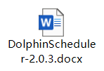

## 13.2 数据准备

此处需要模拟生成一天的新数据，作为全流程调度的测试数据。

**1）执行集群启动脚本，开启Hadoop、ZooKeeper、Kafka以及用户行为数据采集系统。**

``` bash
[zhangsan@node0 ~]$ cluster.sh start
```

**2）启动业务数据采集Flume。**

``` bash
[zhangsan@node0 ~]$ f3.sh start
```

**3）模拟生成2022-02-22的数据。**

``` bash
[zhangsan@node0 ~]$ mock.sh 2022-02-22
```

## 13.3 工作流调度实操

由于DolphinScheduler集群模式启动进程较多，对虚拟机内存要求较高。故下面提供两种方式，可根据虚拟机内存情况进行选择。

### 13.3.1 DolphinScheduler集群模式

**1）启动DolphinScheduler**

``` bash
[zhangsan@node0 dolphinscheduler]$ bin/start-all.sh
```

**2）使用普通用户登录**

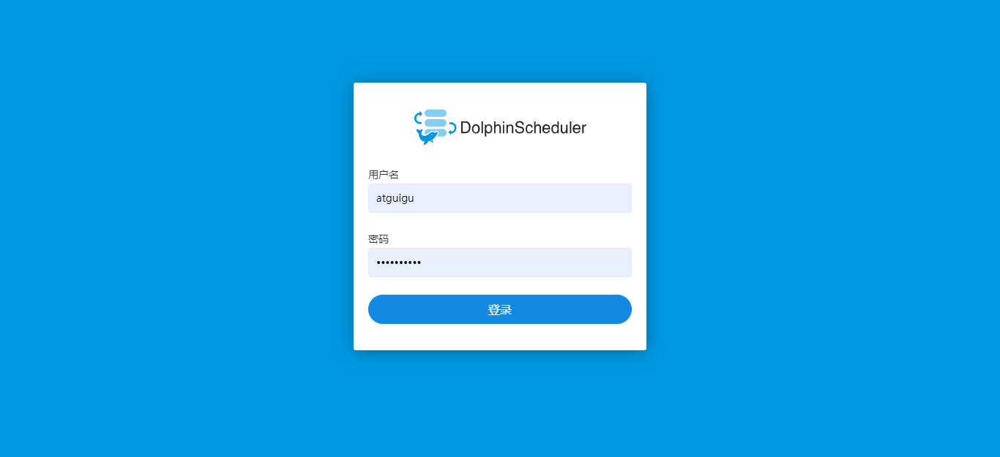

**3）向DolphinScheduler资源中心上传工作流所需脚本**

（1）创建文件夹

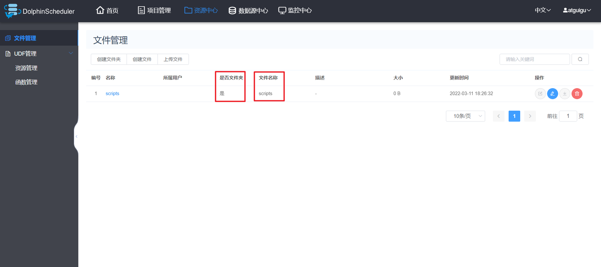

（2）上传工作流所需脚本

将工作流所需的所有脚本上传到资源中心scripts路径下，结果如下

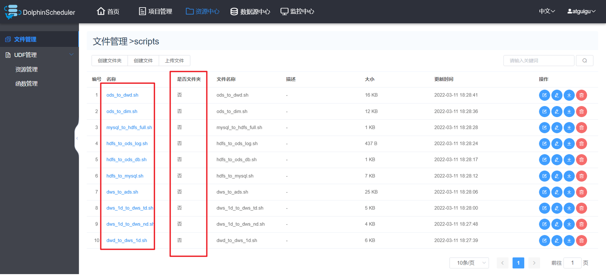

**4）向DolphinScheduler的WorkerServer节点分发脚本依赖的组件**

由于工作流要执行的脚本需要调用Hive、DataX等组件，故在DolphinScheduler的集群模式下，需要确保每个WorkerServer节点都有脚本所依赖的组件。

``` bash
[zhangsan@node0 ~]$ xsync /opt/module/hive/
[zhangsan@node0 ~]$ xsync /opt/module/spark/
[zhangsan@node0 ~]$ xsync /opt/module/datax/
```

**5）配置运行环境**

（1）切换到 admin 用户，在环境管理下创建环境

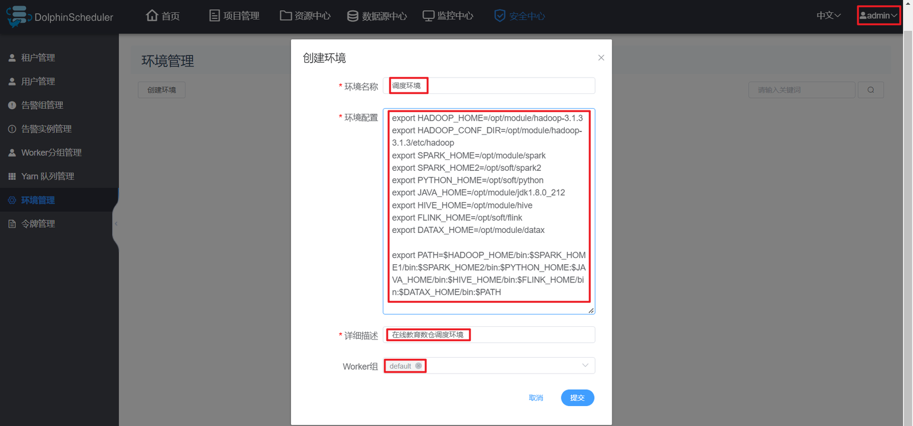

（2）在环境配置中添加如下内容

<span class="mark">标红部分根据集群情况修改。</span>

``` text
export HADOOP_HOME=/opt/module/hadoop-3.1.3
export HADOOP_CONF_DIR=/opt/module/hadoop-3.1.3/etc/hadoop
export SPARK_HOME=/opt/module/spark
export SPARK_HOME2=/opt/soft/spark2
export PYTHON_HOME=/opt/soft/python
export JAVA_HOME=/opt/module/jdk1.8.0_144
export HIVE_HOME=/opt/module/hive
export FLINK_HOME=/opt/soft/flink
export DATAX_HOME=/opt/module/datax
export PATH=$HADOOP_HOME/bin:$SPARK_HOME1/bin:$SPARK_HOME2/bin:$PYTHON_HOME:$JAVA_HOME/bin:$HIVE_HOME/bin:$FLINK_HOME/bin:$DATAX_HOME/bin:$PATH
```

**6）创建工作流**

（1）在edu项目下创建工作流

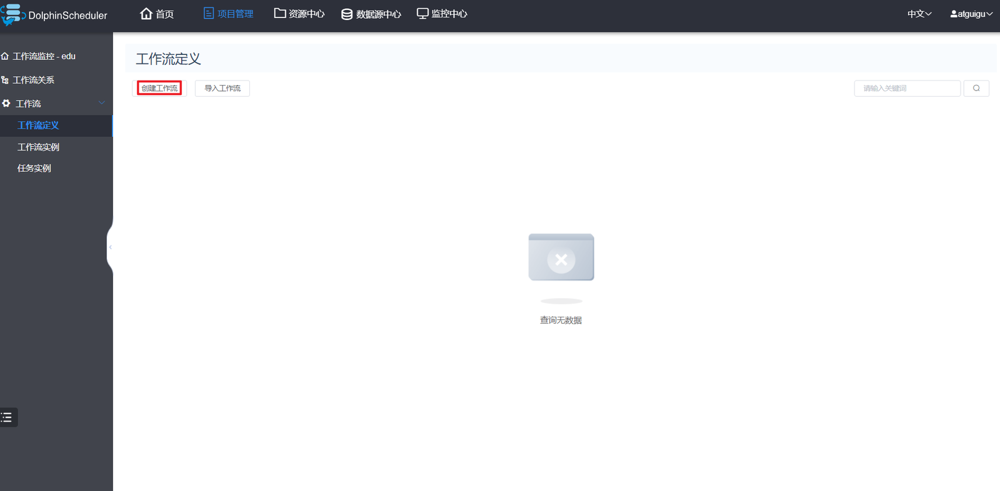

（2）各任务节点配置如下

mysql_to_hdfs_full

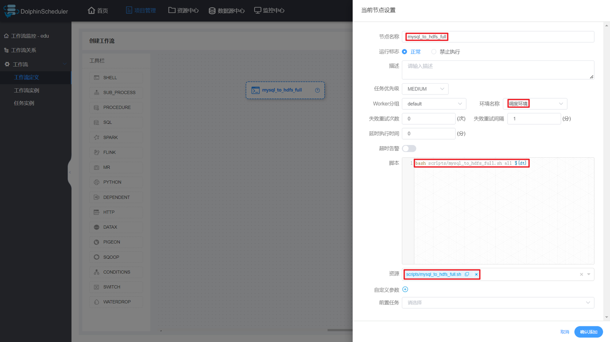

hdfs_to_ods_db


hdfs_to_ods_log


ods_to_dwd


ods_to_dim

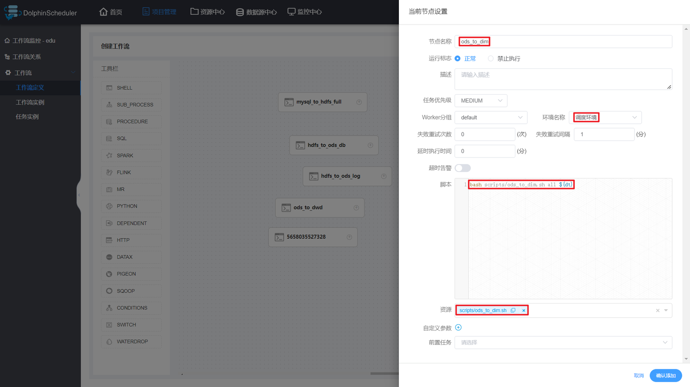

dwd_to_dws_1d

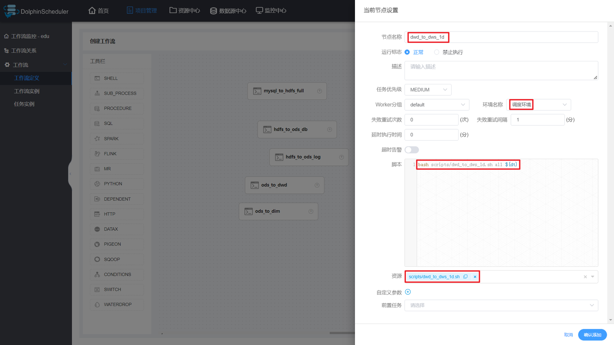

dws_1d_to_dws_nd


dws_1d_to_dws_td


dws_to_ads


hdfs_to_mysql


（3）各节点依赖关系如下

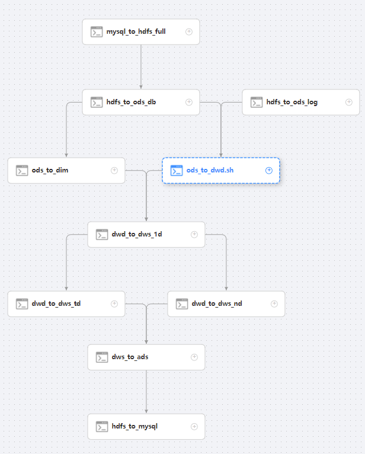

（4）保存工作流

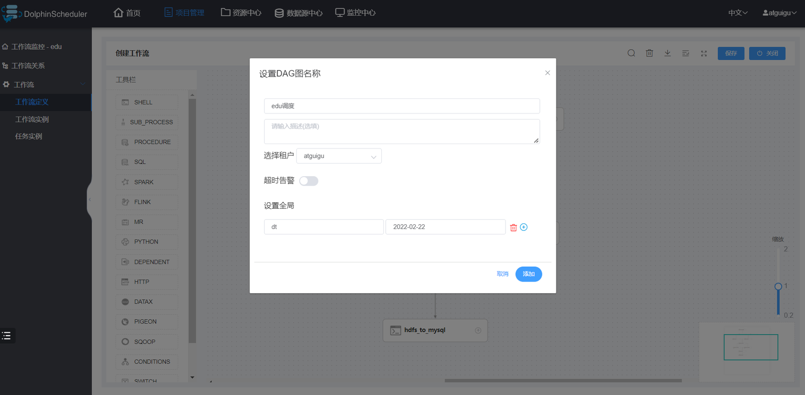

**注：定时调度时，全局参数值应设置为\$\[yyyy-MM-dd-1\]或者空值。**

**7）上线工作流**

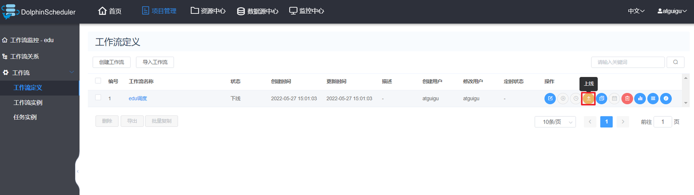

**8）执行工作流**

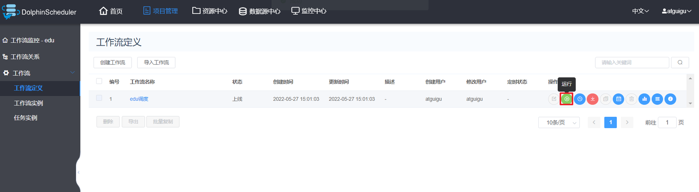

**9）执行工作流后，出现下图所示页面，即表示执行成功。**

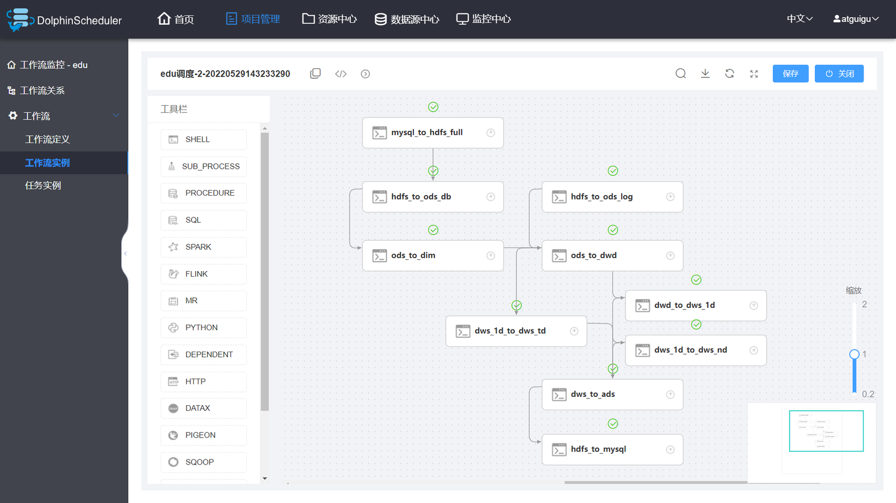

**注：工作流启动前选择的环境无效，必须在创建任务节点时选择对应环境。此处的“环境名称”可以置空。**

### 13.3.2 DolphinScheduler单机模式

**1）启动DolphinScheduler**

``` bash
[zhangsan@node0 dolphinscheduler]$ bin/dolphinscheduler-daemon.sh start standalone-server
```

**2）安全中心配置**

由于DolphinScheduler的单机模式使用的是内置的ZK和数据库，故在集群模式下所做的相关配置在单机模式下并不可见，所以需要重新配置，必要的配置为创建租户和创建用户。

（1）使用管理员用户登录

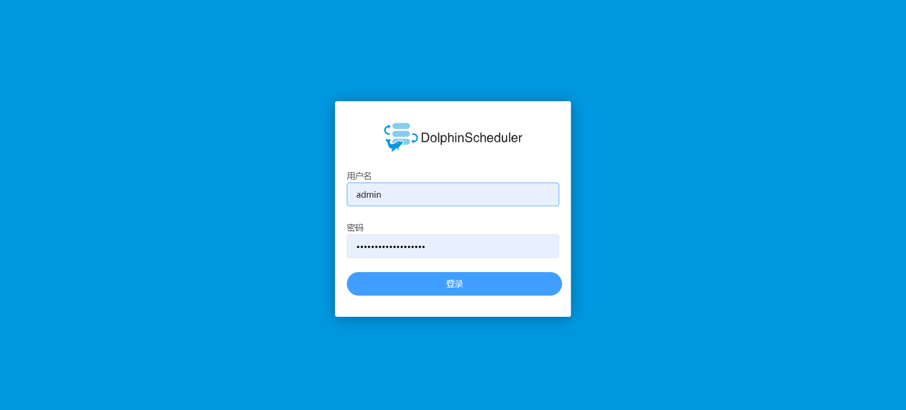

（2）创建租户

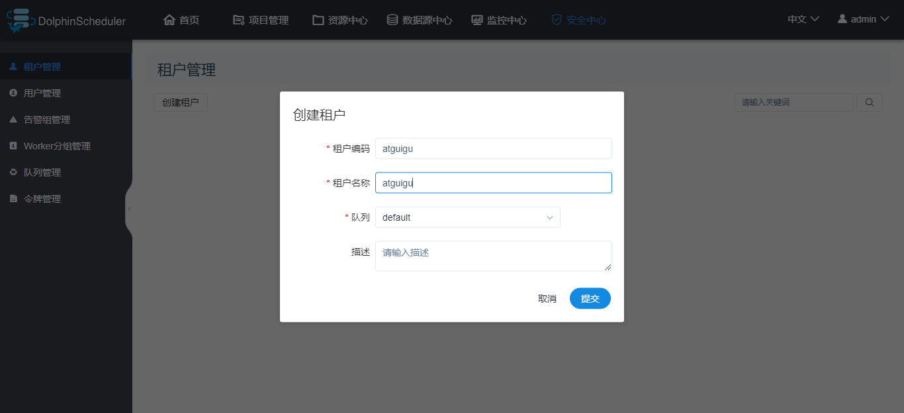

（3）创建用户

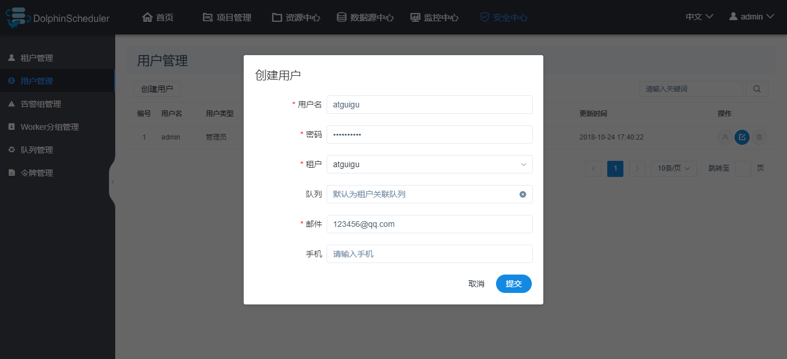

**3）切换普通用户登录**


**4）创建项目**

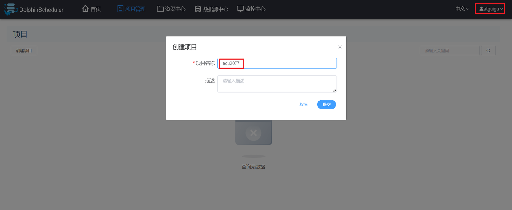

**5）其余操作**

其余操作与集群模式基本一致，其中分发Hive、Spark、DataX这一步可以省略。
