尚硅谷大数据项目之在线教育数仓（在线教育数据仓库系统）

（作者：尚硅谷研究院）

版本：V1.0

# 第1章 数据仓库概述

## 1.1 数据仓库概念

数据仓库是一个为数据分析而设计的企业级数据管理系统。数据仓库可集中、整合多个信息源的大量数据，借助数据仓库的分析能力，企业可从数据中获得宝贵的信息进而改进决策。同时，随着时间的推移，数据仓库中积累的大量历史数据对于数据科学家和业务分析师也是十分宝贵的。

## 1.2 数据仓库核心架构

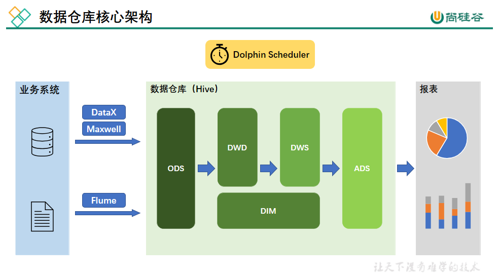

# 第2章 数据仓库建模概述

## 2.1 数据仓库建模的意义

如果把数据看作图书馆里的书，我们希望看到它们在书架上分门别类地放置；如果把数据看作城市的建筑，我们希望城市规划布局合理；如果把数据看作电脑文件和文件夹，我们希望按照自己的习惯有很好的文件夹组织方式，而不是糟糕混乱的桌面，经常为找一个文件而不知所措。

数据模型就是数据组织和存储方法，它强调从业务、数据存取和使用角度合理存储数据。只有将数据有序的组织和存储起来之后，数据才能得到高性能、低成本、高效率、高质量的使用。

高性能：良好的数据模型能够帮助我们快速查询所需要的数据。

低成本：良好的数据模型能减少重复计算，实现计算结果的复用，降低计算成本。

高效率：良好的数据模型能极大的改善用户使用数据的体验，提高使用数据的效率。

高质量：良好的数据模型能改善数据统计口径的混乱，减少计算错误的可能性。

## 2.2 数据仓库建模方法论

### 2.2.1 ER模型

数据仓库之父Bill Inmon提出的建模方法是从全企业的高度，用实体关系（Entity Relationship，ER）模型来描述企业业务，并用规范化的方式表示出来，在范式理论上符合3NF。

**1）实体关系模型**

实体关系模型将复杂的数据抽象为两个概念——实体和关系。实体表示一个对象，例如学生、班级，关系是指两个实体之间的关系，例如学生和班级之间的从属关系。

**2）数据库规范化**

数据库规范化是使用一系列范式设计数据库（通常是关系型数据库）的过程，其目的是减少数据冗余，增强数据的一致性。

这一系列范式就是指在设计关系型数据库时，需要遵从的不同的规范。关系型数据库的范式一共有六种，分别是第一范式（1NF）、第二范式（2NF）、第三范式（3NF）、巴斯-科德范式（BCNF）、第四范式(4NF）和第五范式（5NF）。遵循的范式级别越高，数据冗余性就越低。

**3）三范式**

**（1）函数依赖**

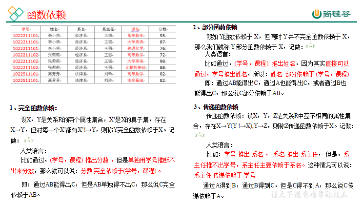

**（2）第一范式**

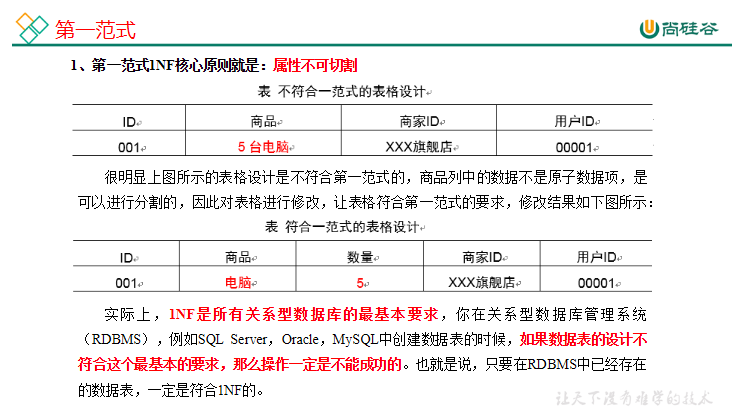

**（3）第二范式**

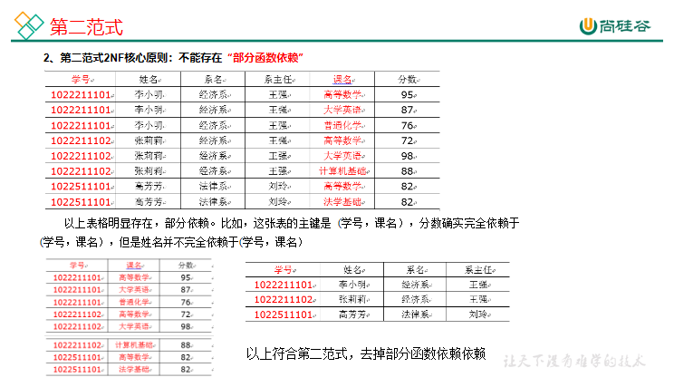

**（4）第三范式**

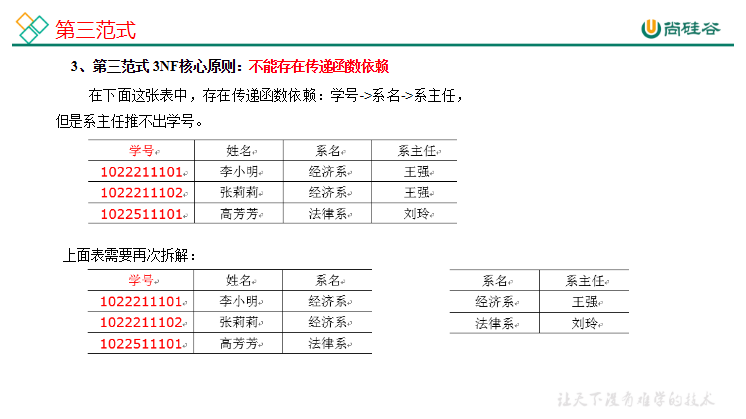

下图为一个采用Bill Inmon倡导的建模方法构建的模型，从图中可以看出，较为松散、零碎，物理表数量多。

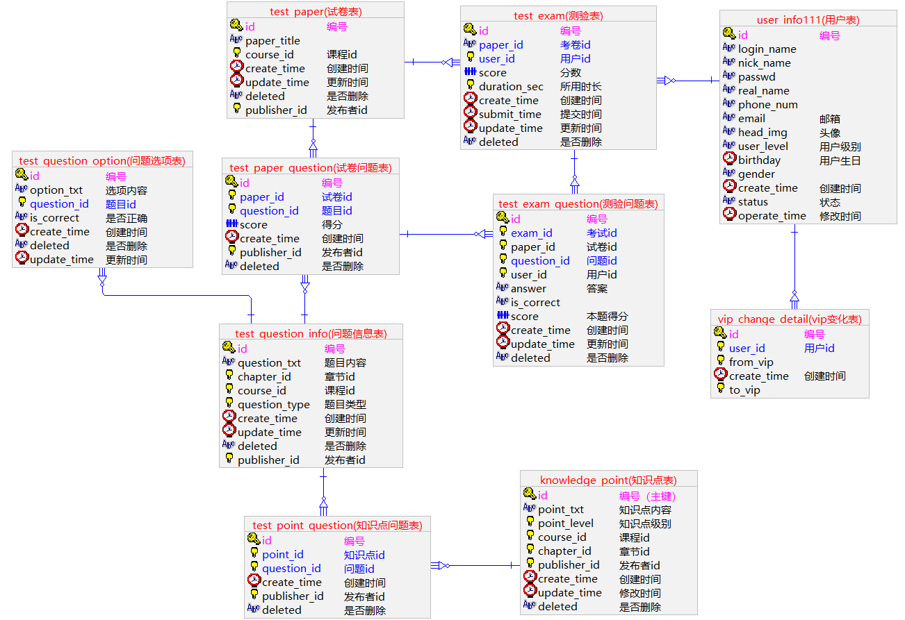

这种建模方法的出发点是整合数据，其目的是将整个企业的数据进行组合和合并，并进行规范处理，减少数据冗余性，保证数据的一致性。这种模型并不适合直接用于分析统计。

### 2.2.2 维度模型

数据仓库领域的令一位大师——Ralph Kimball倡导的建模方法为维度建模。维度模型将复杂的业务通过事实和维度两个概念进行呈现。事实通常对应业务过程，而维度通常对应业务过程发生时所处的环境。

**注**：业务过程可以概括为一个个不可拆分的行为事件，例如在线教育交易中的下单，付款，加购等，都是业务过程。

下图为一个典型的维度模型，其中位于中心的SalesOrder为事实表，其中保存的是下单这个业务过程的所有记录。位于周围每张表都是维度表，包括Date（日期），Customer（顾客），Product（产品），Location（地区）等，这些维度表就组成了每个订单发生时所处的环境，即何人、何时、在何地下单了何种产品。从图中可以看出，模型相对清晰、简洁。

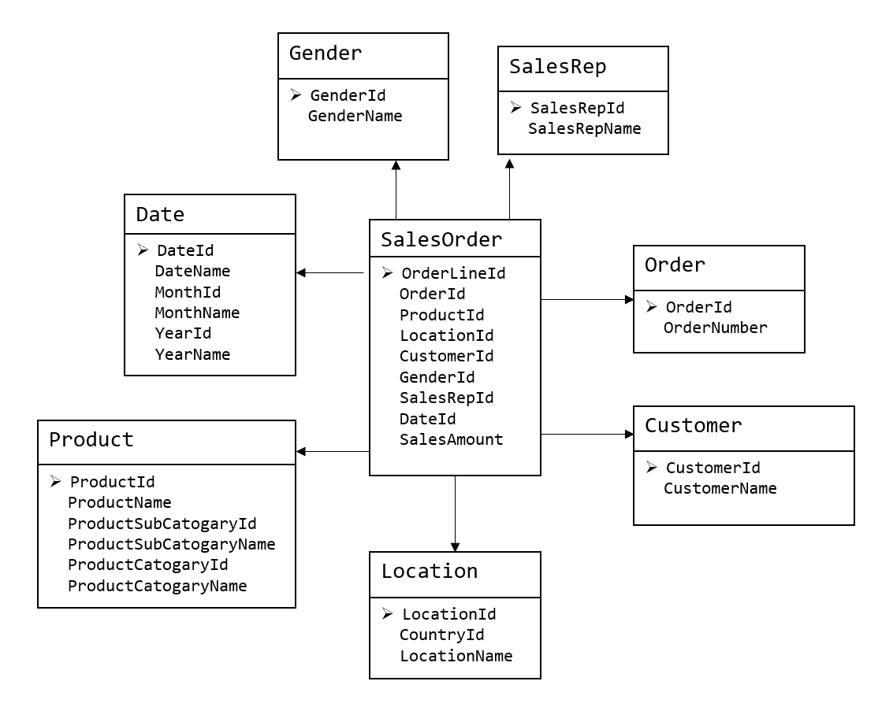

<!-- redraw:image7 lang=mermaid why="图本质是'表结构 + 外键关系'（8 个表框 + 字段清单 + 指向中心事实表的连线），非流程非拓扑，故用 mermaid erDiagram 重绘；字段名与原图一致，基数按维度建模惯例（事实表 : 维度表 = n : 1）。原图框内为英文表/字段名，照录。" -->

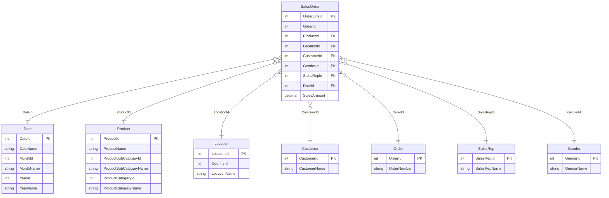
<!-- /redraw -->

维度建模以数据分析作为出发点，为数据分析服务，因此它关注的重点的用户如何更快的完成需求分析以及如何实现较好的大规模复杂查询的响应性能。

# 第3章 维度建模理论之事实表

## 3.1 事实表概述

事实表作为数据仓库维度建模的核心，紧紧围绕着业务过程来设计。其包含与该业务过程有关的维度引用（维度表外键）以及该业务过程的度量（通常是可累加的数字类型字段）。

### 3.1.1 事实表特点

事实表通常比较“细长”，即列较少，但行较多，且行的增速快。

### 3.1.2 事实表分类

事实表有三种类型：分别是事务事实表、周期快照事实表和累积快照事实表，每种事实表都具有不同的特点和适用场景，下面逐个介绍。

## 3.2 事务型事实表

### 3.2.1 概述

事务事实表用来记录各业务过程，它保存的是各业务过程的原子操作事件，即最细粒度的操作事件。粒度是指事实表中一行数据所表达的业务细节程度。

事务型事实表可用于分析与各业务过程相关的各项统计指标，由于其保存了最细粒度的记录，可以提供最大限度的灵活性，可以支持无法预期的各种细节层次的统计需求。

### 3.2.2 设计流程

设计事务事实表时一般可遵循以下四个步骤：

**选择业务过程→声明粒度→确认维度→确认事实**

**1）选择业务过程**

在业务系统中，挑选我们感兴趣的业务过程，业务过程可以概括为一个个不可拆分的行为事件，例如在线教育交易中的下单，付款，加购等，都是业务过程。通常情况下，一个业务过程对应一张事务型事实表。

**2）声明粒度**

业务过程确定后，需要为每个业务过程声明粒度。即精确定义每张事务型事实表的每行数据表示什么，应该尽可能选择最细粒度，以此来应对各种细节程度的需求。

**典型的粒度声明如下：**

订单事实表中一行数据表示的是一个订单中的一门课程。

**3）确定维度**

确定维度具体是指，确定与每张事务型事实表相关的维度有哪些。

确定维度时应尽量多的选择与业务过程相关的环境信息。因为维度的丰富程度就决定了维度模型能够支持的指标丰富程度。

**4）确定事实**

此处的“事实”一词，指的是每个业务过程的度量值（通常是可累加的数字类型的值，例如：次数、个数、件数、金额等）。

经过上述四个步骤，事务型事实表就基本设计完成了。第一步选择业务过程可以确定有哪些事务型事实表，第二步可以确定每张事务型事实表的每行数据是什么，第三步可以确定每张事务型事实表的维度外键，第四步可以确定每张事务型事实表的度量值字段。

### 3.2.3 不足

事务型事实表可以保存所有业务过程的最细粒度的操作事件，故理论上其可以支撑与各业务过程相关的各种统计粒度的需求。但对于某些特定类型的需求，其逻辑可能会比较复杂，或者效率会比较低下。例如：

**1）存量型指标**

例如购物车存量，账户余额等。此处以在线教育中的加购业务为例，加购业务包含的业务过程主要包括加购物车和减购物车，两个业务过程各自对应一张事务型事实表，一张存储所有加购物车的原子操作事件，另一张存储所有减购物车的原子操作事件。

假定现有一个需求，要求统计截至当日的各用户各科目的购物车存量。由于加购物车和减购物车操作均会影响到购物车存量，故需要对两张事务型事实表进行聚合，且需要区分两者对购物车存量的影响（加或减），另外需要对两张表的全表数据聚合才能得到统计结果。

可以看到，不论是从逻辑上还是效率上考虑，这都不是一个好的方案。

**2）多事务关联统计**

例如，现需要统计最近30天，用户下单到支付的时间间隔的平均值。统计思路应该是找到下单事务事实表和支付事务事实表，过滤出最近30天的记录，然后按照订单id对两张事实表进行关联，之后用支付时间减去下单时间，然后再求平均值。

逻辑上虽然并不复杂，但是其效率较低，因为下单事务事实表和支付事务事实表均为大表，大表join大表的操作应尽量避免。

可以看到，在上述两种场景下事务型事实表的表现并不理想。下面要介绍的另外两种类型的事实表就是为了弥补事务型事实表的不足的。

## 3.3 周期型快照事实表

### 3.3.1 概述

周期快照事实表以具有规律性的、可预见的时间间隔来记录事实，主要用于分析一些存量型（例如购物车存量，账户余额）或者状态型（空气温度，行驶速度）指标。

对于购物车存量、账户余额这些存量型指标，业务系统中通常就会计算并保存最新结果，所以定期同步一份全量数据到数据仓库，构建周期型快照事实表，就能轻松应对此类统计需求，而无需再对事务型事实表中大量的历史记录进行聚合了。

对于空气温度、行驶速度这些状态型指标，由于它们的值往往是连续的，我们无法捕获其变动的原子事务操作，所以无法使用事务型事实表统计此类需求。而只能定期对其进行采样，构建周期型快照事实表。

### 3.3.2 设计流程

**1）确定粒度**

周期型快照事实表的粒度可由采样周期和维度描述，故确定采样周期和维度后即可确定粒度。

采样周期通常选择每日。

维度可根据统计指标决定，例如指标为统计每个用户每个科目的购物车存量，则可确定维度为用户和科目。

确定完采样周期和维度后，即可确定该表粒度为每日-用户-科目。

**2）确认事实**

事实也可根据统计指标决定，例如指标为统计每个用户每个科目的购物车存量，则事实为购物车存量。

### 3.3.3 事实类型

此处的事实类型是指度量值的类型，而非事实表的类型。事实（度量值）共分为三类，分别是可加事实，半可加事实和不可加事实。

**1）可加事实**

可加事实是指可以按照与事实表相关的所有维度进行累加，例如事务型事实表中的事实。

**2）半可加事实**

半可加事实是指只能按照与事实表相关的一部分维度进行累加，例如周期型快照事实表中的事实。以上述各仓库中各用户购物车存量每天快照事实表为例，这张表中的购物车存量事实可以按照用户或者科目维度进行累加，但是不能按照时间维度进行累加，因为将每天的购物车存量累加起来是没有任何意义的。

**3）不可加事实**

不可加事实是指完全不具备可加性，例如比率型事实。不可加事实通常需要转化为可加事实，例如比率可转化为分子和分母。

## 3.4 累积型快照事实表

### 3.4.1 概述

累积型快照事实表是基于一个业务流程中的多个关键业务过程联合处理而构建的事实表，如交易流程中的试听、下单、支付等业务过程。

累积型快照事实表通常具有多个日期字段，每个日期对应业务流程中的一个关键业务过程（里程碑）。

| 课程id | 用户id |  试听日期  |  下单日期  |  支付日期  | 订单分摊金额 | 支付分摊金额 |
|:------:|:------:|:----------:|:----------:|:----------:|:------------:|:------------:|
|  1001  |  1234  | 2022-02-19 | 2022-02-20 | 2022-02-21 |     1000     |     1000     |

累积型快照事实表主要用于分析业务过程（里程碑）之间的时间间隔等需求。例如前文提到的用户下单到支付的平均时间间隔，使用累积型快照事实表进行统计，就能避免两个事务事实表的关联操作，从而变得十分简单高效。

### 3.4.2 设计流程

累积型快照事实表的设计流程同事务型事实表类似，也可采用以下四个步骤，下面重点描述与事务型事实表的不同之处。

**选择业务过程→声明粒度→确认维度→确认事实。**

**1）选择业务过程**

选择一个业务流程中需要关联分析的多个关键业务过程，多个业务过程对应一张累积型快照事实表。

**2）声明粒度**

精确定义每行数据表示的是什么，尽量选择最小粒度。

**3）确认维度**

选择与各业务过程相关的维度，需要注意的是，每各业务过程均需要一个日期维度。

**4）确认事实**

选择各业务过程的度量值。

# 第4章 维度建模理论之维度表

## 4.1 维度表概述

维度表是维度建模的基础和灵魂。前文提到，事实表紧紧围绕业务过程进行设计，而维度表则围绕业务过程所处的环境进行设计。维度表主要包含一个主键和各种维度字段，维度字段称为维度属性。

## 4.2 维度表设计步骤

**1）确定维度（表）**

在设计事实表时，已经确定了与每个事实表相关的维度，理论上每个相关维度均需对应一张维度表。需要注意到，可能存在多个事实表与同一个维度都相关的情况，这种情况需保证维度的唯一性，即只创建一张维度表。另外，如果某些维度表的维度属性很少，例如只有一个\*\*名称，则可不创建该维度表，而把该表的维度属性直接增加到与之相关的事实表中，这个操作称为**维度退化**。

**2）确定主维表和相关维表**

此处的主维表和相关维表均指**业务系统**中与某维度相关的表。例如业务系统中与课程相关的表有course_info，chapter_info，base_subject_info，base_category_info，video_info等，其中course_info就称为课程维度的主维表，其余表称为课程维度的相关维表。维度表的粒度通常与主维表相同。

**3）确定维度属性**

确定维度属性即确定维度表字段。维度属性主要来自于业务系统中与该维度对应的主维表和相关维表。维度属性可直接从主维表或相关维表中选择，也可通过进一步加工得到。

确定维度属性时，需要遵循以下要求：

（1）尽可能生成丰富的维度属性

维度属性是后续做分析统计时的查询约束条件、分组字段的基本来源，是数据易用性的关键。维度属性的丰富程度直接影响到数据模型能够支持的指标的丰富程度。

（2）尽量不使用编码，而使用明确的文字说明，一般可以编码和文字共存。

（3）尽量沉淀出通用的维度属性

有些维度属性的获取需要进行比较复杂的逻辑处理，例如需要通过多个字段拼接得到。为避免后续每次使用时的重复处理，可将这些维度属性沉淀到维度表中。

## 4.3 维度设计要点

### 4.3.1 规范化与反规范化

**规范化**是指使用一系列范式设计数据库的过程，其目的是减少数据冗余，增强数据的一致性。通常情况下，规范化之后，一张表的字段会拆分到多张表。

**反规范化**是指将多张表的数据冗余到一张表，其目的是减少join操作，提高查询性能。

在设计维度表时，如果对其进行规范化，得到的维度模型称为雪花模型，如果对其进行反规范化，得到的模型称为星型模型。

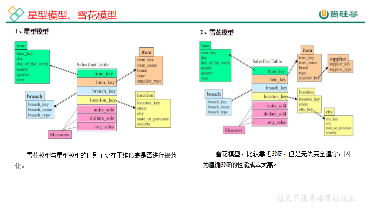

数据仓库系统的主要目的是用于数据分析和统计，所以是否方便用户进行统计分析决定了模型的优劣。采用雪花模型，用户在统计分析的过程中需要大量的关联操作，使用复杂度高，同时查询性能很差，而采用星型模型，则方便、易用且性能好。所以出于易用性和性能的考虑，维度表一般是很不规范化的。

### 4.3.2 维度变化

维度属性通常不是静态的，而是会随时间变化的，数据仓库的一个重要特点就是反映历史的变化，所以如何保存维度的历史状态是维度设计的重要工作之一。保存维度数据的历史状态，通常有以下两种做法，分别是全量快照表和拉链表。

**1）全量快照表**

离线数据仓库的计算周期通常为每天一次，所以可以每天保存一份全量的维度数据。这种方式的优点和缺点都很明显。

优点是简单而有效，开发和维护成本低，且方便理解和使用。

缺点是浪费存储空间，尤其是当数据的变化比例比较低时。

**2）拉链表**

拉链表的意义就在于能够更加高效的保存维度信息的历史状态。

（1）什么是拉链表

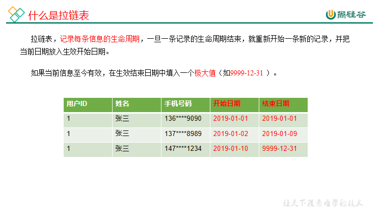

（2）为什么要做拉链表

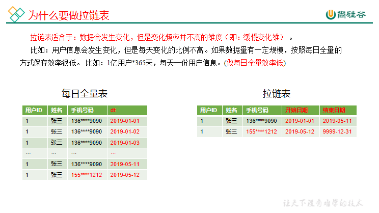

（3）如何使用拉链表

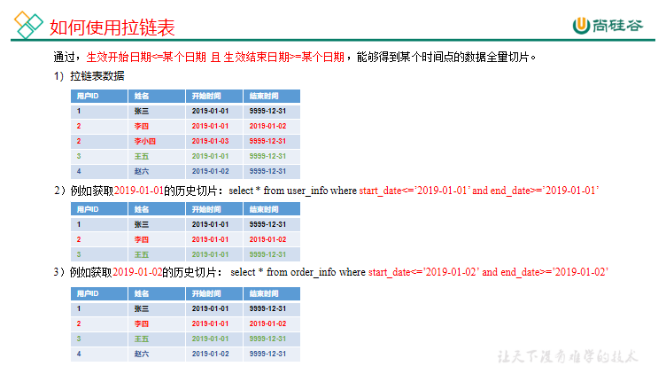

### 4.3.3 多值维度

如果事实表中一条记录在某个维度表中有多条记录与之对应，称为多值维度。例如，下单事实表中的一条记录为一个订单，一个订单可能包含多个课程，所以课程维度表中就可能有多条数据与之对应。

针对这种情况，通常采用以下两种方案解决。

第一种：降低事实表的粒度，例如将订单事实表的粒度由一个订单降低为一个订单中的一门课程。

第二种：在事实表中采用多字段保存多个维度值，每个字段保存一个维度id。这种方案只适用于多值维度个数固定的情况。

建议尽量采用第一种方案解决多值维度问题。

### 4.3.4 多值属性

维表中的某个属性同时有多个值，称之为“多值属性”，例如课程维度的课程类别，每个课程均有多个属性值。

针对这种情况，通常有可以采用以下两种方案。

第一种：将多值属性放到一个字段，该字段内容为key1:value1，key2:value2或者 value1，value2的形式。如课程类别属性，一个课程可以属于编程技术、后端开发等多个类别。

第二种：将多值属性放到多个字段，每个字段对应一个属性。这种方案只适用于多值属性个数固定的情况。

# 第5章 数据仓库设计

## 5.1 数据仓库分层规划

优秀可靠的数仓体系，需要良好的数据分层结构。合理的分层，能够使数据体系更加清晰，使复杂问题得以简化。以下是该项目的分层规划。

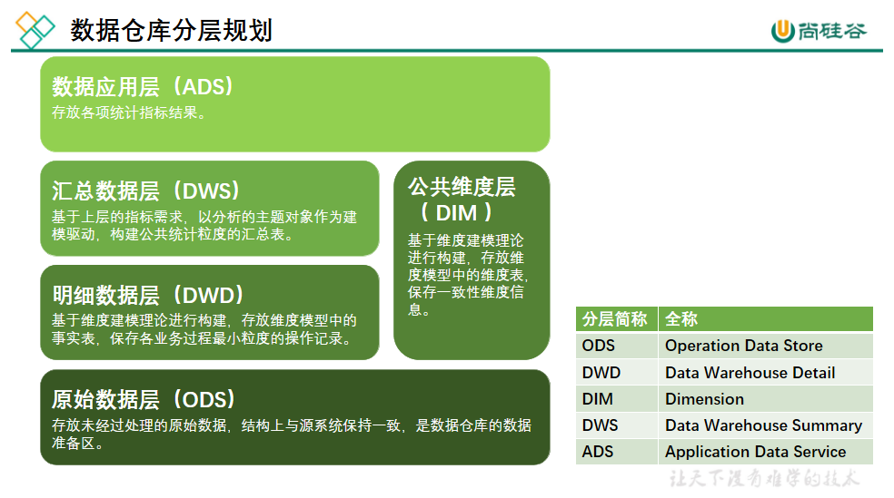

## 5.2 数据仓库构建流程

以下是构建数据仓库的完整流程。

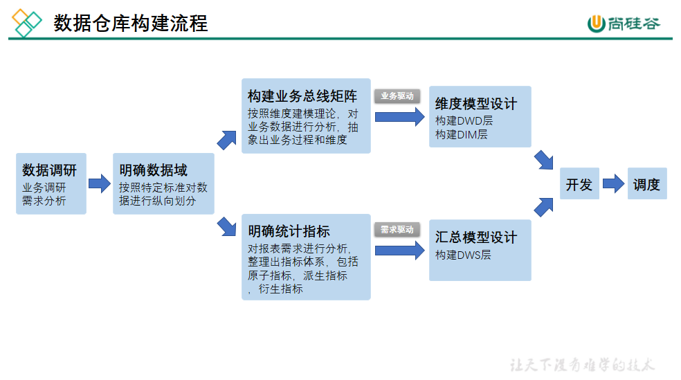

### 5.2.1 数据调研

数据调研重点要做两项工作，分别是业务调研和需求分析。这两项工作做的是否充分，直接影响着数据仓库的质量。

**1）业务调研**

业务调研的主要目标是**熟悉业务流程**、**熟悉业务数据**。

**熟悉业务流程**要求做到，明确每个业务的具体流程，需要将该业务所包含的每个**业务过程**一一列举出来。

**熟悉业务数据**要求做到，将数据（包括埋点日志和业务数据表）与业务过程对应起来，明确每个业务过程会对哪些表的数据产生影响，以及产生什么影响。产生的影响，需要具体到，是新增一条数据，还是修改一条数据，并且需要明确新增的内容或者是修改的逻辑。

下面以在线教育中的交易业务为例进行演示，交易业务涉及到的业务过程有用户试听、用户下单、用户支付，具体流程如下图。

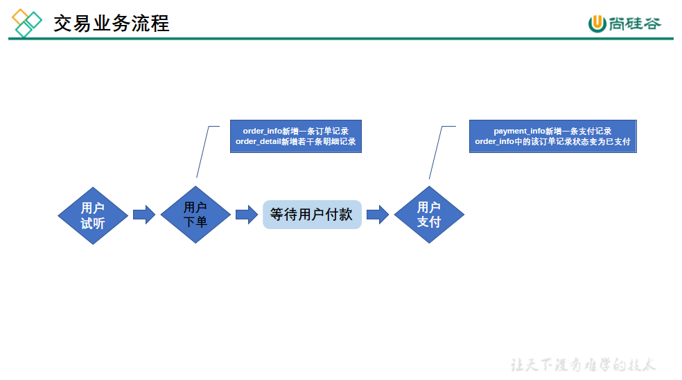

**2）需求分析**

典型的需求指标如，最近一天各省份 Java 学科订单总额。

分析需求时，需要明确需求所需的**业务过程**及**维度**，例如该需求所需的业务过程就是用户下单，所需的维度有日期，省份，科目。

**3）总结**

做完业务分析和需求分析之后，要保证每个需求都能找到与之对应的业务过程及维度。若现有数据无法满足需求，则需要和业务方进行沟通，例如某个页面需要新增某个行为的埋点。

### 5.2.2 明确数据域

数据仓库模型设计除横向的分层外，通常也需要根据业务情况进行纵向划分数据域。

划分数据域的意义是**便于数据的管理和应用**。

通常可以根据业务过程或者部门进行划分，本项目根据业务过程进行划分，需要注意的是一个业务过程只能属于一个数据域。

下面是本数仓项目所需的所有业务过程及数据域划分详情。

| 数据域 | 业务过程                             |
|--------|--------------------------------------|
| 交易域 | 加购、下单、支付成功                 |
| 流量域 | 页面浏览、启动应用、动作、曝光、错误 |
| 用户域 | 注册、登录                           |
| 互动域 | 收藏、评价                           |
| 考试域 | 考试                                 |
| 学习域 | 观看视频                             |

### 5.2.3 构建业务总线矩阵

业务总线矩阵中包含维度模型所需的所有事实（业务过程）以及维度，以及各业务过程与各维度的关系。矩阵的行是一个个业务过程，矩阵的列是一个个的维度，行列的交点表示业务过程与维度的关系。

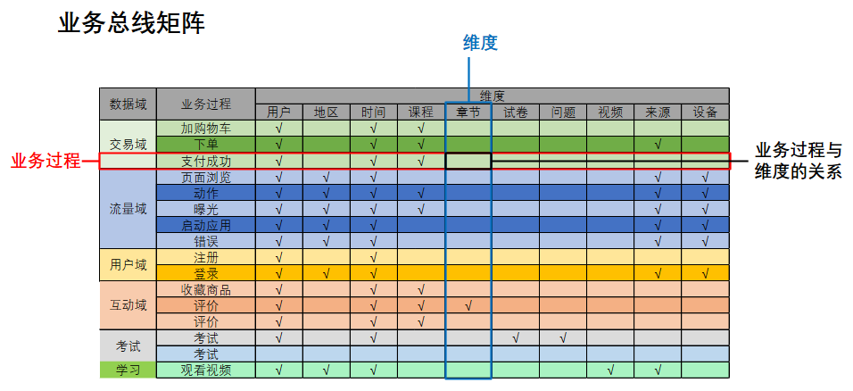

一个业务过程对应维度模型中一张事务型事实表，一个维度则对应维度模型中的一张维度表。所以构建业务总线矩阵的过程就是设计维度模型的过程。但是需要注意的是，总线矩阵中通常只包含事务型事实表，另外两种类型的事实表需单独设计。

按照事务型事实表的设计流程，**选择业务过程🡪声明粒度🡪确认维度🡪确认事实**，得到的最终的业务总线矩阵见以下表格。


后续的DWD层以及DIM层的搭建需参考业务总线矩阵。

### 5.2.4 明确统计指标

明确统计指标具体的工作是，深入分析需求，构建指标体系。构建指标体系的主要意义就是指标定义标准化。所有指标的定义，都必须遵循同一套标准，这样能有效的避免指标定义存在歧义，指标定义重复等问题。

**1）指标体系相关概念**

（1）原子指标

原子指标基于某一**业务过程**的**度量值**，是业务定义中不可再拆解的指标，原子指标的核心功能就是对指标的**聚合逻辑**进行了定义。我们可以得出结论，原子指标包含三要素，分别是业务过程、度量值和聚合逻辑。

例如**订单总额**就是一个典型的原子指标，其中的业务过程为用户下单、度量值为订单金额，聚合逻辑为sum()求和。需要注意的是原子指标只是用来辅助定义指标一个概念，通常不会对应有实际统计需求与之对应。

（2）派生指标

派生指标基于原子指标，其与原子指标的关系如下图所示。

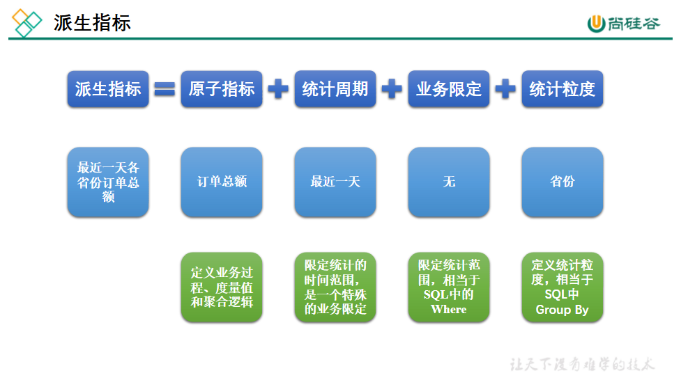

与原子指标不同，派生指标通常会对应实际的统计需求。请从图中的例子中，体会指标定义标准化的含义。

（3）衍生指标

衍生指标是在一个或多个派生指标的基础上，通过各种逻辑运算复合而成的。例如比率、比例等类型的指标。衍生指标也会对应实际的统计需求。

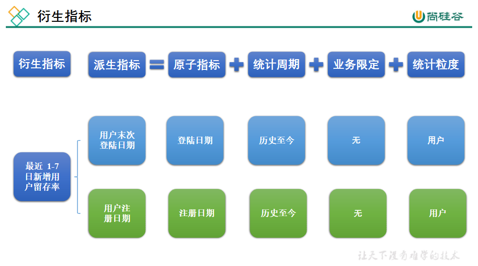

**2）指标体系对于数仓建模的意义**

通过上述两个具体的案例可以看出，绝大多数的统计需求，都可以使用原子指标、派生指标以及衍生指标这套标准去定义。同时能够发现这些统计需求都直接的或间接的对应一个或者是多个派生指标。

当统计需求足够多时，必然会出现部分统计需求对应的派生指标相同的情况。这种情况下，我们就可以考虑将这些公共的派生指标保存下来，这样做的主要目的就是减少重复计算，提高数据的复用性。

这些公共的派生指标统一保存在数据仓库的DWS层。因此DWS层设计，就可以参考我们根据现有的统计需求整理出的派生指标。

按照上述标准整理出的指标体系如下：

（1）思维导图版


（2）PDF版


从上述指标体系中抽取出来的所有派生指标见如下表格。


### 5.2.4 维度模型设计

维度模型的设计参照上述得到的业务总线矩阵即可。事实表存储在DWD层，维度表存储在DIM层。

### 5.2.5 汇总模型设计

汇总模型的设计参考上述整理出的指标体系（主要是派生指标）即可。汇总表与派生指标的对应关系是，**一张汇总**表通常**包含**业务过程相同、统计周期相同、统计粒度相同的**多个派生指标**。请思考：汇总表与事实表的对应关系是？

# 第6章 数据仓库环境准备

## 6.1 数据仓库运行环境

### 6.1.1 Hive环境搭建

**1）Hive引擎简介**

Hive引擎包括：默认MR、tez、spark

Hive on Spark：Hive既作为存储元数据又负责SQL的解析优化，语法是HQL语法，执行引擎变成了Spark，Spark负责采用RDD执行。

Spark on Hive : Hive只作为存储元数据，Spark负责SQL解析优化，语法是Spark SQL语法，Spark负责采用RDD执行。

**2）Hive on Spark配置**

（1）兼容性说明

注意：官网下载的Hive3.1.2和Spark3.0.0默认是不兼容的。因为Hive3.1.2支持的Spark版本是2.4.5，所以需要我们重新编译Hive3.1.2版本。

编译步骤：官网下载Hive3.1.2源码，修改pom文件中引用的Spark版本为3.0.0，如果编译通过，直接打包获取jar包。如果报错，就根据提示，修改相关方法，直到不报错，打包获取jar包。

（2）在Hive所在节点部署Spark

如果之前已经部署了Spark，则该步骤可以跳过

Spark官网下载jar包地址：

[<u>http://spark.apache.org/downloads.html</u>](http://spark.apache.org/downloads.html)

上传并解压解压spark-3.0.0-bin-hadoop3.2.tgz

``` text
[zhangsan@node0 software]$ tar -zxvf spark-3.0.0-bin-hadoop3.2.tgz -C /opt/module/
[zhangsan@node0 software]$ mv /opt/module/spark-3.0.0-bin-hadoop3.2 /opt/module/spark
```

（3）配置SPARK_HOME环境变量

``` text
[zhangsan@node0 software]$ sudo vim /etc/profile.d/my_env.sh
```

添加如下内容

``` text
# SPARK_HOME
export SPARK_HOME=/opt/module/spark
export PATH=$PATH:$SPARK_HOME/bin
```

source 使其生效

``` text
[zhangsan@node0 software]$ source /etc/profile.d/my_env.sh
```

（4）在hive中创建spark配置文件

``` text
[zhangsan@node0 software]$ vim /opt/module/hive/conf/spark-defaults.conf
```

添加如下内容（在执行任务时，会根据如下参数执行）

``` text
spark.master                               yarn
spark.eventLog.enabled                   true
spark.eventLog.dir                        hdfs://hadoop102:8020/spark-history
spark.executor.memory                    1g
spark.driver.memory					   1g
```

在HDFS创建如下路径，用于存储历史日志

``` text
[zhangsan@node0 software]$ hadoop fs -mkdir /spark-history
```

（5）向HDFS上传Spark纯净版jar包

说明1：由于Spark3.0.0非纯净版默认支持的是hive2.3.7版本，直接使用会和安装的Hive3.1.2出现兼容性问题。所以采用Spark纯净版jar包，不包含hadoop和hive相关依赖，避免冲突。

说明2：Hive任务最终由Spark来执行，Spark任务资源分配由Yarn来调度，该任务有可能被分配到集群的任何一个节点。所以需要将Spark的依赖上传到HDFS集群路径，这样集群中任何一个节点都能获取到。

上传并解压spark-3.0.0-bin-without-hadoop.tgz

``` text
[zhangsan@node0 software]$ tar -zxvf /opt/software/spark-3.0.0-bin-without-hadoop.tgz
```

上传Spark纯净版jar包到HDFS

``` text
[zhangsan@node0 software]$ hadoop fs -mkdir /spark-jars
[zhangsan@node0 software]$ hadoop fs -put spark-3.0.0-bin-without-hadoop/jars/* /spark-jars
```

（6）修改hive-site.xml文件

``` text
[zhangsan@node0 ~]$ vim /opt/module/hive/conf/hive-site.xml
```

添加如下内容

``` text
<!--Spark依赖位置（注意：端口号8020必须和namenode的端口号一致）-->
<property>
    <name>spark.yarn.jars</name>
    <value>hdfs://hadoop102:8020/spark-jars/*</value>
</property>

<!--Hive执行引擎-->
<property>
    <name>hive.execution.engine</name>
    <value>spark</value>
</property>
```

**3）Hive on Spark测试**

（1）启动hive客户端

``` text
[zhangsan@node0 hive]$ hive
```

（2）创建一张测试表

``` text
hive (default)> create table student(id int, name string);
```

（3）通过insert测试效果

``` text
hive (default)> insert into table student values(1,'abc');
```

若结果如下，则说明配置成功

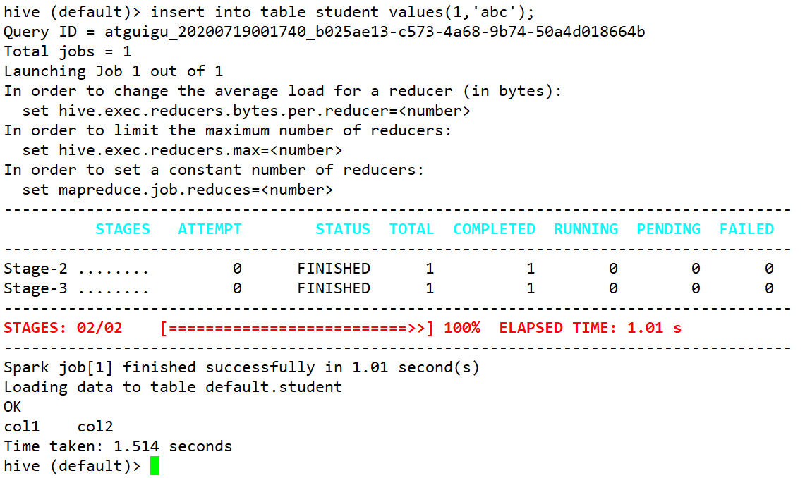

### 6.1.2 Yarn环境配置

**1）增加ApplicationMaster资源比例**

容量调度器对每个资源队列中同时运行的Application Master占用的资源进行了限制，该限制通过yarn.scheduler.capacity.maximum-am-resource-percent参数实现，其默认值是0.1，表示每个资源队列上Application Master最多可使用的资源为该队列总资源的10%，目的是防止大部分资源都被Application Master占用，而导致Map/Reduce Task无法执行。

生产环境该参数可使用默认值。但学习环境，集群资源总数很少，如果只分配10%的资源给Application Master，则可能出现，同一时刻只能运行一个Job的情况，因为一个Application Master使用的资源就可能已经达到10%的上限了。故此处可将该值适当调大。

（1）在hadoop102的/opt/module/hadoop-3.1.3/etc/hadoop/capacity-scheduler.xml文件中**修改**如下参数值

``` text
[zhangsan@node0 hadoop]$ vim capacity-scheduler.xml
<property>
    <name>yarn.scheduler.capacity.maximum-am-resource-percent</name>
    <value>0.8</value>
</property>
```

（2）分发capacity-scheduler.xml配置文件

``` text
[zhangsan@node0 hadoop]$ xsync capacity-scheduler.xml
```

（3）关闭正在运行的任务，重新启动yarn集群

``` text
[atguigu@hadoop103 hadoop-3.1.3]$ stop-yarn.sh
[atguigu@hadoop103 hadoop-3.1.3]$ start-yarn.sh
```

## 6.2 数据仓库开发环境

数仓开发工具可选用DBeaver或者DataGrip。两者都需要用到JDBC协议连接到Hive，故需要启动HiveServer2。

**1）启动HiveServer2**

``` text
[zhangsan@node0 hive]$ hiveserver2
```

**2）配置DataGrip连接**

（1）创建连接

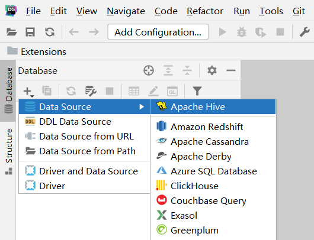

（2）配置连接属性

所有属性配置，和Hive的beeline客户端配置一致即可。初次使用，配置过程会提示缺少JDBC驱动，按照提示下载即可。

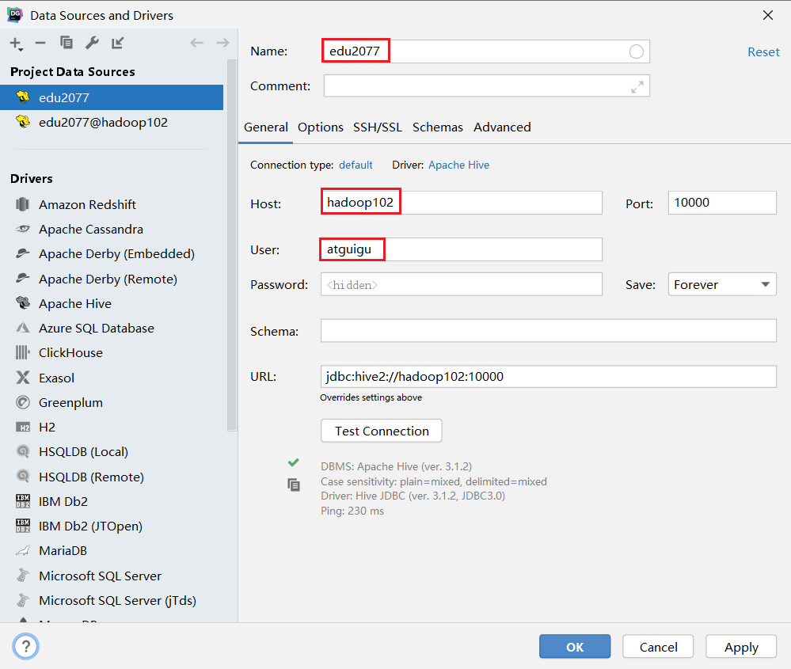

**3）测试使用**

**创建数据库gmall，并观察是否创建成功。**

（1）创建数据库

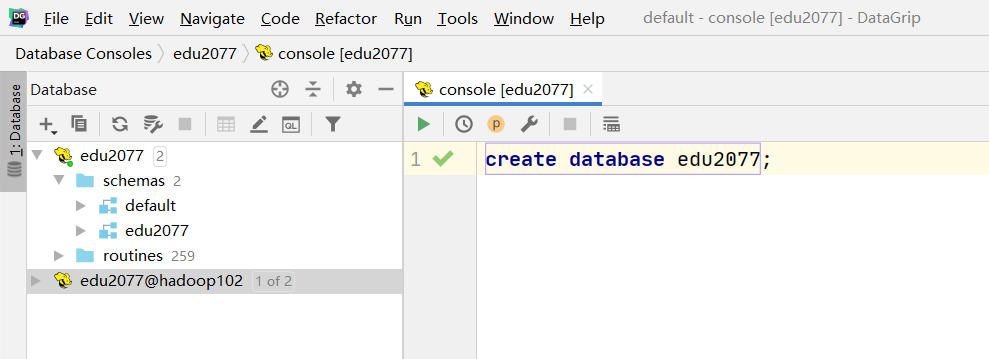

（2）查看数据库

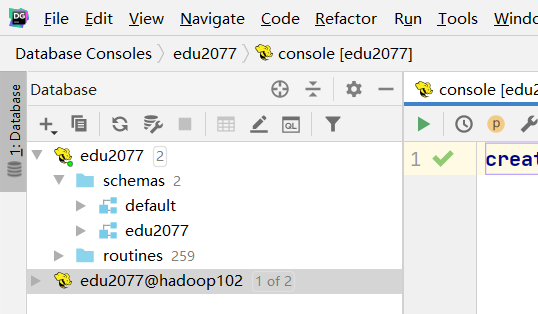

（3）修改连接，指明连接数据库

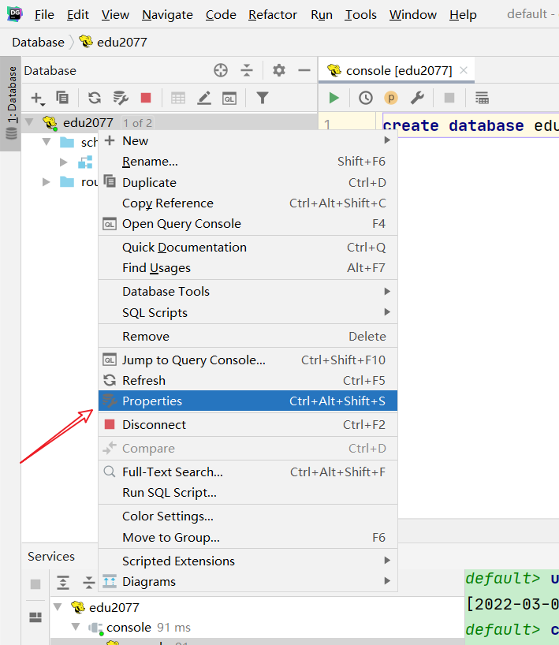

（4）选择当前数据库为edu2077

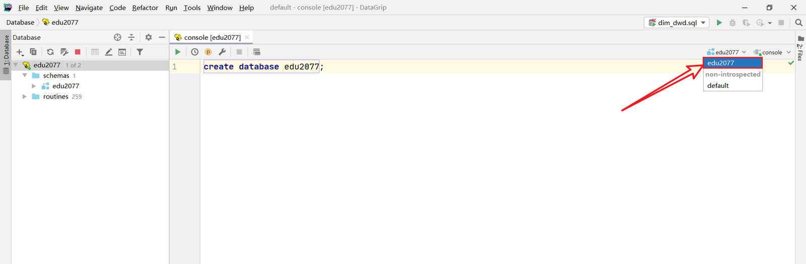

## 6.3 模拟数据准备

通常企业在开始搭建数仓时，业务系统中会存在历史数据，一般是业务数据库存在历史数据，而用户行为日志无历史数据。假定数仓上线的日期为2022-02-21，为模拟真实场景，需准备以下数据。

注：在执行以下操作之前，先将HDFS上/origin_data路径下之前的数据删除。

**1）用户行为日志**

用户行为日志，一般是没有历史数据的，故日志只需要准备2022-02-21一天的数据。

**2）业务数据**

业务数据一般存在历史数据，此处需准备2022-02-16至2022-02-21的数据。

可以通过数据生成脚本一键完成历史数据初始化，操作如下

``` text
[zhangsan@node0 bin]$ mock.sh init 2022-02-21
```

（2）全量表同步

执行全量表同步脚本

``` text
[zhangsan@node0 bin]$ mysql_to_hdfs_full.sh all 2022-02-21
```

观察HDFS上是否出现全量表数据

（3）增量表首日全量同步

清除Maxwell断点记录

由于Maxwell支持断点续传，而上述重新生成业务数据的过程，会产生大量的binlog操作日志，这些日志我们并不需要。故此处需清除Maxwell的断点记录，另其从binlog最新的位置开始采集。

关闭Maxwell

``` text
[zhangsan@node0 bin]$ mxw.sh stop
```

清空Maxwell数据库，相当于初始化Maxwell

``` text
mysql>
drop table maxwell.bootstrap;
drop table maxwell.columns;
drop table maxwell.databases;
drop table maxwell.heartbeats;
drop table maxwell.positions;
drop table maxwell.schemas;
drop table maxwell.tables;
```

修改Maxwell配置文件中的mock_date参数

``` text
[zhangsan@node0 maxwell]$ vim /opt/module/maxwell/config.properties
```

**mock_date=2022-02-21**

启动增量表数据通道，包括Maxwell、Kafka、Flume

执行增量表首日全量同步脚本

``` text
[zhangsan@node0 bin]$ mysql_to_kafka_inc_init.sh all 2022-02-21
```

观察HDFS上是否出现全量表数据

## 6.4 Hive 常见问题及解决方式

**1）DataGrip 中注释乱码问题**

注释属于元数据的一部分，同样存储在mysql的metastore库中，如果metastore库的字符集不支持中文，就会导致中文显示乱码。

不建议修改Hive元数据库的编码，此处我们在metastore中找存储注释的表，找到表中存储注释的字段，只改对应表对应字段的编码。

如下两步修改，缺一不可

（1）修改mysql元数据库

我们用到的注释有两种：字段注释和整张表的注释。

COLUMNS_V2 表中的 COMMENT 字段存储了 Hive 表所有字段的注释，TABLE_PARAMS 表中的 PARAM_VALUE 字段存储了所有表的注释。我们可以通过命令修改字段编码，也可以用 DataGrip 或 Navicat 等工具修改，此处仅对 Navicat 进行展示。

（i）命令修改

``` text
 alter table COLUMNS_V2 modify column COMMENT varchar(256) character set utf8;
alter table TABLE_PARAMS modify column PARAM_VALUE mediumtext character set utf8;
```

（ii）使用工具

以 COLUMNS_V2 表中COMMENT 字段的修改为例

a）右键点击表名，选择设计表

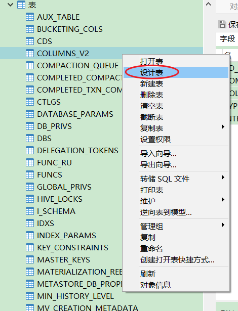

b）在右侧页面中选中表的字段

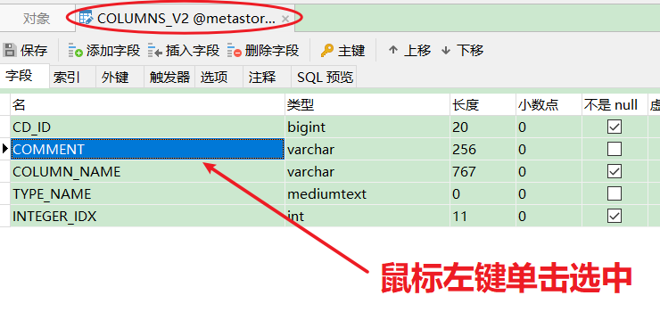

c）在页面下方下拉列表中将字符集改为 utf8

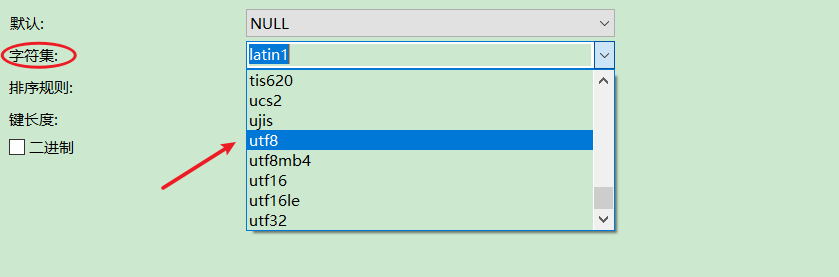

修改字符集之后，已存在的中文注释能否正确显示？不能。为何？

数据库中的字符都是通过编码存储的，写入时编码，读取时解码。修改字段编码并不会改变此前数据的编码方式，依然为默认的 latin1，此时读取之前的中文注释会用 utf8 解码，编解码方式不一致，依然乱码。

（2）修改url连接

修改 hive-site.xml 在末尾添加

``` text
&amp;useUnicode=true&amp;characterEncoding=UTF-8
```

xml 文件中 & 符是有特殊含义的，我们必须使用转义的方式 &amp; 对 & 进行替换

修改结果如下

``` text
<property>
        <name>javax.jdo.option.ConnectionURL</name>
        <value>jdbc:mysql://hadoop102:3306/metastore?useSSL=false&amp;useUnicode=true&amp;characterEncoding=UTF-8
</value>
</property>
```

只要修改了 hive-site.xml，就必须重启 hiveserver2。

**2）DataGrip 刷新连接时 hiveserver2 后台报错**

（1）报错信息如下

``` text
FAILED: ParseException line 1:5 cannot recognize input near 'show' 'indexes' 'on' in ddl statement
```

原因：我们使用的是 Hive-3.1.2，早期版本的 Hive 有索引功能，当前版本已移除， DataGrip 刷新连接时会扫描索引，而 Hive 没有，就会报错。

**3）OOM 报错**

Hive 默认堆内存只有 256M，如果 hiveserver2 后台频繁出现 OutOfMemoryError，可以调大堆内存。

在 Hive 家目录的 conf 目录下复制一份模板文件 hive-env.sh.template

``` text
[zhangsan@node0 conf]$ cd $HIVE_HOME/conf
[zhangsan@node0 conf]$ cp hive-env.sh.template hive-env.sh
```

修改 hive-env.sh，将 Hive 堆内存改为 1024M，如下

``` text
export HADOOP_HEAPSIZE=1024
```

可根据实际使用情况适当调整堆内存。

**4）DataGrip ODS 层部分表字段显示异常**

建表字段中有如下语句的表字段无法显示

``` text
ROW FORMAT SERDE 'org.apache.hadoop.hive.serde2.JsonSerDe'
```

上述语句指定了 Hive 表的序列化器和反序列化器 SERDE（serialization 和 deserialization 的合并缩写），用于解析 JSON 格式的文件。上述 SERDE 是由第三方提供的，在 hive-site.xml 中添加如下配置即可解决

``` text
<property>
<name>metastore.storage.schema.reader.impl</name>
<value>org.apache.hadoop.hive.metastore.SerDeStorageSchemaReader</value>
</property>
```

# 第7章 数仓开发之ODS层

ODS层的设计要点如下：

（1）ODS层的表结构设计依托于从业务系统同步过来的数据结构。

（2）ODS层要保存全部历史数据，故其压缩格式应选择压缩比较高的，此处选择gzip。

（3）ODS层表名的命名规范为：ods_表名_单分区增量全量标识（inc/full）。

## 7.1 日志表

**1）建表语句**

``` text
DROP TABLE IF EXISTS ods_log_inc;
create external table ods_log_inc
(
    `common`   STRUCT<ar :STRING,sid :STRING,ba :STRING,ch :STRING,is_new :STRING,md :STRING,mid :STRING,os :STRING,uid :STRING,vc :STRING,sc :STRING> COMMENT '公共信息',
    `page`     STRUCT<during_time :STRING,item :STRING,item_type :STRING,last_page_id :STRING,page_id :STRING,source_type :STRING> COMMENT '页面信息',
    `actions`  ARRAY<STRUCT<action_id:STRING,item:STRING,item_type:STRING,ts:BIGINT>> COMMENT '动作信息',
    `displays` ARRAY<STRUCT<display_type :STRING,item :STRING,item_type :STRING,`order` :STRING,pos_id :STRING>> COMMENT '曝光信息',
    `start`    STRUCT<entry :STRING,loading_time :BIGINT,open_ad_id :BIGINT,open_ad_ms :BIGINT,open_ad_skip_ms :BIGINT,first_open :STRING> COMMENT '启动信息',
    `err` 		STRUCT<error_code:BIGINT,msg:STRING> COMMENT '错误信息',
    `appVideo` 	STRUCT<video_id:STRING, position_sec:BIGINT, play_sec: BIGINT> COMMENT '视频播放信息',
    `ts` 		BIGINT COMMENT '时间戳'
) COMMENT '日志增量表'
    PARTITIONED BY (`dt` STRING)
    ROW FORMAT SERDE 'org.apache.hadoop.hive.serde2.JsonSerDe'
    LOCATION '/warehouse/edu/ods/ods_log_inc/';
```

**2）数据装载**

``` text
load data inpath '/origin_data/edu/log/edu_log/2022-02-21' into table edu.ods_log_inc partition(dt='2022-02-21');
```

**3）每日数据装载脚本**

（1）在hadoop102的/home/atguigu/bin目录下创建hdfs_to_ods_log.sh

``` text
[zhangsan@node0 bin]$ vim hdfs_to_ods_log.sh
```

（2）编写如下内容

``` text
#!/bin/bash
# 定义变量方便修改
APP="edu"
# 如果是输入的日期按照取输入日期；如果没输入日期取当前时间的前一天
if [ -n "$1" ] ;then
   do_date=$1
else
   do_date=`date -d "-1 day" +%F`
fi
echo ================== 日志日期为 $do_date ==================
sql="
load data inpath '/origin_data/edu/log/edu_log/$do_date' into table ${APP}.ods_log_inc partition(dt='$do_date');
"
hive -e "$sql"
```

（3）增加脚本执行权限

``` text
[zhangsan@node0 bin]$ chmod +x hdfs_to_ods_log.sh
```

（4）脚本用法

``` text
[zhangsan@node0 bin]$ hdfs_to_ods_log.sh 2022-02-21
```

## 7.2 业务表

### 7.2.1 创建分类信息表（全量）

``` text
DROP TABLE IF EXISTS `ods_base_category_info_full`;
CREATE EXTERNAL TABLE `ods_base_category_info_full`
(
    `id` STRING COMMENT '编号',
    `category_name` STRING COMMENT '分类名称',
    `create_time` STRING COMMENT '创建时间',
    `update_time` STRING COMMENT '更新时间',
    `deleted` STRING COMMENT '是否删除'
) COMMENT '分类信息全量表'
    PARTITIONED BY (`dt` STRING)
    ROW FORMAT DELIMITED FIELDS TERMINATED BY '\t'
        NULL DEFINED AS ''
    LOCATION '/warehouse/edu/ods/ods_base_category_info_full/';
```

### 7.2.2 创建来源信息表（全量）

``` text
DROP TABLE IF EXISTS `ods_base_source_full`;
CREATE EXTERNAL TABLE `ods_base_source_full`
(
    `id` STRING COMMENT '编号',
    `source_site` STRING COMMENT '来源',
    `source_url` STRING COMMENT '来源网址'
) COMMENT '来源信息全量表'
    PARTITIONED BY (`dt` STRING)
    ROW FORMAT DELIMITED FIELDS TERMINATED BY '\t'
        NULL DEFINED AS ''
    LOCATION '/warehouse/edu/ods/ods_base_source_full/';
```

### 7.2.3 创建省份表（全量）

``` text
DROP TABLE IF EXISTS `ods_base_province_full`;
CREATE EXTERNAL TABLE `ods_base_province_full`
(
    `id` STRING COMMENT '编号',
    `name` STRING COMMENT '省名称',
    `region_id` STRING COMMENT '地区id',
    `area_code` STRING COMMENT '行政区位码',
    `iso_code` STRING COMMENT '国际编码',
    `iso_3166_2` STRING COMMENT 'ISO3166编码'
) COMMENT '省份全量表'
    PARTITIONED BY (`dt` STRING)
    ROW FORMAT DELIMITED FIELDS TERMINATED BY '\t'
        NULL DEFINED AS ''
    LOCATION '/warehouse/edu/ods/ods_base_province_full/';
```

### 7.2.4 创建科目信息表（全量）

``` text
DROP TABLE IF EXISTS `ods_base_subject_info_full`;
CREATE EXTERNAL TABLE `ods_base_subject_info_full`
(
    `id` STRING COMMENT '编号',
    `subject_name` STRING COMMENT '科目名称',
    `category_id` STRING COMMENT '分类id',
    `create_time` STRING COMMENT '创建时间',
    `update_time` STRING COMMENT '更新时间',
    `deleted` STRING COMMENT '是否删除'
) COMMENT '科目信息全量表'
    PARTITIONED BY (`dt` STRING)
    ROW FORMAT DELIMITED FIELDS TERMINATED BY '\t'
        NULL DEFINED AS ''
    LOCATION '/warehouse/edu/ods/ods_base_subject_info_full/';
```

### 7.2.5 创建购物车表（全量）

``` text
DROP TABLE IF EXISTS `ods_cart_info_full`;
CREATE EXTERNAL TABLE `ods_cart_info_full`
(
    `id` STRING COMMENT '编号',
    `user_id` STRING COMMENT '用户id',
    `course_id` STRING COMMENT '课程id',
    `course_name` STRING COMMENT '课程名称 (冗余)',
    `cart_price` DEC(16, 2) COMMENT '放入购物车时价格',
    `img_url` STRING COMMENT '图片文件',
    `session_id` STRING COMMENT '会话id',
    `create_time` STRING COMMENT '创建时间',
    `update_time` STRING COMMENT '修改时间',
    `deleted` STRING COMMENT '是否已删',
    `sold` STRING COMMENT '是否已售'
) COMMENT '购物车全量表'
    PARTITIONED BY (`dt` STRING)
    ROW FORMAT DELIMITED FIELDS TERMINATED BY '\t'
        NULL DEFINED AS ''
    LOCATION '/warehouse/edu/ods/ods_cart_info_full/';
```

### 7.2.6 创建章节信息表（全量）

``` text
DROP TABLE IF EXISTS `ods_chapter_info_full`;
CREATE EXTERNAL TABLE `ods_chapter_info_full`
(
    `id` STRING COMMENT '编号',
    `chapter_name` STRING COMMENT '章节名称',
    `course_id` STRING COMMENT '课程id',
    `video_id` STRING COMMENT '视频id',
    `publisher_id` STRING COMMENT '发布者id',
    `is_free` STRING COMMENT '是否免费',
    `create_time` STRING COMMENT '创建时间',
    `deleted` STRING COMMENT '是否删除',
    `update_time` STRING COMMENT '更新时间'
) COMMENT '章节信息全量表'
    PARTITIONED BY (`dt` STRING)
    ROW FORMAT DELIMITED FIELDS TERMINATED BY '\t'
        NULL DEFINED AS ''
    LOCATION '/warehouse/edu/ods/ods_chapter_info_full/';
```

### 7.2.7 创建课程信息表（全量）

``` text
DROP TABLE IF EXISTS `ods_course_info_full`;
CREATE EXTERNAL TABLE `ods_course_info_full`
(
    `id` STRING COMMENT '编号',
    `course_name` STRING COMMENT '课程名称',
    `course_slogan` STRING COMMENT '课程标语',
    `course_cover_url` STRING COMMENT '课程封面',
    `subject_id` STRING COMMENT '学科id',
    `teacher` STRING COMMENT '讲师名称',
    `publisher_id` STRING COMMENT '发布者id',
    `chapter_num` BIGINT COMMENT '章节数',
    `origin_price` DECIMAL(16, 2) COMMENT '价格',
    `reduce_amount` DECIMAL(16, 2) COMMENT '优惠金额',
    `actual_price` DECIMAL(16, 2) COMMENT '实际价格',
    `course_introduce` STRING COMMENT '课程介绍',
    `create_time` STRING COMMENT '创建时间',
    `deleted` STRING COMMENT '是否删除',
    `update_time` STRING COMMENT '更新时间'
) COMMENT '课程信息全量表'
    PARTITIONED BY (`dt` STRING)
    ROW FORMAT DELIMITED FIELDS TERMINATED BY '\t'
        NULL DEFINED AS ''
    LOCATION '/warehouse/edu/ods/ods_course_info_full/';
```

### 7.2.8 创建知识点信息表（全量）

``` text
DROP TABLE IF EXISTS `ods_knowledge_point_full`;
CREATE EXTERNAL TABLE `ods_knowledge_point_full`
(
    `id` STRING COMMENT '编号',
    `point_txt` STRING COMMENT '知识点内容  ',
    `point_level` STRING COMMENT '知识点级别',
    `course_id` STRING COMMENT '课程id',
    `chapter_id` STRING COMMENT '章节id',
    `create_time` STRING COMMENT '创建时间',
    `update_time` STRING COMMENT '修改时间',
    `publisher_id` STRING COMMENT '发布者id',
    `deleted` STRING COMMENT '是否删除'
) COMMENT '知识点信息全量表'
    PARTITIONED BY (`dt` STRING)
    ROW FORMAT DELIMITED FIELDS TERMINATED BY '\t'
        NULL DEFINED AS ''
    LOCATION '/warehouse/edu/ods/ods_knowledge_point_full/';
```

### 7.2.9 创建试卷表（全量）

``` text
DROP TABLE IF EXISTS `ods_test_paper_full`;
CREATE EXTERNAL TABLE `ods_test_paper_full`
(
    `id` STRING COMMENT '编号',
    `paper_title` STRING COMMENT '试卷名称',
    `course_id` STRING COMMENT '课程id',
    `create_time` STRING COMMENT '创建时间',
    `update_time` STRING COMMENT '更新时间',
    `publisher_id` STRING COMMENT '发布者id',
    `deleted` STRING COMMENT '是否删除'
) COMMENT '试卷全量表'
    PARTITIONED BY (`dt` STRING)
    ROW FORMAT DELIMITED FIELDS TERMINATED BY '\t'
        NULL DEFINED AS ''
    LOCATION '/warehouse/edu/ods/ods_test_paper_full/';
```

### 7.2.10 创建试卷题目表（全量）

``` text
DROP TABLE IF EXISTS `ods_test_paper_question_full`;
CREATE EXTERNAL TABLE `ods_test_paper_question_full`
(
    `id` STRING COMMENT '编号',
    `paper_id` STRING COMMENT '试卷id',
    `question_id` STRING COMMENT '题目id',
    `score` DECIMAL(16, 2) COMMENT '得分',
    `create_time` STRING COMMENT '创建时间',
    `deleted` STRING COMMENT '是否删除',
    `publisher_id` STRING COMMENT '发布者id'
) COMMENT '试卷题目全量表'
    PARTITIONED BY (`dt` STRING)
    ROW FORMAT DELIMITED FIELDS TERMINATED BY '\t'
        NULL DEFINED AS ''
    LOCATION '/warehouse/edu/ods/ods_test_paper_question_full/';
```

### 7.2.11 创建知识点题目表（全量）

``` text
DROP TABLE IF EXISTS `ods_test_point_question_full`;
CREATE EXTERNAL TABLE `ods_test_point_question_full`
(
    `id` STRING COMMENT '编号',
    `point_id` STRING COMMENT '知识点id',
    `question_id` STRING COMMENT '题目id',
    `create_time` STRING COMMENT '创建时间',
    `publisher_id` STRING COMMENT '发布者id',
    `deleted` STRING COMMENT '是否删除'
) COMMENT '知识点题目全量表'
    PARTITIONED BY (`dt` STRING)
    ROW FORMAT DELIMITED FIELDS TERMINATED BY '\t'
        NULL DEFINED AS ''
    LOCATION '/warehouse/edu/ods/ods_test_point_question_full/';
```

### 7.2.12 创建题目信息表（全量）

``` text
DROP TABLE IF EXISTS `ods_test_question_info_full`;
CREATE EXTERNAL TABLE `ods_test_question_info_full`
(
    `id` STRING COMMENT '编号',
    `question_txt` STRING COMMENT '题目内容',
    `chapter_id` STRING COMMENT '章节id',
    `course_id` STRING COMMENT '课程id',
    `question_type` STRING COMMENT '题目类型',
    `create_time` STRING COMMENT '创建时间',
    `update_time` STRING COMMENT '更新时间',
    `publisher_id` STRING COMMENT '发布者id',
    `deleted` STRING COMMENT '是否删除'
) COMMENT '题目信息全量表'
    PARTITIONED BY (`dt` STRING)
    ROW FORMAT DELIMITED FIELDS TERMINATED BY '\t'
        NULL DEFINED AS ''
    LOCATION '/warehouse/edu/ods/ods_test_question_info_full/';
```

### 7.2.13 创建用户章节进度表（全量）

``` text
DROP TABLE IF EXISTS `ods_user_chapter_process_full`;
CREATE EXTERNAL TABLE `ods_user_chapter_process_full`
(
    `id` STRING COMMENT '编号',
    `course_id` STRING COMMENT '课程id',
    `chapter_id` STRING COMMENT '章节id',
    `user_id` STRING COMMENT '用户id',
    `position_sec` BIGINT COMMENT '时长位置',
    `create_time` STRING COMMENT '创建时间',
    `update_time` STRING COMMENT '更新时间',
    `deleted` STRING COMMENT '是否删除'
) COMMENT '用户章节进度全量表'
    PARTITIONED BY (`dt` STRING)
    ROW FORMAT DELIMITED FIELDS TERMINATED BY '\t'
        NULL DEFINED AS ''
    LOCATION '/warehouse/edu/ods/ods_user_chapter_process_full/';
```

### 7.2.14 创建题目选项表（全量）

``` text
DROP TABLE IF EXISTS `ods_test_question_option_full`;
CREATE EXTERNAL TABLE `ods_test_question_option_full`
(
    `id` STRING COMMENT '编号',
    `option_txt` STRING COMMENT '选项内容',
    `question_id` STRING COMMENT '题目id',
    `is_correct` STRING COMMENT '是否正确',
    `create_time` STRING COMMENT '创建时间',
    `update_time` STRING COMMENT '更新时间',
    `deleted` STRING COMMENT '是否删除'
) COMMENT '题目选项全量表'
    PARTITIONED BY (`dt` STRING)
    ROW FORMAT DELIMITED FIELDS TERMINATED BY '\t'
        NULL DEFINED AS ''
    LOCATION '/warehouse/edu/ods/ods_test_question_option_full/';
```

### 7.2.15 创建视频信息表（全量）

``` text
DROP TABLE IF EXISTS `ods_video_info_full`;
CREATE EXTERNAL TABLE `ods_video_info_full`
(
    `id` STRING COMMENT '编号',
    `video_name` STRING COMMENT '视频名称',
    `during_sec` BIGINT COMMENT '时长',
    `video_status` STRING COMMENT '状态 未上传，上传中，上传完',
    `video_size` BIGINT COMMENT '大小',
    `video_url` STRING COMMENT '视频存储路径',
    `video_source_id` STRING COMMENT '云端资源编号',
    `version_id` STRING COMMENT '版本号',
    `chapter_id` STRING COMMENT '章节id',
    `course_id` STRING COMMENT '课程id',
    `publisher_id` STRING COMMENT '发布者id',
    `create_time` STRING COMMENT '创建时间',
    `update_time` STRING COMMENT '更新时间',
    `deleted` STRING COMMENT '是否删除'
) COMMENT '视频信息全量表'
    PARTITIONED BY (`dt` STRING)
    ROW FORMAT DELIMITED FIELDS TERMINATED BY '\t'
        NULL DEFINED AS ''
    LOCATION '/warehouse/edu/ods/ods_video_info_full/';
```

### 7.2.16 创建购物车表（增量）

``` text
DROP TABLE IF EXISTS ods_cart_info_inc;
CREATE EXTERNAL TABLE ods_cart_info_inc
(
    `type` STRING COMMENT '变动类型',
    `ts` STRING COMMENT '变动时间',
    `data` STRUCT<id : STRING, user_id : STRING, course_id : STRING, course_name : DEC(16, 2), cart_price : DECIMAL(16, 2), img_url : STRING, session_id : STRING, create_time : STRING, update_time : STRING, deleted : STRING, sold : STRING> COMMENT '数据',
    `old` MAP<STRING,STRING> COMMENT '旧值'
) COMMENT '购物车增量表'
    PARTITIONED BY (`dt` STRING)
    ROW FORMAT SERDE 'org.apache.hadoop.hive.serde2.JsonSerDe'
    LOCATION '/warehouse/edu/ods/ods_cart_info_inc/';
```

### 7.2.17 创建章节评价表（增量）

``` text
DROP TABLE IF EXISTS ods_comment_info_inc;
CREATE EXTERNAL TABLE ods_comment_info_inc
(
    `type` STRING COMMENT '变动类型',
    `ts` STRING COMMENT '变动时间',
    `data` STRUCT<id : STRING, user_id : STRING, chapter_id : STRING, course_id : STRING, comment_txt : STRING, create_time :STRING, deleted : STRING> COMMENT '数据',
    `old` MAP<STRING,STRING> COMMENT '旧值'
) COMMENT '章节评价增量表'
    PARTITIONED BY (`dt` STRING)
    ROW FORMAT SERDE 'org.apache.hadoop.hive.serde2.JsonSerDe'
    LOCATION '/warehouse/edu/ods/ods_comment_info_inc/';
```

### 7.2.18 创建收藏表（增量）

``` text
DROP TABLE IF EXISTS ods_favor_info_inc;
CREATE EXTERNAL TABLE ods_favor_info_inc
(
    `type` STRING COMMENT '变动类型',
    `ts` STRING COMMENT '变动时间',
    `data` STRUCT<id : STRING, course_id : STRING, user_id : STRING, create_time : STRING, update_time : STRING, deleted : STRING> COMMENT '数据',
    `old`  MAP<STRING,STRING> COMMENT '旧值'
) COMMENT '收藏增量表'
    PARTITIONED BY (`dt` STRING)
    ROW FORMAT SERDE 'org.apache.hadoop.hive.serde2.JsonSerDe'
    LOCATION '/warehouse/edu/ods/ods_favor_info_inc/';
```

### 7.2.19 创建订单明细表（增量）

``` text
DROP TABLE IF EXISTS ods_order_detail_inc;
CREATE EXTERNAL TABLE ods_order_detail_inc
(
    `type` STRING COMMENT '变动类型',
    `ts` STRING COMMENT '变动时间',
    `data` STRUCT<id : STRING, course_id : STRING, course_name : STRING, order_id : STRING, user_id : STRING, origin_amount : DECIMAL(16, 2), coupon_reduce : DECIMAL(16, 2), final_amount : DECIMAL(16, 2), create_time : STRING, update_time : STRING> COMMENT '数据',
    `old`  MAP<STRING,STRING> COMMENT '旧值'
) COMMENT '订单明细增量表'
    PARTITIONED BY (`dt` STRING)
    ROW FORMAT SERDE 'org.apache.hadoop.hive.serde2.JsonSerDe'
    LOCATION '/warehouse/edu/ods/ods_order_detail_inc/';
```

### 7.2.20 创建订单表（增量）

``` text
DROP TABLE IF EXISTS ods_order_info_inc;
CREATE EXTERNAL TABLE ods_order_info_inc
(
    `type` STRING COMMENT '变动类型',
    `ts` STRING COMMENT '变动时间',
    `data` STRUCT<id : String, user_id : String, origin_amount : DECIMAL(16, 2), coupon_reduce : DECIMAL(16, 2), final_amount : DECIMAL(16, 2), order_status : String, out_trade_no : String, trade_body : String, session_id : String, province_id  : String, create_time : String, expire_time : String, update_time : String> COMMENT '数据',
    `old`  MAP<STRING,STRING> COMMENT '旧值'
) COMMENT '订单增量表'
    PARTITIONED BY (`dt` STRING)
    ROW FORMAT SERDE 'org.apache.hadoop.hive.serde2.JsonSerDe'
    LOCATION '/warehouse/edu/ods/ods_order_info_inc/';
```

### 7.2.21 创建支付表（增量）

``` text
DROP TABLE IF EXISTS ods_payment_info_inc;
CREATE EXTERNAL TABLE ods_payment_info_inc
(
    `type` STRING COMMENT '变动类型',
    `ts` STRING COMMENT '变动时间',
    `data` STRUCT<id : STRING, out_trade_no : STRING, order_id : STRING, alipay_trade_no : STRING, total_amount : DECIMAL(16, 2), trade_body : STRING, payment_type : STRING, payment_status : STRING, create_time : STRING, update_time : STRING, callback_content : STRING, callback_time : STRING> COMMENT '数据',
    `old`  MAP<STRING,STRING> COMMENT '旧值'
) COMMENT '支付增量表'
    PARTITIONED BY (`dt` STRING)
    ROW FORMAT SERDE 'org.apache.hadoop.hive.serde2.JsonSerDe'
    LOCATION '/warehouse/edu/ods/ods_payment_info_inc/';
```

### 7.2.22 创建课程评价表（增量）

``` text
DROP TABLE IF EXISTS ods_review_info_inc;
CREATE EXTERNAL TABLE ods_review_info_inc
(
    `type` STRING COMMENT '变动类型',
    `ts` STRING COMMENT '变动时间',
    `data` STRUCT<id : STRING, user_id : STRING, course_id : STRING, review_txt : STRING, review_stars : STRING, create_time : STRING, deleted : STRING> COMMENT '数据',
    `old`  MAP<STRING,STRING> COMMENT '旧值'
) COMMENT '课程评价增量表'
    PARTITIONED BY (`dt` STRING)
    ROW FORMAT SERDE 'org.apache.hadoop.hive.serde2.JsonSerDe'
    LOCATION '/warehouse/edu/ods/ods_review_info_inc/';
```

### 7.2.23 创建考试表（增量）

``` text
DROP TABLE IF EXISTS ods_test_exam_inc;
CREATE EXTERNAL TABLE ods_test_exam_inc
(
    `type` STRING COMMENT '变动类型',
    `ts` STRING COMMENT '变动时间',
    `data` STRUCT<id : STRING, paper_id : STRING, user_id : STRING, score : DECIMAL(16, 2), duration_sec : BIGINT, create_time : STRING, submit_time : STRING, update_time : STRING, deleted : STRING> COMMENT '数据',
    `old`  MAP<STRING,STRING> COMMENT '旧值'
) COMMENT '考试增量表'
    PARTITIONED BY (`dt` STRING)
    ROW FORMAT SERDE 'org.apache.hadoop.hive.serde2.JsonSerDe'
    LOCATION '/warehouse/edu/ods/ods_test_exam_inc/';
```

### 7.2.24 创建用户表（增量）

``` text
DROP TABLE IF EXISTS ods_user_info_inc;
CREATE EXTERNAL TABLE ods_user_info_inc
(
    `type` STRING COMMENT '变动类型',
    `ts` STRING COMMENT '变动时间',
    `data` STRUCT<id : STRING, login_name : STRING, nick_name : STRING, passwd : STRING, real_name : STRING, phone_num : STRING, email : STRING, head_img : STRING, user_level : STRING, birthday : STRING, gender : STRING, create_time : STRING, operate_time : STRING, status : STRING> COMMENT '数据',
    `old`  MAP<STRING,STRING> COMMENT '旧值'
) COMMENT '用户增量表'
    PARTITIONED BY (`dt` STRING)
    ROW FORMAT SERDE 'org.apache.hadoop.hive.serde2.JsonSerDe'
    LOCATION '/warehouse/edu/ods/ods_user_info_inc/';
```

### 7.2.25 创建VIP等级变动明细表（增量）

``` text
DROP TABLE IF EXISTS ods_vip_change_detail_inc;
CREATE EXTERNAL TABLE ods_vip_change_detail_inc
(
    `type` STRING COMMENT '变动类型',
    `ts` STRING COMMENT '变动时间',
    `data` STRUCT<id : STRING, user_id : STRING, from_vip : STRING, to_vip : STRING, create_time : STRING> COMMENT '数据',
    `old`  MAP<STRING,STRING> COMMENT '旧值'
) COMMENT 'VIP等级变动明细增量表'
    PARTITIONED BY (`dt` STRING)
    ROW FORMAT SERDE 'org.apache.hadoop.hive.serde2.JsonSerDe'
    LOCATION '/warehouse/edu/ods/ods_vip_change_detail_inc/';
```

### 7.2.26 创建考试题目表（增量）

``` text
DROP TABLE IF EXISTS `ods_test_exam_question_inc`;
CREATE EXTERNAL TABLE `ods_test_exam_question_inc`
(
    `type` STRING COMMENT '变动类型',
    `ts` STRING COMMENT '变动时间',
    `data` STRUCT< id : STRING, exam_id : STRING, paper_id : STRING, question_id : STRING,user_id : STRING, answer : STRING, is_correct : STRING,score : decimal(16, 2), create_time : STRING,update_time : STRING,deleted : STRING> COMMENT '数据',
    `old`  MAP<STRING,STRING> COMMENT '旧值'
) COMMENT '考试题目增量表'
    PARTITIONED BY (`dt` STRING)
    ROW FORMAT SERDE 'org.apache.hadoop.hive.serde2.JsonSerDe'
    LOCATION '/warehouse/edu/ods/ods_test_exam_question_inc/';
```

### 7.2.27 数据装载脚本

**1）在hadoop102的/home/atguigu/bin目录下创建hdfs_to_ods_db.sh**

``` text
[zhangsan@node0 bin]$ vim hdfs_to_ods_db.sh
```

**2）编写如下内容**

``` text
#!/bin/bash
APP='edu'
if [ -n "$2" ] ;then
   do_date=$2
else
   do_date=`date -d '-1 day' +%F`
fi
load_data(){
    sql=""
    for i in $*; do
        #判断路径是否存在
        hadoop fs -test -e /origin_data/edu/db/${i:4}/$do_date
        #路径存在方可装载数据
        if [[ $? = 0 ]]; then
            sql=$sql"load data inpath '/origin_data/edu/db/${i:4}/$do_date' OVERWRITE into table ${APP}.${i} partition(dt='$do_date');"
        fi
    done
    hive -e "$sql"
}
case $1 in
    ods_base_category_info_full | ods_base_province_full | ods_base_source_full | ods_base_subject_info_full | ods_cart_info_full | ods_cart_info_inc | ods_chapter_info_full | ods_comment_info_inc | ods_course_info_full | ods_favor_info_inc | ods_knowledge_point_full | ods_order_detail_inc | ods_order_info_inc | ods_payment_info_inc | ods_review_info_inc | ods_test_exam_inc | ods_test_exam_question_inc | ods_test_paper_full | ods_test_paper_question_full | ods_test_point_question_full | ods_test_question_info_full | ods_test_question_option_full | ods_user_chapter_process_full | ods_user_info_inc | ods_video_info_full | ods_vip_change_detail_inc)
        load_data $1
    ;;
    "all")
        load_data ods_base_category_info_full ods_base_province_full ods_base_source_full ods_base_subject_info_full ods_cart_info_full ods_cart_info_inc ods_chapter_info_full ods_comment_info_inc ods_course_info_full ods_favor_info_inc ods_knowledge_point_full ods_order_detail_inc ods_order_info_inc ods_payment_info_inc ods_review_info_inc ods_test_exam_inc ods_test_exam_question_inc ods_test_paper_full ods_test_paper_question_full ods_test_point_question_full ods_test_question_info_full ods_test_question_option_full ods_user_chapter_process_full ods_user_info_inc ods_video_info_full ods_vip_change_detail_inc
    ;;
esac
```

**3）增加脚本执行权限**

``` text
[zhangsan@node0 bin]$ chmod +x hdfs_to_ods_db.sh
```

**4）脚本用法**

``` text
[zhangsan@node0 bin]$ hdfs_to_ods_db.sh all 2022-02-21
```

# 第8章 数仓开发之DIM层

DIM层设计要点：

（1）DIM层的设计依据是维度建模理论，该层存储维度模型的维度表。

（2）DIM层的数据存储格式为orc列式存储+snappy压缩。

（3）DIM层表名的命名规范为dim_表名_全量表或者拉链表标识（full/zip）

## 8.1 章节维度表（全量）

**1）建表语句**

``` text
DROP TABLE IF EXISTS dim_chapter_full;
CREATE EXTERNAL TABLE dim_chapter_full
(
    `id`           STRING COMMENT '章节ID',
    `chapter_name` STRING COMMENT '章节名称',
    `course_id`    STRING COMMENT '课程ID',
    `video_id`     STRING COMMENT '视频ID',
    `publisher_id` STRING COMMENT '发布者ID',
    `is_free`      STRING COMMENT '是否免费',
    `create_time`  STRING COMMENT '创建时间',
    `update_time`  STRING COMMENT '更新时间'
) COMMENT '章节维度表'
    PARTITIONED BY (`dt` STRING)
    STORED AS ORC
    LOCATION '/warehouse/edu/dim/dim_chapter_full/'
    TBLPROPERTIES ('orc.compress' = 'snappy');
```

**2）数据装载**

``` text
insert overwrite table edu.dim_chapter_full
    partition (dt = '2022-02-21')
select id,
       chapter_name,
       course_id,
       video_id,
       publisher_id,
       is_free,
       create_time,
       update_time
from edu.ods_chapter_info_full
where deleted = '0'
  and dt = '2022-02-21';
```

## 8.2 课程维度表（全量）

**1）建表语句**

``` text
DROP TABLE IF EXISTS dim_course_full;
CREATE EXTERNAL TABLE dim_course_full
(
    `id`               STRING COMMENT '编号',
    `course_name`      STRING COMMENT '课程名称',
    `subject_id`       STRING COMMENT '学科id',
    `subject_name`     STRING COMMENT '学科名称',
    `category_id`      STRING COMMENT '分类id',
    `category_name`    STRING COMMENT '分类名称',
    `teacher`          STRING COMMENT '讲师名称',
    `publisher_id`     STRING COMMENT '发布者id',
    `chapter_num`      BIGINT COMMENT '章节数',
    `origin_price`     decimal(16, 2) COMMENT '价格',
    `reduce_amount`    decimal(16, 2) COMMENT '优惠金额',
    `actual_price`     decimal(16, 2) COMMENT '实际价格',
    `create_time`      STRING COMMENT '创建时间',
    `update_time`      STRING COMMENT '更新时间',
    `chapters`       ARRAY<STRUCT<chapter_id : STRING,chapter_name : STRING, video_id : STRING,is_free  : STRING>> COMMENT '章节'
) COMMENT '课程维度表'
    PARTITIONED BY (`dt` STRING)
    STORED AS ORC
    LOCATION '/warehouse/edu/dim/dim_course_full/'
    TBLPROPERTIES ('orc.compress' = 'snappy');
```

**2）数据装载**

``` text
with a as
         (
             select id, category_name
                 from edu.ods_base_category_info_full
             where deleted = '0'
               and dt = '2022-02-21'
         ),
     b as
         (
             select id, subject_name, category_id
                 from edu.ods_base_subject_info_full
             where deleted = '0'
               and dt = '2022-02-21'
         ),
     c as
         (
             select id,
                    course_name,
                    subject_id,
                    teacher,
                    publisher_id,
                    chapter_num,
                    origin_price,
                    reduce_amount,
                    actual_price,
                    create_time,
                    update_time
                 from edu.ods_course_info_full
             where deleted = '0'
               and dt = '2022-02-21'
         ),
     d as
         (
             select course_id,
                    collect_set(named_struct('chapter_id', id, 'chapter_name', chapter_name, 'video_id', video_id, 'is_free', is_free)) chapters
                 from edu.ods_chapter_info_full
             where deleted = '0'
               and dt = '2022-02-21'
             group by course_id
         )
insert overwrite table edu.dim_course_full
partition(dt = '2022-02-21')
select c.id,
       course_name,
       subject_id,
       subject_name,
       category_id,
       category_name,
       teacher,
       publisher_id,
       chapter_num,
       origin_price,
       reduce_amount,
       actual_price,
       create_time,
       update_time,
       chapters
from c
         left join b
                   on c.subject_id = b.id
         left join a
                   on b.category_id = a.id
         left join d
                   on c.id = d.course_id;
```

## 8.3 视频维度表（全量）

**1）建表语句**

``` text
DROP TABLE IF EXISTS dim_video_full;
CREATE EXTERNAL TABLE dim_video_full
(
    `id`              STRING COMMENT '编号',
    `video_name`      STRING COMMENT '视频名称',
    `during_sec`      BIGINT COMMENT '时长',
    `video_status`    STRING COMMENT '状态 未上传，上传中，上传完',
    `video_size`      BIGINT COMMENT '大小',
    `version_id`      STRING COMMENT '版本号',
    `chapter_id`      STRING COMMENT '章节id',
    `chapter_name`    STRING COMMENT '章节名称',
    `is_free`         STRING COMMENT '是否免费',
    `course_id`       STRING COMMENT '课程id',
    `publisher_id`    STRING COMMENT '发布者id',
    `create_time`     STRING COMMENT '创建时间',
    `update_time`     STRING COMMENT '更新时间'
) COMMENT '视频维度表'
    PARTITIONED BY (`dt` STRING)
    STORED AS ORC
    LOCATION '/warehouse/edu/dim/dim_video_zip/'
    TBLPROPERTIES ('orc.compress' = 'snappy');
```

**2）数据装载**

``` text
insert overwrite table edu.dim_video_full partition (dt = '2022-02-21')
select vt.id,
       video_name,
       during_sec,
       video_status,
       video_size,
       version_id,
       chapter_id,
       chapter_name,
       is_free,
       course_id,
       publisher_id,
       create_time,
       update_time
from (
         select id,
                video_name,
                during_sec,
                video_status,
                video_size,
                version_id,
                chapter_id,
                course_id,
                publisher_id,
                create_time,
                update_time
         from edu.ods_video_info_full
         where dt = '2022-02-21' and deleted = '0'
     ) vt
         join
     (
         select id,
                chapter_name,
                is_free
         from edu.ods_chapter_info_full
         where dt = '2022-02-21'
     ) cht
     on vt.chapter_id = cht.id;
```

## 8.4 试卷维度表（全量）

**1）建表语句**

``` text
DROP TABLE IF EXISTS dim_paper_full;
CREATE EXTERNAL TABLE dim_paper_full
(
    `id`           STRING COMMENT '编号',
    `paper_title`  STRING COMMENT '试卷名称',
    `course_id`    STRING COMMENT '课程id',
    `create_time`  STRING COMMENT '创建时间',
    `update_time`  STRING COMMENT '更新时间',
    `publisher_id` STRING COMMENT '发布者id',
    `questions`   ARRAY<STRUCT<question_id: STRING, score: DECIMAL(16, 2)>> COMMENT '题目'
) COMMENT '试卷维度表'
    PARTITIONED BY (`dt` STRING)
    STORED AS ORC
    LOCATION '/warehouse/edu/dim/dim_paper_full/'
    TBLPROPERTIES ('orc.compress' = 'snappy');
```

**2）数据装载**

``` text
insert overwrite table edu.dim_paper_full partition (dt = '2022-02-21')
select t1.id,
       paper_title,
       course_id,
       create_time,
       update_time,
       publisher_id,
       questions
from edu.ods_test_paper_full t1
         left join
     (
         select paper_id,
                 collect_set(named_struct('question_id', question_id, 'score', score)) questions
         from edu.ods_test_paper_question_full
         where deleted = '0' and dt = '2022-02-21'
         group by paper_id
     ) t2
     on t1.id = t2.paper_id
where t1.deleted = '0' and t1.dt = '2022-02-21';
```

## 8.5 来源维度表（全量）

**1）建表语句**

``` text
DROP TABLE IF EXISTS dim_source_full;
CREATE EXTERNAL TABLE dim_source_full
(
    `id`            STRING COMMENT '编号',
    `source_site` STRING COMMENT '来源'
) COMMENT '来源维度表'
    PARTITIONED BY (`dt` STRING)
    STORED AS ORC
    LOCATION '/warehouse/edu/dim/dim_source_full/'
    TBLPROPERTIES ('orc.compress' = 'snappy');
```

**2）数据装载**

``` text
insert overwrite table edu.dim_source_full partition (dt = '2022-02-21')
select id,
       source_site
from edu.ods_base_source_full obsf
where dt = '2022-02-21';
```

## 8.6 题目维度表（全量）

**1）建表语句**

``` text
DROP TABLE IF EXISTS dim_question_full;
CREATE EXTERNAL TABLE dim_question_full
(
    `id`            STRING COMMENT '编号',
    `chapter_id`    STRING COMMENT '章节id',
    `course_id`     STRING COMMENT '课程id',
    `question_type` BIGINT COMMENT '题目类型',
    `create_time`   STRING COMMENT '创建时间',
    `update_time`   STRING COMMENT '更新时间',
    `publisher_id`  STRING COMMENT '发布者id'
) COMMENT '题目维度表'
    PARTITIONED BY (`dt` STRING)
    STORED AS ORC
    LOCATION '/warehouse/edu/dim/dim_question_full/'
    TBLPROPERTIES ('orc.compress' = 'snappy');
```

**2）数据装载**

``` text
insert overwrite table edu.dim_question_full
    partition (dt = '2022-02-21')
select id,
       chapter_id,
       course_id,
       question_type,
       create_time,
       update_time,
       publisher_id
from edu.ods_test_question_info_full
where deleted = '0'
  and dt = '2022-02-21';
```

## 8.7 地区维度表（全量）

**1）建表语句**

``` text
DROP TABLE IF EXISTS dim_province_full;
CREATE EXTERNAL TABLE dim_province_full
(
    `id`         STRING COMMENT '编号',
    `name`       STRING COMMENT '省名称',
    `region_id`  STRING COMMENT '地区id',
    `area_code`  STRING COMMENT '行政区位码',
    `iso_code`   STRING COMMENT '国际编码',
    `iso_3166_2` STRING COMMENT 'ISO3166编码'
) COMMENT '地区维度表'
    PARTITIONED BY (`dt` STRING)
    STORED AS ORC
    LOCATION '/warehouse/edu/dim/dim_province_full/'
    TBLPROPERTIES ('orc.compress' = 'snappy');
```

**2）数据装载**

``` text
insert overwrite table edu.dim_province_full partition (dt = '2022-02-21')
select id,
       name,
       region_id,
       area_code,
       iso_code,
       iso_3166_2
from edu.ods_base_province_full
where dt = '2022-02-21';
```

## 8.8 时间维度表（特殊）

**1）建表语句**

``` text
DROP TABLE IF EXISTS dim_date;
CREATE EXTERNAL TABLE dim_date
(
    `date_id`    STRING COMMENT '日期id',
    `week_id`    STRING COMMENT '周id,一年中的第几周',
    `week_day`   STRING COMMENT '周几',
    `day`        STRING COMMENT '每月的第几天',
    `month`      STRING COMMENT '一年中的第几月',
    `quarter`    STRING COMMENT '一年中的第几季度',
    `year`       STRING COMMENT '年份',
    `is_workday` STRING COMMENT '是否是工作日',
    `holiday_id` STRING COMMENT '节假日'
) COMMENT '时间维度表'
    STORED AS ORC
    LOCATION '/warehouse/edu/dim/dim_date/'
    TBLPROPERTIES ('orc.compress' = 'snappy');
```

**2）创建临时表**

``` text
DROP TABLE IF EXISTS tmp_dim_date_info;
CREATE EXTERNAL TABLE tmp_dim_date_info (
    `date_id` STRING COMMENT '日',
    `week_id` STRING COMMENT '周id',
    `week_day` STRING COMMENT '周几',
    `day` STRING COMMENT '每月的第几天',
    `month` STRING COMMENT '第几月',
    `quarter` STRING COMMENT '第几季度',
    `year` STRING COMMENT '年',
    `is_workday` STRING COMMENT '是否是工作日',
    `holiday_id` STRING COMMENT '节假日'
) COMMENT '时间维度表'
ROW FORMAT DELIMITED FIELDS TERMINATED BY '\t'
LOCATION '/warehouse/edu/tmp/tmp_dim_date_info/';
```

**3）上传date.info文件**

将数据文件date.info（在本书提供的资料中可以找到）上传到HFDS上临时表指定路径/warehouse/edu/tmp/tmp_dim_date_info/。

**4）执行以下语句将其导入时间维度表。**

``` text
insert overwrite table dim_date select * from tmp_dim_date_info;
```

**5）检查数据是否导入成功。**

``` text
select * from dim_date;
```

## 8.9 用户维度表（拉链表）

**1）建表语句**

``` text
DROP TABLE IF EXISTS dim_user_zip;
CREATE EXTERNAL TABLE dim_user_zip
(
    `id`           STRING COMMENT '编号',
    `login_name`   STRING COMMENT '用户名称',
    `nick_name`    STRING COMMENT '用户昵称',
    `real_name`    STRING COMMENT '用户姓名',
    `phone_num`    STRING COMMENT '手机号',
    `email`        STRING COMMENT '邮箱',
    `user_level`   STRING COMMENT '用户级别',
    `birthday`     STRING COMMENT '用户生日',
    `gender`       STRING COMMENT '性别 M男,F女',
    `create_time`  STRING COMMENT '创建时间',
    `operate_time` STRING COMMENT '修改时间',
    `status`       STRING COMMENT '状态',
    `start_date`   STRING COMMENT '开始日期',
    `end_date`     STRING COMMENT '结束日期'
) COMMENT '用户表'
    PARTITIONED BY (`dt` STRING)
    STORED AS ORC
    LOCATION '/warehouse/edu/dim/dim_user_zip/'
    TBLPROPERTIES ('orc.compress' = 'snappy');
```

**2）分区规划**


**3）数据装载**

（1）数据装载过程

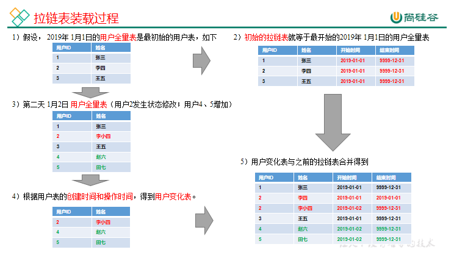

（2）数据流向

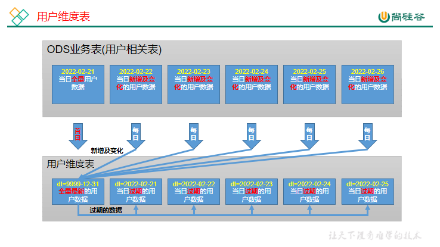

（3）首日装载

``` text
insert overwrite table edu.dim_user_zip
    partition (dt = '9999-12-31')
select data.id,
       data.login_name,
       data.nick_name,
       md5(data.real_name),
       md5(if(data.phone_num regexp '^(13[0-9]|14[01456879]|15[0-35-9]|16[2567]|17[0-8]|18[0-9]|19[0-35-9])\\d{8}$',data.phone_num,null)),
       md5(if(data.email regexp '^[a-zA-Z0-9_-]+@[a-zA-Z0-9_-]+(\\.[a-zA-Z0-9_-]+)+$',data.email,null)),
       data.user_level,
       data.birthday,
       data.gender,
       data.create_time,
       data.operate_time,
       data.status,
       '2022-02-21' start_date,
       '9999-12-31' end_date
from edu.ods_user_info_inc
where dt = '2022-02-21'
  and type = 'bootstrap-insert';
```

（4）每日装载

装载思路

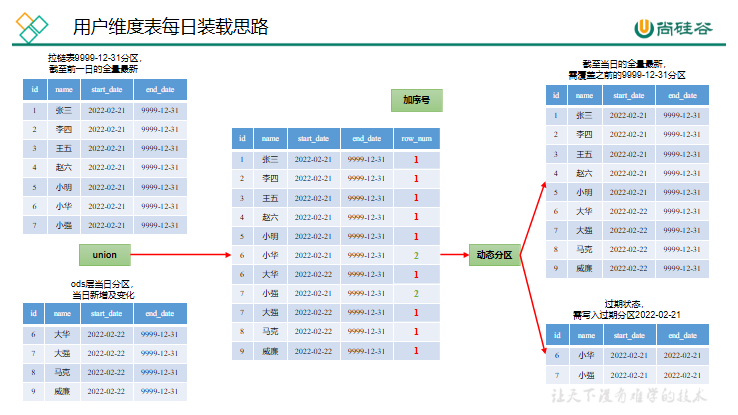

装载语句

``` text
set hive.exec.dynamic.partition.mode=nonstrict;
insert overwrite table edu.dim_user_zip
partition(dt)
select
    id,
    login_name,
    nick_name,
    real_name,
    phone_num,
    email,
    user_level,
    birthday,
    gender,
    create_time,
    operate_time,
    status,
    start_date,
    if(rn=1,'9999-12-31',date_sub('2022-02-22',1)) end_date,
    if(rn=1,'9999-12-31',date_sub('2022-02-22',1)) dt
from
(
    select
        id,
        login_name,
        nick_name,
        real_name,
        phone_num,
        email,
        user_level,
        birthday,
        gender,
        create_time,
        operate_time,
        status,
        start_date,
        end_date,
        row_number() over (partition by id order by start_date desc) rn
    from
    (
        select
            id,
            login_name,
            nick_name,
            real_name,
            phone_num,
            email,
            user_level,
            birthday,
            gender,
            create_time,
            operate_time,
            status,
            start_date,
            end_date
        from edu.dim_user_zip
        where dt='9999-12-31'
        union
        select
            id,
            login_name,
            nick_name,
            real_name,
            phone_num,
            email,
            user_level,
            birthday,
            gender,
            create_time,
            operate_time,
            status,
            '2020-02-22' start_date,
            '9999-12-31' end_date
        from
        (
            select
                data.id,
                data.login_name,
                data.nick_name,
                md5(data.real_name) real_name,
                md5(if(data.phone_num regexp '^(13[0-9]|14[01456879]|15[0-35-9]|16[2567]|17[0-8]|18[0-9]|19[0-35-9])\\d{8}$',data.phone_num,null)) phone_num,
                md5(if(data.email regexp '^[a-zA-Z0-9_-]+@[a-zA-Z0-9_-]+(\\.[a-zA-Z0-9_-]+)+$',data.email,null)) email,
                data.user_level,
                data.birthday,
                data.gender,
                data.create_time,
                data.operate_time,
                data.status,
                row_number() over (partition by data.id order by ts desc) rn
            from edu.ods_user_info_inc
            where dt='2022-02-22'
        )t1
        where rn=1
    )t2
)t3;
```

## 8.10 数据装载脚本

### 8.10.1 首日装载脚本

**1）在hadoop102的/home/atguigu/bin目录下创建ods_to_dim_init.sh**

``` text
[zhangsan@node0 bin]$ vim ods_to_dim_init.sh
```

**2）编写如下内容**

``` text
#!/bin/bash
if [ -n "$2" ] ;then
    do_date=$2
else
    echo "请传入日期参数"
    exit
fi
APP=edu
dim_chapter_full="
insert overwrite table ${APP}.dim_chapter_full
    partition (dt = '$do_date')
select id,
       chapter_name,
       course_id,
       video_id,
       publisher_id,
       is_free,
       create_time,
       update_time
from ${APP}.ods_chapter_info_full
where deleted = '0'
  and dt = '$do_date';"
dim_course_full="
with a as
         (
             select id, category_name
                 from ${APP}.ods_base_category_info_full
             where deleted = '0'
               and dt = '$do_date'
         ),
     b as
         (
             select id, subject_name, category_id
                 from ${APP}.ods_base_subject_info_full
             where deleted = '0'
               and dt = '$do_date'
         ),
     c as
         (
             select id,
                    course_name,
                    subject_id,
                    teacher,
                    publisher_id,
                    chapter_num,
                    origin_price,
                    reduce_amount,
                    actual_price,
                    create_time,
                    update_time
                 from ${APP}.ods_course_info_full
             where deleted = '0'
               and dt = '$do_date'
         ),
     d as
         (
             select course_id,
                    collect_set(named_struct('chapter_id', id, 'chapter_name', chapter_name, 'video_id', video_id, 'is_free', is_free)) chapters
                 from ${APP}.ods_chapter_info_full
             where deleted = '0'
               and dt = '$do_date'
             group by course_id
         )
insert overwrite table ${APP}.dim_course_full
partition(dt = '$do_date')
select c.id,
       course_name,
       subject_id,
       subject_name,
       category_id,
       category_name,
       teacher,
       publisher_id,
       chapter_num,
       origin_price,
       reduce_amount,
       actual_price,
       create_time,
       update_time,
       chapters
from c
         left join b
                   on c.subject_id = b.id
         left join a
                   on b.category_id = a.id
         left join d
                   on c.id = d.course_id;"
dim_video_full="
insert overwrite table ${APP}.dim_video_full partition (dt = '$do_date')
select vt.id,
       video_name,
       during_sec,
       video_status,
       video_size,
       version_id,
       chapter_id,
       chapter_name,
       is_free,
       course_id,
       publisher_id,
       create_time,
       update_time
from (
         select id,
                video_name,
                during_sec,
                video_status,
                video_size,
                version_id,
                chapter_id,
                course_id,
                publisher_id,
                create_time,
                update_time
         from ${APP}.ods_video_info_full
         where dt = '$do_date' and deleted = '0'
     ) vt
         join
     (
         select id,
                chapter_name,
                is_free
         from ${APP}.ods_chapter_info_full
         where dt = '$do_date'
     ) cht
     on vt.chapter_id = cht.id;"
dim_paper_full="
insert overwrite table ${APP}.dim_paper_full partition (dt = '$do_date')
select t1.id,
       paper_title,
       course_id,
       create_time,
       update_time,
       publisher_id,
       questions
from ${APP}.ods_test_paper_full t1
         left join
     (
         select paper_id,
                 collect_set(named_struct('question_id', question_id, 'score', score)) questions
         from ${APP}.ods_test_paper_question_full
         where deleted = '0' and dt = '$do_date'
         group by paper_id
     ) t2
     on t1.id = t2.paper_id
where t1.deleted = '0' and t1.dt = '$do_date';"
dim_source_full="
insert overwrite table ${APP}.dim_source_full partition (dt = '$do_date')
select id,
       source_site
from ${APP}.ods_base_source_full obsf
where dt = '$do_date';"
dim_question_full="
insert overwrite table ${APP}.dim_question_full
    partition (dt = '$do_date')
select id,
       chapter_id,
       course_id,
       question_type,
       create_time,
       update_time,
       publisher_id
from ${APP}.ods_test_question_info_full
where deleted = '0'
  and dt = '$do_date';"
dim_province_full="
insert overwrite table ${APP}.dim_province_full partition (dt = '$do_date')
select id,
       name,
       region_id,
       area_code,
       iso_code,
       iso_3166_2
from ${APP}.ods_base_province_full
where dt = '$do_date';"
dim_user_zip="
insert overwrite table ${APP}.dim_user_zip
    partition (dt = '9999-12-31')
select data.id,
       data.login_name,
       data.nick_name,
       md5(data.real_name),
       md5(if(data.phone_num regexp '^(13[0-9]|14[01456879]|15[0-35-9]|16[2567]|17[0-8]|18[0-9]|19[0-35-9])\\d{8}$',data.phone_num,null)),
       md5(if(data.email regexp '^[a-zA-Z0-9_-]+@[a-zA-Z0-9_-]+(\\.[a-zA-Z0-9_-]+)+$',data.email,null)),
       data.user_level,
       data.birthday,
       data.gender,
       data.create_time,
       data.operate_time,
       data.status,
       '$do_date' start_date,
       '9999-12-31' end_date
from ${APP}.ods_user_info_inc
where dt = '$do_date'
  and type = 'bootstrap-insert';"
case $1 in
    dim_chapter_full|dim_course_full|dim_video_full|dim_paper_full|dim_source_full|dim_question_full|dim_province_full|dim_user_zip)
        eval "hive -e \"\$$1\""
    ;;
    "all" )
        hive -e "${dim_chapter_full}${dim_course_full}${dim_video_full}${dim_paper_full}${dim_source_full}${dim_question_full}${dim_province_full}${dim_user_zip}"
    ;;
esac
```

**3）增加脚本执行权限**

``` text
[zhangsan@node0 bin]$ chmod +x ods_to_dim_init.sh
```

**4）脚本用法**

``` text
[zhangsan@node0 bin]$ ods_to_dim_init.sh all 2022-02-21
```

### 8.10.2 每日装载脚本

**1）在hadoop102的/home/atguigu/bin目录下创建ods_to_dim.sh**

``` text
[zhangsan@node0 bin]$ vim ods_to_dim.sh
```

**2）编写如下内容**

``` text
#!/bin/bash
if [ -n "$2" ] ;then
    do_date=$2
else
    do_date=`date -d "-1 day" +%F`
fi
APP=edu
dim_chapter_full="
insert overwrite table ${APP}.dim_chapter_full
    partition (dt = '$do_date')
select id,
       chapter_name,
       course_id,
       video_id,
       publisher_id,
       is_free,
       create_time,
       update_time
from ${APP}.ods_chapter_info_full
where deleted = '0'
  and dt = '$do_date';"
dim_course_full="
with a as
         (
             select id, category_name
                 from ${APP}.ods_base_category_info_full
             where deleted = '0'
               and dt = '$do_date'
         ),
     b as
         (
             select id, subject_name, category_id
                 from ${APP}.ods_base_subject_info_full
             where deleted = '0'
               and dt = '$do_date'
         ),
     c as
         (
             select id,
                    course_name,
                    subject_id,
                    teacher,
                    publisher_id,
                    chapter_num,
                    origin_price,
                    reduce_amount,
                    actual_price,
                    create_time,
                    update_time
                 from ${APP}.ods_course_info_full
             where deleted = '0'
               and dt = '$do_date'
         ),
     d as
         (
             select course_id,
                    collect_set(named_struct('chapter_id', id, 'chapter_name', chapter_name, 'video_id', video_id, 'is_free', is_free)) chapters
                 from ${APP}.ods_chapter_info_full
             where deleted = '0'
               and dt = '$do_date'
             group by course_id
         )
insert overwrite table ${APP}.dim_course_full
partition(dt = '$do_date')
select c.id,
       course_name,
       subject_id,
       subject_name,
       category_id,
       category_name,
       teacher,
       publisher_id,
       chapter_num,
       origin_price,
       reduce_amount,
       actual_price,
       create_time,
       update_time,
       chapters
from c
         left join b
                   on c.subject_id = b.id
         left join a
                   on b.category_id = a.id
         left join d
                   on c.id = d.course_id;"
dim_video_full="
insert overwrite table ${APP}.dim_video_full partition (dt = '$do_date')
select vt.id,
       video_name,
       during_sec,
       video_status,
       video_size,
       version_id,
       chapter_id,
       chapter_name,
       is_free,
       course_id,
       publisher_id,
       create_time,
       update_time
from (
         select id,
                video_name,
                during_sec,
                video_status,
                video_size,
                version_id,
                chapter_id,
                course_id,
                publisher_id,
                create_time,
                update_time
         from ${APP}.ods_video_info_full
         where dt = '$do_date' and deleted = '0'
     ) vt
         join
     (
         select id,
                chapter_name,
                is_free
         from ${APP}.ods_chapter_info_full
         where dt = '$do_date'
     ) cht
     on vt.chapter_id = cht.id;"
dim_paper_full="
insert overwrite table ${APP}.dim_paper_full partition (dt = '$do_date')
select t1.id,
       paper_title,
       course_id,
       create_time,
       update_time,
       publisher_id,
       questions
from ${APP}.ods_test_paper_full t1
         left join
     (
         select paper_id,
                 collect_set(named_struct('question_id', question_id, 'score', score)) questions
         from ${APP}.ods_test_paper_question_full
         where deleted = '0' and dt = '$do_date'
         group by paper_id
     ) t2
     on t1.id = t2.paper_id
where t1.deleted = '0' and t1.dt = '$do_date';"
dim_source_full="
insert overwrite table ${APP}.dim_source_full partition (dt = '$do_date')
select id,
       source_site
from ${APP}.ods_base_source_full obsf
where dt = '$do_date';"
dim_question_full="
insert overwrite table ${APP}.dim_question_full
    partition (dt = '$do_date')
select id,
       chapter_id,
       course_id,
       question_type,
       create_time,
       update_time,
       publisher_id
from ${APP}.ods_test_question_info_full
where deleted = '0'
  and dt = '$do_date';"
dim_province_full="
insert overwrite table ${APP}.dim_province_full partition (dt = '$do_date')
select id,
       name,
       region_id,
       area_code,
       iso_code,
       iso_3166_2
from ${APP}.ods_base_province_full
where dt = '$do_date';"
dim_user_zip="
set hive.exec.dynamic.partition.mode=nonstrict;
insert overwrite table ${APP}.dim_user_zip
partition(dt)
select
    id,
    login_name,
    nick_name,
    real_name,
    phone_num,
    email,
    user_level,
    birthday,
    gender,
    create_time,
    operate_time,
    status,
    start_date,
    if(rn=1,'9999-12-31',date_sub('$do_date',1)) end_date,
    if(rn=1,'9999-12-31',date_sub('$do_date',1)) dt
from
(
    select
        id,
        login_name,
        nick_name,
        real_name,
        phone_num,
        email,
        user_level,
        birthday,
        gender,
        create_time,
        operate_time,
        status,
        start_date,
        end_date,
        row_number() over (partition by id order by start_date desc) rn
    from
    (
        select
            id,
            login_name,
            nick_name,
            real_name,
            phone_num,
            email,
            user_level,
            birthday,
            gender,
            create_time,
            operate_time,
            status,
            start_date,
            end_date
        from ${APP}.dim_user_zip
        where dt='9999-12-31'
        union
        select
            id,
            login_name,
            nick_name,
            real_name,
            phone_num,
            email,
            user_level,
            birthday,
            gender,
            create_time,
            operate_time,
            status,
            '2020-02-22' start_date,
            '9999-12-31' end_date
        from
        (
            select
                data.id,
                data.login_name,
                data.nick_name,
                md5(data.real_name) real_name,
                md5(if(data.phone_num regexp '^(13[0-9]|14[01456879]|15[0-35-9]|16[2567]|17[0-8]|18[0-9]|19[0-35-9])\\d{8}$',data.phone_num,null)) phone_num,
                md5(if(data.email regexp '^[a-zA-Z0-9_-]+@[a-zA-Z0-9_-]+(\\.[a-zA-Z0-9_-]+)+$',data.email,null)) email,
                data.user_level,
                data.birthday,
                data.gender,
                data.create_time,
                data.operate_time,
                data.status,
                row_number() over (partition by data.id order by ts desc) rn
            from ${APP}.ods_user_info_inc
            where dt='$do_date'
        )t1
        where rn=1
    )t2
)t3;"
case $1 in
    dim_chapter_full|dim_course_full|dim_video_full|dim_paper_full|dim_source_full|dim_question_full|dim_province_full|dim_user_zip)
        eval "hive -e \"\$$1\""
    ;;
    "all" )
        hive -e "${dim_chapter_full}${dim_course_full}${dim_video_full}${dim_paper_full}${dim_source_full}${dim_question_full}${dim_province_full}${dim_user_zip}"
    ;;
esac
```

**3）增加脚本执行权限**

``` text
[zhangsan@node0 bin]$ chmod +x ods_to_dim.sh
```

**4）脚本用法**

``` text
[zhangsan@node0 bin]$ ods_to_dim.sh all 2022-02-22
```

# 第9章 数仓开发之DWD层

DWD层设计要点：

（1）DWD层的设计依据是维度建模理论，该层存储维度模型的事实表。

（2）DWD层的数据存储格式为orc列式存储+snappy压缩。

（3）DWD层表名的命名规范为dwd_数据域_表名_单分区增量全量标识（inc/full）

## 9.1 交易域加购事务事实表

**1）建表语句**

``` text
DROP TABLE IF EXISTS dwd_trade_cart_add_inc;
CREATE EXTERNAL TABLE dwd_trade_cart_add_inc
(
    `id`          STRING COMMENT '编号',
    `user_id`     STRING COMMENT '用户id',
    `course_id`   STRING COMMENT '课程id',
    `date_id`     STRING COMMENT '时间id',
    `session_id`  STRING COMMENT '会话id',
    `create_time` STRING COMMENT '加购时间',
    `cart_price`  DECIMAL(16, 2) COMMENT '加购时价格'
) COMMENT '交易域加购事务事实表'
    PARTITIONED BY (`dt` STRING)
    STORED AS ORC
    LOCATION '/warehouse/edu/dwd/dwd_trade_cart_add_inc/'
    TBLPROPERTIES ('orc.compress' = 'snappy');
```

**2）分区规划**

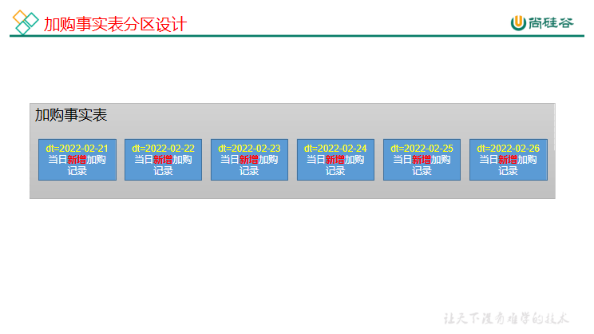

**3）数据装载**

（1）数据流向

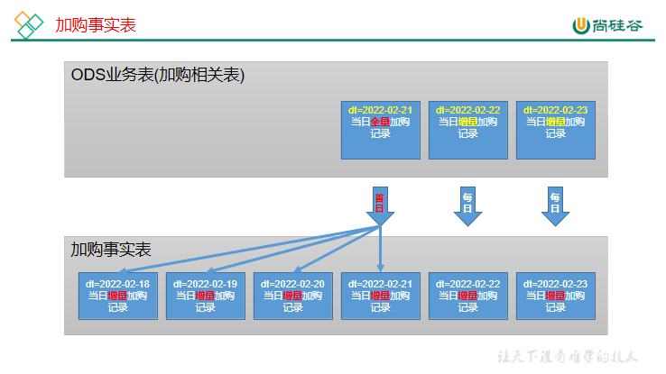

（2）首日装载

``` text
insert overwrite table edu.dwd_trade_cart_add_inc
select data.id,
       data.user_id,
       data.course_id,
       date_format(data.create_time, 'yyyy-MM-dd') date_id,
       data.session_id,
       data.create_time,
       data.cart_price,
       date_format(data.create_time, 'yyyy-MM-dd') dt
from edu.ods_cart_info_inc
where dt = '2022-02-21' and type = 'bootstrap-insert';
```

（3）每日装载

``` text
insert overwrite table edu.dwd_trade_cart_add_inc partition (dt = '2022-02-22')
select data.id,
       data.user_id,
       data.course_id,
       date_format(data.create_time, 'yyyy-MM-dd') date_id,
       data.session_id,
       data.create_time,
       data.cart_price
from edu.ods_cart_info_inc
where dt = '2022-02-22' and type = 'insert';
```

## 9.2 交易域加购周期快照事实表

**1）建表语句**

``` text
DROP TABLE IF EXISTS dwd_trade_cart_full;
CREATE EXTERNAL TABLE dwd_trade_cart_full
(
    `id`          STRING COMMENT '编号',
    `user_id`     STRING COMMENT '用户id',
    `course_id`   STRING COMMENT '课程id',
    `date_id`     STRING COMMENT '时间id',
    `session_id`  STRING COMMENT '会话id',
    `course_name` STRING COMMENT '课程名称',
    `create_time` STRING COMMENT '加购时间',
    `cart_price`  DECIMAL(16, 2) COMMENT '加购时价格'
) COMMENT '交易域加购周期快照事实表'
    PARTITIONED BY (`dt` STRING)
    STORED AS ORC
    LOCATION '/warehouse/edu/dwd/dwd_trade_cart_full/'
    TBLPROPERTIES ('orc.compress' = 'snappy');
```

**2）数据装载**

``` text
insert overwrite table edu.dwd_trade_cart_full  partition (dt = '2022-02-21')
select id,
       user_id,
       course_id,
       date_format(create_time, 'yyyy-MM-dd'),
       session_id,
       course_name,
       create_time,
       cart_price
from edu.ods_cart_info_full
where dt = '2022-02-21'
  and deleted = '0' and sold = '0';
```

## 9.3 交易域试听下单累积快照事实表

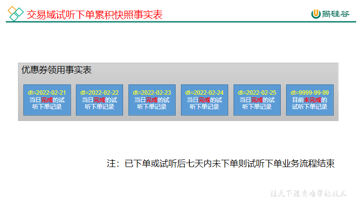

**1）建表语句**

``` text
DROP TABLE IF EXISTS dwd_trade_course_order_inc;
CREATE EXTERNAL TABLE dwd_trade_course_order_inc
(
    `id`                   STRING COMMENT '编号',
    `user_id`              STRING COMMENT '用户id',
    `course_id`            STRING COMMENT '课程id',
    `course_name`          STRING COMMENT '课程名称',
    `category_id`          STRING COMMENT '分类id',
    `category_name`        STRING COMMENT '分类名称',
    `subject_id`           STRING COMMENT '科目id',
    `subject_name`         STRING COMMENT '科目名称',
    `order_id`             STRING COMMENT '订单id',
    `province_id`          STRING COMMENT '省份id',
    `play_time`            STRING COMMENT '首次播放时间',
    `play_date`            STRING COMMENT '首次播放日期',
    `order_time`           STRING COMMENT '首次下单时间',
    `order_date`           STRING COMMENT '首次下单日期',
    `end_date`             STRING COMMENT '结束日期,试听后七天内未下单即为结束,试听日期+7为结束日期',
    `session_id`           STRING COMMENT '会话id',
    `original_amount`      DECIMAL(16, 2) COMMENT '原始金额分摊',
    `coupon_reduce_amount` DECIMAL(16, 2) COMMENT '优惠金额分摊',
    `final_amount`         DECIMAL(16, 2) COMMENT '最终价格分摊'
) COMMENT '交易域试听下单累积快照事实表'
    PARTITIONED BY (`dt` STRING)
    STORED AS ORC
    LOCATION '/warehouse/edu/dwd/dwd_trade_course_order_inc/'
    TBLPROPERTIES ('orc.compress' = 'snappy');
```

**2）数据装载**

（1）首日装载

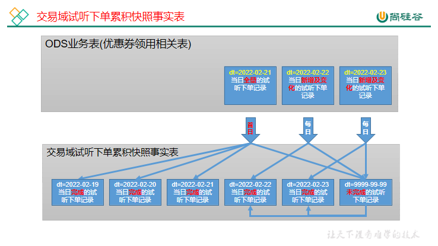

``` text
set hive.exec.dynamic.partition.mode=nonstrict;
with play as
         (
             select min(id)                                     id,
                    user_id,
                    course_id,
                    min(create_time)                            play_time,
                    date_format(min(create_time), 'yyyy-MM-dd') play_date
             from edu.ods_user_chapter_process_full
             where dt = '2022-02-21'
             group by user_id, course_id
         ),
     oi as
         (
             select data.id,
                    data.province_id,
                    data.session_id
             from edu.ods_order_info_inc
             where dt = '2022-02-21'
               and type = 'bootstrap-insert'
         ),
     od as
         (
             select data.id,
                    data.course_id,
                    data.order_id,
                    data.user_id,
                    data.origin_amount,
                    data.coupon_reduce,
                    data.final_amount,
                    data.create_time order_time,
                    date_format(data.create_time, 'yyyy-MM-dd') order_date
             from edu.ods_order_detail_inc
             where dt = '2022-02-21'
               and type = 'bootstrap-insert'
         ),
     dim_course as (
         select id,
                course_name,
                category_id,
                category_name,
                subject_id,
                subject_name
         from edu.dim_course_full
         where dt = '2022-02-21'
     )
insert overwrite table edu.dwd_trade_course_order_inc partition (dt)
select final.id,
       user_id,
       course_id,
       course_name,
       category_id,
       category_name,
       subject_id,
       subject_name,
       order_id,
       province_id,
       play_time,
       play_date,
       order_time,
       order_date,
       end_date,
       session_id,
       origin_amount,
       coupon_reduce,
       final_amount,
       case
		  when end_date is not null then end_date
		  when order_date is not null then order_date
           else '9999-12-31' end dt
from (select play.id,
             play.user_id,
             play.course_id,
             od.order_id,
             oi.province_id,
             play.play_time,
             play.play_date,
             od.order_time,
             od.order_date,
             if(od.order_date is null and
                date_add(play.play_date, 7) <= '2022-02-21',
                date_add(play.play_date, 7), null) end_date,
             oi.session_id,
             od.origin_amount,
             od.coupon_reduce,
             od.final_amount
      from play
               left join od on play.user_id = od.user_id and play.course_id = od.course_id
               left join oi on od.order_id = oi.id
where od.order_time is null
or od.order_time > play.play_time
) final
         left join dim_course on course_id = dim_course.id;
```

（2）每日装载

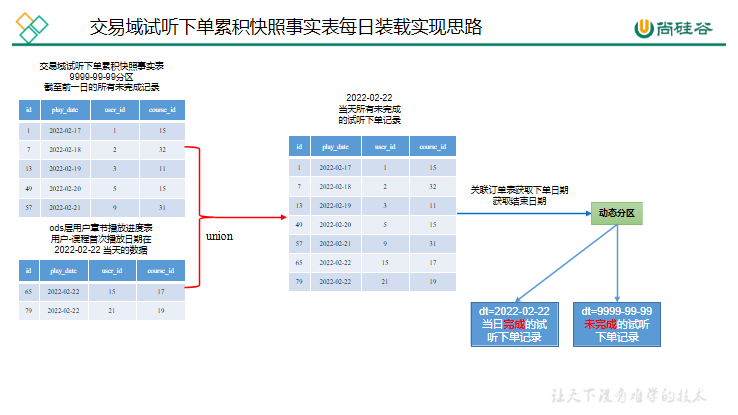

``` text
set hive.exec.dynamic.partition.mode=nonstrict;
with play as
         (select id,
                 user_id,
                 course_id,
                 play_time,
                 play_date
          from edu.dwd_trade_course_order_inc
          where dt = '9999-12-31'
          union
          select min(id)                                     id,
                 user_id,
                 course_id,
                 min(create_time),
                 date_format(min(create_time), 'yyyy-MM-dd') play_date
          from edu.ods_user_chapter_process_full
          where dt = '2022-02-22'
          group by user_id, course_id
          having date_format(min(create_time), 'yyyy-MM-dd') = '2022-02-22'),
     oi as
         (
             select data.id,
                    data.province_id,
                    data.session_id,
                    data.create_time order_time
             from edu.ods_order_info_inc
             where dt = '2022-02-22'
               and type = 'insert'
         ),
     od as
         (
             select data.id,
                    data.course_id,
                    data.order_id,
                    data.user_id,
                    data.origin_amount,
                    data.coupon_reduce,
                    data.final_amount,
                    date_format(data.create_time, 'yyyy-MM-dd') order_date
             from edu.ods_order_detail_inc
             where dt = '2022-02-22'
               and type = 'insert'
         ),
     dim_course as
         (
             select id,
                    course_name,
                    category_id,
                    category_name,
                    subject_id,
                    subject_name
             from edu.dim_course_full
             where dt = '2022-02-22'
         )
insert overwrite table edu.dwd_trade_course_order_inc
partition (dt)
select final.id,
       user_id,
       course_id,
       course_name,
       category_id,
       category_name,
       subject_id,
       subject_name,
       order_id,
       province_id,
       play_time,
       play_date,
       order_time,
       order_date,
       end_date,
       session_id,
       origin_amount,
       coupon_reduce,
       final_amount,
       case
           when end_date is not null then end_date
           when order_date is not null then order_date
           else '9999-12-31' end dt
from (select play.id,
             play.user_id,
             play.course_id,
             od.order_id,
             oi.province_id,
             play.play_time,
             play.play_date,
             oi.order_time,
             od.order_date,
             if(order_date is null and date_add(play_date, 7) = '2022-02-22', '2022-02-22', null) end_date,
             oi.session_id,
             od.origin_amount,
             od.coupon_reduce,
             od.final_amount
      from play
               left join od on play.user_id = od.user_id and play.course_id = od.course_id
               left join oi on od.order_id = oi.id
where order_time is null
or order_time > play_time
) final
         left join dim_course on course_id = dim_course.id;
```

## 9.4 交易域下单事务事实表

**1）建表语句**

``` text
DROP TABLE IF EXISTS dwd_trade_order_detail_inc;
CREATE EXTERNAL TABLE dwd_trade_order_detail_inc
(
    `id`                   STRING COMMENT '编号',
    `order_id`             STRING COMMENT '订单id',
    `user_id`              STRING COMMENT '用户id',
    `course_id`            STRING COMMENT '课程id',
    `course_name`          STRING COMMENT '课程名称',
    `category_id`          STRING COMMENT '分类id',
    `category_name`        STRING COMMENT '分类名称',
    `subject_id`           STRING COMMENT '科目id',
    `subject_name`         STRING COMMENT '科目名称',
    `province_id`          STRING COMMENT '省份id',
    `date_id`              STRING COMMENT '下单日期id',
    `session_id`           STRING COMMENT '会话id',
    `source_id`            STRING COMMENT '来源id',
    `create_time`          STRING COMMENT '下单时间',
    `original_amount`      DECIMAL(16, 2) COMMENT '原始金额分摊',
    `coupon_reduce_amount` DECIMAL(16, 2) COMMENT '优惠金额分摊',
    `final_amount`         DECIMAL(16, 2) COMMENT '最终价格分摊',
    `out_trade_no`         STRING COMMENT '订单交易编号',
    `trade_body`           STRING COMMENT '订单描述'
) COMMENT '交易域下单事务事实表'
    PARTITIONED BY (`dt` STRING)
    STORED AS ORC
    LOCATION '/warehouse/edu/dwd/dwd_trade_order_detail_inc/'
    TBLPROPERTIES ('orc.compress' = 'snappy');
```

**2）数据装载**

（1）首日装载

``` text
set hive.exec.dynamic.partition.mode=nonstrict;
insert overwrite table edu.dwd_trade_order_detail_inc
    partition (dt)
select odt.id,
       order_id,
       user_id,
       course_id,
       course_name,
       category_id,
       category_name,
       subject_id,
       subject_name,
       province_id,
       date_id,
       session_id,
       source_id,
       create_time,
       origin_amount,
       coupon_reduce,
       final_amount,
       out_trade_no,
       trade_body,
       date_id
from (
         select data.id,
                data.order_id,
                data.user_id,
                data.course_id,
                date_format(data.create_time, 'yyyy-MM-dd') date_id,
                data.create_time,
                data.origin_amount,
                data.coupon_reduce,
                data.final_amount
         from edu.ods_order_detail_inc
         where dt = '2022-02-21'
           and type = 'bootstrap-insert'
     ) odt
         left join
     (
         select data.id,
                data.province_id,
                data.out_trade_no,
                data.session_id,
                data.trade_body
         from edu.ods_order_info_inc
         where dt = '2022-02-21'
           and type = 'bootstrap-insert'
     ) od
     on odt.order_id = od.id
         left join
     (
         select distinct common.sid,
                         common.sc source_id
         from edu.ods_log_inc oli
         where dt = '2022-02-21'
     ) log
     on od.session_id = log.sid
         left join
     (
         select id,
                course_name,
                category_id,
                category_name,
                subject_id,
                subject_name
         from edu.dim_course_full
         where dt = '2022-02-21'
     ) dim_course
     on course_id = dim_course.id;
```

（2）每日装载

``` text
insert overwrite table edu.dwd_trade_order_detail_inc
    partition (dt = '2022-02-22')
select odt.id,
       order_id,
       user_id,
       course_id,
       course_name,
       category_id,
       category_name,
       subject_id,
       subject_name,
       province_id,
       date_id,
       session_id,
       source_id,
       create_time,
       origin_amount,
       coupon_reduce,
       final_amount,
       out_trade_no,
       trade_body
from (
         select data.id,
                data.order_id,
                data.user_id,
                data.course_id,
                date_format(data.create_time, 'yyyy-MM-dd') date_id,
                data.create_time,
                data.origin_amount,
                data.coupon_reduce,
                data.final_amount
         from edu.ods_order_detail_inc
         where dt = '2022-02-22'
           and type = 'insert'
     ) odt
         left join
     (
         select data.id,
                data.province_id,
                data.session_id,
                data.out_trade_no,
                data.trade_body
         from edu.ods_order_info_inc
         where dt = '2022-02-22'
           and type = 'insert'
     ) od
     on odt.order_id = od.id
         left join
     (
         select distinct common.sid,
                         common.sc source_id
         from edu.ods_log_inc oli
         where dt = '2022-02-22'
     ) log
     on od.session_id = log.sid
         left join
     (
         select id,
                course_name,
                category_id,
                category_name,
                subject_id,
                subject_name
         from edu.dim_course_full
         where dt = '2022-02-22'
     ) dim_course
     on course_id = dim_course.id;
```

## 9.5 交易域支付成功事务事实表

**1）建表语句**

``` text
DROP TABLE IF EXISTS dwd_trade_pay_detail_suc_inc;
CREATE EXTERNAL TABLE dwd_trade_pay_detail_suc_inc
(
    `id`                   STRING COMMENT '编号',
    `order_id`             STRING COMMENT '订单id',
    `user_id`              STRING COMMENT '用户id',
    `course_id`            STRING COMMENT '课程id',
    `province_id`          STRING COMMENT '省份id',
    `date_id`              STRING COMMENT '支付日期id',
    `alipay_trade_no`      STRING COMMENT '支付宝交易编号',
    `trade_body`           STRING COMMENT '交易内容',
    `payment_type`         STRING COMMENT '支付类型名称',
    `payment_status`       STRING COMMENT '支付状态',
    `callback_time`        STRING COMMENT '支付成功时间',
    `callback_content`     STRING COMMENT '回调信息',
    `original_amount`      DECIMAL(16, 2) COMMENT '原始支付金额分摊',
    `coupon_reduce_amount` DECIMAL(16, 2) COMMENT '优惠支付金额分摊',
    `final_amount`         DECIMAL(16, 2) COMMENT '最终支付金额分摊'
) COMMENT '交易域支付成功事务事实表'
    PARTITIONED BY (`dt` STRING)
    STORED AS ORC
    LOCATION '/warehouse/edu/dwd/dwd_trade_pay_detail_suc_inc/'
    TBLPROPERTIES ('orc.compress' = 'snappy');
```

**2）数据装载**

（1）首日装载

``` text
set hive.exec.dynamic.partition.mode=nonstrict;
insert overwrite table edu.dwd_trade_pay_detail_suc_inc
partition(dt)
select odt.id,
       od.id,
       user_id,
       course_id,
       province_id,
       date_format(create_time, 'yyyy-MM-dd') date_id,
       alipay_trade_no,
       trade_body,
       payment_type,
       payment_status,
       callback_time,
       callback_content,
       origin_amount,
       coupon_reduce,
       final_amount,
       date_format(create_time, 'yyyy-MM-dd') date_id
from (
         select data.id,
                data.order_id,
                data.user_id,
                data.course_id,
                data.origin_amount,
                data.coupon_reduce,
                data.final_amount,
                data.create_time
         from edu.ods_order_detail_inc
         where dt = '2022-02-21' and type = 'bootstrap-insert'
     ) odt
         left join
     (
         select data.id,
                data.province_id
         from edu.ods_order_info_inc
         where dt = '2022-02-21' and type = 'bootstrap-insert'
     ) od
     on odt.order_id = od.id
         join
     (
         select data.alipay_trade_no,
                data.trade_body,
                data.order_id,
                data.payment_type,
                data.payment_status,
                data.callback_time,
                data.callback_content
         from edu.ods_payment_info_inc
         where dt = '2022-02-21' and type = 'bootstrap-insert'
           and data.callback_time is not null
     ) pi
     on od.id = pi.order_id;
```

（2）每日装载

``` text
insert overwrite table edu.dwd_trade_pay_detail_suc_inc
    partition (dt = '2022-02-22')
select
 odt.id,
       od.id,
       user_id,
       course_id,
       province_id,
       date_format(create_time, 'yyyy-MM-dd') date_id,
       alipay_trade_no,
       trade_body,
       payment_type,
       payment_status,
       callback_time,
       callback_content,
       origin_amount,
       coupon_reduce,
       final_amount
from (
         select data.id,
                data.order_id,
                data.user_id,
                data.course_id,
                data.origin_amount,
                data.coupon_reduce,
                data.final_amount,
                data.create_time
         from edu.ods_order_detail_inc
         where (dt = '2022-02-22' or dt = date_add('2022-02-22', -1))
           and (type = 'insert' or type = 'bootstrap-insert')
     ) odt
         left join
     (
         select data.id,
                data.province_id
         from edu.ods_order_info_inc
         where (dt = '2022-02-22' or dt = date_add('2022-02-22', -1))
           and (type = 'insert' or type = 'bootstrap-insert')
     ) od
     on odt.order_id = od.id
         join
     (
         select data.alipay_trade_no,
                data.trade_body,
                data.order_id,
                data.payment_type,
                data.payment_status,
                data.callback_time,
                data.callback_content
         from edu.ods_payment_info_inc
         where dt = '2022-02-22'
           and type = 'update'
           and array_contains(map_keys(old), 'callback_time')
     ) pi
     on od.id = pi.order_id;
```

## 9.6 流量域页面浏览事务事实表

**1）建表语句**

``` text
DROP TABLE IF EXISTS dwd_traffic_page_view_inc;
CREATE EXTERNAL TABLE dwd_traffic_page_view_inc
(
    `mid_id`         STRING COMMENT '手机唯一编号',
    `province_id`    STRING COMMENT '省份id',
    `brand`          STRING COMMENT '手机品牌',
    `is_new`         STRING COMMENT '是否新用户',
    `model`          STRING COMMENT '手机型号',
    `os`             STRING COMMENT '手机品牌',
    `session_id`     STRING COMMENT '会话id',
    `user_id`        STRING COMMENT '用户id',
    `version_code`   STRING COMMENT '版本号',
    `source_id`         STRING COMMENT '数据来源',
    `during_time`    BIGINT COMMENT '持续时间毫秒',
    `page_item`      STRING COMMENT '目标id ',
    `page_item_type` STRING COMMENT '目标类型',
    `page_id`        STRING COMMENT '页面id ',
    `last_page_id`   STRING COMMENT '上页类型',
    `ts`             STRING COMMENT '跳入时间'
)
    COMMENT '流量域页面浏览事务事实表'
    PARTITIONED BY (`dt` STRING)
    STORED AS ORC
    LOCATION '/warehouse/edu/dwd/dwd_traffic_page_view_inc'
    TBLPROPERTIES ('orc.compress' = 'snappy');
```

**2）数据装载**

``` text
set hive.cbo.enable=false;
insert overwrite table edu.dwd_traffic_page_view_inc partition (dt = '2022-02-21')
select common.mid,
       common.ar      province_id,
       common.ba      brand,
       common.is_new,
       common.md      model,
       common.os,
       common.sid     session_id,
       common.uid     user_id,
       common.vc      version_code,
       common.sc,
       page.during_time,
       page.item      page_item,
       page.item_type page_item_type,
       page.page_id,
       page.last_page_id,
       ts
from edu.ods_log_inc
where dt = '2022-02-21'
  and page is not null;
set hive.cbo.enable=true;
```

## 9.7 流量域启动事务事实表

**1）建表语句**

``` text
DROP TABLE IF EXISTS dwd_traffic_start_inc;
CREATE EXTERNAL TABLE dwd_traffic_start_inc
(
    `mid_id`          STRING COMMENT '手机唯一编号',
    `province_id`     STRING COMMENT '省份id',
    `brand`           STRING COMMENT '手机品牌',
    `is_new`          STRING COMMENT '是否新用户',
    `model`           STRING COMMENT '手机型号',
    `os`              STRING COMMENT '手机品牌',
    `session_id`      STRING COMMENT '会话id',
    `user_id`         STRING COMMENT '用户id',
    `version_code`    STRING COMMENT '版本号',
    `source_id`          STRING COMMENT '数据来源',
    `entry`           STRING COMMENT 'icon手机图标 notice 通知',
    `open_ad_id`      STRING COMMENT '广告页id',
    `first_open`      STRING COMMENT '是否首次启动',
    `date_id`         STRING COMMENT '日期id',
    `start_time`      STRING COMMENT '启动时间',
    `loading_time_ms` BIGINT COMMENT '启动加载时间',
    `open_ad_ms`      BIGINT COMMENT '广告总共播放时间',
    `open_ad_skip_ms` BIGINT COMMENT '用户跳过广告时点'
) COMMENT '流量域启动事务事实表'
    PARTITIONED BY (`dt` STRING)
    STORED AS ORC
    LOCATION '/warehouse/edu/dwd/dwd_traffic_start_inc'
    TBLPROPERTIES ('orc.compress' = 'snappy');
```

**2）数据装载**

``` text
set hive.cbo.enable=false;
insert overwrite table edu.dwd_traffic_start_inc partition (dt = '2022-02-21')
select common.mid,
       common.ar            province_id,
       common.ba            brand,
       common.is_new,
       common.md            model,
       common.os,
       common.sid           session_id,
       common.uid           user_id,
       common.vc            version_code,
       common.sc,
       `start`.entry,
       `start`.open_ad_id,
       `start`.first_open,
       date_format(from_utc_timestamp(ts, 'GMT+8'), 'yyyy-MM-dd'),
       date_format(from_utc_timestamp(ts, 'GMT+8'), 'yyyy-MM-dd HH:mm:ss'),
       `start`.loading_time loading_time_ms,
       `start`.open_ad_ms,
       `start`.open_ad_skip_ms
from edu.ods_log_inc
where dt = '2022-02-21'
  and `start` is not null;
set hive.cbo.enable=true;
```

## 9.8 流量域动作事务事实表

**1）建表语句**

``` text
DROP TABLE IF EXISTS dwd_traffic_action_inc;
CREATE EXTERNAL TABLE dwd_traffic_action_inc
(
    `mid_id`           STRING COMMENT '手机唯一编号',
    `province_id`      STRING COMMENT '省份id',
    `brand`            STRING COMMENT '手机品牌',
    `is_new`           STRING COMMENT '是否新用户',
    `model`            STRING COMMENT '手机型号',
    `os`               STRING COMMENT '手机品牌',
    `session_id`       STRING COMMENT '会话id',
    `user_id`          STRING COMMENT '用户id',
    `version_code`     STRING COMMENT '版本号',
    `source_id`           STRING COMMENT '数据来源',
    `during_time`      BIGINT COMMENT '持续时间毫秒',
    `page_item`        STRING COMMENT '目标id',
    `page_item_type`   STRING COMMENT '目标类型',
    `page_id`          STRING COMMENT '页面id',
    `last_page_id`     STRING COMMENT '上页类型',
    `action_id`        STRING COMMENT '动作id',
    `action_item`      STRING COMMENT '目标id',
    `action_item_type` STRING COMMENT '目标类型',
    `date_id`          STRING COMMENT '日期id',
    `action_time`      STRING COMMENT '动作发生时间'
) COMMENT '流量域动作事务事实表'
    PARTITIONED BY (`dt` STRING)
    STORED AS ORC
    LOCATION '/warehouse/edu/dwd/dwd_traffic_action_inc'
    TBLPROPERTIES ('orc.compress' = 'snappy');
```

**2）数据装载**

``` text
set hive.cbo.enable=false;
insert overwrite table edu.dwd_traffic_action_inc partition (dt = '2022-02-21')
select common.mid,
       common.ar,
       common.ba,
       common.is_new,
       common.md,
       common.os,
       common.sid,
       common.uid,
       common.vc,
       common.sc,
       page.during_time,
       page.item,
       page.item_type,
       page.page_id,
       page.last_page_id,
       action.action_id,
       action.item,
       action.item_type,
       date_format(from_utc_timestamp(ts * 1000, 'GMT+8'), 'yyyy-MM-dd') date_id,
       action.ts
from edu.ods_log_inc oli lateral view explode(actions) tmp as action
where oli.dt = '2022-02-21'
  and actions is not null;
set hive.cbo.enable=true;
```

## 9.9 流量域曝光事务事实表

**1）建表语句**

``` text
DROP TABLE IF EXISTS dwd_traffic_display_inc;
CREATE EXTERNAL TABLE dwd_traffic_display_inc
(
    `mid_id`            STRING COMMENT '手机唯一编号',
    `province_id`       STRING COMMENT '省份id',
    `brand`             STRING COMMENT '手机品牌',
    `is_new`            STRING COMMENT '是否新用户',
    `model`             STRING COMMENT '手机型号',
    `os`                STRING COMMENT '手机品牌',
    `session_id`        STRING COMMENT '会话id',
    `user_id`           STRING COMMENT '用户id',
    `version_code`      STRING COMMENT '版本号',
    `source_id`            STRING COMMENT '数据来源',
    `during_time`       BIGINT COMMENT '页面时间',
    `page_item`         STRING COMMENT '目标id ',
    `page_item_type`    STRING COMMENT '目标类型',
    `page_id`           STRING COMMENT '页面id ',
    `last_page_id`      STRING COMMENT '上页类型',
    `date_id`           STRING COMMENT '日期id',
    `display_time`      STRING COMMENT '曝光时间',
    `display_type`      STRING COMMENT '曝光类型',
    `display_item`      STRING COMMENT '曝光对象id ',
    `display_item_type` STRING COMMENT 'app版本号',
    `display_order`     BIGINT COMMENT '曝光顺序',
    `display_pos_id`    BIGINT COMMENT '曝光位置'
) COMMENT '流量域曝光事务事实表'
    PARTITIONED BY (`dt` STRING)
    STORED AS ORC
    LOCATION '/warehouse/edu/dwd/dwd_traffic_display_inc'
    TBLPROPERTIES ('orc.compress' = 'snappy');
```

**2）数据装载**

``` text
set hive.cbo.enable=false;
insert overwrite table edu.dwd_traffic_display_inc partition (dt = '2022-02-21')
select common.mid,
       common.ar,
       common.ba,
       common.is_new,
       common.md,
       common.os,
       common.sid,
       common.uid,
       common.vc,
       common.sc,
       page.during_time,
       page.item,
       page.item_type,
       page.page_id,
       page.last_page_id,
       date_format(from_utc_timestamp(ts * 1000, 'GMT+8'), 'yyyy-MM-dd'),
       ts,
       display.display_type,
       display.item,
       display.item_type,
       display.`order`,
       display.pos_id
from edu.ods_log_inc oli lateral view explode(displays) tmp as display
where oli.dt = '2022-02-21'
  and displays is not null;
set hive.cbo.enable=true;
```

## 9.10 流量域错误事务事实表

**1）建表语句**

``` text
DROP TABLE IF EXISTS dwd_traffic_error_inc;
CREATE EXTERNAL TABLE dwd_traffic_error_inc
(
    `mid_id`          STRING COMMENT '手机唯一编号',
    `province_id`     STRING COMMENT '省份id',
    `brand`           STRING COMMENT '手机品牌',
    `is_new`          STRING COMMENT '是否新用户',
    `model`           STRING COMMENT '手机型号',
    `os`              STRING COMMENT '手机品牌',
    `session_id`      STRING COMMENT '会话id',
    `user_id`         STRING COMMENT '用户id',
    `version_code`    STRING COMMENT '版本号',
    `source_id`          STRING COMMENT '数据来源',
    `during_time`     BIGINT COMMENT '页面时间',
    `page_item`       STRING COMMENT '目标id ',
    `page_item_type`  STRING COMMENT '目标类型',
    `last_page_id`    STRING COMMENT '上页类型',
    `page_id`         STRING COMMENT '页面id',
    `entry`           STRING COMMENT 'icon手机图标  notice 通知',
    `loading_time`    STRING COMMENT '启动加载时间',
    `open_ad_id`      STRING COMMENT '广告页id',
    `open_ad_ms`      STRING COMMENT '广告总共播放时间',
    `open_ad_skip_ms` STRING COMMENT '用户跳过广告时点',
    `actions`         ARRAY<STRUCT<action_id:STRING,item:STRING,item_type:STRING,ts:BIGINT>> COMMENT '动作信息',
    `displays`        ARRAY<STRUCT<display_type :STRING,item :STRING,item_type :STRING,`order` :STRING,pos_id
                                   :STRING>> COMMENT '曝光信息',
    `date_id`         STRING COMMENT '日期id',
    `error_time`      STRING COMMENT '错误时间',
    `error_code`      STRING COMMENT '错误码',
    `error_msg`       STRING COMMENT '错误信息'
) COMMENT '流量域错误事务事实表'
    PARTITIONED BY (`dt` STRING)
    STORED AS ORC
    LOCATION '/warehouse/edu/dwd/dwd_traffic_error_inc'
    TBLPROPERTIES ('orc.compress' = 'snappy');
```

**2）数据装载**

``` text
set hive.cbo.enable=false;
insert overwrite table edu.dwd_traffic_error_inc partition (dt = '2022-02-21')
select common.mid,
       common.ar,
       common.ba,
       common.is_new,
       common.md,
       common.os,
       common.sid,
       common.uid,
       common.vc,
       common.sc,
       page.during_time,
       page.item,
       page.item_type,
       page.last_page_id,
       page.page_id,
       `start`.entry,
       `start`.loading_time,
       `start`.open_ad_id,
       `start`.open_ad_ms,
       `start`.open_ad_skip_ms,
       actions,
       displays,
       date_format(from_utc_timestamp(ts * 1000, 'GMT+8'), 'yyyy-MM-dd'),
       ts,
       err.error_code,
       err.msg
from edu.ods_log_inc
where dt = '2022-02-21'
  and err is not null;
set hive.cbo.enable=true;
```

## 9.11 互动域收藏事务事实表

**1）建表语句**

``` text
DROP TABLE IF EXISTS dwd_interaction_favor_add_inc;
CREATE EXTERNAL TABLE dwd_interaction_favor_add_inc
(
    `id`          STRING COMMENT '编号',
    `user_id`     STRING COMMENT '用户id',
    `course_id`   STRING COMMENT '课程id',
    `date_id`     STRING COMMENT '日期id',
    `create_time` STRING COMMENT '收藏时间'
) COMMENT '互动域收藏事务事实表'
    PARTITIONED BY (`dt` STRING)
    STORED AS ORC
    LOCATION '/warehouse/edu/dwd/dwd_interaction_favor_add_inc/'
    TBLPROPERTIES ("orc.compress" = "snappy");
```

**2）数据装载**

（1）首日装载

``` text
insert overwrite table edu.dwd_interaction_favor_add_inc
select data.id,
       data.user_id,
       data.course_id,
       date_format(from_utc_timestamp(ts * 1000, 'GMT+8'), 'yyyy-MM-dd'),
       data.create_time,
       date_format(data.create_time, 'yyyy-MM-dd')
from edu.ods_favor_info_inc
where dt='2022-02-21' and type = 'bootstrap-insert';
```

（2）每日装载

``` text
insert overwrite table edu.dwd_interaction_favor_add_inc
    partition (dt = '2022-02-22')
select data.id,
       data.user_id,
       data.course_id,
       date_format(from_utc_timestamp(ts * 1000, 'GMT+8'), 'yyyy-MM-dd'),
       data.create_time
from edu.ods_favor_info_inc
where dt = '2022-02-22'
  and type = 'insert';
```

## 9.12 互动域章节评价事务事实表

**1）建表语句**

``` text
DROP TABLE IF EXISTS dwd_interaction_comment_inc;
CREATE EXTERNAL TABLE dwd_interaction_comment_inc
(
    `id`          STRING COMMENT '编号',
    `user_id`     STRING COMMENT '用户id',
    `chapter_id`  STRING COMMENT '章节id',
    `course_id`   STRING COMMENT '课程id',
    `date_id`     STRING COMMENT '日期id',
    `create_time` STRING COMMENT '评价时间',
    `comment_txt` STRING COMMENT '评价内容'
) COMMENT '互动域章节评价事务事实表'
    PARTITIONED BY (`dt` STRING)
    STORED AS ORC
    LOCATION '/warehouse/edu/dwd/dwd_interaction_comment_inc/'
    TBLPROPERTIES ("orc.compress" = "snappy");
```

**2）数据装载**

（1）首日装载

``` text
insert overwrite table edu.dwd_interaction_comment_inc
select data.id,
       data.user_id,
       data.chapter_id,
       data.course_id,
       date_format(from_utc_timestamp(ts * 1000, 'GMT+8'), 'yyyy-MM-dd'),
       data.create_time,
       data.comment_txt,
       date_format(data.create_time, 'yyyy-MM-dd')
from edu.ods_comment_info_inc
where dt='2022-02-21' and type = 'bootstrap-insert';
```

（2）每日装载

``` text
insert overwrite table edu.dwd_interaction_comment_inc
    partition (dt = '2022-02-22')
select data.id,
       data.user_id,
       data.chapter_id,
       data.course_id,
       date_format(from_utc_timestamp(ts * 1000, 'GMT+8'), 'yyyy-MM-dd'),
       data.create_time,
       data.comment_txt
from edu.ods_comment_info_inc
where dt = '2022-02-22'
  and type = 'insert';
```

## 9.13 互动域课程评价事务事实表

**1）建表语句**

``` text
DROP TABLE IF EXISTS dwd_interaction_review_inc;
CREATE EXTERNAL TABLE dwd_interaction_review_inc
(
    `id`           STRING COMMENT '编号',
    `user_id`      STRING COMMENT '用户id',
    `course_id`    STRING COMMENT '课程id',
    `date_id`      STRING COMMENT '日期id',
    `review_txt`   STRING COMMENT '评论文本',
    `review_stars` BIGINT COMMENT '评级',
    `create_time`  STRING COMMENT '评价时间'
) COMMENT '互动域课程评价事务事实表'
    PARTITIONED BY (`dt` STRING)
    STORED AS ORC
    LOCATION '/warehouse/edu/dwd/dwd_interaction_review_inc/'
    TBLPROPERTIES ("orc.compress" = "snappy");
```

**2）数据装载**

（1）首日装载

``` text
insert overwrite table edu.dwd_interaction_review_inc
select data.id,
       data.user_id,
       data.course_id,
       date_format(from_utc_timestamp(ts * 1000, 'GMT+8'), 'yyyy-MM-dd'),
       data.review_txt,
       data.review_stars,
       data.create_time,
       date_format(data.create_time, 'yyyy-MM-dd')
from edu.ods_review_info_inc
where dt='2022-02-21' and type = 'bootstrap-insert';
```

（2）每日装载

``` text
insert overwrite table edu.dwd_interaction_review_inc
    partition (dt = '2022-02-22')
select data.id,
       data.user_id,
       data.course_id,
       date_format(from_utc_timestamp(ts * 1000, 'GMT+8'), 'yyyy-MM-dd'),
       data.review_txt,
       data.review_stars,
       data.create_time
from edu.ods_review_info_inc
where dt = '2022-02-22'
  and type = 'insert';
```

## 9.14 考试域答卷事务事实表

**1）建表语句**

``` text
DROP TABLE IF EXISTS dwd_examination_test_paper_inc;
CREATE EXTERNAL TABLE dwd_examination_test_paper_inc
(
    `id`           STRING COMMENT '编号',
    `paper_id`     STRING COMMENT '试卷id',
    `user_id`      STRING COMMENT '用户id',
    `date_id`      STRING COMMENT '日期id',
    `score`        decimal(16, 2) COMMENT '分数',
    `duration_sec` STRING COMMENT '所用时长',
    `create_time`  STRING COMMENT '创建时间',
    `submit_time`  STRING COMMENT '提交时间',
    `update_time`  STRING COMMENT '更新时间'
) COMMENT '考试域答卷事务事实表'
    PARTITIONED BY (`dt` STRING)
    STORED AS ORC
    LOCATION '/warehouse/edu/dwd/dwd_examination_test_paper_inc/'
    TBLPROPERTIES ("orc.compress" = "snappy");
```

**2）数据装载**

（1）首日装载

``` text
insert overwrite table edu.dwd_examination_test_paper_inc
select data.id,
       data.paper_id,
       data.user_id,
       date_format(from_utc_timestamp(data.create_time, 'GMT+8'), 'yyyy-MM-dd'),
       data.score,
       data.duration_sec,
       data.create_time,
       data.submit_time,
       data.update_time,
       date_format(from_utc_timestamp(data.create_time, 'GMT+8'), 'yyyy-MM-dd')
from edu.ods_test_exam_inc
where dt = '2022-02-21'
  and type = 'bootstrap-insert'
  and data.deleted = '0';
```

（2）每日装载

``` text
insert overwrite table edu.dwd_examination_test_paper_inc
    partition (dt = '2022-02-22')
select data.id,
       data.paper_id,
       data.user_id,
       date_format(from_utc_timestamp(data.create_time, 'GMT+8'), 'yyyy-MM-dd'),
       data.score,
       data.duration_sec,
       data.create_time,
       data.submit_time,
       data.update_time
from edu.ods_test_exam_inc
where dt = '2022-02-22'
  and type = 'insert'
  and data.deleted = '0';
```

## 9.15 考试域答题事务事实表

**1）建表语句**

``` text
DROP TABLE IF EXISTS dwd_examination_test_question_inc;
CREATE EXTERNAL TABLE dwd_examination_test_question_inc
(
    `id`          STRING COMMENT '编号',
    `user_id`     STRING COMMENT '用户id',
    `paper_id`    STRING COMMENT '试卷id',
    `question_id` STRING COMMENT '题目id',
    `date_id`     STRING COMMENT '日期id',
    `answer`      STRING COMMENT '答案',
    `is_correct`  STRING COMMENT '是否正确',
    `score`       DECIMAL(16, 2) COMMENT '分数',
    `create_time` STRING COMMENT '开始时间',
    `update_time` STRING COMMENT '更新时间'
) COMMENT '考试域答题事务事实表'
    PARTITIONED BY (`dt` STRING)
    STORED AS ORC
    LOCATION '/warehouse/edu/dwd/dwd_examination_test_question_inc/'
    TBLPROPERTIES ("orc.compress" = "snappy");
```

**2）数据装载**

（1）首日装载

``` text
insert overwrite table edu.dwd_examination_test_question_inc
select data.id,
       data.user_id,
       data.paper_id,
       data.question_id,
       date_format(from_utc_timestamp(data.create_time, 'GMT+8'), 'yyyy-MM-dd'),
       data.answer,
       data.is_correct,
       data.score,
       data.create_time,
       data.update_time,
       date_format(from_utc_timestamp(data.create_time, 'GMT+8'), 'yyyy-MM-dd')
from edu.ods_test_exam_question_inc
where dt = '2022-02-21'
  and type = 'bootstrap-insert'
  and data.deleted = '0';
```

（2）每日装载

``` text
insert overwrite table edu.dwd_examination_test_question_inc
    partition (dt = '2022-02-22')
select data.id,
       data.user_id,
       data.paper_id,
       data.question_id,
       date_format(from_utc_timestamp(data.create_time, 'GMT+8'), 'yyyy-MM-dd'),
       data.answer,
       data.is_correct,
       data.score,
       data.create_time,
       data.update_time
from edu.ods_test_exam_question_inc
where dt = '2022-02-22'
  and type = 'insert'
  and data.deleted = '0';
```

## 9.16 学习域播放周期快照事实表

**1）建表语句**

``` text
DROP TABLE IF EXISTS dwd_learn_play_stats_full;
CREATE EXTERNAL TABLE dwd_learn_play_stats_full
(
    `user_id`                     STRING COMMENT '用户id',
    `video_id`                    STRING COMMENT '视频id',
    `video_name`                  STRING COMMENT '视频名称',
    `chapter_id`                  STRING COMMENT '章节id',
    `chapter_name`                STRING COMMENT '章节名称',
    `course_id`                   STRING COMMENT '课程id',
    `total_play_sec`              BIGINT COMMENT '累计播放时长',
    `position_sec`                BIGINT COMMENT '当前播放进度',
    `max_position_sec`            BIGINT COMMENT '历史最大播放进度',
    `first_sec_complete_date`     STRING COMMENT '首次累计时长完播日期',
    `first_process_complete_date` STRING COMMENT '进度首次完播日期',
    `first_complete_date`         STRING COMMENT '首次完播日期'
) COMMENT '学习域播放周期快照事实表'
    PARTITIONED BY (`dt` STRING)
    STORED AS ORC
    LOCATION '/warehouse/edu/dwd/dwd_learn_play_stats_full'
    TBLPROPERTIES ('orc.compress' = 'snappy');
```

**2）数据装载**

（1）首日装载

``` text
set hive.cbo.enable=false;
with curpos as (
    select user_id,
           video_id,
           position_sec
    from (select common.uid            user_id,
                 appvideo.video_id,
                 appvideo.position_sec,
                 row_number() over (partition by common.uid, appvideo.video_id
                     order by ts desc) rk
          from edu.ods_log_inc
          where dt = '2022-02-21'
and appvideo is not null) origin
    where rk = 1
),
     aggred as (
         select common.uid                 user_id,
                appvideo.video_id,
                sum(appvideo.play_sec)     total_play_sec,
                max(appvideo.position_sec) max_position_sec
         from edu.ods_log_inc
         where dt = '2022-02-21'
         and appvideo is not null
         group by common.uid, appvideo.video_id
     ),
     dim_video as (
         select id,
                video_name,
                chapter_id,
                chapter_name,
                course_id,
                during_sec
         from edu.dim_video_full
         where dt = '2022-02-21'
     )
insert overwrite table edu.dwd_learn_play_stats_full partition (dt = '2022-02-21')
select calculated.user_id,
       calculated.video_id,
       video_name,
       chapter_id,
       chapter_name,
       course_id,
       total_play_sec,
       position_sec,
       max_position_sec,
       first_sec_complete_date,
       first_process_complete_date,
       first_complete_date
from (select user_id,
             video_id,
             video_name,
             chapter_id,
             chapter_name,
             course_id,
             total_play_sec,
             max_position_sec,
             if(total_play_sec / during_sec >= 0.9, '2022-02-21', null)   first_sec_complete_date,
             if(max_position_sec / during_sec >= 0.9, '2022-02-21', null) first_process_complete_date,
             if(total_play_sec / during_sec >= 0.9 and
                max_position_sec / during_sec >= 0.9, '2022-02-21', null) first_complete_date
      from (select user_id,
                   video_id,
                   video_name,
                   chapter_id,
                   chapter_name,
                   course_id,
                   total_play_sec,
                   max_position_sec,
                   during_sec
            from aggred
                     left join dim_video
                               on aggred.video_id = dim_video.id
           ) joined) calculated
         left join curpos
                   on calculated.user_id = curpos.user_id
                       and calculated.video_id = curpos.video_id;
set hive.cbo.enable=true;
```

（2）每日装载

``` text
set hive.cbo.enable=false;
with curpos as (
    select user_id,
           video_id,
           position_sec
    from (select common.uid            user_id,
                 appvideo.video_id,
                 appvideo.position_sec,
                 row_number() over (partition by common.uid, appvideo.video_id
                     order by ts desc) rk
          from edu.ods_log_inc
          where appvideo is not null
            and dt = '2022-02-22') origin
    where rk = 1
),
     aggred as (
         select common.uid                 user_id,
                appvideo.video_id,
                sum(appvideo.play_sec)     total_play_sec,
                max(appvideo.position_sec) max_position_sec
         from edu.ods_log_inc
         where appvideo is not null
           and dt = '2022-02-22'
         group by common.uid, appvideo.video_id
     ),
     dim_video as (
         select id,
                video_name,
                chapter_id,
                chapter_name,
                course_id,
                during_sec
         from edu.dim_video_full
         where dt = '2022-02-22'
     )
insert overwrite table edu.dwd_learn_play_stats_full partition(dt = '2022-02-22')
select user_id,
       video_id,
       video_name,
       chapter_id,
       chapter_name,
       course_id,
       total_play_sec,
       position_sec,
       max_position_sec,
       nvl(first_sec_complete_date,
           if(total_play_sec / during_sec >= 0.9, '2022-02-22', null))   first_sec_complete_date,
       nvl(first_process_complete_date,
           if(max_position_sec / during_sec >= 0.9, '2022-02-22', null)) first_process_complete_date,
       nvl(first_complete_date,
           if(total_play_sec / during_sec >= 0.9 and
              max_position_sec / during_sec >= 0.9, '2022-02-22', null)) first_complete_date
from (
         select nvl(new.user_id, old.user_id)                             user_id,
                nvl(new.video_id, old.video_id)                           video_id,
                nvl(new.video_name, old.video_name)                       video_name,
                nvl(new.chapter_id, old.chapter_id)                       chapter_id,
                nvl(new.chapter_name, old.chapter_name)                   chapter_name,
                nvl(new.course_id, old.course_id)                         course_id,
                nvl(new.total_play_sec, 0L) + nvl(old.total_play_sec, 0L) total_play_sec,
                nvl(new.position_sec, old.position_sec)                   position_sec,
                if(new.max_position_sec is null, old.max_position_sec,
                   if(old.max_position_sec is null, new.max_position_sec,
                      if(new.max_position_sec > old.max_position_sec,
                         new.max_position_sec, old.max_position_sec)))    max_position_sec,
                old.first_sec_complete_date,
                old.first_process_complete_date,
                old.first_complete_date,
                during_sec
         from (select calculated.user_id  user_id,
                      calculated.video_id video_id,
                      video_name,
                      chapter_id,
                      chapter_name,
                      course_id,
                      total_play_sec,
                      position_sec,
                      max_position_sec,
                      during_sec
               from (select user_id,
                            video_id,
                            video_name,
                            chapter_id,
                            chapter_name,
                            course_id,
                            total_play_sec,
                            max_position_sec,
                            during_sec
                     from (select user_id,
                                  video_id,
                                  video_name,
                                  chapter_id,
                                  chapter_name,
                                  course_id,
                                  total_play_sec,
                                  max_position_sec,
                                  during_sec
                           from aggred
                                    left join dim_video
                                              on aggred.video_id = dim_video.id
                          ) joined) calculated
                        left join curpos
                                  on calculated.user_id = curpos.user_id
                                      and calculated.video_id = curpos.video_id) new
                  full outer join
              (
                  select user_id,
                         video_id,
                         video_name,
                         chapter_id,
                         chapter_name,
                         course_id,
                         total_play_sec,
                         position_sec,
                         max_position_sec,
                         first_sec_complete_date,
                         first_process_complete_date,
                         first_complete_date
                  from edu.dwd_learn_play_stats_full
                  where dt = date_add('2022-02-22', -1)
              ) old
              on new.user_id = old.user_id
                  and new.video_id = old.video_id
     ) final;
set hive.cbo.enable=true;
```

## 9.17 学习域播放事务事实表

**1）建表语句**

``` text
DROP TABLE IF EXISTS dwd_learn_play_inc;
CREATE EXTERNAL TABLE dwd_learn_play_inc
(
    `mid_id`       STRING COMMENT '手机唯一编号',
    `province_id`  STRING COMMENT '省份id',
    `brand`        STRING COMMENT '手机品牌',
    `is_new`       STRING COMMENT '是否新用户',
    `model`        STRING COMMENT '手机型号',
    `os`           STRING COMMENT '手机品牌',
    `session_id`   STRING COMMENT '会话id',
    `user_id`      STRING COMMENT '用户id',
    `version_code` STRING COMMENT '版本号',
    `source_id`    STRING COMMENT '数据来源',
    `video_id`     STRING COMMENT '视频id',
    `video_name`   STRING COMMENT '视频名称',
    `chapter_id`   STRING COMMENT '章节id',
    `chapter_name` STRING COMMENT '章节名称',
    `course_id`    STRING COMMENT '课程id',
	`course_name`    STRING COMMENT '课程名称',
    `play_sec`     BIGINT COMMENT '播放时长',
    `ts`           BIGINT COMMENT '跳入时间'
) COMMENT '学习域播放事务事实表'
    PARTITIONED BY (`dt` STRING)
    STORED AS ORC
    LOCATION '/warehouse/edu/dwd/dwd_learn_play_inc'
    TBLPROPERTIES ('orc.compress' = 'snappy');
```

**2）数据装载**

``` text
set hive.cbo.enable=false;
insert overwrite table edu.dwd_learn_play_inc
    partition (dt = '2022-02-21')
select mid,
       province_id,
       brand,
       is_new,
       model,
       os,
       session_id,
       user_id,
       version_code,
       sc,
       video_id,
       video_name,
       chapter_id,
       chapter_name,
       course_id,
       course_name,
       play_sec,
       ts
from (select common.mid,
             common.ar              province_id,
             common.ba              brand,
             common.is_new,
             common.md              model,
             common.os,
             common.sid             session_id,
             common.uid             user_id,
             common.vc              version_code,
             common.sc,
             appvideo.video_id,
             sum(appvideo.play_sec) play_sec,
             max(ts)                ts
      from edu.ods_log_inc
      where dt = '2022-02-21'
        and appvideo is not null
      group by common.mid,
               common.ar,
               common.ba,
               common.is_new,
               common.md,
               common.os,
               common.sid,
               common.uid,
               common.vc,
               common.sc,
               appvideo.video_id) aggred
         left join
     (select id,
             video_name,
             chapter_id,
             chapter_name,
             course_id
      from edu.dim_video_full
      where dt = '2022-02-21') dim_video
     on aggred.video_id = dim_video.id
         left join
     (select id,
             course_name
      from edu.dim_course_full
      where dt = '2022-02-21') dim_course
     on course_id = dim_course.id;
set hive.cbo.enable=true;
```

## 9.18 用户域用户注册事务事实表

**1）建表语句**

``` text
DROP TABLE IF EXISTS dwd_user_register_inc;
CREATE EXTERNAL TABLE dwd_user_register_inc
(
    `user_id`        STRING COMMENT '用户id',
    `register_time`  STRING COMMENT '注册时间',
    `register_date`  STRING COMMENT '注册日期',
    `province_id`    STRING COMMENT '省份id',
    `version_code`   STRING COMMENT '应用版本',
    `mid_id`         STRING COMMENT '设备id',
    `brand`          STRING COMMENT '设备品牌',
    `model`          STRING COMMENT '设备型号',
    `operate_system` STRING COMMENT '设备操作系统'
) COMMENT '用户域用户注册事务事实表'
    PARTITIONED BY (`dt` STRING)
    STORED AS ORC
    LOCATION '/warehouse/edu/dwd/dwd_user_register_inc/'
    TBLPROPERTIES ("orc.compress" = "snappy");
```

**2）数据装载**

（1）首日装载

``` text
set hive.cbo.enable=false;
insert overwrite table edu.dwd_user_register_inc
select register.id,
       register_time,
       register_date,
       province_id,
       version_code,
       mid_id,
       brand,
       model,
       operate_system,
       register_date
from (
select data.id,
             data.create_time register_time,
             date_format(data.create_time, 'yyyy-MM-dd') register_date
      from edu.ods_user_info_inc
      where type = 'bootstrap-insert'
        and dt = '2022-02-21'
) register
         left join
     (select common.uid      user_id,
             min(common.ar)  province_id,
             min(common.vc)  version_code,
             min(common.mid) mid_id,
             min(common.ba)  brand,
             min(common.md)  model,
             min(common.os)  operate_system
      from edu.ods_log_inc
      where dt = '2022-02-21'
        and `start` is not null
      group by common.uid) log_dim
     on register.id = log_dim.user_id;
set hive.cbo.enable=true;
```

（2）每日装载

``` text
set hive.cbo.enable=false;
insert overwrite table edu.dwd_user_register_inc partition (dt = '2022-02-22')
select
	register.id,
	register_time,
	register_date,
	province_id,
	version_code,
	mid_id,
	brand,
	model,
	operate_system
from
	(
	select
		data.id,
		data.create_time register_time,
		date_format(data.create_time, 'yyyy-MM-dd') register_date
	from edu.ods_user_info_inc
	where type = 'insert' and dt = '2022-02-22'
	) register
left join
	(
	select
		common.uid      user_id,
		min(common.ar)  province_id,
		min(common.vc)  version_code,
		min(common.mid) mid_id,
		min(common.ba)  brand,
		min(common.md)  model,
		min(common.os)  operate_system
	from edu.ods_log_inc
	where dt = '2022-02-22' and `start` is not null
	group by common.uid
	) log_dim
	on register.id = log_dim.user_id;
set hive.cbo.enable=true;
```

## 9.19 用户域用户登录事务事实表

**1）建表语句**

``` text
DROP TABLE IF EXISTS dwd_user_login_inc;
CREATE EXTERNAL TABLE dwd_user_login_inc
(
    `user_id`        STRING COMMENT '用户id',
    `date_id`        STRING COMMENT '日期id',
    `login_time`     STRING COMMENT '登录时间',
    `province_id`    STRING COMMENT '省份id',
    `version_code`   STRING COMMENT '应用版本',
    `mid_id`         STRING COMMENT '设备id',
    `brand`          STRING COMMENT '设备品牌',
    `model`          STRING COMMENT '设备型号',
    `operate_system` STRING COMMENT '设备操作系统'
) COMMENT '用户域用户登录事务事实表'
    PARTITIONED BY (`dt` STRING)
    STORED AS ORC
    LOCATION '/warehouse/edu/dwd/dwd_user_login_inc/'
    TBLPROPERTIES ("orc.compress" = "snappy");
```

**2）数据装载**

``` text
set hive.cbo.enable=false;
insert overwrite table edu.dwd_user_login_inc
    partition (dt = '2022-02-21')
select user_id,
       date_format(from_utc_timestamp(ts, 'GMT+8'), 'yyyy-MM-dd') date_id,
       date_format(from_utc_timestamp(ts, 'GMT+8'), 'yyyy-MM-dd') login_time,
       province_id,
       version_code,
       mid_id,
       brand,
       model,
       operate_system
from (select user_id,
             province_id,
             version_code,
             mid_id,
             brand,
             model,
             operate_system,
             row_number() over (partition by session_id order by ts) rk,
             ts
      from (select common.ar  province_id,
                   common.ba  brand,
                   common.md  model,
                   common.mid mid_id,
                   common.os  operate_system,
                   common.sid session_id,
                   common.vc  version_code,
                   common.uid user_id,
                   ts
            from edu.ods_log_inc
            where page is not null
   				and common.uid is not null
              and dt = '2022-02-21') log
     ) rkt
where rk = 1;
set hive.cbo.enable=true;
```

## 9.20 数据装载脚本

### 9.20.1 首日装载脚本

``` text
1）在hadoop102的/home/atguigu/bin目录下创建ods_to_dwd_init.sh
[zhangsan@node0 bin]$ vim ods_to_dwd_init.sh
```

**2）编写如下内容**

``` text
#!/bin/bash
if [ -n "$2" ] ;then
    do_date=$2
else
    echo "请传入日期参数"
    exit
fi
APP=edu
dwd_trade_cart_add_inc="
insert overwrite table ${APP}.dwd_trade_cart_add_inc
select data.id,
       data.user_id,
       data.course_id,
       date_format(data.create_time, 'yyyy-MM-dd') date_id,
       data.session_id,
       data.create_time,
       data.cart_price,
       date_format(data.create_time, 'yyyy-MM-dd') dt
from ${APP}.ods_cart_info_inc
where dt = '$do_date' and type = 'bootstrap-insert';"
dwd_trade_cart_full="
insert overwrite table ${APP}.dwd_trade_cart_full partition (dt = '$do_date')
select id,
       user_id,
       course_id,
       date_format(create_time, 'yyyy-MM-dd'),
       session_id,
       course_name,
       create_time,
       cart_price
from ${APP}.ods_cart_info_full
where dt = '$do_date'
  and deleted = '0' and sold = '0';"
dwd_trade_course_order_inc="
set hive.exec.dynamic.partition.mode=nonstrict;
with play as
         (
             select min(id)                                     id,
                    user_id,
                    course_id,
                    min(create_time)                            play_time,
                    date_format(min(create_time), 'yyyy-MM-dd') play_date
             from ${APP}.ods_user_chapter_process_full
             where dt = '$do_date'
             group by user_id, course_id
         ),
     oi as
         (
             select data.id,
                    data.province_id,
                    data.session_id
             from ${APP}.ods_order_info_inc
             where dt = '$do_date'
               and type = 'bootstrap-insert'
         ),
     od as
         (
             select data.id,
                    data.course_id,
                    data.order_id,
                    data.user_id,
                    data.origin_amount,
                    data.coupon_reduce,
                    data.final_amount,
                    data.create_time order_time,
                    date_format(data.create_time, 'yyyy-MM-dd') order_date
             from ${APP}.ods_order_detail_inc
             where dt = '$do_date'
               and type = 'bootstrap-insert'
         ),
     dim_course as (
         select id,
                course_name,
                category_id,
                category_name,
                subject_id,
                subject_name
         from ${APP}.dim_course_full
         where dt = '$do_date'
     )
insert overwrite table ${APP}.dwd_trade_course_order_inc partition (dt)
select final.id,
       user_id,
       course_id,
       course_name,
       category_id,
       category_name,
       subject_id,
       subject_name,
       order_id,
       province_id,
       play_time,
       play_date,
       order_time,
       order_date,
       end_date,
       session_id,
       origin_amount,
       coupon_reduce,
       final_amount,
       case
      when end_date is not null then end_date
      when order_date is not null then order_date
           else '9999-12-31' end dt
from (select play.id,
             play.user_id,
             play.course_id,
             od.order_id,
             oi.province_id,
             play.play_time,
             play.play_date,
             od.order_time,
             od.order_date,
             if(od.order_date is null and
                date_add(play.play_date, 7) <= '$do_date',
                date_add(play.play_date, 7), null) end_date,
             oi.session_id,
             od.origin_amount,
             od.coupon_reduce,
             od.final_amount
      from play
               left join od on play.user_id = od.user_id and play.course_id = od.course_id
               left join oi on od.order_id = oi.id
where od.order_time is null
or od.order_time > play.play_time
) final
         left join dim_course on course_id = dim_course.id;"
dwd_trade_order_detail_inc="
set hive.exec.dynamic.partition.mode=nonstrict;
insert overwrite table ${APP}.dwd_trade_order_detail_inc
    partition (dt)
select odt.id,
       order_id,
       user_id,
       course_id,
       course_name,
       category_id,
       category_name,
       subject_id,
       subject_name,
       province_id,
       date_id,
       session_id,
       source_id,
       create_time,
       origin_amount,
       coupon_reduce,
       final_amount,
       out_trade_no,
       trade_body,
       date_id
from (
         select data.id,
                data.order_id,
                data.user_id,
                data.course_id,
                date_format(data.create_time, 'yyyy-MM-dd') date_id,
                data.create_time,
                data.origin_amount,
                data.coupon_reduce,
                data.final_amount
         from ${APP}.ods_order_detail_inc
         where dt = '$do_date'
           and type = 'bootstrap-insert'
     ) odt
         left join
     (
         select data.id,
                data.province_id,
                data.out_trade_no,
                data.session_id,
                data.trade_body
         from ${APP}.ods_order_info_inc
         where dt = '$do_date'
           and type = 'bootstrap-insert'
     ) od
     on odt.order_id = od.id
         left join
     (
         select distinct common.sid,
                         common.sc source_id
         from ${APP}.ods_log_inc oli
         where dt = '$do_date'
     ) log
     on od.session_id = log.sid
         left join
     (
         select id,
                course_name,
                category_id,
                category_name,
                subject_id,
                subject_name
         from ${APP}.dim_course_full
         where dt = '$do_date'
     ) dim_course
     on course_id = dim_course.id;"
dwd_trade_pay_detail_suc_inc="
set hive.exec.dynamic.partition.mode=nonstrict;
insert overwrite table ${APP}.dwd_trade_pay_detail_suc_inc
partition(dt)
select odt.id,
       od.id,
       user_id,
       course_id,
       province_id,
       date_format(create_time, 'yyyy-MM-dd') date_id,
       alipay_trade_no,
       trade_body,
       payment_type,
       payment_status,
       callback_time,
       callback_content,
       origin_amount,
       coupon_reduce,
       final_amount,
       date_format(create_time, 'yyyy-MM-dd') date_id
from (
         select data.id,
                data.order_id,
                data.user_id,
                data.course_id,
                data.origin_amount,
                data.coupon_reduce,
                data.final_amount,
                data.create_time
         from ${APP}.ods_order_detail_inc
         where dt = '$do_date' and type = 'bootstrap-insert'
     ) odt
         left join
     (
         select data.id,
                data.province_id
         from ${APP}.ods_order_info_inc
         where dt = '$do_date' and type = 'bootstrap-insert'
     ) od
     on odt.order_id = od.id
         join
     (
         select data.alipay_trade_no,
                data.trade_body,
                data.order_id,
                data.payment_type,
                data.payment_status,
                data.callback_time,
                data.callback_content
         from ${APP}.ods_payment_info_inc
         where dt = '$do_date' and type = 'bootstrap-insert'
           and data.callback_time is not null
     ) pi
     on od.id = pi.order_id;"
dwd_traffic_page_view_inc="
set hive.cbo.enable=false;
insert overwrite table ${APP}.dwd_traffic_page_view_inc partition (dt = '$do_date')
select common.mid,
       common.ar      province_id,
       common.ba      brand,
       common.is_new,
       common.md      model,
       common.os,
       common.sid     session_id,
       common.uid     user_id,
       common.vc      version_code,
       common.sc,
       page.during_time,
       page.item      page_item,
       page.item_type page_item_type,
       page.page_id,
       page.last_page_id,
       ts
from ${APP}.ods_log_inc
where dt = '$do_date'
  and page is not null;
set hive.cbo.enable=true;"
dwd_traffic_start_inc="
set hive.cbo.enable=false;
insert overwrite table ${APP}.dwd_traffic_start_inc partition (dt = '$do_date')
select common.mid,
       common.ar            province_id,
       common.ba            brand,
       common.is_new,
       common.md            model,
       common.os,
       common.sid           session_id,
       common.uid           user_id,
       common.vc            version_code,
       common.sc,
       \`start\`.entry,
       \`start\`.open_ad_id,
       \`start\`.first_open,
       date_format(from_utc_timestamp(ts, 'GMT+8'), 'yyyy-MM-dd'),
       date_format(from_utc_timestamp(ts, 'GMT+8'), 'yyyy-MM-dd HH:mm:ss'),
       \`start\`.loading_time loading_time_ms,
       \`start\`.open_ad_ms,
       \`start\`.open_ad_skip_ms
from ${APP}.ods_log_inc
where dt = '$do_date'
  and \`start\` is not null;
set hive.cbo.enable=true;"
dwd_traffic_action_inc="
set hive.cbo.enable=false;
insert overwrite table ${APP}.dwd_traffic_action_inc partition (dt = '$do_date')
select common.mid,
       common.ar,
       common.ba,
       common.is_new,
       common.md,
       common.os,
       common.sid,
       common.uid,
       common.vc,
       common.sc,
       page.during_time,
       page.item,
       page.item_type,
       page.page_id,
       page.last_page_id,
       action.action_id,
       action.item,
       action.item_type,
       date_format(from_utc_timestamp(ts * 1000, 'GMT+8'), 'yyyy-MM-dd') date_id,
       action.ts
from ${APP}.ods_log_inc oli lateral view explode(actions) tmp as action
where oli.dt = '$do_date'
  and actions is not null;
set hive.cbo.enable=true;"
dwd_traffic_display_inc="
set hive.cbo.enable=false;
insert overwrite table ${APP}.dwd_traffic_display_inc partition (dt = '$do_date')
select common.mid,
       common.ar,
       common.ba,
       common.is_new,
       common.md,
       common.os,
       common.sid,
       common.uid,
       common.vc,
       common.sc,
       page.during_time,
       page.item,
       page.item_type,
       page.page_id,
       page.last_page_id,
       date_format(from_utc_timestamp(ts * 1000, 'GMT+8'), 'yyyy-MM-dd'),
       ts,
       display.display_type,
       display.item,
       display.item_type,
       display.\`order\`,
       display.pos_id
from ${APP}.ods_log_inc oli lateral view explode(displays) tmp as display
where oli.dt = '$do_date'
  and displays is not null;
set hive.cbo.enable=true;"
dwd_traffic_error_inc="
set hive.cbo.enable=false;
insert overwrite table ${APP}.dwd_traffic_error_inc partition (dt = '$do_date')
select common.mid,
       common.ar,
       common.ba,
       common.is_new,
       common.md,
       common.os,
       common.sid,
       common.uid,
       common.vc,
       common.sc,
       page.during_time,
       page.item,
       page.item_type,
       page.last_page_id,
       page.page_id,
       \`start\`.entry,
       \`start\`.loading_time,
       \`start\`.open_ad_id,
       \`start\`.open_ad_ms,
       \`start\`.open_ad_skip_ms,
       actions,
       displays,
       date_format(from_utc_timestamp(ts * 1000, 'GMT+8'), 'yyyy-MM-dd'),
       ts,
       err.error_code,
       err.msg
from ${APP}.ods_log_inc
where dt = '$do_date'
  and err is not null;
set hive.cbo.enable=true;"
dwd_interaction_favor_add_inc="
insert overwrite table ${APP}.dwd_interaction_favor_add_inc
select data.id,
       data.user_id,
       data.course_id,
       date_format(from_utc_timestamp(ts * 1000, 'GMT+8'), 'yyyy-MM-dd'),
       data.create_time,
       date_format(data.create_time, 'yyyy-MM-dd')
from ${APP}.ods_favor_info_inc
where dt='$do_date' and type = 'bootstrap-insert';"
dwd_interaction_comment_inc="
insert overwrite table ${APP}.dwd_interaction_comment_inc
select data.id,
       data.user_id,
       data.chapter_id,
       data.course_id,
       date_format(from_utc_timestamp(ts * 1000, 'GMT+8'), 'yyyy-MM-dd'),
       data.create_time,
       data.comment_txt,
       date_format(data.create_time, 'yyyy-MM-dd')
from ${APP}.ods_comment_info_inc
where dt='$do_date' and type = 'bootstrap-insert';"
dwd_interaction_review_inc="
insert overwrite table ${APP}.dwd_interaction_review_inc
select data.id,
       data.user_id,
       data.course_id,
       date_format(from_utc_timestamp(ts * 1000, 'GMT+8'), 'yyyy-MM-dd'),
       data.review_txt,
       data.review_stars,
       data.create_time,
       date_format(data.create_time, 'yyyy-MM-dd')
from ${APP}.ods_review_info_inc
where dt='$do_date' and type = 'bootstrap-insert';"
dwd_examination_test_paper_inc="
insert overwrite table ${APP}.dwd_examination_test_paper_inc
select data.id,
       data.paper_id,
       data.user_id,
       date_format(from_utc_timestamp(data.create_time, 'GMT+8'), 'yyyy-MM-dd'),
       data.score,
       data.duration_sec,
       data.create_time,
       data.submit_time,
       data.update_time,
       date_format(from_utc_timestamp(data.create_time, 'GMT+8'), 'yyyy-MM-dd')
from ${APP}.ods_test_exam_inc
where dt = '$do_date'
  and type = 'bootstrap-insert'
  and data.deleted = '0';"
dwd_examination_test_question_inc="
insert overwrite table ${APP}.dwd_examination_test_question_inc
select data.id,
       data.user_id,
       data.paper_id,
       data.question_id,
       date_format(from_utc_timestamp(data.create_time, 'GMT+8'), 'yyyy-MM-dd'),
       data.answer,
       data.is_correct,
       data.score,
       data.create_time,
       data.update_time,
       date_format(from_utc_timestamp(data.create_time, 'GMT+8'), 'yyyy-MM-dd')
from ${APP}.ods_test_exam_question_inc
where dt = '$do_date'
  and type = 'bootstrap-insert'
  and data.deleted = '0';"
dwd_learn_play_stats_full="
set hive.cbo.enable=false;
with curpos as (
    select user_id,
           video_id,
           position_sec
    from (select common.uid            user_id,
                 appvideo.video_id,
                 appvideo.position_sec,
                 row_number() over (partition by common.uid, appvideo.video_id
                     order by ts desc) rk
          from ${APP}.ods_log_inc
          where dt = '$do_date'
and appvideo is not null) origin
    where rk = 1
),
     aggred as (
         select common.uid                 user_id,
                appvideo.video_id,
                sum(appvideo.play_sec)     total_play_sec,
                max(appvideo.position_sec) max_position_sec
         from ${APP}.ods_log_inc
         where dt = '$do_date'
         and appvideo is not null
         group by common.uid, appvideo.video_id
     ),
     dim_video as (
         select id,
                video_name,
                chapter_id,
                chapter_name,
                course_id,
                during_sec
         from ${APP}.dim_video_full
         where dt = '$do_date'
     )
insert overwrite table ${APP}.dwd_learn_play_stats_full partition (dt = '$do_date')
select calculated.user_id,
       calculated.video_id,
       video_name,
       chapter_id,
       chapter_name,
       course_id,
       total_play_sec,
       position_sec,
       max_position_sec,
       first_sec_complete_date,
       first_process_complete_date,
       first_complete_date
from (select user_id,
             video_id,
             video_name,
             chapter_id,
             chapter_name,
             course_id,
             total_play_sec,
             max_position_sec,
             if(total_play_sec / during_sec >= 0.9, '$do_date', null)   first_sec_complete_date,
             if(max_position_sec / during_sec >= 0.9, '$do_date', null) first_process_complete_date,
             if(total_play_sec / during_sec >= 0.9 and
                max_position_sec / during_sec >= 0.9, '$do_date', null) first_complete_date
      from (select user_id,
                   video_id,
                   video_name,
                   chapter_id,
                   chapter_name,
                   course_id,
                   total_play_sec,
                   max_position_sec,
                   during_sec
            from aggred
                     left join dim_video
                               on aggred.video_id = dim_video.id
           ) joined) calculated
         left join curpos
                   on calculated.user_id = curpos.user_id
                       and calculated.video_id = curpos.video_id;
set hive.cbo.enable=true;"
dwd_learn_play_inc="
set hive.cbo.enable=false;
insert overwrite table ${APP}.dwd_learn_play_inc
    partition (dt = '$do_date')
select mid,
       province_id,
       brand,
       is_new,
       model,
       os,
       session_id,
       user_id,
       version_code,
       sc,
       video_id,
       video_name,
       chapter_id,
       chapter_name,
       course_id,
       course_name,
       play_sec,
       ts
from (select common.mid,
             common.ar              province_id,
             common.ba              brand,
             common.is_new,
             common.md              model,
             common.os,
             common.sid             session_id,
             common.uid             user_id,
             common.vc              version_code,
             common.sc,
             appvideo.video_id,
             sum(appvideo.play_sec) play_sec,
             max(ts)                ts
      from ${APP}.ods_log_inc
      where dt = '$do_date'
        and appvideo is not null
      group by common.mid,
               common.ar,
               common.ba,
               common.is_new,
               common.md,
               common.os,
               common.sid,
               common.uid,
               common.vc,
               common.sc,
               appvideo.video_id) aggred
         left join
     (select id,
             video_name,
             chapter_id,
             chapter_name,
             course_id
      from ${APP}.dim_video_full
      where dt = '$do_date') dim_video
     on aggred.video_id = dim_video.id
         left join
     (select id,
             course_name
      from ${APP}.dim_course_full
      where dt = '$do_date') dim_course
     on course_id = dim_course.id;
set hive.cbo.enable=true;"
dwd_user_register_inc="
set hive.cbo.enable=false;
insert overwrite table ${APP}.dwd_user_register_inc
select register.id,
       register_time,
       register_date,
       province_id,
       version_code,
       mid_id,
       brand,
       model,
       operate_system,
       register_date
from (
select data.id,
             data.create_time register_time,
             date_format(data.create_time, 'yyyy-MM-dd') register_date
      from ${APP}.ods_user_info_inc
      where type = 'bootstrap-insert'
        and dt = '$do_date'
) register
         left join
     (select common.uid      user_id,
             min(common.ar)  province_id,
             min(common.vc)  version_code,
             min(common.mid) mid_id,
             min(common.ba)  brand,
             min(common.md)  model,
             min(common.os)  operate_system
      from ${APP}.ods_log_inc
      where dt = '$do_date'
        and \`start\` is not null
      group by common.uid) log_dim
     on register.id = log_dim.user_id;
set hive.cbo.enable=true;"
dwd_user_login_inc="
set hive.cbo.enable=false;
insert overwrite table ${APP}.dwd_user_login_inc
    partition (dt = '$do_date')
select user_id,
       date_format(from_utc_timestamp(ts, 'GMT+8'), 'yyyy-MM-dd') date_id,
       date_format(from_utc_timestamp(ts, 'GMT+8'), 'yyyy-MM-dd') login_time,
       province_id,
       version_code,
       mid_id,
       brand,
       model,
       operate_system
from (select user_id,
             province_id,
             version_code,
             mid_id,
             brand,
             model,
             operate_system,
             row_number() over (partition by session_id order by ts) rk,
             ts
      from (select common.ar  province_id,
                   common.ba  brand,
                   common.md  model,
                   common.mid mid_id,
                   common.os  operate_system,
                   common.sid session_id,
                   common.vc  version_code,
                   common.uid user_id,
                   ts
            from ${APP}.ods_log_inc
            where page is not null
   				and common.uid is not null
              and dt = '$do_date') log
     ) rkt
where rk = 1;
set hive.cbo.enable=true;"
case $1 in
    dwd_trade_cart_add_inc|dwd_trade_cart_full|dwd_trade_course_order_inc|dwd_trade_order_detail_inc|dwd_trade_pay_detail_suc_inc|dwd_traffic_page_view_inc|dwd_traffic_start_inc|dwd_traffic_action_inc|dwd_traffic_display_inc|dwd_traffic_error_inc|dwd_interaction_favor_add_inc|dwd_interaction_comment_inc|dwd_interaction_review_inc|dwd_examination_test_paper_inc|dwd_examination_test_question_inc|dwd_learn_play_stats_full|dwd_learn_play_inc|dwd_user_register_inc|dwd_user_login_inc)
        eval "hive -e \"\$$1\""
    ;;
    "all" )
        hive -e "${dwd_trade_cart_add_inc}${dwd_trade_cart_full}${dwd_trade_course_order_inc}${dwd_trade_order_detail_inc}${dwd_trade_pay_detail_suc_inc}${dwd_traffic_page_view_inc}${dwd_traffic_start_inc}${dwd_traffic_action_inc}${dwd_traffic_display_inc}${dwd_traffic_error_inc}${dwd_interaction_favor_add_inc}${dwd_interaction_comment_inc}${dwd_interaction_review_inc}${dwd_examination_test_paper_inc}${dwd_examination_test_question_inc}${dwd_learn_play_stats_full}${dwd_learn_play_inc}${dwd_user_register_inc}${dwd_user_login_inc}"
    ;;
esac
```

**3）增加脚本执行权限**

``` text
[zhangsan@node0 bin]$ chmod +x ods_to_dwd_init.sh
```

**4）脚本用法**

``` text
[zhangsan@node0 bin]$ ods_to_dwd_init.sh all 2022-02-21
```

### 9.20.2 每日装载脚本

**1）在hadoop102的/home/atguigu/bin目录下创建ods_to_dwd.sh**

``` text
[zhangsan@node0 bin]$ vim ods_to_dwd.sh
```

**2）编写如下内容**

``` text
#!/bin/bash
if [ -n "$2" ] ;then
    do_date=$2
else
    do_date=`date -d "-1 day" +%F`
fi
APP=edu
dwd_trade_cart_add_inc="
insert overwrite table ${APP}.dwd_trade_cart_add_inc partition (dt = '$do_date')
select data.id,
       data.user_id,
       data.course_id,
       date_format(data.create_time, 'yyyy-MM-dd') date_id,
       data.session_id,
       data.create_time,
       data.cart_price
from ${APP}.ods_cart_info_inc
where dt = '$do_date' and type = 'insert';"
dwd_trade_cart_full="
insert overwrite table ${APP}.dwd_trade_cart_full partition (dt = '$do_date')
select id,
       user_id,
       course_id,
       date_format(create_time, 'yyyy-MM-dd'),
       session_id,
       course_name,
       create_time,
       cart_price
from ${APP}.ods_cart_info_full
where dt = '$do_date'
  and deleted = '0' and sold = '0';"
dwd_trade_course_order_inc="
set hive.exec.dynamic.partition.mode=nonstrict;
with play as
         (select id,
                 user_id,
                 course_id,
                 play_time,
                 play_date
          from ${APP}.dwd_trade_course_order_inc
          where dt = '9999-12-31'
          union
          select min(id)                                     id,
                 user_id,
                 course_id,
                 min(create_time),
                 date_format(min(create_time), 'yyyy-MM-dd') play_date
          from ${APP}.ods_user_chapter_process_full
          where dt = '$do_date'
          group by user_id, course_id
          having date_format(min(create_time), 'yyyy-MM-dd') = '$do_date'),
     oi as
         (
             select data.id,
                    data.province_id,
                    data.session_id,
                    data.create_time order_time
             from ${APP}.ods_order_info_inc
             where dt = '$do_date'
               and type = 'insert'
         ),
     od as
         (
             select data.id,
                    data.course_id,
                    data.order_id,
                    data.user_id,
                    data.origin_amount,
                    data.coupon_reduce,
                    data.final_amount,
                    date_format(data.create_time, 'yyyy-MM-dd') order_date
             from ${APP}.ods_order_detail_inc
             where dt = '$do_date'
               and type = 'insert'
         ),
     dim_course as
         (
             select id,
                    course_name,
                    category_id,
                    category_name,
                    subject_id,
                    subject_name
             from ${APP}.dim_course_full
             where dt = '$do_date'
         )
insert overwrite table ${APP}.dwd_trade_course_order_inc
partition (dt)
select final.id,
       user_id,
       course_id,
       course_name,
       category_id,
       category_name,
       subject_id,
       subject_name,
       order_id,
       province_id,
       play_time,
       play_date,
       order_time,
       order_date,
       end_date,
       session_id,
       origin_amount,
       coupon_reduce,
       final_amount,
       case
           when end_date is not null then end_date
           when order_date is not null then order_date
           else '9999-12-31' end dt
from (select play.id,
             play.user_id,
             play.course_id,
             od.order_id,
             oi.province_id,
             play.play_time,
             play.play_date,
             oi.order_time,
             od.order_date,
             if(order_date is null and date_add(play_date, 7) = '$do_date', '$do_date', null) end_date,
             oi.session_id,
             od.origin_amount,
             od.coupon_reduce,
             od.final_amount
      from play
               left join od on play.user_id = od.user_id and play.course_id = od.course_id
               left join oi on od.order_id = oi.id
where order_time is null
or order_time > play_time
) final
         left join dim_course on course_id = dim_course.id;"
dwd_trade_order_detail_inc="
insert overwrite table ${APP}.dwd_trade_order_detail_inc
    partition (dt = '$do_date')
select odt.id,
       order_id,
       user_id,
       course_id,
       course_name,
       category_id,
       category_name,
       subject_id,
       subject_name,
       province_id,
       date_id,
       session_id,
       source_id,
       create_time,
       origin_amount,
       coupon_reduce,
       final_amount,
       out_trade_no,
       trade_body
from (
         select data.id,
                data.order_id,
                data.user_id,
                data.course_id,
                date_format(data.create_time, 'yyyy-MM-dd') date_id,
                data.create_time,
                data.origin_amount,
                data.coupon_reduce,
                data.final_amount
         from ${APP}.ods_order_detail_inc
         where dt = '$do_date'
           and type = 'insert'
     ) odt
         left join
     (
         select data.id,
                data.province_id,
                data.session_id,
                data.out_trade_no,
                data.trade_body
         from ${APP}.ods_order_info_inc
         where dt = '$do_date'
           and type = 'insert'
     ) od
     on odt.order_id = od.id
         left join
     (
         select distinct common.sid,
                         common.sc source_id
         from ${APP}.ods_log_inc oli
         where dt = '$do_date'
     ) log
     on od.session_id = log.sid
         left join
     (
         select id,
                course_name,
                category_id,
                category_name,
                subject_id,
                subject_name
         from ${APP}.dim_course_full
         where dt = '$do_date'
     ) dim_course
     on course_id = dim_course.id;"
dwd_trade_pay_detail_suc_inc="
insert overwrite table ${APP}.dwd_trade_pay_detail_suc_inc
    partition (dt = '$do_date')
select
 odt.id,
       od.id,
       user_id,
       course_id,
       province_id,
       date_format(create_time, 'yyyy-MM-dd') date_id,
       alipay_trade_no,
       trade_body,
       payment_type,
       payment_status,
       callback_time,
       callback_content,
       origin_amount,
       coupon_reduce,
       final_amount
from (
         select data.id,
                data.order_id,
                data.user_id,
                data.course_id,
                data.origin_amount,
                data.coupon_reduce,
                data.final_amount,
                data.create_time
         from ${APP}.ods_order_detail_inc
         where (dt = '$do_date' or dt = date_add('$do_date', -1))
           and (type = 'insert' or type = 'bootstrap-insert')
     ) odt
         left join
     (
         select data.id,
                data.province_id
         from ${APP}.ods_order_info_inc
         where (dt = '$do_date' or dt = date_add('$do_date', -1))
           and (type = 'insert' or type = 'bootstrap-insert')
     ) od
     on odt.order_id = od.id
         join
     (
         select data.alipay_trade_no,
                data.trade_body,
                data.order_id,
                data.payment_type,
                data.payment_status,
                data.callback_time,
                data.callback_content
         from ${APP}.ods_payment_info_inc
         where dt = '$do_date'
           and type = 'update'
           and array_contains(map_keys(old), 'callback_time')
     ) pi
     on od.id = pi.order_id;"
dwd_traffic_page_view_inc="
set hive.cbo.enable=false;
insert overwrite table ${APP}.dwd_traffic_page_view_inc partition (dt = '$do_date')
select common.mid,
       common.ar      province_id,
       common.ba      brand,
       common.is_new,
       common.md      model,
       common.os,
       common.sid     session_id,
       common.uid     user_id,
       common.vc      version_code,
       common.sc,
       page.during_time,
       page.item      page_item,
       page.item_type page_item_type,
       page.page_id,
       page.last_page_id,
       ts
from ${APP}.ods_log_inc
where dt = '$do_date'
  and page is not null;
set hive.cbo.enable=true;"
dwd_traffic_start_inc="
set hive.cbo.enable=false;
insert overwrite table ${APP}.dwd_traffic_start_inc partition (dt = '$do_date')
select common.mid,
       common.ar            province_id,
       common.ba            brand,
       common.is_new,
       common.md            model,
       common.os,
       common.sid           session_id,
       common.uid           user_id,
       common.vc            version_code,
       common.sc,
       \`start\`.entry,
       \`start\`.open_ad_id,
       \`start\`.first_open,
       date_format(from_utc_timestamp(ts, 'GMT+8'), 'yyyy-MM-dd'),
       date_format(from_utc_timestamp(ts, 'GMT+8'), 'yyyy-MM-dd HH:mm:ss'),
       \`start\`.loading_time loading_time_ms,
       \`start\`.open_ad_ms,
       \`start\`.open_ad_skip_ms
from ${APP}.ods_log_inc
where dt = '$do_date'
  and \`start\` is not null;
set hive.cbo.enable=true;"
dwd_traffic_action_inc="
set hive.cbo.enable=false;
insert overwrite table ${APP}.dwd_traffic_action_inc partition (dt = '$do_date')
select common.mid,
       common.ar,
       common.ba,
       common.is_new,
       common.md,
       common.os,
       common.sid,
       common.uid,
       common.vc,
       common.sc,
       page.during_time,
       page.item,
       page.item_type,
       page.page_id,
       page.last_page_id,
       action.action_id,
       action.item,
       action.item_type,
       date_format(from_utc_timestamp(ts * 1000, 'GMT+8'), 'yyyy-MM-dd') date_id,
       action.ts
from ${APP}.ods_log_inc oli lateral view explode(actions) tmp as action
where oli.dt = '$do_date'
  and actions is not null;
set hive.cbo.enable=true;"
dwd_traffic_display_inc="
set hive.cbo.enable=false;
insert overwrite table ${APP}.dwd_traffic_display_inc partition (dt = '$do_date')
select common.mid,
       common.ar,
       common.ba,
       common.is_new,
       common.md,
       common.os,
       common.sid,
       common.uid,
       common.vc,
       common.sc,
       page.during_time,
       page.item,
       page.item_type,
       page.page_id,
       page.last_page_id,
       date_format(from_utc_timestamp(ts * 1000, 'GMT+8'), 'yyyy-MM-dd'),
       ts,
       display.display_type,
       display.item,
       display.item_type,
       display.\`order\`,
       display.pos_id
from ${APP}.ods_log_inc oli lateral view explode(displays) tmp as display
where oli.dt = '$do_date'
  and displays is not null;
set hive.cbo.enable=true;"
dwd_traffic_error_inc="
set hive.cbo.enable=false;
insert overwrite table ${APP}.dwd_traffic_error_inc partition (dt = '$do_date')
select common.mid,
       common.ar,
       common.ba,
       common.is_new,
       common.md,
       common.os,
       common.sid,
       common.uid,
       common.vc,
       common.sc,
       page.during_time,
       page.item,
       page.item_type,
       page.last_page_id,
       page.page_id,
       \`start\`.entry,
       \`start\`.loading_time,
       \`start\`.open_ad_id,
       \`start\`.open_ad_ms,
       \`start\`.open_ad_skip_ms,
       actions,
       displays,
       date_format(from_utc_timestamp(ts * 1000, 'GMT+8'), 'yyyy-MM-dd'),
       ts,
       err.error_code,
       err.msg
from ${APP}.ods_log_inc
where dt = '$do_date'
  and err is not null;
set hive.cbo.enable=true;"
dwd_interaction_favor_add_inc="
insert overwrite table ${APP}.dwd_interaction_favor_add_inc
    partition (dt = '$do_date')
select data.id,
       data.user_id,
       data.course_id,
       date_format(from_utc_timestamp(ts * 1000, 'GMT+8'), 'yyyy-MM-dd'),
       data.create_time
from ${APP}.ods_favor_info_inc
where dt = '$do_date'
  and type = 'insert';"
dwd_interaction_comment_inc="
insert overwrite table ${APP}.dwd_interaction_comment_inc
    partition (dt = '$do_date')
select data.id,
       data.user_id,
       data.chapter_id,
       data.course_id,
       date_format(from_utc_timestamp(ts * 1000, 'GMT+8'), 'yyyy-MM-dd'),
       data.create_time,
       data.comment_txt
from ${APP}.ods_comment_info_inc
where dt = '$do_date'
  and type = 'insert';"
dwd_interaction_review_inc="
insert overwrite table ${APP}.dwd_interaction_review_inc
    partition (dt = '$do_date')
select data.id,
       data.user_id,
       data.course_id,
       date_format(from_utc_timestamp(ts * 1000, 'GMT+8'), 'yyyy-MM-dd'),
       data.review_txt,
       data.review_stars,
       data.create_time
from ${APP}.ods_review_info_inc
where dt = '$do_date'
  and type = 'insert';"
dwd_examination_test_paper_inc="
insert overwrite table ${APP}.dwd_examination_test_paper_inc
    partition (dt = '$do_date')
select data.id,
       data.paper_id,
       data.user_id,
       date_format(from_utc_timestamp(data.create_time, 'GMT+8'), 'yyyy-MM-dd'),
       data.score,
       data.duration_sec,
       data.create_time,
       data.submit_time,
       data.update_time
from ${APP}.ods_test_exam_inc
where dt = '$do_date'
  and type = 'insert'
  and data.deleted = '0';"
dwd_examination_test_question_inc="
insert overwrite table ${APP}.dwd_examination_test_question_inc
    partition (dt = '$do_date')
select data.id,
       data.user_id,
       data.paper_id,
       data.question_id,
       date_format(from_utc_timestamp(data.create_time, 'GMT+8'), 'yyyy-MM-dd'),
       data.answer,
       data.is_correct,
       data.score,
       data.create_time,
       data.update_time
from ${APP}.ods_test_exam_question_inc
where dt = '$do_date'
  and type = 'insert'
  and data.deleted = '0';"

dwd_learn_play_stats_full="
set hive.cbo.enable=false;
with curpos as (
    select user_id,
           video_id,
           position_sec
    from (select common.uid            user_id,
                 appvideo.video_id,
                 appvideo.position_sec,
                 row_number() over (partition by common.uid, appvideo.video_id
                     order by ts desc) rk
          from ${APP}.ods_log_inc
          where appvideo is not null
            and dt = '$do_date') origin
    where rk = 1
),
     aggred as (
         select common.uid                 user_id,
                appvideo.video_id,
                sum(appvideo.play_sec)     total_play_sec,
                max(appvideo.position_sec) max_position_sec
         from ${APP}.ods_log_inc
         where appvideo is not null
           and dt = '$do_date'
         group by common.uid, appvideo.video_id
     ),
     dim_video as (
         select id,
                video_name,
                chapter_id,
                chapter_name,
                course_id,
                during_sec
         from ${APP}.dim_video_full
         where dt = '$do_date'
     )
insert overwrite table ${APP}.dwd_learn_play_stats_full partition(dt = '$do_date')
select user_id,
       video_id,
       video_name,
       chapter_id,
       chapter_name,
       course_id,
       total_play_sec,
       position_sec,
       max_position_sec,
       nvl(first_sec_complete_date,
           if(total_play_sec / during_sec >= 0.9, '$do_date', null))   first_sec_complete_date,
       nvl(first_process_complete_date,
           if(max_position_sec / during_sec >= 0.9, '$do_date', null)) first_process_complete_date,
       nvl(first_complete_date,
           if(total_play_sec / during_sec >= 0.9 and
              max_position_sec / during_sec >= 0.9, '$do_date', null)) first_complete_date
from (
         select nvl(new.user_id, old.user_id)                             user_id,
                nvl(new.video_id, old.video_id)                           video_id,
                nvl(new.video_name, old.video_name)                       video_name,
                nvl(new.chapter_id, old.chapter_id)                       chapter_id,
                nvl(new.chapter_name, old.chapter_name)                   chapter_name,
                nvl(new.course_id, old.course_id)                         course_id,
                nvl(new.total_play_sec, 0L) + nvl(old.total_play_sec, 0L) total_play_sec,
                nvl(new.position_sec, old.position_sec)                   position_sec,
                if(new.max_position_sec is null, old.max_position_sec,
                   if(old.max_position_sec is null, new.max_position_sec,
                      if(new.max_position_sec > old.max_position_sec,
                         new.max_position_sec, old.max_position_sec)))    max_position_sec,
                old.first_sec_complete_date,
                old.first_process_complete_date,
                old.first_complete_date,
                during_sec
         from (select calculated.user_id  user_id,
                      calculated.video_id video_id,
                      video_name,
                      chapter_id,
                      chapter_name,
                      course_id,
                      total_play_sec,
                      position_sec,
                      max_position_sec,
                      during_sec
               from (select user_id,
                            video_id,
                            video_name,
                            chapter_id,
                            chapter_name,
                            course_id,
                            total_play_sec,
                            max_position_sec,
                            during_sec
                     from (select user_id,
                                  video_id,
                                  video_name,
                                  chapter_id,
                                  chapter_name,
                                  course_id,
                                  total_play_sec,
                                  max_position_sec,
                                  during_sec
                           from aggred
                                    left join dim_video
                                              on aggred.video_id = dim_video.id
                          ) joined) calculated
                        left join curpos
                                  on calculated.user_id = curpos.user_id
                                      and calculated.video_id = curpos.video_id) new
                  full outer join
              (
                  select user_id,
                         video_id,
                         video_name,
                         chapter_id,
                         chapter_name,
                         course_id,
                         total_play_sec,
                         position_sec,
                         max_position_sec,
                         first_sec_complete_date,
                         first_process_complete_date,
                         first_complete_date
                  from ${APP}.dwd_learn_play_stats_full
                  where dt = date_add('$do_date', -1)
              ) old
              on new.user_id = old.user_id
                  and new.video_id = old.video_id
     ) final;
set hive.cbo.enable=true;"
dwd_learn_play_inc="
set hive.cbo.enable=false;
insert overwrite table ${APP}.dwd_learn_play_inc
    partition (dt = '$do_date')
select mid,
       province_id,
       brand,
       is_new,
       model,
       os,
       session_id,
       user_id,
       version_code,
       sc,
       video_id,
       video_name,
       chapter_id,
       chapter_name,
       course_id,
       course_name,
       play_sec,
       ts
from (select common.mid,
             common.ar              province_id,
             common.ba              brand,
             common.is_new,
             common.md              model,
             common.os,
             common.sid             session_id,
             common.uid             user_id,
             common.vc              version_code,
             common.sc,
             appvideo.video_id,
             sum(appvideo.play_sec) play_sec,
             max(ts)                ts
      from ${APP}.ods_log_inc
      where dt = '$do_date'
        and appvideo is not null
      group by common.mid,
               common.ar,
               common.ba,
               common.is_new,
               common.md,
               common.os,
               common.sid,
               common.uid,
               common.vc,
               common.sc,
               appvideo.video_id) aggred
         left join
     (select id,
             video_name,
             chapter_id,
             chapter_name,
             course_id
      from ${APP}.dim_video_full
      where dt = '$do_date') dim_video
     on aggred.video_id = dim_video.id
         left join
     (select id,
             course_name
      from ${APP}.dim_course_full
      where dt = '$do_date') dim_course
     on course_id = dim_course.id;
set hive.cbo.enable=true;"
dwd_user_register_inc="
set hive.cbo.enable=false;
insert overwrite table ${APP}.dwd_user_register_inc partition (dt = '$do_date')
select
	register.id,
	register_time,
	register_date,
	province_id,
	version_code,
	mid_id,
	brand,
	model,
	operate_system
from
	(
	select
		data.id,
		data.create_time register_time,
		date_format(data.create_time, 'yyyy-MM-dd') register_date
	from ${APP}.ods_user_info_inc
	where type = 'insert' and dt = '$do_date'
	) register
left join
	(
	select
		common.uid      user_id,
		min(common.ar)  province_id,
		min(common.vc)  version_code,
		min(common.mid) mid_id,
		min(common.ba)  brand,
		min(common.md)  model,
		min(common.os)  operate_system
	from ${APP}.ods_log_inc
	where dt = '$do_date' and \`start\` is not null
	group by common.uid
	) log_dim
	on register.id = log_dim.user_id;
set hive.cbo.enable=true;"
dwd_user_login_inc="
set hive.cbo.enable=false;
insert overwrite table ${APP}.dwd_user_login_inc
    partition (dt = '$do_date')
select user_id,
       date_format(from_utc_timestamp(ts, 'GMT+8'), 'yyyy-MM-dd') date_id,
       date_format(from_utc_timestamp(ts, 'GMT+8'), 'yyyy-MM-dd') login_time,
       province_id,
       version_code,
       mid_id,
       brand,
       model,
       operate_system
from (select user_id,
             province_id,
             version_code,
             mid_id,
             brand,
             model,
             operate_system,
             row_number() over (partition by session_id order by ts) rk,
             ts
      from (select common.ar  province_id,
                   common.ba  brand,
                   common.md  model,
                   common.mid mid_id,
                   common.os  operate_system,
                   common.sid session_id,
                   common.vc  version_code,
                   common.uid user_id,
                   ts
            from ${APP}.ods_log_inc
            where page is not null
   				and common.uid is not null
              and dt = '$do_date') log
     ) rkt
where rk = 1;
set hive.cbo.enable=true;"
case $1 in
    dwd_trade_cart_add_inc|dwd_trade_cart_full|dwd_trade_course_order_inc|dwd_trade_order_detail_inc|dwd_trade_pay_detail_suc_inc|dwd_traffic_page_view_inc|dwd_traffic_start_inc|dwd_traffic_action_inc|dwd_traffic_display_inc|dwd_traffic_error_inc|dwd_interaction_favor_add_inc|dwd_interaction_comment_inc|dwd_interaction_review_inc|dwd_examination_test_paper_inc|dwd_examination_test_question_inc|dwd_learn_play_stats_full|dwd_learn_play_inc|dwd_user_register_inc|dwd_user_login_inc)
        eval "hive -e \"\$$1\""
    ;;
    "all" )
        hive -e "${dwd_trade_cart_add_inc}${dwd_trade_cart_full}${dwd_trade_course_order_inc}${dwd_trade_order_detail_inc}${dwd_trade_pay_detail_suc_inc}${dwd_traffic_page_view_inc}${dwd_traffic_start_inc}${dwd_traffic_action_inc}${dwd_traffic_display_inc}${dwd_traffic_error_inc}${dwd_interaction_favor_add_inc}${dwd_interaction_comment_inc}${dwd_interaction_review_inc}${dwd_examination_test_paper_inc}${dwd_examination_test_question_inc}${dwd_learn_play_stats_full}${dwd_learn_play_inc}${dwd_user_register_inc}${dwd_user_login_inc}"
    ;;
esac
```

**3）增加脚本执行权限**

``` text
[zhangsan@node0 bin]$ chmod +x ods_to_dwd.sh
```

**4）脚本用法**

``` text
[zhangsan@node0 bin]$ ods_to_dwd.sh all 2022-02-22
```

# 第10章 数仓开发之DWS层

设计要点：

（1）DWS层的设计参考指标体系

（2）DWS层的数据存储格式为orc列式存储+snappy压缩。

（3）DWS层表名的命名规范为dws_数据域_统计粒度_业务过程_统计周期（1d/nd/td）

注：1d标识最近1日，nd表示最近n日，td表示历史至今。

## 10.1 最近1日汇总表

### 10.1.1 交易域用户粒度用户加购最近 1 日汇总表

**1）建表语句**

``` text
DROP TABLE IF EXISTS dws_trade_user_cart_add_1d;
CREATE EXTERNAL TABLE dws_trade_user_cart_add_1d
(
    `user_id`      STRING COMMENT '用户id',
    `course_count` BIGINT COMMENT '加购课程数'
) COMMENT '交易域用户粒度用户加购最近1日汇总表'
    PARTITIONED BY (`dt` STRING)
    STORED AS ORC
    LOCATION '/warehouse/edu/dws/dws_trade_user_cart_add_1d/'
    TBLPROPERTIES ('orc.compress' = 'snappy');
```

**2）数据装载**

（1）首日装载

``` text
set hive.exec.dynamic.partition.mode=nonstrict;
insert overwrite table edu.dws_trade_user_cart_add_1d
	partition(dt)
select user_id,
       count(course_id) course_count,
       dt
from edu.dwd_trade_cart_add_inc
group by user_id, dt;
```

（2）每日装载

``` text
insert overwrite table edu.dws_trade_user_cart_add_1d
    partition (dt = '2022-02-22')
select user_id,
       count(course_id) course_count
from edu.dwd_trade_cart_add_inc
where dt = '2022-02-22'
group by user_id;
```

### 10.1.2 交易域用户粒度用户支付最近1日汇总表

**1）建表语句**

``` text
DROP TABLE IF EXISTS dws_trade_user_payment_1d;
CREATE EXTERNAL TABLE dws_trade_user_payment_1d
(
    `user_id`       STRING COMMENT '用户id',
    `payment_count` BIGINT COMMENT '支付次数'
) COMMENT '交易域用户粒度用户支付最近1日汇总表'
    PARTITIONED BY (`dt` STRING)
    STORED AS ORC
    LOCATION '/warehouse/edu/dws/dws_trade_user_payment_1d/'
    TBLPROPERTIES ('orc.compress' = 'snappy');
```

**2）数据装载**

（1）首日装载

``` text
set hive.exec.dynamic.partition.mode=nonstrict;
insert overwrite table edu.dws_trade_user_payment_1d
partition (dt)
select user_id,
       count(distinct order_id) payment_count,
       dt
from edu.dwd_trade_pay_detail_suc_inc
group by user_id, dt;
```

（2）每日装载

``` text
insert overwrite table edu.dws_trade_user_payment_1d
    partition (dt = '2022-02-22')
select user_id,
       count(distinct order_id) payment_count
from edu.dwd_trade_pay_detail_suc_inc
where dt = '2022-02-22'
group by user_id;
```

### 10.1.3 交易域会话粒度用户下单最近1日汇总表

**1）建表语句**

``` text
DROP TABLE IF EXISTS dws_trade_session_order_1d;
CREATE EXTERNAL TABLE dws_trade_session_order_1d
(
    `session_id`   STRING COMMENT '会话id',
    `user_id`      STRING COMMENT '用户id',
    `province_id`  STRING COMMENT '省份id',
    `source_id`    STRING COMMENT '引流来源id',
    `source_site`  STRING COMMENT '引流名称',
    `order_count`  BIGINT COMMENT '下单次数',
    `order_amount` DECIMAL(16, 2) COMMENT '下单金额'
) COMMENT '交易域会话粒度用户下单最近1日汇总表'
    PARTITIONED BY (`dt` STRING)
    STORED AS ORC
    LOCATION '/warehouse/edu/dws/dws_trade_session_order_1d/'
    TBLPROPERTIES ('orc.compress' = 'snappy');
```

**2）数据装载**

（1）首日装载

``` text
set hive.exec.dynamic.partition.mode=nonstrict;
insert overwrite table  edu.dws_trade_session_order_1d
partition (dt)
select session_id,
       user_id,
       province_id,
       source_id,
       source_site,
       order_count,
       order_amount,
       dt
from (
         select session_id,
                user_id,
                province_id,
                source_id,
                count(distinct order_id) order_count,
                sum(final_amount)        order_amount,
                dt
         from  edu.dwd_trade_order_detail_inc
         group by session_id, user_id, province_id, source_id, dt
     ) ag_t
         left join
     (
         select id,
                source_site
         from edu.dim_source_full
         where dt = '2022-02-21'
     ) d_source
     on ag_t.source_id = d_source.id;
```

（2）每日装载

``` text
insert overwrite table  edu.dws_trade_session_order_1d
    partition (dt = '2022-02-22')
select session_id,
       user_id,
       province_id,
       source_id,
       source_site,
       order_count,
       order_amount
from (select session_id,
             user_id,
             province_id,
             source_id,
             count(distinct order_id) order_count,
             sum(final_amount)        order_amount
      from  edu.dwd_trade_order_detail_inc
      where dt = '2022-02-22'
      group by session_id, user_id, province_id, source_id) ag_t
         left join
     (select id,
             source_site
      from edu.dim_source_full
      where dt = '2022-02-22'
     ) d_source
     on ag_t.source_id = d_source.id;
```

### 10.1.4 考试域试卷粒度考试最近1日汇总表

**1）建表语句**

``` text
DROP TABLE IF EXISTS dws_examination_paper_exam_1d;
CREATE EXTERNAL TABLE dws_examination_paper_exam_1d
(
    `paper_id`         STRING COMMENT '试卷id',
    `paper_title`      STRING COMMENT '试卷标题',
    `course_id`        STRING COMMENT '课程id',
    `course_name`      STRING COMMENT '课程名称',
    `subject_id`       STRING COMMENT '学科id',
    `subject_name`     STRING COMMENT '学科名称',
    `category_id`      STRING COMMENT '分类id',
    `category_name`    STRING COMMENT '分类名称',
    `avg_score`        DECIMAL(16, 2) COMMENT '平均分',
    `avg_during_sec`   BIGINT COMMENT '平均时长',
    `total_score`      BIGINT COMMENT '总分',
    `total_during_sec` BIGINT COMMENT '总时长',
    `user_count`       BIGINT COMMENT '用户数'
) COMMENT '考试域试卷粒度考试最近1日汇总表'
    PARTITIONED BY (`dt` STRING)
    STORED AS ORC
    LOCATION '/warehouse/edu/dws/dws_examination_paper_exam_1d/'
    TBLPROPERTIES ('orc.compress' = 'snappy');
```

**2）数据装载**

（1）首日装载

``` text
set hive.exec.dynamic.partition.mode=nonstrict;
insert overwrite table edu.dws_examination_paper_exam_1d
    partition (dt)
select paper_id,
       paper_title,
       course_id,
       course_name,
       subject_id,
       subject_name,
       category_id,
       category_name,
       avg_score,
       avg_during_sec,
       total_score,
       total_during_sec,
       user_count,
       dt
from (select paper_id,
             avg(score)        avg_score,
             avg(duration_sec) avg_during_sec,
             sum(score)        total_score,
             sum(duration_sec) total_during_sec,
             count(user_id)    user_count,
             dt
      from edu.dwd_examination_test_paper_inc
      group by paper_id, dt) ex
         left join
     (select id,
             paper_title,
             course_id
      from edu.dim_paper_full
      where dt = '2022-02-21') paper
     on ex.paper_id = paper.id
         left join
     (select id,
             course_name,
             subject_id,
             subject_name,
             category_id,
             category_name
      from edu.dim_course_full
      where dt = '2022-02-21'
     ) dim_course
     on paper.course_id = dim_course.id;
```

（2）每日装载

``` text
insert overwrite table edu.dws_examination_paper_exam_1d
    partition (dt = '2022-02-22')
select paper_id,
       paper_title,
       course_id,
       course_name,
       subject_id,
       subject_name,
       category_id,
       category_name,
       avg_score,
       avg_during_sec,
       total_score,
       total_during_sec,
       user_count
from (select paper_id,
             avg(score)        avg_score,
             avg(duration_sec) avg_during_sec,
             sum(score)        total_score,
             sum(duration_sec) total_during_sec,
             count(user_id)    user_count
      from edu.dwd_examination_test_paper_inc
      where dt = '2022-02-22'
      group by paper_id) exa
         left join
     (select id,
             paper_title,
             course_id
      from edu.dim_paper_full
      where dt = '2022-02-22'
     ) paper
     on exa.paper_id = paper.id
         left join
     (select id,
             course_name,
             subject_id,
             subject_name,
             category_id,
             category_name
      from edu.dim_course_full
      where dt = '2022-02-22'
     ) dim_course
     on paper.course_id = dim_course.id;
```

### 10.1.5 考试域试卷分数段粒度最近1日汇总表

**1）建表语句**

``` text
DROP TABLE IF EXISTS dws_examination_paper_duration_exam_1d;
CREATE EXTERNAL TABLE dws_examination_paper_duration_exam_1d
(
    `paper_id`      STRING COMMENT '试卷id',
    `paper_title`   STRING COMMENT '试卷名称',
    `duration_name` STRING COMMENT '分数区间',
    `user_count`    BIGINT COMMENT '用户数'
) COMMENT '考试域试卷-分数段粒度最近1日汇总表'
    PARTITIONED BY (`dt` STRING)
    STORED AS ORC
    LOCATION '/warehouse/edu/dws/dws_examination_paper_duration_exam_1d/'
    TBLPROPERTIES ('orc.compress' = 'snappy');
```

**2）数据装载**

（1）首日装载

``` text
set hive.exec.dynamic.partition.mode=nonstrict;
insert overwrite table edu.dws_examination_paper_duration_exam_1d
    partition (dt)
select paper_id,
       paper_title,
       duration_name,
       user_count,
       dt
from (select paper_id,
             duration_name,
             count(user_id) user_count,
             dt
      from (select paper_id,
                   case
                       when score >= 0 and score < 60
                           then '[0, 60)'
                       when score >= 60 and score < 70
                           then '[60, 70)'
                       when score >= 70 and score < 80
                           then '[70, 80)'
                       when score >= 80 and score < 90
                           then '[80, 90)'
                       when score >= 90 and score <= 100
                           then '[90, 100]'
                       end duration_name,
                   user_id,
                   dt
            from edu.dwd_examination_test_paper_inc) origin
      group by paper_id, duration_name, dt) dur
         left join
     (select id,
             paper_title
      from edu.dim_paper_full
      where dt = '2022-02-21'
     ) paper
     on dur.paper_id = paper.id;
```

（2）每日装载

``` text
insert overwrite table edu.dws_examination_paper_duration_exam_1d
    partition (dt = '2022-02-22')
select paper_id,
       paper_title,
       duration_name,
       user_count
from (
         select paper_id,
                duration_name,
                count(user_id) user_count
         from (select paper_id,
                      case
                          when score >= 0 and score < 60 then '[0, 60)'
                          when score >= 60 and score < 70 then '[60, 70)'
                          when score >= 70 and score < 80 then '[70, 80)'
                          when score >= 80 and score < 90 then '[80, 90)'
                          when score >= 90 and score <= 100 then '[90, 100]'
                          end duration_name,
                      user_id
               from edu.dwd_examination_test_paper_inc
               where dt = '2022-02-22') orgin
         group by paper_id, duration_name
     ) dur
         left join
     (
         select id,
                paper_title
         from edu.dim_paper_full
         where dt = '2022-02-22'
     ) paper
     on dur.paper_id = paper.id;
```

### 10.1.6 考试域题目粒度考试最近1日汇总表

**1）建表语句**

``` text
DROP TABLE IF EXISTS dws_examination_question_exam_1d;
CREATE EXTERNAL TABLE dws_examination_question_exam_1d
(
    `question_id`   STRING COMMENT '题目id',
    `correct_count` BIGINT COMMENT '正确答题次数',
    `answer_count`  BIGINT COMMENT '答题次数'
) COMMENT '考试域题目粒度考试最近1日汇总表'
    PARTITIONED BY (`dt` STRING)
    STORED AS ORC
    LOCATION '/warehouse/edu/dws/dws_examination_question_exam_1d/'
    TBLPROPERTIES ('orc.compress' = 'snappy');
```

**2）数据装载**

（1）首日装载

``` text
set hive.exec.dynamic.partition.mode=nonstrict;
insert overwrite table edu.dws_examination_question_exam_1d
    partition (dt)
select question_id,
             sum(if(is_correct = 1, 1, 0))          correct_count,
             count(*)                               answer_count,
             date_format(create_time, 'yyyy-MM-dd') dt
      from edu.dwd_examination_test_question_inc
      group by question_id, date_format(create_time, 'yyyy-MM-dd');
```

（2）每日装载

``` text
insert overwrite table edu.dws_examination_question_exam_1d
    partition (dt = '2022-02-22')
select question_id,
             sum(if(is_correct = 1, 1, 0))          correct_count,
             count(*)                               answer_count
      from edu.dwd_examination_test_question_inc
      where dt = '2022-02-22'
      group by question_id;
```

### 10.1.7 流量域会话粒度页面浏览最近1日汇总表

**1）建表语句**

``` text
DROP TABLE IF EXISTS dws_traffic_session_page_view_1d;
CREATE EXTERNAL TABLE dws_traffic_session_page_view_1d
(
    `session_id`  STRING COMMENT '会话id',
    `mid_id`      STRING COMMENT '设备id',
    `user_id`     STRING COMMENT '用户id',
    `source_id`   STRING COMMENT '引流来源id',
    `source_site` STRING COMMENT '引流来源名称',
    `page_count`  BIGINT COMMENT '页面总数',
    `during_time` BIGINT COMMENT '停留时长,单位: 毫秒'
) COMMENT '流量域会话粒度页面浏览最近1日汇总表'
    PARTITIONED BY (`dt` STRING)
    STORED AS ORC
    LOCATION '/warehouse/edu/dws/dws_traffic_session_page_view_1d/'
    TBLPROPERTIES ('orc.compress' = 'snappy');
```

**2）数据装载**

``` text
insert overwrite table edu.dws_traffic_session_page_view_1d
  partition(dt = '2022-02-21')
select session_id,
       mid_id,
       user_id,
       source_id,
       source_site,
       page_count,
       during_time
from (
         select session_id,
                max(mid_id)      mid_id,
                max(user_id)     user_id,
                max(source_id)   source_id,
                count(*)         page_count,
                sum(during_time) during_time,
                dt
         from edu.dwd_traffic_page_view_inc
         where dt = '2022-02-21'
         group by session_id, dt
     ) pv
         left join
     (
         select id,
                source_site
         from edu.dim_source_full
         where dt = '2022-02-21'
     ) dim
     on pv.source_id = dim.id;
```

### 10.1.8 数据装载脚本

**1）首日数据装载脚本**

（1）在hadoop102的/home/atguigu/bin目录下创建dwd_to_dws_1d_init.sh

``` text
[zhangsan@node0 bin]$ vim dwd_to_dws_1d_init.sh
```

（2）编写如下内容

``` text
#!/bin/bash
if [ -n "$2" ] ;then
    do_date=$2
else
    echo "请传入日期参数"
    exit
fi
APP=edu
dws_trade_user_cart_add_1d="
set hive.exec.dynamic.partition.mode=nonstrict;
insert overwrite table ${APP}.dws_trade_user_cart_add_1d
	partition(dt)
select user_id,
       count(course_id) course_count,
       dt
from ${APP}.dwd_trade_cart_add_inc
group by user_id, dt;"
dws_trade_user_payment_1d="
set hive.exec.dynamic.partition.mode=nonstrict;
insert overwrite table ${APP}.dws_trade_user_payment_1d
partition (dt)
select user_id,
       count(distinct order_id) payment_count,
       dt
from ${APP}.dwd_trade_pay_detail_suc_inc
group by user_id, dt;"
dws_trade_session_order_1d="
insert overwrite table  ${APP}.dws_trade_session_order_1d
partition (dt)
select session_id,
       user_id,
       province_id,
       source_id,
       source_site,
       order_count,
       order_amount,
       dt
from (
         select session_id,
                user_id,
                province_id,
                source_id,
                count(distinct order_id) order_count,
                sum(final_amount)        order_amount,
                dt
         from  ${APP}.dwd_trade_order_detail_inc
         group by session_id, user_id, province_id, source_id, dt
     ) ag_t
         left join
     (
         select id,
                source_site
         from ${APP}.dim_source_full
         where dt = '$do_date'
     ) d_source
     on ag_t.source_id = d_source.id;"
dws_examination_paper_exam_1d="
set hive.exec.dynamic.partition.mode=nonstrict;
insert overwrite table ${APP}.dws_examination_paper_exam_1d
    partition (dt)
select paper_id,
       paper_title,
       course_id,
       course_name,
       subject_id,
       subject_name,
       category_id,
       category_name,
       avg_score,
       avg_during_sec,
       total_score,
       total_during_sec,
       user_count,
       dt
from (select paper_id,
             avg(score)        avg_score,
             avg(duration_sec) avg_during_sec,
             sum(score)        total_score,
             sum(duration_sec) total_during_sec,
             count(user_id)    user_count,
             dt
      from ${APP}.dwd_examination_test_paper_inc
      group by paper_id, dt) ex
         left join
     (select id,
             paper_title,
             course_id
      from ${APP}.dim_paper_full
      where dt = '$do_date') paper
     on ex.paper_id = paper.id
         left join
     (select id,
             course_name,
             subject_id,
             subject_name,
             category_id,
             category_name
      from ${APP}.dim_course_full
      where dt = '$do_date'
     ) dim_course
     on paper.course_id = dim_course.id;"
dws_examination_paper_duration_exam_1d="
insert overwrite table ${APP}.dws_examination_paper_duration_exam_1d
    partition (dt)
select paper_id,
       paper_title,
       duration_name,
       user_count,
       dt
from (select paper_id,
             duration_name,
             count(user_id) user_count,
             dt
      from (select paper_id,
                   case
                       when score >= 0 and score < 60
                           then '[0, 60)'
                       when score >= 60 and score < 70
                           then '[60, 70)'
                       when score >= 70 and score < 80
                           then '[70, 80)'
                       when score >= 80 and score < 90
                           then '[80, 90)'
                       when score >= 90 and score <= 100
                           then '[90, 100]'
                       end duration_name,
                   user_id,
                   dt
            from ${APP}.dwd_examination_test_paper_inc) origin
      group by paper_id, duration_name, dt) dur
         left join
     (select id,
             paper_title
      from ${APP}.dim_paper_full
      where dt = '$do_date'
     ) paper
     on dur.paper_id = paper.id;"
dws_examination_question_exam_1d="
insert overwrite table ${APP}.dws_examination_question_exam_1d
    partition (dt)
select question_id,
             sum(if(is_correct = 1, 1, 0))          correct_count,
             count(*)                               answer_count,
             date_format(create_time, 'yyyy-MM-dd') dt
      from ${APP}.dwd_examination_test_question_inc
      group by question_id, date_format(create_time, 'yyyy-MM-dd');"
dws_traffic_session_page_view_1d="
insert overwrite table ${APP}.dws_traffic_session_page_view_1d
  partition(dt = '$do_date')
select session_id,
       mid_id,
       user_id,
       source_id,
       source_site,
       page_count,
       during_time
from (
         select session_id,
                max(mid_id)      mid_id,
                max(user_id)     user_id,
                max(source_id)   source_id,
                count(*)         page_count,
                sum(during_time) during_time,
                dt
         from ${APP}.dwd_traffic_page_view_inc
         where dt = '$do_date'
         group by session_id, dt
     ) pv
         left join
     (
         select id,
                source_site
         from ${APP}.dim_source_full
         where dt = '$do_date'
     ) dim
     on pv.source_id = dim.id;"
case $1 in
    dws_trade_user_cart_add_1d|dws_trade_user_payment_1d|dws_trade_session_order_1d|dws_examination_paper_exam_1d|dws_examination_paper_duration_exam_1d|dws_examination_question_exam_1d|dws_traffic_session_page_view_1d)
        eval "hive -e \"\$$1\""
    ;;
    "all" )
        hive -e "${dws_trade_user_cart_add_1d}${dws_trade_user_payment_1d}${dws_trade_session_order_1d}${dws_examination_paper_exam_1d}${dws_examination_paper_duration_exam_1d}${dws_examination_question_exam_1d}${dws_traffic_session_page_view_1d}"
    ;;
esac
```

（3）增加脚本执行权限

``` text
[zhangsan@node0 bin]$ chmod +x dwd_to_dws_1d_init.sh
```

（4）脚本用法

``` text
[zhangsan@node0 bin]$ dwd_to_dws_1d_init.sh all 2022-02-21
```

**2）每日数据装载脚本**

（1）在hadoop102的/home/atguigu/bin目录下创建dwd_to_dws_1d.sh

``` text
[zhangsan@node0 bin]$ vim dwd_to_dws_1d.sh
```

（2）编写如下内容

``` text
#!/bin/bash
if [ -n "$2" ] ;then
    do_date=$2
else
    do_date=`date -d "-1 day" +%F`
fi
APP=edu
dws_trade_user_cart_add_1d="
insert overwrite table ${APP}.dws_trade_user_cart_add_1d
    partition (dt = '$do_date')
select user_id,
       count(course_id) course_count
from ${APP}.dwd_trade_cart_add_inc
where dt = '$do_date'
group by user_id;"
dws_trade_user_payment_1d="
insert overwrite table ${APP}.dws_trade_user_payment_1d
    partition (dt = '$do_date')
select user_id,
       count(distinct order_id) payment_count
from ${APP}.dwd_trade_pay_detail_suc_inc
where dt = '$do_date'
group by user_id;"
dws_trade_session_order_1d="
insert overwrite table  ${APP}.dws_trade_session_order_1d
    partition (dt = '$do_date')
select session_id,
       user_id,
       province_id,
       source_id,
       source_site,
       order_count,
       order_amount
from (select session_id,
             user_id,
             province_id,
             source_id,
             count(distinct order_id) order_count,
             sum(final_amount)        order_amount
      from  ${APP}.dwd_trade_order_detail_inc
      where dt = '$do_date'
      group by session_id, user_id, province_id, source_id) ag_t
         left join
     (select id,
             source_site
      from ${APP}.dim_source_full
      where dt = '$do_date'
     ) d_source
     on ag_t.source_id = d_source.id;"
dws_examination_paper_exam_1d="
insert overwrite table ${APP}.dws_examination_paper_exam_1d
    partition (dt = '$do_date')
select paper_id,
       paper_title,
       course_id,
       course_name,
       subject_id,
       subject_name,
       category_id,
       category_name,
       avg_score,
       avg_during_sec,
       total_score,
       total_during_sec,
       user_count
from (select paper_id,
             avg(score)        avg_score,
             avg(duration_sec) avg_during_sec,
             sum(score)        total_score,
             sum(duration_sec) total_during_sec,
             count(user_id)    user_count
      from ${APP}.dwd_examination_test_paper_inc
      where dt = '$do_date'
      group by paper_id) exa
         left join
     (select id,
             paper_title,
             course_id
      from ${APP}.dim_paper_full
      where dt = '$do_date'
     ) paper
     on exa.paper_id = paper.id
         left join
     (select id,
             course_name,
             subject_id,
             subject_name,
             category_id,
             category_name
      from ${APP}.dim_course_full
      where dt = '$do_date'
     ) dim_course
     on paper.course_id = dim_course.id;"
dws_examination_paper_duration_exam_1d="
insert overwrite table ${APP}.dws_examination_paper_duration_exam_1d
    partition (dt = '$do_date')
select paper_id,
       paper_title,
       duration_name,
       user_count
from (
         select paper_id,
                duration_name,
                count(user_id) user_count
         from (select paper_id,
                      case
                          when score >= 0 and score < 60 then '[0, 60)'
                          when score >= 60 and score < 70 then '[60, 70)'
                          when score >= 70 and score < 80 then '[70, 80)'
                          when score >= 80 and score < 90 then '[80, 90)'
                          when score >= 90 and score <= 100 then '[90, 100]'
                          end duration_name,
                      user_id
               from ${APP}.dwd_examination_test_paper_inc
               where dt = '$do_date') orgin
         group by paper_id, duration_name
     ) dur
         left join
     (
         select id,
                paper_title
         from ${APP}.dim_paper_full
         where dt = '$do_date'
     ) paper
     on dur.paper_id = paper.id;"
dws_examination_question_exam_1d="
insert overwrite table ${APP}.dws_examination_question_exam_1d
    partition (dt = '$do_date')
select question_id,
             sum(if(is_correct = 1, 1, 0))          correct_count,
             count(*)                               answer_count
      from ${APP}.dwd_examination_test_question_inc
      where dt = '$do_date'
      group by question_id;"
dws_traffic_session_page_view_1d="
insert overwrite table ${APP}.dws_traffic_session_page_view_1d
  partition(dt = '$do_date')
select session_id,
       mid_id,
       user_id,
       source_id,
       source_site,
       page_count,
       during_time
from (
         select session_id,
                max(mid_id)      mid_id,
                max(user_id)     user_id,
                max(source_id)   source_id,
                count(*)         page_count,
                sum(during_time) during_time,
                dt
         from ${APP}.dwd_traffic_page_view_inc
         where dt = '$do_date'
         group by session_id, dt
     ) pv
         left join
     (
         select id,
                source_site
         from ${APP}.dim_source_full
         where dt = '$do_date'
     ) dim
     on pv.source_id = dim.id;"
case $1 in
    dws_trade_user_cart_add_1d|dws_trade_user_payment_1d|dws_trade_session_order_1d|dws_examination_paper_exam_1d|dws_examination_paper_duration_exam_1d|dws_examination_question_exam_1d|dws_traffic_session_page_view_1d)
        eval "hive -e \"\$$1\""
    ;;
    "all" )
        hive -e "${dws_trade_user_cart_add_1d}${dws_trade_user_payment_1d}${dws_trade_session_order_1d}${dws_examination_paper_exam_1d}${dws_examination_paper_duration_exam_1d}${dws_examination_question_exam_1d}${dws_traffic_session_page_view_1d}"
    ;;
esac
```

（3）增加脚本执行权限

``` text
[zhangsan@node0 bin]$ chmod +x dwd_to_dws_1d.sh
```

（4）脚本用法

``` text
[zhangsan@node0 bin]$ dwd_to_dws_1d.sh all 2022-02-22
```

## 10.2 最近n日汇总表

### 10.2.1 交易域用户粒度用户加购最近n日汇总表

**1）建表语句**

``` text
DROP TABLE IF EXISTS dws_trade_user_cart_add_nd;
CREATE EXTERNAL TABLE dws_trade_user_cart_add_nd
(
    `user_id`          STRING COMMENT '用户id',
    `course_count_7d`  BIGINT COMMENT '最近7日加购课程数',
    `course_count_30d` BIGINT COMMENT '最近30日加购课程数'
) COMMENT '交易域用户粒度用户加购最近n日汇总表'
    PARTITIONED BY (`dt` STRING)
    STORED AS ORC
    LOCATION '/warehouse/edu/dws/dws_trade_user_cart_add_nd/'
    TBLPROPERTIES ('orc.compress' = 'snappy');
```

**2）数据装载**

``` text
insert overwrite table edu.dws_trade_user_cart_add_nd
    partition (dt = '2022-02-21')
select user_id,
       sum(if(dt >= date_add('2022-02-21', -6), course_count, 0)) course_count_7d,
       sum(course_count)                                          course_count_30d
from edu.dws_trade_user_cart_add_1d
where dt >= date_add('2022-02-21', -29)
  and dt <= '2022-02-21'
group by user_id;
```

### 10.2.2 交易域用户粒度用户支付最近n日汇总表

**1）建表语句**

``` text
DROP TABLE IF EXISTS dws_trade_user_payment_nd;
CREATE EXTERNAL TABLE dws_trade_user_payment_nd
(
    `user_id`           STRING COMMENT '用户id',
    `payment_count_7d`  BIGINT COMMENT '最近7日支付次数',
    `payment_count_30d` BIGINT COMMENT '最近30日支付次数'
) COMMENT '交易域用户粒度用户支付最近n日汇总表'
    PARTITIONED BY (`dt` STRING)
    STORED AS ORC
    LOCATION '/warehouse/edu/dws/dws_trade_user_payment_nd/'
    TBLPROPERTIES ('orc.compress' = 'snappy');
```

**2）数据装载**

``` text
insert overwrite table edu.dws_trade_user_payment_nd
    partition (dt = '2022-02-21')
select user_id,
       sum(if(dt >= date_add('2022-02-21', -6), payment_count, 0)) payment_count_7d,
       sum(payment_count)                                          payment_count_30d
from edu.dws_trade_user_payment_1d
where dt >= date_add('2022-02-21', -29)
  and dt <= '2022-02-21'
group by user_id;
```

### 10.2.3 考试域试卷粒度考试最近n日汇总表

**1）建表语句**

``` text
DROP TABLE IF EXISTS dws_examination_paper_exam_nd;
CREATE EXTERNAL TABLE dws_examination_paper_exam_nd
(
    `paper_id`             STRING COMMENT '试卷id',
    `paper_title`          STRING COMMENT '试卷标题',
    `course_id`            STRING COMMENT '课程id',
    `course_name`          STRING COMMENT '课程名称',
    `subject_id`           STRING COMMENT '学科id',
    `subject_name`         STRING COMMENT '学科名称',
    `category_id`          STRING COMMENT '分类id',
    `category_name`        STRING COMMENT '分类名称',
    `avg_score_7d`         DECIMAL(16, 2) COMMENT '最近7日平均分',
    `avg_during_sec_7d`    BIGINT COMMENT '最近7日平均时长',
    `total_score_7d`       BIGINT COMMENT '最近7日总分',
    `total_during_sec_7d`  BIGINT COMMENT '最近7日总时长',
    `user_count_7d`        BIGINT COMMENT '最近7日用户数',
    `avg_score_30d`        DECIMAL(16, 2) COMMENT '最近30日平均分',
    `avg_during_sec_30d`   BIGINT COMMENT '最近30日平均时长',
    `total_score_30d`      BIGINT COMMENT '最近30日总分',
    `total_during_sec_30d` BIGINT COMMENT '最近30日总时长',
    `user_count_30d`       BIGINT COMMENT '最近30日用户数'
) COMMENT '考试域试卷粒度考试最近n日汇总表'
    PARTITIONED BY (`dt` STRING)
    STORED AS ORC
    LOCATION '/warehouse/edu/dws/dws_examination_paper_exam_nd/'
    TBLPROPERTIES ('orc.compress' = 'snappy');
```

**2）数据装载**

``` text
insert overwrite table edu.dws_examination_paper_exam_nd
    partition (dt = '2022-02-21')
select paper_id,
       paper_title,
       course_id,
       course_name,
       subject_id,
       subject_name,
       category_id,
       category_name,
       sum(if(dt >= date_add('2022-02-21', -6), total_score, 0)) /
       sum(if(dt >= date_add('2022-02-21', -6), user_count, 0))       avg_score_7d,
       sum(if(dt >= date_add('2022-02-21', -6), total_during_sec, 0)) /
       sum(if(dt >= date_add('2022-02-21', -6), user_count, 0))       avg_during_sec_7d,
       sum(if(dt >= date_add('2022-02-21', -6), total_score, 0))      total_score_7d,
       sum(if(dt >= date_add('2022-02-21', -6), total_during_sec, 0)) total_during_sec_7d,
       sum(if(dt >= date_add('2022-02-21', -6), user_count, 0))       user_count_7d,
       sum(total_score) / sum(user_count)                             avg_score_30d,
       sum(total_during_sec) / sum(user_count)                        avg_during_sec_30d,
       sum(total_score)                                               total_score_30d,
       sum(total_during_sec)                                          total_during_sec_30d,
       sum(user_count)                                                user_count_30d
from edu.dws_examination_paper_exam_1d
where dt >= date_add('2022-02-21', -29)
  and dt <= '2022-02-21'
group by paper_id,
         paper_title,
         course_id,
         course_name,
         subject_id,
         subject_name,
         category_id,
         category_name;
```

### 10.2.4 考试域试卷分数段粒度最近n日汇总表

**1）建表语句**

``` text
DROP TABLE IF EXISTS dws_examination_paper_duration_exam_nd;
CREATE EXTERNAL TABLE dws_examination_paper_duration_exam_nd
(
    `paper_id`       STRING COMMENT '试卷id',
    `paper_title`    STRING COMMENT '试卷名称',
    `duration_name`  STRING COMMENT '分数区间',
    `user_count_7d`  BIGINT COMMENT '最近7日用户数',
    `user_count_30d` BIGINT COMMENT '最近30日用户数'
) COMMENT '考试域试卷-分数段粒度最近n日汇总表'
    PARTITIONED BY (`dt` STRING)
    STORED AS ORC
    LOCATION '/warehouse/edu/dws/dws_examination_paper_duration_exam_nd/'
    TBLPROPERTIES ('orc.compress' = 'snappy');
```

**2）数据装载**

``` text
insert overwrite table edu.dws_examination_paper_duration_exam_nd
    partition (dt = '2022-02-21')
select paper_id,
       paper_title,
       duration_name,
       sum(if(dt >= date_add('2022-02-21', -6), user_count, 0)) user_count_7d,
       sum(user_count)                                          user_count_30d
from edu.dws_examination_paper_duration_exam_1d
where dt >= date_add('2022-02-21', -29)
  and dt <= '2022-02-21'
group by paper_id,
         paper_title,
         duration_name;
```

### 10.2.5 考试域题目粒度考试最近n日汇总表

**1）建表语句**

``` text
DROP TABLE IF EXISTS dws_examination_question_exam_nd;
CREATE EXTERNAL TABLE dws_examination_question_exam_nd
(
    `question_id`       STRING COMMENT '题目id',
    `correct_count_7d`  BIGINT COMMENT '最近7日正确答题次数',
    `answer_count_7d`   BIGINT COMMENT '最近7日答题次数',
    `correct_count_30d` BIGINT COMMENT '最近30日正确答题次数',
    `answer_count_30d`  BIGINT COMMENT '最近30日答题次数'
) COMMENT '考试域题目粒度考试最近n日汇总表'
    PARTITIONED BY (`dt` STRING)
    STORED AS ORC
    LOCATION '/warehouse/edu/dws/dws_examination_question_exam_nd/'
    TBLPROPERTIES ('orc.compress' = 'snappy');
```

**2）数据装载**

``` text
insert overwrite table edu.dws_examination_question_exam_nd
    partition (dt = '2022-02-21')
select question_id,
       sum(if(dt >= date_add('2022-02-21', -6), correct_count, 0)) correct_count_7d,
       sum(if(dt >= date_add('2022-02-21', -6), answer_count, 0))  answer_count_7d,
       sum(correct_count)                                          correct_count_30d,
       sum(answer_count)                                           answer_count_30d
from edu.dws_examination_question_exam_1d
where dt >= date_add('2022-02-21', -29)
  and dt <= '2022-02-21'
group by question_id;
```

### 10.2.6 数据装载脚本

**1）每日数据装载脚本**

（1）在hadoop102的/home/atguigu/bin目录下创建dws_1d_to_dws_nd.sh

``` text
[zhangsan@node0 bin]$ vim dws_1d_to_dws_nd.sh
```

（2）编写如下内容

``` text
#!/bin/bash
if [ -n "$2" ] ;then
    do_date=$2
else
    do_date=`date -d "-1 day" +%F`
fi
APP=edu
dws_trade_user_cart_add_nd="
insert overwrite table ${APP}.dws_trade_user_cart_add_nd
    partition (dt = '$do_date')
select user_id,
       sum(if(dt >= date_add('$do_date', -6), course_count, 0)) course_count_7d,
       sum(course_count)                                          course_count_30d
from ${APP}.dws_trade_user_cart_add_1d
where dt >= date_add('$do_date', -29)
  and dt <= '$do_date'
group by user_id;"
dws_trade_user_payment_nd="
insert overwrite table ${APP}.dws_trade_user_payment_nd
    partition (dt = '$do_date')
select user_id,
       sum(if(dt >= date_add('$do_date', -6), payment_count, 0)) payment_count_7d,
       sum(payment_count)                                          payment_count_30d
from ${APP}.dws_trade_user_payment_1d
where dt >= date_add('$do_date', -29)
  and dt <= '$do_date'
group by user_id;"
dws_examination_paper_exam_nd="
insert overwrite table ${APP}.dws_examination_paper_exam_nd
    partition (dt = '$do_date')
select paper_id,
       paper_title,
       course_id,
       course_name,
       subject_id,
       subject_name,
       category_id,
       category_name,
       sum(if(dt >= date_add('$do_date', -6), total_score, 0)) /
       sum(if(dt >= date_add('$do_date', -6), user_count, 0))       avg_score_7d,
       sum(if(dt >= date_add('$do_date', -6), total_during_sec, 0)) /
       sum(if(dt >= date_add('$do_date', -6), user_count, 0))       avg_during_sec_7d,
       sum(if(dt >= date_add('$do_date', -6), total_score, 0))      total_score_7d,
       sum(if(dt >= date_add('$do_date', -6), total_during_sec, 0)) total_during_sec_7d,
       sum(if(dt >= date_add('$do_date', -6), user_count, 0))       user_count_7d,
       sum(total_score) / sum(user_count)                             avg_score_30d,
       sum(total_during_sec) / sum(user_count)                        avg_during_sec_30d,
       sum(total_score)                                               total_score_30d,
       sum(total_during_sec)                                          total_during_sec_30d,
       sum(user_count)                                                user_count_30d
from ${APP}.dws_examination_paper_exam_1d
where dt >= date_add('$do_date', -29)
  and dt <= '$do_date'
group by paper_id,
         paper_title,
         course_id,
         course_name,
         subject_id,
         subject_name,
         category_id,
         category_name;"
dws_examination_paper_duration_exam_nd="
insert overwrite table ${APP}.dws_examination_paper_duration_exam_nd
    partition (dt = '$do_date')
select paper_id,
       paper_title,
       duration_name,
       sum(if(dt >= date_add('$do_date', -6), user_count, 0)) user_count_7d,
       sum(user_count)                                          user_count_30d
from ${APP}.dws_examination_paper_duration_exam_1d
where dt >= date_add('$do_date', -29)
  and dt <= '$do_date'
group by paper_id,
         paper_title,
         duration_name;"
dws_examination_question_exam_nd="
insert overwrite table ${APP}.dws_examination_question_exam_nd
    partition (dt = '$do_date')
select question_id,
       sum(if(dt >= date_add('$do_date', -6), correct_count, 0)) correct_count_7d,
       sum(if(dt >= date_add('$do_date', -6), answer_count, 0))  answer_count_7d,
       sum(correct_count)                                          correct_count_30d,
       sum(answer_count)                                           answer_count_30d
from ${APP}.dws_examination_question_exam_1d
where dt >= date_add('$do_date', -29)
  and dt <= '$do_date'
group by question_id;"
case $1 in
    dws_trade_user_cart_add_nd|dws_trade_user_payment_nd|dws_examination_paper_exam_nd|dws_examination_paper_duration_exam_nd|dws_examination_question_exam_nd)
        eval "hive -e \"\$$1\""
    ;;
    "all" )
        hive -e "${dws_trade_user_cart_add_nd}${dws_trade_user_payment_nd}${dws_examination_paper_exam_nd}${dws_examination_paper_duration_exam_nd}${dws_examination_question_exam_nd}"
    ;;
esac
```

（3）增加脚本执行权限

``` text
[zhangsan@node0 bin]$ chmod +x dws_1d_to_dws_nd.sh
```

（4）脚本用法

``` text
[zhangsan@node0 bin]$ dws_1d_to_dws_nd.sh all 2022-02-21
```

## 10.3 历史至今汇总表

### 10.3.1 交易域用户粒度下单历史至今汇总表

**1）建表语句**

``` text
DROP TABLE IF EXISTS dws_trade_user_order_td;
CREATE EXTERNAL TABLE dws_trade_user_order_td
(
    `user_id`        STRING COMMENT '用户id',
    `order_dt_first` STRING COMMENT '首次下单日期',
    `order_dt_last`  STRING COMMENT '末次下单日期'
) COMMENT '交易域用户粒度用户下单历史至今汇总表'
    PARTITIONED BY (`dt` STRING)
    STORED AS ORC
    LOCATION '/warehouse/edu/dws/dws_trade_user_order_td/'
    TBLPROPERTIES ('orc.compress' = 'snappy');
```

**2）数据装载**

（1）首日装载

``` text
insert overwrite table edu.dws_trade_user_order_td
    partition (dt = '2022-02-21')
select user_id,
       min(create_time) order_dt_first,
       max(create_time) order_dt_last
from edu.dwd_trade_order_detail_inc
group by user_id;
```

（2）每日装载

``` text
insert overwrite table dws_trade_user_order_td partition (dt='2022-02-22')
select  nvl(old.user_id,nod.user_id) user_id,
        `if`(old.order_dt_first is null,nod.create_time,old.order_dt_first) order_dt_first,
        `if`(nod.create_time is null,old.order_dt_last,nod.create_time) order_dt_last
from (
     select user_id,
            max(create_time) create_time
    from dwd_trade_order_detail_inc
    where dt='2022-02-22'
    group by user_id
)nod
full outer join (
    select user_id,
           order_dt_first,
           order_dt_last
    from dws_trade_user_order_td
    where dt=date_sub('2022-02-22',1)
)old
on nod.user_id=old.user_id;
```

### 10.3.2 交易域用户粒度用户支付历史至今汇总表

**1）建表语句**

``` text
DROP TABLE IF EXISTS dws_trade_user_payment_td;
CREATE EXTERNAL TABLE dws_trade_user_payment_td
(
    `user_id`          STRING COMMENT '用户id',
    `payment_dt_first` STRING COMMENT '首次支付日期'
) COMMENT '交易域用户粒度用户支付历史至今汇总表'
    PARTITIONED BY (`dt` STRING)
    STORED AS ORC
    LOCATION '/warehouse/edu/dws/dws_trade_user_payment_td/'
    TBLPROPERTIES ('orc.compress' = 'snappy');
```

**2）数据装载**

（1）首日装载

``` text
insert overwrite table edu.dws_trade_user_payment_td
    partition (dt = '2022-02-21')
select user_id,
       min(callback_time) payment_dt_first
from edu.dwd_trade_pay_detail_suc_inc
group by user_id;
```

（2）每日装载

``` text
insert overwrite table dws_trade_user_payment_td partition (dt='2022-02-22')
select nvl(old.user_id,npd.user_id) user_id,
       `if`(payment_dt_first is null ,callback_time,payment_dt_first ) payment_dt_first
from (
     select user_id,
           payment_dt_first
    from dws_trade_user_payment_td
    where dt=date_sub('2022-02-22',1)
)old
full outer join (
    select user_id,
           max(callback_time) callback_time
    from dwd_trade_pay_detail_suc_inc
    where dt='2022-02-22'
    group by user_id
)npd
on old.user_id=npd.user_id;
```

### 10.3.3 用户域用户粒度用户登录历史至今汇总表

**1）建表语句**

``` text
DROP TABLE IF EXISTS dws_user_user_login_td;
CREATE EXTERNAL TABLE dws_user_user_login_td
(
    `user_id`          STRING COMMENT '用户id',
    `login_last_date`  STRING COMMENT '末次登录日期',
    `user_login_count` STRING COMMENT '用户登录次数'
) COMMENT '用户域用户粒度用户登录历史至今汇总表'
    PARTITIONED BY (`dt` STRING)
    STORED AS ORC
    LOCATION '/warehouse/edu/dws/dws_user_user_login_td/'
    TBLPROPERTIES ('orc.compress' = 'snappy');
```

**2）数据装载**

（1）首日装载

``` text
insert overwrite table edu.dws_user_user_login_td
    partition (dt = '2022-02-21')
select ui.id,
       nvl(login_last_date, register_date) login_last_date,
       nvl(user_login_count, 1)            user_login_count
from (select id,
             date_format(create_time, 'yyyy-MM-dd') register_date
      from edu.dim_user_zip
      where dt = '9999-12-31') ui
         left join
     (
         select user_id,
                max(date_id) login_last_date,
                count(*)     user_login_count
         from edu.dwd_user_login_inc
         group by user_id
     ) login_td
     on ui.id = login_td.user_id;
```

（2）每日装载

``` text
insert overwrite table dws_user_user_login_td partition (dt='2022-02-22')
select nvl(old.user_id,nl.user_id) user_id,
       nvl(nl.date_id,old.login_last_date) login_last_date,
       nvl(old.user_login_count,0) + nvl(nl.counts,0) user_login_count
from (
     select user_id,
           login_last_date,
           user_login_count
    from dws_user_user_login_td
    where dt=date_sub('2022-02-22',1)
)old
full outer join (
    select user_id,
           max(date_id) date_id,
           count(*) counts
    from dwd_user_login_inc
    where dt='2022-02-22'
    group by user_id
)nl
on old.user_id=nl.user_id;
```

### 10.3.4 数据装载脚本

**1）首日数据装载脚本**

（1）在hadoop102的/home/atguigu/bin目录下创建dws_1d_to_dws_td_init.sh

``` text
[zhangsan@node0 bin]$ vim dws_1d_to_dws_td_init.sh
```

（2）编写如下内容

``` text
#!/bin/bash
if [ -n "$2" ] ;then
    do_date=$2
else
    echo "请传入日期参数"
    exit
fi
APP=edu
dws_trade_user_order_td="
insert overwrite table ${APP}.dws_trade_user_order_td
    partition (dt = '$do_date')
select user_id,
       min(create_time) order_dt_first,
       max(create_time) order_dt_last
from ${APP}.dwd_trade_order_detail_inc
group by user_id;"
dws_trade_user_payment_td="
insert overwrite table ${APP}.dws_trade_user_payment_td
    partition (dt = '$do_date')
select user_id,
       min(callback_time) payment_dt_first
from ${APP}.dwd_trade_pay_detail_suc_inc
group by user_id;"
dws_user_user_login_td="
insert overwrite table ${APP}.dws_user_user_login_td
    partition (dt = '$do_date')
select ui.id,
       nvl(login_last_date, register_date) login_last_date,
       nvl(user_login_count, 1)            user_login_count
from (select id,
             date_format(create_time, 'yyyy-MM-dd') register_date
      from ${APP}.dim_user_zip
      where dt = '9999-12-31') ui
         left join
     (
         select user_id,
                max(date_id) login_last_date,
                count(*)     user_login_count
         from ${APP}.dwd_user_login_inc
         group by user_id
     ) login_td
     on ui.id = login_td.user_id;"
case $1 in
    dws_trade_user_order_td|dws_trade_user_payment_td|dws_user_user_login_td)
        eval "hive -e \"\$$1\""
    ;;
    "all" )
        hive -e "${dws_trade_user_order_td}${dws_trade_user_payment_td}${dws_user_user_login_td}"
    ;;
esac
```

（3）增加脚本执行权限

``` text
[zhangsan@node0 bin]$ chmod +x dws_1d_to_dws_td_init.sh
```

（4）脚本用法

``` text
[zhangsan@node0 bin]$ dws_1d_to_dws_td_init.sh all 2022-02-21
```

**2）每日数据装载脚本**

（1）在hadoop102的/home/atguigu/bin目录下创建dws_1d_to_dws_td.sh

``` text
[zhangsan@node0 bin]$ vim dws_1d_to_dws_td.sh
```

（2）编写如下内容

``` text
#!/bin/bash
if [ -n "$2" ] ;then
    do_date=$2
else
    do_date=`date -d "-1 day" +%F`
fi
APP=edu
dws_trade_user_order_td="
insert overwrite table ${APP}.dws_trade_user_order_td partition (dt='$do_date')
select  nvl(old.user_id,nod.user_id) user_id,
        if(old.order_dt_first is null,nod.create_time,old.order_dt_first) order_dt_first,
        if(nod.create_time is null,old.order_dt_last,nod.create_time) order_dt_last
from (
     select user_id,
            max(create_time) create_time
    from ${APP}.dwd_trade_order_detail_inc
    where dt='$do_date'
    group by user_id
)nod
full outer join (
    select user_id,
           order_dt_first,
           order_dt_last
    from ${APP}.dws_trade_user_order_td
    where dt=date_sub('$do_date',1)
)old
on nod.user_id=old.user_id;"
dws_trade_user_payment_td="
insert overwrite table ${APP}.dws_trade_user_payment_td
    partition (dt = '$do_date')
select nvl(new.user_id, old.user_id),
       if((payment_dt_first is null) or (new_payment_dt_first < payment_dt_first), new_payment_dt_first,
          payment_dt_first)
from (select *
      from ${APP}.dws_trade_user_payment_td
      where dt = date_add('$do_date', -1)) old
         full outer join
     (
         select user_id,
                min(callback_time) new_payment_dt_first
         from ${APP}.dwd_trade_pay_detail_suc_inc
         where dt = '$do_date'
         group by user_id
     ) new
     on old.user_id = new.user_id;"
dws_user_user_login_td="
insert overwrite table ${APP}.dws_user_user_login_td
    partition (dt = '$do_date')
select nvl(old_user_id, new_user_id)         user_id,
       nvl(new_date, old_date)               login_last_date,
       nvl(old_count, 0) + nvl(new_count, 0) user_login_count
from (select user_id          old_user_id,
             login_last_date  old_date,
             user_login_count old_count
      from ${APP}.dws_user_user_login_td
      where dt = date_add('$do_date', -1)) old
         full outer join
     (
         select user_id      new_user_id,
                '$do_date' new_date,
                count(*)     new_count
         from ${APP}.dwd_user_login_inc
         where dt = '$do_date'
         group by user_id
     ) new
     on old_user_id = new_user_id;"
case $1 in
    dws_trade_user_order_td|dws_trade_user_payment_td|dws_user_user_login_td)
        eval "hive -e \"\$$1\""
    ;;
    "all" )
        hive -e "${dws_trade_user_order_td}${dws_trade_user_payment_td}${dws_user_user_login_td}"
    ;;
esac
```

（3）增加脚本执行权限

``` text
[zhangsan@node0 bin]$ chmod +x dws_1d_to_dws_td.sh
```

（4）脚本用法

``` text
[zhangsan@node0 bin]$ dws_1d_to_dws_td.sh all 2022-02-22
```

# 第11章 数仓开发之ADS层

## 11.1 流量主题

### 11.1.1 各来源流量统计

引流就是通过各种渠道吸引顾客的工作，统计不同引流来源的访客可用于分析各来源的引流效果，对企业推广策略的制定提供参考。

需求说明如下。

| 统计周期     | 统计粒度 | 指标               | 说明                       |
|--------------|----------|--------------------|----------------------------|
| 最近1/7/30日 | 来源     | 访客数             | 统计访问人数               |
| 最近1/7/30日 | 来源     | 会话平均停留时长   | 统计每个会话平均停留时长   |
| 最近1/7/30日 | 来源     | 会话平均浏览页面数 | 统计每个会话平均浏览页面数 |
| 最近1/7/30日 | 来源     | 会话总数           | 统计会话总数               |
| 最近1/7/30日 | 来源     | 跳出率             | 只有一个页面的会话的比例   |

**1）建表语句**

``` text
DROP TABLE IF EXISTS ads_traffic_stats_by_source;
CREATE EXTERNAL TABLE ads_traffic_stats_by_source
(
    `dt`               STRING COMMENT '统计日期',
    `recent_days`      BIGINT COMMENT '最近天数,1:最近1天,7:最近7天,30:最近30天',
    `source_id`           STRING COMMENT '引流来源id',
    `source_site`      STRING COMMENT '引流来源名称',
    `uv_count`         BIGINT COMMENT '访客人数',
    `avg_duration_sec` BIGINT COMMENT '会话平均停留时长，单位为秒',
    `avg_page_count`   BIGINT COMMENT '会话平均浏览页面数',
    `sv_count`         BIGINT COMMENT '会话数',
    `bounce_rate`      DECIMAL(16, 2) COMMENT '跳出率'
) COMMENT '各引流来源流量统计'
    ROW FORMAT DELIMITED FIELDS TERMINATED BY '\t'
    LOCATION '/warehouse/edu/ads/ads_traffic_stats_by_source/';
```

**2）数据装载**

``` text
insert overwrite table edu.ads_traffic_stats_by_source
select dt,
       recent_days,
       source_id,
       source_site,
       uv_count,
       avg_duration_sec,
       avg_page_count,
       sv_count,
       bounce_rate
from edu.ads_traffic_stats_by_source
union
select '2022-02-21'                                      dt,
       recent_days,
       source_id,
       source_site,
       count(distinct user_id)                           uv_count,
       cast(avg(during_time / 1000) as BIGINT)           avg_duration_sec,
       cast(avg(page_count) as BIGINT)                   avg_page_count,
       count(session_id)                                 sv_count,
       sum(if(page_count = 1, 1, 0)) / count(session_id) bounce_rate
from edu.dws_traffic_session_page_view_1d
         lateral view explode(array(1, 7, 30)) tmp as recent_days
where dt >= date_add('2022-02-21', -recent_days + 1)
  and dt <= '2022-02-21'
group by recent_days, source_id, source_site;
```

### 11.1.2 路径分析

用户路径分析，顾名思义，就是指用户在APP或网站中的访问路径。为了衡量网站优化的效果或营销推广的效果，以及了解用户行为偏好，时常要对访问路径进行分析。

用户访问路径的可视化通常使用桑基图。如下图所示，该图可真实还原用户的访问路径，包括页面跳转和页面访问次序。

桑基图需要我们提供每种页面跳转的次数，每个跳转由source/target表示，source指跳转起始页面，target表示跳转终到页面。

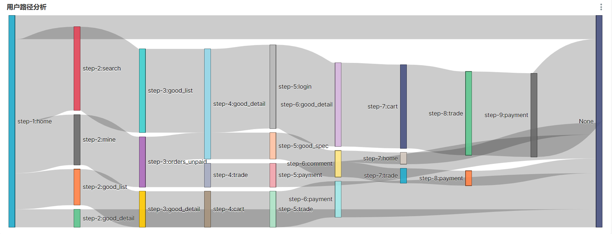

**1）建表语句**

``` text
DROP TABLE IF EXISTS ads_traffic_page_path;
CREATE EXTERNAL TABLE ads_traffic_page_path
(
    `dt`          STRING COMMENT '统计日期',
    `recent_days` BIGINT COMMENT '最近天数,1:最近1天,7:最近7天,30:最近30天',
    `source`      STRING COMMENT '跳转起始页面id',
    `target`      STRING COMMENT '跳转终到页面id',
    `path_count`  BIGINT COMMENT '跳转次数'
) COMMENT '页面浏览路径分析'
    ROW FORMAT DELIMITED FIELDS TERMINATED BY '\t'
    LOCATION '/warehouse/edu/ads/ads_traffic_page_path/';
```

**2）数据装载**

``` text
insert overwrite table edu.ads_traffic_page_path
select dt, recent_days, source, target, path_count
from edu.ads_traffic_page_path
union
select '2022-02-21' dt,
       recent_days,
       source,
       nvl(target, 'null'),
       count(*)     path_count
from (select recent_days,
             concat('step-', rk, ':', page_id)          source,
             concat('step-', rk + 1, ':', next_page_id) target
      from (select recent_days,
                   page_id,
                   lead(page_id) over (partition by recent_days, session_id order by ts) next_page_id,
                   row_number() over (partition by recent_days, session_id order by ts)  rk
            from edu.dwd_traffic_page_view_inc
                     lateral view explode(array(1, 7, 30)) tmp as recent_days
            where dt >= date_add('2022-02-21', -recent_days + 1)
              and dt <= '2022-02-21') t1) t2
group by recent_days, source, target;
```

### 11.1.3 各来源下单统计

需求说明如下。

| 统计周期     | 统计粒度 | 指标   | 说明                     |
|--------------|----------|--------|--------------------------|
| 最近1/7/30日 | 引流来源 | 销售额 | 统计下单金额             |
| 最近1/7/30日 | 引流来源 | 转化率 | 下单人数与引流访客数之比 |

**1）建表语句**

``` text
DROP TABLE IF EXISTS ads_traffic_sale_stats_by_source;
CREATE EXTERNAL TABLE ads_traffic_sale_stats_by_source
(
    `dt` STRING COMMENT '统计日期',
    `recent_days` BIGINT COMMENT '最近天数,1:最近1天,7:最近7天,30:最近30天',
    `source_id`          STRING COMMENT '引流来源id',
    `source_site`        STRING COMMENT '引流来源名称',
    `order_total_amount` DECIMAL(16, 2) COMMENT '销售额',
    `order_user_count`  BIGINT COMMENT '下单用户数',
    `pv_visitor_count`         BIGINT COMMENT '引流访客数',
    `convert_rate`       DECIMAL(16, 2) COMMENT '转化率'
) COMMENT '各引流来源销售状况统计'
    ROW FORMAT DELIMITED FIELDS TERMINATED BY '\t'
    LOCATION '/warehouse/edu/ads/ads_traffic_sale_stats_by_source';
```

**2）数据装载**

``` text
insert overwrite table edu.ads_traffic_sale_stats_by_source
select dt,
       recent_days,
       source_id,
       source_site,
       order_total_amount,
       order_user_count,
       pv_visitor_count,
       convert_rate
from edu.ads_traffic_sale_stats_by_source
union
select '2022-02-21'                     dt,
       t_u_count.recent_days,
       t_u_count.source_id,
       t_u_count.source_site,
       order_total_amount,
       order_user_count,
       pv_visitor_count,
       order_user_count / pv_visitor_count convert_rate
from (
         select recent_days,
                source_id,
                source_site,
                count(distinct mid_id) pv_visitor_count
         from edu.dws_traffic_session_page_view_1d
                  lateral view explode(array(1, 7, 30)) tmp as recent_days
         where dt >= date_add('2022-02-21', -recent_days + 1)
         group by recent_days,
                  source_id,
                  source_site
     ) t_u_count
         left join
     (
         select recent_days,
                source_id,
                source_site,
                sum(order_amount)       order_total_amount,
                count(distinct user_id) order_user_count
         from edu.dws_trade_session_order_1d
                  lateral view explode(array(1, 7, 30)) tmp as recent_days
         where dt >= date_add('2022-02-21', -recent_days + 1)
           and order_amount is not null
           and order_amount > 0
         group by recent_days,
                  source_id,
                  source_site
     ) t_amount
     on t_u_count.recent_days = t_amount.recent_days
         and t_u_count.source_id = t_amount.source_id;
```

## 11.2 用户主题

### 11.2.1 用户变动统计

该需求包括两个指标，分别为流失用户数和回流用户数，以下为对两个指标的解释说明。

| 统计周期 | 指标 | 说明 |
|----|----|----|
| 最近1日 | 流失用户数 | 之前活跃过的用户，最近一段时间未活跃，就称为流失用户。此处要求统计7日前活跃，但最近7日未活跃的用户总数。 |
| 最近1日 | 回流用户数 | 之前的活跃用户，一段时间未活跃（流失），今日又活跃了，就称为回流用户。此处要求统计回流用户总数。 |

**1）建表语句**

``` text
DROP TABLE IF EXISTS ads_user_user_change;
CREATE EXTERNAL TABLE ads_user_user_change
(
    `dt`               STRING COMMENT '统计日期',
    `user_churn_count` BIGINT COMMENT '流失用户数',
    `user_back_count`  BIGINT COMMENT '回流用户数'
) COMMENT '用户变动统计'
    ROW FORMAT DELIMITED FIELDS TERMINATED BY '\t'
    LOCATION '/warehouse/edu/ads/ads_user_user_change/';
```

**2）数据装载**

``` text
insert overwrite table edu.ads_user_user_change
select dt, user_churn_count, user_back_count
from edu.ads_user_user_change
union
select '2022-02-21' dt,
       user_churn_count,
       user_back_count
from (select count(*) user_churn_count
      from edu.dws_user_user_login_td
      where dt = '2022-02-21'
        and login_last_date <= date_add('2022-02-21', -6)) churn
         join
     (select count(*) user_back_count
      from (select user_id
            from edu.dws_user_user_login_td
            where dt = '2022-02-21'
and login_last_date = '2022-02-21'
           ) today
               join
           (
               select user_id,
                      login_last_date
               from edu.dws_user_user_login_td
               where dt = date_add('2022-02-21', -1)
           ) yesterday
           on today.user_id = yesterday.user_id
               and datediff('2022-02-21', yesterday.login_last_date) >= 7) back;
11.2.2 用户留存率
```

留存分析一般包含新增留存和活跃留存分析。

新增留存分析是分析某天的新增用户中，有多少人有后续的活跃行为。活跃留存分析是分析某天的活跃用户中，有多少人有后续的活跃行为。

留存分析是衡量产品对用户价值高低的重要指标。

此处要求统计新增留存率，新增留存率具体是指留存用户数与新增用户数的比值，例如2022-02-21新增100个用户，1日之后（2022-02-22）这100人中有80个人活跃了，那2022-02-21的1日留存数则为80，2022-02-21的1日留存率则为80%。

要求统计每天的1至7日留存率，如下图所示。

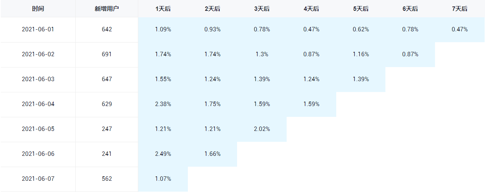

**1）建表语句**

``` text
DROP TABLE IF EXISTS ADS_USER_USER_RETENTION;
CREATE EXTERNAL TABLE ADS_USER_USER_RETENTION
(
    `DT`              STRING COMMENT '统计日期',
    `CREATE_DATE`     STRING COMMENT '用户新增日期',
    `RETENTION_DAY`   INT COMMENT '截至当前日期留存天数',
    `RETENTION_COUNT` BIGINT COMMENT '留存用户数量',
    `NEW_USER_COUNT`  BIGINT COMMENT '新增用户数量',
    `RETENTION_RATE`  DECIMAL(16, 2) COMMENT '留存率'
) COMMENT '用户留存率'
    ROW FORMAT DELIMITED FIELDS TERMINATED BY '\T'
    LOCATION '/WAREHOUSE/EDU/ADS/ADS_USER_USER_RETENTION/';
```

**2）数据装载**

``` text
insert overwrite table edu.ads_user_user_retention
select dt,
       create_date,
       retention_day,
       retention_count,
       new_user_count,
       retention_rate
from edu.ads_user_user_retention
union
select '2022-02-21'                                             dt,
       register_date,
       retention_day,
       sum(if(login_last_date = '2022-02-21', 1, 0))            retention_count,
       count(*)                                                 new_user_count,
       sum(if(login_last_date = '2022-02-21', 1, 0)) / count(*) retention_rate
from (
         select user_id,
                register_date,
                retention_day
         from edu.dwd_user_register_inc
                  lateral view explode(array(1, 2, 3, 4, 5, 6, 7)) tmp as retention_day
         where dt = date_add('2022-02-21', -retention_day)
     ) previous
         left join
     (select user_id,
             login_last_date
      from edu.dws_user_user_login_td
      where dt = '2022-02-21'
     ) today
     on today.user_id = previous.user_id
group by register_date,
         retention_day;
```

### 11.2.3 用户新增活跃统计

需求说明如下。

| 统计周期       | 指标       | 指标说明 |
|----------------|------------|----------|
| 最近1、7、30日 | 新增用户数 | 略       |
| 最近1、7、30日 | 活跃用户数 | 略       |

**1）建表语句**

``` text
DROP TABLE IF EXISTS ads_user_user_stats;
CREATE EXTERNAL TABLE ads_user_user_stats
(
    `dt`                STRING COMMENT '统计日期',
    `recent_days`       BIGINT COMMENT '最近n日,1:最近1日,7:最近7日,30:最近30日',
    `new_user_count`    BIGINT COMMENT '新增用户数',
    `active_user_count` BIGINT COMMENT '活跃用户数'
) COMMENT '用户新增活跃统计'
    ROW FORMAT DELIMITED FIELDS TERMINATED BY '\t'
    LOCATION '/warehouse/edu/ads/ads_user_user_stats/';
```

**2）数据装载**

``` text
insert overwrite table  edu.ads_user_user_stats
select dt, recent_days, new_user_count, active_user_count
from  edu.ads_user_user_stats
union
select '2022-02-21' dt,
       new.recent_days,
       new_user_count,
       active_user_count
from (
         select recent_days,
                count(user_id) new_user_count
         from  edu.dwd_user_register_inc
                   lateral view explode(array(1, 7, 30)) tmp as recent_days
         where dt >= date_add('2022-02-21', -recent_days + 1)
         group by recent_days
     ) new
         join
     (
         select recent_days,
                count(user_id) active_user_count
         from  edu.dws_user_user_login_td lateral view
             explode(array(1, 7, 30)) tmp as recent_days
         where dt = '2022-02-21'
           and login_last_date >= date_add('2022-02-21', -recent_days + 1)
         group by recent_days
     ) act
     on new.recent_days = act.recent_days;
```

### 11.2.4 用户行为漏斗分析

漏斗分析是一个数据分析模型，它能够科学反映一个业务过程从起点到终点各阶段用户转化情况。由于其能将各阶段环节都展示出来，故哪个阶段存在问题，就能一目了然。

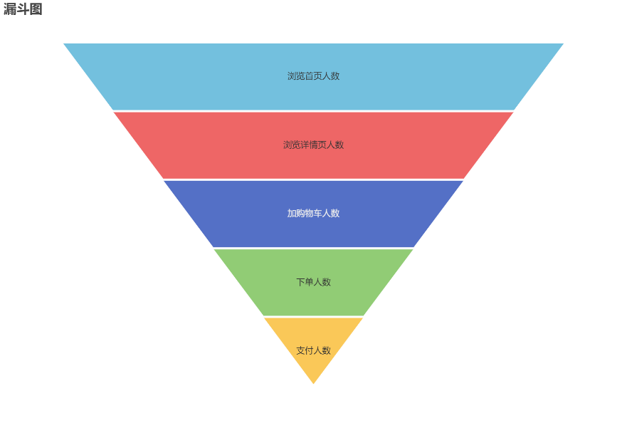

该需求要求统计一个完整的购物流程各个阶段的人数，具体说明如下：

| 统计周期       | 指标               | 说明         |
|----------------|--------------------|--------------|
| 最近1、7、30日 | 首页浏览人数       | 略           |
| 最近1、7、30日 | 商品详情页浏览人数 | 略           |
| 最近1、7、30日 | 加购人数           | 略           |
| 最近1、7、30日 | 下单人数           | 略           |
| 最近1、7、30日 | 支付人数           | 支付成功人数 |

**1）建表语句**

``` text
DROP TABLE IF EXISTS ads_user_user_action;
CREATE EXTERNAL TABLE ads_user_user_action
(
    `dt`                STRING COMMENT '统计日期',
    `recent_days`       BIGINT COMMENT '最近天数,1:最近1天,7:最近7天,30:最近30天',
    `home_count`        BIGINT COMMENT '浏览首页人数',
    `good_detail_count` BIGINT COMMENT '浏览课程详情页人数',
    `cart_count`        BIGINT COMMENT '加入购物车人数',
    `order_count`       BIGINT COMMENT '下单人数',
    `payment_count`     BIGINT COMMENT '支付人数'
) COMMENT '用户行为漏斗分析'
    ROW FORMAT DELIMITED FIELDS TERMINATED BY '\t'
    LOCATION '/warehouse/edu/ads/ads_user_user_action/';
```

**2）数据装载**

``` text
insert overwrite table edu.ads_user_user_action
select dt, recent_days, home_count, good_detail_count, cart_count, order_count, payment_count
from edu.ads_user_user_action
union
select '2022-02-21' dt,
       t1.recent_days,
       home_count,
       good_detail_count,
       cart_count,
       order_count,
       payment_count
from (select recent_days,
             count(distinct if(page_id = 'home', user_id, null))          home_count,
             count(distinct if(page_id = 'course_detail', user_id, null)) good_detail_count
      from edu.dwd_traffic_page_view_inc
               lateral view explode(array(1, 7, 30)) tmp as recent_days
      where dt >= date_add('2022-02-21', -recent_days + 1)
        and page_id in ('home', 'course_detail')
      group by recent_days) t1
         join
     (select 1        recent_days,
             count(*) payment_count
      from edu.dws_trade_user_payment_1d
      where dt = '2022-02-21'
      union
      select recent_days,
             case recent_days
                 when 7
                     then sum(if(payment_count_7d > 0, 1, 0))
                 when 30
                     then sum(if(payment_count_30d > 0, 1, 0))
                 --count(*)
                 end payment_count
      from edu.dws_trade_user_payment_nd
               lateral view explode(array(7, 30)) tmp as recent_days
      where dt = '2022-02-21'
      group by recent_days) t2
     on t1.recent_days = t2.recent_days
         join
     (select recent_days,
             count(distinct user_id) order_count
      from edu.dwd_trade_order_detail_inc
               lateral view explode(array(1, 7, 30)) tmp as recent_days
      where dt >= date_add('2022-02-21', -recent_days + 1)
        and dt <= '2022-02-21'
      group by recent_days
     ) t3
     on t2.recent_days = t3.recent_days
         join
     (select 1        recent_days,
             count(*) cart_count
      from edu.dws_trade_user_cart_add_1d
      where dt = '2022-02-21'
      union
      select recent_days,
             case recent_days
                 when 7 then sum(if(course_count_7d > 0, 1, 0))
                 when 30 then (sum(if(course_count_30d > 0, 1, 0)))
                 end cart_count
      from edu.dws_trade_user_cart_add_nd
               lateral view explode(array(7, 30)) tmp as recent_days
      where dt = '2022-02-21'
      group by recent_days) t4
     on t3.recent_days = t4.recent_days;
```

### 11.2.5 新增交易用户统计

需求说明如下。

| 统计周期       | 指标         | 说明 |
|----------------|--------------|------|
| 最近1、7、30日 | 新增下单人数 | 略   |
| 最近1、7、30日 | 新增支付人数 | 略   |

**1）建表语句**

``` text
DROP TABLE IF EXISTS ads_user_new_buyer_stats;
CREATE EXTERNAL TABLE ads_user_new_buyer_stats
(
    `dt`                     STRING COMMENT '统计日期',
    `recent_days`            BIGINT COMMENT '最近天数,1:最近1天,7:最近7天,30:最近30天',
    `new_order_user_count`   BIGINT COMMENT '新增下单人数',
    `new_payment_user_count` BIGINT COMMENT '新增支付人数'
) COMMENT '新增交易用户统计'
    ROW FORMAT DELIMITED FIELDS TERMINATED BY '\t'
    LOCATION '/warehouse/edu/ads/ads_user_new_buyer_stats/';
```

**2）数据装载**

``` text
insert overwrite table edu.ads_user_new_buyer_stats
select dt, recent_days, new_order_user_count, new_payment_user_count
from edu.ads_user_new_buyer_stats
union
select '2022-02-21' dt,
       t1.recent_days,
       new_order_user_count,
       new_payment_user_count
from (select recent_days,
             sum(if(order_dt_first >=
                    date_add('2022-02-21', -recent_days + 1), 1, 0)) new_order_user_count
      from edu.dws_trade_user_order_td
               lateral view explode(array(1, 7, 30)) tmp as recent_days
      where dt = '2022-02-21'
      group by recent_days) t1
         join
     (select recent_days,
             sum(if(payment_dt_first >=
                    date_add('2022-02-21', -recent_days + 1), 1, 0)) new_payment_user_count
      from edu.dws_trade_user_payment_td
               lateral view explode(array(1, 7, 30)) tmp as recent_days
      where dt = '2022-02-21'
      group by recent_days) t2
     on t1.recent_days = t2.recent_days;
```

### 11.2.6 各年龄段下单用户数

需求说明如下。

| 统计周期       | 统计粒度 | 指标     | 说明 |
|----------------|----------|----------|------|
| 最近1、7、30日 | 年龄段   | 下单人数 | 略   |

**1）建表语句**

``` text
DROP TABLE IF EXISTS ads_user_order_user_count_by_age_group;
CREATE EXTERNAL TABLE ads_user_order_user_count_by_age_group
(
    `dt`               STRING COMMENT '统计日期',
    `recent_days`      BIGINT COMMENT '最近天数,1:最近1天,7:最近7天,30:最近30天',
    `age_group`        STRING COMMENT '年龄段,18岁及以下、19-24岁、25-29岁、30-34岁、35-39岁、40-49岁、50岁及以上',
    `order_user_count` BIGINT COMMENT '下单人数'
) COMMENT '各年龄段下单用户数统计'
    ROW FORMAT DELIMITED FIELDS TERMINATED BY '\t'
    LOCATION '/warehouse/edu/ads/ads_user_order_user_count_by_age_group/';
```

**2）数据装载**

``` text
insert overwrite table edu.ads_user_order_user_count_by_age_group
select dt, recent_days, age_group, order_user_count
from edu.ads_user_order_user_count_by_age_group
union
select '2022-02-21'   dt,
       recent_days,
       age_group,
       count(user_id) order_user_count
from (select user_id,
             recent_days,
             case
                 when age <= 18 then '18 岁及以下'
                 when age >= 19 and age <= 24 then '19-24 岁'
                 when age >= 25 and age <= 29 then '25-29 岁'
                 when age >= 30 and age <= 34 then '30-34 岁'
                 when age >= 35 and age <= 39 then '35-39 岁'
                 when age >= 40 and age <= 49 then '40-49 岁'
                 when age >= 50 then '50 岁及以上'
                 else '年龄不详'
                 end age_group
      from (
               select user_id,
                      recent_days
               from edu.dwd_trade_order_detail_inc
                        lateral view explode(array(1, 7, 30)) tmp as recent_days
               where dt >= date_add('2022-02-21', -recent_days + 1)
                 and dt <= '2022-02-21'
               group by user_id,
                        recent_days
           ) t1
               left join
           (
               select id,
                      cast(datediff('2022-02-21', birthday) / 365 as BIGINT) age
               from edu.dim_user_zip
               where dt = '9999-12-31'
           ) age
           on t1.user_id = age.id) age_g
group by recent_days,
         age_group;
```

## 11.3 商品主题

### 11.3.1 各分类课程交易统计

需求说明如下。

| 统计周期     | 统计粒度 | 指标     | 说明 |
|--------------|----------|----------|------|
| 最近1/7/30日 | 分类     | 下单数   | 略   |
| 最近1/7/30日 | 分类     | 下单人数 | 略   |
| 最近1/7/30日 | 分类     | 下单金额 | 略   |

**1）建表语句**

``` text
DROP TABLE IF EXISTS ads_course_trade_stats_by_category;
CREATE EXTERNAL TABLE ads_course_trade_stats_by_category
(
    `dt`               STRING COMMENT '统计日期',
    `recent_days`      BIGINT COMMENT '最近天数,1:最近 1 天,7:最近 7
天,30:最近 30 天',
    `category_id`      STRING COMMENT '分类 id',
    `category_name`    STRING COMMENT '分类名称',
    `order_count`      BIGINT COMMENT '下单数',
    `order_user_count` BIGINT COMMENT '下单人数',
    `order_amount`     DECIMAL(16, 2) COMMENT '下单金额'
) COMMENT '各分类课程交易统计'
    ROW FORMAT DELIMITED FIELDS TERMINATED BY '\t'
    LOCATION '/warehouse/edu/ads/ads_course_trade_stats_by_category/';
```

**2）数据装载**

``` text
insert overwrite table edu.ads_course_trade_stats_by_category
select dt,
       recent_days,
       category_id,
       category_name,
       order_count,
       order_user_count,
       order_amount
from edu.ads_course_trade_stats_by_category
union
select '2022-02-21'             dt,
       recent_days,
       category_id,
       category_name,
       count(distinct order_id) order_count,
       count(distinct user_id)  order_user_count,
       sum(final_amount)        order_amount
from edu.dwd_trade_order_detail_inc
         lateral view
             explode(array(1, 7, 30)) tmp as recent_days
where dt >= date_add('2022-02-21', -recent_days + 1)
group by recent_days, category_id, category_name;
```

### 11.3.2 各学科课程交易统计

需求说明如下。

| 统计周期     | 统计粒度 | 指标     | 说明 |
|--------------|----------|----------|------|
| 最近1/7/30日 | 学科     | 下单数   | 略   |
| 最近1/7/30日 | 学科     | 下单人数 | 略   |
| 最近1/7/30日 | 学科     | 下单金额 | 略   |

**1）建表语句**

``` text
DROP TABLE IF EXISTS ads_course_trade_stats_by_subject;
CREATE EXTERNAL TABLE ads_course_trade_stats_by_subject
(
    `dt`               STRING COMMENT '统计日期',
    `recent_days`      BIGINT COMMENT '最近天数,1:最近 1 天,7:最近 7
天,30:最近 30 天',
    `subject_id`       STRING COMMENT '学科id',
    `subject_name`     STRING COMMENT '学科名称',
    `order_count`      BIGINT COMMENT '下单数',
    `order_user_count` BIGINT COMMENT '下单人数',
    `order_amount`     DECIMAL(16, 2) COMMENT '下单金额'
) COMMENT '各学科课程交易统计'
    ROW FORMAT DELIMITED FIELDS TERMINATED BY '\t'
    LOCATION '/warehouse/edu/ads/ads_course_trade_stats_by_subject/';
```

**2）数据装载**

``` text
insert overwrite table edu.ads_course_trade_stats_by_subject
select dt,
       recent_days,
       subject_id,
       subject_name,
       order_count,
       order_user_count,
       order_amount
from edu.ads_course_trade_stats_by_subject
union
select '2022-02-21'             dt,
       recent_days,
       subject_id,
       subject_name,
       count(distinct order_id) order_count,
       count(distinct user_id)  order_user_count,
       sum(final_amount)        order_amount
from edu.dwd_trade_order_detail_inc
         lateral view
             explode(array(1, 7, 30)) tmp as recent_days
where dt >= date_add('2022-02-21', -recent_days + 1)
group by recent_days, subject_id, subject_name;
```

### 11.3.3 各课程交易统计

需求说明如下。

| 统计周期     | 统计粒度 | 指标     | 说明 |
|--------------|----------|----------|------|
| 最近1/7/30日 | 课程     | 下单数   | 略   |
| 最近1/7/30日 | 课程     | 下单人数 | 略   |
| 最近1/7/30日 | 课程     | 下单金额 | 略   |

**1）建表语句**

``` text
DROP TABLE IF EXISTS ads_course_trade_stats_by_course;
CREATE EXTERNAL TABLE ads_course_trade_stats_by_course
(
    `dt`               STRING COMMENT '统计日期',
    `recent_days`      BIGINT COMMENT '最近天数,1:最近 1 天,7:最近 7
天,30:最近 30 天',
    `course_id`        STRING COMMENT '课程id',
    `course_name`      STRING COMMENT '课程名称',
    `order_count`      BIGINT COMMENT '下单数',
    `order_user_count` BIGINT COMMENT '下单人数',
    `order_amount`     DECIMAL(16, 2) COMMENT '下单金额'
) COMMENT '各课程交易统计'
    ROW FORMAT DELIMITED FIELDS TERMINATED BY '\t'
    LOCATION '/warehouse/edu/ads/ads_course_trade_stats_by_course/';
```

**2）数据装载**

``` text
insert overwrite table edu.ads_course_trade_stats_by_course
select dt,
       recent_days,
       course_id,
       course_name,
       order_count,
       order_user_count,
       order_amount
from edu.ads_course_trade_stats_by_course
union
select '2022-02-21'             dt,
       recent_days,
       course_id,
       course_name,
       count(distinct order_id) order_count,
       count(distinct user_id)  order_user_count,
       sum(final_amount)        order_amount
from edu.dwd_trade_order_detail_inc
         lateral view
             explode(array(1, 7, 30)) tmp as recent_days
where dt >= date_add('2022-02-21', -recent_days + 1)
group by recent_days, course_id, course_name;
```

### 11.3.4 各课程评价统计

需求说明如下。

| 统计周期     | 统计粒度 | 指标                                          | 说明 |
|--------------|----------|-----------------------------------------------|------|
| 最近1/7/30日 | 课程     | 用户平均评分                                  | 略   |
| 最近1/7/30日 | 课程     | 评价用户数                                    | 略   |
| 最近1/7/30日 | 课程     | 好评率（给出5星评价的用户占总评价用户的比率） | 略   |

**1）建表语句**

``` text
DROP TABLE IF EXISTS ads_course_review_stats_by_course;
CREATE EXTERNAL TABLE ads_course_review_stats_by_course
(
    `dt`                STRING COMMENT '统计日期',
    `recent_days`       BIGINT COMMENT '最近天数,1:最近 1 天,7:最近 7
天,30:最近 30 天',
    `course_id`         STRING COMMENT '课程id',
    `course_name`       STRING COMMENT '课程名称',
    `avg_stars`         BIGINT COMMENT '用户平均评分',
    `review_user_count` BIGINT COMMENT '评价用户数',
    `praise_rate`       DECIMAL(16, 2) COMMENT '好评率'
) COMMENT '各课程评价统计'
    ROW FORMAT DELIMITED FIELDS TERMINATED BY '\t'
    LOCATION '/warehouse/edu/ads/ads_course_review_stats_by_course/';
```

**2）数据装载**

``` text
insert overwrite table ads_course_review_stats_by_course
select *
from ads_course_review_stats_by_course
union
select '2022-02-21' dt,
       recent_days,
       course_id,
       course_name,
       avg_stars,
       review_user_count,
       praise_rate
from (
     select recent_days,
           course_id,
           cast(avg(review_stars) as bigint) avg_stars,
           count(*)  review_user_count,
           cast(sum(`if`(review_stars=5,1,0)) / count(*) as decimal(16,2)) praise_rate
    from dwd_interaction_review_inc
    lateral view explode(`array`(1,7,30)) tmp as recent_days
    where dt<='2022-02-21' and dt>=date_sub('2022-02-21',recent_days-1)
    group by recent_days,course_id
)t1
left join (
    select *
    from dim_course_full
    where dt='2022-02-21'
)t2
on t1.course_id=t2.id;
```

### 11.3.5 各分类课程试听留存统计

需求说明如下。

| 统计周期  | 统计粒度 | 指标       | 说明                    |
|-----------|----------|------------|-------------------------|
| 最近1-7日 | 分类     | 试听人数   | count(distinct user_id) |
| 最近1-7日 | 分类     | 试听留存率 | 下单人次/试听人次       |

**1）建表语句**

``` text
DROP TABLE IF EXISTS ads_sample_retention_stats_by_category;
CREATE EXTERNAL TABLE ads_sample_retention_stats_by_category
(
    `dt`                STRING COMMENT '统计日期',
    `retention_days`    BIGINT COMMENT '留存天数，1-7 天',
    `category_id`       STRING COMMENT '分类id',
    `category_name`     STRING COMMENT '分类名称',
    `sample_user_count` BIGINT COMMENT '试听人数',
    `retention_rate`    DECIMAL(16, 2) COMMENT '试听留存率'
) COMMENT '各分类课程试听留存统计'
    ROW FORMAT DELIMITED FIELDS TERMINATED BY '\t'
    LOCATION '/warehouse/edu/ads/ads_sample_retention_stats_by_category/';
```

**2）数据装载**

``` text
insert overwrite table ads_sample_retention_stats_by_category
select *
from ads_sample_retention_stats_by_category
union
select '2022-02-21' dt,
       retention_days,
       category_id,
       category_name,
       count(*)  sample_user_count,
       cast(sum(`if`(order_date is not null ,1,0)) /  count(*) as decimal(16,2)) retention_rate
from dwd_trade_course_order_inc
lateral view explode(`array`(1,2,3,4,5,6,7)) tmp as retention_days
where (dt='9999-12-31' or dt>=date_sub('2022-02-21',6))
and play_date=date_sub('2022-02-21',retention_days-1)
group by retention_days,category_id,category_name,play_date;
```

### 11.3.6 各学科试听留存统计

需求说明如下。

| 统计周期  | 统计粒度 | 指标       | 说明                    |
|-----------|----------|------------|-------------------------|
| 最近1-7日 | 学科     | 试听人数   | count(distinct user_id) |
| 最近1-7日 | 学科     | 试听留存率 | 下单人次/试听人次       |

**1）建表语句**

``` text
DROP TABLE IF EXISTS ads_sample_retention_stats_by_subject;
CREATE EXTERNAL TABLE ads_sample_retention_stats_by_subject
(
    `dt`                STRING COMMENT '统计日期',
    `retention_days`    BIGINT COMMENT '留存天数，1-7 天',
    `subject_id`        STRING COMMENT '学科id',
    `subject_name`      STRING COMMENT '学科名称',
    `sample_user_count` BIGINT COMMENT '试听人数',
    `retention_rate`    DECIMAL(16, 2) COMMENT '试听留存率'
) COMMENT '各学科试听留存统计'
    ROW FORMAT DELIMITED FIELDS TERMINATED BY '\t'
    LOCATION '/warehouse/edu/ads/ads_sample_retention_stats_by_subject/';
```

**2）数据装载**

``` text
insert overwrite table ads_sample_retention_stats_by_subject
select *
from ads_sample_retention_stats_by_subject
union
select '2022-02-21' dt,
       retention_days,
       subject_id,
       subject_name,
       count(*)  sample_user_count,
       cast(sum(`if`(order_date is not null ,1,0)) /  count(*) as decimal(16,2)) retention_rate
from dwd_trade_course_order_inc
lateral view explode(`array`(1,2,3,4,5,6,7)) tmp as retention_days
where (dt='9999-12-31' or dt>=date_sub('2022-02-21',6))
and play_date=date_sub('2022-02-21',retention_days-1)
group by retention_days,subject_id,subject_name,play_date;
```

### 11.3.7 各课程试听留存统计

需求说明如下。

| 统计周期  | 统计粒度 | 指标       | 说明                    |
|-----------|----------|------------|-------------------------|
| 最近1-7日 | 课程     | 试听人数   | count(distinct user_id) |
| 最近1-7日 | 课程     | 试听留存率 | 下单人次/试听人次       |

**1）建表语句**

``` text
DROP TABLE IF EXISTS ads_sample_retention_stats_by_course;
CREATE EXTERNAL TABLE ads_sample_retention_stats_by_course
(
    `dt`                STRING COMMENT '统计日期',
    `retention_days`    BIGINT COMMENT '留存天数，1-7 天',
    `course_id`         STRING COMMENT '课程id',
    `course_name`       STRING COMMENT '课程名称',
    `sample_user_count` BIGINT COMMENT '试听人数',
    `retention_rate`    DECIMAL(16, 2) COMMENT '试听留存率'
) COMMENT '各课程试听留存统计'
    ROW FORMAT DELIMITED FIELDS TERMINATED BY '\t'
    LOCATION '/warehouse/edu/ads/ads_sample_retention_stats_by_course/';
```

**2）数据装载**

``` text
insert overwrite table ads_sample_retention_stats_by_course
select *
from ads_sample_retention_stats_by_course
union
select '2022-02-21' dt,
       retention_days,
       course_id,
       course_name,
       count(*)  sample_user_count,
       cast(sum(`if`(order_date is not null ,1,0)) /  count(*) as decimal(16,2)) retention_rate
from dwd_trade_course_order_inc
lateral view explode(`array`(1,2,3,4,5,6,7)) tmp as retention_days
where (dt='9999-12-31' or dt>=date_sub('2022-02-21',6))
and play_date=date_sub('2022-02-21',retention_days-1)
group by retention_days,course_id,course_name,play_date;
```

## 11.4 交易主题

### 11.4.1 交易综合统计

需求说明如下。

| 统计周期       | 指标     | 说明         |
|----------------|----------|--------------|
| 最近1、7、30日 | 下单总额 | 下单最终金额 |
| 最近1、7、30日 | 下单数   | 略           |
| 最近1、7、30日 | 下单人数 | 略           |

**1）建表语句**

``` text
DROP TABLE IF EXISTS ads_trade_stats;
CREATE EXTERNAL TABLE ads_trade_stats
(
    `dt`                 STRING COMMENT '统计日期',
    `recent_days`        BIGINT COMMENT '最近天数,1:最近1日,7:最近7天,30:最近30天',
    `order_total_amount` DECIMAL(16, 2) COMMENT '下单总额,GMV',
    `order_count`        BIGINT COMMENT '下单数',
    `order_user_count`   BIGINT COMMENT '下单人数'
) COMMENT '交易综合指标'
    ROW FORMAT DELIMITED FIELDS TERMINATED BY '\t'
    LOCATION '/warehouse/edu/ads/ads_trade_stats/';
```

**2）数据装载**

``` text
insert overwrite table edu.ads_trade_stats
select dt, recent_days, order_total_amount, order_count, order_user_count
from edu.ads_trade_stats
union
select '2022-02-21'            dt,
       recent_days,
       sum(order_amount)       order_total_amount,
       sum(order_count)        order_count,
       count(distinct user_id) order_user_count
from edu.dws_trade_session_order_1d
         lateral view explode(array(1, 7, 30)) tmp as recent_days
where dt >= date_add('2022-02-21', -recent_days + 1)
  and dt <= '2022-02-21'
group by recent_days;
```

### 11.4.2 各省份交易统计

需求说明如下。

| 统计周期     | 统计粒度 | 指标     | 说明 |
|--------------|----------|----------|------|
| 最近1/7/30日 | 省份     | 下单数   | 略   |
| 最近1/7/30日 | 省份     | 下单人数 | 略   |
| 最近1/7/30日 | 省份     | 下单金额 | 略   |

**1）建表语句**

``` text
DROP TABLE IF EXISTS ads_trade_order_by_province;
CREATE EXTERNAL TABLE ads_trade_order_by_province
(
    `dt`                 STRING COMMENT '统计日期',
    `recent_days`        BIGINT COMMENT '最近天数,1:最近1天,7:最近7天,30:最近30天',
    `province_id`        STRING COMMENT '省份id',
    `province_name`      STRING COMMENT '省份名称',
    `region_id`          STRING COMMENT '地区id',
    `area_code`          STRING COMMENT '地区编码',
    `iso_code`           STRING COMMENT '国际标准地区编码',
    `iso_code_3166_2`    STRING COMMENT '国际标准地区编码',
    `order_count`        BIGINT COMMENT '下单数',
    `order_user_count`   BIGINT COMMENT '下单人数',
    `order_total_amount` DECIMAL(16, 2) COMMENT '下单金额'
) COMMENT '各省份下单统计'
    ROW FORMAT DELIMITED FIELDS TERMINATED BY '\t'
    LOCATION '/warehouse/edu/ads/ads_trade_order_by_province/';
```

**2）数据装载**

``` text
insert overwrite table edu.ads_trade_order_by_province
select dt,
       recent_days,
       province_id,
       province_name,
       region_id,
       area_code,
       iso_code,
       iso_code_3166_2,
       order_count,
       order_user_count,
       order_total_amount
from edu.ads_trade_order_by_province
union
select '2022-02-21' dt,
       recent_days,
       province_id,
       province_name,
       region_id,
       area_code,
       iso_code,
       iso_code_3166_2,
       order_count,
       order_user_count,
       order_total_amount
from (select recent_days,
             province_id,
             sum(order_count)  order_count,
             count(distinct user_id) order_user_count,
             sum(order_amount) order_total_amount
      from edu.dws_trade_session_order_1d
               lateral view explode(array(1, 7, 30)) tmp as recent_days
      where dt >= date_add('2022-02-21', -recent_days + 1)
        and dt <= '2022-02-21'
      group by recent_days, province_id) t1
         left join
     (select id,
             name       province_name,
             region_id,
             area_code,
             iso_code,
             iso_3166_2 iso_code_3166_2
      from edu.dim_province_full
      where dt = '2022-02-21') prov
     on t1.province_id = prov.id;
```

## 11.5 考试主题

### 11.5.1 各试卷平均统计

需求说明如下。

| 统计周期     | 统计粒度 | 指标     | 说明                             |
|--------------|----------|----------|----------------------------------|
| 最近1/7/30日 | 试卷     | 平均分   | 完成该试卷的所有用户的平均成绩   |
| 最近1/7/30日 | 试卷     | 平均时长 | 完成该试卷所有用户答卷的平均时长 |
| 最近1/7/30日 | 试卷     | 用户数   | 完成该试卷的用户数               |

**1）建表语句**

``` text
DROP TABLE IF EXISTS ads_examination_paper_avg_stats;
CREATE EXTERNAL TABLE ads_examination_paper_avg_stats
(
    `dt`             STRING COMMENT '统计日期',
    `recent_days`    BIGINT COMMENT '最近天数,1:最近1天,7:最近7天,30:最近30天',
    `paper_id`       STRING COMMENT '试卷id',
    `paper_title`    STRING COMMENT '试卷名称',
    `avg_score`      DECIMAL(16, 2) COMMENT '平均分',
    `avg_during_sec` BIGINT COMMENT '平均时长',
    `user_count`     BIGINT COMMENT '用户数'
) COMMENT '各试卷相关指标'
    ROW FORMAT DELIMITED FIELDS TERMINATED BY '\t'
    LOCATION '/warehouse/edu/ads/ads_examination_paper_avg_stats/';
```

**2）数据装载**

``` text
insert overwrite table edu.ads_examination_paper_avg_stats
select dt,
       recent_days,
       paper_id,
       paper_title,
       avg_score,
       avg_during_sec,
       user_count
from edu.ads_examination_paper_avg_stats
union
select '2022-02-21' dt,
       1            recent_days,
       paper_id,
       paper_title,
       avg_score,
       avg_during_sec,
       user_count
from edu.dws_examination_paper_exam_1d
where dt = '2022-02-21'
union
select '2022-02-21' dt,
       recent_days,
       paper_id,
       paper_title,
       case recent_days
           when 7 then avg_score_7d
           when 30 then avg_score_30d
           end      avg_score,
       case recent_days
           when 7 then avg_during_sec_7d
           when 30 then avg_during_sec_30d
           end      avg_during_sec,
       case recent_days
           when 7 then user_count_7d
           when 30 then user_count_30d
           end      user_count
from edu.dws_examination_paper_exam_nd
         lateral view explode(array(7, 30)) tmp as recent_days
where dt = '2022-02-21';
```

### 11.5.2 各课程考试相关指标统计

需求说明如下。

| 统计周期     | 统计粒度 | 指标     | 说明                             |
|--------------|----------|----------|----------------------------------|
| 最近1/7/30日 | 课程     | 平均分   | 完成该试卷的所有用户的平均成绩   |
| 最近1/7/30日 | 课程     | 平均时长 | 完成该试卷所有用户答卷的平均时长 |
| 最近1/7/30日 | 课程     | 用户数   | 完成该试卷的用户数               |

**1）建表语句**

``` text
DROP TABLE IF EXISTS ads_examination_course_avg_stats;
CREATE EXTERNAL TABLE ads_examination_course_avg_stats
(
    `dt`             STRING COMMENT '统计日期',
    `recent_days`    BIGINT COMMENT '最近天数,1:最近1天,7:最近7天,30:最近30天',
    `course_id`      STRING COMMENT '课程id',
    `course_name`    STRING COMMENT '课程名称',
    `avg_score`      DECIMAL(16, 2) COMMENT '平均分',
    `avg_during_sec` BIGINT COMMENT '平均时长',
    `user_count`     BIGINT COMMENT '用户数'
) COMMENT '各课程考试相关指标'
    ROW FORMAT DELIMITED FIELDS TERMINATED BY '\t'
    LOCATION '/warehouse/edu/ads/ads_examination_course_avg_stats/';
```

**2）数据装载**

``` text
insert overwrite table edu.ads_examination_course_avg_stats
select dt,
       recent_days,
       course_id,
       course_name,
       avg_score,
       avg_during_sec,
       user_count
from edu.ads_examination_course_avg_stats
union
select '2022-02-21' dt,
       user_ct.recent_days,
       user_ct.course_id,
       course_name,
       avg_score,
       avg_during_sec,
       user_count
from (
         select recent_days,
                course_id,
                count(distinct user_id) user_count
         from (select course_id,
                      user_id,
                      dt
               from (select paper_id,
                            user_id,
                            dt
                     from edu.dwd_examination_test_paper_inc
                     where dt >= date_add('2022-02-21', -29)) dwd_exam
                        left join
                    (select id,
                            course_id
                     from edu.dim_paper_full
                     where dt = '2022-02-21'
                    ) dim_paper
                    on dwd_exam.paper_id = dim_paper.id) wide
                  lateral view explode(array(1, 7, 30)) tmp as recent_days
         where dt >= date_add('2022-02-21', -recent_days + 1)
         group by recent_days,
                  course_id) user_ct
         join
     (select 1                                       recent_days,
             course_id,
             course_name,
             sum(total_score) / sum(user_count)      avg_score,
             sum(total_during_sec) / sum(user_count) avg_during_sec
      from edu.dws_examination_paper_exam_1d
      where dt = '2022-02-21'
      group by course_id,
               course_name
      union
      select recent_days,
             course_id,
             course_name,
             sum(if(recent_days = 7, total_score_7d, total_score_30d)) /
             sum(if(recent_days = 7, user_count_7d, user_count_30d)) avg_score,
             sum(if(recent_days = 7, total_during_sec_7d, total_during_sec_30d)) /
             sum(if(recent_days = 7, user_count_7d, user_count_30d)) avg_during_sec
      from edu.dws_examination_paper_exam_nd
               lateral view explode(array(7, 30)) tmp as recent_days
      where dt = '2022-02-21'
      group by recent_days,
               course_id,
               course_name) rate_query
     on user_ct.recent_days = rate_query.recent_days
         and user_ct.course_id = rate_query.course_id;
```

### 11.5.3 各试卷成绩分布

统计最近 1/7/30 日各试卷在各个分数区间的用户数，需求说明如下。

| 统计周期       | 统计粒度    | 指标   | 说明 |
|----------------|-------------|--------|------|
| 最近1、7、30日 | 试卷-分数段 | 用户数 | 略   |

**1）建表语句**

``` text
DROP TABLE IF EXISTS ads_examination_user_count_by_score_duration;
CREATE EXTERNAL TABLE ads_examination_user_count_by_score_duration
(
    `dt`             STRING COMMENT '统计日期',
    `recent_days`    BIGINT COMMENT '最近天数,1:最近1天,7:最近7天,30:最近30天',
    `paper_id`       STRING COMMENT '试卷 id',
    `score_duration` STRING COMMENT '分数区间',
    `user_count`     BIGINT COMMENT '各试卷各分数区间用户数'
) COMMENT '各试卷分数分布统计'
    ROW FORMAT DELIMITED FIELDS TERMINATED BY '\t'
    LOCATION '/warehouse/edu/ads/ads_examination_user_count_by_score_duration/';
```

**2）数据装载**

``` text
insert overwrite table edu.ads_examination_user_count_by_score_duration
select dt, recent_days, paper_id, score_duration, user_count
from edu.ads_examination_user_count_by_score_duration
union
select '2022-02-21'  dt,
       1             recent_days,
       paper_id,
       duration_name score_duration,
       user_count
from edu.dws_examination_paper_duration_exam_1d
where dt = '2022-02-21'
union
select '2022-02-21'  dt,
       recent_days,
       paper_id,
       duration_name score_duration,
       case recent_days
           when 7 then user_count_7d
           when 30 then user_count_30d
           end       user_count
from edu.dws_examination_paper_duration_exam_nd
         lateral view explode(array(7, 30)) tmp as recent_days
where dt = '2022-02-21';
```

### 11.5.4 各题正确率

需求说明如下。

| 统计周期       | 统计粒度 | 指标   | 说明 |
|----------------|----------|--------|------|
| 最近1、7、30日 | 试题     | 正确率 | 略   |

**1）建表语句**

``` text
DROP TABLE IF EXISTS ads_examination_question_accuracy;
CREATE EXTERNAL TABLE ads_examination_question_accuracy
(
    `dt`          STRING COMMENT '统计日期',
    `recent_days` BIGINT COMMENT '最近天数,1:最近1天,7:最近7天,30:最近30天',
    `question_id` STRING COMMENT '题目 id',
    `accuracy`    DECIMAL(16, 2) COMMENT '正确率'
) COMMENT '各题目正确率'
    ROW FORMAT DELIMITED FIELDS TERMINATED BY '\t'
    LOCATION '/warehouse/edu/ads/ads_examination_question_accuracy/';
```

**2）数据装载**

``` text
insert overwrite table edu.ads_examination_question_accuracy
select dt, recent_days, question_id, accuracy
from edu.ads_examination_question_accuracy
union
select '2022-02-21'                 dt,
       1                            recent_days,
       question_id,
       correct_count / answer_count accuracy
from edu.dws_examination_question_exam_1d
where dt = '2022-02-21'
union
select '2022-02-21' dt,
       recent_days,
       question_id,
       case recent_days
           when 7 then correct_count_7d / answer_count_7d
           when 30 then correct_count_30d / answer_count_30d
           end      accuracy
from edu.dws_examination_question_exam_nd
         lateral view explode(array(7, 30)) tmp as recent_days
where dt = '2022-02-21';
```

## 11.6 播放主题

### 11.6.1 各章节视频播放情况统计

需求说明如下。

| 统计周期       | 统计粒度 | 指标         | 说明 |
|----------------|----------|--------------|------|
| 最近1、7、30日 | 章节     | 视频播放次数 | 略   |
| 最近1、7、30日 | 章节     | 人均观看时长 | 略   |
| 最近1、7、30日 | 章节     | 观看人数     | 略   |

**1）建表语句**

``` text
DROP TABLE IF EXISTS ads_learn_play_stats_by_chapter;
CREATE EXTERNAL TABLE ads_learn_play_stats_by_chapter
(
    `dt`           STRING COMMENT '统计日期',
    `recent_days`  BIGINT COMMENT '最近天数,1:最近1天,7:最近7天,30:最近30天',
    `chapter_id`   STRING COMMENT '章节 id',
    `chapter_name` STRING COMMENT '章节名称',
    `video_id`     STRING COMMENT '视频 id',
    `video_name`   STRING COMMENT '视频名称',
    `play_count`   BIGINT COMMENT '各章节视频播放次数',
    `avg_play_sec` BIGINT COMMENT '各章节视频人均观看时长',
    `user_count`   BIGINT COMMENT '各章节观看人数'
) COMMENT '各章节视频播放情况统计'
    ROW FORMAT DELIMITED FIELDS TERMINATED BY '\t'
    LOCATION '/warehouse/edu/ads/ads_learn_play_stats_by_chapter/';
```

**2）数据装载**

``` text
insert overwrite table edu.ads_learn_play_stats_by_chapter
select dt,
       recent_days,
       chapter_id,
       chapter_name,
       video_id,
       video_name,
       play_count,
       avg_play_sec,
       user_count
from edu.ads_learn_play_stats_by_chapter
union
select '2022-02-21'                            dt,
       recent_days,
       chapter_id,
       chapter_name,
       video_id,
       video_name,
       count(*)                                play_count,
       sum(play_sec) / count(distinct user_id) avg_play_sec,
       count(distinct user_id)                 user_count
from edu.dwd_learn_play_inc
         lateral view explode(array(1, 7, 30)) tmp
         as recent_days
where dt >= date_add('2022-02-21', -recent_days + 1)
group by recent_days,
         chapter_id,
         chapter_name,
         video_id,
         video_name;
```

### 11.6.2 各课程视频播放情况统计

需求说明如下。

| 统计周期       | 统计粒度 | 指标         | 说明 |
|----------------|----------|--------------|------|
| 最近1、7、30日 | 课程     | 视频播放次数 | 略   |
| 最近1、7、30日 | 课程     | 人均观看时长 | 略   |
| 最近1、7、30日 | 课程     | 观看人数     | 略   |

**1）建表语句**

``` text
DROP TABLE IF EXISTS ads_learn_play_stats_by_course;
CREATE EXTERNAL TABLE ads_learn_play_stats_by_course
(
    `dt`           STRING COMMENT '统计日期',
    `recent_days`  BIGINT COMMENT '最近天数,1:最近1天,7:最近7天,30:最近30天',
    `course_id`    STRING COMMENT '课程id',
    `course_name`  STRING COMMENT '课程名称',
    `play_count`   BIGINT COMMENT '各课程视频播放次数',
    `avg_play_sec` BIGINT COMMENT '各课程视频人均观看时长',
    `user_count`   BIGINT COMMENT '各课程观看人数'
) COMMENT '各课程播放情况统计'
    ROW FORMAT DELIMITED FIELDS TERMINATED BY '\t'
    LOCATION '/warehouse/edu/ads/ads_learn_play_stats_by_course/';
```

**2）数据装载**

``` text
insert overwrite table edu.ads_learn_play_stats_by_course
select dt,
       recent_days,
       course_id,
       course_name,
       play_count,
       avg_play_sec,
       user_count
from edu.ads_learn_play_stats_by_course
union
select '2022-02-21'                            dt,
       recent_days,
       course_id,
       course_name,
       count(*)                                play_count,
       sum(play_sec) / count(distinct user_id) avg_play_sec,
       count(distinct user_id)                 user_count
from edu.dwd_learn_play_inc
         lateral view explode(array(1, 7, 30)) tmp
         as recent_days
where dt >= date_add('2022-02-21', -recent_days + 1)
group by recent_days,
         course_id,
         course_name;
```

## 11.7 完课主题

### 11.7.1 各课程完课人数统计

需求说明如下。

| 统计周期       | 统计粒度 | 指标     | 说明 |
|----------------|----------|----------|------|
| 最近1、7、30日 | 课程     | 完课人数 | 略   |

**1）建表语句**

``` text
DROP TABLE IF EXISTS ads_complete_complete_user_count_per_course;
CREATE EXTERNAL TABLE ads_complete_complete_user_count_per_course
(
    `dt`          STRING COMMENT '统计日期',
    `recent_days` BIGINT COMMENT '最近天数,1:最近1天,7:最近7天,30:最近30天',
    `course_id`   STRING COMMENT '课程 id',
    `user_count`  BIGINT COMMENT '完课人数'
) COMMENT '各课程完课人数'
    ROW FORMAT DELIMITED FIELDS TERMINATED BY '\t'
    LOCATION '/warehouse/edu/ads/ads_complete_complete_user_count_per_course/';
```

**2）数据装载**

``` text
insert overwrite table edu.ads_complete_complete_user_count_per_course
select dt,
       recent_days,
       course_id,
       user_count
from edu.ads_complete_complete_user_count_per_course
union
select '2022-02-21'   dt,
       recent_days,
       course_id,
       count(user_id) order_count
from (select course_id,
             id,
             user_id,
             max_chapter_complete_date
      from (select course_id,
                   user_id,
                   max(first_complete_date)   max_chapter_complete_date,
                   count(first_complete_date) user_chapter_complete_count
            from edu.dwd_learn_play_stats_full
            where dt = '2022-02-21'
            group by course_id, user_id
           ) chapter_complete
               left join
           (select id,
                   chapter_num
            from edu.dim_course_full
            where dt = '2022-02-21') dim_course
           on chapter_complete.course_id = dim_course.id
      where user_chapter_complete_count = chapter_num
     ) course_complete
         lateral view explode(array(1, 7, 30)) tmp as recent_days
where max_chapter_complete_date >= date_add('2022-02-21', -recent_days + 1)
group by recent_days, course_id;
```

### 11.7.2 完课综合指标

需求说明如下。

| 统计周期     | 指标       | 说明 |
|--------------|------------|------|
| 最近1/7/30日 | 总完课人数 | 略   |
| 最近1/7/30日 | 总完课人次 |      |

**1）建表语句**

``` text
DROP TABLE IF EXISTS ads_complete_complete_stats;
CREATE EXTERNAL TABLE ads_complete_complete_stats
(
    `dt`                         STRING COMMENT '统计日期',
    `recent_days`                BIGINT COMMENT '最近天数,1:最近1天,7:最近7天,30:最近30天',
    `user_complete_count`        BIGINT COMMENT '完课人数',
    `user_course_complete_count` BIGINT COMMENT '完课人次'
) COMMENT '完课综合指标'
    ROW FORMAT DELIMITED FIELDS TERMINATED BY '\t'
    LOCATION '/warehouse/edu/ads/ads_complete_complete_stats/';
```

**2）数据装载**

``` text
insert overwrite table edu.ads_complete_complete_stats
select dt,
       recent_days,
       user_complete_count,
       user_course_complete_count
from edu.ads_complete_complete_stats
union
select '2022-02-21'            dt,
       recent_days,
       count(distinct user_id) user_complete_count,
       count(*)                user_course_complete_count
from (select course_id,
             id,
             user_id,
             max_chapter_complete_date
      from (select course_id,
                   user_id,
                   max(first_complete_date)   max_chapter_complete_date,
                   count(first_complete_date) user_chapter_complete_count
            from edu.dwd_learn_play_stats_full
            where dt = '2022-02-21'
            group by course_id, user_id
           ) chapter_complete
               left join
           (select id,
                   chapter_num
            from edu.dim_course_full
            where dt = '2022-02-21') dim_course
           on chapter_complete.course_id = dim_course.id
      where user_chapter_complete_count = chapter_num
     ) course_complete
         lateral view explode(array(1, 7, 30)) tmp as recent_days
where max_chapter_complete_date >= date_add('2022-02-21', -recent_days + 1)
group by recent_days;
```

### 11.7.3 各个课程人均完成章节数

需求说明如下。

| 统计周期       | 统计粒度 | 指标           | 说明                 |
|----------------|----------|----------------|----------------------|
| 最近1、7、30日 | 课程     | 人均完成章节数 | 等价于人均完播视频数 |

**1）建表语句**

``` text
DROP TABLE IF EXISTS ads_complete_complete_chapter_count_per_course;
CREATE EXTERNAL TABLE ads_complete_complete_chapter_count_per_course
(
    `dt`                     STRING COMMENT '统计日期',
    `recent_days`            BIGINT COMMENT '最近天数,1:最近1天,7:最近7天,30:最近30天',
    `course_id`              STRING COMMENT '课程 id',
    `complete_chapter_count` DECIMAL(16, 2) COMMENT '用户平均完成章节数'
) COMMENT '各课程人均完成章节视频数'
    ROW FORMAT DELIMITED FIELDS TERMINATED BY '\t'
    LOCATION '/warehouse/edu/ads/ads_complete_complete_chapter_count_per_course/';
```

**2）数据装载**

``` text
insert overwrite table edu.ads_complete_complete_chapter_count_per_course
select dt,
       recent_days,
       course_id,
       complete_chapter_count
from edu.ads_complete_complete_chapter_count_per_course
union
select '2022-02-21'                                                         dt,
       recent_days,
       course_id,
       count(first_complete_date) / count(distinct user_id) complete_chapter_count
from edu.dwd_learn_play_stats_full
         lateral view explode(array(1, 7, 30)) tmp as recent_days
where dt = '2022-02-21'
  and first_complete_date is not null
  and first_complete_date >= date_add('2022-02-21', -recent_days + 1)
group by recent_days,
         course_id;
```

## 11.8 数据装载脚本

**1）每日数据装载脚本**

（1）在hadoop102的/home/atguigu/bin目录下创建dws_to_ads.sh

``` text
[zhangsan@node0 bin]$ vim dws_to_ads.sh
```

（2）编写如下内容

``` text
#!/bin/bash
if [ -n "$2" ] ;then
    do_date=$2
else
    do_date=date -d "-1 day" +%F
fi
APP=edu
ads_traffic_stats_by_source="
insert overwrite table ${APP}.ads_traffic_stats_by_source
select dt,
       recent_days,
       source_id,
       source_site,
       uv_count,
       avg_duration_sec,
       avg_page_count,
       sv_count,
       bounce_rate
from ${APP}.ads_traffic_stats_by_source
union
select '$do_date'                                      dt,
       recent_days,
       source_id,
       source_site,
       count(distinct user_id)                           uv_count,
       cast(avg(during_time / 1000) as BIGINT)           avg_duration_sec,
       cast(avg(page_count) as BIGINT)                   avg_page_count,
       count(session_id)                                 sv_count,
       sum(if(page_count = 1, 1, 0)) / count(session_id) bounce_rate
from ${APP}.dws_traffic_session_page_view_1d
         lateral view explode(array(1, 7, 30)) tmp as recent_days
where dt >= date_add('$do_date', -recent_days + 1)
  and dt <= '$do_date'
group by recent_days, source_id, source_site;"
ads_traffic_page_path="
insert overwrite table ${APP}.ads_traffic_page_path
select dt, recent_days, source, target, path_count
from ${APP}.ads_traffic_page_path
union
select '$do_date' dt,
       recent_days,
       source,
       nvl(target, 'null'),
       count(*)     path_count
from (select recent_days,
             concat('step-', rk, ':', page_id)          source,
             concat('step-', rk + 1, ':', next_page_id) target
      from (select recent_days,
                   page_id,
                   lead(page_id) over (partition by recent_days, session_id order by ts) next_page_id,
                   row_number() over (partition by recent_days, session_id order by ts)  rk
            from ${APP}.dwd_traffic_page_view_inc
                     lateral view explode(array(1, 7, 30)) tmp as recent_days
            where dt >= date_add('$do_date', -recent_days + 1)
              and dt <= '$do_date') t1) t2
group by recent_days, source, target;"
ads_traffic_sale_stats_by_source="
insert overwrite table ${APP}.ads_traffic_sale_stats_by_source
select dt,
       recent_days,
       source_id,
       source_site,
       order_total_amount,
       order_user_count,
       pv_visitor_count,
       convert_rate
from ${APP}.ads_traffic_sale_stats_by_source
union
select '$do_date'                     dt,
       t_u_count.recent_days,
       t_u_count.source_id,
       t_u_count.source_site,
       order_total_amount,
       order_user_count,
       pv_visitor_count,
       order_user_count / pv_visitor_count convert_rate
from (
         select recent_days,
                source_id,
                source_site,
                count(distinct mid_id) pv_visitor_count
         from ${APP}.dws_traffic_session_page_view_1d
                  lateral view explode(array(1, 7, 30)) tmp as recent_days
         where dt >= date_add('$do_date', -recent_days + 1)
         group by recent_days,
                  source_id,
                  source_site
     ) t_u_count
         left join
     (
         select recent_days,
                source_id,
                source_site,
                sum(order_amount)       order_total_amount,
                count(distinct user_id) order_user_count
         from ${APP}.dws_trade_session_order_1d
                  lateral view explode(array(1, 7, 30)) tmp as recent_days
         where dt >= date_add('$do_date', -recent_days + 1)
           and order_amount is not null
           and order_amount > 0
         group by recent_days,
                  source_id,
                  source_site
     ) t_amount
     on t_u_count.recent_days = t_amount.recent_days
         and t_u_count.source_id = t_amount.source_id;"
ads_user_user_change="
insert overwrite table ${APP}.ads_user_user_change
select dt, user_churn_count, user_back_count
from ${APP}.ads_user_user_change
union
select '$do_date' dt,
       user_churn_count,
       user_back_count
from (select count(*) user_churn_count
      from ${APP}.dws_user_user_login_td
      where dt = '$do_date'
        and login_last_date <= date_add('$do_date', -6)) churn
         join
     (select count(*) user_back_count
      from (select user_id
            from ${APP}.dws_user_user_login_td
            where dt = '$do_date'
and login_last_date = '$do_date'
           ) today
               join
           (
               select user_id,
                      login_last_date
               from ${APP}.dws_user_user_login_td
               where dt = date_add('$do_date', -1)
           ) yesterday
           on today.user_id = yesterday.user_id
               and datediff('$do_date', yesterday.login_last_date) >= 7) back;"
ads_user_user_retention="
insert overwrite table ${APP}.ads_user_user_retention
select dt,
       create_date,
       retention_day,
       retention_count,
       new_user_count,
       retention_rate
from ${APP}.ads_user_user_retention
union
select '$do_date'                                             dt,
       register_date,
       retention_day,
       sum(if(login_last_date = '$do_date', 1, 0))            retention_count,
       count(*)                                                 new_user_count,
       sum(if(login_last_date = '$do_date', 1, 0)) / count(*) retention_rate
from (
         select user_id,
                register_date,
                retention_day
         from ${APP}.dwd_user_register_inc
                  lateral view explode(array(1, 2, 3, 4, 5, 6, 7)) tmp as retention_day
         where dt = date_add('$do_date', -retention_day)
     ) previous
         left join
     (select user_id,
             login_last_date
      from ${APP}.dws_user_user_login_td
      where dt = '$do_date'
     ) today
     on today.user_id = previous.user_id
group by register_date,
         retention_day;"
ads_user_user_stats="
insert overwrite table ${APP}.ads_user_user_stats
select dt, recent_days, new_user_count, active_user_count
from  ${APP}.ads_user_user_stats
union
select '$do_date' dt,
       new.recent_days,
       new_user_count,
       active_user_count
from (
         select recent_days,
                count(user_id) new_user_count
         from  ${APP}.dwd_user_register_inc
                   lateral view explode(array(1, 7, 30)) tmp as recent_days
         where dt >= date_add('$do_date', -recent_days + 1)
         group by recent_days
     ) new
         join
     (
         select recent_days,
                count(user_id) active_user_count
         from  ${APP}.dws_user_user_login_td lateral view
             explode(array(1, 7, 30)) tmp as recent_days
         where dt = '$do_date'
           and login_last_date >= date_add('$do_date', -recent_days + 1)
         group by recent_days
     ) act
     on new.recent_days = act.recent_days;"
ads_user_user_action="
insert overwrite table ${APP}.ads_user_user_action
select dt, recent_days, home_count, good_detail_count, cart_count, order_count, payment_count
from ${APP}.ads_user_user_action
union
select '$do_date' dt,
       t1.recent_days,
       home_count,
       good_detail_count,
       cart_count,
       order_count,
       payment_count
from (select recent_days,
             count(distinct if(page_id = 'home', user_id, null))          home_count,
             count(distinct if(page_id = 'course_detail', user_id, null)) good_detail_count
      from ${APP}.dwd_traffic_page_view_inc
               lateral view explode(array(1, 7, 30)) tmp as recent_days
      where dt >= date_add('$do_date', -recent_days + 1)
        and page_id in ('home', 'course_detail')
      group by recent_days) t1
         join
     (select 1        recent_days,
             count(*) payment_count
      from ${APP}.dws_trade_user_payment_1d
      where dt = '$do_date'
      union
      select recent_days,
             case recent_days
                 when 7
                     then sum(if(payment_count_7d > 0, 1, 0))
                 when 30
                     then sum(if(payment_count_30d > 0, 1, 0))
                 --count(*)
                 end payment_count
      from ${APP}.dws_trade_user_payment_nd
               lateral view explode(array(7, 30)) tmp as recent_days
      where dt = '$do_date'
      group by recent_days) t2
     on t1.recent_days = t2.recent_days
         join
     (select recent_days,
             count(distinct user_id) order_count
      from ${APP}.dwd_trade_order_detail_inc
               lateral view explode(array(1, 7, 30)) tmp as recent_days
      where dt >= date_add('$do_date', -recent_days + 1)
        and dt <= '$do_date'
      group by recent_days
     ) t3
     on t2.recent_days = t3.recent_days
         join
     (select 1        recent_days,
             count(*) cart_count
      from ${APP}.dws_trade_user_cart_add_1d
      where dt = '$do_date'
      union
      select recent_days,
             case recent_days
                 when 7 then sum(if(course_count_7d > 0, 1, 0))
                 when 30 then (sum(if(course_count_30d > 0, 1, 0)))
                 end cart_count
      from ${APP}.dws_trade_user_cart_add_nd
               lateral view explode(array(7, 30)) tmp as recent_days
      where dt = '$do_date'
      group by recent_days) t4
     on t3.recent_days = t4.recent_days;"
ads_user_new_buyer_stats="
insert overwrite table ${APP}.ads_user_new_buyer_stats
select dt, recent_days, new_order_user_count, new_payment_user_count
from ${APP}.ads_user_new_buyer_stats
union
select '$do_date' dt,
       t1.recent_days,
       new_order_user_count,
       new_payment_user_count
from (select recent_days,
             sum(if(order_dt_first >=
                    date_add('$do_date', -recent_days + 1), 1, 0)) new_order_user_count
      from ${APP}.dws_trade_user_order_td
               lateral view explode(array(1, 7, 30)) tmp as recent_days
      where dt = '$do_date'
      group by recent_days) t1
         join
     (select recent_days,
             sum(if(payment_dt_first >=
                    date_add('$do_date', -recent_days + 1), 1, 0)) new_payment_user_count
      from ${APP}.dws_trade_user_payment_td
               lateral view explode(array(1, 7, 30)) tmp as recent_days
      where dt = '$do_date'
      group by recent_days) t2
     on t1.recent_days = t2.recent_days;"
ads_user_order_user_count_by_age_group="
insert overwrite table ${APP}.ads_user_order_user_count_by_age_group
select dt, recent_days, age_group, order_user_count
from ${APP}.ads_user_order_user_count_by_age_group
union
select '$do_date'   dt,
       recent_days,
       age_group,
       count(user_id) order_user_count
from (select user_id,
             recent_days,
             case
                 when age <= 18 then '18 岁及以下'
                 when age >= 19 and age <= 24 then '19-24 岁'
                 when age >= 25 and age <= 29 then '25-29 岁'
                 when age >= 30 and age <= 34 then '30-34 岁'
                 when age >= 35 and age <= 39 then '35-39 岁'
                 when age >= 40 and age <= 49 then '40-49 岁'
                 when age >= 50 then '50 岁及以上'
                 else '年龄不详'
                 end age_group
      from (
               select user_id,
                      recent_days
               from ${APP}.dwd_trade_order_detail_inc
                        lateral view explode(array(1, 7, 30)) tmp as recent_days
               where dt >= date_add('$do_date', -recent_days + 1)
                 and dt <= '$do_date'
               group by user_id,
                        recent_days
           ) t1
               left join
           (
               select id,
                      cast(datediff('$do_date', birthday) / 365 as BIGINT) age
               from ${APP}.dim_user_zip
               where dt = '9999-12-31'
           ) age
           on t1.user_id = age.id) age_g
group by recent_days,
         age_group;"
ads_course_trade_stats_by_category="
insert overwrite table ${APP}.ads_course_trade_stats_by_category
select dt,
       recent_days,
       category_id,
       category_name,
       order_count,
       order_user_count,
       order_amount
from ${APP}.ads_course_trade_stats_by_category
union
select '$do_date'             dt,
       recent_days,
       category_id,
       category_name,
       count(distinct order_id) order_count,
       count(distinct user_id)  order_user_count,
       sum(final_amount)        order_amount
from ${APP}.dwd_trade_order_detail_inc
         lateral view
             explode(array(1, 7, 30)) tmp as recent_days
where dt >= date_add('$do_date', -recent_days + 1)
group by recent_days, category_id, category_name;"
ads_course_trade_stats_by_subject="
insert overwrite table ${APP}.ads_course_trade_stats_by_subject
select dt,
       recent_days,
       subject_id,
       subject_name,
       order_count,
       order_user_count,
       order_amount
from ${APP}.ads_course_trade_stats_by_subject
union
select '$do_date'             dt,
       recent_days,
       subject_id,
       subject_name,
       count(distinct order_id) order_count,
       count(distinct user_id)  order_user_count,
       sum(final_amount)        order_amount
from ${APP}.dwd_trade_order_detail_inc
         lateral view
             explode(array(1, 7, 30)) tmp as recent_days
where dt >= date_add('$do_date', -recent_days + 1)
group by recent_days, subject_id, subject_name;"
ads_course_trade_stats_by_course="
insert overwrite table ${APP}.ads_course_trade_stats_by_course
select dt,
       recent_days,
       course_id,
       course_name,
       order_count,
       order_user_count,
       order_amount
from ${APP}.ads_course_trade_stats_by_course
union
select '$do_date'             dt,
       recent_days,
       course_id,
       course_name,
       count(distinct order_id) order_count,
       count(distinct user_id)  order_user_count,
       sum(final_amount)        order_amount
from ${APP}.dwd_trade_order_detail_inc
         lateral view explode(array(1, 7, 30)) tmp as recent_days
where dt >= date_add('$do_date', -recent_days + 1)
group by recent_days, course_id, course_name;"
ads_course_review_stats_by_course="
insert overwrite table ${APP}.ads_course_review_stats_by_course
select *
from ${APP}.ads_course_review_stats_by_course
union
select '$do_date' dt,
       recent_days,
       course_id,
       course_name,
       avg_stars,
       review_user_count,
       praise_rate
from (
     select recent_days,
           course_id,
           cast(avg(review_stars) as bigint) avg_stars,
           count(*)  review_user_count,
           sum(if(review_stars=5,1,0)) / count(*)  praise_rate
    from ${APP}.dwd_interaction_review_inc
    lateral view explode(array(1,7,30)) tmp as recent_days
    where dt<='$do_date' and dt>=date_sub('$do_date',recent_days-1)
    group by recent_days,course_id
)t1
left join (
    select *
    from ${APP}.dim_course_full
    where dt='$do_date'
)t2
on t1.course_id=t2.id;"
ads_sample_retention_stats_by_category="
insert overwrite table ads_sample_retention_stats_by_category
select *
from ads_sample_retention_stats_by_category
union
select '2022-02-21' dt,
       retention_days,
       category_id,
       category_name,
       count(*)  sample_user_count,
       sum(if(order_date is not null ,1,0)) /  count(*)  retention_rate
from dwd_trade_course_order_inc
lateral view explode( array(1,2,3,4,5,6,7) ) tmp as retention_days
where (dt='9999-12-31' or dt>=date_sub('2022-02-21',6))
and play_date=date_sub('2022-02-21',retention_days-1)
group by retention_days,category_id,category_name,play_date;"
ads_sample_retention_stats_by_subject="
insert overwrite table ${APP}.ads_sample_retention_stats_by_subject
select *
from ${APP}.ads_sample_retention_stats_by_subject
union
select '$do_date' dt,
       retention_days,
       subject_id,
       subject_name,
       count(*)  sample_user_count,
       sum(if(order_date is not null ,1,0)) /  count(*)  retention_rate
from ${APP}.dwd_trade_course_order_inc
lateral view explode(array(1,2,3,4,5,6,7)) tmp as retention_days
where (dt='9999-12-31' or dt>=date_sub('$do_date',6))
and play_date=date_sub('$do_date',retention_days-1)
group by retention_days,subject_id,subject_name,play_date;"
ads_sample_retention_stats_by_course="
insert overwrite table ${APP}.ads_sample_retention_stats_by_course
select *
from ${APP}.ads_sample_retention_stats_by_course
union
select '$do_date' dt,
       retention_days,
       course_id,
       course_name,
       count(*)  sample_user_count,
       cast(sum(if(order_date is not null ,1,0)) /  count(*) as decimal(16,2)) retention_rate
from ${APP}.dwd_trade_course_order_inc
lateral view explode(array(1,2,3,4,5,6,7)) tmp as retention_days
where (dt='9999-12-31' or dt>=date_sub('$do_date',6))
and play_date=date_sub('$do_date',retention_days-1)
group by retention_days,course_id,course_name,play_date;"
ads_trade_stats="
insert overwrite table ${APP}.ads_trade_stats
select dt, recent_days, order_total_amount, order_count, order_user_count
from ${APP}.ads_trade_stats
union
select '$do_date'            dt,
       recent_days,
       sum(order_amount)       order_total_amount,
       sum(order_count)        order_count,
       count(distinct user_id) order_user_count
from ${APP}.dws_trade_session_order_1d
         lateral view explode(array(1, 7, 30)) tmp as recent_days
where dt >= date_add('$do_date', -recent_days + 1)
  and dt <= '$do_date'
group by recent_days;"
ads_trade_order_by_province="
insert overwrite table ${APP}.ads_trade_order_by_province
select dt,
       recent_days,
       province_id,
       province_name,
       region_id,
       area_code,
       iso_code,
       iso_code_3166_2,
       order_count,
       order_user_count,
       order_total_amount
from ${APP}.ads_trade_order_by_province
union
select '$do_date' dt,
       recent_days,
       province_id,
       province_name,
       region_id,
       area_code,
       iso_code,
       iso_code_3166_2,
       order_count,
       order_user_count,
       order_total_amount
from (select recent_days,
             province_id,
             sum(order_count)  order_count,
             count(distinct user_id) order_user_count,
             sum(order_amount) order_total_amount
      from ${APP}.dws_trade_session_order_1d
               lateral view explode(array(1, 7, 30)) tmp as recent_days
      where dt >= date_add('$do_date', -recent_days + 1)
        and dt <= '$do_date'
      group by recent_days, province_id) t1
         left join
     (select id,
             name       province_name,
             region_id,
             area_code,
             iso_code,
             iso_3166_2 iso_code_3166_2
      from ${APP}.dim_province_full
      where dt = '$do_date') prov
     on t1.province_id = prov.id;"
ads_examination_paper_avg_stats="
insert overwrite table ${APP}.ads_examination_paper_avg_stats
select dt,
       recent_days,
       paper_id,
       paper_title,
       avg_score,
       avg_during_sec,
       user_count
from ${APP}.ads_examination_paper_avg_stats
union
select '$do_date' dt,
       1            recent_days,
       paper_id,
       paper_title,
       avg_score,
       avg_during_sec,
       user_count
from ${APP}.dws_examination_paper_exam_1d
where dt = '$do_date'
union
select '$do_date' dt,
       recent_days,
       paper_id,
       paper_title,
       case recent_days
           when 7 then avg_score_7d
           when 30 then avg_score_30d
           end      avg_score,
       case recent_days
           when 7 then avg_during_sec_7d
           when 30 then avg_during_sec_30d
           end      avg_during_sec,
       case recent_days
           when 7 then user_count_7d
           when 30 then user_count_30d
           end      user_count
from ${APP}.dws_examination_paper_exam_nd
         lateral view explode(array(7, 30)) tmp as recent_days
where dt = '$do_date';"
ads_examination_course_avg_stats="
insert overwrite table ${APP}.ads_examination_course_avg_stats
select dt,
       recent_days,
       course_id,
       course_name,
       avg_score,
       avg_during_sec,
       user_count
from ${APP}.ads_examination_course_avg_stats
union
select '$do_date' dt,
       user_ct.recent_days,
       user_ct.course_id,
       course_name,
       avg_score,
       avg_during_sec,
       user_count
from (
         select recent_days,
                course_id,
                count(distinct user_id) user_count
         from (select course_id,
                      user_id,
                      dt
               from (select paper_id,
                            user_id,
                            dt
                     from ${APP}.dwd_examination_test_paper_inc
                     where dt >= date_add('$do_date', -29)) dwd_exam
                        left join
                    (select id,
                            course_id
                     from ${APP}.dim_paper_full
                     where dt = '$do_date'
                    ) dim_paper
                    on dwd_exam.paper_id = dim_paper.id) wide
                  lateral view explode(array(1, 7, 30)) tmp as recent_days
         where dt >= date_add('$do_date', -recent_days + 1)
         group by recent_days,
                  course_id) user_ct
         join
     (select 1                                       recent_days,
             course_id,
             course_name,
             sum(total_score) / sum(user_count)      avg_score,
             sum(total_during_sec) / sum(user_count) avg_during_sec
      from ${APP}.dws_examination_paper_exam_1d
      where dt = '$do_date'
      group by course_id,
               course_name
      union
      select recent_days,
             course_id,
             course_name,
             sum(if(recent_days = 7, total_score_7d, total_score_30d)) /
             sum(if(recent_days = 7, user_count_7d, user_count_30d)) avg_score,
             sum(if(recent_days = 7, total_during_sec_7d, total_during_sec_30d)) /
             sum(if(recent_days = 7, user_count_7d, user_count_30d)) avg_during_sec
      from ${APP}.dws_examination_paper_exam_nd
               lateral view explode(array(7, 30)) tmp as recent_days
      where dt = '$do_date'
      group by recent_days,
               course_id,
               course_name) rate_query
     on user_ct.recent_days = rate_query.recent_days
         and user_ct.course_id = rate_query.course_id;"
ads_examination_user_count_by_score_duration="
insert overwrite table ${APP}.ads_examination_user_count_by_score_duration
select dt, recent_days, paper_id, score_duration, user_count
from ${APP}.ads_examination_user_count_by_score_duration
union
select '$do_date'  dt,
       1             recent_days,
       paper_id,
       duration_name score_duration,
       user_count
from ${APP}.dws_examination_paper_duration_exam_1d
where dt = '$do_date'
union
select '$do_date'  dt,
       recent_days,
       paper_id,
       duration_name score_duration,
       case recent_days
           when 7 then user_count_7d
           when 30 then user_count_30d
           end       user_count
from ${APP}.dws_examination_paper_duration_exam_nd
         lateral view explode(array(7, 30)) tmp as recent_days
where dt = '$do_date';"
ads_examination_question_accuracy="
insert overwrite table ${APP}.ads_examination_question_accuracy
select dt, recent_days, question_id, accuracy
from ${APP}.ads_examination_question_accuracy
union
select '$do_date'                 dt,
       1                            recent_days,
       question_id,
       correct_count / answer_count accuracy
from ${APP}.dws_examination_question_exam_1d
where dt = '$do_date'
union
select '$do_date' dt,
       recent_days,
       question_id,
       case recent_days
           when 7 then correct_count_7d / answer_count_7d
           when 30 then correct_count_30d / answer_count_30d
           end      accuracy
from ${APP}.dws_examination_question_exam_nd
         lateral view explode(array(7, 30)) tmp as recent_days
where dt = '$do_date';"
ads_learn_play_stats_by_chapter="
insert overwrite table ${APP}.ads_learn_play_stats_by_chapter
select dt,
       recent_days,
       chapter_id,
       chapter_name,
       video_id,
       video_name,
       play_count,
       avg_play_sec,
       user_count
from ${APP}.ads_learn_play_stats_by_chapter
union
select '$do_date'                            dt,
       recent_days,
       chapter_id,
       chapter_name,
       video_id,
       video_name,
       count(*)                                play_count,
       sum(play_sec) / count(distinct user_id) avg_play_sec,
       count(distinct user_id)                 user_count
from ${APP}.dwd_learn_play_inc
         lateral view explode(array(1, 7, 30)) tmp
         as recent_days
where dt >= date_add('$do_date', -recent_days + 1)
group by recent_days,
         chapter_id,
         chapter_name,
         video_id,
         video_name;"
ads_learn_play_stats_by_course="
insert overwrite table ${APP}.ads_learn_play_stats_by_course
select dt,
       recent_days,
       course_id,
       course_name,
       play_count,
       avg_play_sec,
       user_count
from ${APP}.ads_learn_play_stats_by_course
union
select '$do_date'                            dt,
       recent_days,
       course_id,
       course_name,
       count(*)                                play_count,
       sum(play_sec) / count(distinct user_id) avg_play_sec,
       count(distinct user_id)                 user_count
from ${APP}.dwd_learn_play_inc
         lateral view explode(array(1, 7, 30)) tmp
         as recent_days
where dt >= date_add('$do_date', -recent_days + 1)
group by recent_days,
         course_id,
         course_name;"
ads_complete_complete_user_count_per_course="
insert overwrite table ${APP}.ads_complete_complete_user_count_per_course
select dt,
       recent_days,
       course_id,
       user_count
from ${APP}.ads_complete_complete_user_count_per_course
union
select '$do_date'   dt,
       recent_days,
       course_id,
       count(user_id) order_count
from (select course_id,
             id,
             user_id,
             max_chapter_complete_date
      from (select course_id,
                   user_id,
                   max(first_complete_date)   max_chapter_complete_date,
                   count(first_complete_date) user_chapter_complete_count
            from ${APP}.dwd_learn_play_stats_full
            where dt = '$do_date'
            group by course_id, user_id
           ) chapter_complete
               left join
           (select id,
                   chapter_num
            from ${APP}.dim_course_full
            where dt = '$do_date') dim_course
           on chapter_complete.course_id = dim_course.id
      where user_chapter_complete_count = chapter_num
     ) course_complete
         lateral view explode(array(1, 7, 30)) tmp as recent_days
where max_chapter_complete_date >= date_add('$do_date', -recent_days + 1)
group by recent_days, course_id;"
ads_complete_complete_stats="
insert overwrite table ${APP}.ads_complete_complete_stats
select dt,
       recent_days,
       user_complete_count,
       user_course_complete_count
from ${APP}.ads_complete_complete_stats
union
select '$do_date'            dt,
       recent_days,
       count(distinct user_id) user_complete_count,
       count(*)                user_course_complete_count
from (select course_id,
             id,
             user_id,
             max_chapter_complete_date
      from (select course_id,
                   user_id,
                   max(first_complete_date)   max_chapter_complete_date,
                   count(first_complete_date) user_chapter_complete_count
            from ${APP}.dwd_learn_play_stats_full
            where dt = '$do_date'
            group by course_id, user_id
           ) chapter_complete
               left join
           (select id,
                   chapter_num
            from ${APP}.dim_course_full
            where dt = '$do_date') dim_course
           on chapter_complete.course_id = dim_course.id
      where user_chapter_complete_count = chapter_num
     ) course_complete
         lateral view explode(array(1, 7, 30)) tmp as recent_days
where max_chapter_complete_date >= date_add('$do_date', -recent_days + 1)
group by recent_days;"
ads_complete_complete_chapter_count_per_course="
insert overwrite table ${APP}.ads_complete_complete_chapter_count_per_course
select dt,
       recent_days,
       course_id,
       complete_chapter_count
from ${APP}.ads_complete_complete_chapter_count_per_course
union
select '$do_date'                                                         dt,
       recent_days,
       course_id,
       count(first_complete_date) / count(distinct user_id) complete_chapter_count
from ${APP}.dwd_learn_play_stats_full
         lateral view explode(array(1, 7, 30)) tmp as recent_days
where dt = '$do_date'
  and first_complete_date is not null
  and first_complete_date >= date_add('$do_date', -recent_days + 1)
group by recent_days,
         course_id;"
case $1 in
    ads_traffic_stats_by_source|ads_traffic_page_path|ads_traffic_sale_stats_by_source|ads_user_user_change|ads_user_user_retention|ads_user_user_stats|ads_user_user_action|ads_user_new_buyer_stats|ads_user_order_user_count_by_age_group|ads_course_trade_stats_by_category|ads_course_trade_stats_by_subject|ads_course_trade_stats_by_course|ads_course_review_stats_by_course|ads_sample_retention_stats_by_category|ads_sample_retention_stats_by_subject|ads_sample_retention_stats_by_course|ads_trade_stats|ads_trade_order_by_province|ads_examination_paper_avg_stats|ads_examination_course_avg_stats|ads_examination_user_count_by_score_duration|ads_examination_question_accuracy|ads_learn_play_stats_by_chapter|ads_learn_play_stats_by_course|ads_complete_complete_user_count_per_course|ads_complete_complete_stats|ads_complete_complete_chapter_count_per_course)
        eval "hive -e \"\$$1\""
    ;;
    "all" )
        hive -e "${ads_traffic_stats_by_source}${ads_traffic_page_path}${ads_traffic_sale_stats_by_source}${ads_user_user_change}${ads_user_user_retention}${ads_user_user_stats}${ads_user_user_action}${ads_user_new_buyer_stats}${ads_user_order_user_count_by_age_group}${ads_course_trade_stats_by_category}${ads_course_trade_stats_by_subject}${ads_course_trade_stats_by_course}${ads_course_review_stats_by_course}${ads_sample_retention_stats_by_category}${ads_sample_retention_stats_by_subject}${ads_sample_retention_stats_by_course}${ads_trade_stats}${ads_trade_order_by_province}${ads_examination_paper_avg_stats}${ads_examination_course_avg_stats}${ads_examination_user_count_by_score_duration}${ads_examination_question_accuracy}${ads_learn_play_stats_by_chapter}${ads_learn_play_stats_by_course}${ads_complete_complete_user_count_per_course}${ads_complete_complete_stats}${ads_complete_complete_chapter_count_per_course}"
    ;;
esac
```

（3）增加脚本执行权限

``` text
[zhangsan@node0 bin]$ chmod +x dws_to_ads.sh
```

（4）脚本用法

``` text
[zhangsan@node0 bin]$ dws_to_ads.sh all 2022-02-21
```

# 第12章 报表数据导出

为方便报表应用使用数据，需将ads各指标的统计结果导出到MySQL数据库中。

## 12.1 MySQL建库建表

### 12.1.1 创建数据库

``` text
CREATE DATABASE IF NOT EXISTS edu_report DEFAULT CHARSET utf8 COLLATE utf8_general_ci;
```

### 12.1.2 创建表

**1）各来源流量统计**

``` text
DROP TABLE IF EXISTS ads_traffic_stats_by_source;
CREATE TABLE ads_traffic_stats_by_source
(
    `dt`               DATETIME COMMENT '统计日期',
    `recent_days`      BIGINT COMMENT '最近天数,1:最近1天,7:最近7天,30:最近30天',
    `source_id`        VARCHAR(255) COMMENT '引流来源id',
    `source_site`      VARCHAR(255) COMMENT '引流来源名称',
    `uv_count`         BIGINT COMMENT '访客人数',
    `avg_duration_sec` BIGINT COMMENT '会话平均停留时长，单位为秒',
    `avg_page_count`   BIGINT COMMENT '会话平均浏览页面数',
    `sv_count`         BIGINT COMMENT '会话数',
    `bounce_rate`      DECIMAL(16, 2) COMMENT '跳出率',
    primary key (`dt`, `recent_days`, `source_id`)
) COMMENT '各引流来源流量统计';
```

**2）页面浏览路径分析**

``` text
DROP TABLE IF EXISTS ads_traffic_page_path;
CREATE TABLE ads_traffic_page_path
(
    `dt`          DATETIME COMMENT '统计日期',
    `recent_days` BIGINT COMMENT '最近天数,1:最近1天,7:最近7天,30:最近30天',
    `source`      VARCHAR(255) COMMENT '跳转起始页面id',
    `target`      VARCHAR(255) COMMENT '跳转终到页面id',
    `path_count`  BIGINT COMMENT '跳转次数',
    primary key (`dt`, `recent_days`, `source`, `target`)
) COMMENT '页面浏览路径分析';
```

**3）各引流来源销售状况统计**

``` text
DROP TABLE IF EXISTS ads_traffic_sale_stats_by_source;
CREATE TABLE ads_traffic_sale_stats_by_source
(
    `dt`                 DATETIME COMMENT '统计日期',
    `recent_days`        BIGINT COMMENT '最近天数,1:最近1天,7:最近7天,30:最近30天',
    `source_id`          VARCHAR(255) COMMENT '引流来源id',
    `source_site`        VARCHAR(255) COMMENT '引流来源名称',
    `order_total_amount` DECIMAL(16, 2) COMMENT '销售额',
    `order_user_count`   BIGINT COMMENT '下单用户数',
    `pv_visitor_count`   BIGINT COMMENT '引流访客数',
    `convert_rate`       DECIMAL(16, 2) COMMENT '转化率',
    primary key (`dt`, `recent_days`, `source_id`)
) COMMENT '各引流来源销售状况统计';
```

**4）用户变动统计**

``` text
DROP TABLE IF EXISTS ads_user_user_change;
CREATE TABLE ads_user_user_change
(
    `dt`               DATETIME COMMENT '统计日期',
    `user_churn_count` BIGINT COMMENT '流失用户数',
    `user_back_count`  BIGINT COMMENT '回流用户数',
    primary key (`dt`)
) COMMENT '用户变动统计';
```

**5）用户留存率**

``` text
DROP TABLE IF EXISTS ads_user_user_retention;
CREATE TABLE ads_user_user_retention
(
    `dt`              DATETIME COMMENT '统计日期',
    `create_date`     VARCHAR(255) COMMENT '用户新增日期',
    `retention_day`   INT COMMENT '截至当前日期留存天数',
    `retention_count` BIGINT COMMENT '留存用户数量',
    `new_user_count`  BIGINT COMMENT '新增用户数量',
    `retention_rate`  DECIMAL(16, 2) COMMENT '留存率',
    primary key (`dt`, `create_date`, `retention_day`)
) COMMENT '用户留存率';
```

**6）用户新增活跃统计**

``` text
DROP TABLE IF EXISTS ads_user_user_stats;
CREATE TABLE ads_user_user_stats
(
    `dt`                DATETIME COMMENT '统计日期',
    `recent_days`       BIGINT COMMENT '最近n日,1:最近1日,7:最近7日,30:最近30日',
    `new_user_count`    BIGINT COMMENT '新增用户数',
    `active_user_count` BIGINT COMMENT '活跃用户数',
    primary key (`dt`, `recent_days`)
) COMMENT '用户新增活跃统计';
```

**7）用户行为漏斗分析**

``` text
DROP TABLE IF EXISTS ads_user_user_action;
CREATE TABLE ads_user_user_action
(
    `dt`                DATETIME COMMENT '统计日期',
    `recent_days`       BIGINT COMMENT '最近天数,1:最近1天,7:最近7天,30:最近30天',
    `home_count`        BIGINT COMMENT '浏览首页人数',
    `good_detail_count` BIGINT COMMENT '浏览商品详情页人数',
    `cart_count`        BIGINT COMMENT '加入购物车人数',
    `order_count`       BIGINT COMMENT '下单人数',
    `payment_count`     BIGINT COMMENT '支付人数',
    primary key (`dt`, `recent_days`)
) COMMENT '用户行为漏斗分析';
```

**8）新增交易用户统计**

``` text
DROP TABLE IF EXISTS ads_user_new_buyer_stats;
CREATE TABLE ads_user_new_buyer_stats
(
    `dt`                     DATETIME COMMENT '统计日期',
    `recent_days`            BIGINT COMMENT '最近天数,1:最近1天,7:最近7天,30:最近30天',
    `new_order_user_count`   BIGINT COMMENT '新增下单人数',
    `new_payment_user_count` BIGINT COMMENT '新增支付人数',
    primary key (`dt`, `recent_days`)
) COMMENT '新增交易用户统计';
```

**9）各年龄段下单用户数**

``` text
DROP TABLE IF EXISTS ads_user_order_user_count_by_age_group;
CREATE TABLE ads_user_order_user_count_by_age_group
(
    `dt`               DATETIME COMMENT '统计日期',
    `recent_days`      BIGINT COMMENT '最近天数,1:最近1天,7:最近7天,30:最近30天',
    `age_group`        VARCHAR(255) COMMENT '年龄段,18岁及以下、19-24岁、25-29岁、30-34岁、35-39岁、40-49岁、50岁及以上',
    `order_user_count` BIGINT COMMENT '下单人数',
    primary key (`dt`, `recent_days`, `age_group`)
) COMMENT '各年龄段下单用户数统计';
```

**10）各类别课程交易统计**

``` text
DROP TABLE IF EXISTS ads_course_trade_stats_by_category;
CREATE TABLE ads_course_trade_stats_by_category
(
    `dt`               DATETIME COMMENT '统计日期',
    `recent_days`      BIGINT COMMENT '最近天数,1:最近1天,7:最近7天,30:最近30天',
    `category_id`      VARCHAR(255) COMMENT '类别id',
    `category_name`    VARCHAR(255) COMMENT '类别名称',
    `order_count`      BIGINT COMMENT '订单数',
    `order_user_count` BIGINT COMMENT '订单人数' ,
    `order_amount`     DECIMAL(16, 2) COMMENT '下单金额',
    primary key (`dt`, `recent_days`, `category_id`)
) COMMENT '各类别课程交易统计';
```

**11）各学科课程交易统计**

``` text
DROP TABLE IF EXISTS ads_course_trade_stats_by_subject;
CREATE TABLE ads_course_trade_stats_by_subject
(
    `dt`               DATETIME COMMENT '统计日期',
    `recent_days`      BIGINT COMMENT '最近天数,1:最近1天,7:最近7天,30:最近30天',
    `subject_id`       VARCHAR(255) COMMENT '学科id',
    `subject_name`     VARCHAR(255) COMMENT '学科名称',
    `order_count`      BIGINT COMMENT '订单数',
    `order_user_count` BIGINT COMMENT '订单人数' ,
    `order_amount`     DECIMAL(16, 2) COMMENT '下单金额',
    primary key (`dt`, `recent_days`, `subject_id`)
) COMMENT '各学科课程交易统计';
```

**12）各课程交易统计**

``` text
DROP TABLE IF EXISTS ads_course_trade_stats_by_course;
CREATE TABLE ads_course_trade_stats_by_course
(
    `dt`               DATETIME COMMENT '统计日期',
    `recent_days`      BIGINT COMMENT '最近天数,1:最近 1 天,7:最近 7
天,30:最近 30 天',
    `course_id`        VARCHAR(255) COMMENT '课程id',
    `course_name`      VARCHAR(255) COMMENT '课程名称',
    `order_count`      BIGINT COMMENT '下单数',
    `order_user_count` BIGINT COMMENT '下单人数',
    `order_amount`     DECIMAL(16, 2) COMMENT '下单金额',
    primary key (`dt`, `recent_days`, `course_id`)
) COMMENT '各课程交易统计';
```

**13）各课程评价统计**

``` text
DROP TABLE IF EXISTS ads_course_review_stats_by_course;
CREATE TABLE ads_course_review_stats_by_course
(
    `dt`                DATETIME COMMENT '统计日期',
    `recent_days`       BIGINT COMMENT '最近天数,1:最近 1 天,7:最近 7
天,30:最近 30 天',
    `course_id`         VARCHAR(255) COMMENT '课程id',
    `course_name`       VARCHAR(255) COMMENT '课程名称',
    `avg_stars`         BIGINT COMMENT '用户平均评分',
    `review_user_count` BIGINT COMMENT '评价用户数',
    `praise_rate`       DECIMAL(16, 2) COMMENT '好评率',
    primary key (`dt`, `recent_days`, `course_id`)
) COMMENT '各课程评价统计';
```

**14）各分类课程试听留存统计**

``` text
DROP TABLE IF EXISTS ads_sample_retention_stats_by_category;
CREATE TABLE ads_sample_retention_stats_by_category
(
    `dt`                DATETIME COMMENT '统计日期',
    `retention_days`    BIGINT COMMENT '留存天数，1-7 天',
    `category_id`       VARCHAR(255) COMMENT '分类id',
    `category_name`     VARCHAR(255) COMMENT '分类名称',
    `sample_user_count` BIGINT COMMENT '试听人数',
    `retention_rate`    DECIMAL(16, 2) COMMENT '试听留存率',
    primary key (`dt`, `retention_days`, `category_id`)
) COMMENT '各分类课程试听留存统计';
```

**15）各学科试听留存统计**

``` text
DROP TABLE IF EXISTS ads_sample_retention_stats_by_subject;
CREATE TABLE ads_sample_retention_stats_by_subject
(
    `dt`                DATETIME COMMENT '统计日期',
    `retention_days`    BIGINT COMMENT '留存天数，1-7 天',
    `subject_id`        VARCHAR(255) COMMENT '学科id',
    `subject_name`      VARCHAR(255) COMMENT '学科名称',
    `sample_user_count` BIGINT COMMENT '试听人数',
    `retention_rate`    DECIMAL(16, 2) COMMENT '试听留存率',
    primary key (`dt`, `retention_days`, `subject_id`)
) COMMENT '各学科试听留存统计';
```

**16）各课程试听留存统计**

``` text
DROP TABLE IF EXISTS ads_sample_retention_stats_by_course;
CREATE TABLE ads_sample_retention_stats_by_course
(
    `dt`                DATETIME COMMENT '统计日期',
    `retention_days`    BIGINT COMMENT '留存天数，1-7 天',
    `course_id`         VARCHAR(255) COMMENT '课程id',
    `course_name`       VARCHAR(255) COMMENT '课程名称',
    `sample_user_count` BIGINT COMMENT '试听人数',
    `retention_rate`    DECIMAL(16, 2) COMMENT '试听留存率',
    primary key (`dt`, `retention_days`, `course_id`)
) COMMENT '各课程试听留存统计';
```

**17）交易综合指标**

``` text
DROP TABLE IF EXISTS ads_trade_stats;
CREATE TABLE ads_trade_stats
(
    `dt`                 DATETIME COMMENT '统计日期',
    `recent_days`        BIGINT COMMENT '最近天数,1:最近1日,7:最近7天,30:最近30天',
    `order_total_amount` DECIMAL(16, 2) COMMENT '订单总额,GMV',
    `order_count`        BIGINT COMMENT '订单数',
    `order_user_count`   BIGINT COMMENT '下单人数',
    primary key (`dt`, `recent_days`)
) COMMENT '交易综合指标';
```

**18）各省份交易统计**

``` text
DROP TABLE IF EXISTS ads_trade_order_by_province;
CREATE TABLE ads_trade_order_by_province
(
    `dt`                 DATETIME COMMENT '统计日期',
    `recent_days`        BIGINT COMMENT '最近天数,1:最近1天,7:最近7天,30:最近30天',
    `province_id`        VARCHAR(10) COMMENT '省份id',
    `province_name`      VARCHAR(30) COMMENT '省份名称',
    `region_id`          VARCHAR(30) COMMENT '大区id',
    `area_code`          VARCHAR(255) COMMENT '地区编码',
    `iso_code`           VARCHAR(255) COMMENT '国际标准地区编码',
    `iso_code_3166_2`    VARCHAR(255) COMMENT '国际标准地区编码',
    `order_count`        BIGINT COMMENT '订单数' ,
    `order_user_count`   BIGINT COMMENT '下单人数',
    `order_total_amount` DECIMAL(16, 2) COMMENT '订单金额',
    primary key (`dt`, `recent_days`, `province_id`, `region_id`, `area_code`, `iso_code`, `iso_code_3166_2`)
) COMMENT '各省份交易统计';
```

**19）各试卷平均统计**

``` text
DROP TABLE IF EXISTS ads_examination_paper_avg_stats;
CREATE TABLE ads_examination_paper_avg_stats
(
    `dt`             DATETIME COMMENT '统计日期',
    `recent_days`    BIGINT COMMENT '最近天数,1:最近1天,7:最近7天,30:最近30天',
    `paper_id`       VARCHAR(255) COMMENT '试卷 id',
    `paper_title`    VARCHAR(255) COMMENT '试卷名称',
    `avg_score`      DECIMAL(16, 2) COMMENT '试卷平均分',
    `avg_during_sec` BIGINT COMMENT '试卷平均时长',
    `user_count`     BIGINT COMMENT '试卷用户数',
    primary key (`dt`, `recent_days`, `paper_id`)
) COMMENT '各试卷平均统计';
```

**20）最近 1/7/30 日各试卷成绩分布**

``` text
DROP TABLE IF EXISTS ads_examination_course_avg_stats;
CREATE TABLE ads_examination_course_avg_stats
(
    `dt`             DATETIME COMMENT '统计日期',
    `recent_days`    BIGINT COMMENT '最近天数,1:最近1天,7:最近7天,30:最近30天',
    `course_id`      VARCHAR(255) COMMENT '课程id',
    `course_name`    VARCHAR(255) COMMENT '课程名称',
    `avg_score`      DECIMAL(16, 2) COMMENT '平均分',
    `avg_during_sec` BIGINT COMMENT '平均时长',
    `user_count`     BIGINT COMMENT '用户数',
    primary key (`dt`, `recent_days`, `course_id`)
) COMMENT '各课程考试相关指标';
```

**21）最近 1/7/30 日各试卷分数分布统计**

``` text
DROP TABLE IF EXISTS ads_examination_user_count_by_score_duration;
CREATE TABLE ads_examination_user_count_by_score_duration
(
    `dt`             DATETIME COMMENT '统计日期',
    `recent_days`    BIGINT COMMENT '最近天数,1:最近1天,7:最近7天,30:最近30天',
    `paper_id`       VARCHAR(255) COMMENT '试卷 id',
    `score_duration` VARCHAR(255) COMMENT '分数区间',
    `user_count`     BIGINT COMMENT '各试卷各分数区间用户数',
    primary key (`dt`, `recent_days`, `paper_id`, `score_duration`)
) COMMENT '各试卷分数分布统计';
```

**22）最近 1/7/30 日各题目正确率**

``` text
DROP TABLE IF EXISTS ads_examination_question_accuracy;
CREATE TABLE ads_examination_question_accuracy
(
    `dt`          DATETIME COMMENT '统计日期',
    `recent_days` BIGINT COMMENT '最近天数,1:最近1天,7:最近7天,30:最近30天',
    `question_id` VARCHAR(255) COMMENT '题目 id',
    `accuracy`    DECIMAL(16, 2) COMMENT '题目正确率',
    primary key (`dt`, `recent_days`, `question_id`)
) COMMENT '各题目正确率';
```

**23）单章视频播放情况统计**

``` text
DROP TABLE IF EXISTS ads_learn_play_stats_by_chapter;
CREATE TABLE ads_learn_play_stats_by_chapter
(
    `dt`           DATETIME COMMENT '统计日期',
    `recent_days`  BIGINT COMMENT '最近天数,1:最近1天,7:最近7天,30:最近30天',
    `chapter_id`   VARCHAR(30) COMMENT '章节 id',
    `chapter_name` VARCHAR(200) COMMENT '章节名称',
    `video_id`     VARCHAR(255) COMMENT '视频 id',
    `video_name`   VARCHAR(255) COMMENT '视频名称',
    `play_count`   BIGINT COMMENT '各章节视频播放次数',
    `avg_play_sec` BIGINT COMMENT '各章节视频人均观看时长',
    `user_count`   BIGINT COMMENT '各章节观看人数',
    primary key (`dt`, `recent_days`, `chapter_id`, `video_id`)
) COMMENT '单章视频播放情况统计';
```

**24）各课程播放情况统计**

``` text
DROP TABLE IF EXISTS ads_learn_play_stats_by_course;
CREATE TABLE ads_learn_play_stats_by_course
(
    `dt`           DATETIME COMMENT '统计日期',
    `recent_days`  BIGINT COMMENT '最近天数,1:最近1天,7:最近7天,30:最近30天',
    `course_id`    VARCHAR(255) COMMENT '课程id',
    `course_name`  VARCHAR(255) COMMENT '课程名称',
    `play_count`   BIGINT COMMENT '各课程视频播放次数',
    `avg_play_sec` BIGINT COMMENT '各课程视频人均观看时长',
    `user_count`   BIGINT COMMENT '各课程观看人数',
    primary key (`dt`, `recent_days`, `course_id`)
) COMMENT '各课程播放情况统计';
```

**25）各课程完课人数统计**

``` text
DROP TABLE IF EXISTS ads_complete_complete_user_count_per_course;
CREATE TABLE ads_complete_complete_user_count_per_course
(
    `dt`          DATETIME COMMENT '统计日期',
    `recent_days` BIGINT COMMENT '最近天数,1:最近1天,7:最近7天,30:最近30天',
    `course_id`   VARCHAR(255) COMMENT '课程 id',
    `user_count`  BIGINT COMMENT '各课程完课人数',
    primary key (`dt`, `recent_days`, `course_id`)
) COMMENT '各课程完课人数统计';
```

**26）完课综合指标**

``` text
DROP TABLE IF EXISTS ads_complete_complete_stats;
CREATE TABLE ads_complete_complete_stats
(
    `dt`                         DATETIME COMMENT '统计日期',
    `recent_days`                BIGINT COMMENT '最近天数,1:最近1天,7:最近7天,30:最近30天',
    `user_complete_count`        BIGINT COMMENT '完课人数',
    `user_course_complete_count` BIGINT COMMENT '完课人次',
    primary key (`dt`, `recent_days`)
) COMMENT '完课综合指标';
```

**27）各课程人均完成章节视频数**

``` text
DROP TABLE IF EXISTS ads_complete_complete_chapter_count_per_course;
CREATE TABLE ads_complete_complete_chapter_count_per_course
(
    `dt`                     DATETIME COMMENT '统计日期',
    `recent_days`            BIGINT COMMENT '最近天数,1:最近1天,7:最近7天,30:最近30天',
    `course_id`              VARCHAR(255) COMMENT '课程 id',
    `complete_chapter_count` BIGINT COMMENT '各课程用户平均完成章节数',
    primary key (`dt`, `recent_days`, `course_id`)
) COMMENT '各课程人均完成章节视频数';
```

## 12.2 数据导出

数据导出工具选用DataX，选用HDFSReader和MySQLWriter。

### 12.2.1 编写DataX配置文件

我们需要为每个张表编写一个DataX配置文件，此处以ads_traffic_stats_by_source为例，配置文件内容如下：

``` text
{
    "job": {
        "content": [
            {
                "reader": {
                    "name": "hdfsreader",
                    "parameter": {
                        "column": [
                            "*"
                        ],
                        "defaultFS": "hdfs://hadoop102:8020",
                        "encoding": "UTF-8",
                        "fieldDelimiter": "\t",
                        "fileType": "text",
                        "nullFormat": "\\N",
                        "path": "${exportdir}"
                    }
                },
                "writer": {
                    "name": "mysqlwriter",
                    "parameter": {
                        "column": [
                            "dt",
                            "recent_days",
                            "channel",
                            "uv_count",
                            "avg_duration_sec",
                            "avg_page_count",
                            "sv_count",
                            "bounce_rate"
                        ],
                        "connection": [
                            {
                                "jdbcUrl": "jdbc:mysql://hadoop102:3306/edu_report?useUnicode=true&characterEncoding=utf-8",
                                "table": [
                                    "ads_traffic_stats_by_source"
                                ]
                            }
                        ],
                        "password": "000000",
                        "username": "root",
                        "writeMode": "replace"
                    }
                }
            }
        ],
        "setting": {
            "errorLimit": {
                "percentage": 0.02,
                "record": 0
            },
            "speed": {
                "channel": 3
            }
        }
    }
}
```

注：导出路径path参数并未写死，需在提交任务时通过参数动态传入，参数名称为exportdir。

### 12.2.2 DataX配置文件生成脚本

方便起见，此处提供了DataX配置文件批量生成脚本，脚本内容及使用方式如下。

**1）在~/bin目录下创建gen_export_config.py脚本**

``` text
[zhangsan@node0 bin]$ vim ~/bin/gen_export_config.py
```

脚本内容如下

``` text
# coding=utf-8
import json
import getopt
import os
import sys
import MySQLdb
#MySQL相关配置，需根据实际情况作出修改
mysql_host = "hadoop102"
mysql_port = "3306"
mysql_user = "root"
mysql_passwd = "000000"
#HDFS NameNode相关配置，需根据实际情况作出修改
hdfs_nn_host = "hadoop102"
hdfs_nn_port = "8020"
#生成配置文件的目标路径，可根据实际情况作出修改
output_path = "/opt/module/datax/job/export"
def get_connection():
    return MySQLdb.connect(host=mysql_host, port=int(mysql_port), user=mysql_user, passwd=mysql_passwd)
def get_mysql_meta(database, table):
    connection = get_connection()
    cursor = connection.cursor()
    sql = "SELECT COLUMN_NAME,DATA_TYPE from information_schema.COLUMNS WHERE TABLE_SCHEMA=%s AND TABLE_NAME=%s ORDER BY ORDINAL_POSITION"
    cursor.execute(sql, [database, table])
    fetchall = cursor.fetchall()
    cursor.close()
    connection.close()
    return fetchall
def get_mysql_columns(database, table):
    return map(lambda x: x[0], get_mysql_meta(database, table))
def generate_json(target_database, target_table):
    job = {
        "job": {
            "setting": {
                "speed": {
                    "channel": 3
                },
                "errorLimit": {
                    "record": 0,
                    "percentage": 0.02
                }
            },
            "content": [{
                "reader": {
                    "name": "hdfsreader",
                    "parameter": {
                        "path": "${exportdir}",
                        "defaultFS": "hdfs://" + hdfs_nn_host + ":" + hdfs_nn_port,
                        "column": ["*"],
                        "fileType": "text",
                        "encoding": "UTF-8",
                        "fieldDelimiter": "\t",
                        "nullFormat": "\\N"
                    }
                },
                "writer": {
                    "name": "mysqlwriter",
                    "parameter": {
                        "writeMode": "replace",
                        "username": mysql_user,
                        "password": mysql_passwd,
                        "column": get_mysql_columns(target_database, target_table),
                        "connection": [
                            {
                                "jdbcUrl":
                                    "jdbc:mysql://" + mysql_host + ":" + mysql_port + "/" + target_database + "?useUnicode=true&characterEncoding=utf-8",
                                "table": [target_table]
                            }
                        ]
                    }
                }
            }]
        }
    }
    if not os.path.exists(output_path):
        os.makedirs(output_path)
    with open(os.path.join(output_path, ".".join([target_database, target_table, "json"])), "w") as f:
        json.dump(job, f)
def main(args):
    target_database = ""
    target_table = ""
    options, arguments = getopt.getopt(args, '-d:-t:', ['targetdb=', 'targettbl='])
    for opt_name, opt_value in options:
        if opt_name in ('-d', '--targetdb'):
            target_database = opt_value
        if opt_name in ('-t', '--targettbl'):
            target_table = opt_value
    generate_json(target_database, target_table)
if __name__ == '__main__':
    main(sys.argv[1:])
```

**注：**

（1）安装Python Mysql驱动

**由于需要使用Python访问Mysql数据库，故需安装驱动，命令如下：**

``` text
[zhangsan@node0 bin]$ sudo yum install -y MySQL-python
```

（2）脚本使用说明

``` text
python gen_export_config.py -d database -t table
```

通过-d传入MySQL数据库名，-t传入MySQL表名，执行上述命令即可生成该表的DataX同步配置文件。

**2）在~/bin目录下创建gen_export_config.sh脚本**

``` text
[zhangsan@node0 bin]$ vim ~/bin/gen_export_config.sh
```

脚本内容如下

``` text
#!/bin/bash
python ~/bin/gen_export_config.py -d edu_report -t ads_traffic_stats_by_source;
python ~/bin/gen_export_config.py -d edu_report -t ads_traffic_page_path;
python ~/bin/gen_export_config.py -d edu_report -t ads_traffic_sale_stats_by_source;
python ~/bin/gen_export_config.py -d edu_report -t ads_user_user_change;
python ~/bin/gen_export_config.py -d edu_report -t ads_user_user_retention;
python ~/bin/gen_export_config.py -d edu_report -t ads_user_user_stats;
python ~/bin/gen_export_config.py -d edu_report -t ads_user_user_action;
python ~/bin/gen_export_config.py -d edu_report -t ads_user_new_buyer_stats;
python ~/bin/gen_export_config.py -d edu_report -t ads_user_order_user_count_by_age_group;
python ~/bin/gen_export_config.py -d edu_report -t ads_course_trade_stats_by_category;
python ~/bin/gen_export_config.py -d edu_report -t ads_course_trade_stats_by_subject;
python ~/bin/gen_export_config.py -d edu_report -t ads_course_trade_stats_by_course;
python ~/bin/gen_export_config.py -d edu_report -t ads_course_review_stats_by_course;
python ~/bin/gen_export_config.py -d edu_report -t ads_sample_retention_stats_by_category;
python ~/bin/gen_export_config.py -d edu_report -t ads_sample_retention_stats_by_subject;
python ~/bin/gen_export_config.py -d edu_report -t ads_sample_retention_stats_by_course;
python ~/bin/gen_export_config.py -d edu_report -t ads_trade_stats;
python ~/bin/gen_export_config.py -d edu_report -t ads_trade_order_by_province;
python ~/bin/gen_export_config.py -d edu_report -t ads_examination_paper_avg_stats;
python ~/bin/gen_export_config.py -d edu_report -t ads_examination_course_avg_stats;
python ~/bin/gen_export_config.py -d edu_report -t ads_examination_user_count_by_score_duration;
python ~/bin/gen_export_config.py -d edu_report -t ads_examination_question_accuracy;
python ~/bin/gen_export_config.py -d edu_report -t ads_learn_play_stats_by_chapter;
python ~/bin/gen_export_config.py -d edu_report -t ads_learn_play_stats_by_course;
python ~/bin/gen_export_config.py -d edu_report -t ads_complete_complete_user_count_per_course;
python ~/bin/gen_export_config.py -d edu_report -t ads_complete_complete_stats;
python ~/bin/gen_export_config.py -d edu_report -t ads_complete_complete_chapter_count_per_course;
```

**3）为gen_export_config.sh脚本增加执行权限**

``` text
[zhangsan@node0 bin]$ chmod +x ~/bin/gen_export_config.sh
```

**4）执行gen_export_config.sh脚本，生成配置文件**

``` text
[zhangsan@node0 bin]$ gen_export_config.sh
```

**5）观察生成的配置文件**

``` text
[zhangsan@node0 bin]$ ls /opt/module/datax/job/export/
edu_report.ads_complete_complete_chapter_count_per_course.json  edu_report.ads_sample_retention_stats_by_course.json
edu_report.ads_complete_complete_stats.json                     edu_report.ads_sample_retention_stats_by_subject.json
edu_report.ads_complete_complete_user_count_per_course.json     edu_report.ads_trade_order_by_province.json
edu_report.ads_course_review_stats_by_course.json               edu_report.ads_trade_stats.json
edu_report.ads_course_trade_stats_by_category.json              edu_report.ads_traffic_page_path.json
edu_report.ads_course_trade_stats_by_course.json                edu_report.ads_traffic_sale_stats_by_source.json
edu_report.ads_course_trade_stats_by_subject.json               edu_report.ads_traffic_stats_by_source.json
edu_report.ads_examination_course_avg_stats.json                edu_report.ads_user_new_buyer_stats.json
edu_report.ads_examination_paper_avg_stats.json                 edu_report.ads_user_order_user_count_by_age_group.json
edu_report.ads_examination_question_accuracy.json               edu_report.ads_user_user_action.json
edu_report.ads_examination_user_count_by_score_duration.json    edu_report.ads_user_user_change.json
edu_report.ads_learn_play_stats_by_chapter.json                 edu_report.ads_user_user_retention.json
edu_report.ads_learn_play_stats_by_course.json                  edu_report.ads_user_user_stats.json
edu_report.ads_sample_retention_stats_by_category.json
```

### 12.2.3 测试生成的DataX配置文件

以ads_traffic_stats_by_source为例，测试用脚本生成的配置文件是否可用。

**1）执行DataX同步命令**

``` text
[zhangsan@node0 bin]$ python /opt/module/datax/bin/datax.py -p"-Dexportdir=/warehouse/edu/ads/ads_traffic_stats_by_source" /opt/module/datax/job/export/edu_report.ads_traffic_stats_by_source.json
```

**2）观察同步结果**

观察MySQL目标表是否出现数据。

### 12.2.4 编写每日导出脚本

**1）在hadoop102的/home/atguigu/bin目录下创建hdfs_to_mysql.sh**

``` text
[zhangsan@node0 bin]$ vim hdfs_to_mysql.sh
```

**2）编写如下内容**

``` text
#! /bin/bash
DATAX_HOME=/opt/module/datax
#DataX导出路径不允许存在空文件，该函数作用为清理空文件
handle_export_path(){
  target_file=$1
  for i in `hadoop fs -ls -R $target_file | awk '{print $8}'`; do
    hadoop fs -test -z $i
    if [[ $? -eq 0 ]]; then
      echo "$i文件大小为0，正在删除"
      hadoop fs -rm -r -f $i
    fi
  done
}
#数据导出
export_data() {
  datax_config=$1
  export_dir=$2
  hadoop fs -test -e $export_dir
  if [[ $? -eq 0 ]]
  then
    handle_export_path $export_dir
    file_count=$(hadoop fs -ls $export_dir | wc -l)
    if [ $file_count -gt 0 ]
    then
      set -e;
      $DATAX_HOME/bin/datax.py -p"-Dexportdir=$export_dir" $datax_config
      set +e;
    else
      echo "$export_dir 目录为空，跳过~"
    fi
  else
    echo "路径 $export_dir 不存在，跳过~"
  fi
}
case $1 in
  "ads_complete_complete_chapter_count_per_course")
    export_data /opt/module/datax/job/export/edu_report.ads_complete_complete_chapter_count_per_course.json /warehouse/edu/ads/ads_complete_complete_chapter_count_per_course
  ;;
  "ads_complete_complete_stats")
    export_data /opt/module/datax/job/export/edu_report.ads_complete_complete_stats.json /warehouse/edu/ads/ads_complete_complete_stats
  ;;
  "ads_complete_complete_user_count_per_course")
    export_data /opt/module/datax/job/export/edu_report.ads_complete_complete_user_count_per_course.json /warehouse/edu/ads/ads_complete_complete_user_count_per_course
  ;;
  "ads_course_review_stats_by_course")
    export_data /opt/module/datax/job/export/edu_report.ads_course_review_stats_by_course.json /warehouse/edu/ads/ads_course_review_stats_by_course
  ;;
  "ads_course_trade_stats_by_category")
    export_data /opt/module/datax/job/export/edu_report.ads_course_trade_stats_by_category.json /warehouse/edu/ads/ads_course_trade_stats_by_category
  ;;
  "ads_course_trade_stats_by_course")
    export_data /opt/module/datax/job/export/edu_report.ads_course_trade_stats_by_course.json /warehouse/edu/ads/ads_course_trade_stats_by_course
  ;;
  "ads_course_trade_stats_by_subject")
    export_data /opt/module/datax/job/export/edu_report.ads_course_trade_stats_by_subject.json /warehouse/edu/ads/ads_course_trade_stats_by_subject
  ;;
  "ads_examination_course_avg_stats")
    export_data /opt/module/datax/job/export/edu_report.ads_examination_course_avg_stats.json /warehouse/edu/ads/ads_examination_course_avg_stats
  ;;
  "ads_examination_paper_avg_stats")
    export_data /opt/module/datax/job/export/edu_report.ads_examination_paper_avg_stats.json /warehouse/edu/ads/ads_examination_paper_avg_stats
  ;;
  "ads_examination_question_accuracy")
    export_data /opt/module/datax/job/export/edu_report.ads_examination_question_accuracy.json /warehouse/edu/ads/ads_examination_question_accuracy
  ;;
  "ads_examination_user_count_by_score_duration")
    export_data /opt/module/datax/job/export/edu_report.ads_examination_user_count_by_score_duration.json /warehouse/edu/ads/ads_examination_user_count_by_score_duration
  ;;
  "ads_learn_play_stats_by_chapter")
    export_data /opt/module/datax/job/export/edu_report.ads_learn_play_stats_by_chapter.json /warehouse/edu/ads/ads_learn_play_stats_by_chapter
  ;;
  "ads_learn_play_stats_by_course")
    export_data /opt/module/datax/job/export/edu_report.ads_learn_play_stats_by_course.json /warehouse/edu/ads/ads_learn_play_stats_by_course
  ;;
  "ads_sample_retention_stats_by_category")
    export_data /opt/module/datax/job/export/edu_report.ads_sample_retention_stats_by_category.json /warehouse/edu/ads/ads_sample_retention_stats_by_category
  ;;
  "ads_sample_retention_stats_by_course")
    export_data /opt/module/datax/job/export/edu_report.ads_sample_retention_stats_by_course.json /warehouse/edu/ads/ads_sample_retention_stats_by_course
  ;;
  "ads_sample_retention_stats_by_subject")
    export_data /opt/module/datax/job/export/edu_report.ads_sample_retention_stats_by_subject.json /warehouse/edu/ads/ads_sample_retention_stats_by_subject
  ;;
  "ads_trade_order_by_province")
    export_data /opt/module/datax/job/export/edu_report.ads_trade_order_by_province.json /warehouse/edu/ads/ads_trade_order_by_province
  ;;
  "ads_trade_stats")
    export_data /opt/module/datax/job/export/edu_report.ads_trade_stats.json /warehouse/edu/ads/ads_trade_stats
  ;;
  "ads_traffic_page_path")
    export_data /opt/module/datax/job/export/edu_report.ads_traffic_page_path.json /warehouse/edu/ads/ads_traffic_page_path
  ;;
  "ads_traffic_sale_stats_by_source")
    export_data /opt/module/datax/job/export/edu_report.ads_traffic_sale_stats_by_source.json /warehouse/edu/ads/ads_traffic_sale_stats_by_source
  ;;
  "ads_traffic_stats_by_source")
    export_data /opt/module/datax/job/export/edu_report.ads_traffic_stats_by_source.json /warehouse/edu/ads/ads_traffic_stats_by_source
  ;;
  "ads_user_new_buyer_stats")
    export_data /opt/module/datax/job/export/edu_report.ads_user_new_buyer_stats.json /warehouse/edu/ads/ads_user_new_buyer_stats
  ;;
  "ads_user_order_user_count_by_age_group")
    export_data /opt/module/datax/job/export/edu_report.ads_user_order_user_count_by_age_group.json /warehouse/edu/ads/ads_user_order_user_count_by_age_group
  ;;
  "ads_user_user_action")
    export_data /opt/module/datax/job/export/edu_report.ads_user_user_action.json /warehouse/edu/ads/ads_user_user_action
  ;;
  "ads_user_user_change")
    export_data /opt/module/datax/job/export/edu_report.ads_user_user_change.json /warehouse/edu/ads/ads_user_user_change
  ;;
  "ads_user_user_retention")
    export_data /opt/module/datax/job/export/edu_report.ads_user_user_retention.json /warehouse/edu/ads/ads_user_user_retention
  ;;
  "ads_user_user_stats")
    export_data /opt/module/datax/job/export/edu_report.ads_user_user_stats.json /warehouse/edu/ads/ads_user_user_stats
  ;;

  "all")
    export_data /opt/module/datax/job/export/edu_report.ads_complete_complete_chapter_count_per_course.json /warehouse/edu/ads/ads_complete_complete_chapter_count_per_course
    export_data /opt/module/datax/job/export/edu_report.ads_complete_complete_stats.json /warehouse/edu/ads/ads_complete_complete_stats
    export_data /opt/module/datax/job/export/edu_report.ads_complete_complete_user_count_per_course.json /warehouse/edu/ads/ads_complete_complete_user_count_per_course
    export_data /opt/module/datax/job/export/edu_report.ads_course_review_stats_by_course.json /warehouse/edu/ads/ads_course_review_stats_by_course
    export_data /opt/module/datax/job/export/edu_report.ads_course_trade_stats_by_category.json /warehouse/edu/ads/ads_course_trade_stats_by_category
    export_data /opt/module/datax/job/export/edu_report.ads_course_trade_stats_by_course.json /warehouse/edu/ads/ads_course_trade_stats_by_course
    export_data /opt/module/datax/job/export/edu_report.ads_course_trade_stats_by_subject.json /warehouse/edu/ads/ads_course_trade_stats_by_subject
    export_data /opt/module/datax/job/export/edu_report.ads_examination_course_avg_stats.json /warehouse/edu/ads/ads_examination_course_avg_stats
    export_data /opt/module/datax/job/export/edu_report.ads_examination_paper_avg_stats.json /warehouse/edu/ads/ads_examination_paper_avg_stats
    export_data /opt/module/datax/job/export/edu_report.ads_examination_question_accuracy.json /warehouse/edu/ads/ads_examination_question_accuracy
    export_data /opt/module/datax/job/export/edu_report.ads_examination_user_count_by_score_duration.json /warehouse/edu/ads/ads_examination_user_count_by_score_duration
    export_data /opt/module/datax/job/export/edu_report.ads_learn_play_stats_by_chapter.json /warehouse/edu/ads/ads_learn_play_stats_by_chapter
    export_data /opt/module/datax/job/export/edu_report.ads_learn_play_stats_by_course.json /warehouse/edu/ads/ads_learn_play_stats_by_course
    export_data /opt/module/datax/job/export/edu_report.ads_sample_retention_stats_by_category.json /warehouse/edu/ads/ads_sample_retention_stats_by_category
    export_data /opt/module/datax/job/export/edu_report.ads_sample_retention_stats_by_course.json /warehouse/edu/ads/ads_sample_retention_stats_by_course
    export_data /opt/module/datax/job/export/edu_report.ads_sample_retention_stats_by_subject.json /warehouse/edu/ads/ads_sample_retention_stats_by_subject
    export_data /opt/module/datax/job/export/edu_report.ads_trade_order_by_province.json /warehouse/edu/ads/ads_trade_order_by_province
    export_data /opt/module/datax/job/export/edu_report.ads_trade_stats.json /warehouse/edu/ads/ads_trade_stats
    export_data /opt/module/datax/job/export/edu_report.ads_traffic_page_path.json /warehouse/edu/ads/ads_traffic_page_path
    export_data /opt/module/datax/job/export/edu_report.ads_traffic_sale_stats_by_source.json /warehouse/edu/ads/ads_traffic_sale_stats_by_source
    export_data /opt/module/datax/job/export/edu_report.ads_traffic_stats_by_source.json /warehouse/edu/ads/ads_traffic_stats_by_source
    export_data /opt/module/datax/job/export/edu_report.ads_user_new_buyer_stats.json /warehouse/edu/ads/ads_user_new_buyer_stats
    export_data /opt/module/datax/job/export/edu_report.ads_user_order_user_count_by_age_group.json /warehouse/edu/ads/ads_user_order_user_count_by_age_group
    export_data /opt/module/datax/job/export/edu_report.ads_user_user_action.json /warehouse/edu/ads/ads_user_user_action
    export_data /opt/module/datax/job/export/edu_report.ads_user_user_change.json /warehouse/edu/ads/ads_user_user_change
    export_data /opt/module/datax/job/export/edu_report.ads_user_user_retention.json /warehouse/edu/ads/ads_user_user_retention
    export_data /opt/module/datax/job/export/edu_report.ads_user_user_stats.json /warehouse/edu/ads/ads_user_user_stats
  ;;
esac
```

**（3）增加脚本执行权限**

``` text
[zhangsan@node0 bin]$ chmod +x hdfs_to_mysql.sh
```

**（4）脚本用法**

``` text
[zhangsan@node0 bin]$ hdfs_to_mysql.sh all
```

# 第13章 数据仓库工作流调度

## 13.1 调度工具部署

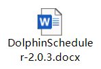

## 13.2 数据准备

此处需要模拟生成一天的新数据，作为全流程调度的测试数据。

**1）执行集群启动脚本，开启Hadoop、ZooKeeper、Kafka以及用户行为数据采集系统。**

``` text
[zhangsan@node0 ~]$ cluster.sh start
```

**2）启动业务数据采集Flume。**

``` text
[zhangsan@node0 ~]$ f3.sh start
```

**3）模拟生成2022-02-22的数据。**

``` text
[zhangsan@node0 ~]$ mock.sh 2022-02-22
```

## 13.3 工作流调度实操

由于DolphinScheduler集群模式启动进程较多，对虚拟机内存要求较高。故下面提供两种方式，可根据虚拟机内存情况进行选择。

### 13.3.1 DolphinScheduler集群模式

**1）启动DolphinScheduler**

``` text
[zhangsan@node0 dolphinscheduler]$ bin/start-all.sh
```

**2）使用普通用户登录**


**3）向DolphinScheduler资源中心上传工作流所需脚本**

（1）创建文件夹

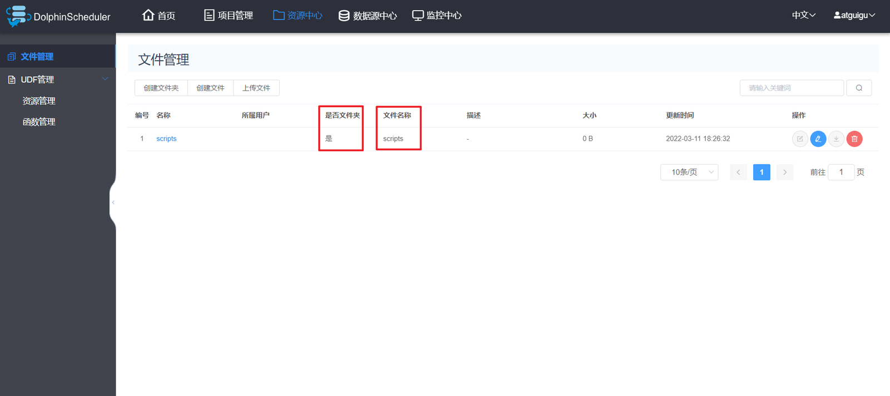

（2）上传工作流所需脚本

将工作流所需的所有脚本上传到资源中心scripts路径下，结果如下

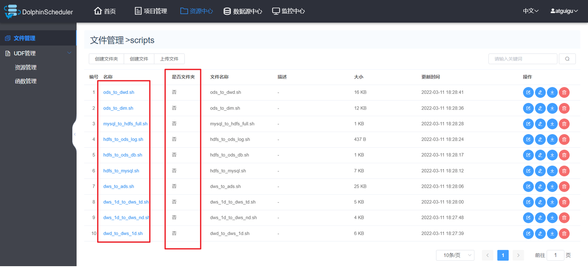

**4）向DolphinScheduler的WorkerServer节点分发脚本依赖的组件**

由于工作流要执行的脚本需要调用Hive、DataX等组件，故在DolphinScheduler的集群模式下，需要确保每个WorkerServer节点都有脚本所依赖的组件。

``` text
[zhangsan@node0 ~]$ xsync /opt/module/hive/
[zhangsan@node0 ~]$ xsync /opt/module/spark/
[zhangsan@node0 ~]$ xsync /opt/module/datax/
```

**5）配置运行环境**

（1）切换到 admin 用户，在环境管理下创建环境

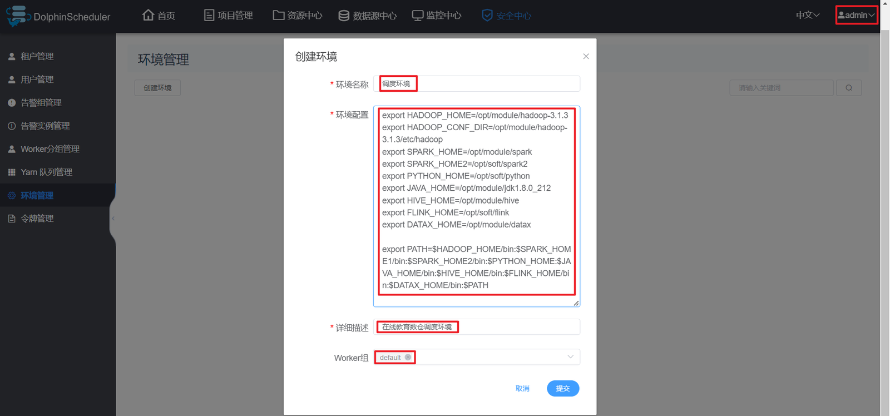

（2）在环境配置中添加如下内容

<span class="mark">标红部分根据集群情况修改。</span>

``` text
export HADOOP_HOME=/opt/module/hadoop-3.1.3
export HADOOP_CONF_DIR=/opt/module/hadoop-3.1.3/etc/hadoop
export SPARK_HOME=/opt/module/spark
export SPARK_HOME2=/opt/soft/spark2
export PYTHON_HOME=/opt/soft/python
export JAVA_HOME=/opt/module/jdk1.8.0_144
export HIVE_HOME=/opt/module/hive
export FLINK_HOME=/opt/soft/flink
export DATAX_HOME=/opt/module/datax
export PATH=$HADOOP_HOME/bin:$SPARK_HOME1/bin:$SPARK_HOME2/bin:$PYTHON_HOME:$JAVA_HOME/bin:$HIVE_HOME/bin:$FLINK_HOME/bin:$DATAX_HOME/bin:$PATH
```

**6）创建工作流**

（1）在edu项目下创建工作流

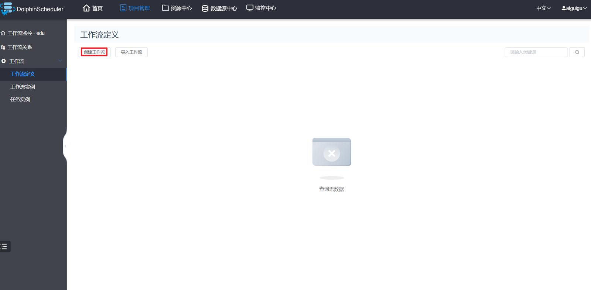

（2）各任务节点配置如下

mysql_to_hdfs_full

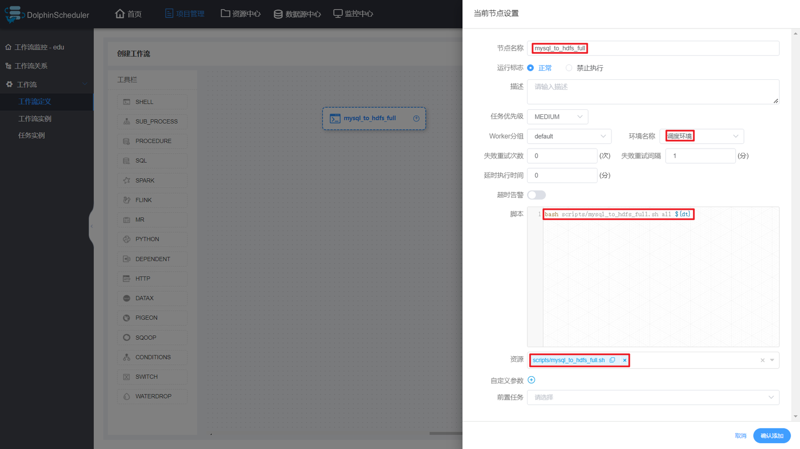

hdfs_to_ods_db


hdfs_to_ods_log


ods_to_dwd


ods_to_dim

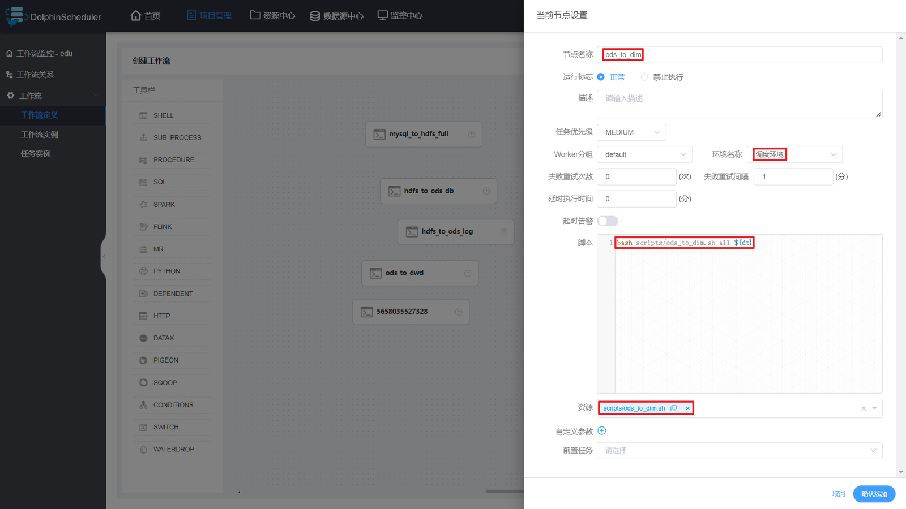

dwd_to_dws_1d

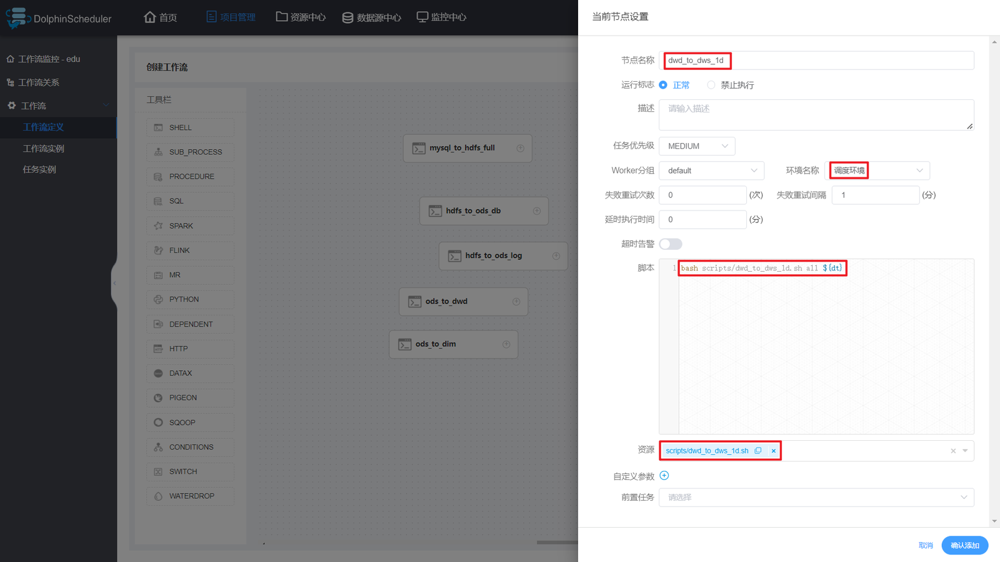

dws_1d_to_dws_nd


dws_1d_to_dws_td


dws_to_ads


hdfs_to_mysql


（3）各节点依赖关系如下

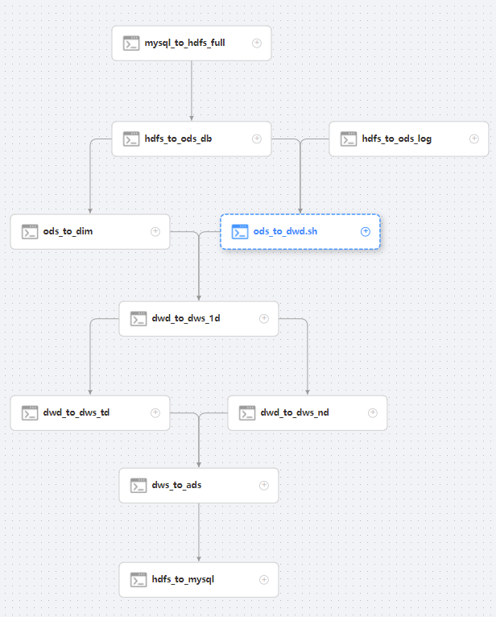

（4）保存工作流

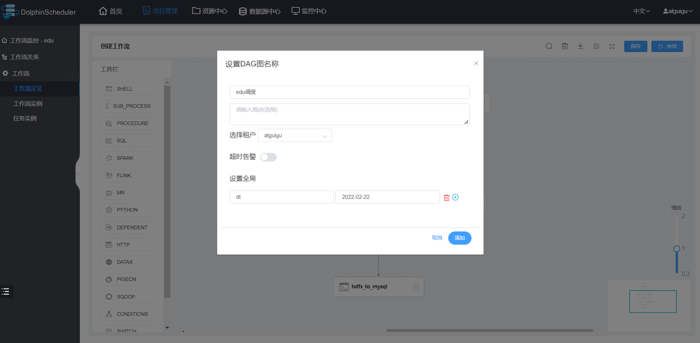

**注：定时调度时，全局参数值应设置为\$\[yyyy-MM-dd-1\]或者空值。**

**7）上线工作流**

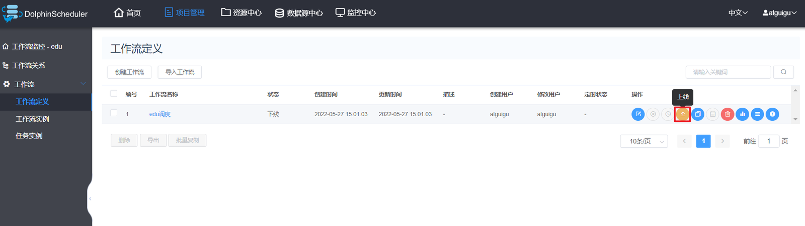

**8）执行工作流**


**9）执行工作流后，出现下图所示页面，即表示执行成功。**


**注：工作流启动前选择的环境无效，必须在创建任务节点时选择对应环境。此处的“环境名称”可以置空。**

### 13.3.2 DolphinScheduler单机模式

**1）启动DolphinScheduler**

``` text
[zhangsan@node0 dolphinscheduler]$ bin/dolphinscheduler-daemon.sh start standalone-server
```

**2）安全中心配置**

由于DolphinScheduler的单机模式使用的是内置的ZK和数据库，故在集群模式下所做的相关配置在单机模式下并不可见，所以需要重新配置，必要的配置为创建租户和创建用户。

（1）使用管理员用户登录


（2）创建租户


（3）创建用户


**3）切换普通用户登录**


**4）创建项目**


**5）其余操作**

其余操作与集群模式基本一致，其中分发Hive、Spark、DataX这一步可以省略。
