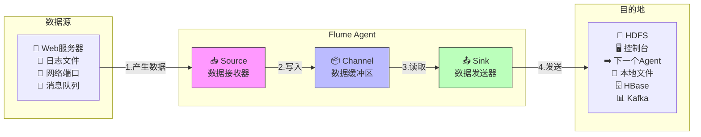

## Flume基本架构

### 整体架构



## Flume安装部署

|                 | node1 | node2 | node3 |
| --------------- | ----- | ----- | ----- |
| Flume(采集日志) | Flume |       |       |

### 安装地址

（1） Flume官网地址：http://flume.apache.org/

（2）文档查看地址：http://flume.apache.org/FlumeUserGuide.html

（3）下载地址：http://archive.apache.org/dist/flume/

### 安装部署

1. 将`apache-flume-1.9.0-bin.tar.gz`上传到`linux`的`/opt/bigdata/flume`目录下
2. 解压`apache-flume-1.9.0-bin.tar.gz`到`/opt/bigdata/flume/`目录下

```bash
[zhangsan@node1 flume]$ pwd
/opt/bigdata/flume

[zhangsan@node1 flume]$ ll
drwxrwxr-x. 10 zhangsan zhangsan 4096 Mar  4 11:26 apache-flume-1.9.0-bin
```

3. 为`apache-flume-1.9.0-bin`创建软连接`default`

```bash
[zhangsan@node1 flume]$ ll
drwxrwxr-x. 10 zhangsan zhangsan 4096 Mar  4 11:26 apache-flume-1.9.0-bin
lrwxrwxrwx.  1 zhangsan zhangsan   22 Feb 28 16:45 default -> apache-flume-1.9.0-bin
```

4. 将`lib`文件夹下的`guava-11.0.2.jar`删除以兼容`Hadoop 3.1.3`

注意：删除`guava-11.0.2.jar`的服务器节点，一定要配置`hadoop`环境变量。否则会报如下异常。

```java
Caused by: java.lang.ClassNotFoundException: com.google.common.collect.Lists
    at java.net.URLClassLoader.findClass(URLClassLoader.java:382)
    at java.lang.ClassLoader.loadClass(ClassLoader.java:424)
    at sun.misc.Launcher$AppClassLoader.loadClass(Launcher.java:349)
    at java.lang.ClassLoader.loadClass(ClassLoader.java:357)
    ... 1 more
```

5. 拷贝`flume/conf`下的`flume-env.sh.template`文件并更名为`flume-env.sh`，配置`flume-env.sh`文件

```bash
# 此处为jdk rpm包安装后的位置，请根据自己实际的JAVA_HOME进行修改
export JAVA_HOME=/usr/java/default
```

6. 配置环境变量。

略。
