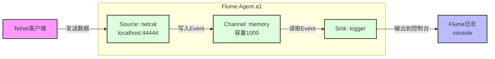
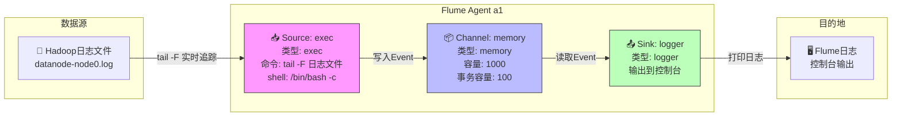

## Source

### 1. NetCat source



#### 配置输出输出

`$FLUME_HOME/job/1-socket-flume-console.conf`

```properties
# 为agent a1 的各组件命名
a1.sources = r1
a1.sinks = k1
a1.channels = c1

# agent a1的一个source在端口9999监听数据
a1.sources.r1.type = netcat
a1.sources.r1.bind = localhost
a1.sources.r1.port = 9999
a1.sources.r1.max-line-length = 1024

# 将event数据记录到控制台
a1.sinks.k1.type = logger

# 使用一个channel在内存中缓存events
a1.channels.c1.type = memory
a1.channels.c1.capacity = 1000
a1.channels.c1.transactionCapacity = 100

# 将source和sink绑定到channel
a1.sources.r1.channels = c1
a1.sinks.k1.channel = c1
```

在一个配置文件中，可以定义多个`agent`；启动的时候指定agent name

#### 启动Agent

```shell
[zhangsan@node1 default]$ flume-ng agent -c conf -f job/1-socket-flume-console.conf -n a1 -Dflume.root.logger=INFO,console
... ...
2026-03-24 14:29:21,638 (lifecycleSupervisor-1-0) [INFO - org.apache.flume.source.NetcatSource.start(NetcatSource.java:155)] Source starting
2026-03-24 14:29:21,647 (lifecycleSupervisor-1-0) [INFO - org.apache.flume.source.NetcatSource.start(NetcatSource.java:166)] Created serverSocket:sun.nio.ch.ServerSocketChannelImpl[/127.0.0.1:9999]
```

> 通过启动日志可以看出，Flume 的 **NetCat Source** 不是调用系统的 `nc` 命令，本质是一个 **Java Socket Server**。


#### Telnet输入

```shell
[zhangsan@node1 ~]$ telnet localhost 9999
Trying ::1...
telnet: connect to address ::1: Connection refused
Trying 127.0.0.1...
Connected to localhost.
Escape character is '^]'.

www.studybigdata.com
OK
学习大数据
OK

# 退出Telnet
Ctrl + ]
telnet> quit
```

#### Logger输出

```java
2026-03-24 14:39:21,767 (SinkRunner-PollingRunner-DefaultSinkProcessor) [INFO - org.apache.flume.sink.LoggerSink.process(LoggerSink.java:95)] Event: { headers:{} body: 77 77 77 2E 73 74 75 64 79 62 69 67 64 61 74 61 www.studybigdata }

2026-03-24 14:46:30,901 (SinkRunner-PollingRunner-DefaultSinkProcessor) [INFO - org.apache.flume.sink.LoggerSink.process(LoggerSink.java:95)] Event: { headers:{} body: E5 AD A6 E4 B9 A0 E5 A4 A7 E6 95 B0 E6 8D AE 0D ................ }
```

#### 输出分析

##### 输出不完整

可以发现`.com`没有正常输出到日志，是因为`logger sink`只输出`16`字节。

```bash
# 将event数据记录到文件
a1.sinks.k1.type = file_roll
a1.sinks.k1.sink.directory = /tmp/flume-test
a1.sinks.k1.sink.rollInterval = 0
```

可以发现`telnet`输入的内容完整的输出到了文件中。

```bash
[zhangsan@node1 flume-test]$ more 1774336000101-1
www.studybigdata.com
```

##### 中文没有正常显示

- 输入：**学习大数据**

- 终端编码：**UTF-8 字节**

- 传输协议：**TCP 字节流**

- Flume 收到：**byte [] 字节数组**

- Flume 打印：**十六进制格式**
- 控制台：**0-127显示成英文字符，>127无法正常只显示整数值**


#### 后台运行

```bash
[zhangsan@node1 default]$ nohup flume-ng agent -c conf -f job/1-socket-flume-console.conf -n a1 -Dflume.root.logger=INFO,console > flume.log 2>&1 &
```


---

### 2. [Exec Source](https://flume.apache.org/releases/content/1.9.0/FlumeUserGuide.html#exec-source)

Exec 源会在启动时执行指定的 Unix 命令，并期望该进程持续在标准输出中生成数据。若该进程因任何原因退出，此数据源也会随之退出，且不再生成任何数据。这意味着像 cat [命名管道] 或 tail -F [文件] 这类配置能够达到预期效果，而 date 命令则大概率无法实现 —— 前两个命令会持续生成数据流，而后者仅生成一次事件数据后便会退出。



#### 配置输出输出

`$FLUME_HOME/job/2-exec-flume-console.conf`

```properties
a1.sources = r1
a1.sinks = k1
a1.channels = c1

a1.sources.r1.type = exec
a1.sources.r1.shell = /bin/bash -c
a1.sources.r1.command = tail -F /tmp/你要监控的文件.log
a1.sources.r1.channels = c1

a1.channels.c1.type = memory
a1.channels.c1.capacity = 1000
a1.channels.c1.transactionCapacity = 100

a1.sinks.k1.type = logger
a1.sinks.k1.channel = c1
```

启动后，向`你要监控的文件.log`中追加内容，观察flume日志输出。


---

| 特性     | SpoolingDir             | TailDir              |
| -------- | ----------------------- | -------------------- |
| 文件状态 | **静止不变**            | **实时增长**         |
| 是否改名 | 读完改名 **.COMPLETED** | **不改名**           |
| 是否实时 | 不实时                  | **实时追更**         |
| 用途     | 历史日志、批量导入      | **线上实时日志采集** |
| 生产常用 | 少                      | **非常常用**         |

- **SpoolingDir = 读已经写完的文件（读死文件）**

- **TailDir = 实时追着正在写的文件（读活文件）**


### 3. [SpoolingDir Source](https://flume.apache.org/releases/content/1.9.0/FlumeUserGuide.html#spooling-directory-source)

#### 准备测试文件夹

```bash
[zhangsan@node1 default]$ pwd
/opt/bigdata/flume/default

# 测试文件
[zhangsan@node1 default]$ cat tmp/static/bigdata.txt
www
```

#### 配置输入输出

`$FLUME_HOME/job/3-spoolingDir-flume-console.conf`

```properties
#1、定义 agent的名称、source、channel、sink的名称
agent1.sources = source1
agent1.channels = channel1
agent1.sinks = sink1

#2、配置 channel组件属性
agent1.channels.channel1.type = memory

#3、配置 source组件属性
agent1.sources.source1.channels = channel1
agent1.sources.source1.type = spooldir
# 需要先准备好文件夹static
agent1.sources.source1.spoolDir = /opt/bigdata/flume/default/tmp/static/

#4、配置 sink组件属性
agent1.sinks.sink1.channel = channel1
agent1.sinks.sink1.type =  logger
```

#### 启动Agent

```shell
[zhangsan@node1 default]$ flume-ng agent -c conf -f job/3-spoolingDir-flume-console.conf -n agent1 -Dflume.root.logger=INFO,console

2026-03-24 17:44:01,702 (SinkRunner-PollingRunner-DefaultSinkProcessor) [INFO - org.apache.flume.sink.LoggerSink.process(LoggerSink.java:95)] Event: { headers:{} body: 77 77 77                                        www }
```

启动后，文件被flume读取：

```bash
(base) [zhangsan@node1 default]$ ll tmp/static/
total 4
-rw-rw-r--. 1 zhangsan zhangsan 4 Mar 24 17:41 bigdata.txt.COMPLETED
```

> `.COMPLETED` 后缀 = Spooling Directory Source 处理完文件的标志！

#### 更新文件

```bash
[zhangsan@node1 default]$ echo "studybigdata" >> tmp/static/bigdata.txt.COMPLETED
```

Spooling Directory Source 处理完文件后，不会检测文件内容变化。


### 4. [Taildir Source](https://flume.apache.org/releases/content/1.9.0/FlumeUserGuide.html#taildir-source)

#### 配置输入输出

`$FLUME_HOME/job/4-tailDir-flume-console.conf`

```properties
#1、定义 agent的名称、source、channel、sink的名称
agent1.sources = source1
agent1.channels = channel1
agent1.sinks = sink1
#2、配置 channel组件属性
agent1.channels.channel1.type = memory
#3、配置 source组件属性
agent1.sources.source1.channels = channel1
agent1.sources.source1.type = taildir
agent1.sources.source1.filegroups = fg1
agent1.sources.source1.positionFile = /opt/bigdata/flume/default/tmp/stream/taildir_position.json
agent1.sources.source1.filegroups.fg1 = /opt/bigdata/flume/default/tmp/stream/.*log
#4、配置 sink组件属性
agent1.sinks.sink1.channel = channel1
agent1.sinks.sink1.type =  logger
```

#### 准备测试文件

```bash
# 准备检测文件夹
[zhangsan@node1 default]$ pwd
/opt/bigdata/flume/default
# 输入一条初始数据
[zhangsan@node1 default]$ echo "www" >> tmp/stream/bigdata.log
www
```

#### 启动Agent

```bash
[zhangsan@node1 default]$ flume-ng agent -c conf -f job/4-tailDir-flume-console.conf -n agent1 -Dflume.root.logger=INFO,console
... ...
# 将文件内容到控制台
2026-03-24 17:27:02,114 (SinkRunner-PollingRunner-DefaultSinkProcessor) [INFO - org.apache.flume.sink.LoggerSink.process(LoggerSink.java:95)] Event: { headers:{} body: 77 77 77                                        www }
```

#### 更新文件内容

```bash
[zhangsan@node1 default]$ echo "study" >> tmp/stream/bigdata.log
[zhangsan@node1 default]$ echo "bigdata" >> tmp/stream/bigdata.log
[zhangsan@node1 default]$ echo "com" >> tmp/stream/bigdata.log
```

#### Logger输出

```java
2026-03-24 17:27:17,118 (SinkRunner-PollingRunner-DefaultSinkProcessor) [INFO - org.apache.flume.sink.LoggerSink.process(LoggerSink.java:95)] Event: { headers:{} body: 73 74 75 64 79                                  study }
2026-03-24 17:27:27,120 (SinkRunner-PollingRunner-DefaultSinkProcessor) [INFO - org.apache.flume.sink.LoggerSink.process(LoggerSink.java:95)] Event: { headers:{} body: 62 69 67 64 61 74 61                            bigdata }
2026-03-24 17:27:37,121 (SinkRunner-PollingRunner-DefaultSinkProcessor) [INFO - org.apache.flume.sink.LoggerSink.process(LoggerSink.java:95)] Event: { headers:{} body: 63 6F 6D                                        com }
```

---


