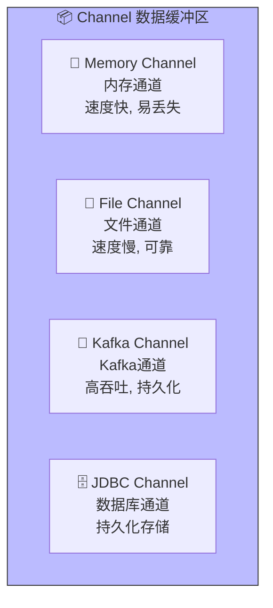
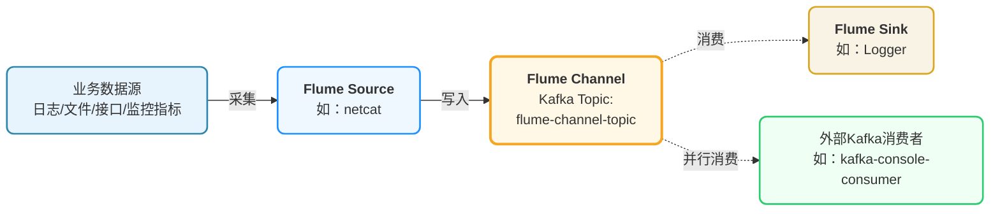

## Flume Channel

### Channel的类型



- Memory
- File
- Kafka
- JDBC

### Kafka Channel



Flume 的 `Kafka Channel` 本质是**把 Kafka 主题当作「数据中转通道」**

✅ **其他程序必须使用【不同的消费者组】**（比如 `my-app-consumer`）

❌ 如果和 Flume 用同一个组：会发生**消费争抢**，Flume 或你的程序会丢失数据。


#### 前置条件

- 启动ZooKeeper集群
- 启动Kafka集群

#### 配置文件

`6-socket-kafka-console.conf`

```properties
# Kafka Channel 类型（固定写法）
a1.channels.c1.type = org.apache.flume.channel.kafka.KafkaChannel

# Kafka 集群地址（必填）
a1.channels.c1.kafka.bootstrap.servers = node1:9092,node2:9092,node3:9092

# Kafka 主题名称（自动创建，可自定义）
a1.channels.c1.kafka.topic = flume-channel-topic

# 消费者组 ID
a1.channels.c1.kafka.consumer.group.id = flume-consumer-group
a1.channels.c1.parseAsFlumeEvent = false
# 生产/消费超时（可选优化）
a1.channels.c1.kafka.producer.acks = 1
a1.channels.c1.kafka.consumer.auto.offset.reset = earliest
```

##### parseAsFlumeEvent

- 开启后：Flume 会把**事件头 (headers) + 事件体 (body)** 一起序列化成 **Flume 自定义的二进制格式** 写入 Kafka。

- 关闭后（默认 `false`）：Flume **只把消息体 (body，也就是你的业务明文)** 写入 Kafka。

#### 自我实现

根据流程图，自行实现下述配置。

- NetCat Source
- Logger Sink


#### 测试

##### Telnet输入

```bash
(base) [zhangsan@node1 ~]$ telnet localhost 9999
Trying ::1...
telnet: connect to address ::1: Connection refused
Trying 127.0.0.1...
Connected to localhost.
Escape character is '^]'.
hello
OK
world
OK
```

##### Logger消费Topic

```java
2026-04-01 21:05:02,730 (kafka-producer-network-thread | producer-1) [INFO - org.apache.kafka.clients.Metadata.update(Metadata.java:285)] Cluster ID: Kc9Z6KZDT3iYwf8RaS6h1Q
2026-04-01 21:05:07,098 (SinkRunner-PollingRunner-DefaultSinkProcessor) [INFO - org.apache.flume.sink.LoggerSink.process(LoggerSink.java:95)] Event: { headers:{} body: 68 65 6C 6C 6F 0D                               hello. }
2026-04-01 21:05:07,107 (SinkRunner-PollingRunner-DefaultSinkProcessor) [INFO - org.apache.flume.sink.LoggerSink.process(LoggerSink.java:95)] Event: { headers:{} body: 77 6F 72 6C 64 0D                               world. }
```

##### Kafka-console-consumer.sh消费Topic

通过`kafka-console-consumer.sh`消费`Topic`，需要自行补全命令参数。

```bash
(base) [zhangsan@node1 default]$ bin/kafka-console-consumer.sh 

hello

world
```


#### 直接发送到Kafka

也可以去掉Sink，直接将消息发送到Kafka，供下游消费。


### 总结
1. **其他消费**：Kafka Channel 的 Topic 是标准 Kafka 主题，无独占性；
3. **核心规则**：外部程序用**独立消费者组**，避免和 Flume 争抢数据。