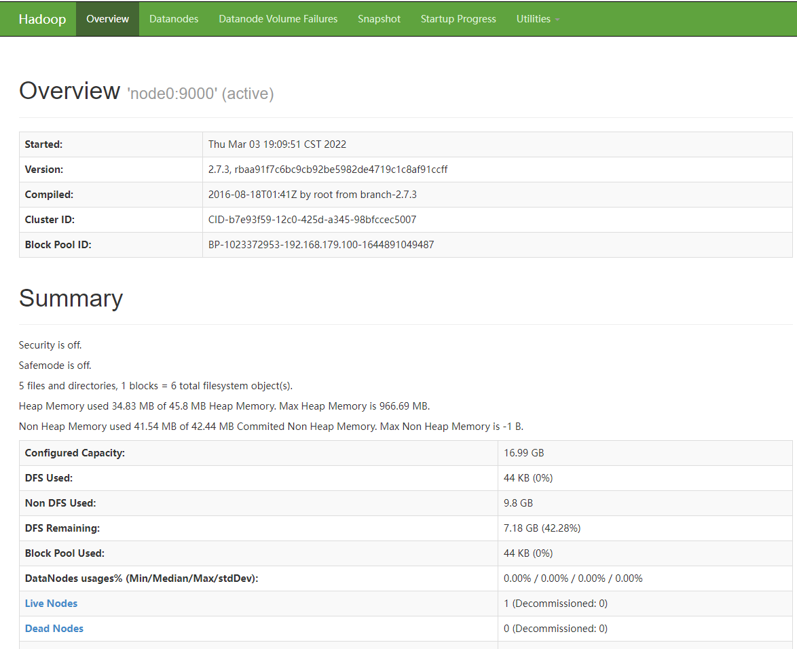
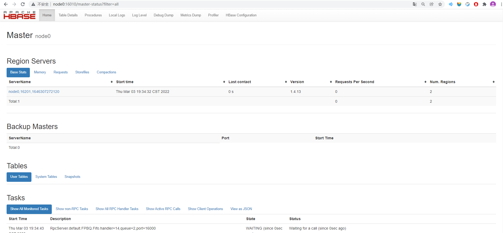
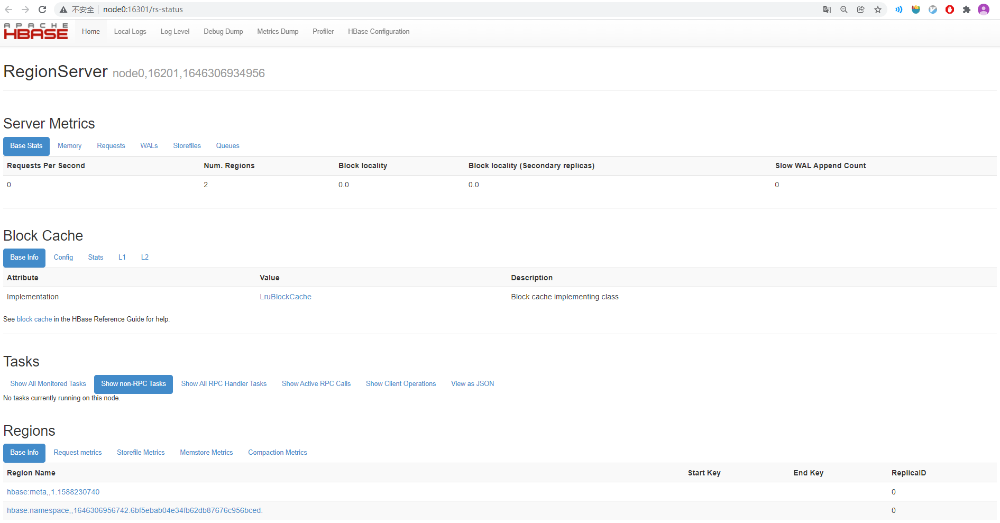
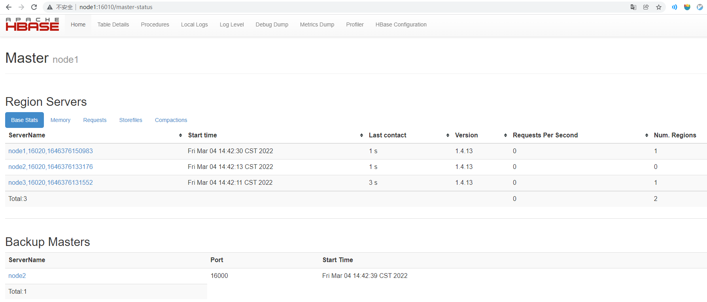

<h1 style="color:red; text-align:center">HBase</h1>

# 环境部署

> **官方文档**
>
> https://hbase.apache.org/x.y/book.html
>
> **下载地址**
>
> https://archive.apache.org/dist/hbase/x.y.z/
>
> **安装目录**
>
> `/opt/bigdata/hbase/`
>
> **配置文件**
>
> https://hbase.apache.org/x.y/book.html#_configuration_files
>
> **部署规划**
>
> `node0`：Standalone
>
> `node0`：Pseudo-Distributed；
>
> `node1` `node2` `node3`  配置为`hbase`集群。


## Standalone

> **Standalone**
>
> https://hbase.apache.org/x.y/book.html#quickstart


### 准备

#### 上传

```shell
[zhangsan@node0 bigdata]$ cd /opt/bigdata/
[zhangsan@node0 bigdata]$ mkdir hbase
```

使用`FTP`工具上传压缩包`hbase-x.y.z-bin.tar.gz   `到`/opt/bigdata/hbase` 目录或者直接`wget`在线下载。

#### 解压

```shell
[zhangsan@node0 hbase]$ tar -zxf hbase-x.y.z-bin.tar.gz 

# 做一个软连接（可选）
[zhangsan@node0 hbase]$ ln -s hbase-x.y.z default
[zhangsan@node0 hbase]$ ll
lrwxrwxrwx.  1 zhangsan zhangsan        12 Mar  3 18:40 default -> hbase-x.y.z
drwxrwxr-x.  7 zhangsan zhangsan       160 Mar  3 18:40 hbase-x.y.z
-rw-rw-r--.  1 zhangsan zhangsan 118343766 Mar  3 18:39 hbase-x.y.z-bin.tar.gz
```


### 配置

##### `hbase-env.sh`

```shell
export JAVA_HOME=/usr/java/default
# 使用HBase自带的ZooKeeper
export HBASE_MANAGES_ZK=true
```

##### `hbase-site.xml`

```xml
<configuration>
  <property>
    <name>hbase.rootdir</name>
    <value>file:///opt/bigdata/hbase/default/data</value>
  </property>
  <property>
    <name>hbase.zookeeper.property.dataDir</name>
    <value>/opt/bigdata/hbase/default/zookeeper</value>
  </property>
</configuration>
```


##### `~/.bashrc`

```shell
export HADOOP_HOME=/opt/bigdata/hadoop/default
export HBASE_HOME=/opt/bigdata/hbase/default
export PATH=$HADOOP_HOME/bin:$HADOOP_HOME/sbin:$HBASE_HOME/bin:$PATH
```

记得`source`一下，让环境变量生效。

```shell
[zhangsan@node0 ~]$ source ~/.bashrc 
```

### 使用

#### 启动

首先需要启动`Hadoop`

```shell
[zhangsan@node0 ~]$ start-hbase.sh 

# 在Standalone模式下，只有一个HMaster进程，里面包括了HMaster,HRegionServer,Zookeeper
(base) [zhangsan@node0 default]$ jps
58278 Jps
57002 HMaster
```

#### HelloWorld

```sql
[zhangsan@node0 default]$ hbase shell
-- 创建表'student' 和 一个列簇 'info' 
hbase(main):001:0> create 'student','info'
0 row(s) in 2.1590 seconds

=> Hbase::Table - student

-- 插入一条数据，行键RowKey=1001, column 为name, value为'zhangsan'
hbase(main):002:0> put 'student','1001','info:name','zhangsan'
0 row(s) in 0.2520 seconds

-- 遍历表
hbase(main):003:0> scan 'student'
ROW                                         COLUMN+CELL                                                                                                                  
 1001                                       column=info:name, timestamp=1646305250836, value=zhangsan                                                                    
1 row(s) in 0.0330 seconds

-- 退出
hbase(main):004:0> exit
```

#### 停止

```shell
[zhangsan@node0 default]$ stop-hbase.sh 
stopping hbase......................
```


## 伪分布式

> **伪分布式**
>
> https://hbase.apache.org/x.y/book.html#quickstart_pseudo


### 配置

#### hbase-site.xml

```xml
<configuration>
    <property>
        <name>hbase.cluster.distributed</name>
        <value>true</value>
    </property>

    <property>
        <name>hbase.rootdir</name>
        <value>hdfs://node0:8020/hbase</value>
    </property>

    <property>
        <name>hbase.zookeeper.property.dataDir</name>
        <value>/opt/bigdata/hbase/default/zookeeper</value>
    </property>
</configuration>
```

### 使用

#### 1. 启动HDFS

```shell
# 启动HDFS
[zhangsan@node0 default]$ start-dfs.sh 
# 查看后台进程
[zhangsan@node0 default]$ jps
58944 DataNode
59136 SecondaryNameNode
58783 NameNode
```

##### HDFS Web UI



#### 2. 启动HBase

```shell
# 启动HBase
(base) [zhangsan@node0 default]$ start-hbase.sh 
The authenticity of host 'localhost (::1)' can't be established.
ECDSA key fingerprint is SHA256:WidPRw9uecnRTrTxBUX35ET02GKdgnoup3FOVmGNBo0.
ECDSA key fingerprint is MD5:c2:b6:e1:6d:e9:0e:b1:40:c2:a1:0e:b2:a8:ca:73:34.
Are you sure you want to continue connecting (yes/no)? ·`yes`
localhost: Warning: Permanently added 'localhost' (ECDSA) to the list of known hosts.
localhost: running zookeeper, logging to /opt/bigdata/hbase/default/logs/hbase-zhangsan-zookeeper-node0.out
running master, logging to /opt/bigdata/hbase/default/logs/hbase-zhangsan-master-node0.out
: running regionserver, logging to /opt/bigdata/hbase/default/logs/hbase-zhangsan-regionserver-node0.out

# 查看后台进程
(base) [zhangsan@node0 default]$ jps
58944 DataNode
59136 SecondaryNameNode
60945 `HRegionServer`
60770 `HQuorumPeer`
60861 `HMaster
58783 NameNode
```


##### Web UI - HMaster

`http://node0:16010`



##### Web UI - HRegionServer

`http://node0:16301`




#### 4. 停止

```shell
[zhangsan@node0 default]$ stop-hbase.sh 
stopping hbase.....................
localhost: running zookeeper, logging to /opt/bigdata/hbase/default/logs/hbase-zhangsan-zookeeper-node0.out
localhost: stopping zookeeper.

[zhangsan@node0 default]$ stop-dfs.sh 
Stopping namenodes on [node0]
node0: stopping namenode
node0: stopping datanode
Stopping secondary namenodes [0.0.0.0]
0.0.0.0: stopping secondarynamenode
```


## 全分布式

> **ZooKeeper副本模式**
>
> ​		参考`Zookeeper实验手册`
>
> **全分布式模式**
>
> https://hbase.apache.org/x.y/book.html#quickstart_fully_distributed

### 集群规划

|         | ZooKeeper | HDFS                                      | YARN                             | HBase                            |
| ------- | --------- | ----------------------------------------- | -------------------------------- | -------------------------------- |
| `node1` | `yes`     | `NameNode`,`DataNode`,`SecondaryNameNode` | `ResourceManager`, `NodeManager` | `HMaster`, `RegionServer`        |
| `node2` | `yes`     | `DataNode`                                | `NodeManager`                    | `HMaster(backup)`,`RegionServer` |
| `node3` | `yes`     | `DataNode`                                | `NodeManager`                    | `RegionServer`                   |


### 配置

在`node1`节点配置，最后将其分发到其他节点。

##### 环境变量

`~/.bashrc`

```shell
export ZOOKEEPER_HOME=/opt/bigdata/zookeeper/default
export HADOOP_HOME=/opt/bigdata/hadoop/default
export HBASE_HOME=/opt/bigdata/hbase/default
export PATH=$ZOOKEEPER_HOME/bin:$HADOOP_HOME/bin:$HADOOP_HOME/sbin:$HBASE_HOME/bin:$PATH
```
记得在Master节点`source`一下，让环境变量生效。

```shell
[zhangsan@node0 ~]$ source .bashrc 
```
##### hbase-env.sh

```shell
export JAVA_HOME=/usr/java/default
export HBASE_MANAGES_ZK=false
```

##### hbase-site.xml

```xml
<configuration>
    <property>
        <name>hbase.cluster.distributed</name>
        <value>true</value>
    </property>

    <property>
        <name>hbase.rootdir</name>
        <value>hdfs://node1:8020/hbase</value>
    </property>
    
    <property>
      <name>hbase.zookeeper.quorum</name>
      <value>node1,node2,node3</value>
    </property>
   
</configuration>
```


##### backup-masters

`$HBASE_HOME/conf/`目录下无此文件，需要手动创建。

```shell
node2
```

##### regionservers

```shell
node1
node2
node3
```

修改完上述配置文件后，将其同步到其它节点。

### 使用

#### 启动ZooKeeper

在三个节点中分别启动`ZooKeeper`集群：

```shell
[zhangsan@node1 ~]$ zkServer.sh start
[zhangsan@node2 ~]$ zkServer.sh start
[zhangsan@node3 ~]$ zkServer.sh start
```

可以查看到其中一台节点被选举为`leader`

````shell
[zhangsan@node2 default]$ zkServer.sh status
ZooKeeper JMX enabled by default
Using config: /opt/bigdata/zookeeper/default/bin/../conf/zoo.cfg
Mode: leader
````

#### 启动HDFS

在`node1`节点启动`Hadoop`集群：

```shell
[zhangsan@node1 hbase-x.y.z]$ start-all.sh
```

##### Wnode1

```shell
[zhangsan@node1 hbase-x.y.z]$ jps
18067 NodeManager
18099 Jps
97669 QuorumPeerMain
17476 DataNode
17928 ResourceManager
17707 SecondaryNameNode
17341 NameNode
```

##### node2

```shell
[zhangsan@node2 default]$ jps
78832 Jps
78659 NodeManager
78443 DataNode
28351 QuorumPeerMain
```

##### node3

```shell
[zhangsan@node3 default]$ jps
78066 DataNode
78466 Jps
78281 NodeManager
27977 QuorumPeerMain
```


#### 启动HBase

在`node1`启动HBase 集群。

```shellll
[zhangsan@node1 conf]$ start-hbase.sh
```

查看启动情况

##### node1

```shell
[zhangsan@node1 hbase-x.y.z]$ jps
18067 NodeManager
97669 QuorumPeerMain
17476 DataNode
17928 ResourceManager
19129 HRegionServer
19241 Jps
17707 SecondaryNameNode
17341 NameNode
18973 HMaster
```

##### node2

```shell
[zhangsan@node2 default]$ jps
78659 NodeManager
79298 HRegionServer
79442 HMaster
78443 DataNode
79644 Jps
28351 QuorumPeerMain
```

##### node3

```shell
[zhangsan@node3 default]$ jps
78066 DataNode
78281 NodeManager
78921 HRegionServer
27977 QuorumPeerMain
79119 Jps
```

##### Web UI

###### 	http://node1:16010/master-status (Master)

###### 	http://node2:16010/master-status(Backup Master)

###### 	http://node1:16030/rs-status (RegionServer)

###### 	http://node2:16030/rs-status (RegionServer)

###### 	http://node3:16030/rs-status (RegionServer)



#### 停止HBase

```shell
[zhangsan@node1 ~]$ stop-hbase.sh 
```

#### 停止HDFS

```shell
[zhangsan@node1 ~]$ stop-all.sh 
```

#### 停止ZooKeeper

分别停止各节点上的ZooKeeper

```shell
[zhangsan@node1 ~]$ zkServer.sh stop
[zhangsan@node2 ~]$ zkServer.sh stop
[zhangsan@node3 ~]$ zkServer.sh stop
```


