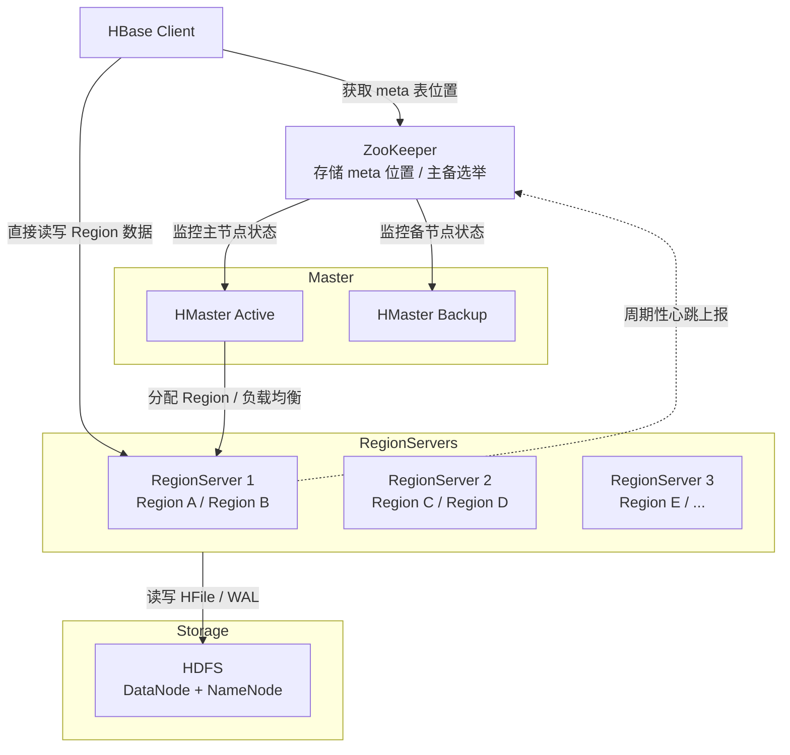
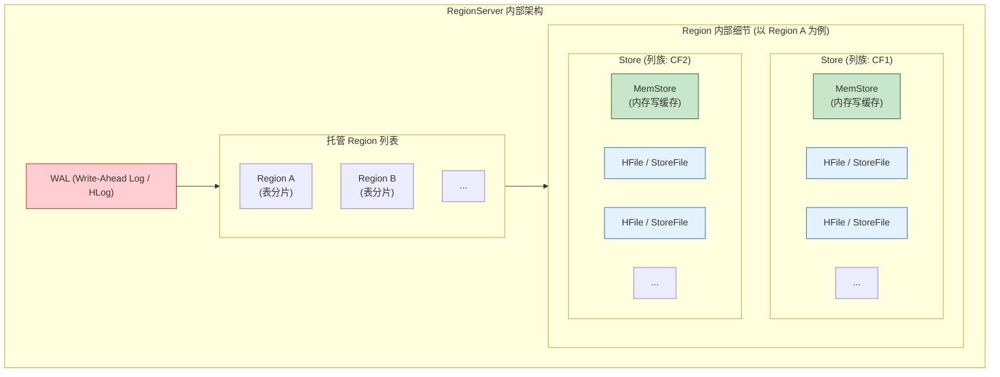

## HBase

| 组件             | 角色与职责                                                   |
| ---------------- | ------------------------------------------------------------ |
| **HMaster**      | 管理 Region 的分配、负载均衡、表结构变更（DDL）、处理 RegionServer 故障转移。 |
| **RegionServer** | 实际存储和处理读写请求的节点，管理多个 Region，与 HDFS DataNode 同机部署。 |
| **ZooKeeper**    | 集群元数据协调：存储 `/hbase/meta` 位置、Master 选举、RegionServer 心跳监控。 |
| **HDFS**         | 底层持久化存储：WAL、HFile 均存储在 HDFS 上，保证数据高可靠。 |
| **Client**       | 通过 ZooKeeper 定位 `hbase:meta` 表，再定位目标 Region，直接与 RegionServer 通信。 |

### 宏观架构图

1. **Client 定位 Region**  
   - 问 ZooKeeper：`hbase:meta` 表在哪个 RegionServer？  
   - 去该 RegionServer 读取 `meta`，缓存目标 Region 位置。  
   - 直接向目标 RegionServer 发起读写请求。

2. **RegionServer 内部结构**  
   - 一个 RegionServer 包含多个 Region（表的水平分片）。  
   - 每个 Region 含一个 **MemStore**（内存）和多个 **HFile**（HDFS 持久化）。  
   - 写操作先记 **WAL（Write Ahead Log）** 到 HDFS，再写入 MemStore。

3. **Master 职责**  
   - 监听 ZooKeeper 的 RegionServer 变化。  
   - Region 分裂、合并、故障转移时重新分配。  
   - 处理建表、改列族等 DDL 操作。

### RegionServer内部结构图

<table>
   <tr>
      <td rowspan="2">No</td>
      <td colspan="2">Info</td>
      <td colspan="3">Score</td>
   </tr>
   <tr>
      <td>name</td>
      <td>age</td>
      <td>Hadoop</td>
      <td>HBase</td>
      <td>Spark</td>
   </tr>
   <tr>
      <td>001</td>
      <td>qiaofeng</td>
      <td>30</td>
      <td>93</td>
      <td>85</td>
      <td>70</td>
   </tr>
   <tr>
      <td>002</td>
      <td>duanyu</td>
      <td>27</td>
      <td>95</td>
      <td>98</td>
      <td>50</td>
   </tr>
   <tr>
      <td>003</td>
      <td>wangyuyan</td>
      <td>18</td>
      <td>95</td>
      <td>97</td>
      <td>92</td>
   </tr
</table>

### 核心组件关系说明

| 组件                  | 层级关系                                                     | 核心作用                                             |
| --------------------- | ------------------------------------------------------------ | ---------------------------------------------------- |
| **RegionServer**      | 进程                                                         | 管理多个 Region，处理客户端读写请求                  |
| **WAL (HLog)**        | RegionServer 级别，所有 Region 共享                          | 预写日志，先写 WAL 再写 MemStore，保证数据可靠性     |
| **Region**            | 表的水平分片，一个 RegionServer 可托管多个                   | 数据存储和访问的基本单元                             |
| **Store**             | 每个 Region 内按**列族 (Column Family)** 划分，一个 CF 对应一个 Store | 隔离不同列族的数据存储与刷写                         |
| **MemStore**          | 每个 Store 拥有一个 MemStore                                 | 内存写缓存，数据先写入此处，达到阈值后刷写到 HFile   |
| **HFile (StoreFile)** | 每个 Store 拥有多个 HFile                                    | 持久化存储文件，按 KeyValue 有序存储，底层在 HDFS 上 |

### 数据写入简要流程
1. 写 WAL（先持久化到磁盘/HDFS）
2. 写入对应 Region → Store → MemStore
3. MemStore 达到阈值后刷写 (Flush) 生成新的 HFile
4. 后续读取会合并 MemStore 与多个 HFile 的数据
