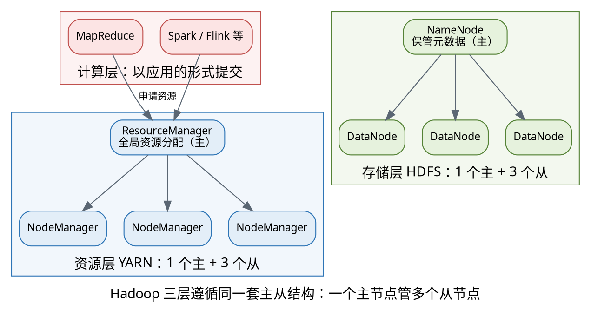
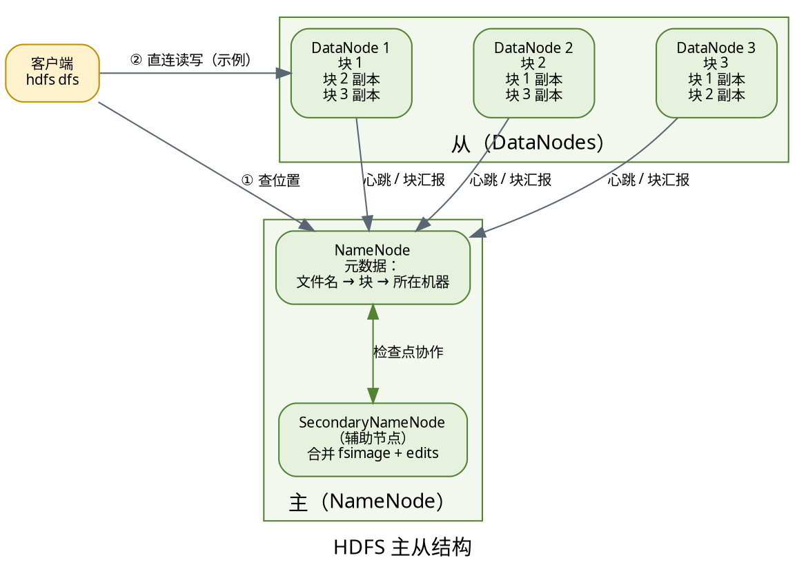
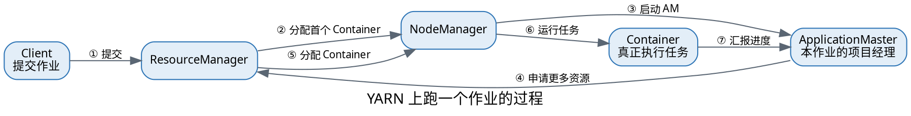

<h1>Hadoop 架构导论</h1>
HDFS 负责存 · YARN 负责调度 · MapReduce 负责算

# Hadoop 架构导论

部署 Hadoop 之前，先花十几分钟建立起整体画面：**Hadoop 由哪几块组成、每一块里谁说了算、它们怎么配合完成一次计算**。

本篇只回答"是什么、谁是谁、怎么协作"。至于"怎么配置、怎么写代码、怎么调参数"，请看每章末尾的阅读地图，那里列出了对应的专题文档。

> 本系列的实验环境统一为：机器 `node0`（`192.168.179.100`），Hadoop 版本 `3.1.3`。

## 为什么需要分布式

### 单机遇到的两堵墙

- **存不下**：单个业务的数据量很快超过一台机器的磁盘容量，而给单机加盘总有上限；
- **算不完**：1TB 数据即便用最好的机器顺序读一遍也要几分钟，遇到多次迭代的计算就更慢。

单机纵向扩容（换更贵的机器）成本高且有天花板，于是自然的思路是：**用一堆普通机器横向扩展**。

### 横向扩展带来的新问题

把数据分散到多台机器后，必须有人解决三件事：

- 文件被切成放在不同机器上的碎片，**谁来记住"哪个碎片在哪台机器"**？
- 某台机器宕机，**怎么保证数据不丢**？
- 几十台机器同时干活，**谁来分配 CPU 和内存，谁来盯着失败的任务**？

这三个问题，正好对应 Hadoop 的三个核心组件 —— HDFS、MapReduce 与 YARN。

## 三个组件的分工

### 一张图看清三层

### 主从结构：1 个主 + 3 个从

图中的资源层与存储层，采用的是同一种组织方式 —— **主从（Master / Slave）**：

- `NameNode`、`ResourceManager`：**主**。整个集群各一个，负责管理与调度，相当于"大脑"；
- `DataNode`、`NodeManager`：**从**。每台工作机器上一个，负责真正干活，并定期向主汇报。

数量不是巧合：`3` 个从节点对应的正是本系列最后要搭建的三台工作机器（`node1`、`node2`、`node3`）。而在前面的伪分布式阶段，它们会被压缩到同一台 `node0` 上 —— **进程分布在哪台机器不重要，谁主谁从才重要**。

> 特别注意：主节点宕机时，从节点**不会**自动顶替成主。这既是后面要讲 SecondaryNameNode 的原因，也是高可用（HA）方案存在的意义。

### 一句话记住各自的角色

| 组件 | 一句话定位 | 类比 |
| --- | --- | --- |
| HDFS | 把大文件切块、存多份，分散保存在多台机器上 | 一个跨机器的网盘 |
| YARN | 统一管理全部机器的 CPU 与内存，谁要用就分给谁 | 集群的操作系统 |
| MapReduce | 一种编程模型：把计算拆成 Map 与 Reduce 两个阶段 | 跑在上面的应用程序 |

关键理解：**这三层是可以分开的**。存储、计算框架、资源管理各自独立后，同一套集群既能跑 MapReduce，也能跑其他计算框架。

## HDFS：数据是怎么存的

### 块与副本

HDFS 不是把文件整份存起来，而是做两件事：

- **切块**：文件按固定大小切成多个 `Block`（Hadoop 2.x/3.x 默认为 `128MB`），分散存到不同机器；
- **复制**：每个块默认保存 `3` 份副本，且尽量分布在不同机器上。

这样做的收益很直接：

- 文件大小不再受单机磁盘限制；
- 某台机器宕机，副本还在别的机器上，**数据不会丢**；
- 计算时可以并行读多个块。

> 这也解释了后面伪分布式时的一个坑：只有一台 DataNode 时，副本数必须改成 `1`，否则多出来的副本无处安放，HDFS 会持续告警。

### NameNode 与 DataNode

::: cols 30:70

二者职责的分界线很重要：

- `NameNode`：只管**元数据**（文件名、权限、块列表、块在哪些机器上），数据本身不经过它；
- `DataNode`：只管**块本体**，并定期向 NameNode 心跳汇报"我这儿有哪些块"。

::: split

:::

### SecondaryNameNode 不是备份（重点）

这是初学者最普遍的误解，请务必记住：

- `SecondaryNameNode` 只负责**定期把 NameNode 的 `fsimage` 与 `edits` 合并成新的 `fsimage`**（即做检查点），减小 NameNode 重启时的恢复时间；
- 它**不能**在 NameNode 宕机时顶替工作，算不上高可用；
- 真正的高可用方案是 HDFS HA（双 NameNode + JournalNode），属于后续进阶内容。

### 一次写、一次读

写入大致过程（了解即可）：

- 客户端向 NameNode 申请写入权限与可用的 DataNode 列表；
- 客户端把数据**直接**写给第一个 DataNode，由它像管道一样接力复制到其余副本节点；
- 全部副本写完后，NameNode 记录下这次产生了哪些块。

读取大致过程：

- 客户端先问 NameNode："这个文件有哪些块、分别在哪些机器上"；
- 然后**直接连对应的 DataNode** 读数据，不再经过 NameNode。

> 关键点：NameNode 只在"寻址"时出现，真正的**数据流不经过它**，这是 HDFS 能支撑大规模并发的原因。

## YARN：资源交给谁来分

### 四个角色

| 角色 | 级别 | 职责 |
| --- | --- | --- |
| ResourceManager | 集群一个 | 全局资源管理与分配，接收作业提交 |
| NodeManager | 每台机器一个 | 管理本机资源，启停 Container 并汇报 |
| ApplicationMaster | 每个作业一个 | 向 RM 申请资源，监控本作业的所有任务 |
| Container | 运行时 | 资源的抽象单位，本质上是一个受限的进程（JVM） |

一句话概括层次：`ResourceManager` 管全集群 → `NodeManager` 管单机 → `Container` 是真正干活的那块资源 → `ApplicationMaster` 是某个作业的"项目经理"。

### 一次作业的生命周期

流程要点：

- 作业提交后，RM 先分配**一个** Container，用来启动这个作业专属的 ApplicationMaster；
- 之后的事情由 AM 去和 RM 谈判申请资源，作业之间互不干扰；
- 任务在 Container 里跑，跑完或失败都由 AM 负责处理，Container 随之释放。

### 为什么 YARN 要单独拆出来

早期 Hadoop 1.x 里，资源调度和 MapReduce 是绑在一起的（`JobTracker` 既调度资源又管 MR 任务），带来三个问题：

- 集群只能跑 MapReduce，无法同时跑别的计算框架；
- `JobTracker` 单点压力大，集群规模被限制在三四千节点；
- 无法在同一集群上共存多个版本的计算框架。

拆出 YARN 之后：资源调度统一由 YARN 负责，MapReduce 只是"跑在 YARN 上的一个应用"，Spark、Flink 同样可以。

> 这也解释了配置文件里为什么要有 `mapreduce.framework.name=yarn`：就是告诉 MapReduce"把作业交给 YARN 去调度"。

## MapReduce：到底怎么算

MapReduce 把一次计算强行拆成两步，这也是它名字的由来：

- **Map 阶段**：对每条输入记录独立处理，输出一批键值对（`<单词, 1>`）；
- **Reduce 阶段**：把相同 key 的数据聚到一起做汇总（`<单词, 总次数>`）。

关键在于：**Map 阶段各干各的、互不依赖**，所以天然可以并行到多台机器上。

## MapReduce词频统计

| node  | data | Map    | Reduce |
| ----- | ---- | ------ | ------ |
| node1 | a    | <a, 1> |        |
| node2 | b    | <b, 1> |        |
| node2 | b    | <b, 1> |        |
| node3 | c    | <c, 1> | <a, 1> |
| node3 | c    | <c, 1> | <b, 2> |
| node3 | c    | <c, 1> | <a, 3> |

> 本质上等价于 SQL 的 `SELECT key, SUM(1) GROUP BY key`：Map 把每个 token 变成 `<k,1>`，Shuffle 按 key 归并，Reduce 把同 key 的 value 加起来。

### reducer 个数与输出文件

Reduce 任务的数量是**可以配置的**（`mapreduce.job.reduces`，默认为 `1`），它直接决定结果的样子：

- 有几个 Reducer，结果目录里就有几个 `part-r-*` 文件；
- 文件名里的 `r` 代表 Reduce 阶段，`00000` 是 Reduce 任务编号。

> 后面跑完 wordcount 看到 `part-r-00000`，就知道它来自"第 0 号 Reducer"。

## 三者怎么配合干完一件事

### 一次 wordcount 的完整链路

把上面三层串起来，`hadoop jar ... wordcount /input /output` 这条命令背后发生的是：

- 输入文件已切成块存在 **HDFS** 的若干 DataNode 上；
- 客户端把作业提交给 **YARN** 的 ResourceManager；
- RM 找 NodeManager 要 Container，先起 ApplicationMaster，再申请更多 Container 跑任务；
- 每个 **MapReduce** 任务从 HDFS 读自己负责的那个块；
- Map 的输出经过 Shuffle 整理后交给 Reduce；
- Reduce 的结果写回 HDFS，落成 `part-r-00000`。

一句话：**HDFS 提供数据，YARN 提供算力，MapReduce 提供算法。**

### 概念与你即将启动的进程（关键对照）

导论里讲的这些角色，就是接下来部署篇里 `jps` 看到的那些进程：

| 组件 | 角色 | jps 中的进程名 | 对外端口 |
| --- | --- | --- | --- |
| HDFS | NameNode | `NameNode` | RPC `9000` / Web `9870` |
| HDFS | DataNode | `DataNode` | Web `9864` |
| HDFS | SecondaryNameNode | `SecondaryNameNode` | Web `9868` |
| YARN | ResourceManager | `ResourceManager` | Web `8088` |
| YARN | NodeManager | `NodeManager` | 无独立 Web 端口 |
| YARN | ApplicationMaster | 作业运行时才出现 | — |

> 记住这张表，下一篇安装时"配什么地址、起哪些进程、打开哪个网页"就都能对上号了。

## 阅读地图

### 深入某一块该看哪篇

| 想了解的内容 | 去这里 |
| --- | --- |
| HDFS 命令、快照、纠删码、机架感知、JAVA API | [Hadoop_HDFS](/Hadoop/Hadoop_HDFS) |
| YARN 的调度器、容量/公平调度、队列配置 | [Hadoop_YARN](/Hadoop/Hadoop_YARN) |
| 编写 MapReduce 程序、Shuffle 细节、分区与分组 | [Hadoop_MapReduce](/Hadoop/Hadoop_MapReduce) |
| Combiner、Partitioner、序列化等进阶写法 | [Hadoop_MapReduce_Combiner](/Hadoop/Hadoop_MapReduce_Combiner) |

### 接下来做什么

- 回到硬件：先配好一台 Linux 虚机（用户、网络、JDK），见 Linux 系统配置篇；
- 装 Hadoop：从最简的**单机模式**开始跑第一个 wordcount，见 Hadoop 部署（一）；
- 再过渡到**伪分布式**，亲手把上表中那五个进程在同一台机器上启动起来，见 Hadoop 部署（二）。

<h1>谢谢</h1>
下一篇：Hadoop单机部署

