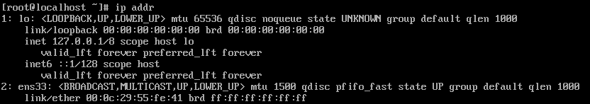
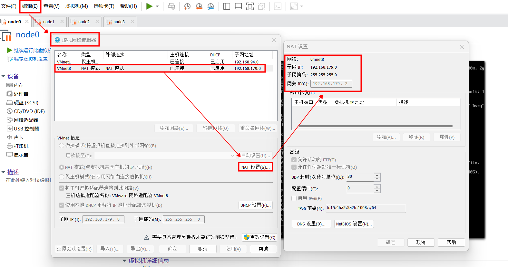
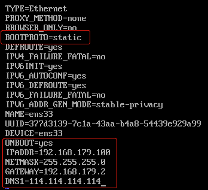
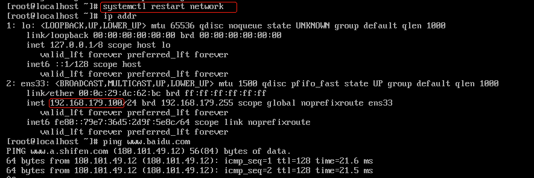

# Linux系统配置

> **系列位置**：本篇是 Hadoop 环境部署系列的第一步（[Hadoop 架构导论](/Hadoop/00-Hadoop_Overview_Architecture) → 本篇 → [单机模式](/Hadoop/02-Hadoop_Environment_Setup_SingleNode) → [伪分布式](/Hadoop/03-Hadoop_Environment_Setup_Distributed_Pseudo)）。篇幅较长，重点是用户、网络、JDK 三项。

## 用户配置

- 设置`root`用户密码；

- 添加普通用户，用户名为自己姓名全拼，如：`zhangsan`；
## 配置IP

### 查看CentOS IP

1. 输入`ip addr` 查看网卡`ip`地址，可以看到网卡`ens33`没有分配到`ip`。



### 查看`VMWare`网络配置



### 设置IP

2. 配置的静态`IP`需要为`192.168.179.x` ，其中 `2<x<128`。此处我们设置静态`IP`为`192.168.179.100`， 编辑网卡`ens33`对应的配置文件`vi /etc/sysconfig/network-scripts/ifcfg-ens33`

  

---
### 重启网络服务

2. 重启网络服务 `systemctl restart network`



​        此时网卡`ens33`的`ip`地址为 `192.168.179.100`


> 为方便复制代码，后续步骤，最好使用ssh客户端操作。


## 安装vim

```shell
[root@localhost ~]# yum -y install vim
```

## 更换软件源

CentOS 7 系统在 2024 年 6 月 30 日结束了官方维护，这意味着：
官方提供的 `mirrorlist.centos.org` 等源地址已经停止服务，无法解析或获取软件包。
你的系统里原来的 yum 源配置文件（`CentOS-Base.repo`）指向的是这些失效地址，所以执行 `yum update`、`yum install` 等命令时会报错。

yum 工具的工作依赖于 “源配置文件”—— 它就像软件包的 “下载地址列表”，如果地址失效，yum 就找不到软件，自然无法完成安装、更新等操作。

可使用官方归档源或者阿里云的归档源。

### 备份原始配置

```bash
[root@localhost ~]# cd /etc/yum.repos.d/
[root@localhost yum.repos.d]# mv CentOS-Base.repo CentOS-Base.repo.bak
```

### 更换为官方归档源

```bash
[root@localhost ~]# vim /etc/yum.repos.d/CentOS-Base.repo
[base]
name=CentOS-7 - Base - vault.centos.org
baseurl=http://vault.centos.org/7.9.2009/os/\$basearch/
gpgcheck=1
gpgkey=file:///etc/pki/rpm-gpg/RPM-GPG-KEY-CentOS-7

[updates]
name=CentOS-7 - Updates - vault.centos.org
baseurl=http://vault.centos.org/7.9.2009/updates/\$basearch/
gpgcheck=1
gpgkey=file:///etc/pki/rpm-gpg/RPM-GPG-KEY-CentOS-7
[extras]
name=CentOS-7 - Extras - vault.centos.org
baseurl=http://vault.centos.org/7.9.2009/extras/\$basearch/
gpgcheck=1
gpgkey=file:///etc/pki/rpm-gpg/RPM-GPG-KEY-CentOS-7

[centosplus]
name=CentOS-7 - Plus - vault.centos.org
baseurl=http://vault.centos.org/7.9.2009/centosplus/\$basearch/
gpgcheck=1
enabled=0
gpgkey=file:///etc/pki/rpm-gpg/RPM-GPG-KEY-CentOS-7
```


### 或者更换为阿里源

```bash
[root@localhost ~]# vim /etc/yum.repos.d/CentOS-Base.repo

[base]
name=CentOS-7.9.2009 - Base
baseurl=https://mirrors.aliyun.com/centos-vault/7.9.2009/os/$basearch/
gpgcheck=1
gpgkey=https://mirrors.aliyun.com/centos-vault/7.9.2009/os/$basearch/RPM-GPG-KEY-CentOS-7
enabled=1

[updates]
name=CentOS-7.9.2009 - Updates
baseurl=https://mirrors.aliyun.com/centos-vault/7.9.2009/updates/$basearch/
gpgcheck=1
gpgkey=https://mirrors.aliyun.com/centos-vault/7.9.2009/os/$basearch/RPM-GPG-KEY-CentOS-7
enabled=1
[extras]
name=CentOS-7.9.2009 - Extras
baseurl=https://mirrors.aliyun.com/centos-vault/7.9.2009/extras/$basearch/
gpgcheck=1
gpgkey=https://mirrors.aliyun.com/centos-vault/7.9.2009/os/$basearch/RPM-GPG-KEY-CentOS-7
enabled=1

[centosplus]
name=CentOS-7.9.2009 - Plus
baseurl=https://mirrors.aliyun.com/centos-vault/7.9.2009/centosplus/$basearch/
gpgcheck=1
gpgkey=https://mirrors.aliyun.com/centos-vault/7.9.2009/os/$basearch/RPM-GPG-KEY-CentOS-7
enabled=0
```

### 清理并重建 yum 缓存

```bash
[root@localhost yum.repos.d]# yum clean all
[root@localhost yum.repos.d]# yum makecache
```

`yum clean all`

- **核心功能**：**彻底清空 Yum 本地缓存**

  包括缓存的软件包列表、元数据、旧安装包等所有临时文件，解决缓存损坏、过期导致的报错。

2. `yum makecache`

- **核心功能**：**重新构建 Yum 缓存**

  从配置的软件源服务器，重新下载最新的软件包信息、元数据，生成新的本地缓存。

- **作用**：让 Yum 识别最新的软件版本，后续安装 / 更新软件时速度更快、信息更准确。

### 测试 yum 功能

重新执行更新命令，验证是否恢复正常：

```bash
[root@localhost ~]# yum update -y
```

检查并更新系统中所有已安装的软件包到最新版本（包含系统内核、依赖库、应用程序等）；

## 安装wget

```shell
[root@localhost ~]# yum -y install wget
```

## 修改机器名

```shell
[root@localhost ~]#  vim /etc/hostname
# 修改机器名
node0
```

## 修改hosts

```shell
[root@localhost ~]#  vim /etc/hosts
# 追加
192.168.179.100    node0
```

重启Linux。

## 停用防火墙

此处为了省事儿，直接停用防火墙，也可手动放开端口。

[手动放开端](/Linux/Linux_15_网络管理#firewall_add_port)

```shell
[root@node0 ~]# systemctl stop firewalld & systemctl disable firewalld
```

## 安装JDK

本文档使用的是`Minimal`版的` CentOS`，使用RPM的方式安装`Oracle JDK`。

rpm命令是RPM软件包的管理工具。

RPM有多种基本的模式：它们是安装、查询、验证、删除等。

- 安装模式：rpm –i

- 查询模式：rpm -q

- 验证模式：rpm –V或 -verify

- 删除模式：rpm –e

- --nodeps 如果该RPM包的安装依赖其它包，即使其它包没装，也强迫安装。

### 上传rpm安装包

略。

### 安装JDK

```shell
[root@node0 ~]# ll
total 112652
-rwxrw-rw-. 1 zhangsan zhangsan 115315748 Nov 22 04:19 jdk-8u311-linux-x64.rpm
```

### 使用rpm -i 安装jdk

```bash
[root@node0 ~]# rpm -i jdk-8u311-linux-x64.rpm 
warning: jdk-8u311-linux-x64.rpm: Header V3 RSA/SHA256 Signature, key ID ec551f03: NOKEY
Unpacking JAR files...
 tools.jar...
 plugin.jar...
 javaws.jar...
 deploy.jar...
 rt.jar...
 jsse.jar...
 charsets.jar...
 localedata.jar...
```

### 查看版本

```
[root@localhost ~]# java -version
java version "1.8.0_311"
Java(TM) SE Runtime Environment (build 1.8.0_311-b11)
Java HotSpot(TM) 64-Bit Server VM (build 25.311-b11, mixed mode)
```

### 配置环境变量

```shell
[root@node0 ~]# vim /etc/profile
export JAVA_HOME=/usr/java/default
```

### 让环境变量生效

```shell
[root@node0 ~]# source /etc/profile
```


## 修改时区

修改为上海时间

```shell
[root@node0 ~]# timedatectl set-timezone Asia/Shanghai
[root@node0 ~]# timedatectl
      Local time: Thu 2022-02-03 15:27:24 CST
  Universal time: Thu 2022-02-03 07:27:24 UTC
        RTC time: Thu 2022-02-03 07:27:24
       Time zone: Asia/Shanghai (CST, +0800)
     NTP enabled: yes
NTP synchronized: yes
 RTC in local TZ: no
      DST active: n/a
You have new mail in /var/spool/mail/root
```

## 时钟同步

如果是虚拟机（如 VMware/VirtualBox），宿主机的挂起/恢复会导致虚拟机时间剧烈跳变

### 安装ntp服务

```shell
[root@node0 ~]# yum -y install ntp
```

### 配置阿里云时钟服务器

```bash
[root@node0 ~]# sed -i '1i\tinker panic 0' /etc/ntp.conf 
[root@node0 ~]# sed -i '/^server/d' /etc/ntp.conf
[root@node0 ~]# echo "server ntp6.aliyun.com iburst" >> /etc/ntp.conf
```

字面翻译

- **tinker**：调整、修补、摆弄（这里指修改 NTP 的默认行为/参数）
- **panic**：恐慌、惊慌（这里指 NTP 检测到时间差异过大时的"保护性退出"机制）

通俗理解

- `tinker panic 0`：**关闭时间跳变恐慌保护**
  - 允许系统时间任意大幅度跳变（哪怕是几个小时），NTP 不会因此崩溃退出
- `tinker panic 1000`：**设置恐慌阈值为 1000 秒**
  - 如果时间跳变超过 1000 秒（约 16.7 分钟），NTP 就"恐慌"并退出

### 启用ntp服务

```shell
# 启动ntp 并 允许开机启动
[root@node0 ~]# systemctl start ntpd & systemctl enable ntpd
```


## 软件安装位置与所有者

在`/opt/`目录下创建`bigdata`目录，并修改目录的所有者和所属组为自己姓名全拼，如：`zhangsan`，以后用到的`Apache`大数据组件都将会安装到该目录中。

```shell
# 创建文件夹 /opt/bigdata/
[root@node0 ~]# mkdir /opt/bigdata

# 修改此文件夹的所有者和所属组为 zhangsan
[root@node0 ~]# chown zhangsan:zhangsan /opt/bigdata/

[root@node0 ~]# ls -al /opt/bigdata/
total 0
drwxr-xr-x. 2 zhangsan zhangsan  6 Feb 14 22:37 .
drwxr-xr-x. 3 root   root   21 Feb 14 22:37 ..

[root@node0 ~]# exit
exit
```

## Apache开源软件的目录结构

- **sbin**：服务端可执行程序存放目录

- **bin**：客户端可执行程序存放目录
- **conf/etc**：配置文件
- **lib/jars**：动态链接库(`so`)，或者`Java`依赖包
- **logs**：日志目录

## 软件的HOME目录

软件解压后的最外层目录，我们称为该软件的`HOME`目录，一般用`SOFTNAME_HOME`表示。

为方便直接跳转到软件`HOME`目录，我们将它们的绝对路径定义在`环境变量`中。

### HADOOP环境变量

```bash
(base) [zhangsan@node0 hadoop]$ ls -al /opt/bigdata/hadoop/
total 16
drwxrwxr-x.  5 zhangsan zhangsan   77 Feb 28 12:53 .
drwxr-xr-x. 16 zhangsan zhangsan 4096 Mar  6 14:37 ..
lrwxrwxrwx.  1 zhangsan zhangsan   12 Feb 28 12:53 default -> hadoop-3.1.3
drwxr-xr-x. 11 zhangsan zhangsan 4096 Dec 25 22:31 hadoop-2.7.3
drwxr-xr-x. 11 zhangsan zhangsan 4096 Feb 28 15:57 hadoop-3.1.3
drwxr-xr-x. 12 zhangsan zhangsan 4096 Dec 26 20:48 hadoop-3.3.6
```

> 通过为`HADOOP_HOME`创建软连接`default`，可方便的管理多个版本。
>
> 本机上同时存在多个 `Hadoop` 版本是历史遗留情况。**本系列教程统一以软连接指向的 `3.1.3` 为准**：后续所有示例 `jar` 的包名、配置文件写法与 `Web UI` 端口号，都按 `3.1.3` 讲解。

环境变量：

```bash
export HADOOP_HOME=/opt/bigdata/hadoop/default
```

