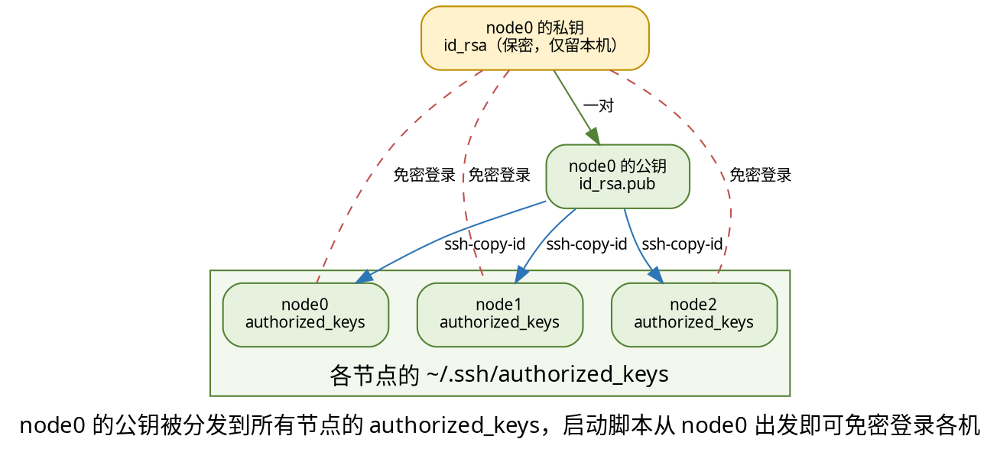

<div class="cover"><h1>SSH 免密登录</h1><p>伪分布式 / 完全分布式 / HA 的共同前置：让一台机器能无声无息地登录另一台</p></div>

# SSH 免密登录

本篇是 Hadoop 部署系列里 **03 伪分布式、04 完全分布式、05 HA** 三篇的共同前置。三篇都会用到 `start-dfs.sh` / `start-yarn.sh` 这类启动脚本，而这些脚本能否"一口气"把集群拉起来，取决于节点之间是否已经配好 SSH 免密。

所以这里把"为什么需要、原理是什么、怎么配、配错了怎么查"一次性讲透，避免在三篇里反复重复。

> 本系列实验环境统一为：机器 `node0`（`192.168.179.100`），用户 `zhangsan`，Hadoop 版本 `3.1.3`。

## 为什么 Hadoop 离不开 SSH 免密

先搞清楚启动脚本到底在干什么，才知道免密到底省掉了哪一步。

### 启动脚本的真实工作机制

`start-dfs.sh` / `start-yarn.sh` **并不是在你敲命令的那台机器上本地 fork 出进程**，它的真实流程是：

1. 读取 `workers` 文件里列出的主机清单（Hadoop 2.x 中叫 `slaves`）；
2. **通过 ssh 逐台登录**清单里的每一台主机；
3. 在远端那台机器上执行启动命令，拉起对应的守护进程（NameNode / DataNode / ResourceManager …）。

也就是说，集群里每个进程都是在"它自己所在的机器"上被 ssh 远程拉起来的。一旦某次 ssh 登录需要你手动输入密码、或手动确认主机指纹，脚本就会卡在那里等着你敲键盘——而脚本是无人值守批量跑的，于是集群起不来。

**免密不是图方便，是自动化启动的硬前提。**

### 一个反直觉的点

很多人卡在伪分布式：明明只有一台机器，为什么还要配 SSH？

答案就在上面的机制里——伪分布式时 `workers` 里只有 `node0` 自己，但启动脚本对 `localhost` / `node0` 同样是**走 ssh 登录这台机器**，登录本机照样要密码。所以哪怕只有一台机器，不做免密，`start-dfs.sh` 一样会被密码挡住。

> 这是伪分布式最容易想不通的一步：只有一台机器，却还要配 SSH 免密。根因是启动脚本统一走 ssh 登录，不分本机还是远端。

## 原理一句话讲清

不需要懂密码学，只要认清楚四个文件的分工就够了。

### 非对称加密的三个角色

SSH 免密用的是"非对称加密"（一对密钥）：

- **公钥**（`id_rsa.pub`）：可以放心公开，交给任何你想登录的机器；
- **私钥**（`id_rsa`）：必须保密，只留在本机，绝不外传；
- **登录时**：目标机器用你存放在它那里的**公钥**加密一段随机挑战，只有持有对应**私钥**的你才能解开并回应 → 从而向服务器证明"我就是被授权的人"，整个过程无需输入密码。

一句话：**公钥负责"允许谁进"，私钥负责"证明我是我"。**

### 四个文件的职责对照

| 文件 | 位置 | 作用 | 能否公开 |
| --- | --- | --- | --- |
| `id_rsa` | 本机 `~/.ssh` | 私钥，解密服务器发来的挑战 | **否**，绝不能泄露 |
| `id_rsa.pub` | 本机 `~/.ssh` | 公钥，可以被复制出去 | 是 |
| `authorized_keys` | 目标机 `~/.ssh` | 存放"被允许登录本机的所有公钥" | 是 |
| `known_hosts` | 本机 `~/.ssh` | 记录见过的服务器指纹，防伪装 | — |

免密登录的本质，就是：**把你的公钥塞进目标机的 `authorized_keys`**。

## 第一步：生成密钥对

### ssh-keygen

在 `node0` 上以 `zhangsan` 身份执行：

```shell
[zhangsan@node0 ~]$ ssh-keygen
```

执行后会在用户目录 `~` 下生成 `.ssh` 目录，内含：

- 私钥 `id_rsa`
- 公钥 `id_rsa.pub`

过程中的提示直接回车用默认值即可；尤其**不要给私钥设置口令（passphrase）**，否则每次启动集群仍然要交互输入口令，等于没免密。

```shell
[zhangsan@node0 ~]$ ssh-keygen
Generating public/private rsa key pair.
Enter file in which to save the key (/home/zhangsan/.ssh/id_rsa):   # 回车
Enter passphrase (empty for no passphrase):                        # 回车（不设口令）
Enter same passphrase again:                                       # 回车
```

> 如果已有密钥可跳过本步。想换更强算法可写 `ssh-keygen -t rsa -b 4096`。

## 第二步：把公钥交给对方（单机）

### ssh-copy-id

```shell
[zhangsan@node0 ~]$ ssh-copy-id -i node0
```

`ssh-copy-id` 会把本机公钥追加到目标机器的 `~/.ssh/authorized_keys` 中；这一步本身需要你输入一次 `zhangsan` 在 `node0` 上的密码（这是最后一次输密码）。

> `workers` 文件默认内容是 `localhost`。由于 `localhost` 与 `node0` 指向同一台机器、同一个用户，它们的 `authorized_keys` 是同一份文件。所以配好 `ssh-copy-id node0` 之后，ssh 到 `localhost` 同样免密，**一般无需修改 workers**。

### 验证

```shell
[zhangsan@node0 ~]$ ssh node0
Last login: Wed Mar 30 13:35:51 2022 from node0
[zhangsan@node0 ~]$ exit
```

直接进入、不再索要密码即为成功。记得用 `exit` 退回原终端。

## 第三步：多机互信（完全分布式 / HA）

伪分布式只需"自己免自己"，完全分布式和 HA 则是 node0 要能免密登录 node1、node2 等多台机器。

### 拓扑



### 两种策略

- **策略 A（单点控制，推荐入门）**：只在 `node0` 生成一对密钥，把 `node0` 的公钥分发到所有节点（含自己）。启动脚本从 node0 出发，就能免密登录每一台。密钥少、好管理。
- **策略 B（互信全联通）**：每台机器都各自生成密钥，并互相把公钥分发给其他所有节点。好处是任意节点都能免密操作其他节点，运维方便；。

### 分发与验证

在 `node0` 上继续：

```shell
[zhangsan@node0 ~]$ ssh-copy-id node1
[zhangsan@node0 ~]$ ssh-copy-id node2
```

过程中分别输入一次 `node1` / `node2` 上 `zhangsan` 的密码。分发后逐台验证：

```shell
[zhangsan@node0 ~]$ ssh node1 hostname
node1
[zhangsan@node0 ~]$ ssh node2 hostname
node2
```

不输密码、直接返回对方主机名即为成功。注意多机环境下**每台机器的 `/etc/hosts` 都要配好主机名→IP 映射，且各节点登录用户名保持一致（都是 `zhangsan`）**。

## 第四步：主机指纹与 known_hosts

### 首次连接的 yes 确认

第一次 ssh 到某台主机时，会看到：

```shell
[zhangsan@node0 ~]$ ssh node1
The authenticity of host 'node1 (192.168.179.101)' can't be established.
Are you sure you want to continue connecting (yes/no)? yes
```

输入 `yes` 后，对方的主机指纹会被写入本机 `~/.ssh/known_hosts`。**没确认这一步，脚本就会卡在等待输入上**，集群起不来。

```shell
Host *
    StrictHostKeyChecking no
    UserKnownHostsFile /dev/null
```

> 这两种做法都会降低安全性（放弃主机指纹校验，理论上可被中间人伪装），**只用于教学 / 隔离的内网集群**，生产环境慎用，应保留默认的主机密钥检查。

## 常见排错

免密"配了却还是让输密码"，多半是下面几类。

### 权限陷阱（最常见）

`sshd` 出于安全考虑，对 `.ssh` 目录和 `authorized_keys` 的权限极其敏感：**权限太开放时它会直接忽略 `authorized_keys`**，表现就是"明明把公钥放进去了，却还是要密码"。

```shell
[zhangsan@node0 ~]$ chmod 700 ~/.ssh
[zhangsan@node0 ~]$ chmod 600 ~/.ssh/authorized_keys
```

并且这两个文件的属主必须是你用来登录的那个用户（`zhangsan`），不是 root。

### 还是让输密码

- **用户名不一致**：`ssh node1` 默认用当前用户名 `zhangsan`；若目标机用户不同，要写成 `ssh 其他用户@node1`；
- **主机名没解析**：确认 `/etc/hosts` 里 `node1 / node2` 的映射都在，且互相能 `ping` 通；
- **SELinux / 家目录加密**：CentOS 开着 SELinux 或家目录被加密时，`authorized_keys` 可能读不到，需相应调整；
- **看服务端日志**：在目标机上 `sudo tail /var/log/secure` 能看到 sshd 拒绝的具体原因。

### 私钥设了口令

现象：ssh 仍然要输入，但输入的是 **passphrase（私钥口令）** 而不是登录密码。

- 解决：重新 `ssh-keygen`（一路回车、不设口令），或 `ssh-keygen -p` 清除旧口令。

### known_hosts 冲突

重装系统、或机器换了 IP 之后，指纹变了，再次登录会报：

```shell
@@@@@@  WARNING: REMOTE HOST IDENTIFICATION HAS CHANGED!  @@@@@@
```

- 解决：删掉旧记录再重连

```shell
[zhangsan@node0 ~]$ ssh-keygen -R node1
[zhangsan@node0 ~]$ ssh node1   # 重新 yes 确认新指纹
```

## 小结 + 阅读地图

回顾整条链路：**生成密钥对（`ssh-keygen`）→ 把公钥交给目标机（`ssh-copy-id`）→ 目标机 `authorized_keys` 收下 → 启动脚本经 ssh 免密登录、拉起各节点进程**。

- 单机 / 伪分布式，只需 `node0` 免自己（见 [Hadoop 部署（二）伪分布式](/Hadoop/03-Hadoop_Environment_Setup_Distributed_Pseudo)）；
- 多机 / 完全分布式，要把 `node0` 公钥分发到 `node1`、`node2`（见 [Hadoop 部署（三）完全分布式](/Hadoop/04-Hadoop_Environment_Setup_Distributed_Fully)）；
- HA 高可用同样依赖节点间互信（见 [Hadoop 部署（四）HA](/Hadoop/05-Hadoop_Environment_Setup_Hadoop_HA)）。
