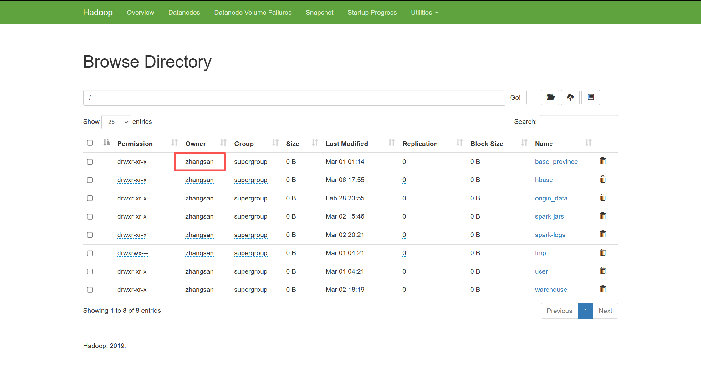
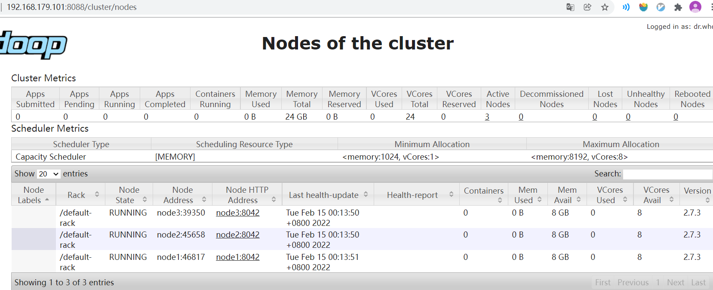
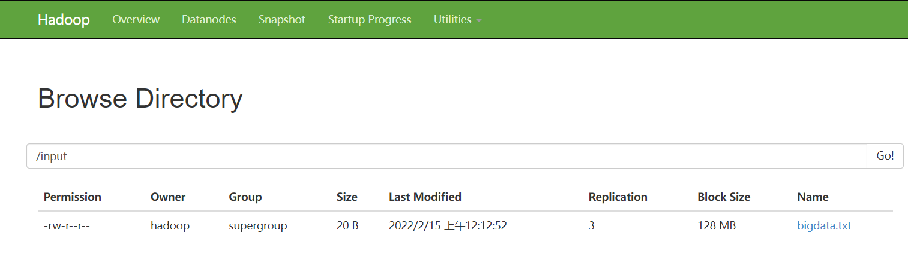
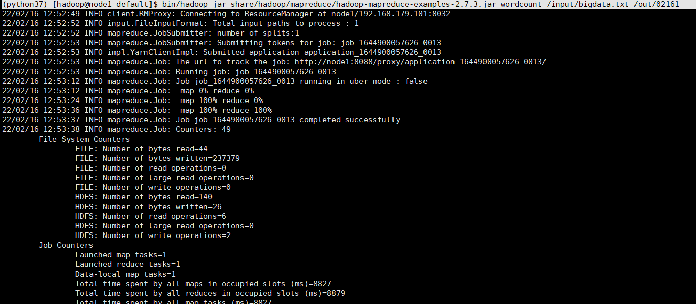

<div class="cover"><h1>Hadoop 部署（三）完全分布式</h1><p>Fully-Distributed Operation：多台机器各司其职，真正的分布式存储与计算</p></div>

# Hadoop 环境部署 - 完全分布式

> **系列位置**：本篇是 Hadoop 环境部署系列的第三步（[架构导论](/Hadoop/00-Hadoop_Overview_Architecture) → [Linux 配置](/Hadoop/01-Hadoop_Environment_Setup_Linux_config) → [单机模式](/Hadoop/02-Hadoop_Environment_Setup_SingleNode) → [伪分布式](/Hadoop/03-Hadoop_Environment_Setup_Distributed_Pseudo) → **本篇** → [HA](/Hadoop/05-Hadoop_Environment_Setup_Hadoop_HA)）。完全分布式把各角色分散到 node1 / node2 / node3 三台机器。
>
> **预备知识**：多机启动依赖 SSH 免密，原理、分发命令与排错见 [SSH 免密登录](/Hadoop/SSH_免密登录)；启动脚本为何走 ssh、各配置文件含义，建议先读 [伪分布式](/Hadoop/03-Hadoop_Environment_Setup_Distributed_Pseudo)。

> **官方文档**
>
> `https://hadoop.apache.org/docs/r3.1.3/hadoop-project-dist/hadoop-common/ClusterSetup.html`

沿用统一约定：机器 `node1 / node2 / node3` 由模板机 `node0`（`192.168.179.100`）克隆而来，IP 分别为 `101 / 102 / 103`，用户 `zhangsan`，`$HADOOP_HOME=/opt/bigdata/hadoop/default`，版本 `3.1.3`。

## 集群规划

- Hadoop 集群由两类"主从"组件构成：

  - **HDFS（分布式文件系统，解决"存"）**
    - 主：`NameNode`（管理元数据：文件的增删查、块到机器的映射）；
    - `SecondaryNameNode`（辅助，定期合并 fsimage 与 edits）
    - 从：`DataNode`（真正存数据块）
  - **YARN（资源调度，解决"算"）**
    - 主：`ResourceManager`（分配 CPU / 内存，接收作业）
    - 从：`NodeManager`（在各自机器上管 Container）
  
  > 启动入口：`start-dfs.sh` 起 HDFS，`start-yarn.sh` 起 YARN；`start-all.sh` 是二者合一（生产环境常分开起，便于定位问题）。
  
### 规划表

|       | `HDFS`                                  | `YARN`                          |
| ----- | --------------------------------------- | ------------------------------- |
| node1 | `DataNode`, `NameNode`, `historyserver` | `NodeManager`                   |
| node2 | `DataNode`                              | `NodeManager`,`ResourceManager` |
| node3 | `DataNode`, `SecondaryNameNode`         | `NodeManager`                   |

## 节点克隆与免密登录

将预配置好的机器克隆：机器名为`node1`, `node2`, `node3`，根据VMware网络信息配置合适`IP`地址，比如。

|       | `IP`            |
| ----- | --------------- |
| node1 | 192.168.179.101 |
| node2 | 192.168.179.102 |
| node3 | 192.168.179.103 |

### Hostname修改

略。

### IP修改

略。

### 配置hosts

`/etc/hosts` （对三个节点都做如下配置）

```shell
127.0.0.1   localhost localhost.localdomain localhost4 localhost4.localdomain4
::1         localhost localhost.localdomain localhost6 localhost6.localdomain6

192.168.179.101 node1
192.168.179.102 node2
192.168.179.103 node3
```

可通过`ping`命令测试映射文件配置是否正确

```shell
[root@node1 hadoop]# ping node2
PING node2 (192.168.179.102) 56(84) bytes of data.
64 bytes from node2 (192.168.179.102): icmp_seq=1 ttl=64 time=0.634 ms
```

修改完，退出`root`账号，切换到`张三`用户，后续我们使用普通用户`zhangsan`部署使用到的大数据组件。

### 免密登录

说明：这里面只配置了node1、node2到其他主机的无密登录；因为node1配置的是NameNode，node2配置的是ResourceManager，都要求对其他节点无密访问。

（1）node1上生成公钥和私钥：

```bash
[zhangsan@node1 .ssh]$ ssh-keygen -t rsa
```

然后敲（三个回车），就会生成两个文件id_rsa（私钥）、id_rsa.pub（公钥）

（2）将node1公钥拷贝到要免密登录的目标机器上

```bash
[zhangsan@node1 .ssh]$ ssh-copy-id node1
[zhangsan@node1 .ssh]$ ssh-copy-id node2
[zhangsan@node1 .ssh]$ ssh-copy-id node3
```

---

（3）node2上生成公钥和私钥：

```bash
[zhangsan@node2 .ssh]$ ssh-keygen -t rsa
```

然后敲（三个回车），就会生成两个文件id_rsa（私钥）、id_rsa.pub（公钥）

（4）将node2公钥拷贝到要免密登录的目标机器上

```bash
[zhangsan@node2 .ssh]$ ssh-copy-id node1
[zhangsan@node2 .ssh]$ ssh-copy-id node2
[zhangsan@node2 .ssh]$ ssh-copy-id node3
```

> 多机互信的原理、分发命令与常见排错，见本系列独立文档 [SSH 免密登录](/Hadoop/SSH_免密登录)。


## 上传 Hadoop 压缩包并解压

三台机器由 node0 克隆而来，node0 上已按 03 篇装好 Hadoop，克隆机通常已自带；若在某台全新机器上安装，则上传并解压到统一目录：

```bash
[zhangsan@node1 ~]$ cd /opt/bigdata/hadoop
[zhangsan@node1 hadoop]$ tar -zxvf hadoop-3.1.3.tar.gz
[zhangsan@node1 hadoop]$ pwd
/opt/bigdata/hadoop
```

## 创建软连接

```bash
[zhangsan@node1 hadoop]$ ln -s hadoop-3.1.3/ default
[zhangsan@node1 hadoop]$ ll
total 12
lrwxrwxrwx.  1 zhangsan zhangsan   12 Feb 28 12:53 default -> hadoop-3.1.3
drwxr-xr-x. 11 zhangsan zhangsan 4096 Feb 28 15:57 hadoop-3.1.3
```

## 配置环境变量

```bash
[zhangsan@node1 ~]$ vim ~/.bashrc
export HADOOP_HOME=/opt/bigdata/hadoop/default
export PATH=$PATH:$HADOOP_HOME/bin:$HADOOP_HOME/sbin
```

source一下配置文件，使环境变量生效。

```bash
[zhangsan@node1 ~]$ source ~/.bashrc 
```

## 配置文件

### hadoop-env.sh

`start-dfs.sh` 通过 ssh **远程执行非交互式命令**启动进程，这类 shell 不会加载 `~/.bashrc` / `/etc/profile`，因此脚本自己必须知道 `JAVA_HOME`。在 `hadoop-env.sh` 里写死：

```bash
export JAVA_HOME=/usr/java/default
```

> 这正是 03 篇强调过的点：远程启动进程拿不到登录 shell 的环境变量，`hadoop-env.sh` 里的 `JAVA_HOME` 是必需项，不是重复劳动。

### 	core-site.xml

```xml
    <!-- 指定NameNode的地址 -->
    <property>
            <name>fs.defaultFS</name>
            <value>hdfs://node1:8020</value>
            <!-- NameNode 的 RPC 端口：Apache 官方默认 9000，CDH 等发行版常用 8020，此处沿用 8020 -->
    </property>
    <!-- 指定hadoop数据的存储目录 -->
    <property>
            <name>hadoop.tmp.dir</name>
            <value>/opt/bigdata/hadoop/default/tmp</value>
    </property>
    <property>
        <name>hadoop.proxyuser.zhangsan.hosts</name>
        <value>*</value>
    </property>
    <property>
        <name>hadoop.proxyuser.zhangsan.groups</name>
        <value>*</value>
    </property>
```

### 	hdfs-site.xml

```xml
    <property>
        <name>dfs.replication</name>
        <value>3</value>
    </property>
    <property>
        <name>dfs.namenode.secondary.http-address</name>
        <value>node3:9868</value>
    </property>
```

### 	yarn-site.xml

```xml
     <property>
        <name>yarn.resourcemanager.hostname</name>
        <value>node2</value>
      </property>
      <property>
        <name>yarn.nodemanager.aux-services</name>
        <value>mapreduce_shuffle</value>
      </property>
      <!-- 开启日志聚集功能(默认在hdfs:/tmp/logs/) -->
      <property>
        <name>yarn.log-aggregation-enable</name>
        <value>true</value>
      </property>
      <!-- 设置日志聚集服务器地址 -->
      <property>
        <name>yarn.log.server.url</name>
        <value>http://node1:19888/jobhistory/logs</value>
      </property>
      <!-- 设置日志保留时间为7天 -->
      <property>
        <name>yarn.log-aggregation.retain-seconds</name>
        <value>604800</value>
      </property>
```

##### YARN Application Container运行日志

Whether to enable log aggregation. Log aggregation collects each container's logs and moves these logs onto a file-system, for e.g. HDFS, after the application completes. 

Users can configure the "yarn.nodemanager.remote-app-log-dir" and "yarn.nodemanager.remote-app-log-dir-suffix" properties to determine where these logs are moved to. 

```bash
[zhangsan@node2 hadoop]$ hdfs dfs -ls /tmp/logs/zhangsan/logs-tfile
drwxrwx---   - zhangsan zhangsan          0 2026-03-20 10:54 /tmp/logs/zhangsan/logs-tfile/application_1773975204382_0001
drwxrwx---   - zhangsan zhangsan          0 2026-03-20 11:25 /tmp/logs/zhangsan/logs-tfile/application_1773975204382_0002
drwxrwx---   - zhangsan zhangsan          0 2026-03-20 11:25 /tmp/logs/zhangsan/logs-tfile/application_1773975204382_0003
```

##### 如何快速查看日志

不需要手动找路径，推荐用 YARN 自带命令查看，更高效：

```bash
# 基础用法：查看 application_id 对应的日志
yarn logs -applicationId <application_id>
# 例如：
[zhangsan@node2 hadoop]$ yarn logs -applicationId application_1773975204382_0003

# 进阶：只看某个 Container 的日志
yarn logs -applicationId <application_id> -containerId <container_id>
```

### 	mapred-site.xml

```xml
    <property>
        <name>mapreduce.framework.name</name>
        <value>yarn</value>
    </property>        
    <!-- 历史服务器端地址 -->
    <property>
        <name>mapreduce.jobhistory.address</name>
        <value>node1:10020</value>
    </property>
    <!-- 历史服务器web端地址 -->
    <property>
        <name>mapreduce.jobhistory.webapp.address</name>
        <value>node1:19888</value>
    </property>
```

### slaves/workers

hadoop 2.x 从进程的配置文件为 slaves (奴隶)

hadoop 3.x 从进程的配置文件为 workers

```shell
node1
node2
node3
```

### 配置同步

使用`scp`命令将修改后的配置文件复制到其他两台机器

```shell
[zhangsan@node1 ~]$ scp -r /opt/bigdata/hadoop/hadoop-3.1.3/etc/hadoop/* zhangsan@node2:/opt/bigdata/hadoop/hadoop-3.1.3/etc/hadoop/

[zhangsan@node1 ~]$ scp -r /opt/bigdata/hadoop/hadoop-3.1.3/etc/hadoop/* 
zhangsan@node3:/opt/bigdata/hadoop/hadoop-3.1.3/etc/hadoop/
```

> **别忘了环境变量也要同步**：`~/.bashrc` 里的 `HADOOP_HOME` / `PATH` 只配在了 node1，node2 / node3 上直接敲 `hdfs`、`yarn` 仍会找不到命令。把配置也发过去并各自生效：


```bash
[zhangsan@node1 ~]$ scp ~/.bashrc node2:~/ && scp ~/.bashrc node3:~/
[zhangsan@node2 ~]$ source ~/.bashrc
[zhangsan@node3 ~]$ source ~/.bashrc
```
> 至于**远程启动**时各节点如何拿到 `JAVA_HOME`，靠的是上文 `hadoop-env.sh` 里写死的值，与 `~/.bashrc` 无关。


## 格式化

这三台机器是由`node0`克隆出来的，因此会有`node0`的脏数据。在格式化前，删除三台机器`$HADOOP_HOME/tmp`目录和`$HADOOP_HOME/logs`目录中的数据。

```shell
# 在node1格式化namenode
[zhangsan@node1 ~]$ hdfs namenode -format
```

## 启动

在集群规划时，我们设置了`node1`为`HDFS`的`NameNode`；`node2`为`YARN`的`ResourceManager`。因此：

```shell
# 在node1 上执行 start-dfs.sh , 启动 HDFS
[zhangsan@node1 ~]$ start-dfs.sh

# 在node2 上执行 start-yarn.sh , 启动 YARN
[zhangsan@node2 ~]$ start-yarn.sh

# 在node1 上 启动 JobHistoryServer  port: 19888
[zhangsan@node1 ~]$ mapred --daemon start historyserver
```

## 节点进程状态

### node1节点

```shell
[zhangsan@node1 ~]$ jps
14258 NodeManager
14579 Jps
13783 DataNode
13644 NameNode
13890 JobHistoryServer
```

### node2节点

```shell
[zhangsan@node2 ~]$ jps
4113 ResourceManager
8211 NodeManager
8382 Jps
8095 DataNode
```

### node3节点

```shell
[zhangsan@node3 ~]$ jps
3955 SecondaryNameNode
7928 DataNode
8044 NodeManager
8220 Jps
```

## Web UI

### HDFS

​	NameNode:  http://node1:50070  （Hadoop 2.x 旧端口，仅作对照）

​	NameNode:  http://node1:9870   （Hadoop 3.x 正确端口，本环境用这个）



### 	YARN

 http://node2:8088



### 测试

#### 文件准备

```shell
[zhangsan@node1 ~]$ hdfs dfs -mkdir /input

[zhangsan@node1 ~]$ hdfs dfs -ls -R /
drwxr-xr-x   - zhangsan supergroup          0 2022-02-15 00:12 /input

[zhangsan@node1 ~]$ hdfs dfs -put /home/zhangsan/bigdata.txt /input
```



#### WordCount

```shell
[zhangsan@node1 ~]$ hadoop jar $HADOOP_HOME/share/hadoop/mapreduce/hadoop-mapreduce-examples-3.1.3.jar wordcount /input/bigdata.txt /out/02161
```



#### 查看结果

```shell
[zhangsan@node1 ~]$ hdfs dfs -cat /out/02161/part-r-00000 | head
```

输出即每个单词的出现次数，证明作业真的在 YARN 上跑完、结果写回了 HDFS。同时可在 YARN Web UI（http://node2:8088）的 Finished 列表看到本次作业，点进去能查日志（见上文"如何快速查看日志"）。

### 集群进程查看脚本

` /home/zhangsan/bin/hdp.sh `    

```bash
#!/bin/bash
if [ $# -lt 1 ]
then
    echo "No Args Input..."
    exit ;
fi
case $1 in
"start")
        echo " =================== 启动 hadoop集群 ==================="

        echo " --------------- 启动 hdfs ---------------"
        ssh node1 "/opt/bigdata/hadoop/default/sbin/start-dfs.sh"
        echo " --------------- 启动 yarn ---------------"
        ssh node2 "/opt/bigdata/hadoop/default/sbin/start-yarn.sh"
        echo " --------------- 启动 historyserver ---------------"
        ssh node1 "/opt/bigdata/hadoop/default/bin/mapred --daemon start historyserver"
;;
"stop")
        echo " =================== 关闭 hadoop集群 ==================="

        echo " --------------- 关闭 historyserver ---------------"
        ssh node1 "/opt/bigdata/hadoop/default/bin/mapred --daemon stop historyserver"
        echo " --------------- 关闭 yarn ---------------"
        ssh node2 "/opt/bigdata/hadoop/default/sbin/stop-yarn.sh"
        echo " --------------- 关闭 hdfs ---------------"
        ssh node1 "/opt/bigdata/hadoop/default/sbin/stop-dfs.sh"
;;
*)
    echo "Input Args Error..."
;;
esac

```

