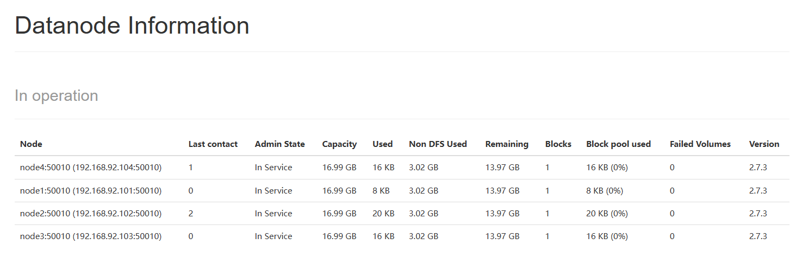
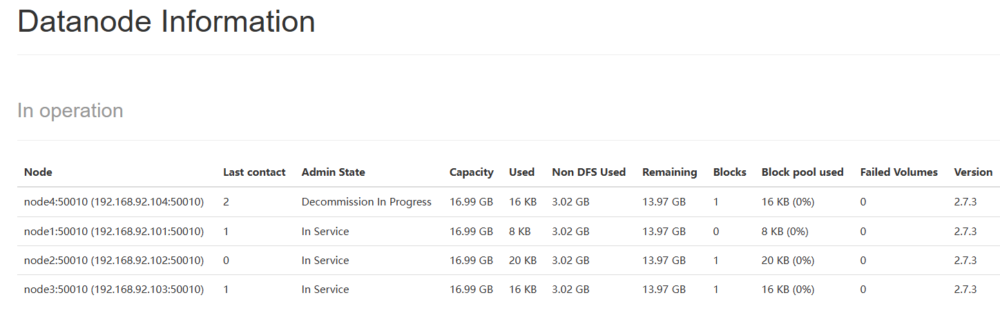
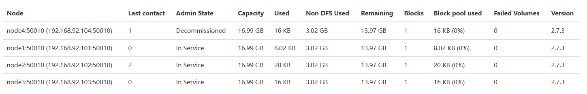

## 一、引言

1. **Hadoop HDFS简介**
   
   - 分布式文件系统概述
   - HDFS架构：NameNode与DataNode
2. **DataNode的重要性**
   - 数据存储与访问的关键角色
   - 数据完整性与高可用性的保障
   
   
   
   

## 二、DataNode工作机制

1. **启动与注册**
   - DataNode启动后向NameNode注册
   - 注册成功后，周期性向NameNode上报块信息
2. **心跳机制**
   - 心跳周期（默认每3秒一次）
   - 心跳返回结果：NameNode的命令（如复制、删除数据块）
   - 心跳超时处理（默认10分钟+30s无心跳则认为节点不可用）
3. **数据存储与管理**
   - 数据块以文件形式存储在磁盘上
   - 每个数据块包括数据文件和元数据文件（包含长度、校验和、时间戳）

## 三、实操案例演示

- ###### 假设已有Hadoop集群环境

- ###### 确认DataNode节点状态

### **1. DataNode启动与注册**

#### 1.1 新增DataNode节点

##### 配置文件

- hosts配置（all）
- ssh免密登录（master--> node4）
- `slaves`新增`node4`（all）

##### 启动DataNode和NodeManager

```shell
[zhangsan@node4 default]$ hadoop-daemon.sh start datanode
```

##### 刷新节点状态

```shell
[zhangsan@node1 ~]$ hdfs dfsadmin -refreshNodes
```



##### 负载均衡

```shell
# 设置负载均衡带宽
[zhangsan@node1 ~]$ hdfs dfsadmin -setBalancerBandwidth bytes
# 磁盘使用率阈值，单位为百分比。此命令会产生一个进程，并在logs目录输出日志；负载均衡完毕，进程结束。
# -threshold
# 默认值:10%。该值确保每个DataNode上的磁盘使用率与集群整体使用率的差距不超过10%。
[zhangsan@node1 ~]$ start-balancer.sh -threshold 1
```

> https://partners-intl.aliyun.com/help/en/e-mapreduce/latest/hdfs-balancer


#### 1.2 移除DataNode节点

##### Master配置排除节点列表

###### `hdfs-site.xml`

```xml
<property>
    <name>dfs.hosts.exclude</name>
    <value>/opt/bigdata/hadoop/hadoop-2.7.3/etc/hadoop/datanode-excludes</value>
</property>
```

###### datanode-excludes (一行一个)

```
node4
```

###### `yarn-site.xml`

```xml
<property>
    <name>yarn.hosts.exclude</name>
    <value>/opt/bigdata/hadoop/hadoop-2.7.3/etc/hadoop/nodemanager-excludes</value>
</property>
```

###### nodemanager-excludes (一行一个)

```shell
node4
```

##### 刷新节点状态

```shell
[zhangsan@node1 hadoop]$ hdfs dfsadmin -refreshNodes
```

`Decommission In Progress --> Decommissioned`






##### 停止守护进程

```shell
[zhangsan@node4 ~]$ hadoop-daemon.sh stop datanode
```

##### 查看下线情况

```shell
[zhangsan@node1 ~]$ hdfs dfsadmin -report
[zhangsan@node1 ~]$ yarn node -list
```


### 2. **心跳机制验证**

- 演示DataNode心跳发送过程
- 修改心跳间隔（通过hdfs-site.xml配置文件）

| 配置项                                  | 配置值 | 说明                                                         | 自定义 |
| --------------------------------------- | ------ | ------------------------------------------------------------ | ------ |
| dfs.heartbeat.interval                  | 3      | Determines datanode heartbeat interval in seconds.           | 3      |
| dfs.namenode.heartbeat.recheck-interval | 300000 | This time decides the interval to check for expired datanodes. With this value and dfs.heartbeat.interval, the interval of deciding the datanode is stale or not is also calculated. The unit of this configuration is millisecond. | 60000  |

- 观察NameNode对心跳超时的处理

> 默认dfs.namenode.heartbeat.recheck-interval为5分钟，dfs.heartbeat.interval默认为3秒
>
> DataNode节点掉线时限是指系统检测到DataNode不再响应的时间阈值。
>
> TimeOut假定为超长时间（默认为10分钟+30秒）：
>
> TimeOut = 2 * dfs.namenode.heartbeat.recheck-interval + 10 * dfs.heartbeat.interval
>


### **3. 数据块管理**

- 演示向HDFS写入文件，观察DataNode上数据块的变化
- 演示DataNode上数据块的删除与恢复

1. **检查集群状态**：

   ```bash
   hdfs dfsadmin -report
   ```

#### 3.1 数据块的写入

1. **创建本地文件**：
   创建一个简单的文本文件，用于写入HDFS。

   ```bash
   echo "Hello, HDFS" > localfile.txt
   ```

2. **将文件写入HDFS**：

   ```bash
   hdfs dfs -mkdir -p /user/zhangsan/
   hdfs dfs -put localfile.txt /user/zhangsan/
   ```

3. **观察DataNode上的数据块**：

   - 通过Hadoop Web UI查看：打开浏览器并访问 `http://<NameNode-IP>:50070`，导航到“DataNodes”页面，查看数据块信息。

   - 或者使用命令行：

     ```bash
     hdfs fsck /user/zhangsan/localfile.txt -files -blocks -locations
     ```

```bash
[zhangsan@node1 ~]$ hdfs fsck /user/zhangsan/localfile.txt -files -blocks -locations
Connecting to namenode via http://node1:50070/fsck?ugi=zhangsan&files=1&blocks=1&locations=1&path=%2Fuser%2Fzhangsan%2Flocalfile.txt
FSCK started by zhangsan (auth:SIMPLE) from /192.168.92.101 for path /user/zhangsan/localfile.txt at Tue Feb 18 08:24:56 CST 2025
/user/zhangsan/localfile.txt 12 bytes, 1 block(s):  OK
0. BP-1428990012-192.168.92.101-1739836208744:blk_1073741825_1001 len=12 repl=3 

[DatanodeInfoWithStorage[192.168.92.102:50010,DS-b0117f0b-206a-4cb5-8bf2-bdb0c2cf387b,DISK], 
DatanodeInfoWithStorage[192.168.92.103:50010,DS-36e58276-08e8-4a36-888e-749cad5fbdfc,DISK], 
DatanodeInfoWithStorage[192.168.92.101:50010,DS-caf1a8a6-01ac-447f-9d07-006d194e7b64,DISK]]

Status: HEALTHY
 Total size:	12 B
 Total dirs:	0
 Total files:	1
 Total symlinks:		0
 Total blocks (validated):	1 (avg. block size 12 B)
 Minimally replicated blocks:	1 (100.0 %)
 Over-replicated blocks:	0 (0.0 %)
 Under-replicated blocks:	0 (0.0 %)
 Mis-replicated blocks:		0 (0.0 %)
 Default replication factor:	3
 Average block replication:	3.0
 Corrupt blocks:		0
 Missing replicas:		0 (0.0 %)
 Number of data-nodes:		3
 Number of racks:		1
FSCK ended at Tue Feb 18 08:24:56 CST 2025 in 6 milliseconds

The filesystem under path '/user/zhangsan/localfile.txt' is HEALTHY
```

#### 3.2 数据块的删除

1. **删除HDFS中的文件**：

   ```bash
   hdfs dfs -rm /user/zhangsan/localfile.txt
   ```

2. **观察数据块的删除**：

   - 再次通过Hadoop Web UI或命令行工具检查数据块是否已被删除。
   
   ```java
   [zhangsan@node1 ~]$ hdfs fsck /user/zhangsan/localfile.txt -files -blocks -locations
   FileSystem is inaccessible due to:
   java.io.FileNotFoundException: File does not exist: /user/zhangsan/localfile.txt
   	at org.apache.hadoop.fs.FileSystem.resolvePath(FileSystem.java:753)
       ... ...
   	at org.apache.hadoop.hdfs.tools.DFSck.main(DFSck.java:377)
   
   DFSck exiting
   ```
   
   

#### 3.3 数据块的恢复

1. **准备文件**：

   ```bash
   [zhangsan@node1 ~]$ hdfs dfs -put localfile.txt /user/zhangsan/
   ```

   

2. **模拟数据块丢失**：

   - 通过关闭一个DataNode来模拟数据块丢失，然后观察Hadoop如何处理。

   ```bash
   # 手动停止DataNode2
   [zhangsan@node2 ~]$ hadoop-daemon.sh stop datanode
   ```

> 注意：默认需要等待10min+30s后，NameNode才会认为副本数减少。

1. **恢复数据块**：

   - 如果副本设置（默认是3），Hadoop会自动从其他副本中恢复数据块。

   ```bash
   # 手动启动DataNode4
   [zhangsan@node4 ~]$ hadoop-daemon.sh start datanode
   ```

   

2. **验证数据块恢复**：

   - 再次检查Hadoop Web UI或使用命令行工具验证数据块的状态。


## 四、总结与问答

1. **课程总结**
   - 回顾DataNode工作机制与实操案例演示要点
2. **问答环节**
   - 解答学员疑问
   - 讨论DataNode在实际应用中的常见问题与解决方案

## 课程注意事项

- 确保实操案例演示环境稳定，避免操作失误导致集群故障。
- 提前准备好演示所需的数据文件和配置文件。
- 鼓励学员积极参与讨论，提出自己的见解和疑问。

通过这样的课程大纲，学员可以在短时间内全面了解DataNode的工作机制，并通过实操案例演示加深理解，为后续的Hadoop HDFS运维与管理打下坚实基础。

