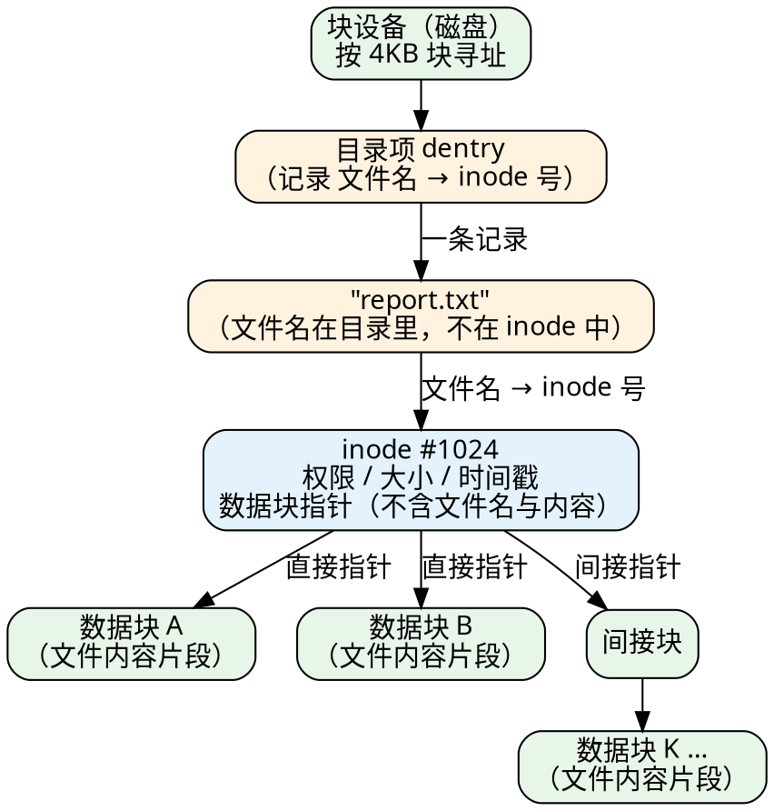
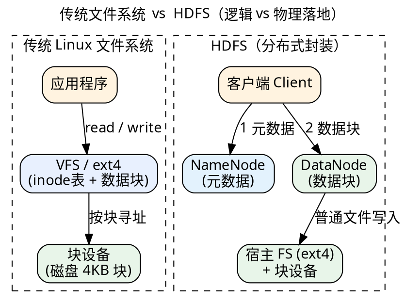
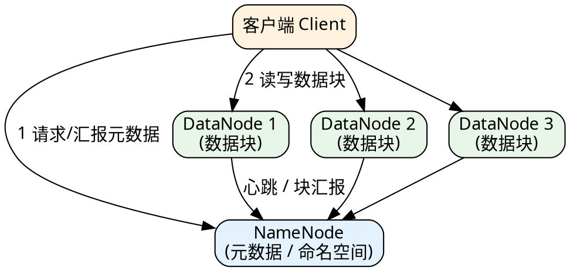
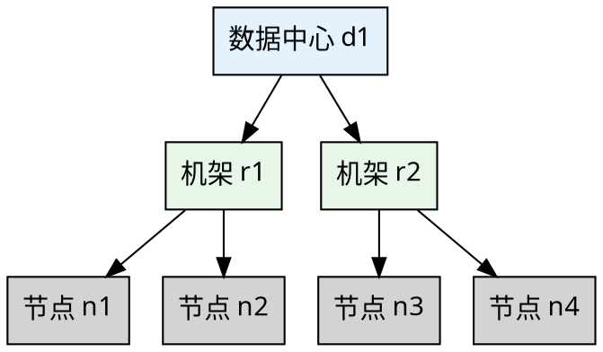
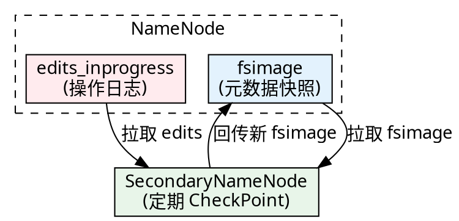
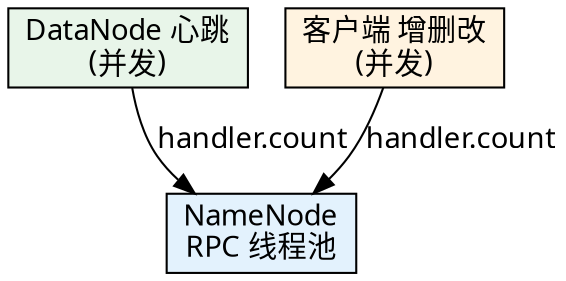

# 一、HDFS 设计原理

### 从传统文件系统说起

在介绍 HDFS 之前，先回想你经常用的 Linux 文件系统——它到底是怎么 "存下一个文件" 的？抓住两点，后面所有 HDFS 概念都能对号入座：

- **文件系统 = 元数据 + 数据块，且架在 "块设备" 之上**。磁盘只能按 "块"（扇区 512B，文件系统聚成 4KB）寻址，所以文件系统把文件切成数据块，再用一张 **元数据表（`inode`，记录权限、时间戳、大小、数据块位置，不含文件名和内容）** 指向这些数据块；文件名则放在目录项里（文件名 → inode 号）。
- **元数据与数据本就分离**。传统文件系统里，元数据（inode 表）和数据块是分开存放的——这正是 HDFS 主从架构的思想源头。

---

####  Linux 文件系统

::: cols 30:70

下面这张 "内部结构树" 把上面两点画成一张具体图（以 `report.txt` / inode #1024 为例）。补一句新信息：小文件内容只占几个数据块，大文件则会经 "间接块" 指向更多数据块——这点对应 1.3 节 HDFS 的大文件切块。

::: split



:::

####  示例元数据表

为了把抽象概念落地，下面给出上图中 `report.txt`（inode #1024）的 **元数据表**——也就是 inode 里真实存的东西。注意表里没有 "文件名" 列：文件名在目录项里，不在这里（呼应前面三件事 ①）。

| 字段 | 示例值（report.txt / inode #1024） | 说明 |
| --- | --- | --- |
| inode 号 | 1024 | 文件唯一标识（不是文件名） |
| 类型 / 权限 | 普通文件，`rw-r--r--` | mode 字段 |
| 属主 / 属组 | `zhangsan` / `zhangsan` | UID / GID |
| 硬链接数 | 1 | 有几个名字指向此 inode |
| 文件大小 | 20 MB | 逻辑字节数（`ls` 看到的） |
| 占用块数 | 5120 个 4KB 块 ≈ 20 MB | 磁盘实际占用（`du` 看到的） |
| 数据块指针 | `[块A, 块B, …, 间接块→块K]` | 指向真正装内容的数据块 |
| 时间戳 | mtime / atime / ctime | 修改 / 访问 / 变更时间 |

> 对比 HDFS：NameNode 记的正是这类 "元数据"（文件名、权限、块列表、副本、时间戳），而 **不存内容**——内容在 DataNode 的数据块里。这正是 1.0 开头说的 "元数据与数据分离" 在 HDFS 上的翻版。

---

再看它与 HDFS 的对照——HDFS 本质是 "在宿主文件系统之上叠了一层分布式封装"：NameNode 管元数据、DataNode 管数据块，而 **物理落地最终仍回到宿主文件系统的 4KB 块**。



HDFS 的 128MB Block 只是 **逻辑单位**：它决定 "文件怎么切、NameNode 怎么记账、MapReduce 怎么调度"，但 **不决定磁盘上占多少字节**——这一点会在 2.2 节展开。

### 设计目标

HDFS 是为 **海量数据、廉价硬件、一次写入多次读取** 的场景量身设计的分布式文件系统。

- 流式数据访问：适合顺序读大文件，而非低延迟随机读写。
- 容错优先：数据自动切块并多副本存储，单节点故障不丢数据。
- 移动计算比移动数据划算：计算任务调度到数据所在节点，而非把数据拉到计算端。
- 简单一致模型：文件写入后很少修改，支持追加，便于高吞吐。

### 主从架构：NameNode 与 DataNode

还记得 1.0 说的吗：传统文件系统的元数据（inode 表）与数据块本就分离。HDFS 把这个 "分离" 进一步 **分布到不同机器**——由一个 NameNode 统管元数据，多个 DataNode 分散存数据块。

HDFS 采用主从（Master/Slave）架构，一个 NameNode 统一管理元数据，多个 DataNode 存储实际数据块。



NameNode 不存数据本身，只记 "文件 → 块 → 节点" 的映射；DataNode 才是块真正的落盘者。

### 数据块与副本机制

> 衔接 1.0：传统文件系统为什么也把文件切成 4KB 块？因为磁盘只能按块寻址，以块为单位读写能 **摊销一次寻址/寻道的开销**；文件的 inode 用一串指针把分散的数据块 "串" 成一个文件，大文件还会用 **间接块** 指向更多数据块。

文件被切分为固定大小的 **块（Block）**，每个块默认保存多份 **副本（Replica）**，分散在不同节点。HDFS 的思路完全一致，只是把 4KB 放大到了 128MB——因为对跨网络的大文件来说，一次寻址/网络往返的代价更高，用大块才能让 "一次寻址后连续读一大段" 更划算；而 "大文件 = 一串 Block" 也正对应传统文件系统里 "inode 指针串起数据块"。

| 版本    | 默认块大小 | 默认副本数 |
| ------- | ---------- | ---------- |
| 1.x     | 64MB       | 3          |
| 2.x/3.x | 128MB      | 3          |
| 本地模式 | 32MB       | 1          |

##### 磁盘与Block

| 硬盘类型         | 硬盘速度 | 建议 Block 大小 |
| ---------------- | -------- | --------------- |
| 普通机械硬盘     | 100MB/s  | 128MB           |
| 固态硬盘（普通） | 300MB/s  | 256MB           |
| 固态硬盘（高级） | 600MB/s  | 512MB           |

块为什么要这么大？减少元数据量、降低寻址开销、让顺序读更连续，从而提升大文件吞吐。

#### 数据块大小确定

**实验验证**（Hadoop 3.1.3 伪分布式实测）：分两步——

**① 造数据**

**② 看它怎么被切块**

##### **① 造一个 200MB 的测试文件**

```bash
# 第 1 步：造一个 200MB 的测试文件（数据准备）
# dd: 按块拷贝、生成文件的工具；bs: block size
$ dd if=/dev/zero of=/tmp/lab_big.bin bs=1M count=200
200+0 records in
200+0 records out
209715200 bytes (210 MB) copied, 0.15 s, 1.4 GB/s
$ ls -lh /tmp/lab_big.bin
-rw-rw-r--. 1 zhangsan zhangsan 200M Jul  2 07:59 /tmp/lab_big.bin
```

##### **② 上传 HDFS 并查看切块**

```bash
# 第 2 步：上传到 HDFS 并查看切块情况
$ hdfs dfs -mkdir -p /user/zhangsan/lab
$ hdfs dfs -put -f /tmp/lab_big.bin /user/zhangsan/lab/
$ hdfs fsck /user/zhangsan/lab/lab_big.bin -files -blocks -locations
/user/zhangsan/lab/lab_big.bin 209715200 bytes, replicated: replication=1, 2 block(s):  OK
0. BP-470267532-192.168.107.100-1782951018062:blk_1073741826_1002 len=134217728 Live_repl=1 [192.168.107.100:9866,DISK]
1. BP-470267532-192.168.107.100-1782951018062:blk_1073741827_1003 len=75497472  Live_repl=1 [192.168.107.100:9866,DISK]
...
Status: HEALTHYb
```

209715200 字节被切成 **2 块**：`134217728`（正好 128MB）+ `75497472`（72MB 余数）。前若干块按块大小切满，最后一块是余数——和 1.0 里 "inode 用指针串起一串数据块" 是同一个思路，只是粒度从 4KB 放大到 128MB。

> 顺带一个 Hadoop 3 的变化：DataNode 数据传输端口这里是 **9866**（2.x 是 50010），NameNode Web UI 也从 50070 改成了 **9870**，看输出时别按老端口找。
>
> 实验收尾清理：`hdfs dfs -rm -r /user/zhangsan/lab` 与 `rm -f /tmp/lab_big.bin`。（后文 2.2 与 9.2 的实验还会用到 `/user/zhangsan/lab` 与这个 200MB 文件，想连着做可以先不删。）


## 二、机架感知与副本放置策略

机架感知依赖 "节点距离" 计算，而集群真实拓扑可通过管理命令查看。

#### 节点距离计算

**节点距离** = 两个节点到达最近 **共同祖先节点** 的距离总和。



距离示例：

- 同节点 `/d1/r1/n1 , /d1/r1/n1` = 0
- 同机架不同节点 `/d1/r1/n1 , /d1/r1/n2` = 2
- 同数据中心不同机架 `/d1/r1/n1 , /d1/r2/n3` = 4
- 不同数据中心 `/d1/r1/n1 , /d2/r3/n4` = 6

#### 副本存放策略

**副本存放策略** 决定副本存到哪些节点：既要可靠（跨机架），又要高效（同机架带宽大）。


放置规则：
- 副本 1 在客户端所在节点（集群外则随机）；
- 副本 2 放另一机架的随机节点；
- 副本 3 放副本 2 所在机架的随机节点。
前两点保证跨机架可靠，后两点利用同机架高带宽。

## 三、 元数据持久化

> 传统文件系统的 inode 表同样既在 **磁盘** 上有固定结构，又会在运行时被缓存进内存以加速访问。HDFS 走得更彻底——把元数据 **全量搬进 NameNode 内存** 来换读写速度，代价是必须靠磁盘文件（fsimage + edits）在重启后恢复，否则内存一丢元数据就没了。

NameNode 的元数据由 **内存镜像 + 磁盘文件** 共同保证：fsimage 是某一时刻的完整快照，edits 是此后的操作日志。



CheckPoint 把 fsimage 与 edits 合并成新的 fsimage，避免 NameNode 重启时重放海量日志。合并工作交由 SecondaryNameNode（或 HA 下的 Standby NameNode）完成，不阻塞主节点。

## 四、写流程与读流程

写入是 "先登记元数据、再建管道、流式复制、最后提交" 的过程；读取是 "问位置、就近直连、按块拼接"。


读取时 NameNode 只返回块所在的 DataNode 列表（按距离排序），真正的数据流在客户端与 DataNode 之间直连，NameNode 不当中转。


## 五、NameNode 运维

对应 1.2/1.5 的原理：NameNode 是单点元数据中枢，它的心跳感知、内存占用、RPC 线程池直接决定集群的可用性与吞吐。

### NameNode 与 DataNode 心跳/超时

DataNode 通过心跳向 NameNode 报活与汇报块信息，超时未报活即被判离线。

- DataNode 启动时汇报本节点托管的 Block，此后默认每 **6 小时** 汇报一次块信息。
- 每 **3 秒** 发送一次心跳；NameNode 在 **10 分钟 + 30 秒** 未收到心跳即认为该节点挂掉。

超时公式：

```text
Timeout = 2 * dfs.namenode.heartbeat.recheck-interval + 10 * dfs.heartbeat.interval
```

| property                                | value    | description                                                  |
| --------------------------------------- | -------- | ------------------------------------------------------------ |
| dfs.blockreport.intervalMsec            | 21600000 | 块汇报间隔（毫秒）                                           |
| dfs.datanode.directoryscan.interval     | 21600    | DataNode 扫描目录、核对内存与磁盘块差异的间隔（秒，6 小时）  |
| dfs.namenode.heartbeat.recheck-interval | 300000   | 检查过期 DataNode 的间隔（毫秒）                             |
| dfs.heartbeat.interval                  | 3        | DataNode 心跳间隔（秒，可加 ms/s/m/h/d 后缀）                |

### NameNode 内存估算与配置

> 衔接 1.0：传统文件系统的每个 inode 也要占空间（磁盘上的 inode 表 + 目录项）。HDFS 把这份 "每文件/每块的元数据" 从磁盘搬进了 NameNode 内存——所以下面每个 Block 约占用 **150 Byte**，指的就是这笔内存账。

NameNode 把元数据全量放在内存，每个 Block 约占用 **150 Byte**。

- 128G 内存约可存储 `128 * 1024^3 / 150 ≈ 9.1 亿` 个文件块。
- 最小内存 1GB；每增加 100 万个文件，增加约 1GB 内存。

| Hadoop 版本 | NameNode 默认内存 |
| ----------- | ----------------- |
| 2.x         | 2000MB            |
| 3.x         | 动态分配          |

配置文件 `hadoop-env.sh`，通过 `HADOOP_NAMENODE_OPTS` 指定堆大小：

```shell
# 配置 NameNode 使用 3GB 内存
export HADOOP_NAMENODE_OPTS="-Xmx3072m"
```

查看内存占用（先用 `jps` 取 NameNode 进程号）：

```shell
$ jmap -heap <pid>
```

参考：https://blog.csdn.net/weixin_45417821/article/details/121041810

### NameNode 工作线程池

NameNode 的 RPC 线程池同时处理 DataNode 的并发心跳与客户端的并发增删改请求。



### 配置项

配置项 `dfs.namenode.handler.count`（默认 10）：

```xml
<property>
  <name>dfs.namenode.handler.count</name>
  <value>10</value>
  <description>The number of Namenode RPC server threads 
      that listen to requests from clients.</description>
</property>
```

经验公式（n 为 DataNode 个数）：

```text
dfs.namenode.handler.count = 20 * log(n)
# 3 台 DataNode：20 * log(3) ≈ 21，可配置为 21
```

