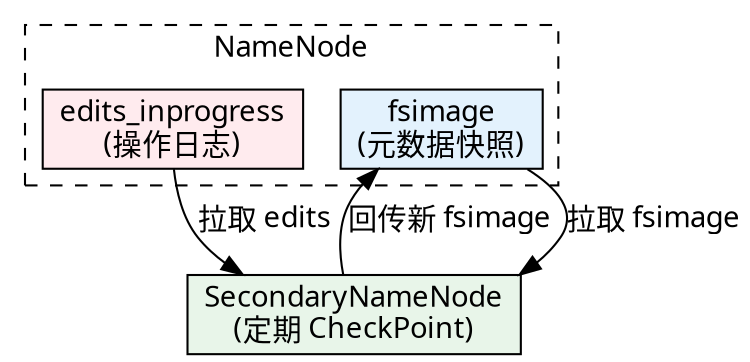

<div class="cover"><h1>Hadoop HDFS 用户高级操作</h1><p>FSCK·元数据解析·扩展属性</p></div>

## fsck文件检查

`hdfs fsck` 检查指定路径下文件的块分布、副本数与健康状态，是排查损坏/缺失块的首选命令。

```shell
hdfs fsck <path> [-move | -delete | -openforwrite] [-files [-blocks [-locations | -racks]]]
#   -files       打印被检查的文件
#   -blocks      打印块信息
#   -locations   打印每个块的位置
#   -racks       打印节点网络拓扑
```

#### 检查示例

（注意 3.x 的 NameNode Web 端口为 **9870**）：

```shell
[zhangsan@node0 subdir0]$ hdfs fsck /user/zhangsan/hadoop-3.1.3.tar.gz -files -blocks -locations

Connecting to namenode via http://node0:9870/fsck?ugi=zhangsan&files=1&blocks=1&locations=1&path=%2Fuser%2Fzhangsan%2Fhadoop-3.1.3.tar.gz
/user/zhangsan/hadoop-3.1.3.tar.gz 214092195 bytes, 2 block(s):  OK
# BP：Block Pool；len：块长 134217728 = 128MB；repl：副本数 = 3
0. BP-...:blk_1073741825_1001 len=134217728 repl=3
   [DatanodeInfoWithStorage[192.168.179.103:50010,...DISK],
    DatanodeInfoWithStorage[192.168.179.102:50010,...DISK],
    DatanodeInfoWithStorage[192.168.179.101:50010,...DISK]]
Status: HEALTHY
 Total blocks (validated):  2 (avg. block size 107046097 B)
 Minimally replicated blocks:  2 (100.0 %)
 Under-replicated blocks:  0 (0.0 %)
 Corrupt blocks:  0
 The filesystem under path '/user/zhangsan/hadoop-3.1.3.tar.gz' is HEALTHY
```

参考：https://hadoop.apache.org/docs/r3.1.3/hadoop-project-dist/hadoop-hdfs/HdfsUserGuide.html


## CheckPointing 合并机制

CheckPoint 把 fsimage 与 edits 合并为新的 fsimage，让 NameNode 直接加载终态而非重放日志，缩短启动时间。



#### 合并触发条件

合并触发条件（参考：https://hadoop.apache.org/docs/r3.1.3/hadoop-project-dist/hadoop-hdfs/HdfsUserGuide.html#Secondary_NameNode ）：

- 每隔 **1 小时** 执行一次；
- 或操作条数达到 **100 万** 时立即执行。

| properties                       | default              |
| -------------------------------- | -------------------- |
| `dfs.namenode.checkpoint.period` | 1 hour by default    |
| `dfs.namenode.checkpoint.txns`   | 1 million by default |


## 元数据离线解析

fsimage 与 edits 是 NameNode 的 "数据库"，无法在线读取，需用离线工具查看；CheckPoint 机制解释它们如何合并。

### 格式化 NameNode

`hdfs namenode -format` 在 `hadoop.tmp.dir` 目录下生成初始的 fsimage 等元数据文件。

```shell
[zhangsan@node0 ~]$ cd /opt/bigdata/hadoop/default/dfs/name/current
[zhangsan@node0 current]$ ll
total 16
-rw-rw-r--. 1 zhangsan zhangsan  355 Oct  1 05:56 fsimage_0000000000000000000
-rw-rw-r--. 1 zhangsan zhangsan   62 Oct  1 05:56 fsimage_0000000000000000000.md5
-rw-rw-r--. 1 zhangsan zhangsan    2 Oct  1 05:56 seen_txid
-rw-rw-r--. 1 zhangsan zhangsan  207 Oct  1 05:56 VERSION
```

### oiv：离线查看 fsimage

`oiv`（Offline Image Viewer）把 fsimage 转储为人类可读格式，支持 XML / FileDistribution / Delimited 等 Processor。

参考：https://hadoop.apache.org/docs/r3.1.3/hadoop-project-dist/hadoop-hdfs/HdfsImageViewer.html

用法：

```shell
bin/hdfs oiv -p XML -i fsimage -o fsimage.xml
#   -p | --processor   解析方式
#   -i | --inputFile    输入的 fsimage
#   -o | --outputFile   输出文件
#   -h | --help
```

#### XML Processor解析

XML Processor 示例（结构节选）：

```shell
[zhangsan@node0 current]$ hdfs oiv -i fsimage_0000000000000000000 -p XML -o ~/fsimage.xml
```

##### 解析结果

```xml
<fsimage>
  <NameSection>
    <lastAllocatedBlockId>1073741824</lastAllocatedBlockId>
    <txid>0</txid>
  </NameSection>
  <INodeSection>
    <lastInodeId>16385</lastInodeId>
    <inode>
      <id>16385</id>
      <type>DIRECTORY</type>
      <permission>zhangsan:supergroup:rwxr-xr-x</permission>
      <nsquota>9223372036854775807</nsquota>
      <dsquota>-1</dsquota>
    </inode>
  </INodeSection>
</fsimage>
```

##### 注意

注意：**fsimage 不保存块的物理分布**；块位置由 DataNode 启动时上报给 NameNode。

`<INodeSection>` 里每个 `<inode>` 记录的，正是 1.0 讲过的那种元数据：`id`、`type`、`name`、`permission`，文件节点还带 `replication`、`perferredBlockSize`（注意 Hadoop 源码里就是这个拼写）和 `<blocks>` 块列表——**唯独没有 "文件路径" 和 "文件内容"**，完美对应 1.0 那棵 "内部结构树"：文件名在目录项里、内容在数据块里，inode 只管元数据与指针。


#### Delimited Processor解析

Delimited Processor 一行概括整棵树：

```shell
[zhangsan@node0 current]$ hdfs oiv -i fsimage_0000000000000000000 -p Delimited -o ~/fsimage.delimited
[zhangsan@node0 current]$ cat ~/fsimage.delimited
/	0	1970-01-01 08:00	1970-01-01 08:00	0	0	0	9223372036854775807	-1	rwxr-xr-x	zhangsan	supergroup
```

### oev：离线查看 edits

`edits` 记录 HDFS 的每一次操作日志，需用 `oev`（Offline Edits Viewer）解析，支持 XML / stats 等 Processor。

参考：https://hadoop.apache.org/docs/r3.1.3/hadoop-project-dist/hadoop-hdfs/HdfsEditsViewer.html

用法：

```shell
bin/hdfs oev -p xml -i edits -o edits.xml
```

#### edits 解析

上传 `hadoop-3.1.3.tar.gz` 后，edits 关键记录（节选）：

```shell
[zhangsan@node0 current]$ hdfs dfs -put /opt/bigdata/hadoop/hadoop-3.1.3.tar.gz /user/zhangsan
[zhangsan@node0 current]$ hdfs oev -i edits_inprogress_0000000000000000001 -p XML -o ~/edits.xml
```


##### 解析结果

```xml
<EDITS>
  <RECORD><OPCODE>OP_START_LOG_SEGMENT</OPCODE><DATA><TXID>1</TXID></DATA></RECORD>
  <RECORD><OPCODE>OP_MKDIR</OPCODE><DATA><TXID>2</TXID><PATH>/user</PATH>...</DATA></RECORD>
  <RECORD><OPCODE>OP_MKDIR</OPCODE><DATA><TXID>3</TXID><PATH>/user/zhangsan</PATH>...</DATA></RECORD>
  <RECORD><OPCODE>OP_ADD</OPCODE><DATA><TXID>4</TXID><PATH>/user/zhangsan/hadoop-3.1.3.tar.gz._COPYING_</PATH><REPLICATION>3</REPLICATION><BLOCKSIZE>134217728</BLOCKSIZE>...</DATA></RECORD>
  <RECORD><OPCODE>OP_ALLOCATE_BLOCK_ID</OPCODE><DATA><TXID>5</TXID><BLOCK_ID>1073741825</BLOCK_ID></DATA></RECORD>
  <RECORD><OPCODE>OP_ADD_BLOCK</OPCODE><DATA><TXID>7</TXID>...<BLOCK_ID>1073741825</BLOCK_ID>...</DATA></RECORD>
  <RECORD><OPCODE>OP_CLOSE</OPCODE><DATA><TXID>11</TXID><PATH>/user/zhangsan/hadoop-3.1.3.tar.gz</PATH><REPLICATION>3</REPLICATION>...</DATA></RECORD>
</EDITS>
```

要点：写文件先 `OP_ADD`（含块大小 134217728 = 128MB、副本 3），再逐块 `OP_ALLOCATE_BLOCK_ID` + `OP_ADD_BLOCK`，最后 `OP_CLOSE` 文件对外可见。


## 文件系统扩展属性

### 概念：什么是扩展属性

**扩展属性**（Extended Attributes，简称 xattr）是文件系统提供的一种元数据机制，用来给文件或目录附加一组“键值对”信息。

- 它不改变文件内容
- 也不等同于文件大小、权限、时间戳这些传统属性。

可以把它理解为贴在文件上的“自定义标签”：

```shell
文件名：/data/report.csv
普通属性：大小、权限、属主、mtime
扩展属性：
  user.department = finance
  user.classification = internal
  user.retention_days = 365
```

#### 关键术语

| 术语     | 含义                                                      |
| -------- | --------------------------------------------------------- |
| 命名空间 | 扩展属性名称前缀，如：                                    |
|          | Linux 的 `user.`、`trusted.`、`security.`；               |
|          | HDFS 的 `user.`、`trusted.`、`system.`、`raw.`            |
| 名称     | 完整键名，如 `user.department`                            |
| 值       | 与键关联的数据，存储形态为字节数组；语义上可为经字符编码（如 UTF-8）得到的文本，也可为无编码约定的原始二进制 |
| inode    | 文件系统中描述文件元数据的结构，扩展属性通常与 inode 关联 |

#### 命名空间与权限

HDFS 命名空间类似但由 HDFS 自己定义：

| 命名空间   | 用途               | 权限                         |
| ---------- | ------------------ | ---------------------------- |
| `user.`    | 用户自定义元数据   | 普通用户可操作，需路径写权限 |
| `trusted.` | 特权标签           | 需要 HDFS 超级用户           |
| `system.`  | HDFS 内部使用      | 用户通常不可设置             |
| `raw.`     | HDFS 内部/超级用户 | 不推荐普通用户使用           |

### 应用

#### Linux 扩展属性

##### 前置：安装 attr 工具
`setfattr` / `getfattr` 来自 `attr` 软件包，非系统自带。最小化安装的 CentOS 7 默认没有，会报 `command not found`。先安装再使用：

```bash
[root@node0 ~]# yum install -y attr
[root@node0 ~]# which setfattr getfattr   # 确认可用
```

##### 常用参数

| 参数        | 所属命令            | 含义                                             |
| ----------- | ------------------- | ------------------------------------------------ |
| `-n <名称>` | setfattr / getfattr | 指定属性名（含命名空间，如 `user.department`）。 |
| `-v <值>`   | setfattr            | 指定属性值（字符串，或 `0x` 开头的十六进制）；   |
| `-d`        | getfattr            | dump：列出文件的所有扩展属性                     |
| `-m <正则>` | getfattr            | match：按正则过滤属性名。默认只显示 `user.*`；   |
| `-x <名称>` | setfattr            | 删除（remove）指定名称的扩展属性                 |

##### Linux 扩展属性示例

**1. 准备一个测试文件**

```bash
[zhangsan@node0 ~]$ touch report.txt
```

**2. 设置第一个扩展属性**

```bash
[zhangsan@node0 ~]$ setfattr -n user.department -v finance report.txt
```

**3. 再设置第二个扩展属性**

```bash
[zhangsan@node0 ~]$ setfattr -n user.classification -v internal report.txt
```

**4. 读取全部扩展属性**

```bash
[zhangsan@node0 ~]$ getfattr -d -m - report.txt
```

> `-m` 的 `-` 为特殊值，表示匹配全部命名空间（不加则默认只显示 `user.*`）


#### HDFS 扩展属性

##### 启用与限制

相关配置通常位于 `hdfs-site.xml`：

官方文档（hdfs-default.xml）：<https://hadoop.apache.org/docs/r3.1.3/hadoop-project-dist/hadoop-hdfs/hdfs-default.xml>

###### dfs.namenode.xattrs.enabled

```xml
<property>
  <name>dfs.namenode.xattrs.enabled</name>
  <value>true</value>
</property>
```

是否启用 XAttr 支持。默认值为 `true`（较新 Hadoop 版本通常已开启）；若集群为性能或管控目的显式关闭，需设回 `true` 后才能使用扩展属性。

###### dfs.namenode.fs-limits.max-xattrs-per-inode

```xml
<property>
  <name>dfs.namenode.fs-limits.max-xattrs-per-inode</name>
  <value>32</value>
</property>
```

每个 inode 允许设置的 XAttr 最大数量，默认 32。超过此上限的设置会失败。

###### dfs.namenode.fs-limits.max-xattr-size

```xml
<property>
  <name>dfs.namenode.fs-limits.max-xattr-size</name>
  <value>16384</value>
</property>
```

单个 XAttr 的「名称 + 值」合计最大字节数，默认 16384（16 KB）；硬性上限为 32768。值越大占 NameNode 内存越多。

> XAttr 会占用 NameNode 内存，并写入 editlog/fsimage，不宜滥用。

##### HDFS 扩展属性示例

###### 1. 准备：创建目录并上传测试文件

先建好目标目录，把本地 `report.txt` 上传到 HDFS，作为后续操作的载体。

```bash
[zhangsan@node0 ~]$ hdfs dfs -mkdir /data/
[zhangsan@node0 ~]$ hdfs dfs -put report.txt /data/report.txt
```

###### 2. 设置扩展属性

用 `-setfattr` 给文件打上 `user.department = finance` 这个自定义标签。

```bash
[zhangsan@node0 ~]$ hdfs dfs -setfattr -n user.department -v finance /data/report.txt
```

###### 3. 读取指定的扩展属性

用 `-getfattr -n <名称>` 只查看某一个属性的值。

```bash
[zhangsan@node0 ~]$ hdfs dfs -getfattr -n user.department /data/report.txt
```

###### 4. 转储（dump）全部扩展属性

用 `-getfattr -d` 列出该文件的所有扩展属性（默认仅显示 `user.*` 命名空间）。

```bash
[zhangsan@node0 ~]$ hdfs dfs -getfattr -d /data/report.txt
```

###### 5. 删除扩展属性

用 `-setfattr -x <名称>` 移除指定属性。

```bash
[zhangsan@node0 ~]$ hdfs dfs -setfattr -x user.department /data/report.txt
```

###### 6. 再次确认已删除

再次 dump，可见 `user.department` 已不再存在。

```bash
[zhangsan@node0 ~]$ hdfs dfs -getfattr -d /data/report.txt
# file: /data/report.txt
```

##### 扩展属性设置示例-trusted	

###### 1. 超级用户设置 trusted.url

`trusted.*` 命名空间为特权标签，仅超级用户可写。以超级用户 `zhangsan` 身份设置成功。

```bash
[zhangsan@node0 current]$ hdfs dfs -setfattr -n trusted.url -v http://hadoop.apache.org /data/report.txt
```

###### 2. 普通用户设置则无权限

新增普通用户 `lisi` 执行同样命令，HDFS 校验命名空间权限后拒绝，抛出 `AccessControlException: Permission denied`（`trusted.*` 要求超级用户）。

```bash
[lisi@node0 ~]$ hdfs dfs -setfattr -n trusted.url -v https://hadoop.apache.org /data/report.txt
```

#### 注意事项与排错

1. **不要存大值**：XAttr 存在 NameNode 元数据中，过大会增加内存和 editlog 压力。
2. **注意数量限制**：默认每 inode 约 32 个，值约 16 KB，具体以集群配置为准。
3. **权限问题**：`user.*` 需写权限；`trusted.*` 需超级用户；`system.*`、`raw.*` 不建议业务使用。
7. **频繁修改有成本**：XAttr 变更会写 NameNode editlog，不要把它当高频数据库使用。

