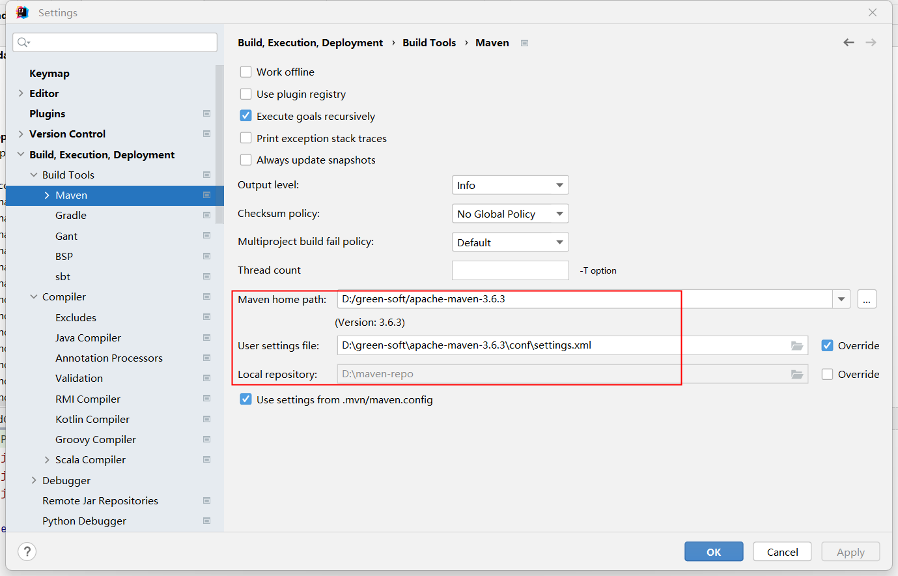
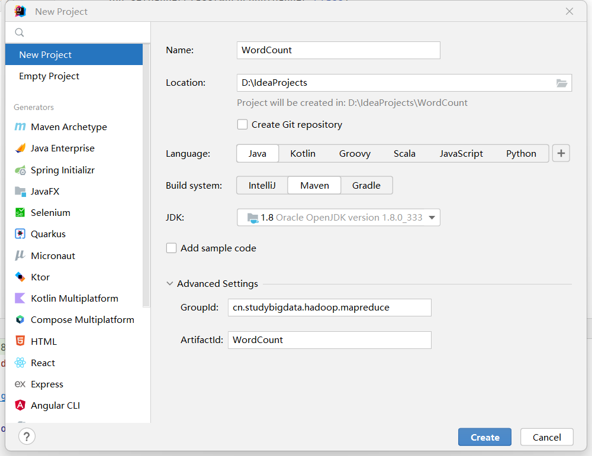
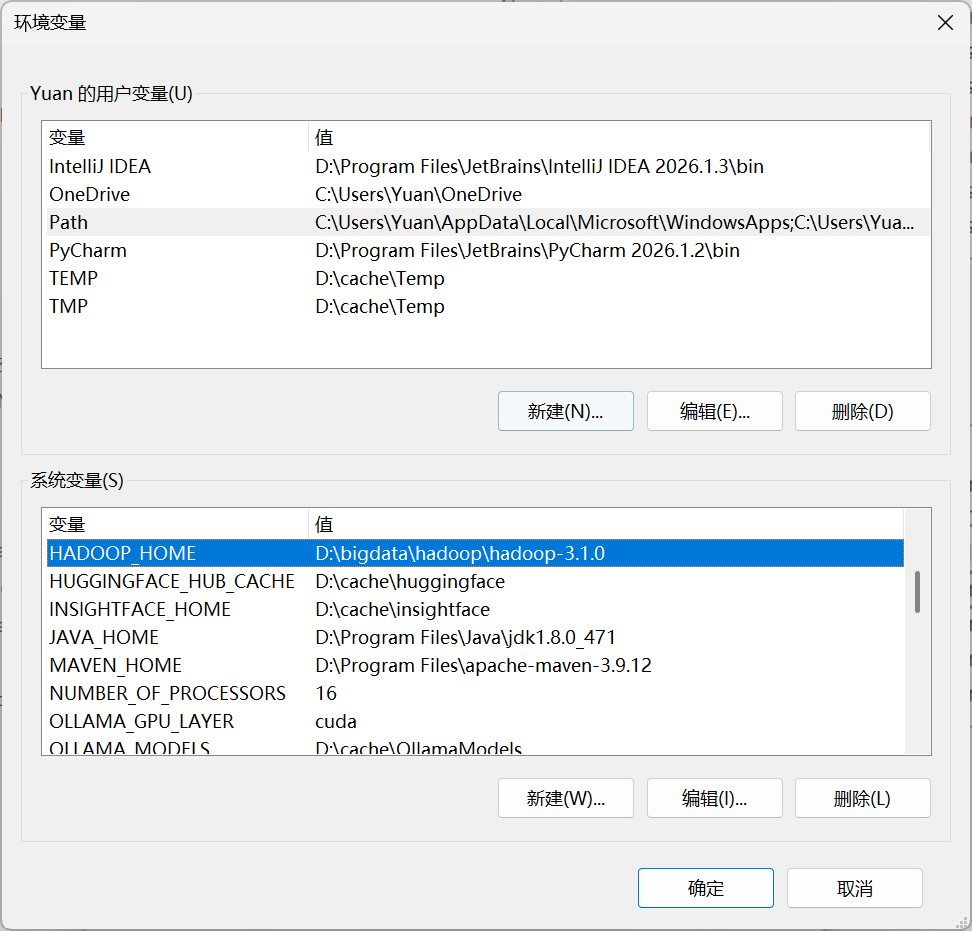
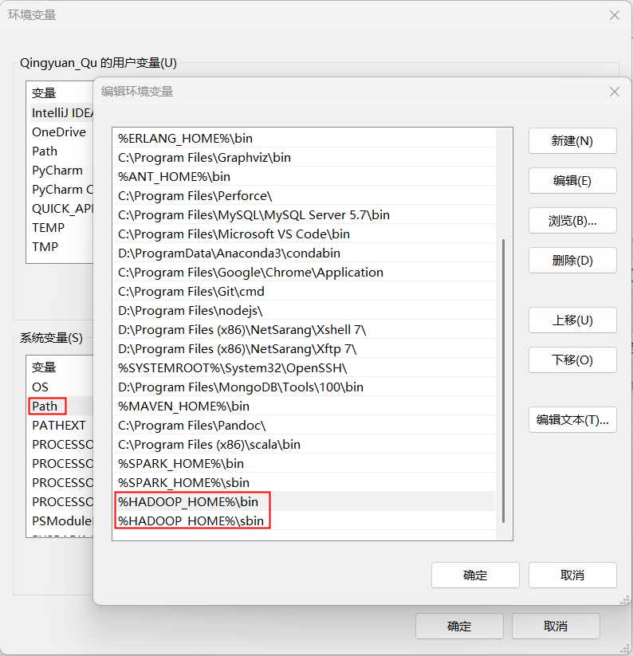

# Windows开发环境搭建

### Maven

#### Maven下载

```http
https://archive.apache.org
```

> 直接解压已经提供的压缩包即可

#### Maven配置

##### MAVEN_HOME/conf/settings.xml

```xml
<!-- 本地仓库: 根据自己的情况修改保存位置 -->
<localRepository>D:\cache\mvn-repo</localRepository>
 
<!-- 远程仓库: aliyun仓库 -->
<mirrors>
    <mirror>
        <id>alimaven</id>
        <name>aliyun maven</name>
        <url>http://maven.aliyun.com/nexus/content/groups/public/</url>
        <mirrorOf>central</mirrorOf>        
    </mirror>
</mirrors>
```

### IDEA

```http
https://www.jetbrains.com/idea/download/?section=windows
```

> 直接使用提供的安装包即可。

### IDEA绑定Maven



### 创建Maven项目



### 安装Hadoop

#### 替换bin目录

```http
https://github.com/cdarlint/winutils
# 或者超星学习通下载
# 资料-第二章-apache-hadoop-3.1.0-winutils-master.zip
```

> 直接解压压缩包即可，如`D:\bigdata\hadoop\hadoop-3.1.0`

### 配置HADOOP环境变量

##### HADOOP_HOME




##### PATH




### Dependency

```xml
<dependency>
    <groupId>org.apache.hadoop</groupId>
    <artifactId>hadoop-client</artifactId>
    <version>3.1.3</version>
</dependency>
```


### HDFS

```java
package com.studybigdata.hadoop.hdfs;

import org.apache.hadoop.conf.Configuration;
import org.apache.hadoop.fs.FileSystem;
import org.apache.hadoop.fs.Path;
import java.net.URI;

public class hdfs {
    public static void main(String[] args) {
        URI uri = null;
        FileSystem fs = null;
        try {
            uri = new URI("hdfs://node0:9000/");
            Configuration conf = new Configuration();
            fs = FileSystem.get(uri, conf, "zhangsan");
            System.out.println("FileSystem 连接成功: " + fs.getUri());

            Path src = new Path("D:\\bigdata.txt");
            Path dst = new Path("/user/zhangsan/hadoop/hdfs/bigdata.txt"); // 写到具体文件名
            fs.copyFromLocalFile(src, dst);
            System.out.println("上传完成，开始校验...");

            System.out.println(fs.exists(dst) ? "success" : "failed: 文件未找到");
        } catch (Exception e) {
            System.err.println("===== 发生异常 =====");
            System.err.println("URI: " + uri);
            e.printStackTrace();
            System.exit(1);
        } finally {
            try { if (fs != null) fs.close(); } catch (Exception ignore) {}
        }
    }
}
```


