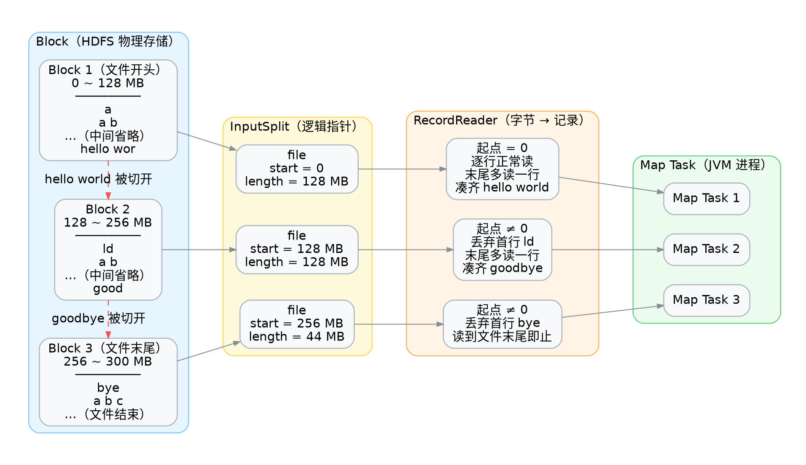

<div class="cover"><h1>分片与并行度</h1><p>一个 Map 到底处理多少数据</p></div>

## 概览

跑一个 WordCount 到底起了几个 map？答案不在代码里，而在**输入文件被切成几片**。这一篇把 Block、Split、Map 三者的关系讲清楚。

### 三组单位，三个层

| 概念 | 所在层 | 由谁决定 | 管的是什么 |
|---|---|---|---|
| **Block** | HDFS 存储层 | `dfs.blocksize`（默认 128 MB） | 文件在磁盘上怎么切、副本怎么存 |
| **Split** | MapReduce 计算层 | `InputFormat` | 一个 map 任务负责哪一段数据 |
| **Map Task** | 执行层 | = Split 数 | 真正跑起来的那个 JVM 进程 |

三者本来分属不同层、互不相干，**只是默认值恰好让它们数量相等**。

### 关系链

```text
1 个 Split  ≈ 1 个 Block
1 个 Map 处理 1 个 Split
Map 数 ≈ Split 数 ≈ Block 数
```

第一行的 `≈` 是重点：它只在默认情况下成立，而且**只是近似**。下面逐条解释。

## 理论篇：这条链是怎么成立的

### Split 大小怎么算出来

`FileInputFormat` 的算法就一行：

```java
splitSize = max(minSize, min(maxSize, blockSize))
```

三个入参的来源与默认值：

| 参数 | 默认值 | 含义 |
|---|---|---|
| `mapreduce.input.fileinputformat.split.minsize` | 1 | split 的下限 |
| `mapreduce.input.fileinputformat.split.maxsize` | `Long.MAX_VALUE` | split 的上限 |
| `dfs.blocksize` | 128 MB | HDFS 块大小 |

把默认值代进去，`splitSize = max(1, min(∞, 128MB)) = 128MB` —— 正好等于块大小。**所以"1 Split ≈ 1 Block"是默认参数算出来的结果，不是设计上的绑定。**

这也意味着调参就能改变 map 数：

| 目标 | 做法 | 结果 |
|---|---|---|
| 切得更细、map 更多 | `maxsize` 设成小于块大小 | split 变小，map 数变多 |
| 切得更粗、map 更少 | `minsize` 设成大于块大小 | split 变大，map 数变少 |

### Split 是逻辑的，Block 是物理的

这是理解整条链的关键区别：

```java
public abstract class InputSplit {
    public abstract long getLength();
    public abstract String[] getLocations();  // 数据在哪几台机器上
}
```

split 里没有数据，只有 **（文件路径, 起始偏移, 长度, 位置列表）** 四个描述项，本质上是一段"指针"。

那为什么默认让它等于块大小？为了让**"一段计算"正好落在"一块数据"上**。调度器看 `getLocations()` 就能把 map 任务派到存着这块数据的机器上跑，省掉跨网络读文件。这就是常说的数据本地性（data locality）。

### 为什么是 ≈ 而不是 =

因为**一条记录可能横跨两个块**。下图是一个 300 MB 的文本：前两块各 128 MB，第三块只剩 44 MB；而一行 `hello world` 恰好横跨 Block 1 的末尾与 Block 2 的开头。



注意图中每个 Split 各自挂着一个 RecordReader——它们是**三个互相独立的实例**，分别跑在各自的 JVM 里，谁也不知道别人的存在。记录不被切断，靠的是每个 RecordReader 都自己遵守下面两条规则：

| 情况 | 处理 |
|---|---|
| split 起点不是文件开头 | 丢弃第一条记录（它是上一条记录的残尾） |
| 读到 split 末尾但行还没结束 | **继续多读一行**，保证最后一条记录完整 |

红色虚线箭头标出的就是被切开的地方。两条规则是**成对生效**的：Split 1 多读一行把 `hello world` 读全，Split 2 就丢掉开头的 `ld`；Split 2 多读一行把 `goodbye` 读全，Split 3 就丢掉开头的 `bye`。于是每一行**既没被切坏，也没被数两遍**。

顺着这个机制再算一笔账。split 的读取窗口是 `[start, start + length)`，长度确实等于 `splitSize`；但起点非 0 时要先吃掉残尾，**这段残尾占的是窗口内的字节**，末尾又可能多溢出一行：

```text
实际读取字节 = length − 残尾长度 + 末行溢出长度
```

它围绕 `splitSize` 小幅波动，并不严格相等。所以"一个 map 处理 128 MB"只是近似描述——准确的说法是：一个 map 负责一段**长度约为 128 MB 的逻辑区间**，并保证区间内的记录条条完整。这就是那个 `≈` 的全部含义。

### 会打破这条链的四种情况

| 输入情况 | Split 数 | 原因 |
|---|---|---|
| 可切分的大文本文件 | ≈ Block 数 | 默认按块大小等分 |
| **gzip 等不可切分压缩** | 每文件 1 个 | 无法在中间定位记录边界 |
| **大量小文件** | = 文件数 | 每个文件至少 1 个 split，哪怕只有 1 KB |
| **NLineInputFormat** | = 总行数 / N | 按行切，跟块大小无关 |

小文件那条尤其值得警惕：**每个 split 起一个 map task，每个 task 是一个独立的 JVM 进程**。文件只有几 KB 时，JVM 启动开销远大于真正的计算量。解决办法是用 `CombineFileInputFormat` 把小文件打包成更大的 split。

### Map 数 vs Reduce 数

这两个数字来源完全不同，初学者常混为一谈：

| | 由什么决定 | 怎么改 |
|---|---|---|
| **Map 数** | 输入数据（Split 数） | **不能直接设置**，只能通过 split 大小参数间接影响 |
| **Reduce 数** | 与输入无关，默认 1 | `job.setNumReduceTasks(n)` 显式设置 |

由此得出一个反直觉的结论：**加机器不会增加 map 数**。集群有 10 台机器、输入只有 1 个 split，那就只会起 1 个 map，剩下 9 台闲着。并行度是被"输入切成几片"锁死的。

## 实训篇：观察 map 数

### 步骤一：从日志里读出来

提交作业后，日志开头会打印一行：

```text
INFO  [org.apache.hadoop.mapreduce.JobSubmitter] - number of splits:1
```

这个数字就是即将启动的 map task 数量。用 `bigdata.txt`（几十字节）跑，必然是 1。

### 步骤二：先算后跑

| 输入 | Block 大小 | Split 数 | Map 数 |
|---|---|---|---|
| 300 MB 文本 | 128 MB | 3 | 3 |
| 1 GB 文本 | 128 MB | 8 | 8 |
| 1000 个 1 KB 小文件 | 128 MB | 1000 | 1000 |
| 500 MB gzip 压缩包 | 128 MB | 1 | 1 |

第一行值得多想一步：300 MB 的第 3 个块只装了 44 MB，但 split 的边界仍按块对齐，只是记录可能跨到第 3 块的末尾之外。

### 步骤三：改 split 上限验证

```shell
hadoop jar hadoop-1.0-SNAPSHOT.jar \
  -D mapreduce.input.fileinputformat.split.maxsize=67108864 \
  com.studybigdata.hadoop.mapred.awordcount.WordCountMain \
  /input /output/wordcount
```

把上限设成 64 MB 后，同样大小的输入应当看到 `number of splits` 翻倍。**这是验证本节结论最直接的一个实验**——改一个参数，看一个数字。

## 常见坑

### 坑一：以为 map 数可以直接设置

| 现象 | 原因 | 修法 |
|---|---|---|
| 设置了 `mapreduce.job.maps` 不生效 | 它只是提示值，对 `FileInputFormat` 无效 | 改 split 大小参数来间接调整 |

### 坑二：调 reduce 数时以为在调并行度上限

map 数和 reduce 数来源完全不同，前者由输入决定，后者要显式设置（默认 1）。

| 现象 | 原因 | 修法 |
|---|---|---|
| 输出只有 1 个 `part-r-00000` | reduce 数默认 1 | `job.setNumReduceTasks(n)` |
| 想减少输出文件数 | 同上 | 调小 n，或 n=1 |

### 坑三：小文件场景照搬"map 数 ≈ block 数"

| 现象 | 原因 | 修法 |
|---|---|---|
| 小文件作业极慢 | 每个小文件一个 JVM 进程 | `CombineFileInputFormat` 打包，或先合并文件 |

### 坑四：gzip 输入只有 1 个 map

| 现象 | 原因 | 修法 |
|---|---|---|
| 大文件却只有 1 个 map，跑很久 | gzip 不可切分，整个文件算 1 个 split | 换可切分压缩（bzip2 / 带索引的 LZO），或预先拆成多个文件 |

### 坑五：担心 split 会把一行切成两半

不会。分片的边界按字节切，但**记录的完整性由 RecordReader 保证**，见上文那两条规则。

| 现象 | 原因 | 修法 |
|---|---|---|
| 输出行数与预期不符 | 通常是分割逻辑问题，不是 split 切坏了行 | 检查 `split()` 的分隔符 |

## 小结

并行度不是你写在代码里的，而是**由输入数据切成几片**决定的。默认 1 Split = 1 Block = 1 Map，只是默认值凑巧相等。

### 三句话回顾

- Block 是存储单位，Split 是计算单位，它们分属两层，只是默认大小相等。
- 1 个 map task 处理 1 个 Split，这条是硬保证；但 Split 边界可能因记录跨块而略微外扩，所以是 `≈`。
- map 数不能设置、只能靠 split 大小间接影响；reduce 数与之无关，默认 1，必须显式指定。

### 与下一案例的衔接

理解了分片，再看"分组汇总"就会多一个视角：map 数由输入决定，而 reduce 数才决定最终输出几个文件——这两个数字各管一段，别混着调。

<div class="end"><h1>分片与并行度</h1><p>下一案例：分组汇总</p></div>
