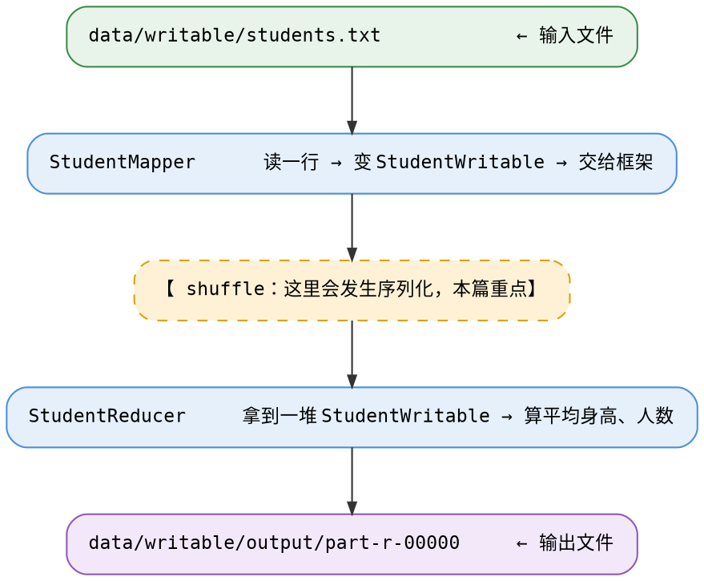

# 第 5 篇 终点：MapReduce 里的序列化

> 前四篇全在本地打转：把对象写进一个 `.bin` 文件，再读回来。
>
> 这一篇终于到了序列化真正派上用场的地方——**跨机器传输**。

## 5.1 先回顾：前面那些例子都用了哪些 Writable

你之前跑的 WordCount 和 DeptSalary 两个作业，用的都是 Hadoop 自带的类型：

```java
// WordCountMapper
public class WordCountMapper extends Mapper<LongWritable, Text, Text, IntWritable> {
    context.write(new Text(word), new IntWritable(1));
}

// DeptSalaryMapper
public class DeptSalaryMapper extends Mapper<LongWritable, Text, Text, IntWritable> {
    context.write(new Text(dept), new IntWritable(salary));
}
```

`Text`、`IntWritable`、`LongWritable` —— 这三个都是 `org.apache.hadoop.io` 包里的类。它们有一个共同点：**全都实现了 `Writable` 接口**。

`Text` 大致长这样（简化）：

```java
public class Text implements Writable {
    private byte[] bytes;

    public void write(DataOutput out) throws IOException {
        // 把字符串写成字节
    }

    public void readFields(DataInput in) throws IOException {
        // 把字节读回字符串
    }
}
```

`IntWritable` 也一样：

```java
public class IntWritable implements Writable {
    private int value;

    public void write(DataOutput out) throws IOException {
        out.writeInt(value);
    }
}
```

看到了吗？**`IntWritable.write` 里面就是一句 `out.writeInt(value)`。**和第 4 篇的 `StudentWritable`、第 2 篇的 `DataOut`，是同一套写法。

也就是说：前面两个作业看着没提"序列化"，其实每一行 `context.write` 背后都在用它，只不过用的是现成的类。

### 问答 5-1：每次都 new 会怎样

#### 问题

`WordCountMapper` 里写的是 `new IntWritable(1)`，每次都 `new` 一个新对象。但如果每次都 `new`，一行有 10 个单词就要造 10 个 `IntWritable`。你觉得 Hadoop 内部真的会造这么多对象吗？

#### 答案

**你写的那个 `new` 确实会造，但真正传输时不会带这么多对象过去。**

要分清两件事：

1. **你代码里的 `new`** —— 每次调用都会真实创建一个 `IntWritable`。这部分是实打实的开销，写多了确实浪费。
2. **框架传输时** —— `context.write` 会立刻把这个对象**序列化成字节**放进缓冲区。之后它就不再是对象了，而是一串字节。

所以到 Reducer 那边，看到的是字节重新填回的那**一个**对象（5.9 节讲）。百万条记录，内存里也只有那么一两个对象。

这也解释了为什么 5.6 节把 `outValue` 提到方法外面——**既然 write 之后就能复用，就没必要每次都造新的。** 这是 Hadoop 里很常见的优化写法。

## 5.2 这一篇要看的是"自己定义的 Writable"

`mapred/cserializable/` 这个包和那两个作业有什么区别？

| 作业 | map 输出的 value 类型 | 谁定义的 |
|---|---|---|
| WordCount | `IntWritable` | Hadoop 自带 |
| DeptSalary | `IntWritable` | Hadoop 自带 |
| **StudentAvg** | **`StudentWritable`** | **我们自己写的（第 4 篇）** |

所以这一篇的重点不是"MR 怎么写"（那个你已经在 WordCount 里学过了），而是：

> **当 key/value 是我们自己定义的类时，序列化这件事怎么走通。**

## 5.3 一眼看全：三个文件各管什么



三个类分工：

| 类 | 角色 | 负责 |
|---|---|---|
| `StudentMapper` | 映射 | 把每行 CSV 解析成一个 `StudentWritable` |
| `StudentReducer` | 归约 | 把这个 key 下所有学生聚合成平均值 |
| `StudentAvgJob` | 驱动 | 把前两个装进一个 Job，然后启动 |

## 5.4 输入数据长什么样

`data/writable/students.txt`，五行，每行一个学生：

```csv
1,张三,180.0
2,李四,165.5
3,王五,172.3
4,赵六,178.8
5,孙七,160.0
```

格式是 `id,name,height`，用逗号分隔。这就是要解析的目标。

## 5.5 StudentMapper：先看清楚它的四个类型参数

```java
public class StudentMapper extends Mapper<LongWritable, Text, Text, StudentWritable> {
```

`Mapper` 后面那四个泛型，意思分别是：

```java
Mapper<  输入的 key ,     输入的 value , 输出的 key ,  输出的 value  >
        LongWritable       Text          Text      StudentWritable
        └── 行偏移量 ──┘  └─ 行内容 ─┘  └─ "all" ─┘  └── 一个学生 ──┘
```

对照 WordCount 的 `Mapper<LongWritable, Text, Text, IntWritable>`：

- 前两个一样：输入永远是"行偏移量 + 行内容"，因为用的是文本读取。
- 后两个不同：WordCount 输出 `<单词, 1>`，这里输出 `<all, 一个学生对象>`。

**第 4 个参数 `StudentWritable`，就是本篇的主角。**

## 5.6 StudentMapper：逐步写出来

先声明两个字段。注意它们在类级别，不在 `map` 方法里面：

```java
private final Text outKey = new Text("all");
private final StudentWritable outValue = new StudentWritable();
```

为什么要放在外面？因为 `map` 方法每读一行就要调用一次。如果每次都在方法里 `new`，五行数据就要 `new` 五次。放在外面，就只 `new` 一次，反复改值 —— 这是 Hadoop 里常见的写法。


## 5.7 StudentMapper 完整代码

```java
package com.studybigdata.hadoop.mapred.cserializable;

import com.studybigdata.hadoop.java.entity.StudentWritable;
import org.apache.hadoop.io.LongWritable;
import org.apache.hadoop.io.Text;
import org.apache.hadoop.mapreduce.Mapper;

import java.io.IOException;

/**
 * Map：把每行 "id,name,height" 文本解析成一个 StudentWritable 作为 value 传给 Reduce。
 * key 统一用 "all"，把所有学生聚到同一个 Reducer 做全班统计。
 */
public class StudentMapper extends Mapper<LongWritable, Text, Text, StudentWritable> {

    private final Text outKey = new Text("all");
    private final StudentWritable outValue = new StudentWritable();

    @Override
    protected void map(LongWritable key, Text value, Context context)
            throws IOException, InterruptedException {
        String line = value.toString().trim();
        if (line.isEmpty()) {
            return;
        }
        String[] parts = line.split(",");
        if (parts.length < 3) {
            return;
        }
        outValue.setId(Integer.parseInt(parts[0].trim()));
        outValue.setName(parts[1].trim());
        outValue.setHeight(Double.parseDouble(parts[2].trim()));
        context.write(outKey, outValue);
    }
}
```

## 5.8 最关键的：序列化在这里发生

现在停下来，认真看这一句：

```java
context.write(outKey, outValue);
```

`outValue` 是一个 `StudentWritable` 对象，它活在 Mapper 所在的那台机器的内存里。

但 Reducer 在**另一台机器**上。这个对象怎么过去？

```graphviz
digraph MapperReducer {
    rankdir=LR;
    graph [
        fontname="Helvetica",
        bgcolor="white",
        nodesep=0.6,
        ranksep=1.4,
        splines=ortho
    ];
    node [
        fontname="Courier",
        fontsize=11,
        shape=box,
        style="rounded,filled",
        fillcolor="#F5F5F5",
        color="#555555",
        margin="0.15,0.1"
    ];
    edge [
        fontname="Helvetica",
        fontsize=10,
        color="#333333",
        arrowsize=0.8
    ];

    /* ---------- Mapper 机器 ---------- */
    subgraph cluster_mapper {
        label="Mapper 机器";
        fontname="Helvetica-Bold";
        fontsize=13;
        color="#4A90D9";
        style="rounded,dashed";
        margin=14;

        mapper_node [
            label=<<table border="0" cellborder="0" cellspacing="0" cellpadding="3">
                <tr><td colspan="2" align="left"><b>StudentWritable</b></td></tr>
                <tr><td align="left">id</td><td align="left">= 1</td></tr>
                <tr><td align="left">name</td><td align="left">= "张三"</td></tr>
                <tr><td align="left">height</td><td align="left">= 180.0</td></tr>
            </table>>
        ];
    }

    /* ---------- Reducer 机器 ---------- */
    subgraph cluster_reducer {
        label="Reducer 机器";
        fontname="Helvetica-Bold";
        fontsize=13;
        color="#4A90D9";
        style="rounded,dashed";
        margin=14;

        reducer_node [
            label=<<table border="0" cellborder="0" cellspacing="0" cellpadding="3">
                <tr><td colspan="2" align="left"><b>StudentWritable</b></td></tr>
                <tr><td align="left">id</td><td align="left">= 1</td></tr>
                <tr><td align="left">name</td><td align="left">= "张三"</td></tr>
                <tr><td align="left">height</td><td align="left">= 180.0</td></tr>
            </table>>
        ];
    }

    /* ---------- 网络传输通道 ---------- */
    network [
        shape=box,
        style="rounded,filled",
        fillcolor="#FFF4D6",
        color="#D9A400",
        fontname="Helvetica-Bold",
        fontsize=12,
        label="网络"
    ];

    /* ---------- 连线 ---------- */
    mapper_node -> network [
        label="① out.write(dos)\n变成字节",
        fontcolor="#1F6FB2"
    ];

    network -> reducer_node [
        label="② in.readFields(dis)\n到对岸再变回对象",
        fontcolor="#1F6FB2"
    ];
}
```



框架不能直接传对象 —— 网络只能传字节。

## 5.9 StudentReducer：读的是一堆"同一个实例"

```java
public class StudentReducer extends Reducer<Text, StudentWritable, Text, Text> {
```

四个泛型是：

```java
Reducer< 输入 key ,    输入 value ,    输出 key ,  输出 value >
          Text      StudentWritable    Text        Text
          "all"        一个学生        "平均身高"   "171.32"
```

`reduce` 方法的签名里有 `Iterable<StudentWritable> values`：

```java
protected void reduce(Text key, Iterable<StudentWritable> values, Context context)
```

因为 Mapper 把所有学生的 key 都设成了 `"all"`，所以这五个学生会全部落到同一个 Reducer、同一次 `reduce` 调用里。`values` 就是这五个学生。

遍历求和：

```java
int count = 0;
double sum = 0.0;
for (StudentWritable stu : values) {
    sum += stu.getHeight();
    count++;
}
```

这里有个必须知道的点：

> **这个 `Iterable` 里，从头到尾只有同一个 `StudentWritable` 实例。**

框架为了省内存，不会真的造五个对象塞进一个列表。它只造**一个**，每次循环前调一次 `readFields` 把下一个学生的值填进去。

所以：

```java
for (StudentWritable stu : values) {
    sum += stu.getHeight();   // ✓ 正确：当场取值，用完就丢
    count++;
}
```

这样写是对的，因为每轮循环里 `stu` 都是刚填好的值。

但这样写就错了：

```java
List<StudentWritable> list = new ArrayList<>();
for (StudentWritable stu : values) {
    list.add(stu);            // ✗ 危险：加进去的是同一个对象的引用
}
// 循环结束后，list 里 5 个元素全是同一个对象，值都是最后一个学生的
```

因为五个位置装的都是同一个引用的副本，循环结束后那个对象里留着最后一个学生的数据。这就是代码注释里说的"经典坑"。

**规则很简单：在循环里就地取值，不要把对象存起来。**

## 5.10 StudentReducer 完整代码

```java
package com.studybigdata.hadoop.mapred.cserializable;

import com.studybigdata.hadoop.java.entity.StudentWritable;
import org.apache.hadoop.io.Text;
import org.apache.hadoop.mapreduce.Reducer;

import java.io.IOException;

/**
 * Reduce：接收同一个 key 下的若干 StudentWritable，聚合出全班平均身高与人数。
 */
public class StudentReducer extends Reducer<Text, StudentWritable, Text, Text> {

    @Override
    protected void reduce(Text key, Iterable<StudentWritable> values, Context context)
            throws IOException, InterruptedException {
        int count = 0;
        double sum = 0.0;
        for (StudentWritable stu : values) {
            sum += stu.getHeight();
            count++;
        }
        double avg = count == 0 ? 0.0 : sum / count;
        context.write(new Text("平均身高"), new Text(String.format("%.2f", avg)));
        context.write(new Text("学生人数"), new Text(String.valueOf(count)));
    }
}
```

求平均的部分：

```java
double avg = count == 0 ? 0.0 : sum / count;
```

`count == 0` 时直接给 0 是防御性的写法 —— 万一 `values` 是空的，防止除零。

输出两行：

```java
context.write(new Text("平均身高"), new Text(String.format("%.2f", avg)));
context.write(new Text("学生人数"), new Text(String.valueOf(count)));
```

`String.format("%.2f", avg)` 保留两位小数。

`String.valueOf(count)` 把 `int` 转成字符串。

输出的 key 和 value 都是 `Text`，不是 `StudentWritable` —— 因为最终结果是要给人看的文本，没必要再包一层对象。

## 5.11 StudentAvgJob：Driver

Driver 的作用是"把前面两个类装进一个作业，然后启动"。
你在 `WordCountMain` 里已经见过这个套路，这里只挑**和序列化有关的**部分说。

```java
Configuration conf = new Configuration();
Job job = Job.getInstance(conf, "student-average");
job.setJarByClass(StudentAvgJob.class);

job.setMapperClass(StudentMapper.class);
job.setReducerClass(StudentReducer.class);
```

这三句是标准的：配置 + 建作业 + 指定两个类。

接下来四句，是**类型声明**：

```java
job.setMapOutputKeyClass(Text.class);
job.setMapOutputValueClass(StudentWritable.class);

job.setOutputKeyClass(Text.class);
job.setOutputValueClass(Text.class);
```

| 设置 | 值 | 含义 |
|---|---|---|
| `setMapOutputKeyClass` | `Text` | Mapper 输出的 key 是字符串 |
| `setMapOutputValueClass` | **`StudentWritable`** | Mapper 输出的 value 是一个学生 |
| `setOutputKeyClass` | `Text` | 最终结果的 key 是文本 |
| `setOutputValueClass` | `Text` | 最终结果的 value 是文本 |

**为什么非要写这些？** 因为前面 5.8 节说的那段框架代码，得知道"该用哪个类去 `new` 空对象"。

回想第 4 篇的空构造：

```java
public StudentWritable() {
}
```

框架在反序列化时的第一步是 `valueClass.newInstance()`，`valueClass` 就来自这里的 `setMapOutputValueClass(StudentWritable.class)`。

**如果 `StudentWritable` 没有无参构造，这一行就会抛异常，作业直接失败。**
第 4 篇讲的"必须有无参构造"，到这一行才显现出必要性。


## 5.12 StudentAvgJob 完整代码

```java
package com.studybigdata.hadoop.mapred.cserializable;

import com.studybigdata.hadoop.java.entity.StudentWritable;
import org.apache.hadoop.conf.Configuration;
import org.apache.hadoop.fs.Path;
import org.apache.hadoop.io.Text;
import org.apache.hadoop.mapreduce.Job;
import org.apache.hadoop.mapreduce.lib.input.FileInputFormat;
import org.apache.hadoop.mapreduce.lib.output.FileOutputFormat;

/**
 * Driver：组装并启动"全班平均身高与人数"统计作业。
 */
public class StudentAvgJob {

    public static void main(String[] args) throws Exception {
        // 本地直接 Run 时不传参，用项目根目录下的默认路径；也可在 IDE 的 Program arguments 传 in out
        String input = args.length > 0 ? args[0] : "data/writable/students.txt";
        String output = args.length > 1 ? args[1] : "data/writable/output";

        Configuration conf = new Configuration();
        Job job = Job.getInstance(conf, "student-average");
        job.setJarByClass(StudentAvgJob.class);

        job.setMapperClass(StudentMapper.class);
        job.setReducerClass(StudentReducer.class);

        // Map 输出类型：Hadoop 据此为 StudentWritable 选择对应的序列化器
        job.setMapOutputKeyClass(Text.class);
        job.setMapOutputValueClass(StudentWritable.class);

        // 最终输出类型
        job.setOutputKeyClass(Text.class);
        job.setOutputValueClass(Text.class);

        FileInputFormat.addInputPath(job, new Path(input));
        FileOutputFormat.setOutputPath(job, new Path(output));

        // 重跑前请删掉 output 目录，Hadoop 不允许输出目录已存在
        System.exit(job.waitForCompletion(true) ? 0 : 1);
    }
}
```

## 5.13 跑一遍

在项目根目录运行 `StudentAvgJob`。控制台会刷一堆日志，最后出现 `Job completed successfully` 之类的话就表示成功了。

然后看输出目录 `data/writable/output/`，里面有几个文件：

```
part-r-00000      ← 结果在这里
_SUCCESS          ← 一个空文件，表示作业成功
._part-r-00000.crc
._SUCCESS.crc
```

`.crc` 那两个是校验文件，是 Windows 本地跑 Hadoop 才会生成的，可以不管。

打开 `part-r-00000`，内容是两行：

```
平均身高    171.32
学生人数    5
```

对得上吗？

```
(180.0 + 165.5 + 172.3 + 178.8 + 160.0) / 5
= 856.6 / 5
= 171.32
```

正好。

## 5.14 把五篇串起来

现在回头看整条线，它其实是一个反复追问的过程：

| 篇 | 做了什么 | 得到了什么 | 不满足的地方 |
|---|---|---|---|
| 1 | 定义 `Student` | 一个能装数据的对象 | 程序一关就没了 |
| 2 | `data/` 手工拆字段 | `stu_data.bin`，**20 字节** | 加字段要改两个类，顺序靠人记 |
| 3 | `object/` 加 `Serializable` | `stu_object.bin`，**127 字节** | 太胖，且只有 Java 读得懂 |
| 4 | `writable/` 回到手工写法 | `stu_writable.bin`，**20 字节** | 看不出这规矩有什么用 |
| 5 | `mapreduce/` 用它跨机器传 | 全班平均身高 **171.32** | —— |

第 4 篇结尾留下的疑问是："Writable 比第 2 篇多了什么？文件一样大啊。"

答案在 5.8 节和 5.11 节：

- 多了**一个接口**，让框架可以不知道你的类长什么样，也能调用它 —— `write(dos)` / `readFields(dis)`
- 多了**一个无参构造**，让框架能凭空造出空对象等着填
- 多了**一行类型声明** `setMapOutputValueClass(StudentWritable.class)`，告诉框架"用哪个类去造"

这三样东西加起来，才让 `StudentWritable` 能在 Mapper 和 Reducer 之间真正跑一趟。

**第 1 篇那个"活不过程序"的对象，到这里终于跨机器走了一回。**

## 5.15 最后：什么时候用哪一套

| 场景 | 用什么 |
|---|---|
| 只是本地存个数据，自己读自己写 | `data/` 那套（`DataOutputStream`）就够 |
| 自己写个小工具，图省事 | `Serializable` 也行，文件大点而已 |
| 在 MapReduce 里做 key 或 value | **必须** `Writable` |
| 要跨语言、跨系统传数据 | 这两套都不合适，得用 Avro、Protobuf 之类 |

最后一行超出了本讲义的范围，知道有这么回事就行 —— 它的理由和第 3 篇 3.10 节说的"说明书是 Java 专有的"是同一个道理。

---

上一篇：[第 4 篇 第三次尝试：Hadoop 的 Writable](04-writable.md) ｜ 返回：[目录](README.md)
