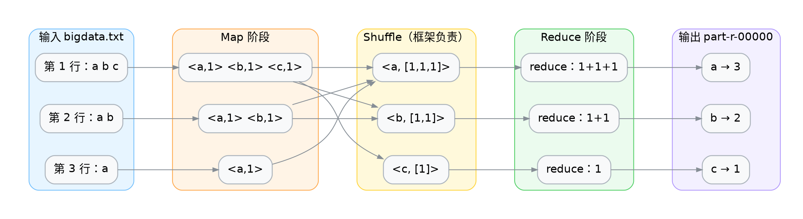
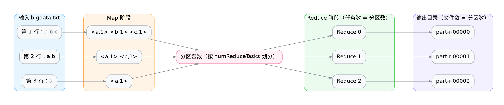

# 前置与后继

| 关系   | 案例         | 承接的知识点          |
| ------ | ------------ | --------------------- |
| 前置   | 自定义序列化 | Hadoop Writable序列化 |
| 本案例 | 自定义分区器 | 分区函数只依赖 key    |
| 后继   | 自定义排序   | 分区与排序的配合      |


# 遗留问题

默认情况下，一个MapReduce Job默认一个Reduce，数据会输出到一个文件中。



> 那我们怎么能根据Key来将数据分散到不同的文件中呢？比如根据部门号将员工分散到不同的文件中。

# 默认分区器

可以通过设置`setNumReduceTasks(n)`为MapReduce Job指定分区数，使用默认分区器。

```graphviz
digraph MapReduce {
  rankdir=LR;
  compound=true;
  newrank=true;
  graph [fontname="Helvetica", pad=0.4, nodesep=0.4, ranksep=0.9,
         splines=spline];
  node  [fontname="Helvetica", shape=box, style="rounded,filled",
         fillcolor="#F8F9FA", color="#ADB5BD", penwidth=1.2,
         margin="0.15,0.08"];
  edge  [fontname="Helvetica", color="#868E96", arrowsize=0.7];

  subgraph cluster_in {
    label="输入 bigdata.txt";
    style="rounded,filled"; color="#74C0FC"; fillcolor="#E7F5FF";
    I1 [label="第 1 行：a b c", group=g1];
    I2 [label="第 2 行：a b",   group=g2];
    I3 [label="第 3 行：a",     group=g3];
  }

  subgraph cluster_map {
    label="Map 阶段";
    style="rounded,filled"; color="#FFA94D"; fillcolor="#FFF4E6";
    M1 [label=<&lt;a,1&gt; &lt;b,1&gt; &lt;c,1&gt;>, group=g1];
    M2 [label=<&lt;a,1&gt; &lt;b,1&gt;>,             group=g2];
    M3 [label=<&lt;a,1&gt;>,                       group=g3];
  }

  subgraph cluster_partition {
    label="Partition 阶段（hash(key) % 3）";
    style="rounded,filled"; color="#F783AC"; fillcolor="#FFF0F6";
    Q1 [label=<P0:&lt;b,1&gt;  P1:&lt;c,1&gt;  P2:&lt;a,1&gt;>, group=g1];
    Q2 [label=<P0:&lt;b,1&gt;  P1:—        P2:&lt;a,1&gt;>, group=g2];
    Q3 [label=<P0:—        P1:—        P2:&lt;a,1&gt;>, group=g3];
  }

  subgraph cluster_shuffle {
    label="Shuffle（框架负责）";
    style="rounded,filled"; color="#FFD43B"; fillcolor="#FFF9DB";
    G1 [label=<P2 &rarr; &lt;a, [1,1,1]&gt;>, group=g1];
    G2 [label=<P0 &rarr; &lt;b, [1,1]&gt;>,   group=g2];
    G3 [label=<P1 &rarr; &lt;c, [1]&gt;>,     group=g3];
  }

  subgraph cluster_reduce {
    label="Reduce 阶段";
    style="rounded,filled"; color="#51CF66"; fillcolor="#EBFBEE";
    R0 [label="Reduce(P2)：1+1+1", group=g1];
    R1 [label="Reduce(P0)：1+1",   group=g2];
    R2 [label="Reduce(P1)：1",     group=g3];
  }

  subgraph cluster_out {
    label="输出目录";
    style="rounded,filled"; color="#B197FC"; fillcolor="#F3F0FF";
    O0 [label="part-r-00002：a → 3", group=g1];
    O1 [label="part-r-00000：b → 2", group=g2];
    O2 [label="part-r-00001：c → 1", group=g3];
  }

  // ---------- 真实数据流 ----------

  // Input -> Map
  I1 -> M1;
  I2 -> M2;
  I3 -> M3;

  // Map -> Partition
  M1 -> Q1;
  M2 -> Q2;
  M3 -> Q3;

  // Partition -> Shuffle（P2 汇 a、P0 汇 b、P1 汇 c）
  Q1 -> G1;   // P2: a
  Q1 -> G2;   // P0: b
  Q1 -> G3;   // P1: c
  Q2 -> G1;   // P2: a
  Q2 -> G2;   // P0: b
  Q3 -> G1;   // P2: a

  // Shuffle -> Reduce -> Output
  G1 -> R0 -> O0;   // P2 → part-r-00002
  G2 -> R1 -> O1;   // P0 → part-r-00000
  G3 -> R2 -> O2;   // P1 → part-r-00001

  // ---------- 不可见边：补齐 G 的入度，保持横向对齐 ----------
  Q2 -> G3 [style=invis, weight=1];
  Q3 -> G2 [style=invis, weight=1];
  Q3 -> G3 [style=invis, weight=1];
}
```



> 这里我们指定$n=3$，数据会被默认的`HashPartitioner` 打散到3个 reduce 任务中，输出到3个文件中。注意文件名与 key 并不是按字母顺序对应的——`a` 落在 `part-r-00002`，这是 `Text` **哈希取模**的结果（详见后文「Hash值」一节）。

# Hash值

Hash：它是一种**把任意数据映射成一个固定长度整数（哈希值）的函数**。

- 相同输入 → 永远得到相同哈希值（确定性）
- 不同输入 → 尽量分散到不同整数（打散）
- 哈希值本身没有业务含义，只是一把"分桶用的钥匙"

> 注意：**哈希冲突是必然存在的**——不同 key 也可能算出相同的 hashCode（key 空间远大于 32 位整数）。

## 字符语义 vs 字节语义

字符侧有四层概念（只有这一层才存在"字符"）：

- 字符：要表示的符号，如 a、中。
- 码点：Unicode 给这个符号分配的整数编号，写法如 U+0061。
- 码元：某种 UTF 编码形式装码点的**固定宽度单元**（UTF-8 为 1 字节，UTF-16 为 2 字节）。
- 编码字节：码元落地成存储/网络上的实际字节。

| 编码 | 1 码元 | 表示全集 | 一个码点占 | 空间特点 |
| ---- | ------ | -------- | ---------- | -------- |
| UTF-8 | 1 字节 | 能 | 1~4 个码元 | ASCII 极省，非 ASCII 多字节 |
| UTF-16 | 2 字节 | 能 | 1~2 个码元 | CJK 常比 UTF-8 紧凑 |
| UTF-32 | 4 字节 | 能 | 恒 1 个码元 | 定长、可 O(1) 下标，最费空间 |

## Java String 的哈希

单字符时，`hashCode()` 恰好等于该字符的码点值（ASCII 字符的码点就是 ASCII 码）——因为递推 `h = 31·h + c` 在只有一个字符时前面没有累乘项，退化为 `c` 自身：

```jshell
new String("a").hashCode();
new String("b").hashCode();
new String("c").hashCode();
```

> 97, 98, 99

多字符时是递推式 $h_i = 31\,h_{i-1} + c_i,\; h_0 = 0$ 的逐次求值（$c_i$ 为第 $i$ 个字符的码点值）：

```jshell
new String("a").hashCode();
new String("ab").hashCode();
new String("abc").hashCode();
```

> 97, 3105, 96354


$$
\begin{aligned}
h_1 &= 31\cdot 0 + 97 = 97 \\
h_2 &= 31\cdot 97 + 98 = 3105 \\
h_3 &= 31\cdot 3105 + 99 = 96354
\end{aligned}
$$

把递推式一层层代入，先各用前一项表示，即可推出多项式：

$$
\begin{aligned}
h_1 &= 31\,h_0+c_1=c_1 \\
h_2 &= 31\,h_1 + c_2+h=31c_1+c_2 \\
h_3 &= 31\,h_2 + c_3 = 31\,(31\,h_1 + c_2) + c_3 = 31^2\,h_1 + 31\,c_2 + c_3= 31^2\,c_1 + 31\,c_2 + c_3
\end{aligned}
$$

 $h_0 = 0$代入，得只含字符码点的形式，推广到 $n$ 个字符，即得多项式闭形式（可视为以 $31$ 为基的字符串"数值"）：

$$
h_n = \sum_{i=1}^{n} c_i \cdot 31^{\,n-i}
$$

> 每一步都"吃进"一个新字符，把上一步的哈希先乘 $31$ 再累加当前字符码点。因此哈希不仅与字符内容有关，还与**顺序**和**长度**有关——`"ab"` 与 `"ba"` 哈希不同。

## Java String 哈希的分区结果（易错示范）

如果拿 `String` 的哈希去推算分区，会得到：

```jshell
(new String("a").hashCode() & Integer.MAX_VALUE) % 3;
(new String("b").hashCode() & Integer.MAX_VALUE) % 3;
(new String("c").hashCode() & Integer.MAX_VALUE) % 3;
```

> 1, 2, 0

> **注意：这是错的。** MapReduce 的 key 是 `Writable`（`Text`），不是 `String`——用 `String` 推算会得出错误桶号。真实的分区见下一节。

## Hadoop Text 的哈希

因为 `Text` 内存里就是 UTF-8 字节，它的 `hashCode()` 自然也遍历这些字节——与 `String` 两点不同：遍历 **UTF-8 字节**（而非 UTF-16 码元），且**种子为 1**（而非 0）：

```java
// org.apache.hadoop.io.WritableComparator（Hadoop 源码，非可直接运行的片段）
public static int hashBytes(byte[] bytes, int length) {
  int hash = 1;
  for (int i = 0; i < length; i++)
    hash = (31 * hash) + bytes[i];   // bytes[i] 为 byte，有符号（-128~127）
  return hash;
}
```

```jshell
import org.apache.hadoop.io.Text;
new Text("a").hashCode();
new Text("b").hashCode();
new Text("c").hashCode();
```

> 128, 129, 130

对 ASCII 字符，UTF-8 字节值 = 码点值，所以 `Text` 与 `String` 只差种子那一项：

$$128 = 31\cdot1 + 97 = 97 + 31$$

非 ASCII 时两者"原料"不同，哈希彻底分叉——下面这段可验证 `Text` 内存里确实是 UTF-8 字节：

```jshell
import org.apache.hadoop.io.Text;
import org.apache.hadoop.io.WritableComparator;
import java.util.Arrays;

Text t2 = new Text("中");
t2.getLength();                                              // 预期 3（UTF-16 应为 2）→ 证明是 UTF-8
Arrays.toString(t2.copyBytes());                             // 预期 [-28, -72, -83]，即 E4 B8 AD
WritableComparator.hashBytes(t2.getBytes(), t2.getLength()); // 预期 568，即 Text("中").hashCode()

new String("中").length();                                   // 1（UTF-16 一个 char）
new String("中").hashCode();                                 // 20013
```

## Hadoop Text 哈希的分区结果

```jshell
import org.apache.hadoop.io.Text;
(new Text("a").hashCode() & Integer.MAX_VALUE) % 3;
(new Text("b").hashCode() & Integer.MAX_VALUE) % 3;
(new Text("c").hashCode() & Integer.MAX_VALUE) % 3;
```

> 2, 0, 1

| key | `String` 哈希 → 分区 | `Text` 哈希 → 分区 |
| --- | --- | --- |
| a | 97 → 1 | 128 → 2 |
| b | 98 → 2 | 129 → 0 |
| c | 99 → 0 | 130 → 1 |

> MapReduce 的 key 是 `Writable`，分区实际用的是 **`Text` 的哈希**——所以真正的输出是 `a→part-r-00002`、`b→part-r-00000`、`c→part-r-00001`。


`String` 与 `Text` 的一切差异，都源于一条根因：**`String` 是字符语义，`Text` 是字节语义**。

- `String`：内存里是 **UTF-16 码元**（`char`），全程认识"字符"。
- `Text`：内存里就是 **UTF-8 字节**（`private byte[] bytes`），**不认识"字符"**，只认 8 位一组的字节。

`Text` 只在**边界**关心字符，其余全是纯字节操作：

| 操作                         | 实际做的事          | 关心字符语义吗   |
| ---------------------------- | ------------------- | ---------------- |
| `new Text(String)` / `set()` | String → UTF-8 编码 | ← 关心（仅一次） |
| `toString()`                 | UTF-8 → String 解码 | ← 关心           |
| `hashCode()`                 | `h = 31h + byte`    | 不关心           |
| `compareTo()`                | 逐字节比大小        | 不关心           |
| `write()` 序列化             | 原样写出字节        | 不关心           |

> 正因 `Text` 内存里已是 UTF-8，序列化时**零转码**——而 MapReduce 的 key 要在 map → shuffle → reduce 之间反复序列化（溢写磁盘、跨网络），这个收益被放大成千上万倍。

# 默认分区器



默认分区器只有一行核心逻辑：

```java
(key.hashCode() & Integer.MAX_VALUE) % numPartitions
```

这行代码的目的是：**根据 key 的哈希值，决定这条记录交给哪个 Reducer（即哪个分区）处理**。结果范围是 `[0, numPartitions - 1]`。

#### `key.hashCode()`

获取 key 对象的哈希值，返回一个 **int**（32 位有符号整数），范围是 `-2^31 ~ 2^31-1`，**可能是负数**。

#### `& Integer.MAX_VALUE`

`Integer.MAX_VALUE` 的值是 `0x7FFFFFFF`，即二进制：

```
0111 1111 1111 1111 1111 1111 1111 1111
```

`&` 是按位与。它的效果是：**保留低 31 位，把最高位（符号位）清零**。

```css
   xxxx xxxx xxxx xxxx xxxx xxxx xxxx xxxx   (hashCode)
 & 0111 1111 1111 1111 1111 1111 1111 1111   (Integer.MAX_VALUE)
 -----------------------------------------
   0xxx xxxx xxxx xxxx xxxx xxxx xxxx xxxx   (结果一定是非负数)
```

**作用：把可能为负的 hashCode 变成一个非负整数**（范围 `0 ~ 2^31-1`），避免负数取模得到负分区号。

#### `% numPartitions`

对分区数取模，把结果映射到 `[0, numPartitions-1]` 区间，得到最终的分区编号。

```graphviz
digraph MapReduce {
  rankdir=LR;
  compound=true;
  newrank=true;
  graph [fontname="Helvetica", pad=0.4, nodesep=0.4, ranksep=0.9,
         splines=spline];
  node  [fontname="Helvetica", shape=box, style="rounded,filled",
         fillcolor="#F8F9FA", color="#ADB5BD", penwidth=1.2,
         margin="0.15,0.08"];
  edge  [fontname="Helvetica", color="#868E96", arrowsize=0.7];

  subgraph cluster_in {
    label="输入 bigdata.txt";
    style="rounded,filled"; color="#74C0FC"; fillcolor="#E7F5FF";
    I1 [label="第 1 行：a b c", group=g1];
    I2 [label="第 2 行：a b",   group=g2];
    I3 [label="第 3 行：a",     group=g3];
  }

  subgraph cluster_map {
    label="Map 阶段";
    style="rounded,filled"; color="#FFA94D"; fillcolor="#FFF4E6";
    M1 [label=<&lt;a,1&gt; &lt;b,1&gt; &lt;c,1&gt;>, group=g1];
    M2 [label=<&lt;a,1&gt; &lt;b,1&gt;>,             group=g2];
    M3 [label=<&lt;a,1&gt;>,                       group=g3];
  }

  subgraph cluster_partition {
    label="Partition 阶段";
    style="rounded,filled"; color="#F783AC"; fillcolor="#FFF0F6";
    Q1 [label=<P0:&lt;a,1&gt;  P1:&lt;b,1&gt;  P2:&lt;c,1&gt;>, group=g1];
    Q2 [label=<P0:&lt;a,1&gt;  P1:&lt;b,1&gt;>,             group=g2];
    Q3 [label=<P0:&lt;a,1&gt;>,                          group=g3];
  }

  subgraph cluster_shuffle {
    label="Shuffle（框架负责）";
    style="rounded,filled"; color="#FFD43B"; fillcolor="#FFF9DB";
    G1 [label=<P0 &rarr; &lt;a, [1,1,1]&gt;>, group=g1];
    G2 [label=<P1 &rarr; &lt;b, [1,1]&gt;>,   group=g2];
    G3 [label=<P2 &rarr; &lt;c, [1]&gt;>,     group=g3];
  }

  subgraph cluster_reduce {
    label="Reduce 阶段";
    style="rounded,filled"; color="#51CF66"; fillcolor="#EBFBEE";
    R0 [label="Reduce(P0)：1+1+1", group=g1];
    R1 [label="Reduce(P1)：1+1",   group=g2];
    R2 [label="Reduce(P2)：1",     group=g3];
  }

  subgraph cluster_out {
    label="输出目录";
    style="rounded,filled"; color="#B197FC"; fillcolor="#F3F0FF";
    O0 [label="part-r-00000：a → 3", group=g1];
    O1 [label="part-r-00001：b → 2", group=g2];
    O2 [label="part-r-00002：c → 1", group=g3];
  }

  // ---------- 真实数据流 ----------

  // Input -> Map
  I1 -> M1;
  I2 -> M2;
  I3 -> M3;

  // Map -> Partition（每个 Map 内部按 key 分区）
  M1 -> Q1;
  M2 -> Q2;
  M3 -> Q3;

  // Partition -> Shuffle（按分区号汇集到对应 Reduce 的数据流）
  Q1 -> G1;
  Q1 -> G2;
  Q1 -> G3;
  Q2 -> G1;
  Q2 -> G2;
  Q3 -> G1;

  // Shuffle -> Reduce -> Output
  G1 -> R0 -> O0;
  G2 -> R1 -> O1;
  G3 -> R2 -> O2;

  // ---------- 不可见边：把每个 G 的入度补齐到 3 条，保证横向对齐 ----------
  Q2 -> G3 [style=invis, weight=1];
  Q3 -> G2 [style=invis, weight=1];
  Q3 -> G3 [style=invis, weight=1];
}
```



# 自定义分区器

默认分区器把 a/b/c 按 hash 打散，文件名和 key 对不上——`part-r-00000` 里装的是 b 而不是 a（`a` 落在 `part-r-00002`）。那我们能不能自己说了算，让 a 进文件 0、b 进文件 1、c 进文件 2？

这就是自定义分区器的职责：**用一个分区函数，显式决定每个 key 去哪个文件**。

先用这个最精简的 a/b/c 例子看清楚"分区器到底能决定什么"，再拿 `emp.csv` 的部门号做实战。

```graphviz
digraph MapReduce {
  rankdir=LR;
  compound=true;
  newrank=true;
  graph [fontname="Helvetica", pad=0.4, nodesep=0.4, ranksep=0.9,
         splines=spline];
  node  [fontname="Helvetica", shape=box, style="rounded,filled",
         fillcolor="#F8F9FA", color="#ADB5BD", penwidth=1.2,
         margin="0.15,0.08"];
  edge  [fontname="Helvetica", color="#868E96", arrowsize=0.7];

  subgraph cluster_in {
    label="输入 bigdata.txt";
    style="rounded,filled"; color="#74C0FC"; fillcolor="#E7F5FF";
    I1 [label="第 1 行：a b c", group=g1];
    I2 [label="第 2 行：a b",   group=g2];
    I3 [label="第 3 行：a",     group=g3];
  }

  subgraph cluster_map {
    label="Map 阶段";
    style="rounded,filled"; color="#FFA94D"; fillcolor="#FFF4E6";
    M1 [label=<&lt;a,1&gt; &lt;b,1&gt; &lt;c,1&gt;>, group=g1];
    M2 [label=<&lt;a,1&gt; &lt;b,1&gt;>,             group=g2];
    M3 [label=<&lt;a,1&gt;>,                       group=g3];
  }

  subgraph cluster_partition {
    label="Partition 阶段（hash(key) % 3）";
    style="rounded,filled"; color="#F783AC"; fillcolor="#FFF0F6";
    Q1 [label=<P0:&lt;a,1&gt;  P1:&lt;b,1&gt;  P2:&lt;c,1&gt;>, group=g1];
    Q2 [label=<P0:&lt;a,1&gt;  P1:&lt;b,1&gt;>,             group=g2];
    Q3 [label=<P0:&lt;a,1&gt;>,                          group=g3];
  }

  subgraph cluster_shuffle {
    label="Shuffle（框架负责：按分区拉取并分组）";
    style="rounded,filled"; color="#FFD43B"; fillcolor="#FFF9DB";
    G1 [label=<P0 &rarr; &lt;a, [1,1,1]&gt;>, group=g1];
    G2 [label=<P1 &rarr; &lt;b, [1,1]&gt;>,   group=g2];
    G3 [label=<P2 &rarr; &lt;c, [1]&gt;>,     group=g3];
  }

  subgraph cluster_reduce {
    label="Reduce 阶段（3 个 Reduce Task）";
    style="rounded,filled"; color="#51CF66"; fillcolor="#EBFBEE";
    R0 [label="Reduce(P0)：1+1+1", group=g1];
    R1 [label="Reduce(P1)：1+1",   group=g2];
    R2 [label="Reduce(P2)：1",     group=g3];
  }

  subgraph cluster_out {
    label="输出目录（3 个 part 文件）";
    style="rounded,filled"; color="#B197FC"; fillcolor="#F3F0FF";
    O0 [label="part-r-00000：a → 3", group=g1];
    O1 [label="part-r-00001：b → 2", group=g2];
    O2 [label="part-r-00002：c → 1", group=g3];
  }

  // ---------- 真实数据流 ----------

  // Input -> Map
  I1 -> M1;
  I2 -> M2;
  I3 -> M3;

  // Map -> Partition（每个 Map 内部按 key 分区）
  M1 -> Q1;
  M2 -> Q2;
  M3 -> Q3;

  // Partition -> Shuffle（按分区号汇集到对应 Reduce 的数据流）
  Q1 -> G1;
  Q1 -> G2;
  Q1 -> G3;
  Q2 -> G1;
  Q2 -> G2;
  Q3 -> G1;

  // Shuffle -> Reduce -> Output
  G1 -> R0 -> O0;
  G2 -> R1 -> O1;
  G3 -> R2 -> O2;

  // ---------- 不可见边：把每个 G 的入度补齐到 3 条，保证横向对齐 ----------
  Q2 -> G3 [style=invis, weight=1];
  Q3 -> G2 [style=invis, weight=1];
  Q3 -> G3 [style=invis, weight=1];
}
```



##### 继承Partitioner

```java demo
import org.apache.hadoop.mapreduce.Partitioner;
public class WordCountPartitioner extends Partitioner<Text, IntWritable> {

    @Override
    public int getPartition(Text key, IntWritable value, int numPartitions) {

        if(Objects.equals(key.toString(), "a")){
            return 0;
        }else if (Objects.equals(key.toString(), "b")){
            return 1;
        }else {
            return 2;
        }
    }
}
```


# 案例概览

本案例使用员工表，让**每个部门的数据落进独立的输出文件**——3 个部门得到 3 个文件，而不是默认哈希分区的结果。

### 输入数据与预期输出

输入 `emp.csv`，14 行，部门号在第 8 列：

```csv
empno,ename,job,mgr,hiredate,sal,comm,deptno
7369,SMITH,CLERK,7902,1980/12/17,800,,20
7499,ALLEN,SALESMAN,7698,1981/2/20,1600,300,30
7521,WARD,SALESMAN,7698,1981/2/22,1250,500,30
7566,JONES,MANAGER,7839,1981/4/2,2975,,20
7654,MARTIN,SALESMAN,7698,1981/9/28,1250,1400,30
7698,BLAKE,MANAGER,7839,1981/5/1,2850,,30
7782,CLARK,MANAGER,7839,1981/6/9,2450,,10
7788,SCOTT,ANALYST,7566,1987/4/19,3000,,20
7839,KING,PRESIDENT,,1981/11/17,5000,,10
7844,TURNER,SALESMAN,7698,1981/9/8,1500,0,30
7876,ADAMS,CLERK,7788,1987/5/23,1100,,20
7900,JAMES,CLERK,7698,1981/12/3,950,,30
7902,FORD,ANALYST,7566,1981/12/3,3000,,20
7934,MILLER,CLERK,7782,1982/1/23,1300,,10
```

预期得到 3 个文件，每个装一个部门：

| 输出文件     | 部门号 | 员工数 |
| ------------ | ------ | ------ |
| part-r-00000 | 10     | 3      |
| part-r-00001 | 20     | 5      |
| part-r-00002 | 30     | 6      |

注意文件名与部门号的对应关系是**由分区器决定的**，不是自动的。

## 理论篇：分区是 Shuffle 的第一道门

数据从 Map 到 Reduce 之前，必须先决定"去哪个 reduce 任务"。这个决定由分区函数做出，而且**一旦决定就不会改**。

### 部门号HashPartition

对 `IntWritable` 这类数值 key，`hashCode()` 返回的就是数值本身。所以对部门号 10、20、30 来说，取模 `3` 的结果是：

| 部门号 | `% 3` 的结果 | 落到分区 |
| ------ | ------------ | -------- |
| 10     | 1            | 1        |
| 20     | 2            | 2        |
| 30     | 0            | 0        |

三个部门确实分散到了三个分区，**但文件名和部门号对不上**：`part-r-00000` 里装的是 30 号部门。业务方拿到文件后无法凭名字判断内容。

### 一个"看起来自定义、实际没有"的反例

本项目原来的分区器实现是这样的：

```java
if (key.get() % numPartitions == 0)      return 0;
else if (key.get() % numPartitions == 1) return 1;
else                                     return 2;
```

在 `numPartitions = 3` 的前提下，`key % 3` 的取值只可能是 0、1、2，三个分支恰好覆盖且返回值就是 `key % 3` 本身——**与默认的 `HashPartitioner` 逐字节等价**。写了 8 行，什么也没改变。

这一条值得单独记住：判断一个自定义分区器是否真的生效，不要看它写没写，要看**它的返回值是否和默认实现不同**。

### 分区函数必须满足两条约束

| 约束   | 要求                                | 违反后的现象                      |
| ------ | ----------------------------------- | --------------------------------- |
| 值域   | 返回值必须落在 `[0, numPartitions)` | 任务抛 `IllegalArgumentException` |
| 稳定性 | 同一个 key 必须总是返回同一个分区   | 同一部门的数据被拆到多个文件      |

第二条是分区器的**根本职责**，也是它只能依赖 key 的原因。如果把 value 也纳入计算，同一个部门号配上不同员工就会得到不同分区，"一个部门一个文件"立刻失效。

### 显式映射：让分区号与部门顺序对应

要让 `part-r-00000` 装 10 号部门，就得做一次显式映射。部门号是 10 的倍数，可以先归一化再取模：

```java
int partition = Math.abs(deptId / 10 - 1);
return partition % numPartitions;
```

| 部门号 | `/10 - 1` | 落到分区 | 说明       |
| ------ | --------- | -------- | ---------- |
| 10     | 0         | 0        | 第一个文件 |
| 20     | 1         | 1        | 第二个文件 |
| 30     | 2         | 2        | 第三个文件 |

取模是为了兜住"部门数超过 reduce 数"的情况——**返回值越界会直接让任务失败**，这一步不能省。

### 算术技巧的边界

`deptId / 10 - 1` 只在部门号是连续整数倍时成立。真实场景里部门号可能是 `1001`、`2057` 这种，算术公式立刻失效，而且冲突会静默发生（两个部门挤进同一个文件，不报错）。

| 做法       | 适用               | 缺点               |
| ---------- | ------------------ | ------------------ |
| 算术归一化 | 编号规整、数量固定 | 编号一变就静默冲突 |
| 查表映射   | 部门数量有限       | 需要维护映射表     |
| 从配置读入 | 生产环境           | 多一层配置管理     |

### reduce 个数决定文件个数

分区与文件是一一对应的：`numPartitions` 就是 `numReduceTasks` 的值。

| 配置                            | 结果                   |
| ------------------------------- | ---------------------- |
| `setNumReduceTasks(3)`          | 3 个文件，分区号 0/1/2 |
| `setNumReduceTasks(1)`          | 1 个文件               |
| 只设 Partitioner 不设 reduce 数 | **分区器完全不生效**   |

最后一行是最常见的问题：默认 reduce 个数是 1，此时所有数据都去分区 0，自定义分区器根本没机会被调用。

### 分区不当会导致数据倾斜

分区器不只是"分文件"，它直接决定各 reduce 任务的负载：

| 分区策略         | 负载           | 后果                   |
| ---------------- | -------------- | ---------------------- |
| 均匀哈希         | 各任务相近     | 正常                   |
| 按业务键切分     | 取决于数据分布 | 大部门所在任务成为瓶颈 |
| 全部挤进一个分区 | 单任务扛全量   | 其他任务空转           |

如果销售部有 100 万员工而其他部门只有几百人，按部门分区就会让一个 reduce 任务独自处理绝大部分数据——这就是数据倾斜。分区器是它的成因之一，也是它的解法之一。

## 实训篇：实现按部门分区

整个改动只有两处：写一个 `Partitioner` 子类，然后在 Job 里注册它并配上对应的 reduce 个数。

### 步骤一：准备数据

```bash
hdfs dfs -mkdir -p /input
hdfs dfs -put emp.csv /input/emp.csv
```

数据与 `fsort`、`gdistinct` 用的是同一份，只是本案例关心第 8 列的部门号。

### 步骤二：实现 Partitioner

继承 `Partitioner`，泛型必须和 Mapper 的输出类型完全一致——这里是 `<IntWritable, Employee>`。

```java
public class DeptPartitioner extends Partitioner<IntWritable, Employee> {

    @Override
    public int getPartition(IntWritable key, Employee value, int numPartitions) {

        int deptId = key.get();
        int partition = Math.abs(deptId / 10 - 1);

        return partition % numPartitions;
    }
}
```

方法签名里的 `value` 参数在这里没有用到。这不是疏忽——**分区函数不应读取 value**，否则同 key 分裂的问题马上出现。同理，`Math.abs` 与末尾的取模都是为了守住"返回值必须落在合法区间"这条约束。

### 步骤三：注册到 Job

两行配置必须成对出现，缺一不可。

```java
job.setNumReduceTasks(3);
job.setPartitionerClass(DeptPartitioner.class);
```

`setNumReduceTasks(3)` 不只是"开 3 个任务"，它同时定义了分区号的值域是 `[0, 3)`。少了这一行，reduce 个数为 1，分区器不会被调用；分区数小于部门数时，多出来的部门只能挤进已有分区。

### 步骤四：运行与验证

```shell
hadoop jar hadoop-1.0-SNAPSHOT.jar \
  com.studybigdata.hadoop.mapred.dpartition.DeptMain \
  /input/emp.csv /output/partition
```

检查输出目录，应当有 3 个文件且行数分别是 3、5、6：

```shell
hdfs dfs -ls /output/partition
hdfs dfs -cat /output/partition/part-r-00000 | wc -l
```

分区器是否生效，有一个直接的判据：**每个文件里的部门号必须唯一**。如果 `part-r-00000` 里同时出现 10 和 40，说明取模那一步把两个部门合并了。

### 步骤五：变式训练

| 变式                      | 做法                             | 观察到的现象                             |
| ------------------------- | -------------------------------- | ---------------------------------------- |
| 1. 去掉 `% numPartitions` | 直接返回 `deptId/10 - 1`         | reduce 数为 3 时部门 40 触发越界异常     |
| 2. 只设 Partitioner       | 把 `setNumReduceTasks(3)` 注释掉 | 只剩 1 个文件，分区器没被调用            |
| 3. 按部门号奇偶分区       | 用 `deptId % 2` 当分区号         | 需配 2 个 reduce，文件内容与部门顺序无关 |

变式 1 演示约束一（值域），变式 2 演示最常见的失效场景。两个都亲手跑一遍，比记住结论有效。

## 常见问题

分区器的代码量很少，出问题基本都集中在下面五处。

### 问题一：输出只有 1 个文件

默认 reduce 个数是 1，此时所有 key 都落分区 0。

| 现象              | 原因             | 修法                   |
| ----------------- | ---------------- | ---------------------- |
| 输出只有 1 个文件 | 未设 reduce 个数 | `setNumReduceTasks(n)` |

### 问题二：出现 0 行的空文件

`numReduceTasks` 与分区逻辑是耦合的。

| 现象              | 原因               | 修法       |
| ----------------- | ------------------ | ---------- |
| 出现 0 行的空文件 | 分区数多于业务键数 | 让两者匹配 |

### 问题三：以为分区器能解决排序

分区只决定"去哪"，不决定"顺序"。

| 现象                     | 原因               | 修法                  |
| ------------------------ | ------------------ | --------------------- |
| 每个文件内顺序与预期不符 | 分区器不负责排序   | 在 key 上定义排序规则 |
| 想全局有序               | 分区与排序是两件事 | 用单 reduce           |

这也正是与下一案例的衔接点：分区把数据分开，排序决定每组内部的顺序，两者配合才能产出既分好类又有序的结果。

## 小结

分区器的全部职责只有一个：给定 key，返回一个分区号。

### 三句话回顾

- 分区函数只能依赖 key，返回值必须落在 `[0, numPartitions)`，否则任务直接失败。
- 自定义分区器只有在返回值与 `HashPartitioner` 不同时才有意义——本项目原实现恰好等价于默认行为。
- 分区器决定文件的划分方式，同时决定各 reduce 任务的负载，因而是数据倾斜的成因之一。

### 与下一案例的衔接

本案例关心"数据去哪个文件"，下一案例"自定义排序"关心"文件内的顺序"。两者都是 Shuffle 阶段的机制，组合起来才能同时控制输出的**划分**与**次序**。

<div class="end"><h1>自定义分区器</h1><p>下一案例：自定义排序</p></div>
