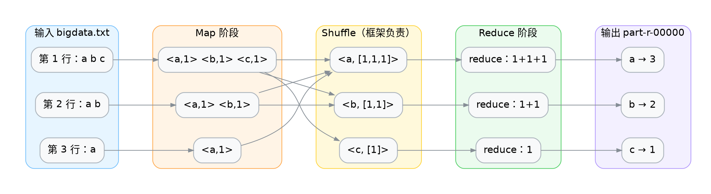
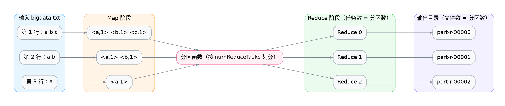

# 前置与后继

| 关系   | 案例         | 承接的知识点          |
| ------ | ------------ | --------------------- |
| 前置   | 自定义序列化 | Hadoop Writable序列化 |
| 本案例 | 自定义分区器 | 分区函数只依赖 key    |
| 后继   | 自定义排序   | 分区与排序的配合      |


# 遗留问题

默认情况下，一个MapReduce Job默认一个Reduce，数据会输出到一个文件中。



> 那我们怎么能根据Key来将数据分散到不同的文件中呢？比如根据部门号将员工分散到不同的文件中。

# 默认分区器

可以通过设置`setNumReduceTasks(n)`为MapReduce Job指定分区数，使用默认分区器。

```graphviz
digraph MapReduce {
  rankdir=LR;
  compound=true;
  newrank=true;
  graph [fontname="Helvetica", pad=0.4, nodesep=0.4, ranksep=0.9,
         splines=spline];
  node  [fontname="Helvetica", shape=box, style="rounded,filled",
         fillcolor="#F8F9FA", color="#ADB5BD", penwidth=1.2,
         margin="0.15,0.08"];
  edge  [fontname="Helvetica", color="#868E96", arrowsize=0.7];

  subgraph cluster_in {
    label="输入 bigdata.txt";
    style="rounded,filled"; color="#74C0FC"; fillcolor="#E7F5FF";
    I1 [label="第 1 行：a b c", group=g1];
    I2 [label="第 2 行：a b",   group=g2];
    I3 [label="第 3 行：a",     group=g3];
  }

  subgraph cluster_map {
    label="Map 阶段";
    style="rounded,filled"; color="#FFA94D"; fillcolor="#FFF4E6";
    M1 [label=<&lt;a,1&gt; &lt;b,1&gt; &lt;c,1&gt;>, group=g1];
    M2 [label=<&lt;a,1&gt; &lt;b,1&gt;>,             group=g2];
    M3 [label=<&lt;a,1&gt;>,                       group=g3];
  }

  subgraph cluster_partition {
    label="Partition 阶段（hash(key) % 3）";
    style="rounded,filled"; color="#F783AC"; fillcolor="#FFF0F6";
    Q1 [label=<P0:&lt;b,1&gt;  P1:&lt;c,1&gt;  P2:&lt;a,1&gt;>, group=g1];
    Q2 [label=<P0:&lt;b,1&gt;  P1:—        P2:&lt;a,1&gt;>, group=g2];
    Q3 [label=<P0:—        P1:—        P2:&lt;a,1&gt;>, group=g3];
  }

  subgraph cluster_shuffle {
    label="Shuffle（框架负责）";
    style="rounded,filled"; color="#FFD43B"; fillcolor="#FFF9DB";
    G1 [label=<P2 &rarr; &lt;a, [1,1,1]&gt;>, group=g1];
    G2 [label=<P0 &rarr; &lt;b, [1,1]&gt;>,   group=g2];
    G3 [label=<P1 &rarr; &lt;c, [1]&gt;>,     group=g3];
  }

  subgraph cluster_reduce {
    label="Reduce 阶段";
    style="rounded,filled"; color="#51CF66"; fillcolor="#EBFBEE";
    R0 [label="Reduce(P2)：1+1+1", group=g1];
    R1 [label="Reduce(P0)：1+1",   group=g2];
    R2 [label="Reduce(P1)：1",     group=g3];
  }

  subgraph cluster_out {
    label="输出目录";
    style="rounded,filled"; color="#B197FC"; fillcolor="#F3F0FF";
    O0 [label="part-r-00002：a → 3", group=g1];
    O1 [label="part-r-00000：b → 2", group=g2];
    O2 [label="part-r-00001：c → 1", group=g3];
  }

  // ---------- 真实数据流 ----------

  // Input -> Map
  I1 -> M1;
  I2 -> M2;
  I3 -> M3;

  // Map -> Partition
  M1 -> Q1;
  M2 -> Q2;
  M3 -> Q3;

  // Partition -> Shuffle（P2 汇 a、P0 汇 b、P1 汇 c）
  Q1 -> G1;   // P2: a
  Q1 -> G2;   // P0: b
  Q1 -> G3;   // P1: c
  Q2 -> G1;   // P2: a
  Q2 -> G2;   // P0: b
  Q3 -> G1;   // P2: a

  // Shuffle -> Reduce -> Output
  G1 -> R0 -> O0;   // P2 → part-r-00002
  G2 -> R1 -> O1;   // P0 → part-r-00000
  G3 -> R2 -> O2;   // P1 → part-r-00001

  // ---------- 不可见边：补齐 G 的入度，保持横向对齐 ----------
  Q2 -> G3 [style=invis, weight=1];
  Q3 -> G2 [style=invis, weight=1];
  Q3 -> G3 [style=invis, weight=1];
}
```



> 这里我们指定$n=3$，数据会被默认的`HashPartitioner` 打散到3个 reduce 任务中，输出到3个文件中。注意文件名与 key 并不是按字母顺序对应的——`a` 落在 `part-r-00002`，这是 `Text` **哈希取模**的结果（详见后文「Hash值」一节）。

# Hash值

Hash：它是一种**把任意数据映射成一个固定长度整数（哈希值）的函数**。

- 相同输入 → 永远得到相同哈希值（确定性）
- 不同输入 → 尽量分散到不同整数（打散）
- 哈希值本身没有业务含义，只是一把"分桶用的钥匙"

> 注意：**哈希冲突是必然存在的**——不同 key 也可能算出相同的 hashCode（key 空间远大于 32 位整数）。

## 字符语义 vs 字节语义

字符侧有四层概念（只有这一层才存在"字符"）：

- 字符：要表示的符号，如 a、中。
- 码点：Unicode 给这个符号分配的整数编号，写法如 U+0061。
- 码元：某种 UTF 编码形式装码点的**固定宽度单元**（UTF-8 为 1 字节，UTF-16 为 2 字节）。
- 编码字节：码元落地成存储/网络上的实际字节。

| 编码 | 1 码元 | 表示全集 | 一个码点占 | 空间特点 |
| ---- | ------ | -------- | ---------- | -------- |
| UTF-8 | 1 字节 | 能 | 1~4 个码元 | ASCII 极省，非 ASCII 多字节 |
| UTF-16 | 2 字节 | 能 | 1~2 个码元 | CJK 常比 UTF-8 紧凑 |
| UTF-32 | 4 字节 | 能 | 恒 1 个码元 | 定长、可 O(1) 下标，最费空间 |

## Java String 的哈希

单字符时，`hashCode()` 恰好等于该字符的码点值（ASCII 字符的码点就是 ASCII 码）——因为递推 `h = 31·h + c` 在只有一个字符时前面没有累乘项，退化为 `c` 自身：

```jshell
new String("a").hashCode();
new String("b").hashCode();
new String("c").hashCode();
```

> 97, 98, 99

多字符时是递推式 $h_i = 31\,h_{i-1} + c_i,\; h_0 = 0$ 的逐次求值（$c_i$ 为第 $i$ 个字符的码点值）：

```jshell
new String("a").hashCode();
new String("ab").hashCode();
new String("abc").hashCode();
```

> 97, 3105, 96354


$$
\begin{aligned}
h_1 &= 31\cdot 0 + 97 = 97 \\
h_2 &= 31\cdot 97 + 98 = 3105 \\
h_3 &= 31\cdot 3105 + 99 = 96354
\end{aligned}
$$

把递推式一层层代入，先各用前一项表示，即可推出多项式：

$$
\begin{aligned}
h_1 &= 31\,h_0+c_1=c_1 \\
h_2 &= 31\,h_1 + c_2+h=31c_1+c_2 \\
h_3 &= 31\,h_2 + c_3 = 31\,(31\,h_1 + c_2) + c_3 = 31^2\,h_1 + 31\,c_2 + c_3= 31^2\,c_1 + 31\,c_2 + c_3
\end{aligned}
$$

 $h_0 = 0$代入，得只含字符码点的形式，推广到 $n$ 个字符，即得多项式闭形式（可视为以 $31$ 为基的字符串"数值"）：

$$
h_n = \sum_{i=1}^{n} c_i \cdot 31^{\,n-i}
$$

> 每一步都"吃进"一个新字符，把上一步的哈希先乘 $31$ 再累加当前字符码点。因此哈希不仅与字符内容有关，还与**顺序**和**长度**有关——`"ab"` 与 `"ba"` 哈希不同。

## Java String 哈希的分区结果（易错示范）

如果拿 `String` 的哈希去推算分区，会得到：

```jshell
(new String("a").hashCode() & Integer.MAX_VALUE) % 3;
(new String("b").hashCode() & Integer.MAX_VALUE) % 3;
(new String("c").hashCode() & Integer.MAX_VALUE) % 3;
```

> 1, 2, 0

> **注意：这是错的。** MapReduce 的 key 是 `Writable`（`Text`），不是 `String`——用 `String` 推算会得出错误桶号。真实的分区见下一节。

## Hadoop Text 的哈希

因为 `Text` 内存里就是 UTF-8 字节，它的 `hashCode()` 自然也遍历这些字节——与 `String` 两点不同：遍历 **UTF-8 字节**（而非 UTF-16 码元），且**种子为 1**（而非 0）：

```java
// org.apache.hadoop.io.WritableComparator（Hadoop 源码，非可直接运行的片段）
public static int hashBytes(byte[] bytes, int length) {
  int hash = 1;
  for (int i = 0; i < length; i++)
    hash = (31 * hash) + bytes[i];   // bytes[i] 为 byte，有符号（-128~127）
  return hash;
}
```

```jshell
import org.apache.hadoop.io.Text;
new Text("a").hashCode();
new Text("b").hashCode();
new Text("c").hashCode();
```

> 128, 129, 130

对 ASCII 字符，UTF-8 字节值 = 码点值，所以 `Text` 与 `String` 只差种子那一项：

$$128 = 31\cdot1 + 97 = 97 + 31$$

非 ASCII 时两者"原料"不同，哈希彻底分叉——下面这段可验证 `Text` 内存里确实是 UTF-8 字节：

```jshell
import org.apache.hadoop.io.Text;
import org.apache.hadoop.io.WritableComparator;
import java.util.Arrays;

Text t2 = new Text("中");
t2.getLength();                                              // 预期 3（UTF-16 应为 2）→ 证明是 UTF-8
Arrays.toString(t2.copyBytes());                             // 预期 [-28, -72, -83]，即 E4 B8 AD
WritableComparator.hashBytes(t2.getBytes(), t2.getLength()); // 预期 568，即 Text("中").hashCode()

new String("中").length();                                   // 1（UTF-16 一个 char）
new String("中").hashCode();                                 // 20013
```

## Hadoop Text 哈希的分区结果

```jshell
import org.apache.hadoop.io.Text;
(new Text("a").hashCode() & Integer.MAX_VALUE) % 3;
(new Text("b").hashCode() & Integer.MAX_VALUE) % 3;
(new Text("c").hashCode() & Integer.MAX_VALUE) % 3;
```

> 2, 0, 1

| key | `String` 哈希 → 分区 | `Text` 哈希 → 分区 |
| --- | --- | --- |
| a | 97 → 1 | 128 → 2 |
| b | 98 → 2 | 129 → 0 |
| c | 99 → 0 | 130 → 1 |

> MapReduce 的 key 是 `Writable`，分区实际用的是 **`Text` 的哈希**——所以真正的输出是 `a→part-r-00002`、`b→part-r-00000`、`c→part-r-00001`。


`String` 与 `Text` 的一切差异，都源于一条根因：**`String` 是字符语义，`Text` 是字节语义**。

- `String`：内存里是 **UTF-16 码元**（`char`），全程认识"字符"。
- `Text`：内存里就是 **UTF-8 字节**（`private byte[] bytes`），**不认识"字符"**，只认 8 位一组的字节。

`Text` 只在**边界**关心字符，其余全是纯字节操作：

| 操作                         | 实际做的事          | 关心字符语义吗   |
| ---------------------------- | ------------------- | ---------------- |
| `new Text(String)` / `set()` | String → UTF-8 编码 | ← 关心（仅一次） |
| `toString()`                 | UTF-8 → String 解码 | ← 关心           |
| `hashCode()`                 | `h = 31h + byte`    | 不关心           |
| `compareTo()`                | 逐字节比大小        | 不关心           |
| `write()` 序列化             | 原样写出字节        | 不关心           |

> 正因 `Text` 内存里已是 UTF-8，序列化时**零转码**——而 MapReduce 的 key 要在 map → shuffle → reduce 之间反复序列化（溢写磁盘、跨网络），这个收益被放大成千上万倍。

# 默认分区器



默认分区器只有一行核心逻辑：

```java
(key.hashCode() & Integer.MAX_VALUE) % numPartitions
```

这行代码的目的是：**根据 key 的哈希值，决定这条记录交给哪个 Reducer（即哪个分区）处理**。结果范围是 `[0, numPartitions - 1]`。

#### `key.hashCode()`

获取 key 对象的哈希值，返回一个 **int**（32 位有符号整数），范围是 `-2^31 ~ 2^31-1`，**可能是负数**。

#### `& Integer.MAX_VALUE`

`Integer.MAX_VALUE` 的值是 `0x7FFFFFFF`，即二进制：

```
0111 1111 1111 1111 1111 1111 1111 1111
```

`&` 是按位与。它的效果是：**保留低 31 位，把最高位（符号位）清零**。

```css
   xxxx xxxx xxxx xxxx xxxx xxxx xxxx xxxx   (hashCode)
 & 0111 1111 1111 1111 1111 1111 1111 1111   (Integer.MAX_VALUE)
 -----------------------------------------
   0xxx xxxx xxxx xxxx xxxx xxxx xxxx xxxx   (结果一定是非负数)
```

**作用：把可能为负的 hashCode 变成一个非负整数**（范围 `0 ~ 2^31-1`），避免负数取模得到负分区号。

#### `% numPartitions`

对分区数取模，把结果映射到 `[0, numPartitions-1]` 区间，得到最终的分区编号。

```graphviz
digraph MapReduce {
  rankdir=LR;
  compound=true;
  newrank=true;
  graph [fontname="Helvetica", pad=0.4, nodesep=0.4, ranksep=0.9,
         splines=spline];
  node  [fontname="Helvetica", shape=box, style="rounded,filled",
         fillcolor="#F8F9FA", color="#ADB5BD", penwidth=1.2,
         margin="0.15,0.08"];
  edge  [fontname="Helvetica", color="#868E96", arrowsize=0.7];

  subgraph cluster_in {
    label="输入 bigdata.txt";
    style="rounded,filled"; color="#74C0FC"; fillcolor="#E7F5FF";
    I1 [label="第 1 行：a b c", group=g1];
    I2 [label="第 2 行：a b",   group=g2];
    I3 [label="第 3 行：a",     group=g3];
  }

  subgraph cluster_map {
    label="Map 阶段";
    style="rounded,filled"; color="#FFA94D"; fillcolor="#FFF4E6";
    M1 [label=<&lt;a,1&gt; &lt;b,1&gt; &lt;c,1&gt;>, group=g1];
    M2 [label=<&lt;a,1&gt; &lt;b,1&gt;>,             group=g2];
    M3 [label=<&lt;a,1&gt;>,                       group=g3];
  }

  subgraph cluster_partition {
    label="Partition 阶段";
    style="rounded,filled"; color="#F783AC"; fillcolor="#FFF0F6";
    Q1 [label=<P0:&lt;a,1&gt;  P1:&lt;b,1&gt;  P2:&lt;c,1&gt;>, group=g1];
    Q2 [label=<P0:&lt;a,1&gt;  P1:&lt;b,1&gt;>,             group=g2];
    Q3 [label=<P0:&lt;a,1&gt;>,                          group=g3];
  }

  subgraph cluster_shuffle {
    label="Shuffle（框架负责）";
    style="rounded,filled"; color="#FFD43B"; fillcolor="#FFF9DB";
    G1 [label=<P0 &rarr; &lt;a, [1,1,1]&gt;>, group=g1];
    G2 [label=<P1 &rarr; &lt;b, [1,1]&gt;>,   group=g2];
    G3 [label=<P2 &rarr; &lt;c, [1]&gt;>,     group=g3];
  }

  subgraph cluster_reduce {
    label="Reduce 阶段";
    style="rounded,filled"; color="#51CF66"; fillcolor="#EBFBEE";
    R0 [label="Reduce(P0)：1+1+1", group=g1];
    R1 [label="Reduce(P1)：1+1",   group=g2];
    R2 [label="Reduce(P2)：1",     group=g3];
  }

  subgraph cluster_out {
    label="输出目录";
    style="rounded,filled"; color="#B197FC"; fillcolor="#F3F0FF";
    O0 [label="part-r-00000：a → 3", group=g1];
    O1 [label="part-r-00001：b → 2", group=g2];
    O2 [label="part-r-00002：c → 1", group=g3];
  }

  // ---------- 真实数据流 ----------

  // Input -> Map
  I1 -> M1;
  I2 -> M2;
  I3 -> M3;

  // Map -> Partition（每个 Map 内部按 key 分区）
  M1 -> Q1;
  M2 -> Q2;
  M3 -> Q3;

  // Partition -> Shuffle（按分区号汇集到对应 Reduce 的数据流）
  Q1 -> G1;
  Q1 -> G2;
  Q1 -> G3;
  Q2 -> G1;
  Q2 -> G2;
  Q3 -> G1;

  // Shuffle -> Reduce -> Output
  G1 -> R0 -> O0;
  G2 -> R1 -> O1;
  G3 -> R2 -> O2;

  // ---------- 不可见边：把每个 G 的入度补齐到 3 条，保证横向对齐 ----------
  Q2 -> G3 [style=invis, weight=1];
  Q3 -> G2 [style=invis, weight=1];
  Q3 -> G3 [style=invis, weight=1];
}
```



# 自定义分区器

默认分区器把 a/b/c 按 hash 打散，文件名和 key 对不上——`part-r-00000` 里装的是 b 而不是 a（`a` 落在 `part-r-00002`）。那我们能不能自己说了算，让 a 进文件 0、b 进文件 1、c 进文件 2？

这就是自定义分区器的职责：**用一个分区函数，显式决定每个 key 去哪个文件**。

先用这个最精简的 a/b/c 例子看清楚"分区器到底能决定什么"。

```graphviz
digraph MapReduce {
  rankdir=LR;
  compound=true;
  newrank=true;
  graph [fontname="Helvetica", pad=0.4, nodesep=0.4, ranksep=0.9,
         splines=spline];
  node  [fontname="Helvetica", shape=box, style="rounded,filled",
         fillcolor="#F8F9FA", color="#ADB5BD", penwidth=1.2,
         margin="0.15,0.08"];
  edge  [fontname="Helvetica", color="#868E96", arrowsize=0.7];

  subgraph cluster_in {
    label="输入 bigdata.txt";
    style="rounded,filled"; color="#74C0FC"; fillcolor="#E7F5FF";
    I1 [label="第 1 行：a b c", group=g1];
    I2 [label="第 2 行：a b",   group=g2];
    I3 [label="第 3 行：a",     group=g3];
  }

  subgraph cluster_map {
    label="Map 阶段";
    style="rounded,filled"; color="#FFA94D"; fillcolor="#FFF4E6";
    M1 [label=<&lt;a,1&gt; &lt;b,1&gt; &lt;c,1&gt;>, group=g1];
    M2 [label=<&lt;a,1&gt; &lt;b,1&gt;>,             group=g2];
    M3 [label=<&lt;a,1&gt;>,                       group=g3];
  }

  subgraph cluster_partition {
    label="Partition 阶段（hash(key) % 3）";
    style="rounded,filled"; color="#F783AC"; fillcolor="#FFF0F6";
    Q1 [label=<P0:&lt;a,1&gt;  P1:&lt;b,1&gt;  P2:&lt;c,1&gt;>, group=g1];
    Q2 [label=<P0:&lt;a,1&gt;  P1:&lt;b,1&gt;>,             group=g2];
    Q3 [label=<P0:&lt;a,1&gt;>,                          group=g3];
  }

  subgraph cluster_shuffle {
    label="Shuffle（框架负责：按分区拉取并分组）";
    style="rounded,filled"; color="#FFD43B"; fillcolor="#FFF9DB";
    G1 [label=<P0 &rarr; &lt;a, [1,1,1]&gt;>, group=g1];
    G2 [label=<P1 &rarr; &lt;b, [1,1]&gt;>,   group=g2];
    G3 [label=<P2 &rarr; &lt;c, [1]&gt;>,     group=g3];
  }

  subgraph cluster_reduce {
    label="Reduce 阶段（3 个 Reduce Task）";
    style="rounded,filled"; color="#51CF66"; fillcolor="#EBFBEE";
    R0 [label="Reduce(P0)：1+1+1", group=g1];
    R1 [label="Reduce(P1)：1+1",   group=g2];
    R2 [label="Reduce(P2)：1",     group=g3];
  }

  subgraph cluster_out {
    label="输出目录（3 个 part 文件）";
    style="rounded,filled"; color="#B197FC"; fillcolor="#F3F0FF";
    O0 [label="part-r-00000：a → 3", group=g1];
    O1 [label="part-r-00001：b → 2", group=g2];
    O2 [label="part-r-00002：c → 1", group=g3];
  }

  // ---------- 真实数据流 ----------

  // Input -> Map
  I1 -> M1;
  I2 -> M2;
  I3 -> M3;

  // Map -> Partition（每个 Map 内部按 key 分区）
  M1 -> Q1;
  M2 -> Q2;
  M3 -> Q3;

  // Partition -> Shuffle（按分区号汇集到对应 Reduce 的数据流）
  Q1 -> G1;
  Q1 -> G2;
  Q1 -> G3;
  Q2 -> G1;
  Q2 -> G2;
  Q3 -> G1;

  // Shuffle -> Reduce -> Output
  G1 -> R0 -> O0;
  G2 -> R1 -> O1;
  G3 -> R2 -> O2;

  // ---------- 不可见边：把每个 G 的入度补齐到 3 条，保证横向对齐 ----------
  Q2 -> G3 [style=invis, weight=1];
  Q3 -> G2 [style=invis, weight=1];
  Q3 -> G3 [style=invis, weight=1];
}
```



##### 继承Partitioner

```java demo
import org.apache.hadoop.mapreduce.Partitioner;
import java.util.Objects;

public class WordCountPartitioner extends Partitioner<Text, IntWritable> {

    /**
     * 返回值 = 该 key 进入第几个 Reduce 任务 = 第几个输出文件 part-r-0000N。
     * 合法区间是 [0, numPartitions)。本例固定返回 0/1/2，因此 numReduceTasks 必须设成 3。
     */
    @Override
    public int getPartition(Text key, IntWritable value, int numPartitions) {
        int p;
        if (Objects.equals(key.toString(), "a")) {
            p = 0;          // a → part-r-00000
        } else if (Objects.equals(key.toString(), "b")) {
            p = 1;          // b → part-r-00001
        } else {
            p = 2;          // 其余 → part-r-00002
        }
        // 用 numPartitions 做越界兜底：一旦 numReduceTasks 没设成 3，立刻给出清晰报错
        if (p >= numPartitions) {
            throw new IllegalArgumentException(
                "分区器返回 " + p + "，但 numReduceTasks=" + numPartitions + "，请设为 3");
        }
        return p;
    }
}
```

##### 在 Driver 中接线

分区器写完后，必须在 Job 里"挂号"并指定 Reduce 数量，否则框架仍走默认分区器：

```java
job.setPartitionerClass(WordCountPartitioner.class); // 不用这行 → 默认 HashPartitioner 生效
job.setNumReduceTasks(3);                            // 文件个数 = 分区个数 = 3
```

- `setPartitionerClass` 决定**怎么分**（用我们的规则还是默认的 hash）；
- `setNumReduceTasks` 决定**分几个文件**（输出目录里 `part-r-0000N` 的个数）。

##### 分区器与 ReduceTask 数量的约束

根因只有一条：`getPartition` 的返回值 `p` 必须满足 `0 ≤ p < numReduceTasks`。由此推出两种必然后果：

| `numReduceTasks` | 情况 | 结果 |
| --- | --- | --- |
| 小于实际分区数（如设 `2`） | 本例会返回 `2 ≥ 2` | 运行时抛 `Illegal partition for key ...` |
| 大于实际分区数（如设 `5`） | 只用到了 `0/1/2` | 多余 Reduce 空跑，产生空 `part` 文件，**不报错** |

本例 a/b/c 固定返回 `0/1/2`，所以 `setNumReduceTasks(3)` 是唯一正确值。分区器与 Reduce 数量必须**对齐设计**，这正是自定义分区器最易踩的坑。

##### 运行验证

运行 `mr-job`（输出目录 `out/wordcount`），a 现在稳定落在文件 0：

```
part-r-00000  a 3
part-r-00001  b 2
part-r-00002  c 1
```

对比开头"遗留问题"——默认分区器下 a 飘到了 `part-r-00002`；现在文件名与 key 一一对应，做到了**按 key 把数据分散进不同文件**。

> 后继：自定义排序中将看到"分区"与"排序"如何配合——同一分区内 key 有序。

