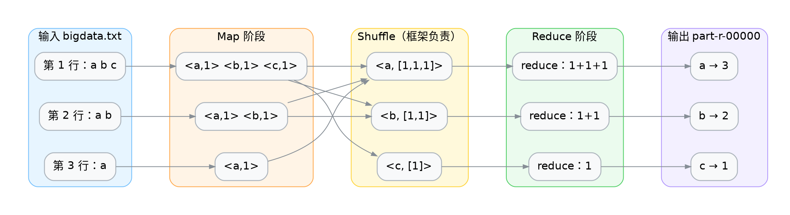
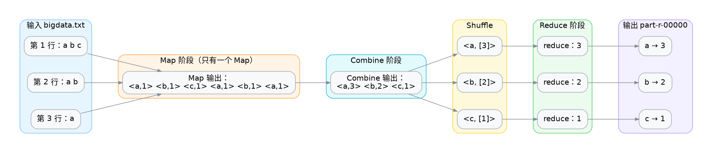
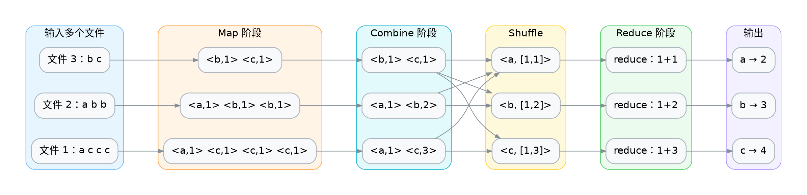

<div class="cover"><h1>Combiner 预聚合</h1><p>在 map 端先合并，少搬数据</p></div>

### 前置与后继

| 关系   | 案例     | 承接的知识点       |
| ------ | -------- | ------------------ |
| 前置   | 词频统计 | map/reduce 同逻辑  |
| 前置   | 分组汇总 | 求和可结合、可交换 |
| 本案例 | Combiner | 聚合的本地预合并   |

源码位置：`code/hadoop/src/main/java/com/studybigdata/hadoop/mapred/ecombine/`

## 案例概览

本案例在词频统计上加一层 Combiner，把"先合并、再传输"提前到 map 端，减少 Shuffle 的数据量。

### 业务问题



词频统计里，一个 map 任务可能产生大量 `<a, 1>`、`<a, 1>`……它们要全部通过网络发给 reduce 再相加。能不能在 map 端先把同一单词的 `1` 加起来，只发 `<a, 3>`？能——这就是 Combiner。

### 输入数据与预期输出

输入 `a.txt`（与词频统计相同），输出也相同：

```txt
a
a b
a b c
```

Combiner **不改变结果**，只改变中间传输的量。验证点不是"结果对不对"，而是"Shuffle 数据量降没降"。

## 理论篇：Combiner 是什么

##### 一个Mapper一个Reducer



##### 多个Mapper一个Reducer



### Shuffle 是开销最大的阶段

map 的输出要落本地磁盘、按分区排序、跨网络发给 reduce。单词越重复，冗余传输越多。

```text
没有 Combiner:  mapper 发 <a,[1,1,1]>  → 网络 → reduce
使用 Combiner:  mapper 发 <a,[3]>      → 网络 → reduce
```

每条 `<a, 1>` 都是一个要传输的键值对，Combiner 把它们压成一个，网络流量成比例下降。

### Combiner 就是"map 端的本地 reduce"

它对每个 map 任务的**局部输出**做一遍和 reduce 一样的合并。注意是"局部"：它只见到自己这个 map 任务产生的数据，不是全局。

| 维度 | Reducer | Combiner |
|---|---|---|
| 见到数据 | 全局（同 key 的全部） | 局部（本 map 任务） |
| 运行位置 | reduce 节点 | map 节点本地 |
| 是否必须 | 是 | 否（优化） |

### 生效条件：聚合必须可结合、可交换

Combiner 可以多次运行、也可以不运行，所以聚合逻辑必须满足这两条：

| 性质 | 求和 | 求平均 |
|---|---|---|
| 可结合 | 满足 | 不满足 |
| 可交换 | 满足 | 不满足 |
| 能否上 Combiner | 能 | **不能** |

`avg(avg(a,b), c)` 不等于 `avg(a,b,c)`——求平均一旦提前合并就错。词频统计是求和，所以可以放心用。

### Combiner 的契约：类型要对得上

Combiner 的输入输出类型**必须等于 Mapper 的输出类型**（也就是 Reducer 的输入类型）。

```text
Mapper 输出:   <Text, IntWritable>
Combiner 输入: <Text, IntWritable>   ← 必须一致
Combiner 输出: <Text, IntWritable>   ← 必须一致
Reducer 输入:  <Text, IntWritable>   ← 必须一致
```

本案例 Combiner 的类型签名和 Reducer 完全相同，所以直接复用同一套逻辑。

### Combiner 不保证一定执行

这是很容易被误解的一点：Hadoop **可能**运行 Combiner，也可能跳过（比如 map 输出很小、没触发溢写时）。

| 误解 | 真相 |
|---|---|
| "结果依赖 Combiner" | 错，Combiner 只是优化，去掉它结果仍正确 |
| "Combiner 一定跑" | 错，框架可跳过 |

所以**正确性绝不能押在 Combiner 上**。

## 实训篇：给词频统计加 Combiner

### 步骤一：准备数据

```shell
hdfs dfs -mkdir -p /input
hdfs dfs -put a.txt /input/a.txt
```

### 步骤二：Mapper 与 Reducer

和词频统计完全一样——`Mapper` 发 `<word, 1>`，`Reducer` 求和。Combiner 是额外加的一层，不动它们。

### 步骤三：写 Combiner

逻辑和 Reducer 一模一样（都是求和），只是角色不同。

```java
public class WordCountCombiner extends Reducer<Text, IntWritable, Text, IntWritable> {
    @Override
    protected void reduce(Text key, Iterable<IntWritable> values, Context context) {
        int count = 0;
        for (IntWritable value : values) count += value.get();
        context.write(key, new IntWritable(count));
    }
}
```

既然逻辑相同，也可以直接 `job.setCombinerClass(WordCountReduce.class)` 复用 Reducer 类——本案例单独写一个类是为了把"Combiner"这个名字显式亮出来。

### 步骤四：注册 Combiner

只多一行，关键是类型已经自洽。

```java
job.setMapperClass(WordCountMapper.class);
job.setCombinerClass(WordCountCombiner.class);
job.setReducerClass(WordCountReduce.class);
```

### 步骤五：运行与验证

```shell
hadoop jar hadoop-1.0-SNAPSHOT.jar \
  com.studybigdata.hadoop.mapred.ecombine.WordCountMain \
  /input/a.txt /output/combine
```

结果应与不加 Combiner 完全一致：a→3、b→2、c→1。结果相同是预期的——Combiner 只影响效率。

### 步骤六：观察 Shuffle 数据量

看作业计数器，对比有无 Combiner 的差异：

| 计数器 | 无 Combiner | 有 Combiner |
|---|---|---|
| Map output records | 6 | 6 |
| Combine input records | — | 6 |
| Combine output records | — | 3 |
| Reduce input records | 6 | 3 |

`Combine output records`(3) 明显小于 `Map output records`(6)，说明传输量减半。这是 Combiner 起作用的硬证据。

### 步骤七：变式训练

| 变式 | 做法 | 观察到的现象 |
|---|---|---|
| 1. 复用 Reducer | `setCombinerClass(WordCountReduce.class)` | 结果相同，少写一个类 |
| 2. 换成求平均逻辑 | Combiner 里做除法 | 结果错误（不可结合） |
| 3. 大输入对比 | 用大文件跑两次 | 有 Combiner 的更快 |

变式 2 是反面教材：把"可结合"的求和换成"不可结合"的求平均，结果立刻错。

## 常见坑

### 坑一：用 Combiner 做求平均

最经典的误用。

| 现象 | 原因 | 修法 |
|---|---|---|
| 平均值偏小/错 | 平均不可结合，提前合并失真 | 平均放 reduce 端或两遍作业 |
| 看似随机 | 取决于 Combiner 跑没跑 | 同上 |

### 坑二：以为结果依赖 Combiner

| 现象 | 原因 | 修法 |
|---|---|---|
| 去掉 Combiner 结果不变 | 它本就是优化 | 正确性不押在它上 |
| 加了 Combiner 结果变 | 聚合不可结合 | 检查聚合逻辑 |

### 坑三：Combiner 类型不匹配

| 现象 | 原因 | 修法 |
|---|---|---|
| 编译/运行类型错 | 输入输出类型 ≠ Mapper 输出 | 严格对齐类型 |
| 数据接不上 | 同上 | 同上 |

### 坑四：把有副作用的逻辑放进 Combiner

Combiner 可能跑 0 次或多次，任何"必须恰好一次"的逻辑都不能放进去。

| 现象 | 原因 | 修法 |
|---|---|---|
| 计数少/多 | 依赖运行次数 | 只放可结合聚合 |

### 坑五：误以为 Combiner 能替代 Reducer

Combiner 只见局部数据，无法做全局去重、全局排序等。

| 现象 | 原因 | 修法 |
|---|---|---|
| 全局结果错 | Combiner 非全局 | Reducer 不可省 |

## 小结

Combiner 是 map 端的本地 reduce，只在"聚合可结合、可交换"时安全，且只优化效率、不改变结果。

### 三句话回顾

- Combiner 把 map 局部输出先合并，减少 Shuffle 传输量，是纯优化。
- 只有可结合、可交换的聚合（如求和）才能上 Combiner；求平均不行。
- 它的输入输出类型必须等于 Mapper 输出类型，且框架可能跳过它——正确性不能押在它上。

### 与下一案例的衔接

本案例解决了"效率"。下一个机制案例回到"分组键"本身——自定义分区器决定数据去哪个 reduce 文件，和 Combiner 关注的是不同维度。

<div class="end"><h1>Combiner 预聚合</h1><p>下一案例：自定义分区器</p></div>

