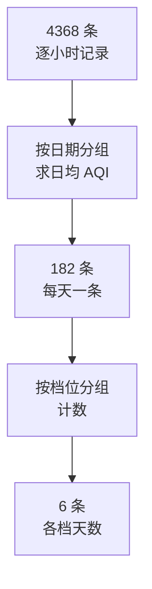

<div class="cover"><h1>多阶段作业串联</h1><p>当一个分组键算不出目标口径时</p></div>

## 案例概览

本案例用北京 2016 年上半年的逐小时气象数据，回答两个问题：空气质量各等级各占多少天、每月平均气温是多少。

### 业务问题

数据是**逐小时**的（每天 24 条）。而报表要的是**按天**的空气质量等级天数、**按月**的平均气温。目标口径与数据粒度不一致，这正是"一次 MapReduce 算不出来"的典型场景。

### 输入数据与预期输出

输入 `beijing.txt`，9 列、4368 行：

```text
DATE,HOUR,COND,PRES,HUM,TMP,AQI,PM2.5,PM10
20160101,00,霾,1024,67,-2,212,168,158
20160101,01,霾,1024,70,-3,209,164,132
```

| 列 | 字段 | 本案例是否使用 | 备注 |
|---|---|---|---|
| 1 | DATE | 是 | `20160101`，前 6 位代表月份 |
| 3 | COND | 否 | 天气现象（霾 / 雪 …） |
| 6 | TMP | 部分 | 气温，范围 -15 ~ 37 |
| 7 | AQI | 部分 | 含 930 个 `N/A` |

两个作业合起来共 3 个阶段，输出都是 6 行以内：

| 阶段 | 输入 | 输出 | 行数 |
|---|---|---|---|
| 日均 AQI | `beijing.txt` 4368 行 | `<日期, 日均AQI>` | 182 |
| 分档统计 | 上一阶段输出 182 行 | `<档位, 天数>` | 6 |
| 月度均温 | `beijing.txt` 4368 行 | `<年月, 均温>` | 6 |

### 前置与后继

| 关系 | 案例 | 承接的知识点 |
|---|---|---|
| 前置 | 多表关联 | 分组键的构造 |
| 本案例 | 多阶段串联 | 作业之间的输入输出契约 |
| 前置 | 自定义排序 | 全局有序的条件 |

源码位置：`code/hadoop/src/main/java/com/studybigdata/hadoop/mapred/weather/`

## 理论篇：为什么必须分成两次作业

先讲清楚"一次算不出来"的根因，再动手。否则很容易写出一个结果看似合理、口径完全错误的作业。

### 一次作业只有一个分组键

Reduce 的分组由 Map 输出的 key 唯一决定。所以一次作业只能回答"按 X 分组"这一个问题。

| 想算的口径 | 分组键应该是什么 | 一次作业能算吗 |
|---|---|---|
| 每天的平均 AQI | 日期 | 能 |
| 每个档位有多少天 | 档位 | **不能**——档位不是原始数据里的字段 |

第二行的关键在于：**"档位"是日均 AQI 算出来之后才存在的概念**。原始数据里只有每小时的 AQI 值，没有"这一天属于良"这个信息。

### 分档是"对统计结果再统计"

这就产生了粒度的跃迁，用两步才能走完：



第一步把 4368 条压成 182 条（粒度：小时 → 天），第二步再把 182 条压成 6 条（粒度：天 → 档位）。**每一步都是一次独立的 MapReduce 作业**。

### 如果硬要用一次作业

有人会想在 Mapper 里先算日均、再分档。这条路走不通，原因是分组键必须在 Map 输出时就确定：

| 尝试 | 做法 | 为什么失败 |
|---|---|---|
| 直接按档位分组 | key 用每条记录的 AQI 档位 | 数出来的是**小时数**，不是天数 |
| 先用 Map 端缓存算日均 | 缓存当前日期的所有记录 | 跨切片时同一日期被拆到不同 map 任务 |
| 用两次作业 | 日期 → 档位 | 正确 |

第二种尝试最隐蔽：它对小数据"看起来能跑通"，因为一个日期恰好落在一个切片里。数据量一变就会出错。

### 阶段之间的衔接契约

两个作业靠 HDFS 上的中间结果衔接，必须满足三条约定：

| 约定 | 本案例的做法 | 违反后的现象 |
|---|---|---|
| 格式匹配 | 阶段二按 `\t` 切，阶段一写出的正是制表符 | `ArrayIndexOutOfBounds` |
| 路径传递 | 阶段一输出目录作为阶段二的 `args[0]` | 读到旧数据或报文件不存在 |
| 无表头 | 阶段一只写 `<日期, 数值>` | 阶段二把表头当数据解析崩溃 |

第一条最容易踩：阶段一的**输入**是逗号分隔的 CSV，**输出**却是制表符分隔的 `Text`。阶段二如果沿用 `split(",")`，读到的就是整个 `20160102\t294` 当第一个字段。

### 平均值与缺测值

日均和月均都要用"求和 ÷ 计数"，这里有两个必须处理的细节：

| 细节 | 本案例的处理 | 不处理的后果 |
|---|---|---|
| 缺测值 | 跳过 `N/A` 的行 | `parseInt("N/A")` 直接抛异常 |
| 整数除法 | 求和与计数都是 `int` | 结果被截断，不四舍五入 |

整数除法意味着 `294.7` 会被记为 `294`。教学案例这么做是为了少写几行代码，但真实报表必须用 `double` 或至少显式说明精度口径。

### Combiner 能不能用在求平均上

这是 Combiner 的经典考点，正好在本案例里能对照上：

| 阶段 | 是否设了 Combiner | 原因 |
|---|---|---|
| 日均 AQI | 没设 | 求平均不可结合，设了会算错 |
| 分档统计 | 设了 `StatReducer` | 求和可结合、可交换 |

"求平均不可结合"的意思是：`avg(avg(a,b),c) ≠ avg(a,b,c)`。所以 Combiner 里只能做求和与计数，**不能**做除法。

## 实训篇：阶段一 日均 AQI

`AqiStatDaily` 把逐小时记录按日期聚合成日均 AQI，输出 182 行。

### 步骤一：准备数据

```shell
hdfs dfs -mkdir -p /input/weather
hdfs dfs -put beijing.txt /input/weather/
```

一个极易忽略的前置检查：确认文件**没有 UTF-8 BOM**。如果文件前 3 个字节是 `EF BB BF`，首行字段会变成 `\ufeffDATE`，表头过滤会失效并崩在类型转换上。

```shell
head -c 3 beijing.txt | xxd
```

### 步骤二：Mapper 过滤表头与缺测

两条过滤条件缺一不可：去掉表头行，跳过 AQI 为 `N/A` 的时段。

```java
String[] items = value.toString().split(",");

String date = items[0];
String aqi = items[6];

if (!"DATE".equals(date) && !"N/A".equals(aqi)) {
    dateKey.set(date);
    intValue.set(Integer.parseInt(aqi));
    context.write(dateKey, intValue);
}
```

用 `"DATE".equals(date)` 而不是 `date.equals("DATE")`，是因为读进来的字段理论上可能是 `null`，写在前面可以避免空指针。

### 步骤三：Reducer 求日均

同时累加和计数，循环结束后做一次除法。

```java
int aqi_sum = 0;
int count = 0;

for (IntWritable val : values) {
    aqi_sum += val.get();
    count++;
}

int aqi_avg = aqi_sum / count;
result.set(aqi_avg);
context.write(key, result);
```

这里的 `count` 就是这一天有效记录的条数。由于 Mapper 已经把 `N/A` 滤掉了，除数是"有效条数"而不是固定的 24——这一点很重要，否则缺测的日子会被稀释。

### 步骤四：运行与验证

```shell
hadoop jar hadoop-1.0-SNAPSHOT.jar \
  com.studybigdata.hadoop.mapred.weather.AqiStatDaily \
  /input/weather /output/aqi_daily 3
```

第三个参数是 reduce 个数。运行后输出目录下会有 3 个 part 文件，合计 182 行：

```shell
hdfs dfs -cat /output/aqi_daily/part-r-* | wc -l
```

`code/data/input/part-r-00000` 就是这一步的预期结果，可以直接对照。

## 实训篇：阶段二 分档统计

`AqiStat` 读上一阶段的输出，把每天的 AQI 归入 6 个档位并计数。

### 步骤五：Mapper 区分档位

输入格式变成了制表符分隔，切分符必须跟着改。

```java
String[] items = value.toString().split("\t");
int aqi = Integer.parseInt(items[1]);

if (aqi <= 50)       cond.set("优");
else if (aqi <= 100) cond.set("良");
else if (aqi <= 150) cond.set("轻度污染");
else if (aqi <= 200) cond.set("中度污染");
else if (aqi <= 300) cond.set("重度污染");
else                 cond.set("严重污染");

context.write(cond, one);
```

档位名直接当 key 输出——这正是"把计算结果变成新的分组键"的具体动作。若档位名很长，生产环境通常用枚举序号当 key 更省传输。

### 步骤六：Reducer 数天数

和词频统计的 Reducer 完全一样，只是语义变了。

```java
int sum = 0;
for (IntWritable val : values) {
    sum += val.get();
}

result.set(sum);
context.write(key, result);
```

**同样的代码，在第 5 行处语义完全不同**：这里每一条记录代表"一天"，所以 `sum` 是**天数**；如果阶段一输出的是逐小时记录，`sum` 就变成小时数了。代码是否等价，取决于上游的口径。

### 步骤七：运行与验证

```shell
hadoop jar hadoop-1.0-SNAPSHOT.jar \
  com.studybigdata.hadoop.mapred.weather.AqiStat \
  /output/aqi_daily /output/aqi_level 1
```

输出 6 行，六档天数之和必须等于 182：

| 档位 | AQI 范围 | 天数 |
|---|---|---|
| 优 | 0 ~ 50 | 52 |
| 良 | 51 ~ 100 | 66 |
| 轻度污染 | 101 ~ 150 | 36 |
| 中度污染 | 151 ~ 200 | 14 |
| 重度污染 | 201 ~ 300 | 10 |
| 严重污染 | 300 以上 | 4 |

52 + 66 + 36 + 14 + 10 + 4 = 182，与阶段一的输出行数一致。这个"总数对得上"的检查是判断两阶段衔接是否正确的第一道关。

## 实训篇：旁支 月度均温

`TmpStat` 与前面是两个独立的作业，可以单独运行。它的价值在于演示**换一个分组键就换一个报表**。

### 步骤八：换一个分组键

同样的输入，只把 `items[6]`（AQI）换成 `items[5]`（TMP），再把日期截断到月份：

```java
String date = items[0];
String tmp = items[5];

if (!"DATE".equals(date) && !"N/A".equals(tmp)) {
    dateKey.set(date.substring(0, 6));
    intValue.set(Integer.parseInt(tmp));
    context.write(dateKey, intValue);
}
```

`substring(0, 6)` 把 `20160101` 截成 `201601`。这依赖日期恰好是 8 位纯数字格式——如果格式是 `2016/01/01`，同样的代码会截出 `2016/0`，得到 12 行垃圾结果。

### 步骤九：运行与验证

```shell
hadoop jar hadoop-1.0-SNAPSHOT.jar \
  com.studybigdata.hadoop.mapred.weather.TmpStat \
  /input/weather /output/tmp_month 1
```

输出 6 行，气温从 1 月到 6 月单调上升：

| 月份 | 平均气温 |
|---|---|
| 201601 | -4 |
| 201602 | 1 |
| 201603 | 9 |
| 201604 | 16 |
| 201605 | 21 |
| 201606 | 25 |

"结果随月份单调上升"是一个业务侧的合理性检查。数值对了但趋势不对手，通常说明分组键截错了位。

## 一个真实的证据：预期输出不是全局有序

`code/data/input/part-r-00000` 是阶段一的预期结果。打开它会发现一件反常的事。

### 三段各自有序的异常现象

文件第一行是 `20160102`，但接着是 `20160105`、`20160108`……跳着走。翻到第 62 行又跳回 `20160103`，第 123 行跳到 `20160101`。

每个片段内部是升序的，但整体不是：

| 检查项 | 结果 |
|---|---|
| 总行数 | 182（日期无缺失） |
| 整体是否升序 | 否 |
| 前 61 / 中 61 / 后 60 行是否各自升序 | 都是 |

### 原因是跑了 3 个 reduce

这正是前面"阶段一"里那个 `args[2]` 造成的——作业被跑成了 **3 个 reduce 任务**，每个任务各自写一个 part 文件，每个文件内部有序；把它们合并成一个文件后，"合并出的文件有序"这个前提就不成立了。

| reduce 个数 | 每个 part 文件 | 合并后 |
|---|---|---|
| 1 | 有序 | 有序 |
| 3 | 各自有序 | **整体无序** |

这与 `fsort` 案例的结论是同一条：**全局有序只属于单个 reduce 文件**，跨文件不存在。

### 如何自己验证

用几行代码就能复现这个判断，不需要跑 Hadoop：

```python
lines = [l.split("\t")[0] for l in open("part-r-00000") if l.strip()]
print(len(lines), lines == sorted(lines))   # 182 False
```

把列表按 61/61/60 切成三段再各自判断，就会得到三个 `True`。这个"分段测试"是识别多 reduce 输出的通用手法。

## 常见坑

天气数据比员工表脏得多，实际调试中大部分时间都花在下面这些问题上。

### 坑一：文件带 UTF-8 BOM

表头过滤写的是 `!"DATE".equals(date)`，但如果文件开头有 BOM，`items[0]` 实际是 `\ufeffDATE`，两个字符串不相等，表头会被当成数据行，随后 `Integer.parseInt("AQI")` 抛异常。

| 现象 | 原因 | 修法 |
|---|---|---|
| `NumberFormatException: For input string: "AQI"` | 文件带 BOM，表头未被过滤 | 去掉 BOM，或对首字段 `replace("\ufeff","")` |
| 表头过滤明明写了却不生效 | 同上 | 用 `head -c 3 \| xxd` 确认 |

### 坑二：两阶段切分符不一致

阶段一输出的是制表符分隔，阶段二必须跟着改。

| 现象 | 原因 | 修法 |
|---|---|---|
| `ArrayIndexOutOfBounds` | 阶段二仍用 `split(",")` | 改 `split("\t")` |
| 只有 1 个字段 | 同上，整行未被切开 | 同上 |

### 坑三：缺测值没跳过

`N/A` 是字符串，直接参与数值运算必然崩。

| 现象 | 原因 | 修法 |
|---|---|---|
| `NumberFormatException: For input string: "N/A"` | 未过滤缺测行 | 判断 `!"N/A".equals(x)` |
| 结果偏低 | 把 `N/A` 当 0 处理 | 正确做法是**跳过**，不是补零 |

### 坑四：整数除法丢精度

`int / int` 直接截断小数部分。

| 现象 | 原因 | 修法 |
|---|---|---|
| 均值总是偏小 | 整除截断 | 用 `double`，或明确声明口径 |
| 月和与日均不符 | 两级截断误差累积 | 同上 |

### 坑五：跑完才想起 reduce 个数

`args[2]` 传了几个 reduce，决定输出几个 part 文件，也决定合并后是否有全局有序。

| 现象 | 原因 | 修法 |
|---|---|---|
| 期望单文件却得到多个 | `args[2]` 大于 1 | 传 1，或最后做一次合并排序 |
| 合并后顺序乱了 | 多 reduce 输出被直接拼接 | 需要全局有序就设单 reduce |

## 小结

本案例把前面所有案例的机制串了起来：分组、分组、再分组，只是每一层的分组键都来自上一层的结果。

### 三句话回顾

- 目标口径与数据粒度不一致时，一次分组算不出来，必须拆成多阶段作业。
- 阶段之间的契约有三条：切分符匹配、路径传递、不写表头。
- 多 reduce 的每个 part 文件各自有序，合并后不保证全局有序。

### 与下一案例的衔接

到这里，MapReduce 的核心机制已经全部走完一遍：分组、排序、去重、关联、串联。再往后要解决的是**工程问题**——任务慢在哪里、数据倾斜怎么定位、参数怎么调，这些属于性能调优专题的范围。

<div class="end"><h1>多阶段作业串联</h1><p>MapReduce 案例主干完结</p></div>
