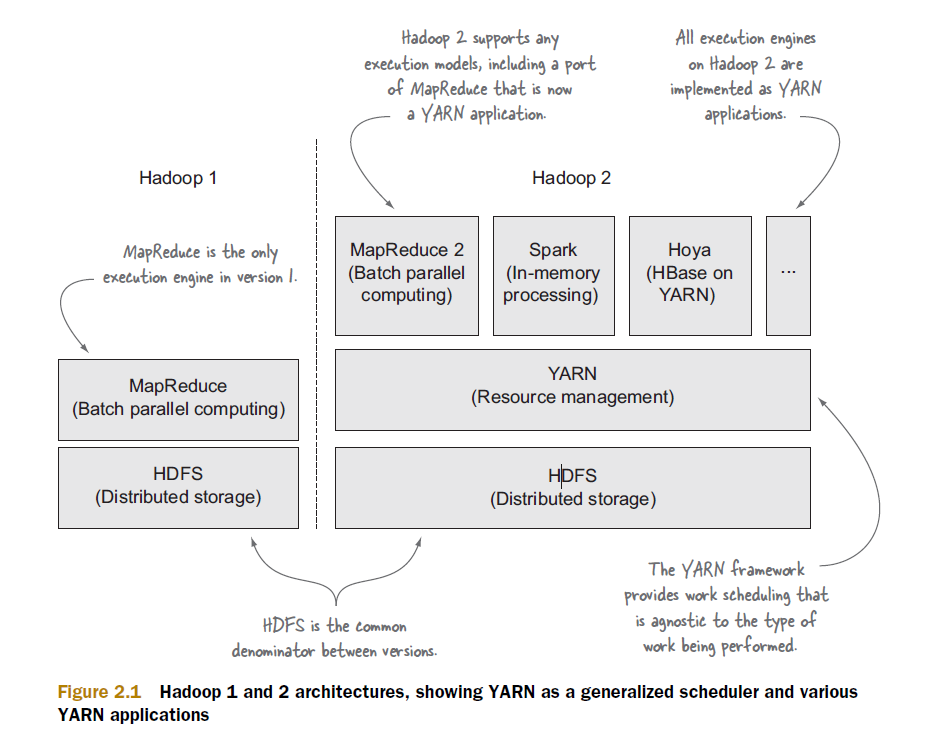
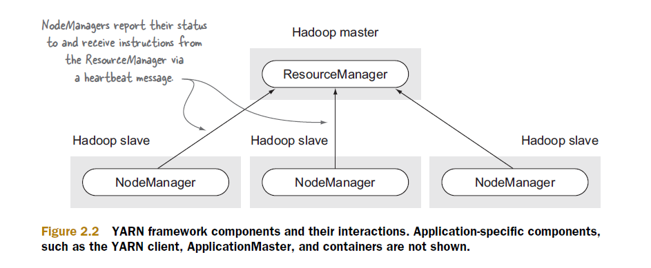
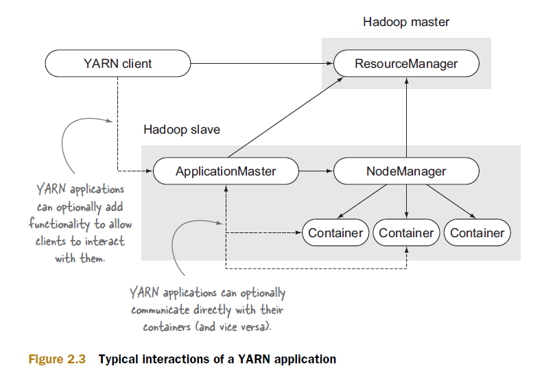
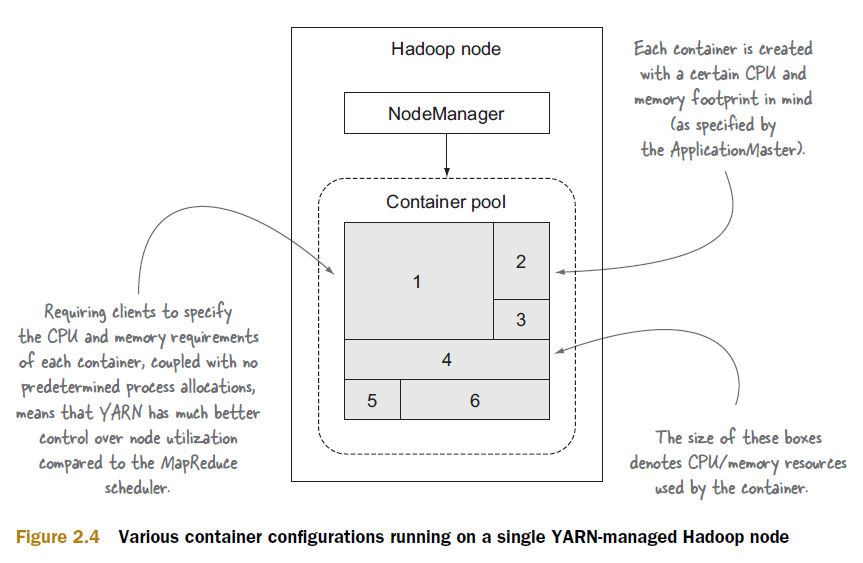
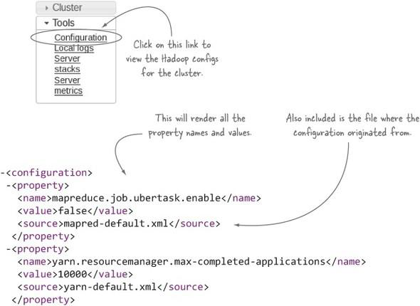
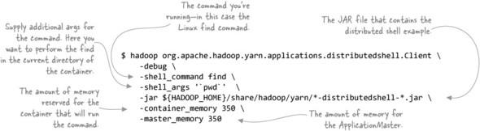
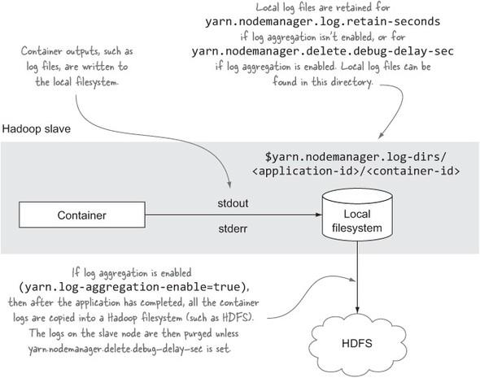
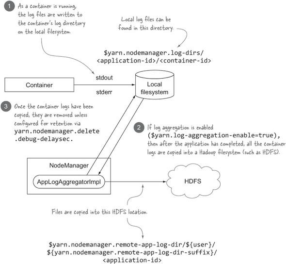
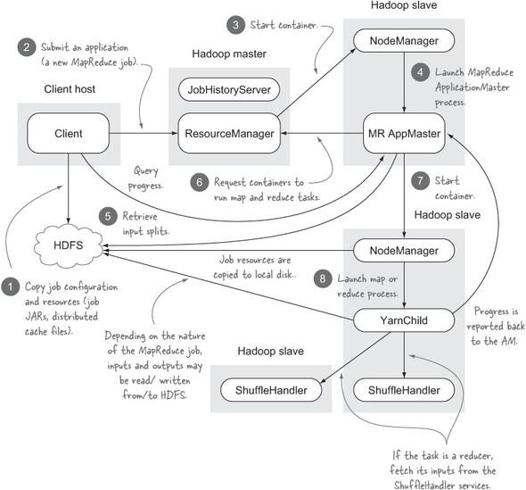

## YARN概览



- `HDFS`在两个版本中都存在；

- `MapReduce`是`Hadoop v1`中唯一的`Execution Engine`；

- `YARN`框架提供的`Work Scheduling`与正在执行的`Work`类型无关；
- `Hadoop v2`上的所有的`Execution Engine`都作为`YARN`应用程序实现。
- `Hadoop v2`支持任何`Execution Engine`，包括`MapReduce`的端口，该端口现在是一个`YARN`应用程序。

### 为什么选择YARN

1. `MapReduce`是`batch-based`，不适合 `real-time`,  `near-real-time`, `Graph`,  `Iterative`数据处理；
2. `Hadoop v1`限制了运行其他框架，`YARN`使`MapReduce`以外的工作也能够在`Hadoop`集群上执行；
3. `Hadoop v1` 的`JobTracker`存在并发问题，一个`Hadoop Cluster`的限制在`3000-4000`个节点。
4. `YARN`的目标是能够扩展到`10000`个节点；
5. `YARN`允许在同一个集群中同时运行不同版本的`MapReduce`；


##### YARN是一个分布式调度器，负责以下两个活动：

1. 响应`Client`申请`Container`的请求，`Container`实质上是一个`process`，能对指定的物理资源进行管理。
2. 监视正在运行的`Container`，并在需要时终止`Container`。
   - 释放`Container`以便其他`Application`的`Container`可以运行；
   - `Container`使用的资源超出`Allocated`的资源。

### YARN概念和组件

#### YARN组件及其相互作用



##### ResourceManager

- 调度器`Schedule(YarnScheduler)`：响应客户端创建`Container`的请求，`Container`的创建实际上委托给了`NodeManager`
- 应用程序管理器`ApplicationManager(RMAppManager)`： manages the list of applications。

##### NodeManager

- 接收`ResourceManager`指令创建、监视、终止`Container`
- 向`ResourceManager`报告`Container`状态

#### 典型的YARN应用程序



##### ApplicationManager

- 向`ResourceManager`申请资源`Container`

- 监控`Application`状态，失败重启`Application`

  

#### 单节点内的container



- 客户端指定每个`Container`的`CPU`和`内存`要求，再加上没有预定的进程分配，这意味着与`MapReduce`调度程序相比，`YARN`对节点的利用率的控制要好得多；
- 每个`Container`创建时都考虑到具体的`CPU`和`内存`占用（由`ApplicationMaster`指定）
- 一个`NodeManager`中有一个`Container Pool`，该`Pool`内可以启动多个不同大小的`Container`
- `Container`进程可以是 `Linux`命令、`Python`应用程序、其他可由操作系统启动的任何进程；


### YARN配置



### 与YARN交互

#### 实验2：在YARN集群中运行一个命令

##### 问题：您希望在 `Hadoop` 集群中的节点上运行 `Linux` 命令。

##### 解决办法：使用与 Hadoop 捆绑在一起的`DistributedShell`示例应用程序。

##### 作用：Start by issuing a Linux find command in a single container:



`DistributedShell ApplicationMaster`在分开的`Container`中启动`find`命令，您看不到该命令的执行结果，`find`命令的标准输出（和标准错误输出）将重定向到`Container`的日志输出目录。

```shell
[zhangsan@node1 userlogs]$ yarn org.apache.hadoop.yarn.applications.distributedshell.Client -debug -shell_command find -shell_args '`pwd`' --jar ${HADOOP_HOME}/share/hadoop/yarn/*distributedshell-*.jar -container_memory 250 -master_memory 250 -num_containers 5
```

如果成功执行该命令，您将会看到如下结果：

```shell
INFO distributedshell.Client: Application completed successfully
```

##### 如何确定Application ID？

```shell
[zhangsan@node1 ~]$  yarn org.apache.hadoop.yarn.applications.distributedshell.Client -debug -shell_command find -shell_args '`pwd`' --jar ${HADOOP_HOME}/share/hadoop/yarn/*distributedshell-*.jar -container_memory 350 -master_memory 350 -num_containers 3
... ...
22/10/06 19:04:26 INFO impl.YarnClientImpl: Submitted application `application_1665053453700_0001`
```

使用`CLI`查看日志：

```shell
[zhangsan@node1 ~]$ yarn logs -applicationId application_1665053453700_0001 
Application has not completed. Logs are only available after an application completes
```

应用程序完成后，如果尝试再次运行该命令，您可能会看到以下输出：

```shell
[zhangsan@node1 ~]$ yarn logs -applicationId application_1665053453700_0001
22/10/06 19:05:46 INFO client.RMProxy: Connecting to ResourceManager at node1/192.168.179.101:8032
/tmp/logs/zhangsan/logs/application_1665053453700_0001 does not exist.
Log aggregation has not completed or is not enabled.
```

`YARN CLI`仅在`Application`完成并启用了`日志聚合`时才能使用。


##### 关闭 YARN Application

```shell
[zhangsan@node0 bin]$ yarn application -kill application_1670156642351_0002
22/12/05 01:17:47 INFO client.RMProxy: Connecting to ResourceManager at node0/192.168.179.100:8032
```


#### 实验3：获取container日志

##### 问题：

访问`Container`日志文件。

##### 解决办法：

使用`YARN`的`UI`和`命令行`访问日志。

##### 讨论：

- `Container`输出（如日志文件）写入本地文件系统。
- 如果没有启用日志聚合，本地日志文件将保留`yarn.nodemanager.log.retain-seconds`秒；
- 如果启用了日志聚合`yarn.log-aggregation-enable`，在`Application`执行完成后，所有`Container`的日志都会被复制到`HDFS`中，然后清除`slave`节点的日志，除非设置了`yarn.nodemanager.delete debug-delay-sec`。


#### 实验4：聚合container日志



##### 启用日志聚合

```xml
<property>
    <name>yarn.log-aggregation-enable</name>
    <value>true</value>
</property>
```

##### 通过UI访问聚合后的日志

```xml
<property>
    <name>yarn.log.server.url</name>
    <value>http://node1:19888/jobhistory/logs</value>
</property>
```

启用`MR`日志服务器

```shell
[zhangsan@node1 ~]$ mr-jobhistory-daemon.sh start historyserver
```

##### 访问HDFS 中的日志文件

默认情况下，聚合的日志文件将存入`HDFS`中的以下目录

```xml
<property>
    <name>yarn.nodemanager.remote-app-log-dir</name>
    <value>/tmp/logs</value>
    <source>yarn-default.xml</source>
</property>
<property>
    <name>yarn.nodemanager.remote-app-log-dir-suffix</name>
    <value>logs</value>
    <source>yarn-default.xml</source>
</property>
```

即：

```shell
/tmp/logs/${user}/logs/<application-id>/
```

如果通过`WebUI`无法查看`HDFS`中的日志，进行如下配置：

```xml
<property>
    <name>hadoop.http.staticuser.user</name>
    <value>zhangsan</value>
    <source>core-site.xml</source>
</property>
```


##### 本地文件系统和HDFS中的日志区别

每个`Container`在本地文件系统中生成两个日志文件：一个用于标准输出`stdout`，另一个用于标准错误输出`stderr`。

作为聚合过程的一部分，给定节点的所有文件将串联到特定于节点的日志中。例如，如果您有五个跨三个节点运行的`Container`，则最终会在 `HDFS` 中得到三个日志文件。

##### 日志压缩

```xml
<property>
    <name>yarn.nodemanager.log-aggregation.compression-type</name>
    <value>gzip或lzo</value>
</property>
```

##### 本地日志保留

关闭日志聚合后，本地主机上的`Container`日志文件将保留 `yarn.nodemanager.log.retain-seconds`秒，默认值为 `10800`（3 小时）。

当日志聚合打开时，将忽略 `yarn.nodemanager.log.retain-seconds`控制，而是在将本地`Container`日志文件复制到 `HDFS` 后立即将其删除。但是，如果您想将它们保留在本地，进行如下配置，则所有内容都不会丢失，这不仅适用于日志文件，还适用于与`Container`关联的所有其他元数据（如 JAR 文件）。

```xml
<property>
    <name>yarn.nodemanager.delete.debug-delay-sec</name>
    <value>600</value>
</property>
```

### 剖析 YARN MapReduce Application




### YARN内存管理

`NodeManager`存在于`Linux`系统中，`Container`存在于`NodeManager`中；所以

- NodeManager Memory < Linux Memory

- Container Memory < NodeManager Memory 

#### NodeManager内存管理

```xml
<!-- yarn nodemanager允许管理的物理内存大小 -->
<property>
    <name>yarn.nodemanager.resource.memory-mb</name>
    <value>-1</value>
    <description>Amount of physical memory, in MB, that can be allocated for containers. If set to -1 and yarn.nodemanager.resource.detect-hardware-capabilities is true, it is automatically calculated(in case of Windows and Linux). In other cases, the default is 8192MB.  NodeManager默认可管理8GB内存；如果value=-1 且 启用自动检测硬件能力 ，该值会自动计算</description>
</property>

<property>
    <name>yarn.nodemanager.resource.detect-hardware-capabilities</name>
    <value>true</value>
    <description>Enable auto-detection of node capabilities such as memory and CPU.启用自动检测节点能力(CPU,Mem), 使用此配置项时，需要 设置yarn.nodemanager.resource.memory-mb=-1 </description>
</property>
```

#### Container内存管理

```xml
<!--yarn单个Container允许分配的最大最小物理内存 -->
<property>
    <name>yarn.scheduler.minimum-allocation-mb</name>
    <value>512</value>
	<description>The minimum allocation for every container request at the RM in MBs. Memory requests lower than this will be set to the value of this property. Additionally, a node manager that is configured to have less memory than this value will be shut down by the resource manager.容器的最小内存，nodemanager可管理的内存不能低于此值</description>
</property>

<property>
    <name>yarn.scheduler.maximum-allocation-mb</name>
    <value>3072</value>
    <description>The maximum allocation for every container request at the RM in MBs. Memory requests higher than this will throw an InvalidResourceRequestException.容器的最大内存，对container的内存请求不能高于此值</description>
</property>
```

> 注意：上面是说的物理内存，不是虚拟内存！

#### 内存不够

如提示：containerID=container_1645498549388_0001_02_000001] is running beyond virtual memory limits. Current usage: 100.0 MB of 1 GB physical memory used; 2.2 GB of 2.1 GB virtual memory used. Killing container.

```xml
<property>
    <name>yarn.nodemanager.pmem-check-enabled</name>
    <value>false</value>
    <description>Whether physical memory limits will be enforced for containers.</description>
    
<property>
    <name>yarn.nodemanager.vmem-check-enabled</name>
    <value>false</value>
    <description>Whether virtual memory limits will be enforced for containers.</description>   
</property>
```

**或**

```xml
<property>
    <name>yarn.nodemanager.vmem-pmem-ratio</name>
    <value>4</value>
    <description>Ratio between virtual memory to physical memory when setting memory limits for containers. Container allocations are expressed in terms of physical memory, and virtual memory usage is allowed to exceed this allocation by this ratio.当启用内存检查时，设置虚拟内存与物理内存的比值</description>
</property>
```

> 未验证。


