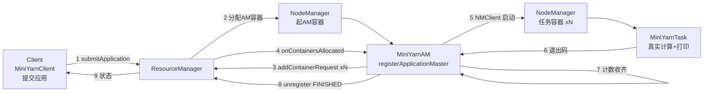

# YARN 自定义应用：从零写一个 ApplicationMaster

> 配套代码：`code/hadoop/src/main/java/com/studybigdata/hadoop/yarn/`（包 `com.studybigdata.hadoop.yarn`，三个类 `MiniYarnClient` / `MiniYarnAM` / `MiniYarnTask`）。
> 前置：已会用 `4-1-Hadoop_YARN.md` 里的 `yarn jar` 跑通 `DistributedShell`；集群 RM/NM 已起。
> 本文所有输出均来自在本仓库测试机（node0，伪分布式）的真实运行。

## 一、为什么要手写 YARN 应用

很多人学 YARN 只停留在"提交一个 MapReduce / DistributedShell"，YARN 内部像黑盒。手写一个迷你应用，是把它拆开、看清每一根"线"的最快路径。

### 01 YARN 到底负责什么

务必先建立一个关键认知：**YARN 只负责"在集群上起 N 个进程、并看住它们活着还是死了"，它不提供数据流、不提供分片、不提供 shuffle、不提供容错。** 所谓"分布式计算"的协调逻辑，全是你自己的 ApplicationMaster 写的。

| 你以为的 YARN | 实际的 YARN |
| --- | --- |
| 一个分布式计算框架 | 一个**分布式进程调度器** |
| 帮你算数据 | 帮你起容器、分配资源、看门 |
| 数据自动流动 | 数据怎么流动由你的 AM 决定 |

### 02 本文目标：一个透明版 DistributedShell

`DistributedShell`（DS）就是 Hadoop 自带的"迷你 YARN 应用"，它申请 N 个容器各自跑一条 shell。本文不重复 DS，而是**手写一个更透明、更贴合教学的版本**：Client 提交 → AM 向 RM 申请 N 个容器 → 每个容器跑一个真实 Java 任务 → AM 收齐退出码后注销。学生读完能改、能加功能，比黑盒 DS 更有成就感。

## 二、整体架构与三角色

整体就三个角色，职责边界非常清晰。看懂这张图，YARN 就通了一半。

### 01 三个角色一张图



### 02 三角色职责对照

| 角色 | 运行位置 | 核心职责 |
| --- | --- | --- |
| `MiniYarnClient` | 提交端（你敲命令的机器） | 上传 jar、组装 AM 启动上下文、提交、轮询终态 |
| `MiniYarnAM` | RM 分配的 AM 容器 | 向 RM 注册、协商 N 个容器、启动任务、收集退出码、注销 |
| `MiniYarnTask` | AM 启动的任务容器 | 领到序号、做真实计算、打印结果、退出 |

> 注意：`MiniYarnAM` 和 `MiniYarnTask` 是**同一个 jar 里的两个 main 类**，靠启动命令里的类名区分。

## 三、Client：提交应用

Client 是唯一跑在你本地、不直接进容器的类。它做两件关键事：把 jar 上传到 HDFS（容器要从 HDFS 拉 jar），再组装 `ApplicationSubmissionContext` 提交。

### 01 代码：上传 jar + 提交应用

```java
// 1) 把当前运行的 jar 上传到 HDFS 暂存目录（容器本地化从这里拉）
String myJar = MiniYarnClient.class.getProtectionDomain()
        .getCodeSource().getLocation().getPath();
Path localJar = new Path(myJar);
Path hdfsJar = hdfsJarPath();                 // /user/zhangsan/.mini-yarn/mini-yarn.jar
fs.mkdirs(new Path(STAGING_DIR));
fs.delete(hdfsJar, true);                     // 先删后传，避免留下陈旧 jar
fs.copyFromLocalFile(false, localJar, hdfsJar);

// 2) 创建应用，探明 RM 允许的单容器最大内存
YarnClient yarnClient = YarnClient.createYarnClient();
yarnClient.init(conf); yarnClient.start();
YarnClientApplication app = yarnClient.createApplication();
int maxMem = app.getNewApplicationResponse()
        .getMaximumResourceCapability().getMemory();

// 3) 组装 AM 容器启动上下文并提交
ApplicationSubmissionContext ctx = app.getApplicationSubmissionContext();
ctx.setApplicationName("MiniYarnApp");
ctx.setResource(Resource.newInstance(masterMemory, 1));
ctx.setAMContainerSpec(amCtx);                // 见下：含 jar/环境/命令
yarnClient.submitApplication(ctx);
```

### 02 关键点：jar 必须作为 localResource 上传 HDFS

容器运行在 NodeManager 上，拿不到你本地的 jar。必须把 jar 放进 HDFS，并在 `ContainerLaunchContext` 里声明为 `LocalResource`，NodeManager 才会在启动容器时把它拉到容器本地目录（`filecache`）。

> 坑：本仓库第一版就栽在这里——`copyFromLocalFile` 默认**不覆盖**已存在的文件，重复运行会把一个**陈旧（甚至曾被误建成目录）的 jar** 留在 HDFS，导致任务容器 `Could not find or load main class`。所以代码里用 `fs.delete(hdfsJar, true)` 先删后传。

### 03 真实输出：Client 端

```text
[Client] 已上传 jar -> /user/zhangsan/.mini-yarn/mini-yarn.jar
[Client] RM 单容器最大内存 = 8192MB
[Client] 已提交应用 application_1782976183503_0002
[Client] ACCEPTED | Application is Activated, waiting for resources to be assigned for AM.
[Client] ACCEPTED | AM container is launched, waiting for AM container to Register with RM
[Client] RUNNING |
[Client] RUNNING |
[Client] FINISHED | 全部任务容器已完成
[Client] 终态: SUCCEEDED | trackingURL=http://node0:8088/proxy/application_1782976183503_0002/
```

## 四、ApplicationMaster：心跳与资源协商

`MiniYarnAM` 运行在 RM 分配的 AM 容器里，是"学生自己写的 YARN 程序"的核心。它和 RM 之间是**异步心跳回调**：AM 提需求，RM 有资源了通过回调把容器"推"给 AM。

### 01 代码：注册 + 申请 N 个容器

```java
AMRMClientAsync<ContainerRequest> rmClient =
        AMRMClientAsync.createAMRMClientAsync(1000, new RMCallbackHandler());
rmClient.init(conf); rmClient.start();
nmClient = NMClient.createNMClient();
nmClient.init(conf); nmClient.start();

rmClient.registerApplicationMaster(host, -1, "");   // 向 RM 报到
System.out.println("[AM] 已注册 @ " + host + "，申请 " + numContainers + " 个容器 x " + containerMemory + "MB");

for (int i = 0; i < numContainers; i++) {           // 一次性申请 N 个
    ContainerRequest req = new ContainerRequest(
            Resource.newInstance(containerMemory, 1), null, null, Priority.newInstance(0));
    rmClient.addContainerRequest(req);
}
while (!done) Thread.sleep(1000);                    // 主线程等收齐
rmClient.unregisterApplicationMaster(FinalApplicationStatus.SUCCEEDED, "全部任务容器已完成", null);
```

### 02 回调：容器来了就启动，退出了就计数

`AMRMClientAsync` 的两个核心回调：

```java
@Override
public void onContainersAllocated(List<Container> containers) {
    for (Container c : containers) {
        int idx = taskIndex.getAndIncrement();
        System.out.println("[AM] 启动任务 #" + idx + " @ " + c.getNodeId());
        nmClient.startContainer(c, buildTaskContext(idx));   // 交给 NM 起任务
    }
}
@Override
public void onContainersCompleted(List<ContainerStatus> statuses) {
    for (ContainerStatus s : statuses) {
        int n = completed.incrementAndGet();
        System.out.println("[AM] 任务完成: " + s.getContainerId() + " exit=" + s.getExitStatus() + " (" + n + "/" + numContainers + ")");
        if (n >= numContainers) done = true;                 // 收齐 → 主线程退出循环
    }
}
```

> 申请 N 个容器时，RM 可能分批回调（一次给几个），AMRMClient 会持续协商直到满足，无需自己重发请求。

### 03 收尾：注销与"被 kill"

全部任务收齐后，`unregisterApplicationMaster(SUCCEEDED, ...)` 告知 RM"我完了"。**务必**实现 `onShutdownRequest()`：当用户执行 `yarn application -kill` 时，RM 通过它通知 AM 安静退出，否则应用会卡在 KILLING 状态。

```java
@Override
public void onShutdownRequest() {
    finalStatus = FinalApplicationStatus.KILLED;
    finalMsg = "AM 被 RM 要求关闭";
    done = true;
}
```

## 五、任务容器：NMClient 启动真实任务

AM 拿到容器后，用 `NMClient` 在对应的 NodeManager 上启动任务进程。任务进程就是 `MiniYarnTask`——一个普通的 Java main，和 YARN 再无耦合。

### 01 代码：任务容器的启动上下文

```java
private ContainerLaunchContext buildTaskContext(int idx) {
    LocalResource jar = MiniYarnClient.newJarLocalResource(new Configuration(), MiniYarnClient.hdfsJarPath());
    Map<String, String> env = new HashMap<>();
    env.put("CLASSPATH", MiniYarnClient.buildClasspath(new Configuration()));  // 见七·01（代码侧）、七·02（集群侧）
    List<String> commands = new ArrayList<>();
    commands.add("{{JAVA_HOME}}/bin/java");
    commands.add("-Xmx" + containerMemory + "m");
    commands.add("com.studybigdata.hadoop.yarn.MiniYarnTask");
    commands.add(String.valueOf(idx));                                        // 传容器序号
    return ContainerLaunchContext.newInstance(
            Collections.singletonMap("mini-yarn.jar", jar), env, commands, null, null, null);
}
```

`{{JAVA_HOME}}` 和 `{{CLASSPATH}}` 是 YARN 在启动容器时自动替换的占位符。

### 02 真实任务：MiniYarnTask 在做什么

任务进程与 YARN 完全解耦，只做"领序号 → 真实计算 → 打印 → 退出"：

```java
int idx = Integer.parseInt(args[0]);
String host = InetAddress.getLocalHost().getHostName();
long n = (idx + 1L) * 1000;
long sum = 0;
for (long i = 1; i <= n; i++) sum += i;       // 真实计算：累加和
System.out.println("MiniYarnTask[#" + idx + "] host=" + host + " sum(1.." + n + ")=" + sum);
Thread.sleep(2000);                            // 模拟耗时，便于观察容器生命周期
System.exit(0);
```

### 03 真实输出：任务容器

```text
MiniYarnTask[#0] host=node0 sum(1..1000)=500500
```

`host=node0` 说明任务确实跑在集群节点上；换成完全分布式集群，这里会出现不同主机名——那就是"分布式"的直观证据。

## 六、跑起来：真实运行全流程

把三个类编译进 jar，用 `yarn jar` 提交，和提交 MapReduce 一模一样。

### 01 准备与提交命令

> 运行前置检查：提交前请确认集群 `yarn-site.xml` 已含 `yarn.application.classpath`（见七·02）且已关闭 vmem/pmem 检查（见七·04）；若缺任一项，先按对应小节补好并执行 `stop-yarn.sh && start-yarn.sh` 重启 YARN，否则容器会 `NoClassDefFoundError` 或被 `-103` 杀掉。

```bash
# 在 code/ 下用 Maven 打包（产出 code/hadoop/target/hadoop-1.0-SNAPSHOT.jar）
mvn -f code/pom.xml -pl hadoop -am package

# 把 jar 传到集群节点，提交
yarn jar hadoop-1.0-SNAPSHOT.jar com.studybigdata.hadoop.yarn.MiniYarnClient \
      -num_containers 5 -container_memory 512 -master_memory 512
```

> `-container_memory` 必须 ≥ `yarn.scheduler.minimum-allocation-mb`（本机 512）；`-master_memory` 是 AM 容器内存。

### 02 AM 日志：完整链路一览

AM 的 stdout 在 YARN Web UI（`node0:8088` → 应用 → Logs → AM 容器）可见，真实内容如下：

```text
[AM] 已注册 @ node0，申请 5 个容器 x 512MB
[AM] 启动任务 #0 @ node0:41656 (1/5)
[AM] 启动任务 #1 @ node0:41656 (2/5)
[AM] 启动任务 #2 @ node0:41656 (3/5)
[AM] 启动任务 #3 @ node0:41656 (4/5)
[AM] 启动任务 #4 @ node0:41656 (5/5)
[AM] 任务完成: container_1782976183503_0002_01_000002 exit=0 (1/5)
[AM] 任务完成: container_1782976183503_0002_01_000003 exit=0 (2/5)
[AM] 任务完成: container_1782976183503_0002_01_000004 exit=0 (3/5)
[AM] 任务完成: container_1782976183503_0002_01_000005 exit=0 (4/5)
[AM] 任务完成: container_1782976183503_0002_01_000006 exit=0 (5/5)
[AM] 注销，状态=SUCCEEDED，信息=全部任务容器已完成
[AM] 退出
```

`exit=0` × 5 + `SUCCEEDED`：Client、AM、Task 三级全部正确串通。

## 七、踩过的坑（必读，也是教学价值所在）

这些坑本仓库在测试机上一一踩过、已修复。它们不是 bug，而是 YARN 应用"约定俗成"的硬门槛——理解它们比跑通更值钱。

### 01 代码侧：CLASSPATH 必须显式追加 yarn.application.classpath

`{{CLASSPATH}}` 令牌只会被替换成容器环境里的 `$CLASSPATH`，**并不自动包含 Hadoop 自身的 jar**。因此我们的 `MiniYarnAM` / `MiniYarnClient` 在拼容器 classpath 时，必须像 DistributedShell 那样显式把 `yarn.application.classpath` 配置项追加上去：

```java
public static String buildClasspath(Configuration conf) {
    StringBuilder cp = new StringBuilder("{{CLASSPATH}}");
    for (String c : conf.getStrings(
            YarnConfiguration.YARN_APPLICATION_CLASSPATH,
            YarnConfiguration.DEFAULT_YARN_APPLICATION_CLASSPATH)) {
        cp.append(File.pathSeparator).append(c.trim());
    }
    cp.append(File.pathSeparator).append("./*");   // 当前目录下的应用 jar
    return cp.toString();
}
```

> 仅代码这样写还不够——`yarn.application.classpath` 这一项**必须真的存在于集群的 `yarn-site.xml`** 中，否则 `conf.getStrings(...)` 取不到本集群的真实路径，容器照样 `NoClassDefFoundError`。集群侧怎么配见下一条（七·02）。

### 02 集群侧：yarn-site.xml 必须配置 yarn.application.classpath

本测试机原先就**缺这项**，导致任何自定义 YARN 应用（含本文、以及官方 DistributedShell）的容器都 `NoClassDefFoundError`。补法如下。

**配置文件**：`$HADOOP_HOME/etc/hadoop/yarn-site.xml`（本机即 `/opt/bigdata/hadoop/default/etc/hadoop/yarn-site.xml`）。在 `<configuration>` 标签内追加：

```xml
<property>
  <name>yarn.application.classpath</name>
  <value>/opt/bigdata/hadoop/default/etc/hadoop,/opt/bigdata/hadoop/default/share/hadoop/common/*,/opt/bigdata/hadoop/default/share/hadoop/common/lib/*,/opt/bigdata/hadoop/default/share/hadoop/hdfs/*,/opt/bigdata/hadoop/default/share/hadoop/hdfs/lib/*,/opt/bigdata/hadoop/default/share/hadoop/yarn/*,/opt/bigdata/hadoop/default/share/hadoop/yarn/lib/*,/opt/bigdata/hadoop/default/share/hadoop/mapreduce/*,/opt/bigdata/hadoop/default/share/hadoop/mapreduce/lib/*</value>
</property>
```

> 路径用的是本机绝对路径（`$HADOOP_HOME=/opt/bigdata/hadoop/default`）。若你的集群 `HADOOP_HOME` 不同，把前缀整体替换即可；也可改写成可移植的变量形式 `$HADOOP_CONF_DIR,$HADOOP_COMMON_HOME/share/hadoop/common/*,$HADOOP_COMMON_HOME/share/hadoop/common/lib/*,$HADOOP_HDFS_HOME/share/hadoop/hdfs/*,...`（前提是容器内能拿到这些环境变量——本机容器未注入，故绝对路径最稳）。

**改完必须重启 YARN 才生效**：

```bash
stop-yarn.sh
sleep 3
start-yarn.sh
```

### 03 CLASSPATH 通配符必须写 `./*` 不能写 `.*`

Java 的 jar 通配符是 `./*`（当前目录下所有 jar）。写成 `:.*` 会让 JVM 把 `.*` 当成字面的"名为点星的文件"而找不到类——AM 直接 `Could not find or load main class`。

### 04 虚拟内存超限 exitCode -103

JVM 的 `-Xmx512m` 只限制堆，但 Hadoop 全量 classpath 会把几百个 jar `mmap` 进虚拟地址空间，轻松超过 YARN 默认的 2.1 倍物理内存上限，AM/任务容器会被 YARN 以 `exitCode -103` 杀掉。本机已在 `yarn-site.xml` 关闭检查（改完同样需 `stop-yarn.sh && start-yarn.sh` 重启）：

```xml
<property>
  <name>yarn.nodemanager.vmem-check-enabled</name>
  <value>false</value>
</property>
<property>
  <name>yarn.nodemanager.pmem-check-enabled</name>
  <value>false</value>
</property>
```

（这正是 `4-1-Hadoop_YARN.md`"内存不够"一节讲的同一类问题；教程集群 179.x 通常也关了该项。）

### 05 jar 先删后传，否则 HDFS 陈旧 jar

见第三章第 2 节：`copyFromLocalFile` 不覆盖已存在文件，重复运行会留下旧 jar（本仓库还曾误把该路径建成目录，导致 `PathIsNotEmptyDirectoryException`）。代码用 `fs.delete(hdfsJar, true)` 兜底。

### 06 伪分布式下"分布式"只是概念

本机是单节点伪分布式，5 个容器全落 `node0`，`host=node0` 都一样。要看到真正的跨节点分布，需用 `4-1` 里那套完全分布式集群（node0/1/2/3）——这本身也是个好实验：把 `num_containers` 调大，去 Web UI 看容器落在哪些 NodeManager 上。

## 八、小结

<div class="end"><h1>YARN 自定义应用小结</h1>
<ul>
<li>YARN 是<b>进程调度器</b>，不提供数据流；"分布式计算"的协调逻辑全在 ApplicationMaster</li>
<li>三级角色：Client（提交） / AM（协商容器+看门） / Task（真实计算，与 YARN 解耦）</li>
<li>jar 必须作为 <code>localResource</code> 上传 HDFS，容器才能本地化</li>
<li>classpath 必须显式追加 <code>yarn.application.classpath</code>，通配符写 <code>./*</code></li>
<li>AM 用异步回调 <code>onContainersAllocated / onContainersCompleted</code> 与 RM 协作，并实现 <code>onShutdownRequest</code> 处理 kill</li>
<li>跑通只是开始：改 <code>MiniYarnTask</code> 让它做词频 / 矩阵乘，或让 AM 把各容器结果汇总，就是你自己的"迷你分布式框架"</li>
</ul>
<p>下一步可挑战：让任务把局部结果写 HDFS，AM 读回聚合——那就从"B"走到了"分布式计算模型"。</p></div>
