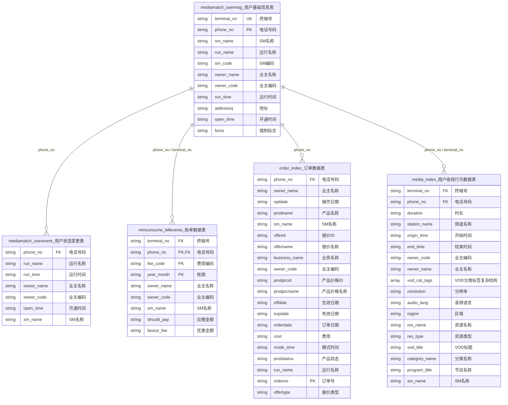

##### 1  创建数据库TestDB并查看数据库

```hive
CREATE DATABASE IF NOT EXISTS TestDB;
SHOW DATABASES;
```


##### 2  创建内部表employees


```hive
CREATE TABLE IF NOT EXISTS TestDB.employees(
name STRING COMMENT 'Employee name',
age INT,
salary FLOAT COMMENT 'Employee salary',
department STRING,
subordinates ARRAY<STRING> COMMENT 'Names of subordinates',
deductions MAP<STRING, FLOAT>  );
```


##### 3  创建外部表employees_external

```hive
CREATE  EXTERNAL  TABLE IF NOT EXISTS TestDB.employees_external(
name STRING COMMENT 'Employee name',
age INT,
salary FLOAT COMMENT 'Employee salary',
department STRING,
subordinates ARRAY<STRING> COMMENT 'Names of subordinates',
deductions MAP<STRING, FLOAT>  )
LOCATION  '/ext/';
```

##### 4  创建静态分区表employees_partition

```hive
CREATE TABLE IF NOT EXISTS TestDB.employees_partition(
name  STRING  COMMENT  'Employee name',
age INT,
salary FLOAT COMMENT 'Employee salary',
department STRING,
subordinates ARRAY<STRING> COMMENT 'Names of subordinates',
deductions MAP<STRING, FLOAT>  )
PARTITIONED BY (country STRING, state STRING);
```


##### 5  创建动态分区表employees_partition_dynamic

```hive
set hive.exec.dynamic.partition=true;  // 开启动态分区模式
set hive.exec.dynamic.partition.mode=nostrict;  // 设置动态分区模式
CREATE TABLE IF NOT EXISTS TestDB.employees_partition_dynamic(
name  STRING  COMMENT  'Employee name',
age INT,
salary FLOAT COMMENT 'Employee salary',
department STRING,
subordinates ARRAY<STRING> COMMENT 'Names of subordinates',
deductions MAP<STRING, FLOAT>  )
PARTITIONED BY (country STRING, state STRING);
```


##### 6  创建桶表employees_cluster

```hive

CREATE TABLE IF NOT EXISTS TestDB.employees_cluster(
name  STRING  COMMENT  'Employee name',
age INT,
salary FLOAT COMMENT 'Employee salary',
department STRING,
subordinates ARRAY<STRING> COMMENT 'Names of subordinates',
deductions MAP<STRING, FLOAT>  )
CLUSTERED BY  (department ) SORTED BY (age DESC)  INTO 3 BUCKETS;
```
##### 7  创建临时表Course_Temp

```hive
CREATE TEMPORARY TABLE TestDB.Course_Temp(id INT,course STRING)
  ROW FORMAT DELIMITED FIELDS TERMINATED BY','
  LINES TERMINATED BY '\n'
  STORED AS textfile;
```


##### 8  查看employees表的表结构信息

```hive
DESCRIBE  TestDB.employees;
```

##### 9  创建log_message表

```hive
USE TestDB;
CREATE EXTERNAL TABLE IF NOT EXISTS  log_message (
hms INT,
severity STRING,
server STRING,
process_id INT,
message STRING)
PARTITIONED  BY  (year INT,  month  INT , day  INT)
ROW FORMAT DELIMITED FIELDS TERMINATED  BY  '\t';
```


##### 10  表重命名

```hive
ALTER TABLE  log_message  RENAME  TO  log_message_new ;
```


##### 11  增加新的分区

```hive
ALTER TABLE log_message_new  ADD IF NOT EXISTS
  PARTITION(year = 2022, month = 1,day = 1 ) LOCATION '/user/hive/warehouse/testdb.db/log_message_new/2022/01/01'
  PARTITION(year = 2022, month = 1,day = 2 ) LOCATION '/user/hive/warehouse/testdb.db/log_message_new/2022/01/02'
  PARTITION(year = 2022, month = 1,day = 3 ) LOCATION '/user/hive/warehouse/testdb.db/log_message_new/2022/01/03';
```

---




##### 12  创建数据库ZJSM

```hive
CREATE DATABASE IF NOT EXISTS ZJSM;
```


##### 13  创建用户基本数据表

```hive
USE ZJSM;
CREATE TABLE IF NOT EXISTS mediamatch_usermsg(
terminal_no STRING,
phone_no STRING,
sm_name STRING,
run_name STRING,
sm_code STRING,
owner_name STRING,
owner_code STRING,
run_time STRING,
addressoj STRING,
open_time STRING,
force STRING)
ROW FORMAT DELIMITED FIELDS TERMINATED BY '\;';
```


##### 14  创建用户状态变更数据表

```hive
CREATE TABLE IF NOT EXISTS mediamatch_userevent(
phone_no STRING,
run_name STRING,
run_time STRING,
owner_name STRING,
owner_code STRING,
open_time STRING,
sm_name STRING)
ROW FORMAT DELIMITED FIELDS TERMINATED BY '\;';
```


##### 15  创建账单数据表

```hive
CREATE TABLE IF NOT EXISTS mmconsume_billevents(
terminal_no STRING,
phone_no STRING,
fee_code STRING,
year_month STRING,
owner_name STRING,
owner_code STRING,
sm_name STRING,
should_pay STRING,
favour_fee STRING)
ROW FORMAT DELIMITED FIELDS TERMINATED BY '\;';
```


##### 16  创建订单数据表

```hive
CREATE TABLE IF NOT EXISTS order_index(
phone_no STRING,
owner_name STRING,
optdate STRING,
prodname STRING,
sm_name STRING,
offerid STRING,
offername STRING,
business_name STRING,
owner_code STRING,
prodprcid STRING,
prodprcname STRING,
effdate STRING,
expdate STRING,
orderdate STRING,
cost STRING,
mode_time STRING,
prodstatus STRING,
run_name STRING,
orderno STRING,
offertype STRING)
ROW FORMAT DELIMITED FIELDS TERMINATED BY '\;';
```

##### 17  创建用户收视行为数据表


```hive
CREATE TABLE IF NOT EXISTS media_index(
terminal_no STRING,
phone_no STRING,
duration STRING,
station_name STRING,
origin_time STRING,
end_time STRING,
owner_code STRING,
owner_name STRING,
vod_cat_tags ARRAY<STRUCT<level1_name: STRING,level2_name: STRING,level3_name: STRING,level4_name: STRING, level5_name: STRING>>,
resolution STRING,
audio_lang STRING,
region STRING,
res_name STRING,
res_type STRING,
vod_title STRING,
category_name STRING,
program_title STRING,
sm_name STRING)
ROW FORMAT DELIMITED FIELDS TERMINATED BY '\;';

```

