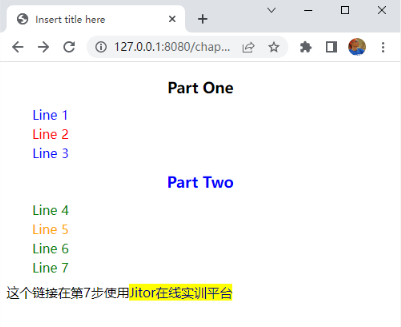

#       【实训2-4】CSS基础和CSS常用样式

## 实训目的

学习 CSS 基本语法，为编写网页打下基础。     

## 实训内容介绍

- 内联样式
- 内部样式表
- 外部样式表
- 元素选择器
- id 选择器
- 类选择器
- 伪类选择器（超链接）
- 文本居中
- 首行缩进
- 指定行高
- 实训总结

## 内联样式

 在【实训2-1】创建的项目 chapter2 中，创建 css.html 文件，添加下述一段代码，按照教材第28页的讲解，为第 2 行“Line 2”的 p 元素加上内联样式，使它以红色显示。 

```html
<h3>Part One</h3>
<p>Line 1</p>
<p>Line 2</p>
<p>Line 3</p>
<h3>Part Two</h3>
<p>Line 4</p>
<p>Line 5</p>
<p>Line 6</p>
<p>Line 7</p>
这个链接在第7步使用<a href="http://ngweb.org/" target="_blank">Jitor在线实训平台</a>
```


在浏览器上观察网页的效果，见 http://127.0.0.1:8080/chapter2/css.html，只有第 2 行是红色的。本实训完成后的效果（直到第11步）如下图所示。



以下每一步骤都是在前一步的基础上添加，除非明确说明要删除前一步的代码。  


## 内部样式表

 修改上一步的 css.html 文件，增加一个内部样式表，将所有 p 元素以绿色（green）显示。 在浏览器上观察网页的效果，所有段落都是绿色的，但是第 2 行“Line 2”是红色的，因为内联模式的优先级最高。  

## 外部样式表

 进一步修改上一步的 css.html 文件，将内部样式表移到外部样式表文件 css/bookstore.css 中， 所有 p 元素仍然以绿色（green）显示。办法分两步（详见教材第 28~29页）。 

（1）在 WebContent 目录下创建一个名为 css 的文件夹，在这个文件夹下创建一个名为 bookstore.css 的文件，将前一步的内部样式表的内容复制到这个文件中（教材中，外部样式表的颜色是 blue 的，这里仍然与内部样式式表的相同）。 

（2）删除 css.html 文件中的内部样式表，代之以一条连接到外部样式表文件的语句。 在浏览器上观察网页的效果，与前一步是相同的。  

## 元素选择器

 内部样式表和外部样式表可以使用选择器，前面两个步骤是通过元素选择器，选择了 p 元素。 html 中的多数元素都是可以被选择的，如标题 h1~h6，列表 li，表格行 tr 等等。 选择器主要有三种：元素选择器、id选择器、类选择器。下面两步学习后面两种。  

## id 选择器

 选择器可以是 id 选择器，就是为元素指定一个唯一 id，为这个 id 的元素指定样式时， 样式仅仅被应用到这一个元素，不可能有更多的元素。下面我们用外部样式表来演示。

 （1）将 css.html 中的第五行“Line 5”指定 id 为 “line5” 

（2）在外部样式表文件 bookstore.css 中，添加 id 为 line5 的样式为颜色 orange。 完成后，在浏览器刷新页面，看到“Line 5”是橙色的。  

## 类选择器

 选择器可以是类选择器，就是为多个元素指定一个类名，为这个类指定样式时， 样式将被应用到这个类的所有元素。下面我们还是用外部样式表来演示。 

（1）将 css.html 中的“Line 1”、“Line 3”、“Part Tow”三行指定 class 为“blue-text” 

（2）在外部样式表文件 bookstore.css 中，指定类 blue-text 的样式为颜色 blue。 

完成后，在浏览器刷新页面，看到有四行是蓝色的，其中三行是段落，一行是三级标题。  


## 伪类选择器（超链接）

 伪类是超链接的四种状态：未访问的链接、已访问的链接、鼠标停于上方、鼠标按下时。 下面我们还是用外部样式表来演示。 

（1）在外部样式表文件 bookstore.css 中，指定未访问的链接、已访问的链接的样式为颜色 navy（深蓝色），底色黄色，无下划线（text-decoration:none），CSS如下。 
```css
a:link, a:visited {
    color: navy;
    text-decoration: none;
    background-color:yellow;
}
```

注意多个选择器用逗号分开，多个样式用分号结尾，最后一个样式也要用分号结尾，以防下次添加模式时忘记结尾的分号。 

（2） css.html 文件无需任何改动。  

## 文本居中

 以设置所有三级标题居中为例。 

（1）在外部样式表文件 bookstore.css 中，指定三级标题的文本对齐方式为居中（参考教材第31页表2-9）。 
```css
h3 {
    text-align: center;
}
```

 （2） css.html 文件无需任何改动。  

## 首行缩进

 以设置所有段落首行缩进 2 字符为例。 

（1）在外部样式表文件 bookstore.css 中，指定段落元素的样式为首行缩进 2 字符（参考教材第31页表2-9）。 
```css
p {
    text-indent: 2em;
}
```

 （2） css.html 文件无需任何改动。  

## 指定行高

 以设置所有段落元素行高为 8 像素为例。 

（1）在外部样式表文件 bookstore.css 中，在前一步骤段落元素的样式中（在上一步中添加一个样式，而不要另外加一个段落样式），加上一行，指定行高为 8px（像素，数字和px之间不应加空格）（参考教材第31页表2-9）。 
```css
p {
    text-indent: 2em;
    line-height: 8px;
}
```

 （2） css.html 文件无需任何改动。  

## 实训总结

 本次实训学习了 html 的基本语法，这些是最基本的，读者一定要全部掌握。   