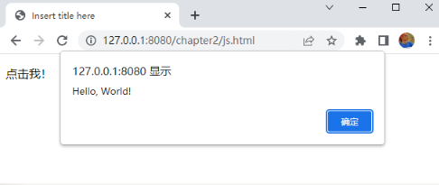

#       【实训2-5】JavaScript 入门

## 实训目的

以 Hello, World! 为例，学习 JavaScript 的三种使用方式。     

## 实训内容介绍

- 元素内部的 JavaScript
- 文档内部的 JavaScript
- 外部的独立 JavaScript 文件
- 实训总结

## 元素内部的 JavaScript

 上次实训的 CSS 使用有三种方式：内联样式、内部样式表、外部样式表，与此类似，JavaScript 也有元素内部、文档内部和外部的三类。本实训将用这三种办法来演示 Hello, World! 程序。 在【实训2-1】创建的项目 chapter2 中，创建 js.html 文件，添加下述一行代码，按照教材第32页的讲解，为一个段落元素添加一句JavaScript代码。 

```html
<p onclick="alert('Hello, World!')">点击我！</p>
```
在浏览器上访问这个网页http://127.0.0.1:8080/chapter2/js.html，单击这个段落元素的文字，就能看到 JavaScript 的运行结果，如下图所示。



## 文档内部的 JavaScript

 修改 js.html 文件，将上一步的 JavaScript 代码从元素内移到文档内，即双引号内的 alert('Hello, World!')，要加上分号结束。类似于教材第33页的第一段代码，教材中的代码是进行算术计算。 在浏览器上访问这个网页，这样再打开网页时，JavaScript 语句便会执行。  

## 外部的独立 JavaScript 文件

 进一步修改上一步的 js.html 文件，将 JavaScript 代码移到外部的独立的 JavaScript 文件 js/script.js 中， 办法分两步（详见教材第 33 页，教材中没有要求创建 js 文件夹）。 

（1）在 WebContent 目录下创建一个名为 js 的文件夹，在这个文件夹下创建一个名为 script.js 的文件，将前一步的 JavaScript 语句复制到这个文件中，并改写为一个 JavaScript 函数，完整代码如下。

```javascript
function hello(){
	alert('Hello, World!');
}
```

（2）在 js.html 文件中添加一条导入 JavaScript 文件的语句，并删除 js.html 文件中的 JavaScript 语句 （这条语句被移到文件中），代之以调用函数的语句，完整代码如下。 

```html
<!DOCTYPE html>
<html>
<head>
<meta charset="UTF-8">
<title>Insert title here</title>
</head>
<script type="text/javascript" src="js/script.js"></script>
<body>
<p onclick="alert('Hello, World!')">点击我！</p>
<script>
    hello();
</script>
</body>
</html>
```

  在浏览器上观察网页的效果，与前一步是相同的，也是打开网页时，执行 JavaScript 语句。  

## 实训总结

 本次实训学习了 JavaScript 的三种使用方式，这些是最基本的，读者一定要全部掌握。   

