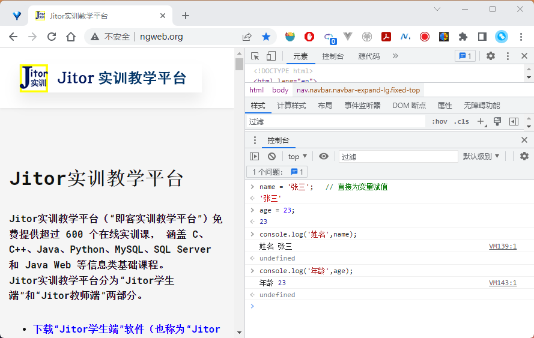

# 【实训2-6】JavaScript 数据类型

##  实训目的

学习 JavaScript 数据类型，JavaScript 是一种弱类型语言。

## 实训内容介绍

- 变量的隐式定义
- 变量的显式定义
- 数据的类型
- 变量的类型
- 两种比较方式
- 实训总结


## 变量的隐式定义

 隐式定义的意思是变量无需声明，即可使用。

如下图所示，按 `F12` 功能键，打开调试窗口，选择`Console`控制台， 编写下述`JavaScript` 语句。 在控制台上可以看到运行的结果。

```javascript
name = '张三';   // 直接为变量赋值
age = 23;

console.log('姓名',name);   // 调试输出到控制台
console.log('年龄',age);
```



## 变量的显式定义

 按照教材第35页的讲解，将上述代码中的两个变量改为显式定义，运行结果应该完全相同。 

## 数据的类型

 数据的类型是数据在计算机内部的存储方式，因此任何数据都是有类型的。 在控制台运行下述代码。
```javascript
console.log('"张三"的数据类型是',typeof("张三"));
console.log('23 的数据类型是',typeof(23));
```

注意：

- 张三的数据类型是什么？
- 23 的数据类型是什么？

## 变量的类型

 在 JavaScript 中，变量是没有固定的类型的，变量的类型就是变量的数据的类型。 在控制台上运行下述代码。
```javascript
tmp = "张三";
console.log('变量 tmp 的数据类型是',typeof(tmp));
tmp = 23;
console.log('变量 tmp 的数据类型是',typeof(tmp));
```

然后根据运行结果回答下述两个问题。 

- 第一次赋值后，变量tmp的数据类型是什么？
- 再次赋值后，变量tmp的数据类型是什么？

## 两种比较方式

 JavaScript 有两种比较，双等号比较和三等号比较，两者之间有细微的差别。 在控制台上运行下述代码。

```javascript
tmp1 = 23;
tmp2 ="23";
console.log('双等号比较',tmp1 == tmp2);
console.log('三等号比较',tmp1 === tmp2);
```

可以发现：

- 双等号比较，仅比较值是否相等，是一种不严格的比较

- 三等号比较，同时比较值和类型是否相等，是一种严格的比较

## 实训总结

 本次实训学习了 JavaScript 的变量定义和数据类型，还学习了双等号比较和三等号比较。       