## HttpServlet报错

目前为止，导入的jar包有三种来源；

- jre中自带的jar包
- tomcat lib目录中的jar包
-  `WEB-INF/lib`目录手动导入的jar包

#### Answer

HttpServlet类是在Tomcat的jar包中定义的，当你的HttpServlet报错。

1. 没有配置Tomcat引起的
2. 你的项目绑定了A电脑上的Tomcat，现在你又在B电脑上接着做项目，没有绑定B电脑的Tomcat；


第一种情况，在项目上右键 `properties --> targeted runtime --> tomcat`


第二种情况，项目上右键`Build Path --> Configure Build Path -->Libraries --> Server Runtime --> Edit --> 绑定本机的Tomcat`


##### Configure Build Path

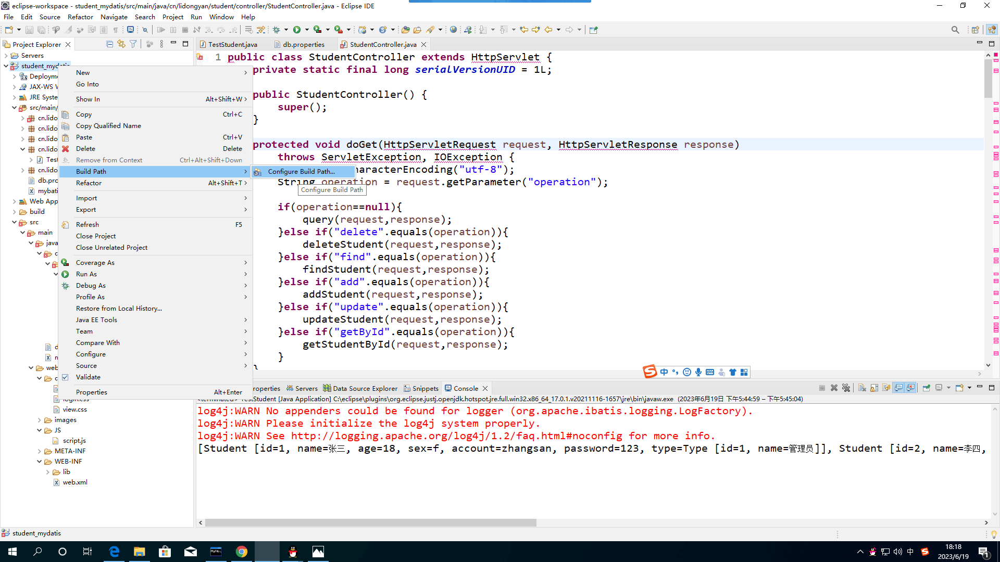


##### Libraries

- 如在此选项卡看不到Tomcat，则 选择 `Add Library`

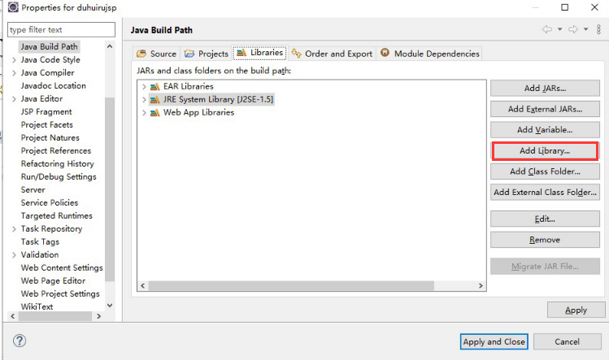

- 如`Tomcat`提示 `unbound`，则点击`Edit`，重新绑定本机的`Tomcat`

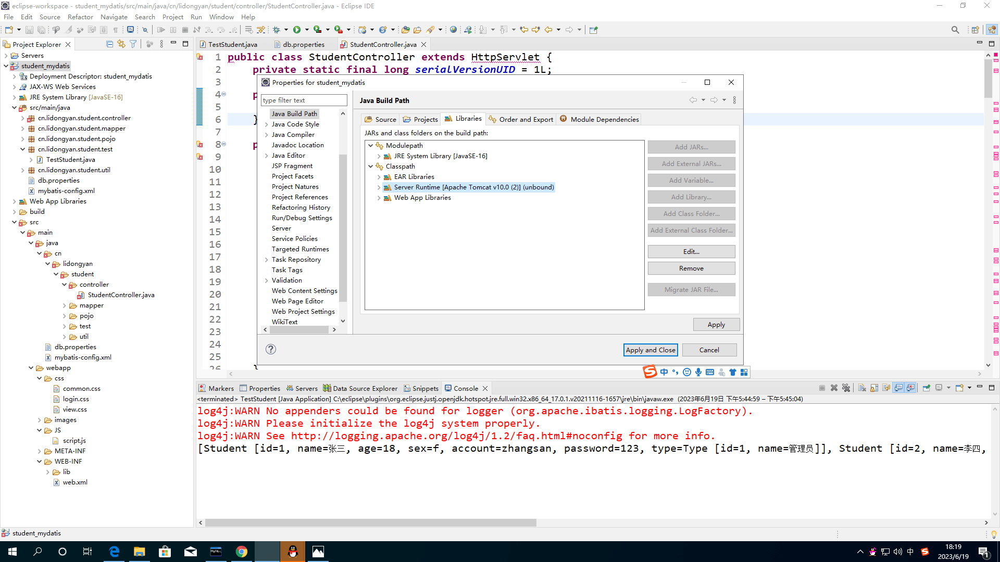


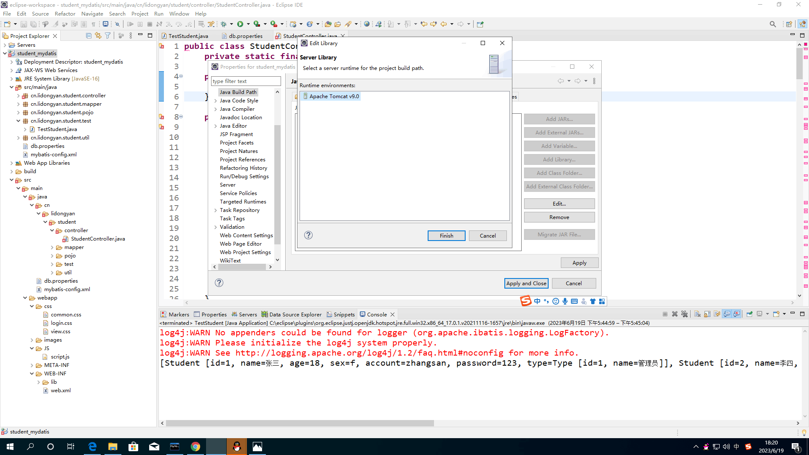


## MySQL

#### MySQL5.5 或 5.7 Server 

使用旧版本的数据库链接驱动jar包；

##### jar

 [mysql-connector-java-5.1.27-bin.jar](https://www.studybigdata.cn/file/javaee/jars/mysql-connector-java-5.1.27-bin.jar) 

##### 数据库驱动类的全限定类名：

```properties
jdbc.driver=com.mysql.jdbc.Driver
```


#### MySQL 8.0 Server

使用新版本的数据库连接驱动jar包。

##### jar

 [mysql-connector-java-8.0.29.jar](https://www.studybigdata.cn/file/javaee/jars/mysql-connector-java-8.0.29.jar) 

##### 数据库驱动类的全限定类名：

```properties
jdbc.driver=com.mysql.cj.jdbc.Driver
```

## caching_sha2_password

#### Question
```java
### Error querying database.  Cause: java.sql.SQLException: Unable to load authentication plugin 'caching_sha2_password'.
### The error may exist in cn/studybigdata/javaee/sm/student/dao/StudentMapper.xml
### The error may involve com.studybigdata.javaee.sm.student.dao.StudentMapper.search
### The error occurred while executing a query
### Cause: java.sql.SQLException: Unable to load authentication plugin 'caching_sha2_password'.
	at org.apache.ibatis.exceptions.ExceptionFactory.wrapException(ExceptionFactory.java:30)
	at org.apache.ibatis.session.defaults.DefaultSqlSession.selectList(DefaultSqlSession.java:150)
	at org.apache.ibatis.session.defaults.DefaultSqlSession.selectList(DefaultSqlSession.java:141)
	at org.apache.ibatis.binding.MapperMethod.executeForMany(MapperMethod.java:137)
	at org.apache.ibatis.binding.MapperMethod.execute(MapperMethod.java:75)
	at org.apache.ibatis.binding.MapperProxy.invoke(MapperProxy.java:53)
	at com.sun.proxy.$Proxy14.search(Unknown Source)
	at com.studybigdata.javaee.sm.student.dao.StudentDao.search(StudentDao.java:77)
	at com.studybigdata.javaee.sm.student.controller.LoginController.doPost(LoginController.java:46)
	at javax.servlet.http.HttpServlet.service(HttpServlet.java:648)
	at javax.servlet.http.HttpServlet.service(HttpServlet.java:729)
	at org.apache.catalina.core.ApplicationFilterChain.internalDoFilter(ApplicationFilterChain.java:291)
	at org.apache.catalina.core.ApplicationFilterChain.doFilter(ApplicationFilterChain.java:206)
	at org.apache.tomcat.websocket.server.WsFilter.doFilter(WsFilter.java:52)
	at org.apache.catalina.core.ApplicationFilterChain.internalDoFilter(ApplicationFilterChain.java:239)
	at org.apache.catalina.core.ApplicationFilterChain.doFilter(ApplicationFilterChain.java:206)
	at org.apache.catalina.core.StandardWrapperValve.invoke(StandardWrapperValve.java:219)
	at org.apache.catalina.core.StandardContextValve.invoke(StandardContextValve.java:106)
	at org.apache.catalina.authenticator.AuthenticatorBase.invoke(AuthenticatorBase.java:502)
	at org.apache.catalina.core.StandardHostValve.invoke(StandardHostValve.java:142)
	at org.apache.catalina.valves.ErrorReportValve.invoke(ErrorReportValve.java:79)
	at org.apache.catalina.valves.AbstractAccessLogValve.invoke(AbstractAccessLogValve.java:616)
	at org.apache.catalina.core.StandardEngineValve.invoke(StandardEngineValve.java:88)
	at org.apache.catalina.connector.CoyoteAdapter.service(CoyoteAdapter.java:518)
	at org.apache.coyote.http11.AbstractHttp11Processor.process(AbstractHttp11Processor.java:1091)
	at org.apache.coyote.AbstractProtocol$AbstractConnectionHandler.process(AbstractProtocol.java:673)
	at org.apache.tomcat.util.net.AprEndpoint$SocketProcessor.doRun(AprEndpoint.java:2503)
	at org.apache.tomcat.util.net.AprEndpoint$SocketProcessor.run(AprEndpoint.java:2492)
	at java.util.concurrent.ThreadPoolExecutor.runWorker(Unknown Source)
	at java.util.concurrent.ThreadPoolExecutor$Worker.run(Unknown Source)
	at org.apache.tomcat.util.threads.TaskThread$WrappingRunnable.run(TaskThread.java:61)
	at java.lang.Thread.run(Unknown Source)
Caused by: java.sql.SQLException: Unable to load authentication plugin 'caching_sha2_password'.
	at com.mysql.jdbc.SQLError.createSQLException(SQLError.java:926)
	at com.mysql.jdbc.SQLError.createSQLException(SQLError.java:923)
	at com.mysql.jdbc.MysqlIO.proceedHandshakeWithPluggableAuthentication(MysqlIO.java:1725)
	at com.mysql.jdbc.MysqlIO.doHandshake(MysqlIO.java:1250)
	at com.mysql.jdbc.ConnectionImpl.coreConnect(ConnectionImpl.java:2465)
	at com.mysql.jdbc.ConnectionImpl.connectOneTryOnly(ConnectionImpl.java:2498)
	at com.mysql.jdbc.ConnectionImpl.createNewIO(ConnectionImpl.java:2283)
	at com.mysql.jdbc.ConnectionImpl.<init>(ConnectionImpl.java:822)
	at com.mysql.jdbc.JDBC4Connection.<init>(JDBC4Connection.java:47)
	at sun.reflect.NativeConstructorAccessorImpl.newInstance0(Native Method)
	at sun.reflect.NativeConstructorAccessorImpl.newInstance(Unknown Source)
	at sun.reflect.DelegatingConstructorAccessorImpl.newInstance(Unknown Source)
	at java.lang.reflect.Constructor.newInstance(Unknown Source)
	at com.mysql.jdbc.Util.handleNewInstance(Util.java:411)
	at com.mysql.jdbc.ConnectionImpl.getInstance(ConnectionImpl.java:404)
	at com.mysql.jdbc.NonRegisteringDriver.connect(NonRegisteringDriver.java:317)
	at java.sql.DriverManager.getConnection(Unknown Source)
	at java.sql.DriverManager.getConnection(Unknown Source)
	at org.apache.ibatis.datasource.unpooled.UnpooledDataSource.doGetConnection(UnpooledDataSource.java:201)
	at org.apache.ibatis.datasource.unpooled.UnpooledDataSource.doGetConnection(UnpooledDataSource.java:196)
	at org.apache.ibatis.datasource.unpooled.UnpooledDataSource.getConnection(UnpooledDataSource.java:93)
	at org.apache.ibatis.datasource.pooled.PooledDataSource.popConnection(PooledDataSource.java:385)
	at org.apache.ibatis.datasource.pooled.PooledDataSource.getConnection(PooledDataSource.java:89)
	at org.apache.ibatis.transaction.jdbc.JdbcTransaction.openConnection(JdbcTransaction.java:138)
	at org.apache.ibatis.transaction.jdbc.JdbcTransaction.getConnection(JdbcTransaction.java:60)
	at org.apache.ibatis.executor.BaseExecutor.getConnection(BaseExecutor.java:336)
	at org.apache.ibatis.executor.SimpleExecutor.prepareStatement(SimpleExecutor.java:84)
	at org.apache.ibatis.executor.SimpleExecutor.doQuery(SimpleExecutor.java:62)
	at org.apache.ibatis.executor.BaseExecutor.queryFromDatabase(BaseExecutor.java:324)
	at org.apache.ibatis.executor.BaseExecutor.query(BaseExecutor.java:156)
	at org.apache.ibatis.executor.CachingExecutor.query(CachingExecutor.java:109)
	at org.apache.ibatis.executor.CachingExecutor.query(CachingExecutor.java:83)
	at org.apache.ibatis.session.defaults.DefaultSqlSession.selectList(DefaultSqlSession.java:148)
	... 30 more
java.lang.NullPointerException
	at com.studybigdata.javaee.sm.student.controller.LoginController.doPost(LoginController.java:47)
	at javax.servlet.http.HttpServlet.service(HttpServlet.java:648)
	at javax.servlet.http.HttpServlet.service(HttpServlet.java:729)
	at org.apache.catalina.core.ApplicationFilterChain.internalDoFilter(ApplicationFilterChain.java:291)
	at org.apache.catalina.core.ApplicationFilterChain.doFilter(ApplicationFilterChain.java:206)
	at org.apache.tomcat.websocket.server.WsFilter.doFilter(WsFilter.java:52)
	at org.apache.catalina.core.ApplicationFilterChain.internalDoFilter(ApplicationFilterChain.java:239)
	at org.apache.catalina.core.ApplicationFilterChain.doFilter(ApplicationFilterChain.java:206)
	at org.apache.catalina.core.StandardWrapperValve.invoke(StandardWrapperValve.java:219)
	at org.apache.catalina.core.StandardContextValve.invoke(StandardContextValve.java:106)
	at org.apache.catalina.authenticator.AuthenticatorBase.invoke(AuthenticatorBase.java:502)
	at org.apache.catalina.core.StandardHostValve.invoke(StandardHostValve.java:142)
	at org.apache.catalina.valves.ErrorReportValve.invoke(ErrorReportValve.java:79)
	at org.apache.catalina.valves.AbstractAccessLogValve.invoke(AbstractAccessLogValve.java:616)
	at org.apache.catalina.core.StandardEngineValve.invoke(StandardEngineValve.java:88)
	at org.apache.catalina.connector.CoyoteAdapter.service(CoyoteAdapter.java:518)
	at org.apache.coyote.http11.AbstractHttp11Processor.process(AbstractHttp11Processor.java:1091)
	at org.apache.coyote.AbstractProtocol$AbstractConnectionHandler.process(AbstractProtocol.java:673)
	at org.apache.tomcat.util.net.AprEndpoint$SocketProcessor.doRun(AprEndpoint.java:2503)
	at org.apache.tomcat.util.net.AprEndpoint$SocketProcessor.run(AprEndpoint.java:2492)
	at java.util.concurrent.ThreadPoolExecutor.runWorker(Unknown Source)
	at java.util.concurrent.ThreadPoolExecutor$Worker.run(Unknown Source)
	at org.apache.tomcat.util.threads.TaskThread$WrappingRunnable.run(TaskThread.java:61)
	at java.lang.Thread.run(Unknown Source)
```
#### Aanswer

请使用新版本的数据库连接驱动jar包。

##### jar

 [mysql-connector-java-8.0.29.jar](C:\Users\Qingyuan_Qu\Downloads\student_mybatis\WebContent\WEB-INF\lib\mysql-connector-java-8.0.29.jar) 

##### 数据库驱动类的全限定类名：

```properties
jdbc.driver=com.mysql.cj.jdbc.Driver
```

## WEB-INF

WEB-INF是Java的WEB应用的安全目录。所谓安全就是客户端无法访问，只有服务端可以访问的目录。如果想在页面中直接访问其中的文件，必须通过`web.xml`文件对要访问的文件进行相应映射才能访问。

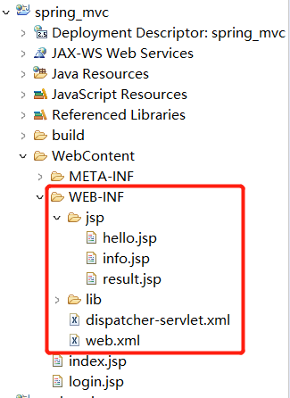

## 404

看一下`WebContent/WebRoot`里面是否有页面资源

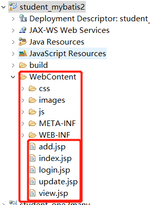


## 页面乱码

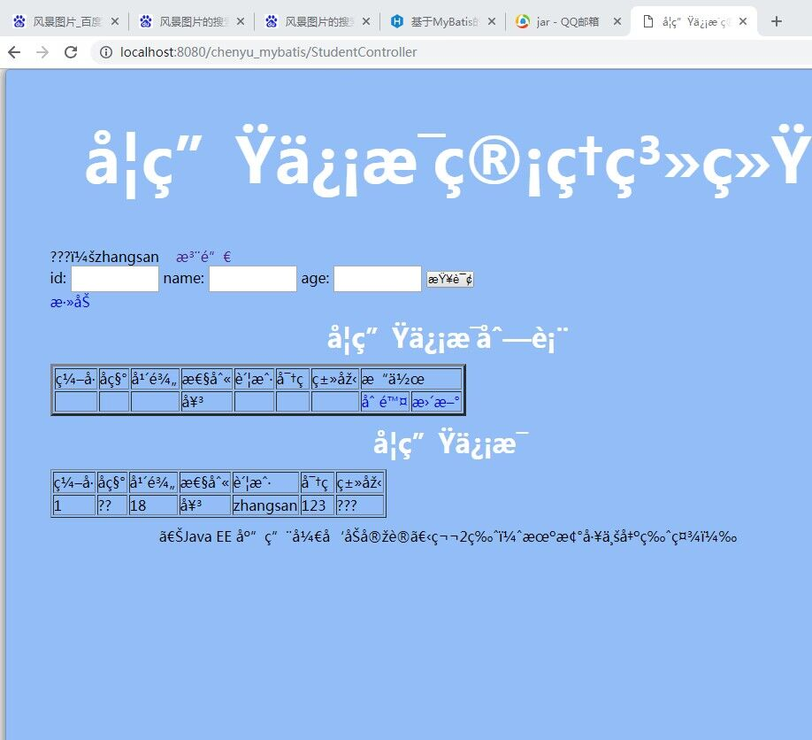

### Answer

##### 第一步

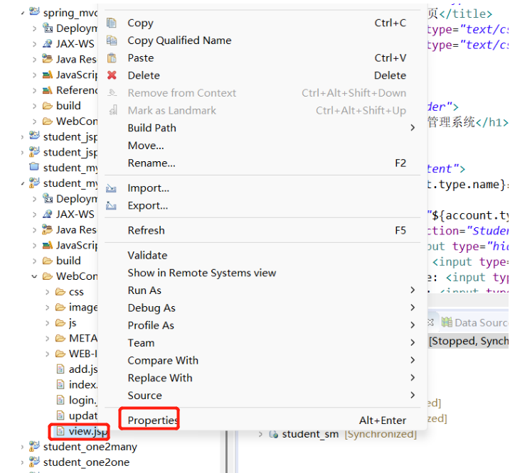

##### 第二步

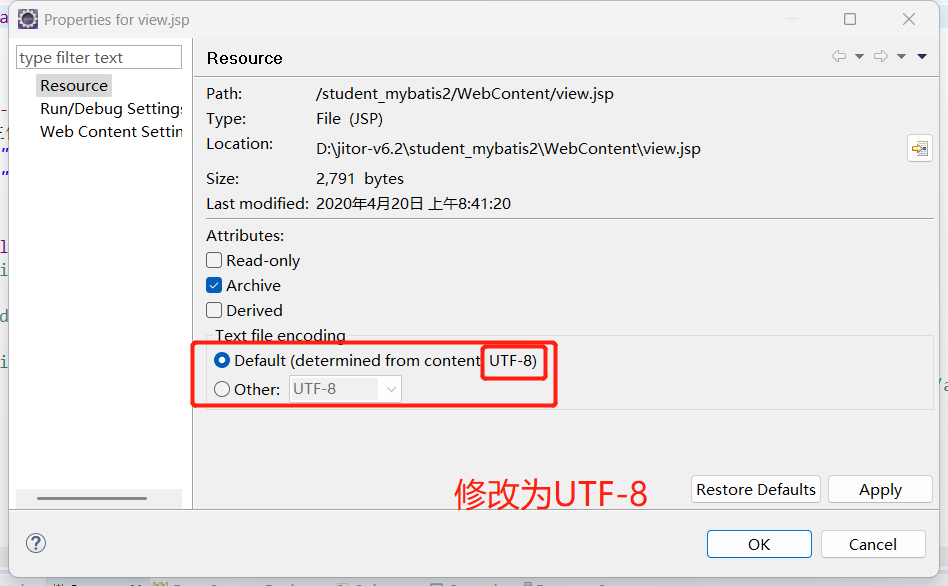

##### 第三步

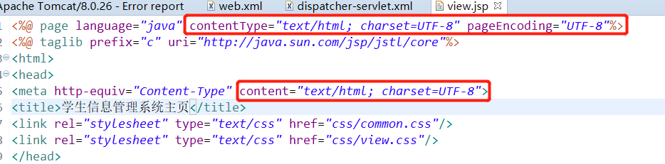

## 数据库乱码

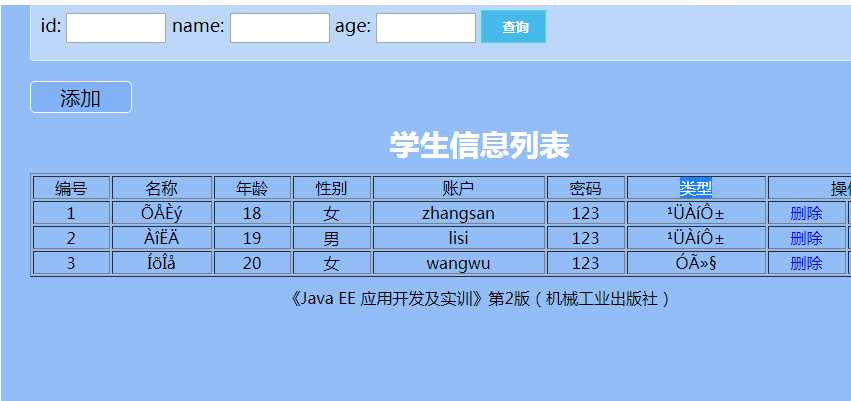

在执行SQL语句时

```sql
set names gbk; -- 设置client、connection、resultset为GBK编码
```


## 端口被占用

### 8080端口被占用

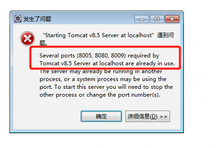

### 杀死占用8080端口的进程

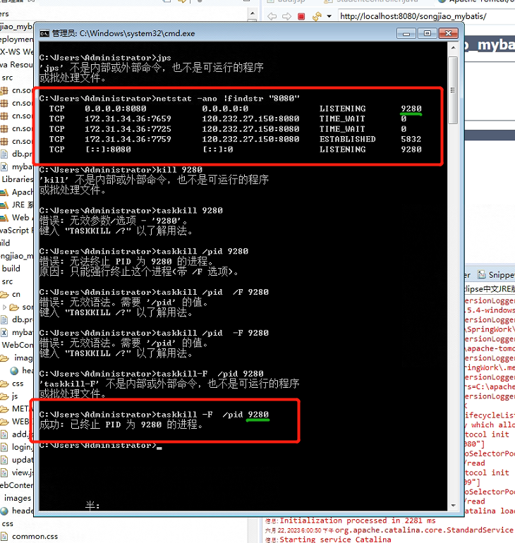

杀死进程后，重新启动Tomcat/Run on Server。
