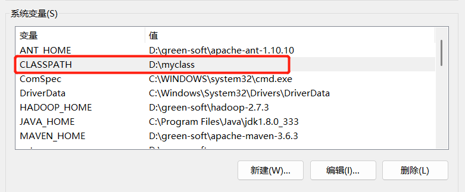

## Java环境变量CLASSPATH的作用

### 环境变量

环境变量（environment variables）一般是指在操作系统中用来指定操作系统运行环境的一些参数，如：临时文件夹位置和系统文件夹位置等。

环境变量是在操作系统中一个具有特定名字的对象，它包含了一个或者多个应用程序所将使用到的信息。例如Windows和DOS操作系统中的path环境变量，当要求系统运行一个程序而没有告诉它程序所在的完整路径时，系统除了在当前目录下面寻找此程序外，还应到PATH中指定的路径去找。用户通过设置环境变量，来更好的运行进程。[百度百科]http://t.csdn.cn/YSHrP)

### CLASSPATH

- 在`D:\myclass\`目录中创建一个`Java`文件；

```java
public class Dog{

public static void main(String [] args){
		System.out.println(Dog.class.getSimpleName()+": 666, you found me! ");
	}
}
```

- 使用`javac`命令编译代码；

```powershell
PS D:\myclass> javac .\Dog.java
```

- 使用`java`命令执行该`Java`程序

```powershell
PS D:\myclass> java Dog
Dog: 666, you found me!
```

- 我们切换到`D:\`执行该Java程序

```powershell
PS D:\myclass> cd ..
PS D:\> java Dog
错误: 找不到或无法加载主类 Dog
```

- 然后，我们将`D:\myclass\`加入到环境变量`CLASSPATH`中



- 这样的话，我们在任意目录中都可以执行`Java`可执行文件`Dog`。

```powershell
PS C:\Users\Qingyuan_Qu> java Dog
Dog: 666, you found me!
```

- 是不是和环境变量PATH有异曲同工之妙~
