# MyEclipse激活

##### 找到MyEclipse所在目录

双击打开。

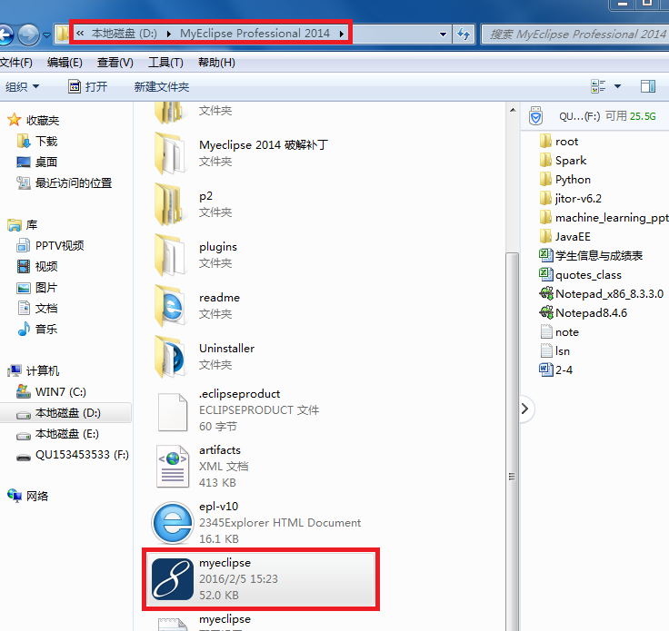


##### 点击Unlock

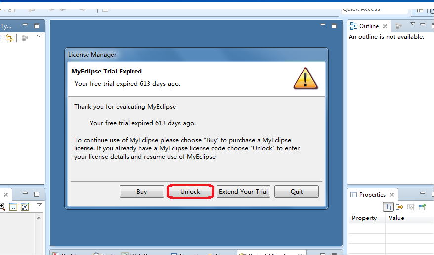


##### 输入激活码点击激活
```
Subscriber: 123456
Subscription Code: 6LR8ZC-855555-71505356786312988
```


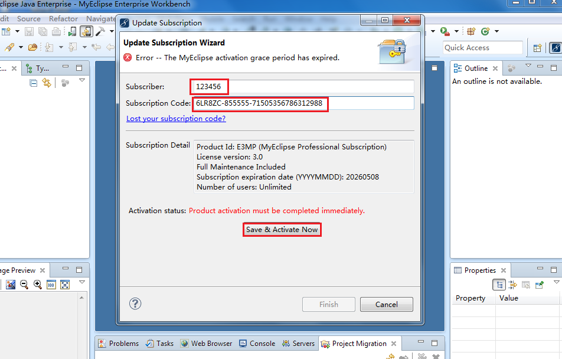

##### 点击Not Now

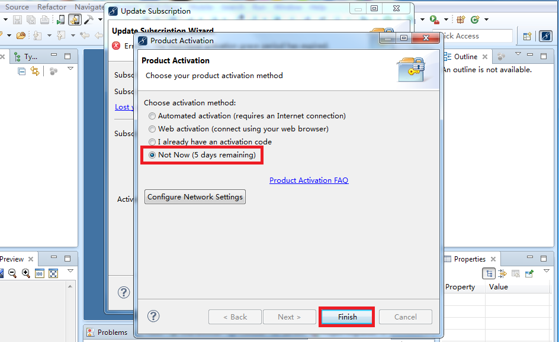

##### 点击取消

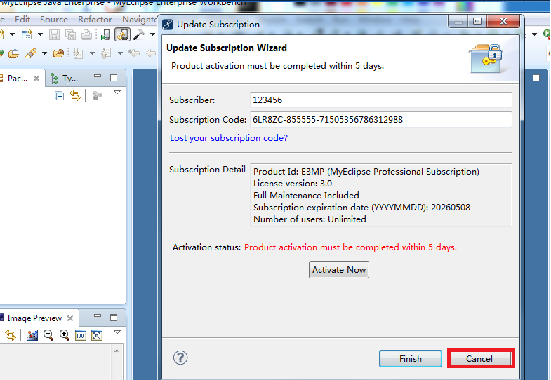


# Dynamic Web Project创建

##### 选择Other

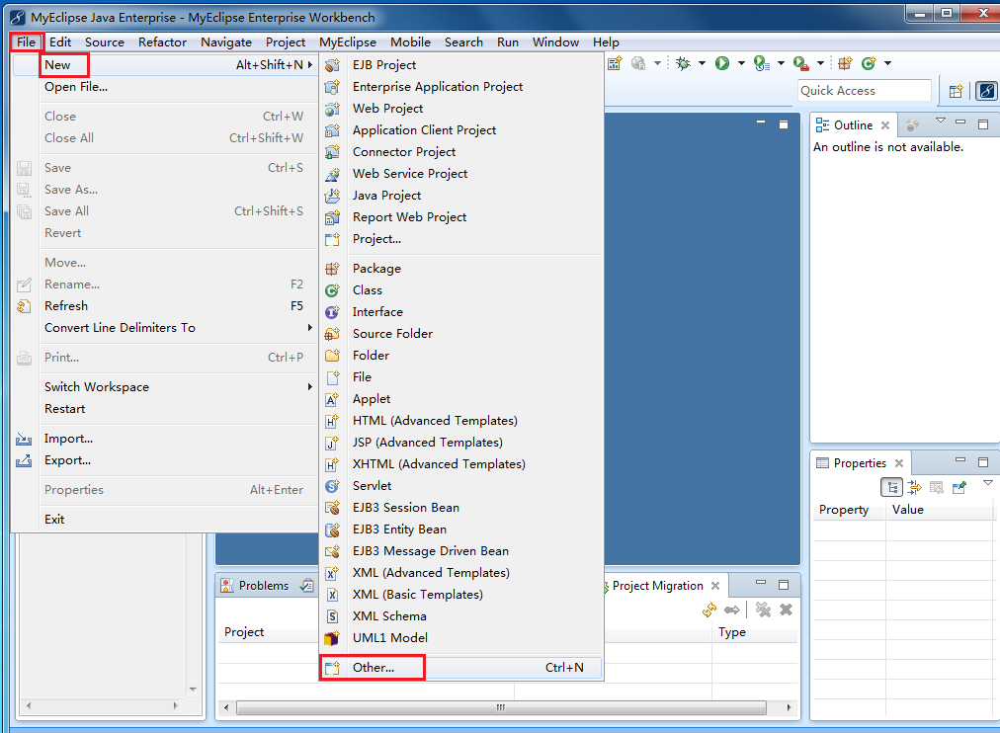

##### 选择Web-DynamicWebProject

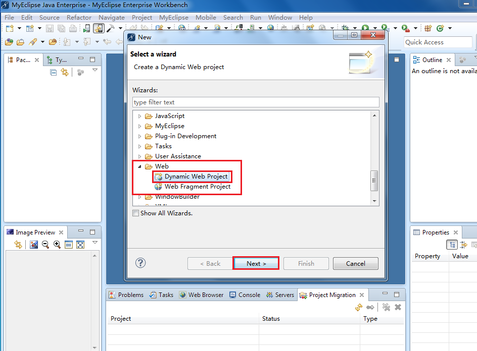

##### 选择Tomcat7

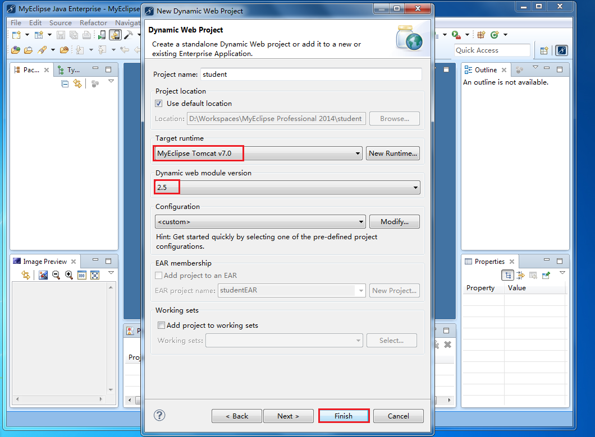

##### 项目右键运行

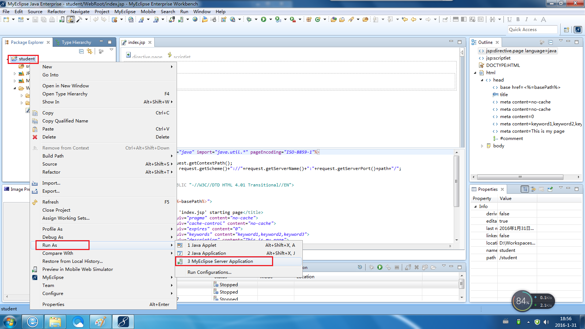

##### 选择Tomcat7

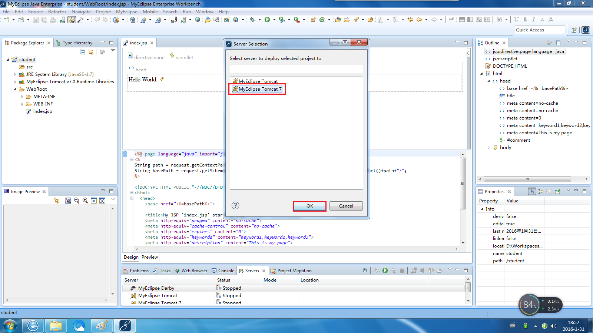

##### 启动成功

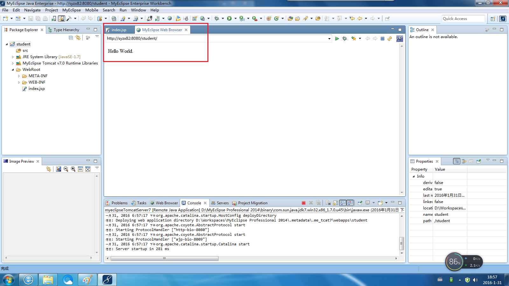

# MySQL

 [mysql-8.0.30-winx64.7z](file/mysql-8.0.30-winx64.7z) 
