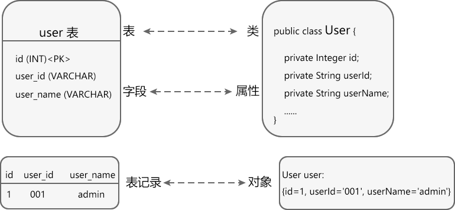
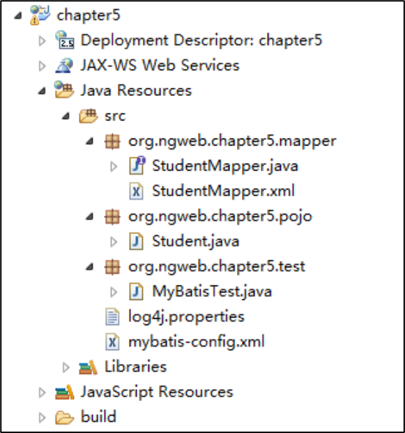

# ORM - 基于MyBatis入门实例

ORM: Object Relational Mapping 对象关系映射

orm是通过使用描述对象和数据之间映射的元数据，将程序中的对象自动持久化到关系[数据库](https://link.zhihu.com/?target=https%3A//cloud.tencent.com/solution/database%3Ffrom%3D10680)中

下表说明了关系型数据库和对象之间的对应关系：

| 数据库                       | 类/对象                   |
| ---------------------------- | ------------------------- |
| 表（table）                  | 类（class）               |
| 表中的记录（record，也称行） | 对象（object）            |
| 表中的字段（field，也称列）  | 对象中的属性（attribute） |

例如，现在有一张 user 表，它包含 id、user_id 和 user_name 三个字段，另外还有一个 Java User 类，它包含 id、userId 和 userName 三个属性，下图演示了它们之间的对应关系：



你看，数据表和类用来描述数据的表现形式，它们之间是相互对应的；记录和对象用来真正地存储数据，它们之间也是相互对应的。

> http://c.biancheng.net/hibernate/orm.html

## 项目整体结构



## 依赖包

略。

## SQL

```sql
set names gbk; 
drop database if exists mybatis2;
create database mybatis2 default charset utf8 collate utf8_general_ci;
use mybatis2;

drop table if exists t_student;
create table t_student(
    id int(11) primary key auto_increment,
    name varchar(20) not null,
    age tinyint(4) not null
);
 
insert into t_student values(1,'张三', 18);
insert into t_student values(2,'李四', 19);
insert into t_student values(3,'王五', 20);
```

## 日志配置文件

log4j定义了8个级别的log，优先级从高到低依次为：OFF、FATAL、ERROR、WARN、INFO、DEBUG、TRACE、 ALL。Log4j建议只使用四个级别，优先级从高到低分别是 ERROR、WARN、INFO、DEBUG。 如果定义了INFO级别，则应用程序中所有DEBUG级别的日志信息将不被打印出来，也是说大于等于INFO级别的日志才输出。
https://blog.51cto.com/u_15162069/2801436

##### log4j.properties

```properties
log4j.rootLogger=DEBUG, stdout
log4j.logger.com.wxit=DEBUG
log4j.appender.stdout=org.apache.log4j.ConsoleAppender
log4j.appender.stdout.layout=org.apache.log4j.PatternLayout
log4j.appender.stdout.layout.ConversionPattern=%5p %d %C: %m%n
```
## MyBatis配置文件

##### mybatis-config.xml

```xml
<?xml version="1.0" encoding="UTF-8" ?>
<!DOCTYPE configuration PUBLIC "-//mybatis.org//DTD Config 3.0//EN"
    "http://mybatis.org/dtd/mybatis-3-config.dtd">
    
<configuration>
    <environments default="mysql">
        <environment id="mysql">
            <transactionManager type="JDBC"/>
            <dataSource type="POOLED">
                <property name="driver" value="com.mysql.cj.jdbc.Driver"/>
                <property name="url" value="jdbc:mysql://localhost:3306/mybatis2"/>
                <property name="username" value="root"/>
                <property name="password" value="123456"/>
            </dataSource>
        </environment>
    </environments>
    <mappers>
        <mapper resource=
            "cn/studybigdata/javaee/mapper/StudentMapper.xml"/>
    </mappers>
</configuration>
```

## Mapper

### 映射器接口

##### StudentMapper.java

```java
package com.studybigdata.javaee.mapper;

import java.util.List;

import com.studybigdata.javaee.pojo.Student;

public interface StudentMapper {
    public Student findStudentById(int id);  //根据id查找学生信息
    public List<Student> findAll();              //查询所有学生信息
    public int addStudent(Student student); //添加学生信息
    public int deleteStudent(int id);             //删除学生信息
    public int updateStudent(Student student); //更新学生信息
}
```

### 映射器XML

##### StudentMapper.xml

```xml
<?xml version="1.0" encoding="UTF-8"?>

<!DOCTYPE mapper PUBLIC "-//mybatis.org//DTD Mapper 3.0//EN"
    "http://mybatis.org/dtd/mybatis-3-mapper.dtd">
    
<mapper namespace="com.studybigdata.javaee.mapper.StudentMapper">

    <select id="findStudentById" parameterType="Integer" resultType="com.studybigdata.javaee.pojo.Student">
        select * from t_student where id = #{id}
    </select>   
    
     
    <select id="findAll" resultType="com.studybigdata.javaee.pojo.Student">
        select * from t_student
    </select>   
     
    <insert id="addStudent" parameterType="com.studybigdata.javaee.pojo.Student">
        insert into t_student values(null, #{name}, #{age})
    </insert>    
    
    <delete id="deleteStudent" parameterType="Integer">
        delete from t_student where id=#{id}
    </delete>    
    
    <update id="updateStudent" parameterType="com.studybigdata.javaee.pojo.Student">
        update t_student set name=#{name}, age=#{age} where id=#{id}
    </update>
    
</mapper>
```

## POJO类

##### Student.java

```java
public class Student {
	private Integer id;
	private String name;
	private Integer age;
	private String sex;
}
```
## 测试类

##### MyBatisTest.java

```java
package com.studybigdata.javaee.test;

import java.io.IOException;
import java.io.InputStream;

import org.apache.ibatis.io.Resources;
import org.apache.ibatis.session.SqlSession;
import org.apache.ibatis.session.SqlSessionFactory;
import org.apache.ibatis.session.SqlSessionFactoryBuilder;
import org.apache.log4j.Logger;
import org.junit.Test;

import com.studybigdata.javaee.mapper.StudentMapper;
import com.studybigdata.javaee.pojo.Student;

public class MyBatisTest {
	
	private final Logger LOGGER = Logger.getLogger(Test.class.getName());
	
	  @Test
	  public void findByIdTest() throws IOException{
		LOGGER.debug("DEBUG");
	    InputStream inputStream = Resources.getResourceAsStream("mybatis-config.xml");
	    SqlSessionFactory sqlSessionFactory = new SqlSessionFactoryBuilder().build(inputStream);
	    SqlSession sqlSession = null;

	    try{
	      sqlSession = sqlSessionFactory.openSession();
	      StudentMapper studentMapper = sqlSession.getMapper(StudentMapper.class);
	      Student student = studentMapper.findStudentById(1);
          LOGGER.info(student);
          LOGGER.warn("WARN");
	    }catch(Exception e){
	      e.printStackTrace();
	    }finally{
	      if(sqlSession!=null){
			sqlSession.close();
	      }
	    }
	    LOGGER.error("ERROR");
	  }
}
```


# MyBatis配置

## MyBatis配置项

### 属性properties

properties元素用于将一些经常修改的属性值从外部文件引入，方便管理配置。

##### jdbc.properties

```properties
jdbc.driver=com.mysql.cj.jdbc.Driver
jdbc.url=jdbc:mysql://localhost:3306/mybatis2
jdbc.username=root
jdbc.password=123456
```

##### mybatis-config.xml

```xml
<!-- configuration节点下 -->
<properties resource="jdbc.properties"/>

<!-- environments -> environment 节点下 -->
<dataSource type="POOLED">
    <property name="driver" value="${jdbc.driver}"/>
    <property name="url" value="${jdbc.url}"/>
    <property name="username" value="${jdbc.username}"/>
    <property name="password" value="${jdbc.password}"/>
</dataSource>
```

### 别名typeAliases

由于类的全限定名称很长，需要大量使用的时候，可以使用别名来代替。

- 少数POJO，可使用typeAlia元素指定。

```xml
<!-- configuration节点下 -->
<typeAliases>
    <typeAlias alias="student"  type="com.studybigdata.javaee.pojo.Student" />
</typeAliases>
```

- 多个POJO，可使用package元素指定。

```xml
<typeAliases>
    <package name="com.studybigdata.javaee.pojo"/>
</typeAliases>
```

### 映射器mappers

指定映射文件的位置。

- 少量映射器，可通过mapper元素的指定

```xml
<mappers>
    <mapper resource="cn/studybigdata/javaee/mapper/StudentMapper.xml"/>
</mappers>
```

- 多个映射器，可通过package元素指定

```xml
<mappers>
	<package name="com.studybigdata.javaee.mapper"/>
</mappers>
```

## Mapper.xml

映射器配置文件是由一组与增删改查有关的SQL语句组成，其常用子元素如下

| 元素名称  | 描述                    | 备注                                               |
| --------- | ----------------------- | -------------------------------------------------- |
| select    | 查询语句                | 可以自定义参数返回结果集，最常用、最复杂的元素之一 |
| insert    | 插入语句                | 执行后返回一个整数，代表插入的条数                 |
| update    | 更新语句                | 执行后返回一个整数，代表更新的条数                 |
| delete    | 删除语句                | 执行后返回一个整数，代表删除的条数                 |
| resultMap | 定义SQL到POJO的映射规则 | 提供映射规则，它是最复杂、最强大的元素             |


```xml
<?xml version="1.0" encoding="UTF-8" ?>
<!DOCTYPE mapper PUBLIC "-//mybatis.org//DTD Mapper 3.0//EN"
    "http://mybatis.org/dtd/mybatis-3-mapper.dtd">
<mapper namespace="org.ngweb.chapter5.mapper.StudentMapper">
    <select id="findStudentById" parameterType="Integer" resultType="org.ngweb.chapter5.pojo.Student">
        select * from t_student where id = #{id}
    </select>    
    <select id="findAll" resultType="org.ngweb.chapter5.pojo.Student">
        select * from t_student
    </select>    
    <insert id="addStudent" parameterType="org.ngweb.chapter5.pojo.Student">
        insert into t_student values(null, #{name}, #{age})
    </insert>    
    <delete id="deleteStudent" parameterType="Integer">
        delete from t_student where id=#{id}
    </delete>    
    <update id="updateStudent" parameterType="org.ngweb.chapter5.pojo.Student">
        update t_student set name=#{name}, age=#{age} where id=#{id}
    </update>
</mapper>
```


| 元素             | 说明                                                         | 备注                                               |
| ---------------- | ------------------------------------------------------------ | -------------------------------------------------- |
| id               | 命名空间中唯一的标识符                                       | 用于引用这条语句（接口中的方法名）                 |
| parameterType    | 全限定类名或别名（typeAlias）                                | 可以选择Map、List、JavaBean传递给SQL               |
| resultType       | 全限定类名或别名（typeAlias）                                | 在自动匹配的情况下，结果集将通过JavaBean的规范映射 |
| [resultMap]()    | 对外部resultMap的引用                                        | 手动映射结果集                                     |
|                  |                                                              |                                                    |
| useGeneratedKeys | 是否使用JDBC的getGeneratedKeys()方法来获取由数据库内部产生的主键值（比如数据库表的自增主键） | insert操作时可选                                   |
| keyProperty      | 标记属性名（比如自增量主键值回填到这里）                     | insert操作时可选                                   |


### 插入数据回填ID

插入数据后，MyBatis会自动将`id`插入到`POJO`对象的`id`属性中。

```xml
<insert id="addStudent" parameterType="student" useGeneratedKeys="true" keyProperty="id">
```

### ResultMap

resultMap的作用是定义映射规则，主要负责结果集的映射关系（从SQL到POJO的映射关系定义），resultMap 元素的子元素如下表所示

| 元素名称      | 说明                               | 例子                                                         |
| ------------- | ---------------------------------- | ------------------------------------------------------------ |
| constructor   | 类在实例化时，注入结果到构造方法中 |                                                              |
| id            | 将主键的值映射到POJO的成员变量中   | 当表的主键名与POJO的主键名不相同时  <id property="id"  column="user_id"  /> |
| result        | 将非主键的值映射到POJO的成员变量中 | 当表的其他列名与POJO的其他属性名不相同时  <result  property="username“ column="user_name"/> |
| association   | 一对一的关联映射                   | **（后续会详细介绍）**                                       |
| collection    | 一对多的关联映射                   | **（后续会详细介绍）**                                       |
| discriminator | 鉴别器                             | **（本书不讲解）**                                           |

#### Object

```java
package org.ngweb.chapter5.pojo;

public class Student {
    private Integer id;
    private String name;             //name
    private Byte age;
}
```

#### Relational 

```sql
create table t_student2(
    id int primary key auto_increment,
    s_name varchar(20) not null,    -- sname
    age tinyint(4)
);
insert into t_student2 values(1,'张三', 18);
```


#### Mapper

##### Interface

```java
public Student getStudentFromOtherTable(int id);
```

##### XML

```xml
<select id = "getStudentFromOtherTable" parameterType="int" resultMap="studentMap">
    select id, s_name, age from t_student2 where id = #{id}
</select>

<!-- 结果集手动映射 -->
<resultMap type="com.studybigdata.javaee.pojo.Student" id="studentMap">
    <id column="id" property="id"/>
    <result column="s_name" property="name"/>
    <result column="age" property="age"/>
</resultMap>
```


#### Test

```java
public class MyBatisResultMapTest {
	
	private final Logger LOGGER = Logger.getLogger(MyBatisResultMapTest.class.getName());
	
	  @Test
	  public void findByIdTest() throws IOException{
		LOGGER.debug("DEBUG");
	    InputStream inputStream = Resources.getResourceAsStream("mybatis-config.xml");
	    SqlSessionFactory sqlSessionFactory = new SqlSessionFactoryBuilder().build(inputStream);
	    SqlSession sqlSession = null;

	    try{
	      sqlSession = sqlSessionFactory.openSession();
	      StudentMapper studentMapper = sqlSession.getMapper(StudentMapper.class);
	      
	      Student student = studentMapper.getStudentFromOtherTable(1);
          LOGGER.info(student);
          LOGGER.warn("WARN");
	    }catch(Exception e){
	      e.printStackTrace();
	    }finally{
	      if(sqlSession!=null){
			sqlSession.close();
	      }
	    }
	    LOGGER.error("ERROR");
	  }
}
```


### 动态SQL

开发人员使用JDBC或其他类似的框架进行数据库开发时，如果出现特殊的需求，这时就需要手动拼装SQL，这是一个非常麻烦且痛苦的工作

而MyBatis提供的SQL语句动态组装的功能，恰能解决这一麻烦工作。动态SQL主要元素如下表所示：

| 元素                          | 说明                          |
| ----------------------------- | ----------------------------- |
| <if>                          | 判断语句，用于单条件分支判断  |
| <where>、<set>                | 辅助元素，用于处理一些SQL拼装 |
| <choose>、<when>、<otherwise> | 根据参数的值动态组装SQL       |
| <foreach>                     | 对集合进行遍历                |


#### 根据学生姓名查询学生信息

```sql
select id, name, age from t_student 
where 1=1 and name like '%赵%'
```

##### Interface

```java
public List<Student> findStudentByName(Student student);
```

##### xml

```xml
<select id="findStudentByName" parameterType="student" resultType="student">
    select id, name, age from t_student where 1=1
   <if test="name!=null and name!=''">
        and name like concat('%',#{name},'%')
  </if>
</select>
```

如果参数student中的name不为空，则加上“and name like……”

##### Test

```java
Student student = new Student();
student.setName("赵");
student.setAge(18);
List<Student> stus = studentMapper.findStudentByName(student);
```


## 一对一

### SQL

```sql
SET FOREIGN_KEY_CHECKS=0;

-- ----------------------------
-- Table structure for faculty
-- ----------------------------
DROP TABLE IF EXISTS `faculty`;
CREATE TABLE `faculty` (
  `id` int(11) NOT NULL AUTO_INCREMENT,
  `facultyname` varchar(18) DEFAULT NULL,
  PRIMARY KEY (`id`)
) ENGINE=InnoDB AUTO_INCREMENT=3 DEFAULT CHARSET=utf8;

-- ----------------------------
-- Records of faculty
-- ----------------------------
INSERT INTO `faculty` VALUES ('1', '赵六');
INSERT INTO `faculty` VALUES ('2', '钱七');

-- ----------------------------
-- Table structure for schoolclass
-- ----------------------------
DROP TABLE IF EXISTS `schoolclass`;
CREATE TABLE `schoolclass` (
  `id` int(11) NOT NULL AUTO_INCREMENT,
  `classname` varchar(32) DEFAULT NULL,
  `facultyid` int(11) DEFAULT NULL,
  PRIMARY KEY (`id`),
  KEY `facultyid` (`facultyid`),
  CONSTRAINT `schoolclass_ibfk_1` FOREIGN KEY (`facultyid`) REFERENCES `faculty` (`id`)
) ENGINE=InnoDB AUTO_INCREMENT=3 DEFAULT CHARSET=utf8;

-- ----------------------------
-- Records of schoolclass
-- ----------------------------
INSERT INTO `schoolclass` VALUES ('1', '初一(1)', '1');
INSERT INTO `schoolclass` VALUES ('2', '初一(2)', '2');
```

### pojo

#####  Faculty.java

```java
private int id;
private String facultyname;
private Schoolclass schoolclass;
```

#####  Schoolclass.java

```java
private int id;
private String classname;
private Faculty faculty;
```

### 映射器

#### 映射器SRC

#####  FacultyMapper.java

```java
public interface FacultyMapper {
    public Faculty getById(Integer id);
}
```

#####  SchoolclassMapper.java

```java
public interface SchoolclassMapper {
    public Schoolclass getById(Integer id);
    public Schoolclass getByFacultyId(Integer id);
}
```

#### 映射器XML

#####  FacultyMapper.xml

```xml
<?xml version="1.0" encoding="UTF-8"?>
<!DOCTYPE mapper PUBLIC "-//mybatis.org//DTD Mapper 3.0//EN" "http://mybatis.org/dtd/mybatis-3-mapper.dtd">
<mapper namespace="org.ngweb.chapter5.mapper.FacultyMapper">
    <resultMap type="org.ngweb.chapter5.pojo.Faculty" id="facultyMap">
         <id column="id" property="id"/>
         <result column="facultyname" property="facultyname"/>
         <association column="id"  property="schoolclass" javaType="org.ngweb.chapter5.pojo.Schoolclass"
                 select="org.ngweb.chapter5.mapper.SchoolclassMapper.getByFacultyId"/>
    </resultMap>
	
   <select id="getById" parameterType="int" resultMap="facultyMap">
        select id, facultyname from faculty where id=#{id}
   </select>
</mapper>
```

#####  SchoolclassMapper.xml

```xml
<?xml version="1.0" encoding="UTF-8"?>
<!DOCTYPE mapper PUBLIC "-//mybatis.org//DTD Mapper 3.0//EN" "http://mybatis.org/dtd/mybatis-3-mapper.dtd">
<mapper namespace="org.ngweb.chapter5.mapper.SchoolclassMapper">	
    <resultMap type="org.ngweb.chapter5.pojo.Schoolclass" id="schoolclassMap">
        <id column="id" property="id" />
        <result column="classname" property="classname" />
        <association column="facultyid" property="faculty"  javaType="org.ngweb.chapter5.pojo.Faculty" 
                             select="org.ngweb.chapter5.mapper.FacultyMapper.getById">
        </association>
    </resultMap>

    <select id="getById" parameterType="int" resultMap="schoolclassMap">
			SELECT id, classname, facultyid from schoolclass where id=#{id}
    </select>
    
    <select id="getByFacultyId" parameterType="int" resultType="org.ngweb.chapter5.pojo.Schoolclass">
             select id,classname, facultyid   from schoolclass where   facultyid=#{id}
    </select>
</mapper>
```

### Test

```java
@Test
  public void findByIdTest() throws IOException{
    InputStream inputStream = Resources.getResourceAsStream("mybatis-config.xml");
    SqlSessionFactory sqlSessionFactory = new SqlSessionFactoryBuilder().build(inputStream);
    SqlSession sqlSession = null;

    try{
        sqlSession = sqlSessionFactory.openSession();
        FacultyMapper facultyMapper = sqlSession.getMapper(FacultyMapper.class);
        Faculty faculty = facultyMapper.getById(1);
        System.out.println("教师：" + faculty);
        System.out.println("老师管理的班级：" + faculty.getSchoolclass());
        sqlSession.commit();
    }catch(Exception e){
      e.printStackTrace();
    }finally{
      if(sqlSession!=null){
        sqlSession.close();
      }
    }
  }
```

## 一对多

### SQL

```sql
SET FOREIGN_KEY_CHECKS=0;

-- ----------------------------
-- Table structure for schoolclass
-- ----------------------------
DROP TABLE IF EXISTS `schoolclass`;
CREATE TABLE `schoolclass` (
  `id` int(11) NOT NULL AUTO_INCREMENT,
  `classname` varchar(32) DEFAULT NULL,
  PRIMARY KEY (`id`)
) ENGINE=InnoDB AUTO_INCREMENT=3 DEFAULT CHARSET=utf8;

-- ----------------------------
-- Records of schoolclass
-- ----------------------------
INSERT INTO `schoolclass` VALUES ('1', '初一(1)');
INSERT INTO `schoolclass` VALUES ('2', '初一(2)');

-- ----------------------------
-- Table structure for student
-- ----------------------------
DROP TABLE IF EXISTS `student`;
CREATE TABLE `student` (
  `id` int(11) NOT NULL AUTO_INCREMENT,
  `studentname` varchar(18) DEFAULT NULL,
  `classid` int(11) DEFAULT NULL,
  PRIMARY KEY (`id`),
  KEY `classid` (`classid`),
  CONSTRAINT `student_ibfk_1` FOREIGN KEY (`classid`) REFERENCES `schoolclass` (`id`)
) ENGINE=InnoDB AUTO_INCREMENT=4 DEFAULT CHARSET=utf8;

-- ----------------------------
-- Records of student
-- ----------------------------
INSERT INTO `student` VALUES ('1', '张三', '1');
INSERT INTO `student` VALUES ('2', '李四', '1');
INSERT INTO `student` VALUES ('3', '王王', '2');
```

### pojo

##### Schoolclass.java

```java
private int id;
private String classname;
private List<Student> studentList;
```

##### Student.java

```java
private int id;
private String studentname;
private Schoolclass schoolclass;
```


### 映射器

#### 映射器SRC

##### StudentMapper

```java
public interface StudentMapper {
    public Student getById(Integer id);
    public List<Student> getStudentList(Integer classId);
}
```

##### SchoolclassMapper

```java
public interface SchoolclassMapper {
    public Schoolclass getById(Integer id);
}
```

#### 映射器XML

#####  StudentMapper.xml

```xml
<?xml version="1.0" encoding="UTF-8"?>
<!DOCTYPE mapper PUBLIC "-//mybatis.org//DTD Mapper 3.0//EN" "http://mybatis.org/dtd/mybatis-3-mapper.dtd">
<mapper namespace="org.ngweb.chapter5.mapper.StudentMapper">
    <resultMap type="org.ngweb.chapter5.pojo.Student" id="studentMap">
        <id column="id" property="id" />
        <result column="studentname" property="studentname" />
		<association column="classid" property="schoolclass" javaType="org.ngweb.chapter5.pojo.Schoolclass" select="org.ngweb.chapter5.mapper.SchoolclassMapper.getById">
        </association>
    </resultMap>

    <select id="getById" parameterType="int" resultMap="studentMap">
        SELECT id, studentname, classid from student where id=#{id}
    </select>
    
    <select id="getStudentList" parameterType="int" resultType="org.ngweb.chapter5.pojo.Student">
        SELECT id, studentname, classid from student where classid=#{classId}
    </select>
</mapper>
```

#####  SchoolclassMapper.xml

```xml
<?xml version="1.0" encoding="UTF-8"?>
<!DOCTYPE mapper PUBLIC "-//mybatis.org//DTD Mapper 3.0//EN" "http://mybatis.org/dtd/mybatis-3-mapper.dtd">
<mapper namespace="org.ngweb.chapter5.mapper.SchoolclassMapper">
    <resultMap type="org.ngweb.chapter5.pojo.Schoolclass" id="schoolclassMap">
        <id column="id" property="id" />
        <result column="classname" property="classname" />

        <collection column="id" property="studentList"
            ofType="org.ngweb.chapter5.pojo.Student" 
                 select="org.ngweb.chapter5.mapper.StudentMapper.getStudentList" />
    </resultMap>

    <select id="getById" parameterType="int" resultMap="schoolclassMap">
        SELECT id, classname from schoolclass where id=#{id}
    </select>
</mapper>
```

### Test

##### findByIdTest

```java
@Test
  public void findByIdTest() throws IOException{
    InputStream inputStream = Resources.getResourceAsStream("mybatis-config.xml");
    SqlSessionFactory sqlSessionFactory = new SqlSessionFactoryBuilder().build(inputStream);
    SqlSession sqlSession = null;

    try{
         sqlSession = sqlSessionFactory.openSession();
         StudentMapper studentMapper = sqlSession.getMapper(StudentMapper.class);
         Student student = studentMapper.getById(1);
         System.out.println("学生：" + student);
         System.out.println("学生所属的班级：" + student.getSchoolclass());
         sqlSession.commit();
    }catch(Exception e){
      e.printStackTrace();
    }finally{
      if(sqlSession!=null){
        sqlSession.close();
      }
    }
  }
```

##### getSchoolclassByIdTest

```java
@Test
  public void getSchoolclassByIdTest() throws IOException{
    InputStream inputStream = Resources.getResourceAsStream("mybatis-config.xml");
    SqlSessionFactory sqlSessionFactory = new SqlSessionFactoryBuilder().build(inputStream);
    SqlSession sqlSession = null;

    try{
         sqlSession = sqlSessionFactory.openSession();
         SchoolclassMapper schoolclassMapper =
                 sqlSession.getMapper(SchoolclassMapper.class);
             Schoolclass schoolclass = schoolclassMapper.getById(1);
             System.out.println("班级：" + schoolclass);
             System.out.println("班级的的学生列表：");
             List<Student> list = schoolclass.getStudentList();
             System.out.println(list);
             sqlSession.commit();

    }catch(Exception e){
      e.printStackTrace();
    }finally{
      if(sqlSession!=null){
        sqlSession.close();
      }
    }
  }
```


# 基于MyBatis的学生信息管理系统


### 相关jar包  
 https://www.studybigdata.cn/file/javaee/jars/mybaits.zip


### 初始化实训环境

为避免干扰，需要初始化实训环境，删除已经存在的 mybatis2 数据库（例如上次实训遗留的，或其他同学创建的）。


### 创建项目

 在 Eclipse 中创建一个 Dynamic Web Project，名为 student_mybatis。 导入相关Jar包，添加到编译Build Path中。

略；

### 创建数据库

 根据教程中的说明，在命令行中打开 MySQL 客户端（也称为 MySQL 控制台）， 创建数据库和数据表，代码如下：

##### SQL

```sql
set names gbk;
create database mybatis2 default charset utf8 collate utf8_general_ci;

use mybatis2;
drop table if exists t_student;
drop table if exists t_type;

create table t_type(
    id int(11) primary key auto_increment,
    name varchar(20) not null
);

create table t_student(
    id int(11) primary key auto_increment,
    name varchar(20) not null,
  	age tinyint(4) not null,
  	sex char(1) not null,
  	account varchar(16) not null,
  	password varchar(64) not null,
  	type_id int(11) not null,
    foreign key(type_id) references t_type(id)
);

insert into t_type(name) values('管理员');
insert into t_type(name) values('用户');

insert into t_student(name, age,sex,account,password, type_id)
	values('张三', 18, 'f','zhangsan','123',1);
insert into t_student(name, age,sex,account,password, type_id)
	values('李四', 19, 'm','lisi','123',1);
insert into t_student(name, age,sex,account,password, type_id)
	values('王五', 20, 'f','wangwu','123',2);
```

### 编写POJO 类

在pojo包中 （ `com.studybigdata.javaee.sm.student.pojo`）包中， 编写 Student 、Type类。

##### student

```java
public class Student {
	private Integer id;
	private String name;
	private Integer age;
	private String sex;
	private String account;
	private String password;
	private Type type;
}
```

##### Type

```java
public class Type {
	private Integer id;
	private String name;
}
```

 注意：
 （1）代码要同学自行编写；
 （2）属性名、类型、以及出现的次序采用上述代码；
 （3）getters 和 setters 必须自动生成，位于属性之后；

### 编写映射器

在dao（`com.studybigdata.javaee.sm.student.dao`）包中创建映射器;

- Student映射器

- Type映射器

每个映射器都由	`映射器interface文件`和`映射器XML文件`组成。

#### Student Mapper

##### StudentMapper.java

```java
public interface StudentMapper {
	//添加学生信息
	public int addStudent(Student student);
	//更新学生信息
	public int updataStudent(Student student);
	//根据id删除学生信息
	public int deleteStudent(int id);
	//根据条件查询学生信息
	public List<Student> search(Student student);
}
```

##### StudentMapper.xml

```xml
<?xml version="1.0" encoding="UTF-8" ?>
<!DOCTYPE mapper
  PUBLIC "-//mybatis.org//DTD Mapper 3.0//EN"
  "http://mybatis.org/dtd/mybatis-3-mapper.dtd">

 <mapper namespace="com.studybigdata.javaee.sm.student.dao.StudentMapper">
 	<resultMap type="student" id="studentMap">
        <id column="id" property="id" />
        <result column="name" property="name" />
        <result column="age" property="age" />
        <result column="sex" property="sex" />
        <result column="account" property="account"/>
        <result column="password" property="password" />
        <association column="type_id" property="type" 
           select="com.studybigdata.javaee.sm.student.dao.TypeMapper.getById"/>
     </resultMap>
 
     <select id="query"  resultMap="studentMap">
         select id, name,age, sex, account, password, type_id from t_student
     </select>
     
     
     <select id="search" parameterType="student" resultMap="studentMap">
         select id, name, age, sex, account, password, type_id from t_student 
         <where>
             <if test="id!=null">
                and id=#{id}
             </if>
         
             <if test="name!=null and name!=''">
                and name like concat('%', #{name}, '%')
             </if>
             
             <if test="age!=null">
                 and age=#{age}
             </if>
             
             <if test="account!=null and account!=''">
                 and account=#{account}
             </if>
             
             <if test="password!=null and password!=''">
                 and password=#{password}
             </if>
         </where>
     </select>
     
     <delete id="deleteStudent" parameterType="int">
         delete from t_student where id=#{id}
     </delete>
     
     <update id="updataStudent" parameterType="student">
         update t_student
         <set>
            <if test="name!=null and name!=''">
                name = #{name},
            </if>
            
            <if test="age!=null and age!=''">
                age= #{age},
            </if>
            
            <if test="sex!=null and sex!=''">
                sex= #{sex},
            </if>
            
            <if test="account!=null and account!=''">
                account= #{account},
            </if>
            
            <if test="password!=null and password!=''">
                password= #{password},
            </if>
            
            <if test="type!=null and type.id!=null">
                type_id= #{type.id}
            </if>
         </set>
         where id = #{id}
     </update>
     
     <insert id="addStudent" parameterType="student">
         insert into t_student values 
         (null, #{name}, #{age}, #{sex}, #{account}, #{password}, #{type.id})
     </insert>
     
     <select id="isExistent" parameterType="student" resultType="int">
         select count(*) from t_student
         where account =#{account} and password = #{password}
     </select>
 </mapper> 
```

#### TypeMapper 

##### TypeMapper.java

```java
public interface TypeMapper {
    //根据id查询类型
	public Type getById(Integer id);
}
```

##### TypeMapper.xml

```xml
<?xml version="1.0" encoding="UTF-8" ?>
<!DOCTYPE mapper
  PUBLIC "-//mybatis.org//DTD Mapper 3.0//EN"
  "http://mybatis.org/dtd/mybatis-3-mapper.dtd">

<mapper namespace="com.studybigdata.javaee.sm.student.dao.TypeMapper">
	<select id="getById"  parameterType="int" resultType="type">	 
		select id, name from t_type where id = #{id}		
	</select>
</mapper> 
```

### 编写MyBatis 配置文件 

1）在src 目录下新建`mybatis-config.xml` 文件，代码如下。

2）在src 目录下新建`db.properties` 文件，代码如下。

##### mybatis-config.xml

```xml
<?xml version="1.0" encoding="UTF-8" ?>
<!DOCTYPE configuration PUBLIC "-//mybatis.org//DTD Config 3.0//EN"
  "http://mybatis.org/dtd/mybatis-3-config.dtd">
  
<configuration>
	<properties resource="db.properties" />
  
	<typeAliases>
		<typeAlias type="com.studybigdata.javaee.sm.student.pojo.Student" alias="student"/>
		<typeAlias type="com.studybigdata.javaee.sm.student.pojo.Type" alias="type"/>
	</typeAliases>
  
	<environments default="mysql">
		<environment id="mysql">
			<transactionManager type="JDBC"/>
			<dataSource type="POOLED">
				<property name="driver" value="${jdbc.driver}"/>
				<property name="url" value="${jdbc.url}"/>
				<property name="username" value="${jdbc.username}"/>
				<property name="password" value="${jdbc.password}"/>
			</dataSource>
		</environment>
	</environments>
   
	<mappers>
		<mapper resource="cn/studybigdata/javaee/sm/student/dao/TypeMapper.xml"/>
		<mapper resource="cn/studybigdata/javaee/sm/student/dao/StudentMapper.xml"/>
	</mappers>
</configuration>
```

##### db.properties 

```properties
#根据数据库版本选择对应的配置
jdbc.driver=com.mysql.jdbc.Driver
jdbc.url=jdbc:mysql://localhost:3306/mybatis2
jdbc.username=root
jdbc.password=123456

#Bellow is for JDBC 8.0

jdbc.driver=com.mysql.cj.jdbc.Driver
jdbc.url=jdbc:mysql://localhost:3306/mybatis2?serverTimezone=UTC
jdbc.username=root
jdbc.password=123456

#Do not forget to change the password
```

注意：数据库名、用户名和密码需要根据情况进行设置，驱动程序名、url 也可以根据 JDBC 的版本号进行修改！


### 编写工具类

在util包（`com.studybigdata.javaee.sm.student.util`）中编写 SqlSessionFactoryUtil 类。

##### SqlSessionFactoryUtil.java

```java
import java.io.IOException;

import org.apache.ibatis.io.Resources;
import org.apache.ibatis.session.SqlSession;
import org.apache.ibatis.session.SqlSessionFactory;
import org.apache.ibatis.session.SqlSessionFactoryBuilder;

public class SqlSessionFactoryUtil {
private static SqlSessionFactory sqlSessionFactory = null;

	public static SqlSessionFactory getSqlSessionFactory(){
		if(sqlSessionFactory!=null){
			return sqlSessionFactory;
		}else{
			try{
				sqlSessionFactory = new SqlSessionFactoryBuilder().
				build(Resources.getResourceAsStream("mybatis-config.xml"));
			}catch(IOException e){
				e.printStackTrace();
			}
		}
		return sqlSessionFactory;
	}

	public static SqlSession openSession(){
		if(sqlSessionFactory==null){
			getSqlSessionFactory();
		}
		return sqlSessionFactory.openSession();
	}
}
```


### 编写DAO 层 

在dao包（`com.studybigdata.javaee.sm.student.dao`）中编写`StudentDao`类

##### StudentDao.java

```java
public class StudentDao{

	public int addStudent(Student student) {
		SqlSession sqlSession = null;
		int result = 0;

		try{
			sqlSession = SqlSessionFactoryUtil.openSession();
			StudentMapper studentDao = sqlSession.getMapper(StudentMapper.class);
			result = studentDao.addStudent(student);
			sqlSession.commit();
		}catch(Exception e){
			sqlSession.rollback();
		}finally{
			if(sqlSession!=null){
				sqlSession.close();
			}
		}
		return result;
	}

	public int updataStudent(Student student) {
		int result = 0;
		SqlSession sqlSession = null;

		try{
			sqlSession = SqlSessionFactoryUtil.openSession();
			StudentMapper studentDao = sqlSession.getMapper(StudentMapper.class);
			result = studentDao.updataStudent(student);
			sqlSession.commit();
		}catch(Exception e){
			e.printStackTrace();
			sqlSession.rollback();
		}finally{
			if(sqlSession!=null){
				sqlSession.close();
			}
		}

		return result;
	}

	public int deleteStudent(int id) {
		int result = 0;
		SqlSession sqlSession = null;

		try{
			sqlSession = SqlSessionFactoryUtil.openSession();
			StudentMapper studentDao = sqlSession.getMapper(StudentMapper.class);
			result = studentDao.deleteStudent(id);
			sqlSession.commit();
		}catch(Exception e){
			sqlSession.rollback();
		}finally{
			if(sqlSession!=null){
				sqlSession.close();
			}
		}
		return result;
	}

	public List<Student> search(Student student) {
		SqlSession sqlSession = null;
		List<Student> studentList = null;
		try{
			sqlSession = SqlSessionFactoryUtil.openSession();
			StudentMapper studentDao = sqlSession.getMapper(StudentMapper.class);
			studentList = studentDao.search(student);
		}catch(Exception e){
			e.printStackTrace();
		}finally{
			if(sqlSession!=null){
				sqlSession.close();
			}
		}
		return studentList;
	}

}
```

##### TypeDao.java

```java
public class TypeDao{
	public Type getById(Integer id) {
		SqlSession sqlSession = null;
		Type type = null;
		try{
			sqlSession = SqlSessionFactoryUtil.openSession();
			TypeMapper typeDao = sqlSession.getMapper(TypeMapper.class);
			type = typeDao.getById(id);
		}catch(Exception e){
			e.printStackTrace();
		}finally{
			if(sqlSession!=null){
				sqlSession.close();
			}
		}
		return type;
	}
}
```


### 前端设计 

将第2章的前端设计成果 - [基于前端的学生信息管理系统](../基于前端的学生信息管理系统)复制到本项目中。

- （1）在WebContent目录下创建css目录，将第2章设计好的三个层叠样式表复制到这个目录中
  css/common.css 文件 、css/view.css 文件和css/login.css 文件 。
- （2）在WebContent目录下创建js目录，将第2章设计好的一个JavaScript文件复制到这个目录中。
  js/script.js 文件 。
- （3）在WebContent目录下创建 images 目录，找一个你喜爱的图片命名为 header.png，复制到这个目录中。

### 编写控制层 

按照教材中的说明，在controller 包（`com.studybigdata.javaee.sm.student.controller`）中，编写下述两个类：

##### StudentController

```java
public class StudentController extends HttpServlet {
	private static final long serialVersionUID = 1L;

	public StudentController() {
		super();
	}

	protected void doGet(HttpServletRequest request, HttpServletResponse response)
		throws ServletException, IOException {
		request.setCharacterEncoding("utf-8");
		String operation = request.getParameter("operation");

		if(operation==null){
			query(request,response);
		}else if("delete".equals(operation)){
			deleteStudent(request,response);
		}else if("find".equals(operation)){
			findStudent(request,response);
		}else if("add".equals(operation)){
			addStudent(request,response);
		}else if("update".equals(operation)){
			updateStudent(request,response);
		}else if("getById".equals(operation)){
			getStudentById(request,response);
		}
	}

	//添加学生操作
void addStudent(HttpServletRequest request, HttpServletResponse response){
// 在这里补写代码


	StudentDao studentDao = new StudentDao();
	Student student = new Student();
	student.setName(request.getParameter("name"));
	student.setAge(Integer.parseInt(request.getParameter("age")));
	student.setSex(request.getParameter("sex"));
	student.setAccount(request.getParameter("account"));
	student.setPassword(request.getParameter("password"));

	TypeDao typeDao = new TypeDao();
	Type type = typeDao.getById(Integer.parseInt(request.getParameter("typeId")));
	student.setType(type);

	try {
		studentDao.addStudent(student);
		response.sendRedirect("StudentController");
	}catch (IOException e) {
		e.printStackTrace();
	}catch (Exception e) {
		e.printStackTrace();
	}


}

//查询所有学生操作
void query(HttpServletRequest request, HttpServletResponse response){
// 在这里补写代码


	StudentDao studentDao = new StudentDao();
	//根据StudentDao实例获得所有学生的信息
	List<Student> list=null;
	try {
		Student student = new Student();
		list = studentDao.search(student);
	} catch (Exception e) {
		e.printStackTrace();
	}
	//将学生信息存入请求域
	request.setAttribute("studentList", list);
	try {
		request.getRequestDispatcher("view.jsp").forward(request, response);
	} catch (ServletException e) {
		e.printStackTrace();
	} catch (IOException e) {
		e.printStackTrace();
	}


}

	//删除学生操作
void deleteStudent(HttpServletRequest request, HttpServletResponse response){
// 在这里补写代码


	StudentDao studentDao = new StudentDao();
	int id = Integer.parseInt(request.getParameter("id"));
	try {
		studentDao.deleteStudent(id);
		response.sendRedirect("StudentController");
	}catch (IOException e) {
		e.printStackTrace();
	}catch (Exception e) {
		e.printStackTrace();
	}


}

	//查询学生操作
void findStudent(HttpServletRequest request, HttpServletResponse response){
// 在这里补写代码


	Student student = new Student();
	String idStr = request.getParameter("id");
	if(!idStr.equals("")){
		int id = Integer.parseInt(idStr);
		student.setId(id);
	}

	String name = request.getParameter("name");
	if(!name.equals("")){
		student.setName(name);
	}

	String ageStr = request.getParameter("age");
	if(!ageStr.equals("")){
		int age = Integer.parseInt(ageStr);
		student.setAge(age);
	}

	StudentDao studentDao = new StudentDao();
	List<Student> studentList =  studentDao.search(student);
	request.setAttribute("studentList", studentList);

	try {
		request.getRequestDispatcher("view.jsp").forward(request, response);
	} catch (ServletException e) {
		e.printStackTrace();
	} catch (IOException e) {
		e.printStackTrace();
	}


}

	//更新学生操作
void updateStudent(HttpServletRequest request, HttpServletResponse response){
// 在这里补写代码


	StudentDao studentDao = new StudentDao();
	Student student = new Student();
	student.setId(Integer.parseInt(request.getParameter("id")));
	student.setName(request.getParameter("name"));
	student.setAge(Integer.parseInt(request.getParameter("age")));
	student.setSex(request.getParameter("sex"));
	student.setAccount(request.getParameter("account"));
	student.setPassword(request.getParameter("password"));
	TypeDao typeDao = new TypeDao();
	Type type = typeDao.getById(Integer.parseInt(request.getParameter("typeId")));
	student.setType(type);

    try {
    	studentDao.updataStudent(student);
		response.sendRedirect("StudentController");
    } catch (IOException e) {
		e.printStackTrace();
    } catch (Exception e) {
		e.printStackTrace();
	}


}

	//根据学生ID查询学生信息
void getStudentById(HttpServletRequest request, HttpServletResponse response){
// 在这里补写代码


	 StudentDao studentDao = new StudentDao();
     int id = Integer.parseInt(request.getParameter("id"));
     Student s =  new Student();
     s.setId(id);
     List<Student> studentList = studentDao.search(s);
     Student student = studentList.get(0);
	 request.setAttribute("student", student);

     try {
		request.getRequestDispatcher("update.jsp").forward(request, response);
	 } catch (ServletException e) {
		e.printStackTrace();
	 } catch (IOException e) {
		e.printStackTrace();
	 }


}

	protected void doPost(HttpServletRequest request, HttpServletResponse response)
		throws ServletException, IOException {
		doGet(request, response);
	}
}

```

##### LoginController

```java
public class LoginController extends HttpServlet {
	private static final long serialVersionUID = 1L;

	public LoginController() {
		super();
	}

	protected void doGet(HttpServletRequest request, HttpServletResponse response)
		throws ServletException, IOException {
		HttpSession session = request.getSession();
		session.invalidate();
		request.getRequestDispatcher("login.jsp").forward(request, response);
	}

	protected void doPost(HttpServletRequest request, HttpServletResponse response)
		throws ServletException, IOException {
		String msg="";
		request.setCharacterEncoding("UTF-8");
		String username = request.getParameter("username");
		String password = request.getParameter("password");

		if(username!=null && password!=null){

			Student student = new Student();
			student.setAccount(username);
			student.setPassword(password);

			StudentDao studentDao = new StudentDao();

			try {
				List<Student> studentList = studentDao.search(student);
				if(studentList.size()>0){
// 在这里补写代码


					HttpSession session = request.getSession();
					session.setAttribute("account", studentList.get(0));
					response.sendRedirect("StudentController");


				}else{
					msg = "用户名或密码不正确";
					request.setAttribute("msg", msg);
					request.getRequestDispatcher("login.jsp").forward(request, response);
				}
			} catch (Exception e) {
				e.printStackTrace();
			}
		}
	}
}
```


________________________________________

### 编写显示层 

按照教材中的说明，在WebContent 目录下新建view.jsp，add.jsp，update.jsp，login.jsp JSP 文件，代码如下。

##### view.jsp

```xml
<%@ page language="java" contentType="text/html; charset=UTF-8" pageEncoding="UTF-8"%>
<%@ taglib prefix="c" uri="http://java.sun.com/jsp/jstl/core"%>
<html>
<head>
<meta http-equiv="Content-Type" content="text/html; charset=UTF-8">
<title>学生信息管理系统主页</title>
<link rel="stylesheet" type="text/css" href="css/common.css"/>
<link rel="stylesheet" type="text/css" href="css/view.css"/>
</head>
<body>
	<div class="main">
		<div class="header">
			<h1>学生信息管理系统</h1>
		</div>

		<div class="content">
			<p>${account.type.name}：${account.account}&nbsp;&nbsp;&nbsp;
				<a href="LoginController">注销</a></p>
	
			<c:if test="${account.type.id==1}">
				<form action="StudentController" method="post" class="formclass">
				        <input type="hidden" name="operation" value="find" />
					id: <input type="text" name="id" value="" class="information"/>
					name: <input type="text" name="name" value="" class="information"/>
					age: <input type="text" name="age" value="" class="information"/>
					<input type="submit" value="查询" class="btn"/>
				</form>
	
				<a href="add.jsp">添加</a>
	
				<h2>学生信息列表</h2>
				<table border="1">
					<tr>
					    <td>编号</td>
					    <td>名称</td>
					    <td>年龄</td>
					    <td>性别</td>
					    <td>账户</td>
					    <td>密码</td>
					    <td>类型</td>
					    <td colspan="2">操作</td>
					</tr>
	
					<c:forEach items="${studentList}" var="student">
					<tr>
						<td>${student.id}</td>
						<td>${student.name}</td>
						<td>${student.age}</td>
						<td>${student.sex=='m'?"男":"女"}</td>
						<td>${student.account}</td>
						<td>${student.password}</td>
						<td>${student.type.name}</td>
						<td><a href="StudentController?id=${student.id}&operation=delete">
							删除</a></td>
						<td><a href="StudentController?id=${student.id}&operation=getById">
							更新</a></td>
					</tr>
					</c:forEach>
				</table>
			</c:if>
	
			<c:if test="${account.type.id==2}">
				<h2>学生信息</h2>
				<table border="1">
					<tr>
						<td>编号</td>
						<td>名称</td>
						<td>年龄</td>
						<td>性别</td>
						<td>账户</td>
						<td>密码</td>
						<td>类型</td>
					</tr>
	
					<tr>
						<td>${account.id}</td>
						<td>${account.name}</td>
						<td>${account.age}</td>
						<td>${account.sex=='m'?"男":"女"}</td>
						<td>${account.account}</td>
						<td>${account.password}</td>
						<td>${account.type.name}</td>
					</tr>
				</table>
			</c:if>
		</div>
	
		<div class="footer"><p>《Java EE 应用开发及实训》第2版（机械工业出版社）</p></div>
	</div>
</body>
</html>
```

##### add.jsp

```xml
<%@ page language="java" contentType="text/html; charset=UTF-8" pageEncoding="UTF-8"%>
<html>
<head>
<meta http-equiv="Content-Type" content="text/html; charset=UTF-8">
<title>添加学生信息</title>
<link rel="stylesheet" type="text/css" href="css/common.css"/>
</head>
<body>
	<div class="main">
		<div class="header">
			<h1>学生信息管理系统</h1>
		</div>

		<div class="content">
			<h2>添加学生信息</h2>
			<form action="StudentController" method="post" onsubmit="return check()" class="contact_form" >
				<input type="hidden" name="operation" value="add" />
				<ul>
					<li class="usually">
						<span>用户名：</span>
						<input type="text" name="name" value="" />
					</li>
					<li class="usually">
						<span>年龄：</span>
						<input type="text" name="age" value="" id="age"/>
					</li>
					<li class="usually">
						<span>性别： </span>
						<input type="radio" name="sex" value="m" id="male"/>
						<label for="male">男</label>
						<input type="radio" name="sex" value="f" id="female"/>
						<label for="female">女</label>
					</li>
					<li class="usually">
						<span>账号：</span>
						<input type="text" name="account" value="" class="information"/>
					</li>
					<li class="usually">
						<span>密码：</span>
						<input type="text" name="password" value="" class="information"/>
					</li>
					<li class="usually">
						<span>类型：</span>
						<select name="typeId">
							<option value="1">管理员</option>
							<option value="2">用户</option>
						</select>
					</li>
					<li>
						<input type="submit" value="添加" class="submit" />
					</li>
				</ul>
			</form>
		</div>
	
	    <div class="footer"><p>《Java EE 应用开发及实训》第2版（机械工业出版社）</p></div>
	</div>
	
	<script type="text/javascript" src="js/script.js"></script>
</body>
</html>
```

##### update.jsp

```xml
<%@ page language="java" contentType="text/html; charset=UTF-8"
    pageEncoding="UTF-8"%>
<!DOCTYPE html>
<html>
<head>
<meta http-equiv="Content-Type" content="text/html; charset=UTF-8">
<title>更新学生信息</title>
<link rel="stylesheet" type="text/css" href="css/common.css"/>
</head>
<body>
    <div class="main">
        <div class="header">
        	<h1>学生信息管理系统</h1>
        </div>

        <div class="content">
        	<h2>更新学生信息</h2>
    	    <form action="StudentController" method="post" onsubmit="return checkAdd()"
    	     class="contact_form">
    	    	<input type="hidden" name="operation" value="update" />
    	    	<input type="hidden" name="id" value="${student.id}"  />
    	    <ul>
                	<li class="usually">
                	    <span>用户名：</span>
                	    <input type="text" name="name" value="${student.name}" />
                	</li>
    
                	<li class="usually">
                	    <span>年龄：</span>
                	    <input type="text" name="age" value="${student.age}" />
                	</li>
    
                	<li class="usually">
                	    <span>性别： </span>
                	    <input type="radio" name="sex" value="m"
                	    class="information"  ${student.sex=="m" ? "checked":""} id="male"/>
                	    <label for="male">男</label>
                	    <input type="radio" name="sex" value="f"
                	    class="information"  ${student.sex=="f" ? "checked":""} id="female"/>
                	    <label for="female">女</label>
                	</li>
    
                	<li class="usually">
                	    <span>账号：</span>
                	    <input type="text" name="account" value="${student.account}" />
                	</li>
    
                	<li class="usually">
                		<span>密码：</span>
                		<input type="text" name="password" value="${student.password}" />
                	</li>
    
                	<li class="usually">
                	    <span>类型：</span>
                	<select name="typeId">
                    <option value="1" ${student.type.id==1 ? "selected":""}>管理员</option>
                    <option value="2" ${student.type.id==2 ? "selected":""}>用户</option>
    				</select>
                	</li>
    
                	<li>
                	    <input type="submit" value="修改" class="submit" />
                	</li>
                </ul>
    	    </form>
        </div>
        <div class="footer"><p>《JAVA EE开发及实训》版权归机械工业出版社所有</p></div>
    </div>
    
    <script type="text/javascript" src="js/script.js"></script>
</body>
</html>
```

##### login.jsp 

```xml
<%@ page language="java" contentType="text/html; charset=UTF-8"
    pageEncoding="UTF-8"%>
<!DOCTYPE html>
<html>
<head>
<meta http-equiv="Content-Type" content="text/html; charset=UTF-8">
<link rel="stylesheet" href="css/login.css" type="text/css" />
<title>登录页面</title>
</head>
<body>
    <div class="loginMain">
        <p>${msg}</p>
        <form action="LoginController" method="post" onsubmit="return checkLogin()">
            <input type="text" name="username"  placeholder="用户名" />
            <input type="password" name="password" placeholder="密码"/>
            <input type="submit" value="登录" class="btn"/>
        </form>
    </div>
    <script type="text/javascript" src="js/script.js"></script>
</body>
</html>
```


### 项目配置 

修改项目配置文件 web.xml，代码如下。将项目添加到 Tomcat Server 里，重启动 Tomcat，点击 http://127.0.0.1:8080/student_mybatis/login.jsp 查看结果。

##### web.xml

在web.xml中追加servlet配置信息。

```xml
  <servlet>
    <description></description>
    <display-name>LoginController</display-name>
    <servlet-name>LoginController</servlet-name>
    <servlet-class>com.studybigdata.javaee.sm.student.controller.LoginController</servlet-class>
  </servlet>
  <servlet-mapping>
    <servlet-name>LoginController</servlet-name>
    <url-pattern>/LoginController</url-pattern>
  </servlet-mapping>
  <servlet>
    <description></description>
    <display-name>StudentController</display-name>
    <servlet-name>StudentController</servlet-name>
    <servlet-class>com.studybigdata.javaee.sm.student.controller.StudentController</servlet-class>
  </servlet>
  <servlet-mapping>
    <servlet-name>StudentController</servlet-name>
    <url-pattern>/StudentController</url-pattern>
  </servlet-mapping>
```


