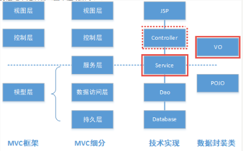
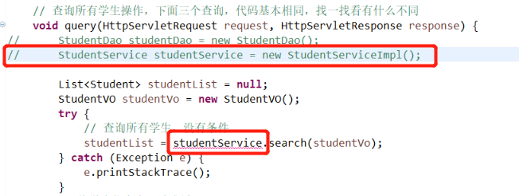
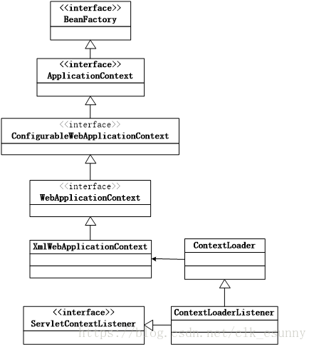

## 基于Spring-MyBatis的学生信息管理系统

### 实训内容介绍

 本章的项目学生信息管理系统，分为两个阶段。

 第一阶段：完善 MVC 架构，使其更加符合实际项目的需求（还没有集成 Spring）。

 第二阶段：在此基础上，将 Spring 技术集成进来。 

  内容概述

对 MVC 架构进行细分，可以将模型层细分为服务层、数据访问层和持久层三个部分 （如下图所示）。其中业务层之上是前台，业务层之下是后台（图中虚线所示）。



  图1 MVC 框架结构的细分

在这个系统中，数据是用普通的 Java 类（也就是所谓的 POJO 类）封装的，但是， 前台数据和后台数据的内容（属性）有可能有少许差别，原因是后台的数据（属性）必须与表的结构完全一一对应， 前台的数据是与用户的需求对应的，对于初学者来说，前台和后台数据基本上是一一对应的，在实际项目中， 经常出现不一致的情况，例如用户数据有时会省略某些属性，有时会多出一些属性，或者需要作某些转换， 甚至可能包含另一张表的数据。 

因此，就采用值对象（Value Object，VO）来封装前台数据，用 POJO 对象来封装后台数据。VO 和 POJO 都是普通 Java 类，在格式要求上是相同的，只是用不同的术语对其作用和地位做一个区分。 　 　

（1）VO对象：用于封装前台数据，其属性与表单的数据一致。 　 　

（2）POJO对象：用于封装后台数据，其属性与表的结构一致。 　 　

通常情况下，业务逻辑是写在 Controller 或 Service 里的，而 VO 和 POJO 类之间的转换则是 Service 的任务。 　　

如果前台数据与后台数据是一致的，这时也可以没有 VO，直接用 POJO 来封装前台和后台数据， 虽然避免了转换这个步骤，但是限制了项目的可扩展性，仅适用于小型项目。  

注意：本项目代码与教材的代码有少量不同，以本实训代码为准。 

所谓的`Spring`与`MyBatis`的集成，就是用`Spring`管理`MyBatis`，用`Spring`的配置文件替代`MyBatis` 配置文件， 从而利用`Spring`许多优秀的特征，例如自动扫描、自动装配，可以按照`Spring`方式来使用`MyBatis`。

### 创建项目

 在 Eclipse 中创建一个 Dynamic Web Project，名为 student_sm。 

### 相关Jar包  

 https://www.studybigdata.cn/file/javaee/jars/mybatis-spring.zip


### 初始化数据库和项目代码

初始化数据库

```sql
set names gbk;
create database mybatis2 default charset utf8 collate utf8_general_ci;

use mybatis2;
drop table if exists t_student;
drop table if exists t_type;

create table t_type(
    id int(11) primary key auto_increment,
    name varchar(20) not null
);

create table t_student(
    id int(11) primary key auto_increment,
    name varchar(20) not null,
  	age tinyint(4) not null,
  	sex char(1) not null,
  	account varchar(16) not null,
  	password varchar(64) not null,
  	type_id int(11) not null,
    foreign key(type_id) references t_type(id)
);

insert into t_type(name) values('管理员');
insert into t_type(name) values('用户');

insert into t_student(name, age,sex,account,password, type_id)
	values('张三', 18, 'f','zhangsan','123',1);
insert into t_student(name, age,sex,account,password, type_id)
	values('李四', 19, 'm','lisi','123',1);
insert into t_student(name, age,sex,account,password, type_id)
	values('王五', 20, 'f','wangwu','123',2);
```

并且将第5章“基于MyBatis 的学生信息管理系统”完成后的代码复制到项目 student_sm 中， 作为本实训的起点。  

刷新项目后到项目的所有代码，请仔细阅读一遍所有的 Java 源代码，作者在复制的代码中添加了许多注释，精减了代码，规范了格式。 要学会通过注释来理解代码，参考第 2 步的图1，理解项目的结构，然后再启动 Tomcat，通过http://127.0.0.1:8080/student_sm/login.jsp 访问项目，对照代码，理解项目的执行流程。  阅读代码的目的是，通过比较本实训前后的代码，理解 VO 的作用。  注意：这一步会删除项目中的所有源代码文件，因此应该先停止 Tomcat 的运行，才能初始化项目。 

### VO 

 在 `vo` 包(`com.studybigdata.javaee.sm.student.vo`)中添加一个 `StudentVO` 类。 在这个例子中，这个 `StudentVO` 类与 `Student` 类的区别在于对外键的处理不同。  

```java
public class StudentVO {
	private Integer id;
	private String name;
	private Integer age;
	private String sex;
	private String account;
	private String password;
	private Integer typeId;
}
//getter setter略。
```

### Mapper

现在的 `StudentMapper` 是一个接口（接口是不能用 `new` 实例化的），并且这个接口也没有对应的实现类。  实际情况是，这个接口的实现类是由`MyBatis` 根据 `StudentMapper.xml` 文件自动生成的。

#### 映射器接口

修改为由`Spring`通过注解的方式装配；为`Mapper`类添加 `@Repository`注解，并给通过该类生成的`Bean`指定一个`id`，通常命名为类名首字母小写的形式。    

##### StudentMapper

```java
@Repository("studentMapper")
public interface StudentMapper {
    // 代码略。
}
```

##### TypeMapper

```java
@Repository("typeMapper")
public interface TypeMapper {
    // 代码略。
}
```

#### 映射器XML

在基于MyBatis的学生信息管理系统中，`MyBatis`配置文件定义了一个默认的包名：

```xml
<typeAliases>
		<package name="org.ngweb.student.pojo"/>
</typeAliases>
```

  将`MyBatis`交给`Spring`管理后，不再需要`MyBatis`配置文件。 因此，将两个`xml`文件中的`student`和`type`，改为绝对引用，即加上默认包名。

- 将`student`改为`org.ngweb.student.pojo.Student`；

- 将`type`改为`org.ngweb.student.pojo.Type`；（两个文件共 5 处，有 1 处不能改）。

```xml
<resultMap type="org.ngweb.student.pojo.Student" id="studentMap">
    <id column="id" property="id" />
    <result column="name" property="name" />
    <result column="age" property="age" />
    <result column="sex" property="sex" />
    <result column="account" property="account"/>
    <result column="password" property="password" />
    <!-- 这个type对应着Student的属性名,不能修改 -->
	<association column="type_id" property="type" select="org.ngweb.student.dao.TypeDao.getById"/>
</resultMap>
```

### Service

 `Service`层位于`Controller`层和`Mapper` 层之间，因此，`Controller`层访问`Service`层，`Service`层访问 `Mapper` 层。  在这个例子中，`Service`的作用仅仅是将 `VO` 转换为 `POJO` 。

##### StudentService接口

 创建包 **service**包（`com.studybigdata.javaee.sm.student.service`），并编写`Service`接口代码：

```java
// 这是接口，参数是 VO 的
public interface StudentService {
	// 根据条件查询学生信息
	public List<Student> search(StudentVO studentVO);

	// 添加学生信息
	public int addStudent(StudentVO studentVO);

	// 更新学生信息
	public int updataStudent(StudentVO studentVO);

	// 根据id删除学生信息
	public int deleteStudent(int id);
}
```

#####  StudentServiceImpl实现类

创建`serviceimpl`包 `com.studybigdata.javaee.sm.student.service.impl`，并编写`StudentServiceImpl`实现类代码。 

为`StudentServiceImpl`类添加`@Service("studentService")`注解，由`Spring`通过注解的方式进行`Bean`的装配；

为`studentMapper`属性添加`@Autowired`注解，使其能够自动完成依赖注入。

```java
@Service("studentService")
public class StudentServiceImpl implements StudentService {
	
	@Autowired
	private StudentMapper studentMapper;

	@Override
	public List<Student> search(StudentVO studentVO) {
		Student student = new Student();
		student.setId(studentVO.getId());
		student.setName(studentVO.getName());
		student.setAge(studentVO.getAge());
		student.setSex(studentVO.getSex());
		student.setAccount(studentVO.getAccount());
		student.setPassword(studentVO.getPassword());
		
		System.out.println("------------"+student);
		return studentMapper.search(student);
	}

	@Override
	public int addStudent(StudentVO studentVO) {
		Student student = new Student();
		student.setId(studentVO.getId());
		student.setName(studentVO.getName());
		student.setAge(studentVO.getAge());
		student.setSex(studentVO.getSex());
		student.setAccount(studentVO.getAccount());
		student.setPassword(studentVO.getPassword());
		Type type = new Type();
		type.setId(studentVO.getTypeId());
		student.setType(type);

		return studentMapper.addStudent(student);
	}

	@Override
	public int updataStudent(StudentVO studentVO) {
		Student student = new Student();
		student.setId(studentVO.getId());
		student.setName(studentVO.getName());
		student.setAge(studentVO.getAge());
		student.setSex(studentVO.getSex());
		student.setAccount(studentVO.getAccount());
		student.setPassword(studentVO.getPassword());
		Type type = new Type();
		type.setId(studentVO.getTypeId());
		student.setType(type);

		return studentMapper.updataStudent(student);
	}

	@Override
	public int deleteStudent(int id) {
		return studentMapper.deleteStudent(id);
	}
}
```

### Controller

**原来**： `Controller` 调用 `Dao` ，`Dao`调用`Mapper`；

**现在**： `Controller` 调用 `Service` ， `Service` 调用 `Mapper` ；

原来由`Dao`通过`sqlSessionFactory` 获取`SqlSession`对象，然后查询映射器`Mapper`；现在`dataSource`和`sqlSessionFactory`均由`Spring`创建。


将两个 `Controller` 文件中，对 `Dao` 的访问，全部替换为对 `Service` 的访问， `Service`从`Spring`中获得，而不再是通过 `new  StudentServiceImpl` 来得到实例，获取方式如下：

```java
//定义依赖的对象，该对象从Spring容器中获取
private StudentService studentService;  // 局部变量改为实例变量

public void init() throws ServletException {
    super.init();
    ServletContext context = this.getServletContext();
    WebApplicationContext wac = WebApplicationContextUtils.getWebApplicationContext(context);
    studentService = (StudentService) wac.getBean("studentService");
}
```

修改两个控制类，将其中的这一行整行删除或注释掉，其中 `LoginController` 有1处， `StudentController` 类有6 处（几乎每个方法有一个）



### Spring 配置文件       

在 `src` 目录下创建文件`spring-cfg.xml`，内容如下（需要时，修改密码等参数）        

```xml
<?xml version='1.0' encoding='UTF-8'?>
<beans xmlns="http://www.springframework.org/schema/beans"
	xmlns:xsi="http://www.w3.org/2001/XMLSchema-instance" xmlns:p="http://www.springframework.org/schema/p"
	xmlns:aop="http://www.springframework.org/schema/aop" xmlns:tx="http://www.springframework.org/schema/tx"
	xmlns:context="http://www.springframework.org/schema/context"
	xsi:schemaLocation="http://www.springframework.org/schema/beans
	   http://www.springframework.org/schema/beans/spring-beans-4.0.xsd
       http://www.springframework.org/schema/aop
       http://www.springframework.org/schema/aop/spring-aop-4.0.xsd
       http://www.springframework.org/schema/tx
       http://www.springframework.org/schema/tx/spring-tx-4.0.xsd
       http://www.springframework.org/schema/context
       http://www.springframework.org/schema/context/spring-context-4.0.xsd">

	<!--启用扫描机制，并指定扫描对应的包-->
	<context:component-scan base-package="com.studybigdata.javaee.sm.student.*" />

	<!-- 数据库连接池 -->
	<bean id="dataSource" class="org.apache.commons.dbcp.BasicDataSource">
		<!-- 数据库驱动 -->
		<property name="driverClassName" value="com.mysql.cj.jdbc.Driver" />
		<!-- 连接数据库的url -->
		<property name="url" value="jdbc:mysql://localhost:3306/mybatis2?serverTimezone=UTC"/>
		<!-- 连接数据库的用户名 -->
		<property name="username" value="root" />
		<!-- 连接数据库的密码 -->
		<property name="password" value="123456" />
		<!-- 最大连接数 -->
		<property name="maxActive" value="255" />
		<!-- 最大空闲连接 -->
		<property name="maxIdle" value="5" />
		<!-- 初始化连接数 -->
		<property name="maxWait" value="10000" />
	</bean>

	<!-- 集成MyBatis -->
	<bean id="sqlSessionFactory" class="org.mybatis.spring.SqlSessionFactoryBean">
		<property name="dataSource" ref="dataSource" />
	</bean>

	<!-- 采用自动扫描方式创建mapper bean -->
	<bean class="org.mybatis.spring.mapper.MapperScannerConfigurer">
		<property name="basePackage" value="com.studybigdata.javaee.sm.student.dao" />
		<property name="SqlSessionFactory" ref="sqlSessionFactory" />
		<property name="annotationClass" value="org.springframework.stereotype.Repository" />
	</bean>

</beans>
```

### MyBatis 配置文件

- 删除配置文件 `mybatis-config.xml` 
- 删除配置参数文件 `db.properties`

### SqlSessionFactoryUtil 

将`MyBatis`交给`Spring`管理后，就不再需要`SqlSessionFactoryUtil`类了，删除这个类和它所属的包。

### web.xml

并修改项目的配置文件 `web.xml`，向其添加下述内容。



Spring提供了监听器`ContextLoaderListener`，实现`ServletContextListener`接口，可监听 `ServletContext`的状态，在`web`服务器的启动，读取(加载)`Spring`的配置文件，创建`Spring`的`IoC`容器。必须在`web.xml`中配置。


```xml
<context-param>
    <param-name>contextConfigLocation</param-name>
    <param-value>classpath:spring-cfg.xml</param-value>
</context-param>
<listener>
	<listener-class>org.springframework.web.context.ContextLoaderListener</listener-class>
</listener>
```

### 测试运行

修改之后，通过[http://127.0.0.1:8080/student_sm/login.jsp](http://127.0.0.1:8080/student_sm/login.jsp...)访问项目，功能没有任何改变，只是增加了Spring 集成。  

集成之后的优点是，当对项目进行扩展时，不再需要修改`MyBatis` 或 `Spring` 配置文件，前者是已经被替换（集成到 Spring)，后者是指定了自动扫描的包，然后通过自动扫描和自动装配，就能够自动识别扩展后的其他类。例如，数据库每增加一张表，就要增加一组类，这些类有POJO类， VO类，Dao类，Service类等，按照规则编写这些类，并加上注解后，无需修改配置，项目就能够直接运行。  

由此可以看到，Spring并不提供任何实质性的功能，它只是按一定的规则维护对象之间的依赖关系，像胶水一样把各个组件紧密的装配在一起。        

