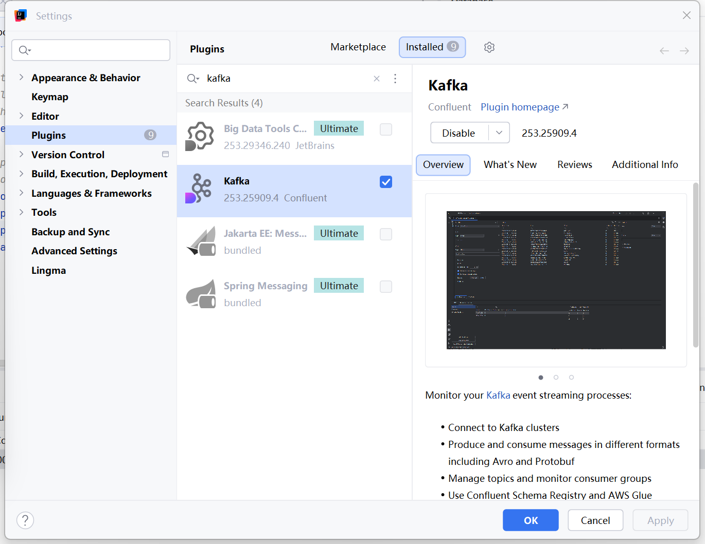
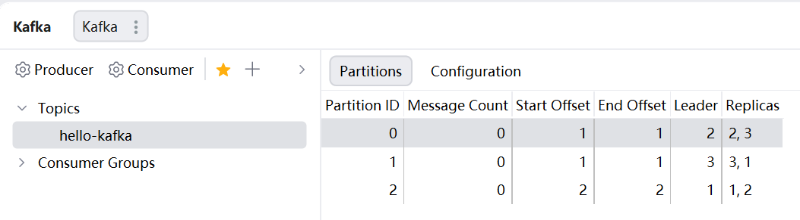
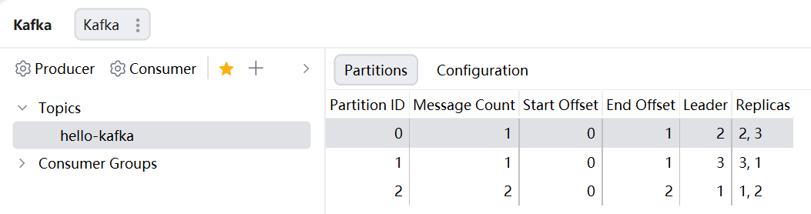

## 查看操作主题命令参数

```bash
[zhangan@node1 kafka]$ bin/kafka-topics.sh
```

| 参数                                              | 描述                                 |
| ------------------------------------------------- | ------------------------------------ |
| --bootstrap-server <String: server toconnect to>  | 连接的Kafka Broker主机名称和端口号。 |
| --topic <String: topic>                           | 操作的topic名称。                    |
| --create                                          | 创建主题。                           |
| --delete                                          | 删除主题。                           |
| --alter                                           | 修改主题。                           |
| --list                                            | 查看所有主题。                       |
| --describe                                        | 查看主题详细描述。                   |
| --partitions <Integer: # of partitions>           | 设置分区数。                         |
| --replication-factor<Integer: replication factor> | 设置分区副本。                       |
| --config <String: name=value>                     | 更新系统默认的配置。                 |

### 查看当前服务器中的所有topic

```bash
[zhangan@node1 kafka]$ bin/kafka-topics.sh --bootstrap-server node1:9092 --list
```

### 创建Topic

```bash
[zhangsan@node1 ~]$ kafka-topics.sh --create --bootstrap-server node1:9092 --topic hello-kafka --partitions 3 --replication-factor 2
Created topic hello-kafka.
```
### 查看Topic的详情

```bash
(base) [zhangsan@node1 ~]$ kafka-topics.sh --describe hello-kafka --bootstrap-server node1:9092
Topic: hello-kafka      TopicId: 8t37qHKIRVa8ASL6dyYYrQ PartitionCount: 3       ReplicationFactor: 2    Configs: segment.bytes=1073741824
        Topic: hello-kafka      Partition: 0    Leader: 2       Replicas: 2,3   Isr: 2,3
        Topic: hello-kafka      Partition: 1    Leader: 3       Replicas: 3,1   Isr: 3,1
        Topic: hello-kafka      Partition: 2    Leader: 1       Replicas: 1,2   Isr: 1,2
```



### 基本信息解读

| 字段                  | 值                       | 说明                                 |
| --------------------- | ------------------------ | ------------------------------------ |
| **Topic**             | hello-kafka              | Topic 名称                           |
| **TopicId**           | 8t37qHKIRVa8ASL6dyYYrQ   | Topic 的唯一标识符（Kafka 内部使用） |
| **PartitionCount**    | 3                        | 这个 Topic 有 3 个分区               |
| **ReplicationFactor** | 2                        | 每个分区有 2 个副本                  |
| **Configs**           | segment.bytes=1073741824 | 自定义配置（日志分段文件大小为 1GB） |

### 分区详细信息

```
Partition: 0    Leader: 2    Replicas: 2,3    Isr: 2,3
```
- **分区编号**：0
- **Leader**：broker 2 是这个分区的 Leader（负责读写）
- **Replicas**：副本分布在 broker 2 和 broker 3
- **ISR (In-Sync Replicas)**：broker 2 和 broker 3 都是同步副本


---

#### 修改分区数（注意：分区数只能增加，不能减少）

```bash
(base) [zhangsan@node1 ~]$ kafka-topics.sh --bootstrap-server node1:9092 --alter --topic hello-kafka --partitions 1
Error while executing topic command : Topic currently has 3 partitions, which is higher than the requested 1.
[2026-03-15 16:36:16,509] ERROR org.apache.kafka.common.errors.InvalidPartitionsException: Topic currently has 3 partitions, which is higher than the requested 1.
 (kafka.admin.TopicCommand$)
```

#### 删除topic

```bash
[zhangan@node1 kafka]$ kafka-topics.sh --bootstrap-server node1:9092 --delete --topic hello-kafka
```


---

## 生产者命令行操作

#### 查看操作生产者命令参数

```bash
[zhangan@node1 kafka]$ bin/kafka-console-producer.sh
```

| 参数                                              | 描述                                 |
| ------------------------------------------------- | ------------------------------------ |
| --bootstrap-server <String: server to connect to> | 连接的Kafka Broker主机名称和端口号。 |
| --topic <String: topic>                           | 操作的topic名称。                    |

#### 发送消息

```bash
(base) [zhangsan@node1 ~]$ kafka-console-producer.sh --bootstrap-server node1:9092 --topic hello-kafka
>a
>b
>c
>d
```




---

## 消费者命令行操作

#### 查看操作消费者命令参数

```bash
[zhangan@node1 kafka]$ bin/kafka-console-consumer.sh
```

| 参数                                              | 描述                                 |
| ------------------------------------------------- | ------------------------------------ |
| --bootstrap-server <String: server to connect to> | 连接的Kafka Broker主机名称和端口号。 |
| --topic <String: topic>                           | 操作的topic名称。                    |
| --from-beginning                                  | 从头开始消费。                       |
| --group <String: consumer group id>               | 指定消费者组名称。                   |

#### 消费消息

（1）消费first主题中的数据。

```bash
[zhangan@node1 kafka]$ kafka-console-consumer.sh --bootstrap-server node1:9092 --topic hello-kafka
```
（2）把主题中所有的数据都读取出来（包括历史数据）。
```bash
[zhangan@node1 kafka]$ kafka-console-consumer.sh --bootstrap-server node1:9092 --from-beginning --topic hello-kafka
```


