## Kettle连接Hadoop

##### Linux软件包

```shell
yum -y install redhat-lsb
```

##### hdfs-site.xml

```xml
<property>
  <name>dfs.permissions.enabled</name>
  <value>false</value>
</property>
```

##### 复制Hadoop配置文件到Kettle

- core-site.xml

- hdfs-site.xml

- yarn-site.xml

- mapred-site.xml

```shell
data-integration\plugins\pentaho-big-data-plugin\hadoop-configurations\cdh61
```

##### 主对象树中配置HadoopCluster

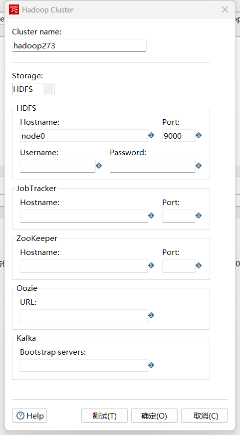

## 复制文件到HDFS

##### Local到HDFS

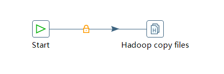

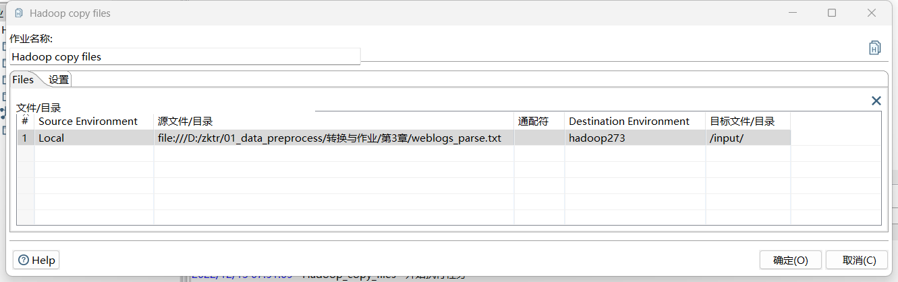

## MapReduce

### MapReduce Mapper

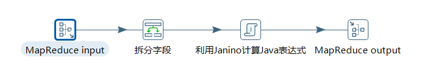

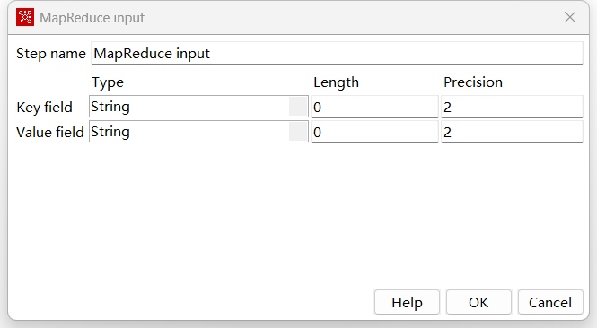

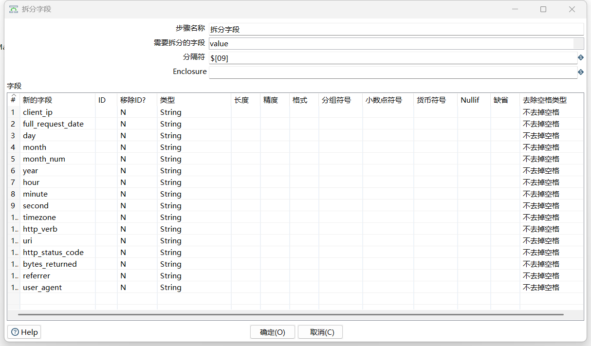

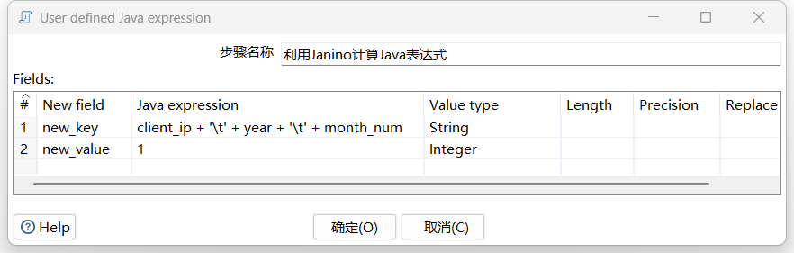

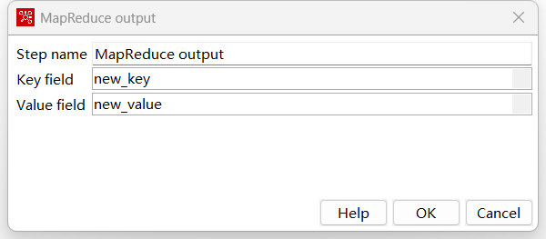

### MapReduce Reduce

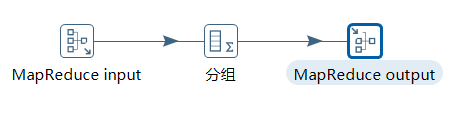

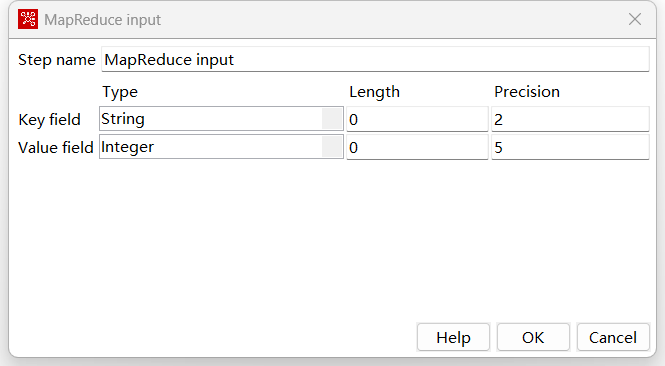

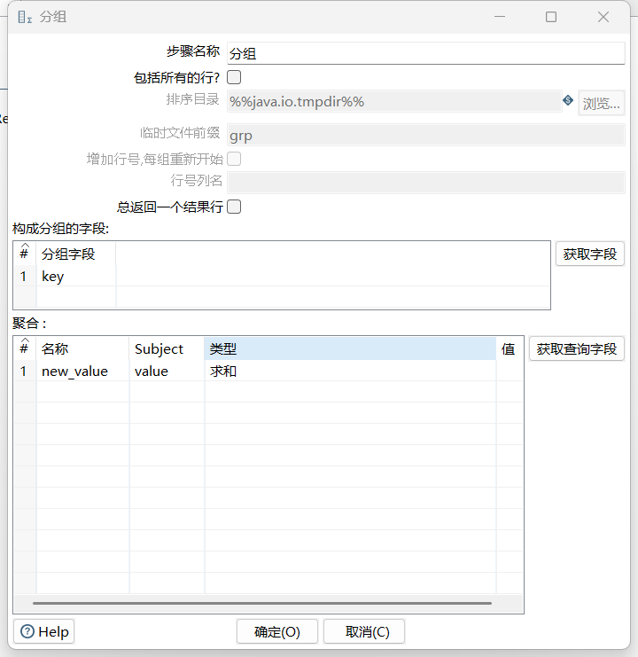

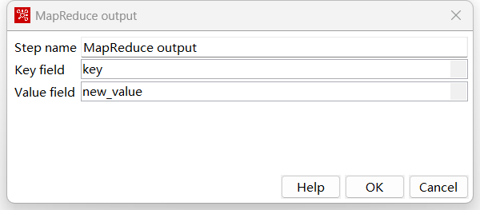

### MapReduce

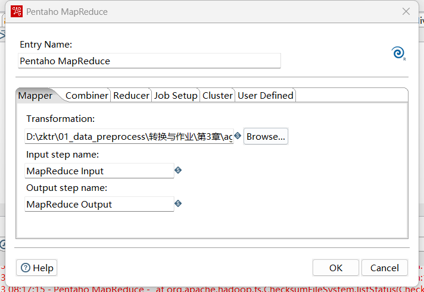

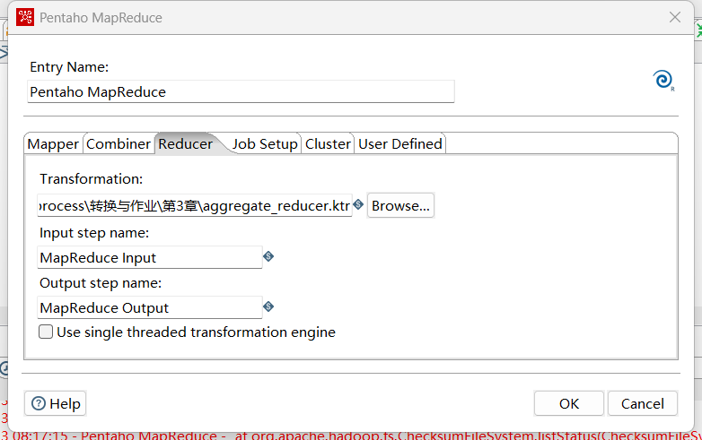

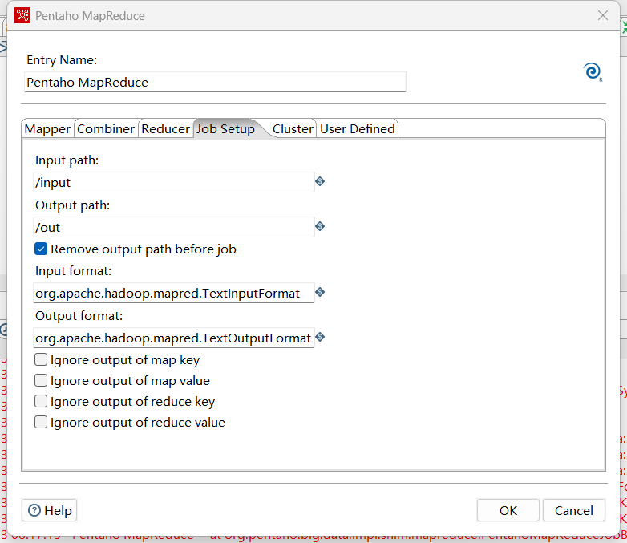

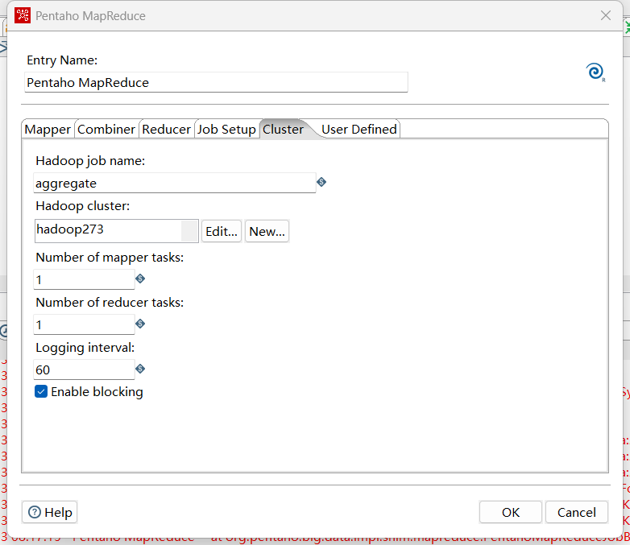


