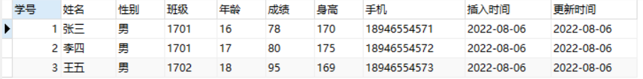
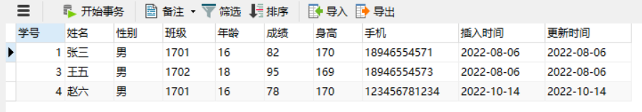
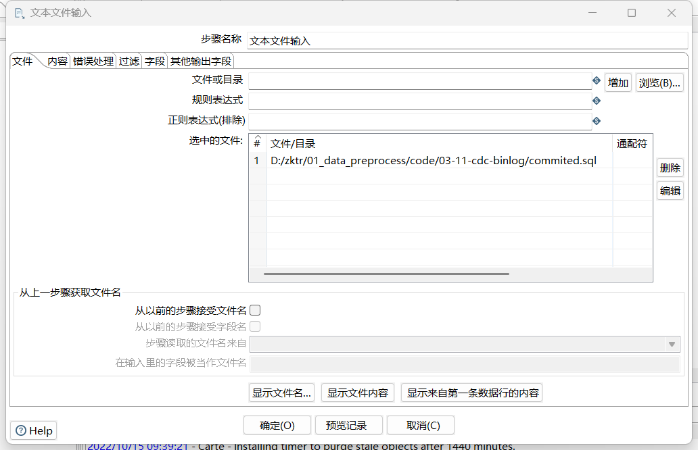
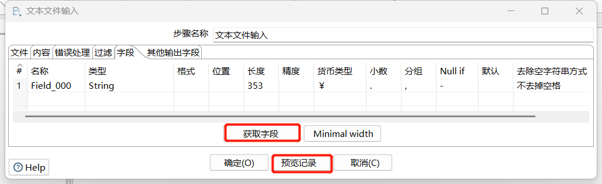
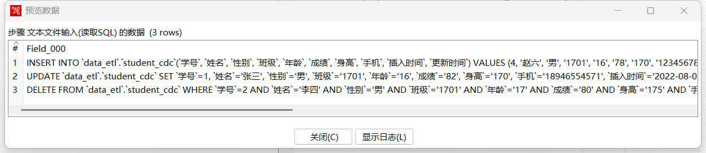
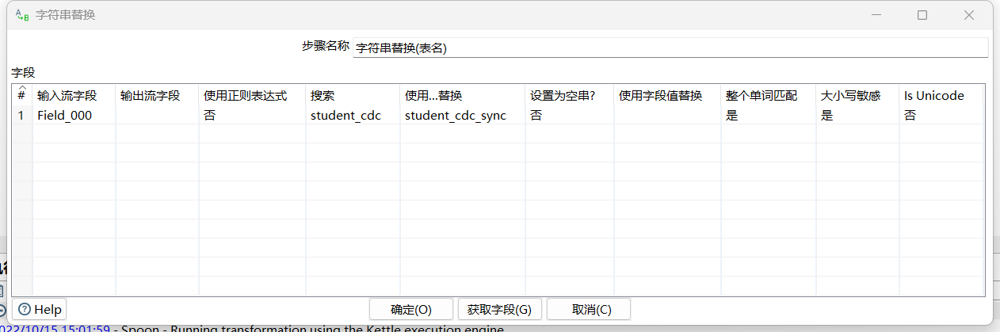
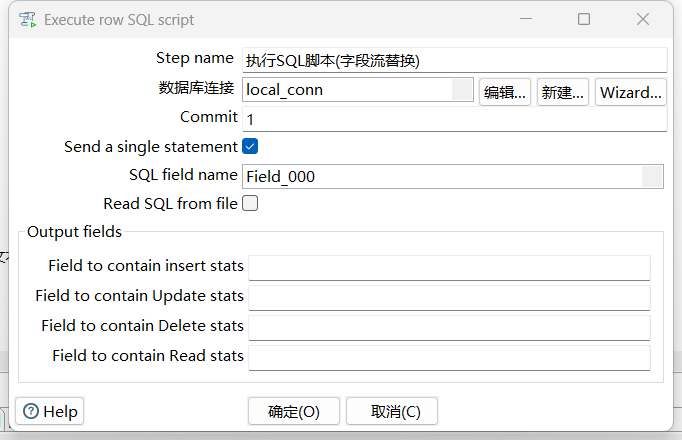
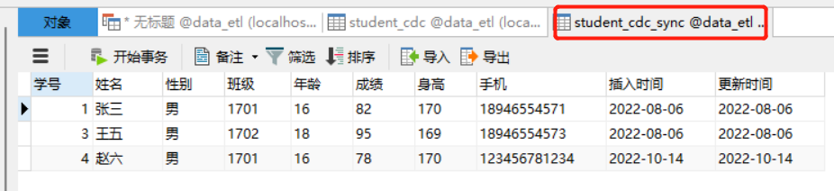

# Kettle - 基于日志的CDC

## 数据准备

##### student_cdc

```sql
DROP TABLE IF EXISTS `student_cdc`;
CREATE TABLE `student_cdc` (
  `学号` int(255) NOT NULL AUTO_INCREMENT,
  `姓名` varchar(255) DEFAULT NULL,
  `性别` varchar(255) DEFAULT NULL,
  `班级` varchar(255) DEFAULT NULL,
  `年龄` varchar(255) DEFAULT NULL,
  `成绩` varchar(255) DEFAULT NULL,
  `身高` varchar(255) DEFAULT NULL,
  `手机` varchar(255) DEFAULT NULL,
  `插入时间` varchar(255) DEFAULT NULL,
  `更新时间` varchar(255) DEFAULT NULL,
  PRIMARY KEY (`学号`)
) ENGINE=InnoDB AUTO_INCREMENT=4 DEFAULT CHARSET=utf8 ROW_FORMAT=DYNAMIC;

-- ----------------------------
-- Records of student_cdc
-- ----------------------------
INSERT INTO `student_cdc` VALUES ('1', '张三', '男', '1701', '16', '78', '170', '18946554571', '2022-08-06', '2022-08-06');
INSERT INTO `student_cdc` VALUES ('2', '李四', '男', '1701', '17', '80', '175', '18946554572', '2022-08-06', '2022-08-06');
INSERT INTO `student_cdc` VALUES ('3', '王五', '男', '1702', '18', '95', '169', '18946554573', '2022-08-06', '2022-08-06');
```



##### student_cdc_sync

```sql
DROP TABLE IF EXISTS `student_cdc_sync`;
CREATE TABLE `student_cdc_sync` (
  `学号` int(255) NOT NULL AUTO_INCREMENT,
  `姓名` varchar(255) DEFAULT NULL,
  `性别` varchar(255) DEFAULT NULL,
  `班级` varchar(255) DEFAULT NULL,
  `年龄` varchar(255) DEFAULT NULL,
  `成绩` varchar(255) DEFAULT NULL,
  `身高` varchar(255) DEFAULT NULL,
  `手机` varchar(255) DEFAULT NULL,
  `插入时间` varchar(255) DEFAULT NULL,
  `更新时间` varchar(255) DEFAULT NULL,
  PRIMARY KEY (`学号`)
) ENGINE=InnoDB AUTO_INCREMENT=4 DEFAULT CHARSET=utf8 ROW_FORMAT=DYNAMIC;

-- ----------------------------
-- Records of student_cdc_sync
-- ----------------------------
INSERT INTO `student_cdc_sync` VALUES ('1', '张三', '男', '1701', '16', '78', '170', '18946554571', '2022-08-06', '2022-08-06');
INSERT INTO `student_cdc_sync` VALUES ('2', '李四', '男', '1701', '17', '80', '175', '18946554572', '2022-08-06', '2022-08-06');
INSERT INTO `student_cdc_sync` VALUES ('3', '王五', '男', '1702', '18', '95', '169', '18946554573', '2022-08-06', '2022-08-06');
```


## 获取SQL日志

### 配置MySQL

修改配置文件 `C:\ProgramData\MySQL\MySQL Server 5.7\my.ini`

```shell
[mysqld]
log-bin=mysql-bin-file
```

value值 `mysql-bin-file` 是自定义的binlog文件名

### 重启MySQL

### 2.1 方式1 
搜索`服务`，找到`mysql57`，右键重启；

### 2.2 方式2
 `net stop mysql57 & net start mysql57` （管理员）

例如：

```
C:\Windows\System32>net stop mysql57 & net start mysql57
MySQL57 服务正在停止.
MySQL57 服务已成功停止。
```

### 查看是否启用

```sql
mysql> show variables like '%log_bin%';
+---------------------------------+-----------------------------------------------------------------+
| Variable_name                   | Value                                                           |
+---------------------------------+-----------------------------------------------------------------+
| log_bin                         | ON                                                              | <== ON表示开启binlog
| log_bin_basename                | C:\ProgramData\MySQL\MySQL Server 5.7\Data\mysql-bin-file       |
| log_bin_index                   | C:\ProgramData\MySQL\MySQL Server 5.7\Data\mysql-bin-file.index |
| log_bin_trust_function_creators | OFF                                                             |
| log_bin_use_v1_row_events       | OFF                                                             |
| sql_log_bin                     | ON                                                              |
+---------------------------------+-----------------------------------------------------------------+
6 rows in set, 1 warning (0.00 sec)
```


### 修改源数据表

```sql
INSERT INTO student_cdc (姓名,性别,班级,年龄,成绩,身高,手机,插入时间,更新时间)
VALUES('赵六','男','1701','16','78','170','123456781234',DATE_SUB(CURDATE(), INTERVAL 1 DAY),DATE_SUB(CURDATE(), INTERVAL 1 DAY));
update student_cdc set 成绩=82 where 学号=1;
delete from student_cdc where 学号=2
```

修改结果：



### 刷新log

```sql
mysql> flush logs;
Query OK, 0 rows affected (0.01 sec)
```


### binlog转文本

#### 方式一：mysqlbinlog转文本文件

```shell
mysqlbinlog --base64-output=decode-rows -v mysql-bin-file.000001 --result-file=.\mysql-bin-file-000001.sql
```

`--base64-ouput=decode-rows` ：代表解码

`-v `：代表换行显示这些语句，如果没有-v 你依然看不到具体的语句

#### 方式二：BinLog2SQL

##### 下载BinLog2SQL

```http
https://github.com/danfengcao/binlog2sql
```

##### 安装

```powershell
(base) PS D:\green-soft\binlog2sql-master> pip install -r .\requirements.txt
```

##### 解析SQL

```shell
(base) PS D:\green-soft\binlog2sql-master\binlog2sql> python binlog2sql.py -h 127.0.0.1 -P 3306 -u root -p 123456 -d data_etl -t student_cdc --start-file=mysql-bin-file.000176 --start-datetime='2022-10-15 15:08:00' --stop-datetime='2022-10-15 15:15:00'
D:\ProgramData\Anaconda3\lib\site-packages\pymysql\cursors.py:166: Warning: (1366, "Incorrect string value: '\\xD6\\xD0\\xB9\\xFA\\xB1\\xEA...' for column 'VARIABLE_VALUE' at row 480")
  result = self._query(query)
INSERT INTO `data_etl`.`student_cdc`(`学号`, `姓名`, `性别`, `班级`, `年龄`, `成绩`, `身高`, `手机`, `插入时间`, `更新时间`) VALUES (4, '赵六', '男', '1701', '16', '78', '170', '123456781234', '2022-10-14', '2022-10-14'); #start 137193 end 137540 time 2022-10-15 15:09:43
UPDATE `data_etl`.`student_cdc` SET `学号`=1, `姓名`='张三', `性别`='男', `班级`='1701', `年龄`='16', `成绩`='82', `身高`='170', `手机`='18946554571', `插入时间`='2022-08-06', `更新时间`='2022-08-06' WHERE `学号`=1 AND `姓名`='张三' AND `性别`='男' AND `班级`='1701' AND `年龄`='16' AND `成绩`='78' AND `身高`='170' AND `手机`='18946554571' AND `插入时间`='2022-08-06' AND `更新时间`='2022-08-06' LIMIT 1; #start 137571 end 137986 time 2022-10-15 15:09:43
DELETE FROM `data_etl`.`student_cdc` WHERE `学号`=2 AND `姓名`='李四' AND `性别`='男' AND `班级`='1701' AND `年龄`='17' AND `成绩`='80' AND `身高`='175' AND `手机`='18946554572' AND `插入时间`='2022-08-06' AND `更新时间`='2022-08-06' LIMIT 1; #start 138017 end 138355 time 2022-10-15 15:09:43
```

将解析出来的`SQL`语句（删除后面的起始时间）保存到文本文件中，命名为`commited.sql`

## 基于日志的CDC

读取提取后的`SQL`文件，并将`SQL`中的`student_cdc`表替换为`student_cdc_sync`表，并执行`SQL`。

需要如下三个步骤：


#### 文本文件输入步骤

##### 文本文件输入

读取从日志中解析出来的SQL语句



##### 获取字段并预览记录



##### 预览结果



#### 字符串替换步骤



#### 执行SQL脚本(字段流替换)步骤



#### 同步表结果


