# Kettle - 基于快照的CDC

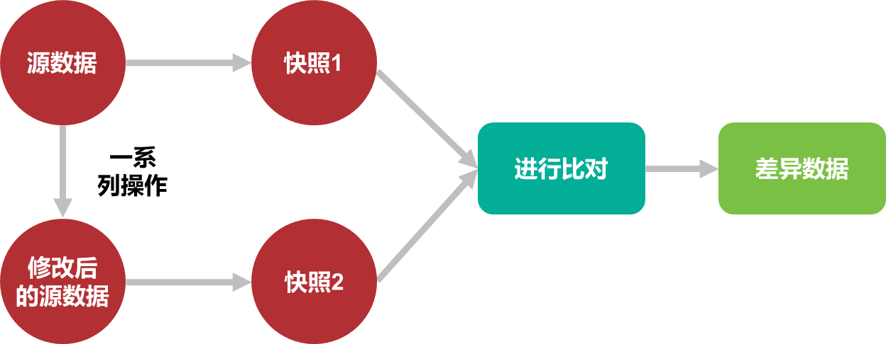


## 源数据表student_cdc

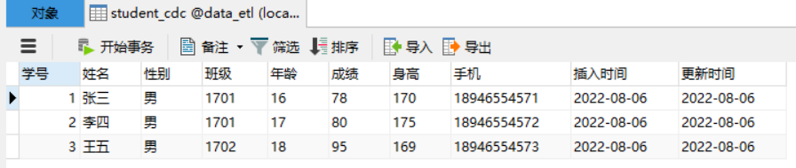

建表语句见文章尾部。

## 快照表student_cdc_snap1

（由源数据表复制得到）

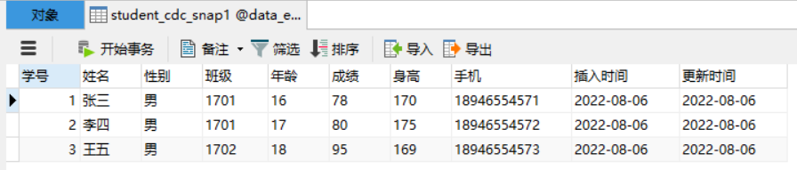

## 第一次数据同步


### student_cdc_sync

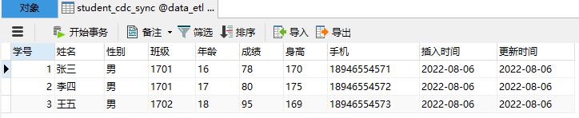

## 2000 Years Later

```sql
INSERT INTO student_cdc (姓名,性别,班级,年龄,成绩,身高,手机,插入时间,更新时间)
VALUES('赵六','男','1701','16','78','170','123456781234',DATE_SUB(CURDATE(), INTERVAL 1 DAY),DATE_SUB(CURDATE(), INTERVAL 1 DAY));
update student_cdc set 成绩=82 where 学号=1;
delete from student_cdc where 学号=2
```


## 源数据表student_cdc

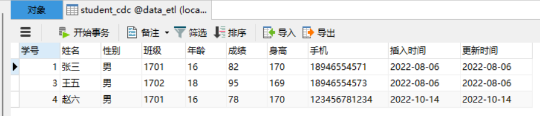

拍摄第二张快照，如下：

## 快照表student_cdc_snap2

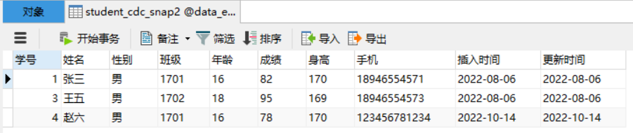

## 第二次数据同步

对比两张快照表中数据的变化，将变化同步到`student_cdc_sync`表中。

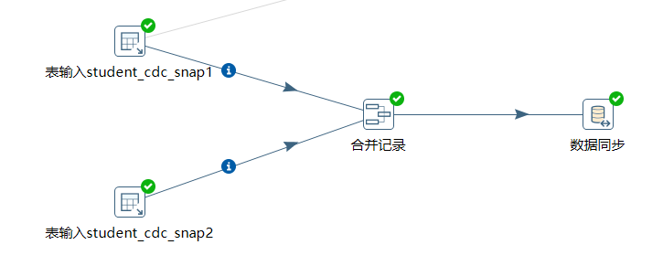

##### 合并记录步骤

`合并记录`顾名思义是对`记录`进行合并；即对`记录`进行比较；即根据`学号`对比记录

新数据源与旧数据源中的记录进行对比，对比`结果`存放到`标志字段`中，该标志字名我们定义为`flagfield`。

- 当记录一致时，`flagfield=identical`；
- 当记录新增时，`flagfield=new`；

- 当记录被修改时，`flagfield=changed`；
- 当记录被删除时，`flagfield=deleted`；

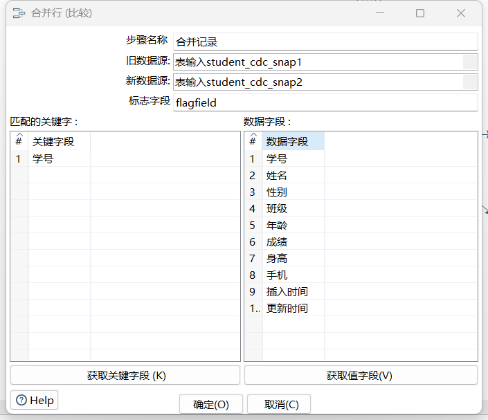


##### 数据同步

将变化的数据同步到`student_cdc_sync`表中。

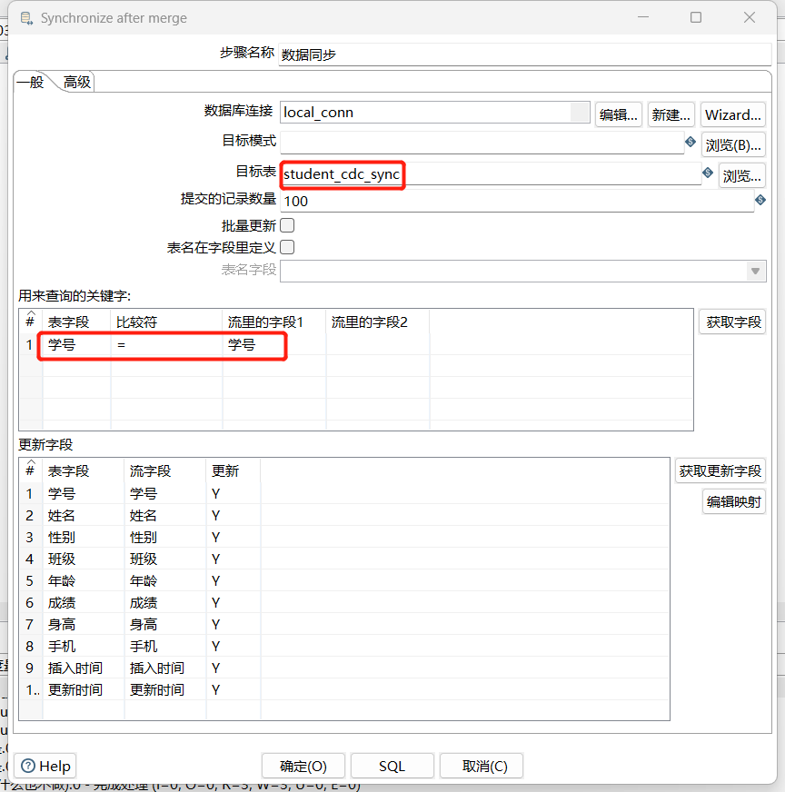

现在`student_cdc_snap1` 实际上与 `student_cdc_sync` 内容一致。我们将快照的记录比较结果合并到`student_cdc_sync`表中，当`flagfield=new`插入数据，当`flagfield=changed`修改数据，当`flagfield=deleted`时，删除数据。

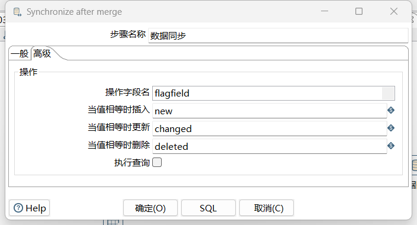

## 同步结果

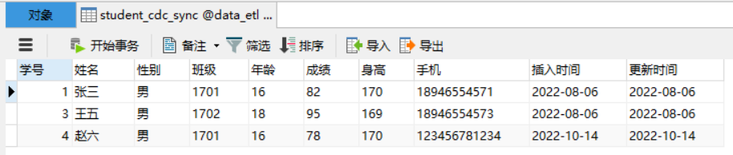

## 附录

##### student_cdc

```sql
DROP TABLE IF EXISTS `student_cdc`;
CREATE TABLE `student_cdc` (
  `学号` int(255) NOT NULL AUTO_INCREMENT,
  `姓名` varchar(255) DEFAULT NULL,
  `性别` varchar(255) DEFAULT NULL,
  `班级` varchar(255) DEFAULT NULL,
  `年龄` varchar(255) DEFAULT NULL,
  `成绩` varchar(255) DEFAULT NULL,
  `身高` varchar(255) DEFAULT NULL,
  `手机` varchar(255) DEFAULT NULL,
  `插入时间` varchar(255) DEFAULT NULL,
  `更新时间` varchar(255) DEFAULT NULL,
  PRIMARY KEY (`学号`)
) ENGINE=InnoDB AUTO_INCREMENT=4 DEFAULT CHARSET=utf8 ROW_FORMAT=DYNAMIC;

-- ----------------------------
-- Records of student_cdc
-- ----------------------------
INSERT INTO `student_cdc` VALUES ('1', '张三', '男', '1701', '16', '78', '170', '18946554571', '2022-08-06', '2022-08-06');
INSERT INTO `student_cdc` VALUES ('2', '李四', '男', '1701', '17', '80', '175', '18946554572', '2022-08-06', '2022-08-06');
INSERT INTO `student_cdc` VALUES ('3', '王五', '男', '1702', '18', '95', '169', '18946554573', '2022-08-06', '2022-08-06');
```

