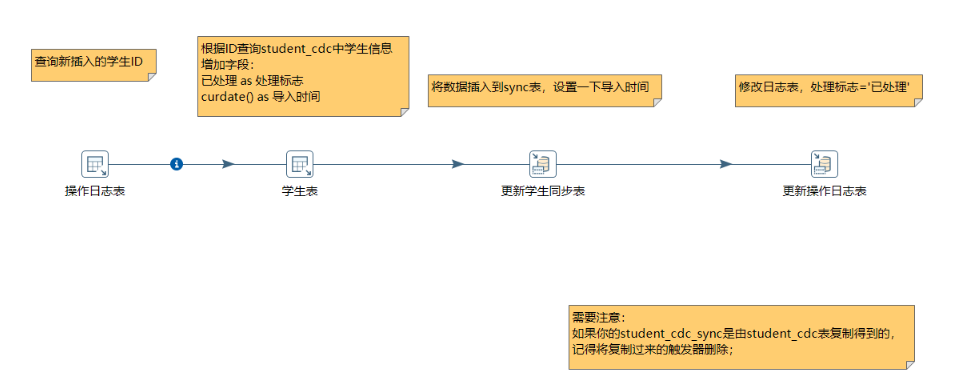
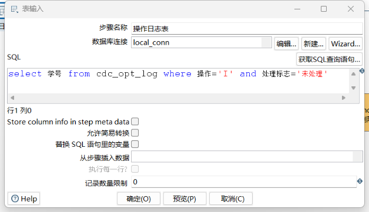
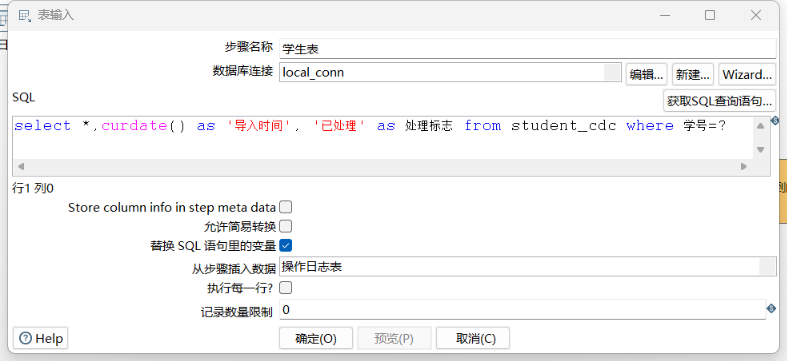
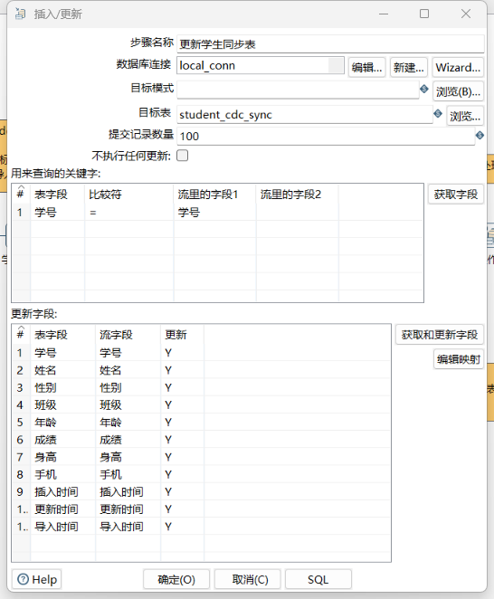
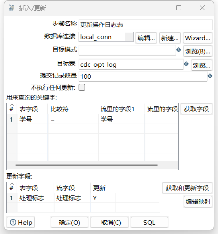
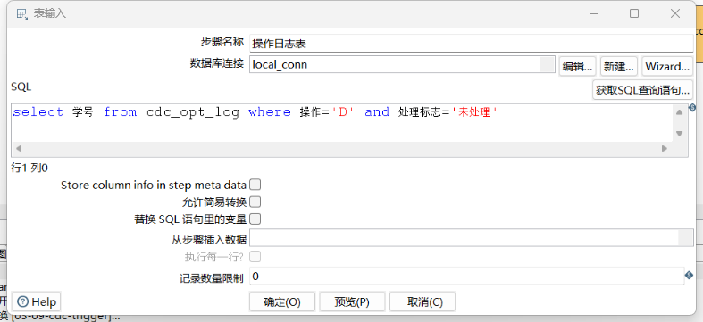
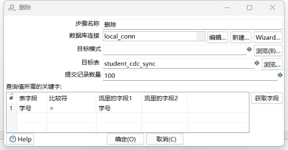
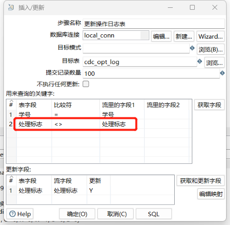

# Kettle - 基于触发器的CDC

## 相关表

##### student_cdc

```sql
-- ----------------------------
-- Table structure for student_cdc
-- ----------------------------
DROP TABLE IF EXISTS `student_cdc`;
CREATE TABLE `student_cdc` (
  `学号` int(255) NOT NULL AUTO_INCREMENT,
  `姓名` varchar(255) DEFAULT NULL,
  `性别` varchar(255) DEFAULT NULL,
  `班级` varchar(255) DEFAULT NULL,
  `年龄` varchar(255) DEFAULT NULL,
  `成绩` varchar(255) DEFAULT NULL,
  `身高` varchar(255) DEFAULT NULL,
  `手机` varchar(255) DEFAULT NULL,
  `插入时间` varchar(255) DEFAULT NULL,
  `更新时间` varchar(255) DEFAULT NULL,
  PRIMARY KEY (`学号`)
) ENGINE=InnoDB AUTO_INCREMENT=4 DEFAULT CHARSET=utf8 ROW_FORMAT=DYNAMIC;

-- ----------------------------
-- Records of student_cdc
-- ----------------------------
INSERT INTO `student_cdc` VALUES ('1', '张三', '男', '1701', '16', '78', '170', '18946554571', '2022-08-06', '2022-08-06');
INSERT INTO `student_cdc` VALUES ('2', '李四', '男', '1701', '17', '80', '175', '18946554572', '2022-08-06', '2022-08-06');
INSERT INTO `student_cdc` VALUES ('3', '王五', '男', '1702', '18', '95', '169', '18946554573', '2022-08-06', '2022-08-06');

-- ----------------------------
-- 设置触发器
-- ----------------------------
DROP TRIGGER IF EXISTS `add`;
DELIMITER ;;
CREATE TRIGGER `add` AFTER INSERT ON `student_cdc` FOR EACH ROW INSERT INTO cdc_opt_log(`学号`,`操作`,`处理标志`) VALUES(new.`学号`,'I','未处理')
;;
DELIMITER ;
DROP TRIGGER IF EXISTS `update`;
DELIMITER ;;
CREATE TRIGGER `update` AFTER UPDATE ON `student_cdc` FOR EACH ROW INSERT INTO cdc_opt_log(`学号`,`操作`,`处理标志`) VALUES(new.`学号`,'U','未处理')
;;
DELIMITER ;
DROP TRIGGER IF EXISTS `delete`;
DELIMITER ;;
CREATE TRIGGER `delete` AFTER DELETE ON `student_cdc` FOR EACH ROW INSERT INTO cdc_opt_log(`学号`,`操作`,`处理标志`) VALUES(old.`学号`,'D','未处理')
;;
DELIMITER ;
```


##### cdc_opt_log

```sql
DROP TABLE IF EXISTS `cdc_opt_log`;
CREATE TABLE `cdc_opt_log` (
  `学号` int(11) NOT NULL,
  `操作` varchar(5) DEFAULT NULL,
  `处理标志` varchar(3) DEFAULT NULL
) ENGINE=InnoDB DEFAULT CHARSET=utf8;
```


##### student_cdc_sync

```sql
DROP TABLE IF EXISTS `student_cdc_sync`;
CREATE TABLE `student_cdc_sync` (
  `学号` int(255) NOT NULL AUTO_INCREMENT,
  `姓名` varchar(255) DEFAULT NULL,
  `性别` varchar(255) DEFAULT NULL,
  `班级` varchar(255) DEFAULT NULL,
  `年龄` varchar(255) DEFAULT NULL,
  `成绩` varchar(255) DEFAULT NULL,
  `身高` varchar(255) DEFAULT NULL,
  `手机` varchar(255) DEFAULT NULL,
  `插入时间` varchar(255) DEFAULT NULL,
  `更新时间` varchar(255) DEFAULT NULL,
  `导入时间` varchar(255) DEFAULT NULL,
  PRIMARY KEY (`学号`)
) ENGINE=InnoDB AUTO_INCREMENT=4 DEFAULT CHARSET=utf8 ROW_FORMAT=DYNAMIC;

-- ----------------------------
-- Records of student_cdc_sync
-- ----------------------------
INSERT INTO `student_cdc_sync` VALUES ('1', '张三', '男', '1701', '16', '78', '170', '18946554571', '2022-08-06', '2022-08-06', '2022-08-06');
INSERT INTO `student_cdc_sync` VALUES ('2', '李四', '男', '1701', '17', '80', '175', '18946554572', '2022-08-06', '2022-08-06', '2022-08-06');
INSERT INTO `student_cdc_sync` VALUES ('3', '王五', '男', '1702', '18', '95', '169', '18946554573', '2022-08-06', '2022-08-06', '2022-08-06');
```


## 测试SQL

## 基于Insert的CDC

在数据库表 `student_cdc` 中插入一条数据，此时`insert`触发器会在`cdc_opt_log`表中增加一条操作记录。

使用`kettle`，查询`cdc_opt_log`表中新插入 (`插入`且`未处理`) 的学生的`学号`；

根据`学号`查询`student_cdc`表，将新增学生记录导出到`student_cdc_sync`表（新增`导出时间`字段）；

最后更改操作日志表`cdc_opt_log`的`处理标志`字段值为`已处理`。

### 相关步骤

#### 插入数据

```sql
INSERT INTO student_cdc (姓名,性别,班级,年龄,成绩,身高,手机,插入时间,更新时间)
VALUES('赵六','男','1701','16','78','170','123456781234',DATE_SUB(CURDATE(), INTERVAL 1 DAY),DATE_SUB(CURDATE(), INTERVAL 1 DAY));
```



#### 步骤：操作日志表



```sql
select 学号 from cdc_opt_log where 操作='I' and 处理标志='未处理'
```

#### 步骤：学生表



```sql
select *, curdate() as '导入时间', '已处理' as 处理标志 from student_cdc where 学号=?
```

#### 步骤：更新学生同步表



#### 步骤：更新操作日志表



## 基于Update的CDC

### 相关步骤

#### 更新数据

```sql
update student_cdc set 成绩=82 where 学号=4;
```

#### 步骤

```sql
select 学号 from cdc_opt_log where 操作='U' and 处理标志='未处理'
```

其他步骤与**基于`Insert`的`CDC`**一致。

## 基于Delete的CDC

### 相关步骤

#### 删除数据

```sql
delete from student_cdc where 学号=4;
```

#### 步骤：操作日志表


```sql
select 学号 from cdc_opt_log where 操作='D' and 处理标志='未处理';
```


#### 步骤：删除学生同步表记录



#### 步骤：更新操作日志表

