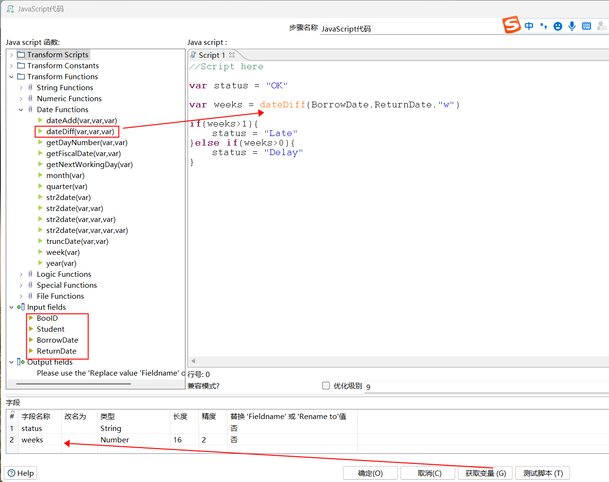
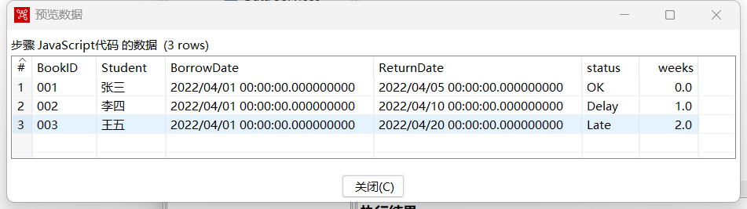

# Kettle - 数据清理之使用JavaScript脚本清理


## 实验数据

```sql
DROP TABLE IF EXISTS `book_borrow`;
CREATE TABLE `book_borrow` (
  `BookID` varchar(10) DEFAULT NULL,
  `Student` varchar(10) DEFAULT NULL,
  `BorrowDate` datetime DEFAULT NULL,
  `ReturnDate` datetime DEFAULT NULL
) ENGINE=InnoDB DEFAULT CHARSET=utf8;

-- ----------------------------
-- Records of book_borrow
-- ----------------------------
INSERT INTO `book_borrow` VALUES ('001', '张三', '2022-04-01 00:00:00', '2022-04-05 00:00:00');
INSERT INTO `book_borrow` VALUES ('002', '李四', '2022-04-01 00:00:00', '2022-04-10 00:00:00');
INSERT INTO `book_borrow` VALUES ('003', '王五', '2022-04-01 00:00:00', '2022-04-20 00:00:00');
```

## 实验目的

新增状态列`Status`：

借书时长在一周之内的记录，状态记为`OK`；

借书时长在一周至二周之内的记录，状态记为`Delay`；

借书时长超过两周的记录，状态记为`Late`；

## 转换设计



在左侧可以看到Kettle提供的`常用函数列表`和`输入输出变量列表`


```javascript
//Script here

var status = "OK"

var weeks = dateDiff(BorrowDate,ReturnDate,"w")

if(weeks>1){
	status = "Late"
}else if(weeks>0){
	status = "Delay"
}
```

## 实验结果

