# kettle - 数据清理之字段清理

## 拆分字段成多行

### 实验数据

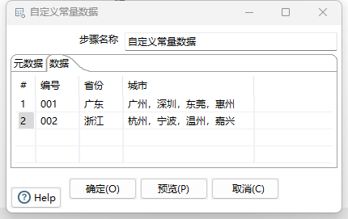

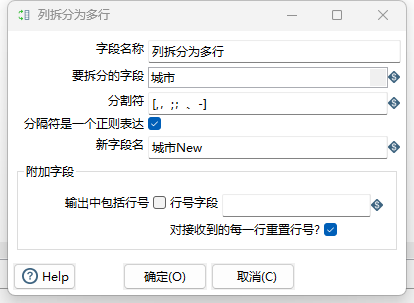

### 预览结果

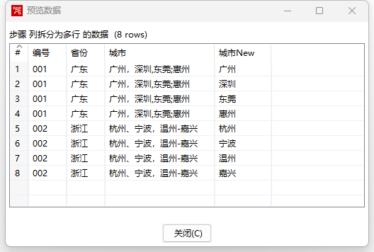

## 拆分字段

### 实验数据

与拆分字段成多行使用同一份实验数据

### 步骤配置

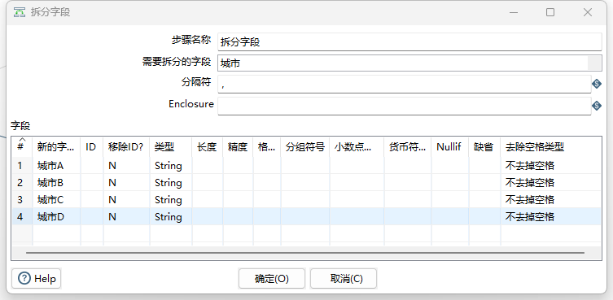

### 实验结果

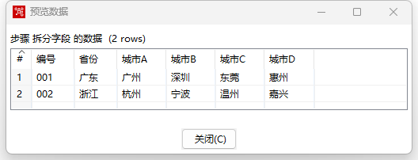

## 合并字段

### 实验要求

合并 `城市A`,  `城市B`,  `城市C`,  `城市D`为一列，列名命名为`城市列表`。

### 实验数据

上一个步骤的输出数据

### 步骤配置

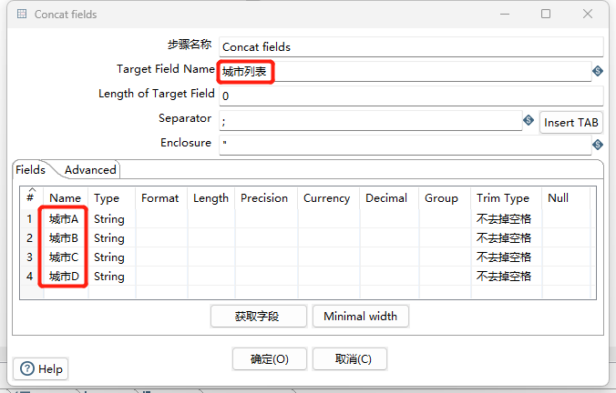

### 实验结果

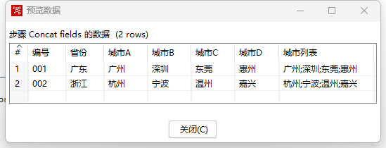

## 字段选择

### 实验要求

1. `Sex`列重命名为`性别`，并移动到`Name`后
2. 删除`Age`列
3. `Birth`列的日期格式调整为`yyyy-MM-DD`
4. `Salary`列保留两位小数

### 实验数据

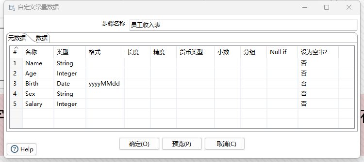

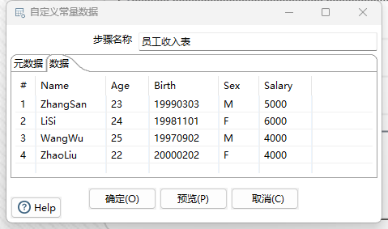

### 步骤配置

##### `Sex`列重命名为`性别`，并移动到`Name`后

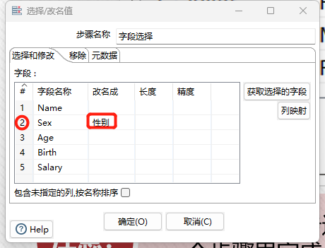

##### 删除`Age`列

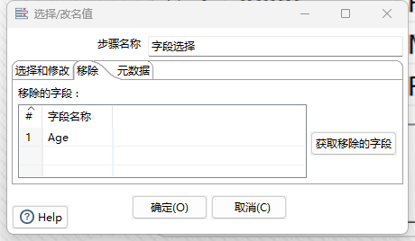

##### `Birth`列的日期格式调整为`yyyy-MM-DD` 且 `Salary`列保留两位小数

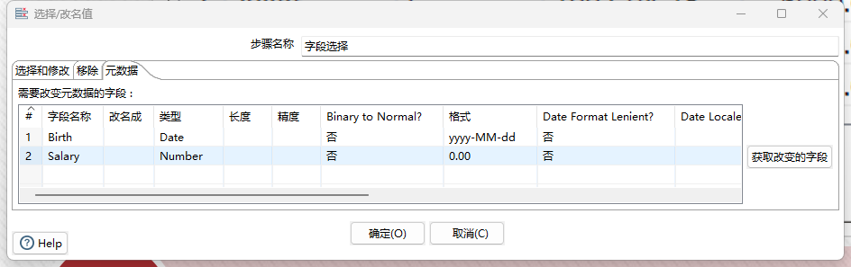

### 实验结果

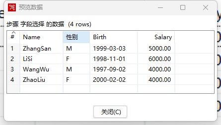