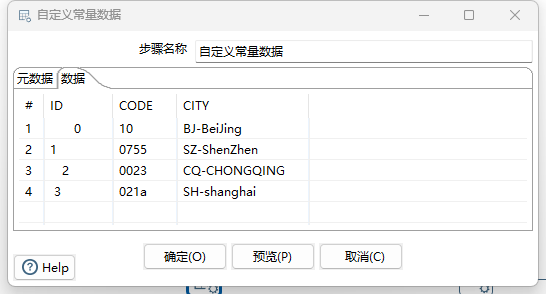
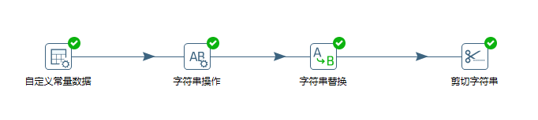
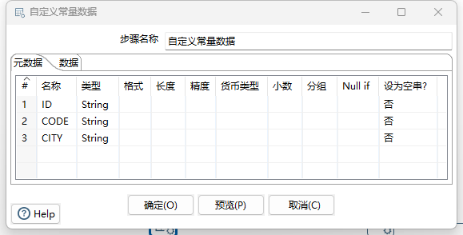
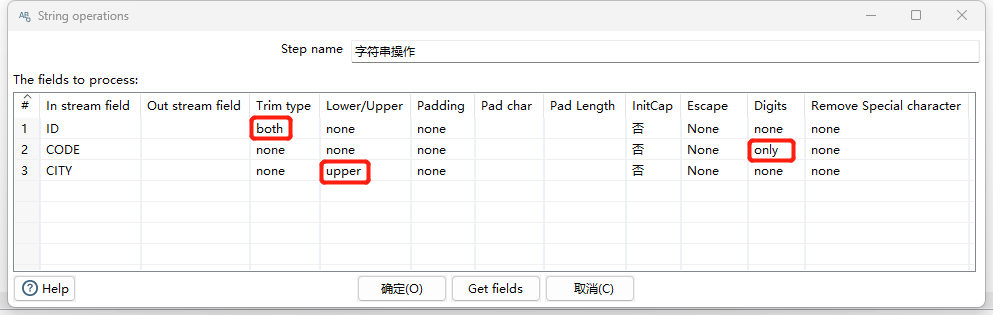
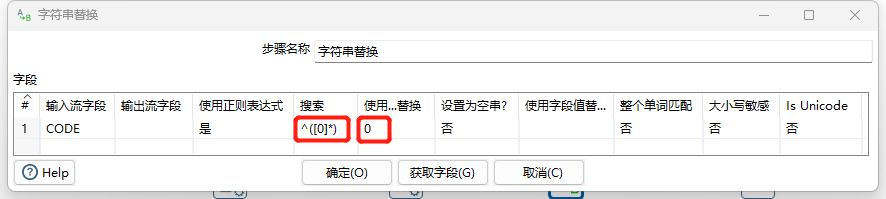
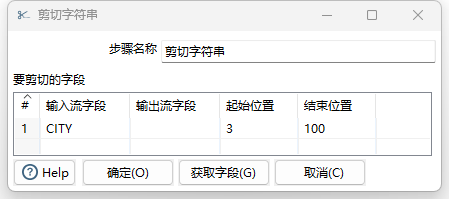
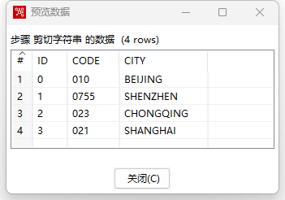

# Kettle - 数据清理之字符串清理

## 实验数据

**城市区号表**

### 数据存在的问题

1. `ID`字段前后存在空白字符
2. `CODE`为区号，有的记录没有以`0`开始，有的记录中存在`非零字符`
3. `CITY`字段大小写未统一，全部修改为大写字母，去掉前面的缩写。

## 转换设计

## 自定义常量步骤

元数据如下，具体数据见实验数据。

### 字符串操作步骤

1. ID列去掉前后空白字符
2. CODE列只保留数字
3. CITY列转为大写

### 字符串替换步骤

### 剪切字符串步骤

## 清理结果

